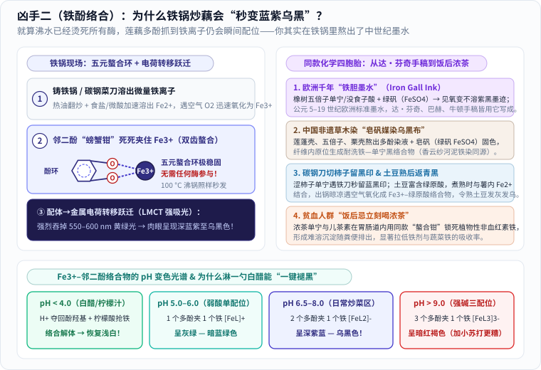
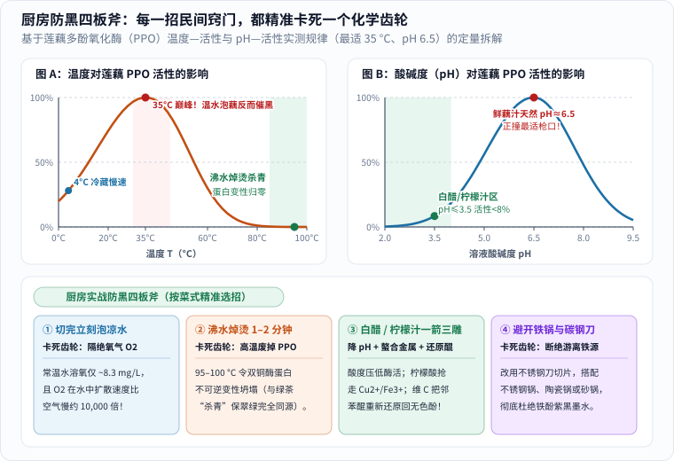
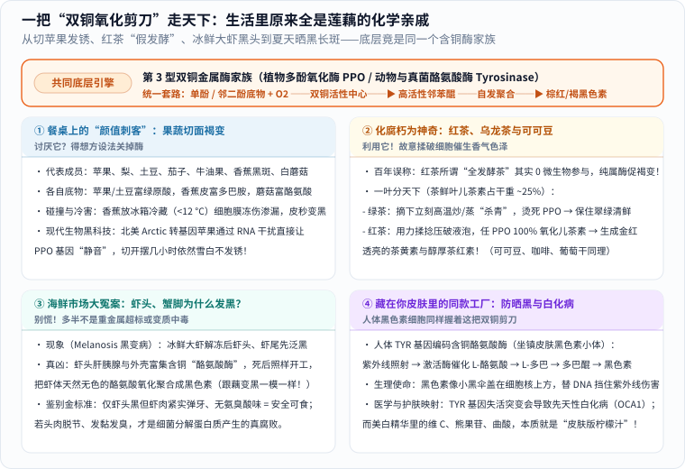
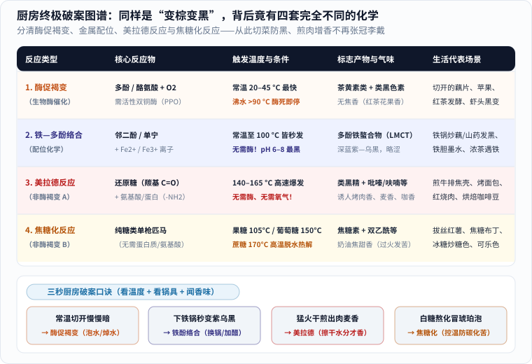

做饭的人，大概率都在莲藕身上栽过两次跟头。

第一次栽在**菜板**上：刚刮掉泥皮、切成薄片的新鲜脆藕，水灵灵、白生生，漂亮得像一摞羊脂白玉；结果你不过转身剥了两瓣蒜、接了个快递电话，再低头一看——雪白的藕片边缘已经悄悄爬上了一层灰扑扑、棕褐色的“铁锈斑”，颜值当场打五折。

第二次栽得更冤，直接栽在**大铁锅**里：你吸取教训，切完藕片立刻拿滚水焯烫了一遍，心想这回总算锁住清白了吧？结果热锅凉油，把雪白的熟藕片往家里那口老铸铁锅里一倒，“刺啦”翻炒还不到十秒钟，灵异事件发生了——整盘莲藕以肉眼可见的速度泛蓝、发紫，出锅时活脱脱变成了一盘乌漆嘛黑的“煤球炒木耳”！

端上桌的时候，家里人筷子悬在半空，灵魂三连问准时响起：

> “这藕是不是不新鲜坏掉了？黑成这样有毒吗？怎么焯过水还能秒变黑？”

先给你吃一颗经过现代食品化学严格检验的定心丸：**只要莲藕闻起来清香爽脆、没有发黏拉丝或酸馊异味，不管是切开晾着变褐，还是下铁锅炒成紫黑，全都既没坏、也完全无毒，甚至连里面的抗氧化活性都没丢！**

真正让人拍案叫绝的是：**同样是“藕片变黑”，菜板上慢慢变褐，和铁锅里十秒变紫黑，背后的幕后凶手根本不是同一个！**

更妙的是，一旦你拆穿了莲藕身上的这两套把戏，就像拿到了一把万能钥匙——你会突然发现：**切开的苹果生锈、冰箱里的香蕉长黑斑、绿茶和红茶的百年分家、菜市场虾头发黑的千古奇冤、欧洲写下达·芬奇与牛顿手稿的千年墨水、广东非遗香云纱的河泥乌黑绸、夏天晒黑长雀斑与几百块一瓶的美白精华，乃至煎牛排的焦香硬壳与红烧肉炒糖色**，竟然全都串联在同一张化学家谱上！

今天，我们就从案发现场的那盘黑莲藕出发，把藏在厨房与日常生活里的“变色江湖”彻底破案。

---

## 一、第一重悬案：切开晾着慢慢发褐——细胞“破墙越狱”与双铜氧化剪刀

先破第一个案子：**为什么整节莲藕埋在淤泥里几个月都白白净净，偏偏菜刀一切开，几分钟就开始发黄、变褐？**

答案藏在植物细胞精妙绝伦的**“分房隔离制度”（细胞区室化，Cellular Compartmentalization）**里。

如果你把一片完好无损的新鲜莲藕放到显微镜下放大几百倍，会发现每一个植物细胞都像一间管理极其森严的危险品仓库，里面住着一对“一旦见面外加吸口氧气就会擦枪走火”的冤家：

1. **锁在中央“液泡（Vacuole）”大水库里的多酚底物**：莲藕之所以嚼起来清甜中带着一丝极淡的微涩回甘，是因为细胞液泡里储存着丰富的**植物多酚（Polyphenols）**。根据 2023 年发表于《*Food Chemistry*》与《*Current Research in Food Science*》（[Li 等，PMCID: PMC10654003](https://pmc.ncbi.nlm.nih.gov/articles/PMC10654003/)）的莲藕代谢组学实测，鲜藕中含量最高、跑得最快的头号酚类分子叫**儿茶素（`(+)-Catechin`）**，紧随其后的还有**表儿茶素（`(-)-Epicatechin`）**、**表没食子儿茶素（`(-)-EGC`）**和**绿原酸（`Chlorogenic acid`）**。它们共同的化学长相，是在苯环上挨着长了两个羟基（$-\text{OH}$），统称**无色邻二酚（*o*-diphenols）**。
2. **锁在门外“质体（Plastid）”小隔间里的双铜氧化剪刀**：就在液泡膜外侧的细胞质体（和我们在[《可视化理解光合作用》]()里见过的叶绿体同属植物质体家族）中，关押着一位专门剪酚羟基的狠角色——[**多酚氧化酶（Polyphenol Oxidase，简称 PPO）**](https://en.wikipedia.org/wiki/Polyphenol_oxidase)。它的心脏部位镶嵌着**两颗铜离子（第 3 型双铜金属中心）**，氧化态时两颗 $\text{Cu(II)}$ 相距仅约 $3.3\text{ \AA}$，还原态时两颗 $\text{Cu(I)}$ 拉开到约 $4.4\text{ \AA}$，像一把靠呼吸氧气反复开合的分子剪刀。

只要莲藕还没挨刀，液泡膜（Tonoplast）和质体膜就像两堵密不透风的防爆墙：多酚在屋里，双铜酶在屋外，再加上致密的藕肉组织挡住了空气，三方老死不相往来，莲藕自然雪白如玉。

**可当你一刀切下去，灾难在毫秒之间爆发了：**

锋利的刀刃像推土机一样碾碎了切面成千上万个细胞的液泡膜与质体膜，原本天各一方的**儿茶素**与**双铜酶 PPO** 瞬间撞在一起；与此同时，空气里的**氧气分子（$\text{O}_2$）**趁虚而入！

接下来发生的是两步紧密咬合的接力赛：

* **第一步：酶促夺氢（需要活的 PPO + $\text{O}_2$）**。双铜酶 PPO 抓住无色的邻二酚与氧气，一口气拔掉酚羟基上的氢原子，把氧气彻底还原成水（注意生成的是无害的 $\text{H}_2\text{O}$，而不是双氧水 $\text{H}_2\text{O}_2$），同时把原本温顺的邻二酚改造成脾气暴躁的淡黄色亲电分子——[**邻苯醌（*o*-quinone）**](https://en.wikipedia.org/wiki/Catechol_oxidase)：

$$2\,\text{邻二酚} + \text{O}_2 \xrightarrow{\text{PPO} } 2\,\text{邻苯醌} + 2\,\text{H}_2\text{O}$$

* **第二步：非酶自发聚合（无需酶参与！）**。邻苯醌极度缺电子，一离开酶的口袋，根本不需要任何酶帮忙，就会自发在细胞残液里横冲直撞——抓起旁边的多酚分子、氨基酸甚至蛋白质上的氨基（$-\text{NH}_2$）和巯基（$-\text{SH}$）疯狂牵手交联，像滚雪球一样聚合成大分子有色物质：**茶黄素类（Theaflavins）**与不溶性的棕黑色**类黑色素（Melanins）**！

*图 1：先看左上完整细胞（液泡膜与质体膜把无色多酚和双铜 PPO 严密隔开），再看右上菜刀切开后的三步连锁反应（破膜见氧 → 双铜酶催化生成邻苯醌 → 邻苯醌自发聚合成茶黄素类与类黑色素），最后看底部化学计量与安全性实测结论。（图中包含单次自动播放的破壁褐变短动画，播完停留在完整结果；若滚动至此已结束，可[单独打开本图重播](/assets/images/lotus-browning/compartmentalization-and-ppo-anim.svg)并刷新页面。）*

你可能会替莲藕委屈：**好端端长在泥里，干嘛要在自己身体里埋这么一套“自毁变黑装置”？**

站在演化的视角看，这哪里是自毁，分明是植物用了几亿年才攒出来的**“全自动液体创可贴 + 生化防弹衣”**！

植物没有腿，地下茎一旦被田鼠啃咬、被水虫钻孔或者被农具铲伤，甜美的淀粉汁液就会立刻引来大批真菌和细菌。双铜酶 PPO 在伤口破壁瞬间启动，几分钟内生成高活性的邻苯醌：一方面，邻苯醌能直接把入侵病菌的细胞膜蛋白和害虫嘴里的消化酶“交联焊死”，让害虫吃一口就消化不良；另一方面，聚合出来的不溶性类黑色素像一层致密的树脂痂皮，把破裂的导管死死封住，防止整节莲藕烂穿！

而且，2023 年中国学者团队在《*Current Research in Food Science*》（[PMCID: PMC10654003](https://pmc.ncbi.nlm.nih.gov/articles/PMC10654003/)）专门对比了鲜藕与酶促褐变后的黑藕：**鲜藕里的儿茶素在变褐后，很大一部分转化成了红茶里最金贵的同款色素——茶黄素类（Theaflavin）与黄烷醇氧化物**；细胞与动物实验证实，它不仅半点毒性都没有，甚至还能辅助调节胆固醇代谢！你嫌弃的那层灰褐色，在植物眼里是救命铠甲，在食品化学家眼里则是“莲藕悄悄给自己泡了一层红茶”。

---

## 二、第二重奇案：焯熟烫死酶还秒变紫黑？铁锅与多酚的“千年墨水之吻”

破完了菜板上的慢性发褐案，第二个更离奇的案子来了：

**很多厨房老手明明把藕片扔进 $100^\circ\text{C}$ 沸水里焯熟了——多酚氧化酶 PPO 这种蛋白质早就被彻底烫死失活了——为什么一倒进老铸铁锅翻炒，还是会在十秒钟内从雪白变成吓人的深蓝紫乃至墨黑色？**

而且仔细观察颜色你会发现：菜板上晾久的生藕是**灰黄、浅棕褐色**；可铁锅炒出来的藕片和汤汁，却透着一股妖异的**蓝紫、乌青、纯墨黑色**！

恭喜你抓到了第二位完全不同的真凶——这一次跟酶半毛钱关系都没有，纯粹是一场跨越千年的无机配位化学魔术：**铁—多酚配位络合反应（Iron–Polyphenol Coordination）**！

高温沸水虽然烫死了蛋白质材质的 PPO 酶，但莲藕液泡里的**儿茶素、没食子酸、绿原酸等多酚小分子非常耐热**，焯完水依然稳稳留在藕片和藕汤里。当你把热腾腾的藕片倒进一口没有涂层的生铁锅或熟铁锅（或者用普通碳钢菜刀切藕）时，金属铁表面极微量的亚铁离子（$\text{Fe}^{2+}$）溶入菜汤，在热锅与空气氧气的夹击下，几秒钟就被氧化成正三价的**铁离子（$\text{Fe}^{3+}$）**。

当 $\text{Fe}^{3+}$ 撞上莲藕多酚苯环上相邻的两个酚羟基时，奇迹上演了：两个酚羟基脱去氢离子（$\text{H}^+$），带着孤对电子的氧原子像一把严丝合缝的**“双齿蟹钳”**，一左一右死死夹住中心的 $\text{Fe}^{3+}$（这正是我们在[《一文读透化学键的底层密码》]()中讲过的**配位共价键**），扣成一个热力学上稳如泰山的**五元螯合环（5-membered chelate ring）**！

$$\text{Fe}^{3+} + 2\,\text{邻二酚}^{2-} \rightleftharpoons \left[\text{Fe}(\text{邻二酚})_2\right]^-$$

为什么原本几乎无色的莲藕多酚，夹住一粒极微量的铁离子，颜色会突然黑得像墨汁一样深？

因为在这个五元螯合环里，发生了一种吸光能力爆表的量子效应——**配体到金属的电荷转移跃迁（LMCT，Ligand-to-Metal Charge Transfer）**！当厨房灯光照在藕片上时，酚氧原子上的电子借着光子的能量，直接一步跳进 $\text{Fe}^{3+}$ 空荡荡的 $3d$ 轨道里，把波长在 **$550\text{–}600\text{ nm}$ 的黄绿光**吞得一干二净；黄绿光被吃光了，反射进你眼睛里的互补色，就成了浓郁得化不开的**深蓝紫与乌黑色**！

更绝的是，如果你顺着这把“铁—多酚螯合钳”往历史和生活里看一眼，会瞬间惊掉下巴——原来你家铁锅里那勺黑藕汤，来头大得吓人：

1. **统治西方文明 1400 年的“铁胆墨水”（[Iron Gall Ink](https://en.wikipedia.org/wiki/Iron_gall_ink)）**：从公元 5 世纪一直到 19 世纪钢笔化工墨水普及前，全欧洲最正统的官方墨水怎么配？拿橡树上的五倍子（虫瘿，富含没食子单宁）泡水，再往里抓一把“绿矾”（硫酸亚铁 $\text{FeSO}_4$）！鹅毛笔刚蘸着写到羊皮纸上时字迹很淡，一接触空气，$\text{Fe}^{2+}$ 氧化成 $\text{Fe}^{3+}$，当场生成水泡不掉、擦不掉的紫黑色没食子酸铁沉淀！**达·芬奇的《蒙娜丽莎》手稿笔记、巴赫的五线谱原稿、牛顿的《自然哲学的数学原理》手稿、乃至美国《独立宣言》羊皮纸正本**，全都是用这套“铁锅炒黑藕同款配方”写下来的！
2. **中国非遗草木染与顺德“软黄金”香云纱**：老祖宗早就把这套反应玩成了东方高定美学！植物多酚染液（用莲蓬壳、五倍子、橡碗子、栗子壳熬水）本身只能把白布染成浅浅的米黄色；可染匠只要把布浸入兑了**“皂矾”（同样是绿矾 $\text{FeSO}_4$）**的媒染缸，棉麻丝绸瞬间乌黑如墨、水洗不掉！国家级非遗**广东顺德香云纱**更绝：先给真丝白绸反复涂刷富含单宁的薯莨汁晒成棕红色，最后一步在清晨把富含高价铁离子的珠江河塘淤泥均匀涂在绸面上——只用半小时，涂泥那一面就发生铁—单宁络合反应，变成油亮深邃、永不褪色的纯黑丝绸！
3. **碳钢菜刀切柿子秒留黑印 & 熟土豆放凉“返灰黑”**：用老式铁菜刀切一枚略带涩味的柿子或苹果，刀面上眨眼就挂上一道洗不掉的蓝黑印并窜出一股铁腥味，正是果肉单宁腐蚀铁刀并当场络合；而很多人煮熟的土豆出锅时金黄雪白，放凉半小时后蒂部却莫名发灰发乌（食品科学专称 **After-cooking darkening 熟后返黑**），罪魁祸首同样是土豆自身的**绿原酸**在煮制时结合了薯块内部的 $\text{Fe}^{2+}$，出锅接触空气氧化成灰黑色的 $\text{Fe}^{3+}\text{–绿原酸}$ 络合物！
4. **医生反复叮嘱贫血人群“吃完铁剂和菠菜，千万别立刻喝浓茶或美式咖啡”**：茶叶里的儿茶素单宁、咖啡里的绿原酸，进到胃肠道里遇到植物性食物或补铁药片里的非血红素铁（$\text{Fe}^{3+}$），照样毫不客气地亮出“五元螯合钳”，把宝贵的铁离子锁成难溶的黑色沉淀直接排出体外，白白浪费你的补铁努力！

*图 2：先看左侧铁锅溶出铁离子与莲藕邻二酚扣成“五元螯合环”、吞掉黄绿光显紫黑色的量子机制；再看右侧横跨书写史、非遗染整、果蔬刀印与营养学的“同款化学四胞胎”；最后看底部不同酸碱度（pH）下的配位数切换——日常炒菜区（pH 6.5–8.0）最紫黑，而加白醋把 pH 压到 4.0 以下即可拆散螯合环恢复浅白。*

看懂了图 2 最底部的 pH 变色带，你还能解锁一个堪称魔术的厨房急救绝招：

万一你不小心用铁锅把藕片炒成了浅灰紫色，**千万别往锅里撒小苏打（碱性会让配位数升到 $[\text{FeL}_3]^{3-}$ 并加速多酚自氧化，整盘菜直接变成诡异的暗红褐泥汤），而是赶紧顺着锅边烹入大半勺白醋或挤半颗柠檬汁！** 当酸度压到 $\text{pH} < 4.0$ 时，浩浩荡荡的氢离子（$\text{H}^+$）会把酚氧原子强行抢回 $-\text{OH}$ 状态，再加上柠檬酸/醋酸根帮忙把 $\text{Fe}^{3+}$ 拐跑，紫黑色的螯合环当场散架，发乌的藕片肉眼可见地重新白回来！

---

## 三、厨房防黑四板斧：每一条民间老窍门，都精准卡死一个化学齿轮

既然我们已经把**“酶促褐变（PPO + 多酚 + $\text{O}_2$）”**和**“铁酚络合（$\text{Fe}^{3+}$ + 多酚）”**两大元凶抓了个现行，那想做出一盘像饭店里那样晶莹雪白、清脆爽口的清炒藕片或凉拌脆藕，就再也不用靠玄学试错了——只要对照实验测出的定量曲线，把链条上的任意一个齿轮敲掉就行！

2023 年至 2024 年，食品化学团队在《*Food Chemistry*》与《*International Journal of Molecular Sciences*》（[Liu 等，PMCID: PMC11432685](https://pmc.ncbi.nlm.nih.gov/articles/PMC11432685/)）中分离纯化了鲜藕中的两条同源多酚氧化酶 PPO，并测出了它的两条“命门曲线”：

* **最适作案温度恰恰在 $35^\circ\text{C}$**（接近人体体温，活性冲上 $100\%$ 巅峰！）；低于 $10^\circ\text{C}$ 时分子热运动迟缓，活性跌到四成以下；而一旦加热跨过 **$80\text{–}90^\circ\text{C}$**，维持酶蛋白三维折叠的氢键雪崩断裂，双铜活性口袋永久坍塌，活性直接**清零**！
* **最适作案酸碱度恰恰在 $\text{pH } 6.5$**（新鲜藕汁天然就是微酸近中性的 $\text{pH } 6.2\text{–}6.6$，简直是为自家 PPO 量身定制的温床！）；而一旦加酸把环境压到 **$\text{pH} < 3.5$**，活性立刻暴跌到不足 $8\%$！

**看到 $35^\circ\text{C}$ 这个数字，请立刻划掉一个无数人冬天常犯的厨房大忌：切完藕片嫌冷水冻手，兑点 $35\text{–}45^\circ\text{C}$ 的温水泡藕！** 你以为是在温柔洗淀粉，实际上是给莲藕里的双铜酶开了个最舒服的恒温温泉轰趴，褐变速度直接拉满！

*图 3：先看上半部分两条实测规律曲线——左图揭示 35 °C 是莲藕 PPO 的活性巅峰（温水泡藕反而催黑），越过 85–95 °C 沸水区则永久变性归零；右图揭示天然藕汁 pH 6.5 正好撞在巅峰区，加白醋或柠檬汁压低到 pH 3.5 以下即可压垮酶活。再看底部对应的厨房防黑四板斧，每一招都精准命中一个化学齿轮。*

把图 3 翻译成你在灶台前最好用的**“防黑四板斧”**，步步都有硬核定量支撑：

1. **第一板斧（切配等待期）——冷水完全没过，物理封死氧气**：在 $20^\circ\text{C}$ 常温下，一升空气里足足装着约 $270\text{ mg}$ 氧气，而一升自来水里最多只能溶解约 $9\text{ mg}$ 氧气；更重要的是，**氧气分子在液态水里的扩散系数（约 $2\times 10^{-9}\text{ m}^2/\text{s}$）比在空气中（约 $2\times 10^{-5}\text{ m}^2/\text{s}$）慢了整整 $10^4$ 倍（一万倍）！** 边切边把藕片摁进冷水盆里，顺手冲掉切面破裂流出的游离多酚与酶液，等于瞬间掐断氧气的供应链。
2. **第二板斧（下锅前定型）——滚水下锅快焯 45–60 秒，一锤子砸碎双铜酶**：一定要等锅里水**彻底大滚（$95\text{–}100^\circ\text{C}$）**再下藕片！千万别冷水下锅慢慢煮——冷水升温穿过 $30\text{–}50^\circ\text{C}$ 的那几分钟，反而会触发一波“临终疯狂褐变”。滚水入锅一分钟内，高温瞬间让表层与内部 PPO 蛋白变性失活，捞出立刻过凉水，既永久关掉了酶促褐变，又保住了脆生生的细胞壁果胶。
3. **第三板斧（化学外挂）——泡水焯水滴几滴白醋或柠檬汁，打出“降酸 + 抢铜 + 还原”三连击**：
   * **降 pH**：醋酸与柠檬酸把水体压进低 pH 禁区，同时防住酶促褐变与后续的铁酚变黑；
   * **螯合金属**：2024 年发表在《*Int. J. Mol. Sci.*》（[PMCID: PMC11432685](https://pmc.ncbi.nlm.nih.gov/articles/PMC11432685/)）的高斯加速分子动力学模拟揭示，草酸、柠檬酸这类有机酸不仅能抢抓双铜中心的铜离子，还会扰乱铜中心旁关键的 `Q53–D63` $\alpha$-螺旋结构，让底物根本钻不进酶口袋；
   * **维 C“替身挡刀”**：柠檬汁里的**维生素 C（抗坏血酸）**更是极强的还原剂——就算有漏网的双铜酶刚刚把儿茶素氧化成了邻苯醌，维 C 也会在邻苯醌聚合成黑斑之前冲上去，无私献出两个氢原子，**把邻苯醌硬生生按回无色的儿茶素**！只要水里的维 C 还没耗光，藕片就绝对黑不了！
4. **第四板斧（厨具隔离）——换把不锈钢/陶瓷刀，炒藕优先端出不粘锅、不锈钢锅或砂锅**：从物理源头上让 $\text{Fe}^{2+}/\text{Fe}^{3+}$ 零出场！如果家里只有一口心爱的传家老铁锅，记得**下藕片的同时烹入半勺白醋**（做酸辣藕丁、糖醋脆藕在铁锅里之所以永远雪白漂亮，秘密全在这勺醋里！）。

---

## 四、大反转！这把让藕变黑的“双铜剪刀”，竟是红茶灵魂、黑头虾真凶与防晒对手

如果故事只讲到怎么把藕炒白，你还只看到了这把“双铜氧化剪刀”在厨房里捣乱的一面。

真正迷人的是：**跳出那节莲藕，整个生物界——从果园、茶山、远洋渔船，一直到你自己的皮肤底下——全都装备着同属“第 3 型双铜氧化酶家族”（多酚氧化酶 PPO 与它的孪生兄弟[酪氨酸酶 Tyrosinase](https://en.wikipedia.org/wiki/Tyrosinase)）的分子机器！** 只不过换一个舞台，它有时是让人头疼的颜值杀手，有时是身价百倍的风味大师，有时又成了背锅多年的冤大头：

*图 4：同一把“双铜氧化剪刀”在日常生活四大角落的变身记——左上为苹果/土豆切面生锈、香蕉冰箱冷害变黑与静音基因不褐变苹果；右上为绿茶高温“杀青”与红茶揉捻破壁“100% 酶促氧化”的分水岭；左下为海鲜摊虾头酪氨酸酶黑变（非重金属污染）与真腐败的鉴别；右下为人体表皮黑色素合成防晒伞与美白精华的抑酶原理。*

### 1. 果篮里的“生锈苹果”与怕冷的热带香蕉

削皮的苹果、雪梨、桃子、土豆、茄子、牛油果，切开一放就泛黄发褐，全都是液泡里的绿原酸、儿茶素撞上了自家质体里的 PPO。

还有一个困扰过无数人的生活谜题：**为什么买回来的黄皮香蕉，好心放进 $4^\circ\text{C}$ 冰箱冷藏室保鲜，结果第二天拿出来整根香蕉皮黑得像根木炭？**

因为香蕉老家在热带雨林，细胞膜里的磷脂习惯了温暖气候；一旦环境温度低于 **$12^\circ\text{C}$**，香蕉果皮细胞的生物膜就会发生“冷害相变”（从柔软的液晶态冻成僵硬的凝胶态并裂开微孔）——明明没挨刀，液泡里的多巴胺（没错，香蕉皮里富含多巴胺！）自己漏出来撞上了 PPO，一夜之间就在冰箱里完成了全套酶促黑化！

为了治服苹果切开变色的毛病，农业生物技术学家甚至培育出了已经上市的 **Arctic 不褐变苹果**：不往苹果里转任何外源物种基因，而是利用 RNA 干扰（RNAi）技术给苹果自带的 PPO 基因贴上“静音封条”，把酶产量砍掉 $90\%$ 以上——切开摆在果盘里几个小时，依然像刚切开一样金黄清亮。

### 2. 绿茶 vs. 红茶：所谓红茶“全发酵”，其实一个细菌酵母都没有！

中国人喝了几千年茶，很多人以为绿茶树和红茶树是两种完全不同的树，或者以为红茶“全发酵”是像酿酒、做酸奶那样靠微生物发酵出来的。

真相恰恰和我们的莲藕一脉相承（参见 [Tea processing](https://en.wikipedia.org/wiki/Tea_processing) 与 [Phenolic content in tea](https://en.wikipedia.org/wiki/Phenolic_content_in_tea)）：**同一片茶园摘下来的鲜茶叶（干重里足足有 $20\%\text{–}30\%$ 都是儿茶素！），往左走还是往右走，全看制茶师傅怎么对待茶叶里的双铜酶 PPO！**

* **想做绿茶（龙井、碧螺春）——第一步就是热锅“杀青”**！采下鲜叶后迅速送进两百多度的炒锅或高温蒸汽里翻炒，赶在叶片细胞破损褐变前，把茶叶里的 PPO 彻底烫死失活（**跟滚水焯藕片完全是同一个化学逻辑！**），从而把无色的儿茶素和鲜绿的叶绿素原封不动锁在干茶里，泡出来清汤绿叶、鲜爽回甘。
* **想做红茶（祁门红茶、滇红、阿萨姆）——偏偏反着来，绝不杀青，而是用力“揉捻破壁”**！制茶师用揉捻机把萎凋后的茶叶细胞揉破，让液泡里的儿茶素与质体里的 PPO 满怀热情地拥抱氧气，在温湿适宜的房间里静置几小时。中文制茶行话管这一步叫“发酵”，但**全程根本没有半个酵母菌或乳酸菌挑大梁，它是 $100\%$ 纯血统的 PPO 酶促褐变！** 原本苦涩无色的儿茶素，在双铜酶的穿针引线下两两缩合，变成了汤色金黄透亮、滋味鲜爽的**茶黄素（Theaflavins）**，以及汤色红浓醇甜的**茶红素（Thearubigins）**！

不止红茶——你爱吃的**黑巧克力（可可豆发酵干燥期）**、甜糯的**棕色葡萄干**，那迷人的红褐光泽与温润风味，全都要感谢这位平时在藕片上挨骂的双铜酶大师！

### 3. 海鲜摊千古奇冤：虾头蟹腮发黑，真的是“重金属污染”吗？

去菜市场买冰鲜大虾，最怕看到虾头和虾脚关节处泛黑。坊间流传已久的说法吓坏了不少人：“虾头变黑是因为海水重金属超标，毒素全攒在虾头里了！”

纯属冤假错案！

虾、蟹、龙虾这类甲壳动物体内，同样装满了双铜酶家族的核心成员——**酪氨酸酶（Tyrosinase，酚氧化酶的一种）**，平时用于蜕壳后把柔软的新虾壳交联硬化（骨化作用）并抵御海洋病菌。因为虾的肝胰腺和消化腺全集中在头部（头胸甲），这里的酪氨酸酶浓度最高。当活虾捕捞离水死去后，即使埋在碎冰里，虾头细胞也会发生自然自溶，释放出酶与游离的**酪氨酸（Tyrosine）**；一接触空气，酪氨酸酶立刻开工，把无色酪氨酸氧化聚合成黑色素，学术上专门叫**甲壳类黑变病（Melanosis）**！

换句话说：**虾头单纯变黑，就像切开的苹果和莲藕变褐一样，只是虾自己体内的双铜酶“下班前打了个卡”，既不代表重金属超标，也不直接等于细菌腐败！**（远洋渔船上合法添加微量焦亚硫酸钠护色剂，原理就像给藕片滴柠檬汁一样，用还原剂拦住酪氨酸酶。）真正判断一只虾坏没坏，看的是**虾头是不是一拎就断还流暗红糊汤、虾肉摁下去是不是软烂不回弹、凑近闻有没有刺鼻的氨水味和腥臭味**——那是微生物分解蛋白质的真腐败，跟单纯的酶促黑头完全是两码事。

### 4. 镜子里的你自己：夏天晒黑、白化病，还有梳妆台上的美白精华

最后，低头看看你自己的手臂——这把让莲藕变褐、让红茶变红、让虾头变黑的“双铜剪刀”，此刻正稳稳运行在你全身每一寸皮肤的表皮基底层里！

人类皮肤的黑色素细胞（Melanocytes）内，住着由 *TYR* 基因编码的同源双铜酶——[**人源酪氨酸酶（Human Tyrosinase）**](https://en.wikipedia.org/wiki/Tyrosinase)。当夏日烈日里的紫外线（UV）穿透表皮、威胁要打断真皮与表皮细胞的 DNA 双链时，细胞立刻拉响防空警报，激活双铜酪氨酸酶：

$$\begin{aligned}
\text{L-酪氨酸} &\xrightarrow{\text{酪氨酸酶} } \text{L-多巴} \\
&\xrightarrow{\text{酪氨酸酶} } \text{多巴醌} \xrightarrow{\text{聚合} } \text{黑色素}
\end{aligned}$$

生成的黑色素颗粒被打包送往周围的角质形成细胞，像一把把微缩的**“黑色小阳伞”**盖在细胞核头顶，把高达 $99.9\%$ 的紫外线光子吸收转化成无害的热量散掉！你去海边晒出来的古铜色皮肤和鼻梁上的小雀斑，本质上和莲藕切面长出的褐色保护层一样，都是双铜酶为你撑起的生命防盾。

反过来：如果一个人天生携带双份失活突变的 *TYR* 基因，双铜剪刀彻底停摆，皮肤、头发和虹膜造不出黑色素，就是医学上的**眼皮肤白化病（Albinism）**；而人老了以后长出满头银丝，则是毛囊底部的黑色素干细胞和酪氨酸酶随岁月耗竭退场。

更逗的是，再去翻翻你梳妆台上那瓶好几百块钱的**美白淡斑精华**配料表——排在前面的明星成分无非是这几位：**原型维 C / 维 C 衍生物、熊果苷（Arbutin）、曲酸（Kojic acid）、377（苯乙基间苯二酚）**。它们在皮肤里干的活，和你在厨房拿白醋柠檬水泡藕片简直是一个模子刻出来的：熊果苷和 377 假扮成酪氨酸去卡死双铜酶的活性口袋，曲酸伸手抱住口袋里的铜离子不撒手，而维 C 则蹲在出口把刚出炉的多巴醌重新还原回无色状态！

**所谓高端护肤美白，说穿了就是“温柔地别让你脸皮像切开的藕片那样氧化褐变”！**

---

## 五、终极总表：生活里的“四大变黑门派”，别再把煎牛排和黑莲藕混为一谈

聊到这里，很多爱琢磨做饭的朋友一定会举手追问最后一个问题：

> “既然莲藕变黑、苹果变褐、红茶变红都是变深色，那我煎牛排煎出焦褐色脆壳、烤吐司烤出金棕色面包皮、红烧排骨拿冰糖炒出琥珀红糖色，也是同一种化学反应吗？”

**完全不是！** 在日常对话里，大家喜欢把一切食物变深色笼统叫成“氧化了”或者“焦了”；但在食品化学的世界里（参见 [Food browning](https://en.wikipedia.org/wiki/Food_browning)），让你碗里的食物变褐变黑的幕后推手，清清楚楚分属**四大门派**——前两派是**室温冷兵器**（不靠高温、不产焦香），后两派则是**烈火炼丹炉**（无需任何酶、不需要氧气，专门制造让人魂牵梦绕的人间烟火香）：

1. **门派一：酶促褐变（PPO / 酪氨酸酶门）**——就是切藕片、削苹果、做红茶、黑头虾和晒黑皮肤这一派。**必须有活的双铜酶 + 多酚/酪氨酸 + 氧气**，$35^\circ\text{C}$ 最猛，一上滚水锅酶就暴毙。
2. **门派二：铁—多酚配位络合（铁胆墨水门）**——就是老铁锅十秒炒黑熟藕片、碳钢刀切柿子留黑印、熟土豆放凉返灰黑、草木染皂矾乌黑布这一派。**不要酶、耐高温**，靠 $\text{Fe}^{3+}$ 与邻二酚扣紧五元螯合环吸光显紫黑，**淋一勺白醋就能秒破功**。
3. **门派三：美拉德反应（[Maillard Reaction](https://en.wikipedia.org/wiki/Maillard_reaction)，肉香烘焙门）**——1912 年法国化学家路易·卡米耶·美拉德发现的厨神级反应！它的入场券是**“还原糖的羰基（$\text{C=O}$）+ 氨基酸或蛋白质的游离氨基（$-\text{NH}_2$）”**，**既不需要酶，也不需要氧气**！当平底锅和烤箱冲上 **$140\text{–}165^\circ\text{C}$**（水分蒸发干爽后），糖和氨基酸发生缩合、重排与裂解，不仅绘出诱人的金棕至深褐色**类黑精（Melanoidins）**，还会像放烟花一样炸出几百种吡嗪、呋喃、噻吩风味分子——**煎牛排的焦脆外壳、烤面包皮的麦香、烘焙咖啡豆的醇香、烤鸭皮的枣红油亮、红烧肉的酱香，甚至我们在[《读懂红星二锅头的酿造技艺与味道密码》]()里讲过的高温大曲慢速生香与黑蒜陈化**，全都是美拉德反应的杰作！
4. **门派四：焦糖化反应（[Caramelization](https://en.wikipedia.org/wiki/Caramelization)，纯糖烈火门）**——比美拉德反应更纯粹：**连氨基酸和蛋白质都不需要，只要纯糖单挑高温！** 当果糖升到约 **$105^\circ\text{C}$**（所以刷了蜂蜜的烤翅最容易上色也最容易烤糊！）、葡萄糖升到 **$150^\circ\text{C}$**、日常白砂糖/冰糖（蔗糖）升到约 **$170^\circ\text{C}$**、麦芽糖升到 **$180^\circ\text{C}$** 时，糖分子自己脱水断裂、重新缩合成琥珀棕色的焦糖色素（焦糖烷、焦糖烯、焦糖素），同时释放出双乙酰带来的浓郁奶油焦甜香——**做红烧排骨前小火拿冰糖“炒糖色”、法式焦糖布丁那层敲得咔嚓响的琥珀脆壳、拔丝地瓜与老北京糖葫芦熬糖**，全靠纯糖单打独斗！

*图 5：从左到右对照“参与主角、触发条件、风味产物、日常代表与控制开关”，一张图彻底分清酶促褐变、铁酚配位络合、美拉德反应与焦糖化反应；最底部附赠厨房三秒破案口诀。*

以后站在厨房灶台前，你只要用**三秒钟**就能当场断案：

* **常温切开、没开火自己慢慢发褐** $\longrightarrow$ 双铜酶 PPO 干的（泡冷水、焯滚水、滴柠檬汁治它）；
* **焯熟了还秒变乌紫墨黑（尤其用了铁锅铁刀）** $\longrightarrow$ 铁离子跟多酚写“铁胆墨水”呢（淋半勺白醋秒救场，下次换口锅）；
* **猛火高温 $150^\circ\text{C}$ 以上、有肉有面越煎越香** $\longrightarrow$ 美拉德反应在给你送香味大礼包；
* **锅里只有冰糖白糖、熬到 $170^\circ\text{C}$ 冒琥珀泡飘甜香** $\longrightarrow$ 焦糖化反应正到火候（再晚五秒就变苦炭啦）！

---

## 结语：每一盘家常菜里，都藏着半部鲜活的化学史

回过头再看案板上那几片带点孔洞的白莲藕，是不是突然觉得它亲切又传奇？

原本只是一道再普通不过的家常素菜：刀锋落下的那一刻，它启动了植物演化上亿年的细胞破壁防御；滑进老铁锅的那十秒，它复刻了达·芬奇与牛顿笔尖流淌的欧洲中世纪墨水，也重现了岭南染匠在珠江河泥里染出的非遗乌黑绸；而当你顺手往清水盆里滴入几滴白醋、烧开一锅沸水把藕片焯得晶莹如玉时，你手起刀落调动的，其实是跟现代制茶大师杀青龙井、远洋冷链保鲜海捕大虾、乃至生物化学家设计美白分子完全同源的底层科学。

化学从来不是锁在试管和试卷里的冰冷符号——它就在切菜的刀尖上、翻炒的锅气里、一杯红茶的金圈边，热气腾腾地陪我们过着每一天。

---

## 参考资料与核查来源

1. **莲藕多酚氧化酶（PPO）最适温度（$35^\circ\text{C}$）、最适酸碱度（$\text{pH } 6.5$）、底物结合机制与有机酸抑制动力学**：
   - Liu, X. 等 (2024). *Mechanistic Insights into Substrate Specificity and Inhibition of Polyphenol Oxidase in Lotus Root: A Molecular Dynamics Study*. **International Journal of Molecular Sciences**, 25(18): 10074. PMC 开放获取全文：[https://pmc.ncbi.nlm.nih.gov/articles/PMC11432685/](https://pmc.ncbi.nlm.nih.gov/articles/PMC11432685/)（核查莲藕两条同源 PPO 的酶学参数引用 `Li et al., Food Chemistry 2023` 最适活性 $35^\circ\text{C}$、$\text{pH } 6.5$，儿茶素/表儿茶素/绿原酸结合自由能，以及草酸螯合金属并扰乱铜中心旁 `Q53–D63` 螺旋的抑制机制）。
2. **鲜藕与褐变莲藕的多酚组成演变（儿茶素 $\to$ 茶黄素类）及食用安全性与生理活性**：
   - Li, S., Luo, Z., Li, X., Liu, D., & Deng, F. (2023). *Phenolic profiles and regulation of cholesterol metabolism in browned lotus root*. **Current Research in Food Science**, 7: 100630. PMC 开放获取全文：[https://pmc.ncbi.nlm.nih.gov/articles/PMC10654003/](https://pmc.ncbi.nlm.nih.gov/articles/PMC10654003/)（核查鲜藕主要酚类单体为儿茶素，酶促褐变后主要转化为茶黄素与黄烷醇氧化物，无毒性且具有调节胆固醇代谢活性）。
3. **多酚氧化酶（PPO）、儿茶酚氧化酶与双铜活性中心催化化学计量**：
   - Wikipedia: *Polyphenol oxidase* — [https://en.wikipedia.org/wiki/Polyphenol_oxidase](https://en.wikipedia.org/wiki/Polyphenol_oxidase) 与 *Catechol oxidase* — [https://en.wikipedia.org/wiki/Catechol_oxidase](https://en.wikipedia.org/wiki/Catechol_oxidase)（核查质体/液泡区室化、第 3 型双铜中心 $\text{Cu–Cu}$ 氧化还原间距 $3.3\text{ \AA} \leftrightarrow 4.4\text{ \AA}$、邻二酚 $+\,\text{O}_2 \to$ 邻苯醌 $+\,\text{H}_2\text{O}$ 反应计量及 Arctic RNAi 不褐变苹果）。
4. **铁—多酚五元螯合环、LMCT 电荷转移显紫黑色机制与欧洲千年铁胆墨水史**：
   - Wikipedia: *Iron gall ink* — [https://en.wikipedia.org/wiki/Iron_gall_ink](https://en.wikipedia.org/wiki/Iron_gall_ink)（核查五倍子没食子酸/单宁与硫酸亚铁绿矾 $\text{FeSO}_4$ 经空气氧化生成不溶性紫黑没食子酸铁络合物的化学机制，以及公元 5–19 世纪达·芬奇、巴赫、牛顿手稿与《独立宣言》使用史实）。
5. **绿茶高温“杀青”灭酶与红茶揉捻破壁“100% PPO 酶促氧化”生成茶黄素/茶红素**：
   - Wikipedia: *Tea processing* — [https://en.wikipedia.org/wiki/Tea_processing](https://en.wikipedia.org/wiki/Tea_processing) 与 *Phenolic content in tea* — [https://en.wikipedia.org/wiki/Phenolic_content_in_tea](https://en.wikipedia.org/wiki/Phenolic_content_in_tea)（核查茶鲜叶儿茶素占比、绿茶杀青失活 PPO 与红茶“发酵”实为无微生物参与的内源多酚氧化酶催化反应）。
6. **甲壳类水产黑变（Melanosis）与人体黑色素合成中的酪氨酸酶（*TYR*）机制**：
   - Wikipedia: *Tyrosinase* — [https://en.wikipedia.org/wiki/Tyrosinase](https://en.wikipedia.org/wiki/Tyrosinase)（核查双铜酪氨酸酶催化 $\text{L-酪氨酸} \to \text{L-多巴} \to \text{多巴醌} \to \text{黑色素}$ 通路、甲壳类死后酶促黑变及人源 *TYR* 突变致白化病原理）。
7. **食品四大褐变分类、美拉德反应（$140\text{–}165^\circ\text{C}$）与各类糖焦糖化起始温度**：
   - Wikipedia: *Food browning* — [https://en.wikipedia.org/wiki/Food_browning](https://en.wikipedia.org/wiki/Food_browning)、*Maillard reaction* — [https://en.wikipedia.org/wiki/Maillard_reaction](https://en.wikipedia.org/wiki/Maillard_reaction) 与 *Caramelization* — [https://en.wikipedia.org/wiki/Caramelization](https://en.wikipedia.org/wiki/Caramelization)（核查酶促与非酶褐变边界、1912 年美拉德反应糖胺缩合最佳温区 $140\text{–}165^\circ\text{C}$，以及果糖 $105^\circ\text{C}$、葡萄糖 $150^\circ\text{C}$、蔗糖 $170^\circ\text{C}$、麦芽糖 $180^\circ\text{C}$ 的纯糖热裂解焦糖化温度表）。
