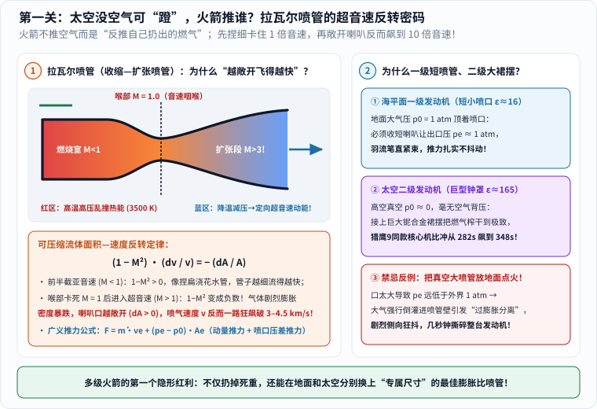
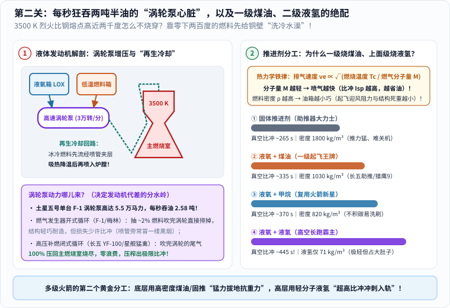
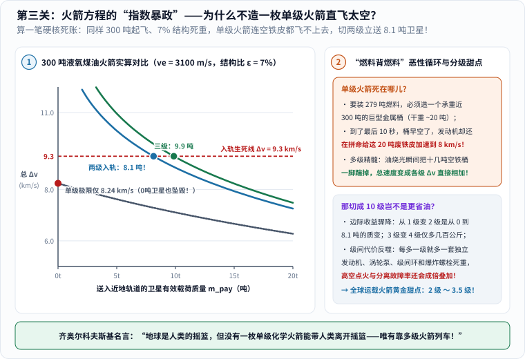

每次看火箭发射卫星的直播，只要留意左下角的遥测数据条和解说词，几乎每个人心里都会冒出过四个直觉上的大问号：

1. **“真空里到底在推谁？”**：民航客机的涡扇发动机必须大口吸入空气向后喷，直升机旋翼必须拼命往下扇风；可火箭刚飞出 $$100\text{ 公里}$$ 高的卡门线，周围连一丝空气都没有了，**脚下空空如也、后方无物可蹬，发动机凭什么还能推着几十吨重的飞船狂飙？**
2. **“为什么喇叭口越敞开，气流反而喷得越快？”**：平时捏扁浇花水管，大家都知道“管口越捏越细，水才滋得越远”；可火箭发动机屁股底下偏偏挂着一只越往外越宽的大钟罩，而且**第一级喷口短小精悍，第二级真空发动机的裙摆却大得夸张**——这又是唱的哪一出？
3. **“为什么非要边飞边扔天价铁桶？”**：一节火箭箭体和发动机动辄价值上亿元，民航飞机从来不会飞一半把油箱和发动机扔掉；为什么全世界的运载火箭都像接力赛一样，刚飞两分半钟就把第一级踹进大海，再过几分钟又把整流罩和二级扔掉，最后只剩鼻尖上一颗孤零零的卫星（往往还不到起飞总重的 **$$2\%\sim 5\%$$**）？
4. **“同样烧火，为什么第一级爱喝煤油或烧固体火药，到了上面几级却抢着烧零下 $$253^\circ\text{C}$$ 的液氢？”**

在之前的两篇文章里，我们已经聊过[火箭起飞时怎样借地球赤道自转的顺风车、空中为什么要“程序转弯”]()，也聊过[卫星与末级火箭分离之后，怎样不烧一滴油靠“水平猛冲赶上地球弧度”永远掉不下来]()。今天，我们就钻进火箭最狂暴的心脏——**燃烧室、涡轮泵、超音速喷管与级间环**，把一枚多级运载火箭从地面拔起数千吨铁躯、一路接力把卫星推上 $$7.8\text{ km/s}$$ 第一宇宙速度的**五大动力玄机**一次讲透。

---

## 一、第一关：真空里没空气可蹬，火箭靠什么推？为什么喇叭越宽喷得越快？

### 1. 《纽约时报》迟到 49 年的道歉：火箭从来不需要“推空气”

1920 年 1 月 13 日，当美国火箭先驱罗伯特·戈达德（Robert Goddard）提出可以用火箭飞往月球时，《纽约时报》发表了一篇著名的社论嘲讽他：*“戈达德教授似乎连每天高中都在教的基础知识都不知道——在真空里，推力根本找不到可以反推的空气！”* 直到 **49 年后的 1969 年 7 月 17 日**，阿波罗 11 号正飞往月球途中，《纽约时报》才正式刊登更正启事，承认“火箭在真空中确实能工作，就像在大气层中一样”。

《纽约时报》当年犯下的，正是人类日常经验最容易掉进去的错觉。

想象你穿一双溜冰鞋站在绝对光滑的冰面上，怀里抱着十颗各重 $$5\text{ 公斤}$$ 的铅球。哪怕冰面抽成彻底的真空，只要你用力把一颗铅球以高速向后扔出去，你的身体就必然瞬间向前滑出！**你推的根本不是身后的空气，而是你亲手扔出去的那颗铅球本身**——铅球获得了向后的动量，根据动量守恒定律（牛顿第三定律），你和剩下的铅球必然获得大小相等、方向相反的向前动量。

火箭本质上就是一台**每秒钟以每秒三四公里的极速、向后连续狂扔几百上千公斤“气体分子微粒铅球”的超级投石机**。根据美国国家航空航天局格伦研究中心（[NASA Glenn Research Center — Rocket Thrust Equation](https://www1.grc.nasa.gov/beginners-guide-to-aeronautics/rocket-thrust-equation/)）给出的严格控制体动量推导，火箭发动机的总推力 $$F$$ 由两项相加而成：

$$
F = \dot{m}\,v_e + (p_e - p_0)\,A_e
$$

我们把式子里的五个物理量挨个翻译成人话：

- $$\dot{m}$$（单位 $$\text{kg/s}$$）：**每秒向后喷出的燃气质量流量**（比如登月巨兽土星五号单台 F-1 发动机，每秒就要吞掉并喷出 **$$2{,}577\text{ 公斤}$$** 推进剂，相当于每秒往后扔两辆家用轿车！）；
- $$v_e$$（单位 $$\text{m/s}$$）：燃气离开喷口时的**实际排气速度**（化学火箭通常高达 $$2{,}500\sim 4{,}500\text{ m/s}$$，是步枪子弹出膛速度的 $$3\sim 5$$ 倍）；第一项 $$\dot{m}\,v_e$$ 叫**动量推力**，占了总推力的绝大头；
- $$p_e$$ 与 $$p_0$$（单位 $$\text{Pa}$$）：分别是**喷管出口处的燃气静压 $$p_e$$** 和**火箭外部的环境大气压 $$p_0$$**，$$A_e$$ 则是喷管出口截面积；第二项 $$(p_e - p_0)\,A_e$$ 叫**压差推力**。

看一眼第二项里的 **$$-p_0\,A_e$$**，你就瞬间明白了一个反常识的真相：**地球表面的大气层不仅没有帮火箭“借力”，反而是死死顶在喷管出口、拖火箭后腿的“背压阻力”！** 当火箭冲出大气层进入太空真空，外界气压 $$p_0$$ 直接归零（$$p_0 = 0$$），挡在喷口外的空气巴掌彻底消失，**同一台火箭发动机在太空真空里的推力，反而比在地面起飞时暴涨 $$10\%\sim 25\%$$！**（例如长征五号助推器的 YF-100 发动机，地面海平面推力约 $$1{,}200\text{ kN}$$，到了真空会自动涨到约 $$1{,}340\text{ kN}$$。）

为了统一衡量一台发动机“喝同样重量的油能榨出多少冲量”，航天工程师把总推力除以每秒消耗推进剂在地球表面的重量 $$\dot{m}\,g_0$$（标准重力加速度 $$g_0 = 9.80665\text{ m/s}^2$$），定义出发动机最核心的“燃油经济性成绩单”——**比冲 $$I_{\text{sp} }$$**（[NASA Glenn — Specific Impulse](https://www1.grc.nasa.gov/beginners-guide-to-aeronautics/specific-impulse/)）：

$$
I_{\text{sp} } = \frac{F}{\dot{m}\,g_0} = \frac{v_{\text{eq} } }{g_0}
$$

其中 $$v_{\text{eq} } = v_e + \frac{(p_e - p_0)\,A_e}{\dot{m} }$$ 叫**等效排气速度**。不管你用公制（牛顿、千克）还是英制（磅力、磅质量）计算，比冲 $$I_{\text{sp} }$$ 的单位永远是干净利落的**“秒（$$\text{s}$$）”**！物理直觉极其好记：**比冲 $$300\text{ 秒}$$，就代表 $$1\text{ 公斤}$$ 推进剂能持续产生 $$1\text{ 公斤力}$$ 的推力长达 $$300\text{ 秒}$$**；乘上约 $$9.8$$，等效排气速度就是约 $$2{,}942\text{ m/s}$$。

### 2. 音速咽喉的反转魔法：为什么超音速燃气“越敞开飞得越快”？

有了高温燃气还不够。燃烧室里温度高达 $$3{,}300\sim 3{,}600\text{ K}$$、压强高达一两百个大气压的燃气，分子原本是在四面八方乱撞的“热能乱军”。怎样才能把这股无序乱撞的热能，变成整整齐齐朝正后方狂飙的超音速定向射流？

全靠瑞典工程师古斯塔夫·德·拉瓦尔（Gustaf de Laval）发明、后来成为所有现代火箭标配的**“先收窄、再敞开”沙漏形喷管（收缩—扩张喷管）**。

很多人第一次看喷管剖面图都会犯迷糊：前半截收窄加速好理解（就像捏扁浇花水管）；可过了最细的“喉部”之后，后半截明明敞开成了大喇叭，按日常经验水流一进宽管子就会慢下来，为什么燃气反而越飞越快？

秘密在于：**浇花水管里的水是不可压缩液体（密度几乎不变），而火箭喷管里的烈焰是可压缩气体！** 根据一维等熵可压缩流体的面积—速度关系式（[NASA Glenn — Nozzle Design](https://www1.grc.nasa.gov/beginners-guide-to-aeronautics/nozzle-design/)），气流速度变化率 $$\frac{\mathrm{d}v}{v}$$ 与管道截面积变化率 $$\frac{\mathrm{d}A}{A}$$ 之间夹着一个由**马赫数 $$M$$**（气流速度除以当地音速）决定的开关因子：

$$
(1 - M^2)\,\frac{\mathrm{d}v}{v} = -\frac{\mathrm{d}A}{A}
$$

看清括号里的 **$$(1 - M^2)$$**，整个喷管前窄后宽的几何造型就彻底通透了：

1. **前半截收缩段（亚音速 $$M < 1$$）**：此时 $$1 - M^2 > 0$$，左右两边异号。管道截面积越小（$$\mathrm{d}A < 0$$），气流速度就越快（$$\mathrm{d}v > 0$$）——完全符合捏水管的日常直觉；
2. **最细喉部（音速咽喉 $$M = 1$$）**：在通道截面积最小处 $$\mathrm{d}A = 0$$，如果气流要继续平滑加速，左边括号必须刚好归零，即 **$$M = 1.0$$**！这叫**声速壅塞（Choked Flow）**——无论燃烧室压强有多高，燃气在最细喉部最高只能加速到当地音速；
3. **后半截扩张大喇叭（超音速 $$M > 1$$）**：一旦跨过喉部进入超音速区，$$M > 1$$，括号 **$$(1 - M^2)$$ 瞬间变成负数**！负负得正，物理规律彻底反转：**此时唯有让管道截面积不断敞开变大（$$\mathrm{d}A > 0$$），气体剧烈膨胀、温度与密度暴跌的速度远快于流速增加，热能才会源源不断转化为定向动能，把燃气从 $$1\text{ 马赫}$$ 一路推上 $$3\sim 5\text{ 马赫}$$（$$3\sim 4.5\text{ km/s}$$）！**

*图 1：先看左卡沙漏形喷管的红蓝渐变——最窄喉部将气流刚好卡在音速 $$M=1.0$$，跨过喉部后因 $$(1-M^2)<0$$ 发生物理反转，喇叭口越敞开，高温高压热能就越充分地转化为超音速定向射流；再看右卡三级对比，这也是多级火箭的第一个隐形红利：地面一级必须用短喷管（$$\varepsilon \approx 16$$）抵抗 $$1\text{ atm}$$ 大气背压防倒灌抖碎，而太空二级则能换上巨型真空钟罩（$$\varepsilon \approx 165$$）把残余气压榨干到极致。（）*

这也顺带解开了直播画面里的另一个视觉谜题：**为什么猎鹰 9 号第一级的 9 台梅林发动机喷口像小茶杯一样短（面积膨胀比 $$\varepsilon = A_e/A_t \approx 16$$），而第二级那台同源的真空梅林发动机，喷管裙摆却大得几乎塞满整个箭体直径（$$\varepsilon = 165$$）？**

再瞄一眼推力公式 $$F = \dot{m}\,v_e + (p_e - p_0)\,A_e$$：当微积分求极值时可以严格证明，**只有当喷口燃气压强刚好降到等于外界环境气压（$$p_e = p_0$$，“完全膨胀”）时，发动机的总推力才达到理论最大值**。

- **在海平面（$$p_0 = 1\text{ atm}$$）**：外界大气压很高，喷管喇叭不能做得太大，否则燃气还没到出口就已经降到了 $$0.2\text{ atm}$$——外界 $$1\text{ atm}$$ 的高压空气会直接顺着喷管内壁凶猛倒灌进去，引发致命的**“过膨胀流动分离（Flow Separation）”**，产生剧烈的不对称侧向狂抖，几秒钟就能把金属喷管撕成碎片！
- **在高空真空（$$p_0 \approx 0$$）**：外界没有一丝空气阻拦，把喷管裙摆拉长放大十倍，让燃气一路膨胀到接近零压，就能白白多榨出百分之十几的推力——猎鹰 9 号同样的核心机换上 $$165:1$$ 的铌合金大钟罩后，比冲直接从海平面的 **$$282\text{ s}$$** 跃升到真空的 **$$348\text{ s}$$**！单级火箭从头到尾只能挂同一种喷口，在地面嫌大、到太空又嫌小；**唯有分级，才能让每一级都穿上最合身的“专属跑鞋”**。

---

## 二、第二关：一秒吞掉两吨半油，发动机为什么没把自己烧化？各级为什么偏爱不同燃料？

明白了喷管的几何魔法，紧接着就会撞上两个看似无解的工程死结：

1. 想往 $$200\text{ 个大气压}$$（相当于海底 $$2{,}000\text{ 米}$$ 深处水压！）的燃烧室里每秒硬塞进几百上千公斤液氧和燃料，靠给油箱充气增压的话，油箱壁得造得像深海潜艇一样厚重，火箭根本飞不起来；
2. 燃烧室里的烈焰温度高达 **$$3{,}500\text{ K}$$（约 $$3{,}200^\circ\text{C}$$）**，而人类最耐热的镍基高温合金和铜锆合金到了 $$1{,}100\sim 1{,}350\text{ K}$$ 就会软化熔穿——**火比金属熔点高出两千多摄氏度，为什么发动机点着几百秒都没化成一滩铁水？**

### 1. 3 万转涡轮泵与“冰火两重天”再生冷却

现代液体火箭发动机用两招绝活同时化解了这两个死结：

- **第一招：薄皮铝桶 + 狂暴涡轮泵（Turbopump）**。主贮箱只维持 $$3\sim 5\text{ 个大气压}$$ 的微正压（让铝合金箱壁薄得像易拉罐一样轻），真正的增压全靠发动机头顶一台燃气涡轮驱动的高速离心泵——它在每分钟 **$$20{,}000\sim 35{,}000\text{ 转}$$** 的尖啸声中，瞬间把低压液氧和燃料加压到 **$$20\sim 30\text{ MPa}$$（$$200\sim 300\text{ atm}$$）** 强行怼进燃烧室！土星五号单台 F-1 发动机的涡轮泵轴功率高达 **$$41\text{ 兆瓦}$$（约 $$55{,}000\text{ 马力}$$）**，体积只相当于一台大号家用冰箱，爆发出的功率却抵得上十几台重载火车头。
- **第二招：拿刺骨冰燃料给喷管“洗冷水澡”的再生冷却（Regenerative Cooling）**。铜合金喷管内壁并不是实心铁板，而是用铣床精密刻出了几百条毫米级的细密夹层暗槽！在燃料（低温煤油、$$-161^\circ\text{C}$$ 的液态甲烷或 $$-253^\circ\text{C}$$ 的液氢）进入燃烧室点火之前，**先被高压泵打进喷管外壁的细槽里从下往上高速流过一圈**——隔着仅 **$$1\text{ 毫米}$$** 厚的导热铜壁，一边是 $$3{,}500\text{ K}$$ 的地狱烈火，另一边是高速冲刷的冰冷燃料！它既把铜壁死死镇压在 $$900\text{ K}$$ 安全线以下，又顺手把燃料预热升温，吸走的热量一分不少全带回燃烧室做功。

至于驱动那台怪兽涡轮泵的燃气烧完之后去哪儿，又演化出了发动机界的两大流派：

- **开式“燃气发生器循环”（如土星五号 F-1、猎鹰 9 号梅林 1D）**：抽出一小股推进剂烧完推动涡轮后，直接从旁边一根排气管（俗称烟囱）排掉——结构简单可靠、造价低，但白白损失了 $$2\%\sim 3\%$$ 的比冲；
- **闭式“分级燃烧/高压补燃循环”（如中国长征五号 YF-100、SpaceX 星舰猛禽 Raptor）**：推动涡轮后的富氧或富燃高温废气一滴都不浪费，**100% 全部压进主燃烧室进行二次完全燃烧**！虽然对耐高温抗氧化合金要求极严苛，但室压更高、比冲榨干到极致。

*图 2：左卡展示液体火箭发动机的“薄皮贮箱 + 3 万转涡轮泵 + 1 毫米铜壁夹层再生冷却”原理，以及开式燃气发生器循环与闭式高压补燃循环的路线差异；右卡依据热力学排气速度关系 $$v_e \propto \sqrt{T_c/\bar{M} }$$，对比固体、液氧煤油、液氧甲烷与液氧液氢四大推进剂为何天然分工为“底层举重王”与“高空长跑王”。（）*

### 2. 为什么底层爱喝“重油/火药”，顶层却非要喝“超轻液氢”？

翻开各国主力火箭的说明书（比如长征五号或当年的土星五号），你会发现一个高度一致的配方规律：**助推器和第一级偏爱用固体推进剂或液氧煤油，而上面级（二级、三级）却宁可忍受 $$-253^\circ\text{C}$$ 的极低温绝热难题，也要改烧液氧液氢！**

为什么不能从头到尾只烧同一种燃料？答案藏在理想气体绝热膨胀的极限排气速度公式里：

$$
v_e = \sqrt{\frac{2\gamma}{\gamma - 1}\,\frac{R_u T_c}{\bar{M} }\left[1 - \left(\frac{p_e}{p_c}\right)^{\frac{\gamma - 1}{\gamma} }\right]}
$$

撇开膨胀比因子，核心标度关系非常直观——$$v_e \propto \sqrt{T_c / \bar{M} }$$！这里 $$R_u = 8.314\text{ J/(mol}\cdot\text{K)}$$ 是普适气体常数，$$T_c$$ 是燃烧室绝对温度，而分母上的 **$$\bar{M}$$ 是燃烧产物的平均摩尔质量（分子有多重）**！

这个根号 $$\sqrt{T_c / \bar{M} }$$ 揭示了一条极其反直觉的化学铁律：**决定喷气速度上限的，不只是火焰有多烫（$$T_c$$），更取决于喷出来的气体分子有多轻（$$\bar{M}$$）！** 在同样的燃烧室温度下，单个分子热运动的平均平动动能差不多；分子质量越轻，热运动和膨胀喷出的速度就越快！

- **液氧 + 煤油（LOX/RP-1）**：燃烧生成大量沉甸甸的二氧化碳 $$\text{CO}_2$$（分子量 $$44$$）和水蒸气 $$\text{H}_2\text{O}$$（分子量 $$18$$），混合尾气平均分子量 $$\bar{M} \approx 22\sim 24\text{ g/mol}$$，真空比冲上限约 **$$335\sim 355\text{ s}$$**。但煤油密度高达 $$0.81\text{ g/cm}^3$$，常温好存、贮箱紧凑轻巧、发动机推力凶猛，是刚离地时顶着重力和稠密大气硬闯关的**“底层举重冠军”**！
- **液氧 + 液氢（$$\text{LOX}/\text{LH}_2$$）**：燃烧生成纯净水蒸气，而且工程师还会故意让氢气稍微多配一点（**富氢燃烧**），让大量未烧完的超轻氢分子 $$\text{H}_2$$（分子量仅 **$$2$$**！）混在尾气里，把平均分子量一口气拉低到 **$$\bar{M} \approx 10\sim 12\text{ g/mol}$$**——只有煤油尾气的一半重！结果它的真空排气速度直飙 **$$4{,}400\text{ m/s}$$**，比冲高达 **$$425\sim 455\text{ s}$$**！但代价是液氢密度极低（仅 **$$0.071\text{ g/cm}^3$$**，不到水的十四分之一，比泡沫塑料还虚胖），装同样重量的燃料需要大得吓人的橘黄色保温巨桶，如果在低空大气里飞，迎风空气阻力和大桶死重反而得不偿失；放到已经冲出大气层的**二级、三级高空真空里**，它就是天下无敌的**“太空马拉松之王”**！
- **液氧 + 液态甲烷（$$\text{LOX}/\text{CH}_4$$，如朱雀二号、星舰）**：正好卡在煤油与液氢正中间（真空比冲约 **$$360\sim 380\text{ s}$$**），密度是液氢的 $$6$$ 倍，而且甲烷分子没有长碳链，燃烧后**几乎不结积碳黑烟**——落地回收后不用拆开清洗发动机就能再次点火，成了新一代可复用火箭的宠儿。

---

## 三、第三关：齐奥尔科夫斯基的“指数暴政”——为什么不造一枚单级火箭直飞太空？

现在到了全篇最核心的灵魂拷问：**既然造多级火箭又要装好几套发动机、又要在高空冒着爆炸风险断成几截，为什么人类不干脆把油箱造大一点，造一枚结结实实的“单级入轨火箭（SSTO）”一脚油门直飞太空？**

答案不是工程师偷懒，而是地球重力场和化学键能量联手设下了一道冷酷的数学铁栅栏——1903 年俄国航天之父康斯坦丁·齐奥尔科夫斯基推导出的**理想火箭方程**（[NASA Glenn — Ideal Rocket Equation](https://www1.grc.nasa.gov/beginners-guide-to-aeronautics/ideal-rocket-equation/)）。

在火箭飞行的每一瞬间，假设当前火箭总质量为 $$m$$，在一小段时间里向后以相对速度 $$v_{\text{eq} }$$ 喷出微量燃气 $$-\mathrm{d}m$$，由动量守恒立得 $$m\,\mathrm{d}v = -v_{\text{eq} }\,\mathrm{d}m$$。对它从起飞初始总质量 $$m_0$$（含燃料、箭体干重与卫星）积分到燃料烧光时的最终干质量 $$m_f$$（只剩箭体空桶与卫星），就得到了统治人类航天史的**齐奥尔科夫斯基方程**：

$$
\Delta v = v_{\text{eq} }\,\ln\left(\frac{m_0}{m_f}\right) = I_{\text{sp} }\,g_0\,\ln(R)
$$

把等号两边颠倒过来解质量比 $$R = m_0 / m_f$$，你会立刻感受到NASA宇航员唐·佩蒂特（Don Pettit）所说的**“火箭方程的暴政（The Tyranny of the Rocket Equation）”**：

$$
\frac{m_0}{m_f} = \exp\left(\frac{\Delta v}{v_{\text{eq} } }\right)
$$

### 1. 算一笔让人绝望的死账：“燃料背燃料”与空铁桶死重

要把一颗卫星送入 $$200\sim 400\text{ km}$$ 高的近地轨道（LEO），水平轨道速度本身就要 **$$7.8\text{ km/s}$$**；再加上起飞头几分钟对抗地球引力下坠消耗的**重力损耗**（约 $$1.1\sim 1.4\text{ km/s}$$）以及冲破稠密空气的**气动阻力损耗**（约 $$0.1\sim 0.2\text{ km/s}$$），一枚运载火箭从发射台到入轨，发动机必须提供的总速度增量门槛高达：

$$
\Delta v_{\text{入轨} } \approx 9{,}300\text{ m/s}\quad (9.3\text{ km/s})
$$

让我们拿今天非常成熟的主流**液氧煤油火箭**来算一笔实打实的硬账：取全程平均等效排气速度 $$v_{\text{eq} } = 3{,}100\text{ m/s}$$，起飞总重固定为 **$$m_0 = 300\text{ 吨}$$**。哪怕用最顶尖的航空铝锂合金与铣削网格工艺，能装将近三百吨燃料的承压贮箱、几台大推力发动机、防热层和阀门管路加起来，也至少要占到箭体级段总重的 **$$\varepsilon = 7\%$$**（结构死重系数，即装 $$93\text{ 吨}$$ 油至少得配 $$7\text{ 吨}$$ 铁桶与发动机）。

**情景 A：如果我们非要造一枚 $$300\text{ 吨}$$ 的单级液氧煤油火箭！**

- 哪怕我们**一颗卫星都不装（有效载荷 $$m_{\text{pay} } = 0\text{ 吨}$$！）**，光那只承重 $$300\text{ 吨}$$ 的空金属大桶和发动机本身就有 $$m_f = 300 \times 7\% = 21\text{ 吨}$$ 死重，燃料最多装 $$279\text{ 吨}$$；
- 代入齐奥尔科夫斯基方程算最大极限速度（$$\ln(1/0.07) \approx 2.659$$）：

$$
\Delta v_{\text{单级} } = 3{,}100 \times \ln\left(\frac{1}{0.07}\right) \approx 8{,}244\text{ m/s}
$$

**看呆了吗？！$$8{,}244\text{ m/s} < 9{,}300\text{ m/s}$$！** 这意味着就算你连一颗螺丝钉的卫星都不带，把 $$279\text{ 吨}$$ 煤油液氧烧得一滴不剩，这枚 $$300\text{ 吨}$$ 的单级火箭最终还差 **$$1.06\text{ km/s}$$** 的速度，只能像一块烧红的废铁一样一头栽进大洋里！

它到底死在了哪里？**死在了最后那 20 秒！** 为了在起飞时兜住 $$279\text{ 吨}$$ 燃料，你被迫造了一只重达 **$$21\text{ 吨}$$** 的巨型金属大桶；可飞到最后半分钟时，桶里的油早就空了大半，发动机却还在满头大汗地消耗宝贵的最后几吨油，拼命把这 **$$21\text{ 吨}$$ 毫无用处的空铁皮**一起加速到每秒七八公里！

**情景 B：现在，我们把同一枚 $$300\text{ 吨}$$ 火箭切成“两级”或“三级”接力！**

总起飞重量还是 **$$300\text{ 吨}$$**，发动机还是同款 $$v_{\text{eq} } = 3{,}100\text{ m/s}$$，每一级的结构死重系数依然是老老实实的 **$$\varepsilon = 7\%$$**——唯一的区别是：**第一级那十几吨重的空铁桶和大发动机一烧光油，当场在半空中一脚踹进大海，绝不带着它去飞后半程！** 此时多级火箭的总速度增量变成了各级 $$\Delta v_i$$ 的**直接累加**：

$$
\Delta v_{\text{总} } = \sum_{i=1}^{N} v_{\text{eq},i}\,\ln\left(\frac{m_{0,i} }{m_{f,i} }\right)
$$

按等质量比最优分级把账重新算一遍：

- **切成两级串联（$$N = 2$$）**：每级只需承担 $$9{,}300 / 2 = 4{,}650\text{ m/s}$$，单级质量比只需 $$R = e^{1.5} \approx 4.48$$——原本连空壳都飞不上去的死局瞬间盘活，**直接把 $$8.1\text{ 吨}$$ 重的大型卫星稳稳送入近地轨道！**
- **切成三级串联（$$N = 3$$）**：每级只需承担 $$3{,}100\text{ m/s}$$，单级质量比降到优雅的自然常数 $$R = e^1 \approx 2.718$$，**近地轨道运载能力进一步跃升到 $$9.9\text{ 吨}$$！**

*图 3：左图按 $$300\text{ 吨}$$ 起飞总重、$$v_{\text{eq} } = 3{,}100\text{ m/s}$$ 与 $$\varepsilon = 7\%$$ 严格绘出载荷—速度曲线：灰色虚线（单级火箭）即使在 $$0\text{ 吨}$$ 载荷下也卡死在 $$8.24\text{ km/s}$$，冲不过红色 $$9.3\text{ km/s}$$ 入轨生死线；而切分为两级（蓝线）与三级（绿线）后，入轨运力瞬间跳升至 $$8.1\text{ 吨}$$ 与 $$9.9\text{ 吨}$$！右卡解释为何工程上不会无限制切成十级八级，而是收敛在 $$2\sim 3.5\text{ 级}$$ 的黄金甜点。（）*

### 2. 既然分级这么香，为什么不切成 10 级、20 级？

看到从 1 级变 2 级、3 级的奇迹，紧接着一定会有人问：**那干脆像竹节虫一样切成 10 级，岂不是更省油？**

答案同样写在工程账本里：**边际收益断崖下跌，而级间死重与故障风险成倍反噬！**

1. **数学边际收益骤减**：从 1 级变 2 级，是从“$$0\text{ 吨}$$ 坠海”到“$$8.1\text{ 吨}$$ 入轨”的生死跨越；从 2 级变 3 级还能多运约 $$1.8\text{ 吨}$$；但从 3 级变 4 级理论上只多出几百公斤，从 4 级再往上几乎已经贴着渐近天花板走平了；
2. **级间死重反噬**：理论公式假设每级结构系数都是 $$7\%$$，但现实中**每多切一级，就要多塞进一整套独立的火箭发动机、涡轮泵、级间连接环、分离火工品和航电阀门**——切得越碎，这些省不掉的“关节死重”占比反而越高，超过 4 级后真实有效载荷不升反降；
3. **可靠性连乘魔咒**：高空高速分离与真空点火是发射全程最惊险的鬼门关。假如每次级间分离与点火的成功率是 $$98\%$$，两级火箭只需闯 1 次关，而 10 级火箭要连闯 9 次关（$$0.98^9 \approx 83.4\%$$），发射失败率直接飙升近十倍！

因此，全世界近七十年航天工程大浪淘沙之后，所有入轨运载火箭都不约而同收敛到了 **$$2\text{ 级}\sim 3.5\text{ 级}$$**（其中“.5 半级”指的是四周捆绑的助推器）的黄金区间；只有飞往木星、冥王星等深空探测任务时，才会在顶上额外加装第 4 级固体远地点上面级。

---

## 四、第四关：空中百米每秒怎样“毫秒换挡”？锯齿过载波、冷分离与热分离

搞懂了为什么要分级，我们再跟着一枚多级火箭升空的 10 分钟时间轴，看看它在天上究竟是怎么完成“高速换挡接力”的。

### 1. 并联捆绑 vs 串联叠罗汉，以及宇航员胸口的“锯齿波”

多级火箭的分级排布主要有两种经典队形（常常混搭使用）：

- **串联分级（Serial Staging）**：像叠罗汉一样一节摞在一节头顶（如土星五号、猎鹰 9 号）。第一级烧完脱落后，第二级才点火；
- **并联分级 / 捆绑助推（Parallel Staging，“半级”）**：在芯一级四周捆上 $$2\sim 6$$ 枚助推器（如长征五号、长征二号F、联盟号）。起飞瞬间**助推器与芯一级同时在地面点火**（这样能在地面确认芯级发动机工作正常，避免高空点不着火），飞到两分多钟助推器先烧完向四周像花瓣一样剥离（著名的“科罗廖夫十字”），而中间的芯一级继续燃烧几十秒后再交给芯二级！
- **别忘了头顶那两瓣“整流罩（Fairing）”也是变相分级！** 卫星结构娇贵，穿大气层时必须靠几吨重的碳纤维蜂窝整流罩挡住超音速狂风与气动摩擦高温；一旦爬升到 **$$100\sim 120\text{ km}$$** 高空，空气密度已不足地面的百万分之一，火箭会立刻炸开锁扣把这两瓣几吨重的“大贝壳”扔掉——在高空少背 $$1\text{ 吨}$$ 整流罩，几乎就等于给卫星白白省出几百公斤入轨运力！

如果你在发射直播中盯着火箭的**轴向过载加速度曲线**看，你会看到一道极具辨识度的**“锯齿波”**（见下图上半部分单次动画）：

- 刚离地时，火箭装满了数千吨燃料，沉重无比，总推力通常只比总重力大 $$25\%\sim 40\%$$（初始推重比 $$\text{TWR} \approx 1.25\sim 1.4$$），火箭慢悠悠拔地而起；
- 随着每秒钟几吨燃料化作火焰喷出，**发动机推力不减反增，箭体质量却急速变轻**！根据牛顿第二定律 $$a = F / m(t)$$，火箭的加速度会越飞越猛，在一级关机前飙升到 **$$3.5g\sim 4.5g$$**（载人火箭还会特意关停中间一台发动机或节流，避免把航天员压得呼吸困难）；
- 紧接着一级熄火分离，推力归零，座舱内的航天员在不到半秒内从 **$$4g$$ 重压瞬间弹入 $$0g$$ 失重**！几秒后二级点火，加速度又从温和的 $$\sim 1g$$ 重新开始爬升，画出第二个锯齿！

*图 4：上图单次动画按时间轴依次绘出多级火箭升空标志性的“锯齿状过载曲线”——每级推力基本恒定而燃料不断烧轻，导致过载从 $$\sim 1.3g$$ 爬升至近 $$4g$$，换级瞬间跌落至 $$0g$$ 再由下一级接力拉起；下图对比高空换级时防失重吸空的“冷分离 + 正推沉底火箭”与“镂空级间环热分离直喷点火”两大工程流派。（）*

### 2. 生死两秒钟：失重油箱里的悬浮泡沫，催生出“冷分离”与“热分离”

就在过载从 $$4g$$ 突然跌到 **$$0g$$ 失重**的那短短一两秒钟里，火箭内部藏着一个外行极少知道的致命陷阱！

在地面开车时，无论你怎么晃，汽油都受地球引力老老实实沉在油箱底部的吸油口；可当第一级在高空突然关机熄火，整枚火箭立刻处于自由落体失重状态（甚至因为稀薄高层大气的气动微弱阻力产生微小的负过载），**第二级贮箱里几十吨液氧和液氢/煤油会瞬间飘起来，和箱内增压氦气搅成一团失重悬浮的气液泡沫！**

如果这时候贸然启动第二级那台每分钟 3 万转的涡轮泵，吸油口一口吸进大气泡（工程上叫**气蚀 / 吸空，Cavitation / Gas Ingestion**），失去液体负载的涡轮泵会在零点几秒内疯狂超速飞车，叶片直接崩裂打穿机匣炸毁整枚火箭！

为了驯服这团失重液体，全球火箭界演化出了两套截然不同的高空换挡绝技：

1. **冷分离 + 正推沉底火箭（Cold Staging + Ullage Motors，代表：土星五号、猎鹰 9 号、长征五号芯二级）**：
   先让第一级彻底关机 → 爆炸螺栓或气动推杆解锁把一二级推开几米远 → **在第二级主发动机点火前，先点燃绑在二级外壁上的几枚小型固体“正推火箭（Ullage Motors）”或冷气推进器**，给箭体施加一个微小的向前推力（哪怕只有 $$0.01g\sim 0.05g$$），就像服务员轻轻一顿酒瓶，把飘在半空的几十吨液氧煤油乖乖震回箱底吸口 → 随后二级主引擎安全点火！
2. **热分离（Hot Staging，代表：苏联/俄罗斯联盟号、中国载人神舟坐骑长征二号F、以及 SpaceX 新一代星舰 Starship）**：
   战斗民族当年想出了一个极其狂野的办法：**既然一级熄火就会失重飘油，那我干脆不等一级熄火脱开！** 设计师把一二级之间的连接段做成一圈**镂空鸟笼状的钢桁架网格（或带导流锥的透气级间环）**；在第一级燃料快烧光、但还保留着残余推力把二级油箱液面死死压在底部的最后 $$1\sim 2\text{ 秒}$$，解锁级间锁扣，**第二级主发动机直接对着第一级的头顶轰然喷火点燃！** 高温烈焰从镂空笼子侧面狂喷而出，顺便像一脚飞踹一样把第一级推离。
   热分离虽然需要给一级顶部铺上厚实的防热装甲，但它不仅彻底省掉了正推沉底小火箭，还消灭了冷分离滑行那几秒钟白白往下掉速的重力损耗——SpaceX 在星舰第二次试飞（IFT-2）起改用热分离环后，马斯克公开测算其**近地轨道有效运力直接提升了约 $$10\%$$**！

---

## 五、第五关：三枚传奇火箭同台拆解——它们是怎么排兵布阵送货上天的？

把前面四关的喷管膨胀比、推进剂化学分工、齐奥尔科夫斯基分级账本与级间分离术串在一起，我们再回头看人类航天史上最具代表性的三枚传奇运载火箭（参数引自 NASA 历史档案、[Saturn V](https://en.wikipedia.org/wiki/Saturn_V)、[Long March 5](https://en.wikipedia.org/wiki/Long_March_5) 与 [Falcon 9](https://en.wikipedia.org/wiki/Falcon_9) 公开技术规范），你会发现每一处设计全都是严丝合缝的物理最优解：

*图 5：三枚代表不同时代工程哲学的经典运载火箭同台拆解——土星五号（三级纯串联“底层煤油大力拔地 + 上两级液氢高比冲奔月”）、长征五号（“四周高压补燃煤油助推器提供九成起飞推力 + 5 米液氢芯级长跑”）以及猎鹰 9 号（“两级同源煤油降成本 + 一级特意留一成油牺牲 23% 运力换箭体回收复用”）。（）*

### 1. 土星五号（Saturn V）：纯串联深空重锤的教科书

- **起飞总重约 $$2{,}965\text{ 吨}$$**，近地轨道运力 **$$140\text{ 吨}$$**（载荷比约 **$$4.7\%$$**）；
- **第一级（S-IC）**：装填 **$$2{,}214\text{ 吨}$$** 高密度液氧煤油，底部 5 台 F-1 巨型发动机爆发出约 **$$3{,}400\text{ 吨}$$（$$33.8\text{ MN}$$）** 海平面推力，短短 **$$168\text{ 秒}$$** 就把整座 36 层楼高的钢铁巨塔顶到 $$67\text{ km}$$ 高空、加速到 $$2.4\text{ km/s}$$，然后干脆利落地扔掉 **$$137\text{ 吨}$$** 空铁壳；
- **第二级（S-II）与第三级（S-IVB）**：一进高空立刻切换成轻分子高比冲的**液氧液氢（J-2 发动机，真空比冲 $$424\text{ s}$$）**——二级一口气推到接近入轨速度，三级先点火入轨停泊，等地面确认无误后在太空**二次点火**，把阿波罗飞船加速到 $$10.8\text{ km/s}$$ 送往月球！

### 2. 长征五号（中国“胖五”）：并联重拳与氢氧长跑的混搭典范

- **起飞总重约 $$852\text{ 吨}$$**，近地轨道运力 **$$25\text{ 吨}$$**（天和核心舱、天问一号火星探测器与嫦娥五号/六号均由它托举）；
- 它采用了极其聪明的**“两级半（并联助推 + 两级氢氧芯级）”**分工：中间 $$5\text{ 米}$$ 直径的芯一级（2 台 YF-77）与芯二级（2 台 YF-75D）全部采用高比冲**液氧液氢**（真空比冲分别达 **$$428\text{ s}$$** 与 **$$\sim 442\text{ s}$$**），专攻中高空长跑；而地面起飞最费劲的第一棒，交给四周捆绑的 4 枚 $$3.35\text{ 米}$$ 助推器——里面装的正是高密度**液氧煤油**，8 台高压补燃循环 YF-100 发动机轰出 **$$9{,}600\text{ kN}$$（约 $$980\text{ 吨力}$$）**，**独自扛下了全箭起飞总推力的整整 $$90\%$$！** 助推器工作约 $$173\text{ 秒}$$ 耗尽分离后，轻装上阵的氢氧芯级接力长跑，完美兼顾了起飞推重比与太空高比冲。

### 3. 猎鹰 9 号（Falcon 9 Block 5）：故意“留一成油不烧光”的复用革命

- **起飞总重约 $$549\text{ 吨}$$**，两级全部统一使用**液氧煤油 + 梅林发动机**（省去异种推进剂加注塔与双生产线成本）；
- 为了把原本扔进大海的几千万美元第一级捡回来重复用二三十次，SpaceX 在齐奥尔科夫斯基方程里做了一笔精明的“反向交易”：**第一级提早在大西洋上空约 $$70\sim 80\text{ km}$$、速度仅约 $$2.2\text{ km/s}$$ 时就提前关机分离**（把更重的入轨加速活儿甩给那台膨胀比 $$165:1$$ 的二级真空梅林发动机），并特意在第一级肚子里**预留约 $$8\%\sim 10\%$$ 的返航燃油**；
- 分离后的第一级靠冷气推力器翻身，先后执行再入减速点火（Entry Burn）与着陆前最后一刻的**“自杀式悬停点火（Hover-slam / Suicide Burn）”**——因为哪怕只剩 1 台梅林发动机节流到最低档，推力依然大于空箭体干重（推重比 $$> 1$$，无法在空中定高悬停），飞控计算机必须算准高度与速度，让箭体减速到 $$0\text{ m/s}$$ 的那一毫秒刚好脚掌触碰回收船甲板！代价是近地轨道运力从一次性抛弃模式的 **$$22.8\text{ 吨}$$** 降到了海上回收模式的 **$$17.5\text{ 吨}$$**（牺牲约 $$23\%$$ 运力），却换来了商业航天发射成本的数量级改写。

---

## 结语：四句话带走多级火箭的全部动力精髓

下次再看火箭托举着百米白烟拔地而起、依次抛掉助推器和整流罩冲向深空时，不妨在脑海里回放这四条硬核物理主线：

1. **真空推力靠动量守恒**：火箭从来不需要推身后的空气，而是靠每秒向后狂抛数百公斤超音速燃气获得反冲动量（$$F = \dot{m}\,v_e + (p_e - p_0)\,A_e$$）；到了没有空气背压阻拦的太空，发动机推力反而比地面大一两成；
2. **沙漏喷管靠音速反转**：最细喉部把燃气卡在 $$1\text{ 马赫}$$，跨入超音速区后 $$(1 - M^2) < 0$$，喇叭口越敞开，乱撞的热能就越彻底地变成定向动能；地面一级配短喷管防大气倒灌，太空二级配巨型大裙摆榨干最后一点气压；
3. **冰火心脏与轻重分工**：3 万转涡轮泵把低压薄皮油箱里的低温燃料打进 $$1\text{ 毫米}$$ 铜壁暗槽给 $$3{,}500\text{ K}$$ 烈焰洗冷水澡；高密度煤油/固体在底层当举重王，超轻分子液氢（$$v_e \propto \sqrt{T_c / \bar{M} }$$）在高空真空当马拉松之王；
4. **多级接力破指数死锁**：齐奥尔科夫斯基方程 $$\Delta v = v_{\text{eq} }\,\ln(m_0/m_f)$$ 让背着巨大空铁桶的单级化学火箭死在入轨门前；唯有把死重铁桶一节节及时踹掉、配合冷分离沉底或热分离硬刚，才能用整箭不到 $$5\%$$ 的顶尖空间，把人类的卫星与飞船送上星辰大海。

---

## 参考资料与核查来源

1. **NASA Glenn Research Center — Rocket Thrust Equation**：火箭广义推力方程 $$F = \dot{m}\,V_e + A_e\,(p_e - p_0)$$ 的控制体动量守恒严格推导，解释为何真空无空气时推力不仅存在且随外界环境气压 $$p_0 \to 0$$ 增大。链接：[https://www1.grc.nasa.gov/beginners-guide-to-aeronautics/rocket-thrust-equation/](https://www1.grc.nasa.gov/beginners-guide-to-aeronautics/rocket-thrust-equation/)
2. **NASA Glenn Research Center — Nozzle Design**：收缩—扩张（de Laval）喷管喉部声速壅塞（$$M = 1.0$$）、可压缩等熵流面积—速度微分关系 $$(1 - M^2)\,\frac{\mathrm{d}V}{V} = -\frac{\mathrm{d}A}{A}$$ 以及欠膨胀与过膨胀流动分离机制。链接：[https://www1.grc.nasa.gov/beginners-guide-to-aeronautics/nozzle-design/](https://www1.grc.nasa.gov/beginners-guide-to-aeronautics/nozzle-design/)
3. **NASA Glenn Research Center — Specific Impulse**：比冲 $$I_{\text{sp} } = \frac{F}{\dot{m}\,g_0} = \frac{V_{\text{eq} } }{g_0}$$ 的定义、秒单位物理意义及等效排气速度换算。链接：[https://www1.grc.nasa.gov/beginners-guide-to-aeronautics/specific-impulse/](https://www1.grc.nasa.gov/beginners-guide-to-aeronautics/specific-impulse/)
4. **NASA Glenn Research Center — Ideal Rocket Equation**：齐奥尔科夫斯基理想火箭方程 $$\Delta u = V_{\text{eq} }\,\ln(m_f/m_e)$$ 的微积分推导及质量比指数增长特性。链接：[https://www1.grc.nasa.gov/beginners-guide-to-aeronautics/ideal-rocket-equation/](https://www1.grc.nasa.gov/beginners-guide-to-aeronautics/ideal-rocket-equation/)
5. **Multistage Rocket — Technical Overview (Wikipedia / Sutton *Rocket Propulsion Elements*)**：串联分级与并联捆绑分级动力学、结构系数权衡、边际收益递减、正推沉底火箭（Ullage motors）冷分离与笼式级间环热分离（Hot staging）技术历史。链接：[https://en.wikipedia.org/wiki/Multistage_rocket](https://en.wikipedia.org/wiki/Multistage_rocket)
6. **Saturn V & Rocketdyne F-1 Engine Specifications (NASA / Wikipedia)**：土星五号三级串联质量预算（起飞约 $$2{,}965\text{ t}$$，LEO 运力 $$140\text{ t}$$，S-IC 干重 $$137\text{ t}$$ / 推进剂 $$2{,}214\text{ t}$$）、F-1 燃气发生器循环发动机参数（每秒消耗 $$1{,}789\text{ kg}$$ 液氧 + $$788\text{ kg}$$ RP-1 = $$2{,}577\text{ kg/s}$$，涡轮泵功率 $$41\text{ MW}$$，海平面比冲 $$263\text{ s}$$ / 真空 $$304\text{ s}$$）与 J-2 氢氧发动机参数（真空比冲 $$424\text{ s}$$）。链接：[https://en.wikipedia.org/wiki/Saturn_V](https://en.wikipedia.org/wiki/Saturn_V) 与 [https://en.wikipedia.org/wiki/Rocketdyne_F-1](https://en.wikipedia.org/wiki/Rocketdyne_F-1)
7. **Long March 5 Launch Vehicle Specifications (Wikipedia / CASC)**：长征五号起飞质量 $$851.8\text{ t}$$、LEO 运力 $$25\text{ t}$$、4 枚液氧煤油助推器（8 台高压补燃循环 YF-100，海平面总推力 $$9{,}600\text{ kN}$$，海平面比冲 $$300\text{ s}$$ / 真空 $$335.1\text{ s}$$）与 $$5\text{ 米}$$ 氢氧芯一级（YF-77 真空比冲 $$428\text{ s}$$）及芯二级（YF-75D 膨胀循环）技术参数。链接：[https://en.wikipedia.org/wiki/Long_March_5](https://en.wikipedia.org/wiki/Long_March_5)
8. **Falcon 9 Block 5 Specifications (Wikipedia / SpaceX)**：猎鹰 9 号起飞质量 $$549\text{ t}$$、一次性 LEO 运力 $$22.8\text{ t}$$ 与海上无人船回收运力 $$17.5\text{ t}$$、一级海平面梅林 1D（比冲 $$282\text{ s}$$）与二级 $$165:1$$ 铌合金大膨胀比真空梅林发动机（比冲 $$348\text{ s}$$）对比。链接：[https://en.wikipedia.org/wiki/Falcon_9](https://en.wikipedia.org/wiki/Falcon_9)
