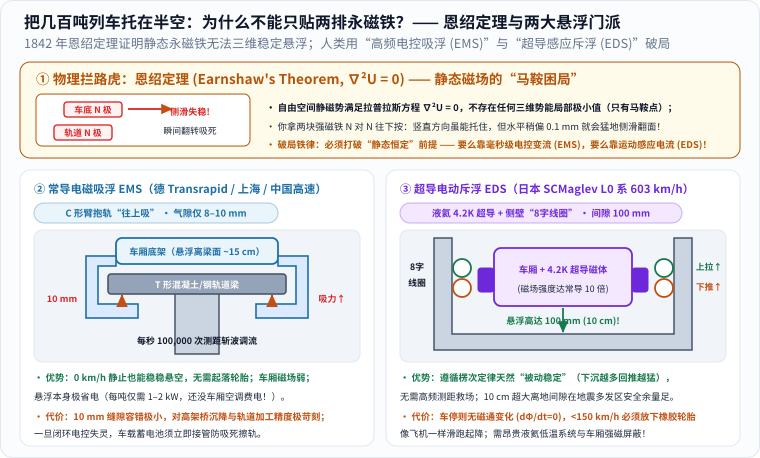
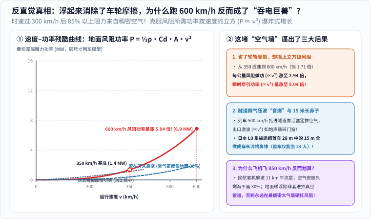
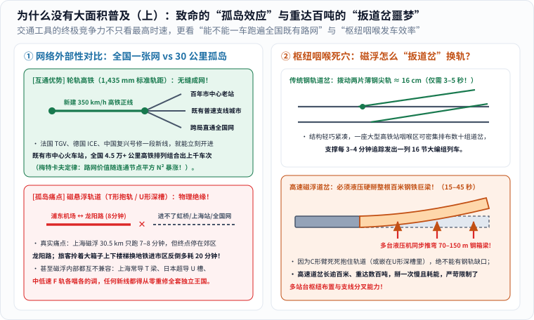
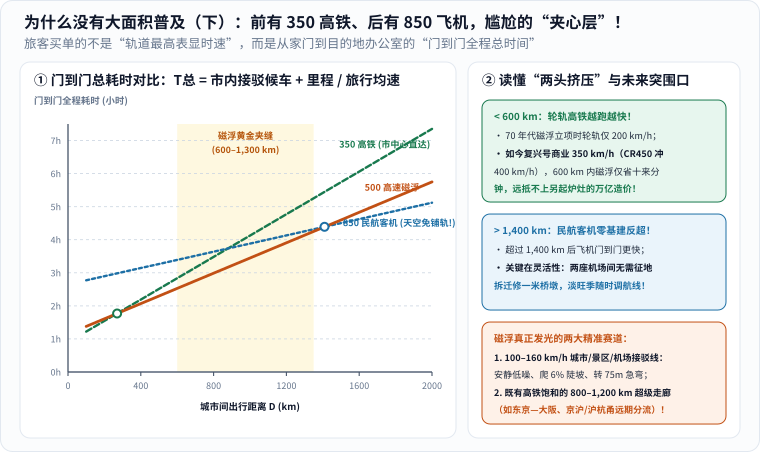

如果去上海浦东国际机场坐过那趟往返龙阳路的**上海磁浮示范运营线**，你一定对那种奇特的推背感印象深刻：

列车关门起步时，脚底下听不到传统火车过钢轨接缝那种“哐当、哐当”的撞击声，整节车厢像脚踩气垫船一样悄无声息地滑出站台。紧接着，车厢内壁的橙色液晶屏数字开始疯狂跳动——$$150\ \mathrm{km/h}$$、$$300\ \mathrm{km/h}$$……在 2004 年到 2021 年初长达十七年的时间里，它每天都会在日常载客班次中一路飙上 **$$431\ \mathrm{km/h}$$**（2003 年 11 月系统调试时更是跑出了 **$$501\ \mathrm{km/h}$$**），全长 $$30.5\ \mathrm{km}$$ 的路程只要 **$$7$$ 分 $$20$$ 秒**就能跑完 [7][10]。而在大海对岸的日本山梨磁浮试验线上，`L0` 系超导磁悬浮列车更是在 2015 年 4 月 21 日载人跑出了 **$$603\ \mathrm{km/h}$$** 的轨道交通人类极速世界纪录 [8]！

但只要走出龙阳路站换乘地铁，一个让人百思不得其解的巨大反差就会浮上心头：

**上海磁浮早在 2004 年春天就投入商业运营了**——那时候，中国连第一条真正意义上的 $$350\ \mathrm{km/h}$$ 轮轨高铁（2008 年京津城际）都还没开工！按理说，没有车轮磨损、时速轻松突破四五百公里的磁悬浮，怎么看都像是对传统钢轮火车的“降维打击”。可二十多年过去，长着钢铁轮子的“复兴号”高铁铺满了全国 **$$4.5$$ 万多公里**（全球轮轨高铁总里程超 $$6$$ 万公里），把几百座城市连成了一张巨网；反观磁悬浮，**全世界至今正常商业运营的加起来只有区区 $$6$$ 条线、总里程还不到 $$100\ \mathrm{公里}$$** [10][11]！甚至连上海磁浮自己，向虹桥与杭州延伸的计划一搁就是十几年，日常最高运营时速也在 2021 年 5 月起下调到了 **$$300\ \mathrm{km/h}$$** [10]。

这背后到底藏着怎样的物理巧思与工程现实？我们把最让人好奇的一连串问题摆在台面上，逐一拆解：

1. **几百吨重的列车，为什么不能直接在车底和轨道各贴一排强力永磁铁“同极相斥”浮起来？它到底靠什么稳稳悬在半空？**
2. **车轮悬空不沾地，既没有飞机螺旋桨也没有喷气发动机，是谁在半空中推着它飙到 $$600\ \mathrm{km/h}$$、又是怎么刹车的？**
3. **既然完全消除了车轮摩擦，磁悬浮跑 $$500\text{–}600\ \mathrm{km/h}$$ 是不是超级省电？为什么事实恰恰相反？**
4. **技术早跑通了二十年，究竟是哪四堵“工程与经济高墙”，挡住了磁悬浮像高铁那样铺满全国？**

先把当今世界三大商用/准商用磁悬浮流派与现代轮轨高铁的核心技术家底列成总表（数据核定自美国能源部 DOE [1]、Transrapid 与 SCMaglev 工程档案 [4][7][8][9]）：

| 技术维度 | **常导电磁吸浮（EMS）** 德国 Transrapid / 上海磁浮 / 中国 $$600\ \mathrm{km/h}$$ 样车 [3][4] | **超导电动斥浮（EDS）** 日本 SCMaglev `L0` 系 / 中央新干线 [1][5][8][9] | **中低速城市常导磁浮** 长沙磁浮 / 北京 S1 / 日本 Linimo [10][11] | **现代轮轨高速铁路** 中国复兴号 `CR400`（`CR450` 试验中） |
| --- | --- | --- | --- | --- |
| **悬浮物理机制** | 普通铜铁电磁铁包住钢轨下方**“往上吸”** | 液氦 $$4.2\ \mathrm{K}$$ 超导强磁掠过侧壁 **“8字线圈”感应推拉** | 常导电磁铁从 F 形轨下方**“往上吸”** | 钢轮直接压在 $$1{,}435\ \mathrm{mm}$$ 标准工字钢轨上 |
| **悬浮气隙高度** | **$$8\text{–}10\ \mathrm{mm}$$**（硬币立起来那么窄！） | **$$100\ \mathrm{mm}$$**（$$10\ \mathrm{cm}$$，抗震余量大） | **$$8\text{–}10\ \mathrm{mm}$$** | $$0\ \mathrm{mm}$$（刚性滚动接触） |
| **静止时能不能浮** | **能！** $$0\ \mathrm{km/h}$$ 通电即悬空，无需轮胎 | **不能！** 低于 **$$150\ \mathrm{km/h}$$** 必须放橡胶轮胎滑跑 | **能！** $$0\ \mathrm{km/h}$$ 静止悬空 | 车轮全程承重 |
| **推进电机装在哪** | **地面长定子**直线同步电机（轨道铺满铜绕组） | **地面长定子**直线同步电机（$$33\ \mathrm{kV}$$ 高压变频） | **车载短定子**直线感应电机（地面仅铺铝感应板，便宜！） | **车载旋转电机**驱动车轮（地面仅铺无源钢轨） |
| **纪录极速 / 商业时速** | 调试 $$501$$ / 曾运营 $$431$$（现日常 $$300$$）$$\mathrm{km/h}$$ | 载人纪录 **$$603$$** / 商业设计 **$$500\text{–}505\ \mathrm{km/h}$$** | $$100\text{–}140\ \mathrm{km/h}$$（新一代 $$160\ \mathrm{km/h}$$） | 试验 $$574.8$$（TGV）/ 商业 **$$350\ \mathrm{km/h}$$** |
| **最大爬坡能力** | **$$4\%\text{–}10\%$$**（无轮轨打滑极限） | **$$4.0\%$$**（中央新干线正线标准） | **$$6\%\text{–}7\%$$**（兼顾 $$75\ \mathrm{m}$$ 急转弯） | 一般 **$$2.0\%\text{–}3.0\%$$**（受钢轮黏着摩擦限制） |

---

## 一、第一问：几百吨重的钢铁巨龙，凭什么稳稳“飘”在半空？

### 1. 先破一个直觉误区：为什么不能在车底和轨道各贴一排强力永磁铁？

几乎每个人第一次听说“磁悬浮列车”时，脑海里冒出的方案都一模一样：

> *“小时候玩过两块磁铁，N 极对 N 极凑近时手心里有一股很大的排斥力。那我在轨道上铺满 N 极朝上的强力钕铁硼永磁铁，再在火车肚子底下装一排 N 极朝下的永磁铁，不就不用花一分钱电费、永远把火车托在半空了吗？”*

你可以立刻找两块圆片磁铁在桌面上试一试：当你把上面那块磁铁往下按时，竖直方向确实有一股弹性十足的斥力托着你的手指；**但只要你一松手，上面那块磁铁绝不会乖乖悬在半空——它会在零点几秒内猛地往旁边一滑，或者“啪”地原地翻个身，把 S 极朝下死死吸在底下的磁铁上！**

这不是因为你手抖没放正，而是一条写进麦克斯韦电磁学底层的铁律——英国数学家塞缪尔·恩绍（Samuel Earnshaw）早在 **1842 年**就严格证明了**恩绍定理（Earnshaw's Theorem）** [2]：

在没有自由电流和时变电磁场的自由空间里，任何一组静态永磁体（或静电荷）产生的标量势能 $$U(x, y, z)$$ 都严格满足拉普拉斯方程：

$$
\nabla^2 U = \frac{\partial^2 U}{\partial x^2} + \frac{\partial^2 U}{\partial y^2} + \frac{\partial^2 U}{\partial z^2} = 0
$$

这行偏微分方程翻译成人话，就是一个极其霸道的几何判决：**三个方向的势能曲率之和永远等于零！**

想要让一列火车在三维空间里“稳定悬浮”，就像把一颗玻璃弹珠放进碗底——无论它往上下（$$z$$）、左右（$$x$$）还是前后（$$y$$）偏一点，势能都必须升高，也就是三个方向的二阶导数必须**同时大于零**（$$\partial^2 U/\partial x^2 > 0,\ \partial^2 U/\partial y^2 > 0,\ \partial^2 U/\partial z^2 > 0$$）。但三个正数加起来怎么可能等于 $$0$$ 呢？

如果永磁铁在竖直方向做到了“越往下压斥力越大”（$$\frac{\partial^2 U}{\partial z^2} > 0$$，像碗底），那么水平方向就必定满足：

$$
\frac{\partial^2 U}{\partial x^2} + \frac{\partial^2 U}{\partial y^2} = -\frac{\partial^2 U}{\partial z^2} < 0
$$

也就是说，**三维空间里的静态磁场势能面，永远只能长成一片光滑的“马鞍”（鞍点）** [2]：顺着马背前后看是凹槽，顺着马肚子左右看却是陡峭的下坡！把几百吨重的列车架在纯永磁体上，就像把鸡蛋立在涂满润滑油的马鞍顶上，微风一吹就会横向滑脱倾覆。

1939 年，德国物理学家维尔纳·布劳恩贝克（Werner Braunbeck）进一步证明 [2]：要想在地球上绕开恩绍定理实现稳定磁悬浮，人类只有**三条合法的物理“后门”**：

1. **打破“恒定不变”**：装上高速传感器和电子开关，每秒钟成千上万次动态调节电磁铁电流（**常导电磁吸浮 EMS**）；
2. **利用“运动感应电流”**：让强磁体高速掠过闭合导体线圈，靠法拉第电磁感应和楞次定律自动生出反向推力（**超导电动斥浮 EDS**）；
3. **引入抗磁性或超导磁通钉扎**（$$\mu_r < 1$$）：利用抗磁材料（如托起活青蛙的强磁抗磁实验）或高温超导块材把磁力线“钉死”在晶格缺陷里。

过去半个多世纪里，德国（以及引进吸收再创新的中国）押注了**第 1 条路**，而日本倾全国之力死磕了**第 2 条路**。

*图 1：怎么读这张横截面对比图——先看顶部琥珀色横幅：恩绍定理 $$\nabla^2 U = 0$$ 决定了纯永磁同极相斥必然侧滑翻面。再对比底部左右两大门派：左图常导吸浮（EMS）用 C 形抱轨臂伸到 T 形钢梁底下**往上吸**，靠每秒 $$100{,}000$$ 次高频测距把不稳定间隙死死钉在 $$10\ \mathrm{mm}$$；右图超导斥浮（EDS）把车放进 U 形水泥槽，靠侧壁“8 字形”零磁通线圈上拉下推，托出 $$100\ \mathrm{mm}$$ 的被动稳定高间隙，但低速时必须放下橡胶轮胎滑跑。*

### 2. 门派一：德国/中国“常导电磁吸浮（EMS）”——抱住轨道从底下往上吸！

很多人坐上海磁浮时会以为列车是被轨道“往上推”起来的——**恰恰相反，上海磁浮和德国 Transrapid 是靠电磁铁“往上吸”把自己吊在半空的！**

这项构想最早由德国工程师赫尔曼·肯佩尔（Hermann Kemper）在 **1934 年**拿到帝国专利（`DRP 643316`）[4]。看看图 1 左下角的横截面就能瞬间明白它的精妙之处：

轨道被修成一横一竖的 **“T”字形高架梁**，而列车车厢底部伸出一对像螃蟹钳一样的 **C 形抱轨臂**，从左右两侧绕到 T 形轨道梁翼缘的**正下方**。抱轨臂内侧朝上安装着普通铜线绕制的常温电磁铁（所以叫“常导”），通电后对上方铁磁性的钢轨产生强大的向上吸引力，把整个车厢底盘往上提起来 [3][4]！

这种“抱轨上吸”设计一石二鸟：一来车体死死扣在 T 形梁上，哪怕遇到强侧风也**物理上不可能像普通火车那样脱轨翻出桥外**；二来即使列车停在站台一动不动（$$v = 0\ \mathrm{km/h}$$），只要通着电就能稳稳悬空，根本不需要车轮。

但它必须正面硬刚恩绍定理的惩罚：电磁铁对上方铁轨的吸引力近似满足

$$
F_{\text{吸} } \propto \frac{I^2}{g^2}
$$

其中 $$I$$ 是线圈电流，$$g$$ 是磁极与钢轨下表面之间的气隙宽度。你看分母上的 $$g^2$$——这依然是一个**天生绝对不稳定**的系统！只要气隙 $$g$$ 稍微缩小 $$1\ \mathrm{mm}$$，向上的吸力就会暴增，把磁铁“啪”地吸死在钢轨底面上；只要气隙稍微变大 $$1\ \mathrm{mm}$$，吸力又骤减，几百吨车体立刻往下掉。

怎么驯服它？答案就像你把一根扫帚倒立在手掌心上——眼睛紧盯扫帚顶，手腕每时每刻微调救场！Transrapid 与上海磁浮在每个悬浮电磁铁旁都装有电感式间隙传感器，**每秒钟测量气隙高达 $$100{,}000$$ 次（$$100\ \mathrm{kHz}$$）** [4]，通过大功率斩波电路毫秒级增减电流 $$I$$：离近了就立刻砍电流，离远了就瞬间补电流，硬是靠闭环控制把整列几百吨巨龙的气隙死死锁在 **$$8\text{–}10\ \mathrm{mm}$$**（约一根小拇指宽，而车厢主体底板离轨道上表面约 $$15\ \mathrm{cm}$$）[3][4]。

这里顺便揭晓一个让人大跌眼镜的冷知识：**把几百吨列车吸在半空，本身费电吗？非常省电！** 一列常导磁浮维持 $$10\ \mathrm{mm}$$ 悬浮所需的功率大约只有 **$$1\text{–}2\ \mathrm{kW/吨}$$**——根据 Transrapid 实测档案，**整列车用来“抵抗重力浮在空中”的电功率，居然还没有车厢里的空调和照明系统耗电多** [4]！（至于高速时电表为什么狂转，我们在第三节马上算清真凶。）

### 3. 门派二：日本“超导电动斥浮（EDS）”——液氦 $$-269\ ^\circ\mathrm{C}$$ 超导与天才的“8 字线圈”

常导 EMS 虽好，但 **$$10\ \mathrm{mm}$$** 的缝隙实在太窄了——在地震频发的日本，工程师们一直担心万一高速行驶时遇上强震晃动，$$1\ \mathrm{cm}$$ 间隙不够缓冲。于是日本国铁（JNR）自 1962 年起立项，结合美国布鲁克海文国家实验室（Brookhaven National Laboratory）物理学家詹姆斯·鲍威尔（James Powell）与戈登·丹比（Gordon Danby）在 20 世纪 60 年代末发明的超导零磁通磁浮构想（1969 年获美国专利 `US 3,470,828`）[1]，打磨出了今天跑出 $$603\ \mathrm{km/h}$$ 的 **SCMaglev 超导电动磁浮（EDS）** [5][8]。

首先，列车转向架两侧装着铌钛（NbTi）合金绕制的**超导磁体**，用液氦冷却到接近绝对零度的 **$$4.2\ \mathrm{K}$$（约 $$-269\ ^\circ\mathrm{C}$$，低于 $$-450\ ^\circ\mathrm{F}$$）** [1][8]。进入超导态后线圈电阻严格归零，一旦注入大电流就能几乎无损耗地持久循环，产生高达普通电磁铁 $$10$$ 倍级别的强磁场 [1]。

那轨道上铺什么来跟它配合呢？如果直接在轨道底部铺一层厚铝板，磁体高速扫过时虽然能激发出涡流（Eddy Currents）把车往上顶，但涡流同时会产生极其恐怖的**电磁阻尼拖拽力**（就像实验室里的电磁阻尼摆一样把动能全烧成铝板发热）[6]！

为了既要巨大升力、又要极小磁阻力，鲍威尔、丹比与日本工程师设计出了U形槽侧壁上那排堪称神来之笔的**无源“8 字形零磁通悬浮线圈”（Figure-8 Null-Flux Coils）** [5][8]（见图 1 右下）：

1. **平衡中心点 = 零电流、零磁阻**：每一个“8”字线圈由上半环和下半环反向绕制串联而成，不需要接任何外部电源。当列车超导磁体的中心恰好对准“8”字腰部的交叉点飞驰而过时，上半环和下半环穿过的磁通变化率大小相等、极性相反，上下感应电动势完美抵消（$$\mathcal{E}_{\text{上} } - \mathcal{E}_{\text{下} } = 0$$）——线圈里几乎没有电流，自然也就没有磁阻损耗！
2. **一旦车体下沉 = 上拉 + 下推双倍救场**：在重力作用下，车体只要稍微往下沉几厘米，超导磁体中心就会偏到“8”字下半环一侧。此时下半环磁通剧增、上半环磁通减少，瞬时激发出强劲的感应电流——根据楞次定律（“来拒去留”）[6]，**下半环变成同极在底下往上“推”车体，上半环同时变成异极在头顶往上“拉”车体**！偏离平衡位置越远，恢复升力越猛，无需任何电脑芯片干预就能实现**天然被动稳定**，稳稳托出高达 **$$100\ \mathrm{mm}$$（$$10\ \mathrm{cm}$$）** 的超大离地间隙 [1][8]！
3. **左右防偏同样零功耗**：把左右两侧墙壁上的线圈从轨道底下交叉相连——列车居中时两侧感应电压抵消；一旦往左偏，电流立刻把左边推回来、右边拉回来，连导向都自动搞定 [1][8]。

但法拉第电磁感应定律 $$\mathcal{E} = -\frac{\mathrm{d}\Phi_B}{\mathrm{d}t}$$ 也给超导 EDS 埋下了一个与生俱来的限制 [5][6]：**车不跑，磁通量就不变（$$\mathrm{d}\Phi_B/\mathrm{d}t = 0$$），“8”字线圈里连半毫安电流都感应不出来！** 所以日本 `L0` 系超导磁浮肚子里必须像客机一样藏着一套**可收放橡胶轮胎起落架**：进出站和时速低于 **$$150\ \mathrm{km/h}$$** 时老老实实用轮子在水泥槽底滑跑；等加速冲过 $$150\ \mathrm{km/h}$$ 电磁升力足以托起车身，再把轮子收进舱内进入真正的“无轮飞行” [5][8]。（此外，近年来我国西南交通大学等团队还在试验第三种路线——用廉价得多的 **$$77\ \mathrm{K}$$（$$-196\ ^\circ\mathrm{C}$$）液氮高温超导块材 + 永磁轨道**实现“磁通钉扎自稳定悬浮”，静止与高速都能自稳，目前仍处于试验线攻关阶段。）

---

## 二、第二问：车轮悬空不沾地，谁在背后把它推到 $$600\ \mathrm{km/h}$$？

### 1. 把圆筒电动机“一刀剖开摊平在地上”：长定子直线同步电机（LSM）

列车浮在半空，车轮既不压铁轨、车尾也不喷火焰，那推着几百吨车身顶风狂奔的水平牵引力从哪来？

答案其实就藏在家里的洗衣机和风扇电机里——工程师们只是做了一次大胆的几何手术：**把一台圆筒形的三相交流同步电动机沿着半径一刀剪开，再把圆周硬生生掰直、摊平铺在大地上** [10][12]！

*图 2：怎么读这张直线电机原理图（[点击单独打开 SVG，刷新页面可重播单次行波推进动画](/assets/images/maglev-train/unrolled-linear-motor-wave.svg)；开启系统“减少动态效果”时自动定格为完整受力状态）——先看上半部分几何展开：普通旋转电机外圈的三相定子绕组，剖开展平后就变成了铺满几百公里轨道的“长定子”；内圈转子磁极则变成了装在车底的电磁铁或超导磁体。再看下半部分：地面变流站向轨道通入三相交流电，制造出向右平移的 `N–S–N` 磁场行波，前方的异极往斜前方“拉”、后方的同极往斜前方“推”，推拉合力带着列车像冲浪手骑在浪尖上一样同步狂奔！*

为什么高速磁浮要把笨重的铜线圈定子铺在**地面轨道**上（称为**长定子直线同步电机 LSM**），而不是像中低速城市磁浮（如长沙磁浮、北京 S1 线）那样把直线电机装在**车上**、地面只铺一层便宜的铝板（**短定子直线感应电机 LIM**）[10][11][12] 呢？

算一笔功率和受流账就懂了：时速 $$100\ \mathrm{km/h}$$ 的城市轻轨只需要几百千瓦功率，车侧面伸一把集电靴蹭着供电轨就能取电；但时速 $$500\text{–}600\ \mathrm{km/h}$$ 的高速列车需要 **$$20\text{–}35\ \mathrm{MW}$$（两三万千瓦）** 的恐怖牵引功率！在这个速度下，如果你还像普通高铁那样升起受电弓去蹭头顶的接触网铜线，高速机械振动加拉弧电火花瞬间就会把接触网烧穿熔断！

反过来，把定子铺到地面轨道上，问题迎刃而解：**几万千瓦的高压大电流根本不用上车**，直接由地面牵引变电站灌进列车脚下那几百米长的轨道推进线圈里（为了省电，轨道按几百米到一公里切成独立供电分区，**只有列车正在经过的那一小段轨道才会通电激活**，车一走远立刻断电）[4][9]！至于车厢里的空调、照明和常导悬浮控制所需的辅助电力，在速度超过约 $$100\ \mathrm{km/h}$$ 后直接靠车载拾取线圈切割轨道磁场谐波**“无线电磁感应充电”**即可（低速进站时由车载蓄电池或低速滑触轨兜底）[4][8]。

### 2. 电磁行波冲浪与精确控速公式 $$v_s = 2 \tau f$$

更妙的是，长定子直线同步电机天生自带“毫米级精准巡航控制”。设轨道上相邻一对 `N` 极与 `S` 极推进线圈的中心距离（极距）为 $$\tau$$（单位：$$\mathrm{m}$$）。当三相交流电完成 $$1$$ 个完整周期变化时，轨道上的磁场波峰正好向前平移 $$2\tau$$（一整个南北极对波长）。因此，只要地面变流站输出的交流电频率为 $$f$$（单位：$$\mathrm{Hz}$$），地面磁场行波向前奔跑的同步速度 $$v_s$$ 就严格锁定为：

$$
v_s = 2 \tau f
$$

我们可以直接拿日本中央新干线公布的真实工程参数验算一把 [9]：其地面三相推进绕组的极距设计为 $$\tau = 1.35\ \mathrm{m}$$；当列车加速到最高商业巡航状态、地面变电站输出 $$33\ \mathrm{kV}$$、频率 $$f = 51.44\ \mathrm{Hz}$$ 的三相交流电时：

$$
v_s = 2 \times 1.35\ \mathrm{m} \times 51.44\ \mathrm{Hz} \approx 138.9\ \mathrm{m/s} = 500\ \mathrm{km/h}
$$

分毫不差！地面调度计算机把交流电频率从 $$0\ \mathrm{Hz}$$ 平滑往上调，磁场浪头就带着列车稳稳加速；要减速进站时，根本不需要刹车片摩擦冒烟——直接改变地面定子相位，让车载磁体反过来推动地面线圈里的电子做功，**整列火车瞬间变成一台巨型直线发电机（再生制动）**，把动能重新变回电能送回电网 [1][9]！而且因为推力直接穿过空气间隙由磁场传递，彻底摆脱了钢轮压钢轨的“摩擦黏着极限”，普通高铁爬 $$2\%\text{–}3\%$$ 的坡都很吃力，磁悬浮却能轻松爬上 **$$4\%\text{–}10\%$$** 的陡坡 [4][9][10]。

---

## 三、第三问：既然没有车轮摩擦，为什么跑快了反而更“费电”？

### 1. 算清一笔气动物理账：力按平方涨（$$v^2$$），功率按立方炸（$$v^3$$）！

讲到这里，最大的民间误解就该浮出水面了：

> *“既然磁悬浮连一丁点车轮滚动摩擦都没有，那它跑 $$500\text{–}600\ \mathrm{km/h}$$ 岂不是顺风顺水、比高铁省电得多？”*

**大错特错！恰恰在能耗这件事上，地面超高速磁浮撞上了一堵连超导体都绕不开的物理铁墙——海平面稠密大气的气动阻力！**

一列在地面奔跑的列车，受到的总阻力由两部分相加而成：一部分是跟速度关系很平缓的机械滚动摩擦（或磁浮涡流磁阻），另一部分则是推开前方空气分子所需的**压差与摩擦气动阻力** $$F_d$$：

$$
F_d = \frac{1}{2} \rho C_d A v^2
$$

这里 $$\rho \approx 1.225\ \mathrm{kg/m^3}$$ 是海平面标准空气密度，$$A$$ 是车头迎风截面积（约 $$10\text{–}12\ \mathrm{m^2}$$），$$C_d$$ 是流线型风阻系数，$$v$$ 是列车速度。注意：当速度超过 **$$300\ \mathrm{km/h}$$** 时，哪怕在传统轮轨高铁上，**空气阻力就已经占到了总阻力的 $$85\%$$ 以上**！磁悬浮消灭掉的那 $$10\%\text{–}15\%$$ 车轮滚动摩擦，在狂暴的飓风级迎面气流面前只是九牛一毛。

更要命的是**牵引电功率 $$P_d$$**：功率等于阻力乘以速度（$$P_d = F_d \cdot v$$），所以克服风阻所需的瞬时电功率是按**速度的三次方（$$v^3$$）**爆炸增长的：

$$
P_d = F_d \cdot v = \frac{1}{2} \rho C_d A v^3
$$

我们来算两组触目惊心的真账：

- **从高铁 $$350\ \mathrm{km/h}$$ 提速到超高速磁浮 $$600\ \mathrm{km/h}$$**：速度只快了 $$\frac{600}{350} \approx 1.71$$ 倍，但每跑 $$1$$ 公里推开空气消耗的电能（$$\propto v^2$$）涨到了 $$\left(\frac{600}{350}\right)^2 = \mathbf{2.94\ 倍}$$，而变电站必须提供的**瞬时牵引风阻功率（$$\propto v^3$$）直接暴涨到了 $$\left(\frac{600}{350}\right)^3 = \mathbf{5.04\ 倍}$$**！
- **反过来看看上海磁浮为什么在 2021 年把日常最高速从 $$431\ \mathrm{km/h}$$ 调回 $$300\ \mathrm{km/h}$$** [10]：$$30.5\ \mathrm{km}$$ 的机场路程，全程运行时间仅仅从 $$7$$ 分 $$20$$ 秒变成了 $$8$$ 分钟——**旅客只多坐了区区 $$40$$ 秒钟**；但在最高速巡航段，列车的瞬时气动功率却一下子降到了原来的

$$
\left(\frac{300}{431}\right)^3 \approx 0.337
$$

也就是说，**牺牲几乎毫无感知的 $$40$$ 秒，就能在极速段直接砍掉将近三分之二（约 $$66\%$$）的风阻功率，连带大幅降低大功率变流器件发热与维护损耗**！这笔工程经济账，换谁当运营总监都会算得明明白白。

*图 3：怎么读这张气动功率曲线图——先看左图红色实线：按流线型列车典型参数（$$A = 11\ \mathrm{m^2},\ C_d = 0.22$$）精确计算，$$350\ \mathrm{km/h}$$ 时海平面气动功率仅约 $$2.8\ \mathrm{MW}$$，飙到 $$600\ \mathrm{km/h}$$ 时猛蹿至 $$14.0\ \mathrm{MW}$$（整整 $$5.04$$ 倍！），而灰色点线代表的轮轨机械摩擦功率占比极小。再看蓝色虚线：同样速度若放到 $$11\ \mathrm{km}$$ 平流层，因空气密度只剩地面的 $$30\%$$，风阻功率立刻砍掉七成——这正是飞机敢飞 $$850\ \mathrm{km/h}$$ 而地面列车越往上冲越吃亏的物理根源。*

### 2. 隧道“活塞音爆”与 $$15$$ 米长的鸭嘴车头，以及飞机为什么不怕？

三次方风阻墙还带来了一个让居民头疼的副产品：**气动噪音与隧道微气压波（“隧道音爆”）**。

当速度突破 $$300\ \mathrm{km/h}$$ 后，哪怕车轮彻底悬空没有任何金属撞击，车身撕裂空气产生的呼啸气动噪音（声功率甚至按 $$v^6 \sim v^8$$ 陡增！）也已经盖过了轮轨声。更可怕的是进隧道：一列 $$500\ \mathrm{km/h}$$ 的列车一头扎进狭长的混凝土地下隧道，就像医用注射器的活塞猛地往针筒里推空气，一道压缩激波以音速（约 $$1{,}224\ \mathrm{km/h}$$）冲到几公里外的隧道出口，轰然炸开形成如同炮击般的低频爆破声（微气压波幅值同样正比于 $$v^3$$）！

为了压住这道空气激波，一方面磁浮隧道的净空截面积必须挖得比普通高铁隧道大得多（工程土石方量飙升），并在洞口加建几十米长的多孔缓冲消音棚；另一方面，日本 `L0` 系超导磁浮不得不把首尾两节车厢削成了造型极其夸张的“大扁鸭嘴鞋”——**一节长 $$28\ \mathrm{m}$$ 的头车，光最前头实心流线型鼻锥就占去了整整 $$15\ \mathrm{m}$$（超过车厢一半长度！），导致整节头车只能塞下 $$24$$ 个座位** [8]！

看到图 3 左图的蓝色虚线，你也就瞬间理解了两件事：第一，为什么波音与空客的民航客机巡航时速高达 **$$850\text{–}900\ \mathrm{km/h}$$** 还能把人均油耗控得很低？因为飞机爬升到了 **$$10\text{–}12\ \mathrm{km}$$ 的高空平流层**，那里的空气密度 $$\rho \approx 0.36\ \mathrm{kg/m^3}$$，还不到海平面的 **$$30\%$$**！第二，为什么全世界但凡畅想 $$800\text{–}1{,}000\ \mathrm{km/h}$$ 下一代地面交通的方案（所谓“超级高铁 / 低真空管道磁浮”），前提全都是**先套上一根抽走 $$90\%\text{–}99\%$$ 空气的密封钢管**——不抽走海平面这团浓稠的空气，地面硬飙超高速就是在糖浆里游泳。

---

## 四、第四问：技术早跑通了，为什么全世界至今没有像高铁那样大面积普及？

现在我们终于可以回答那个最核心的现实之问了：**既然常导与超导磁浮在工程技术上全都行得通，为什么中国、欧洲乃至全世界最终都选择把成千上万亿资金投给“有轮子的高铁”，而不是把磁悬浮铺满大地？**

答案绝不是“技术不成熟”四个字那么简单，而是四本算得清清楚楚的**系统工程账与交通经济账**。

### 1. 头号死穴：与既有铁路 $$100\%$$ 物理绝缘，输给了高铁的“网络效应”

回想一下，为什么法国 TGV、德国 ICE 和中国“复兴号”能在短短十几年里席卷全国？最核心的秘密藏在车轮底下那个看似不起眼的数字里：**$$1{,}435\ \mathrm{mm}$$ 国际标准轨距**。

当你新建一段 $$300\ \mathrm{km}$$ 长的轮轨高铁专线时，它从来不是一条孤立的线段——列车在新建专线上以 $$350\ \mathrm{km/h}$$ 狂飙完，**一分钱不用多花，直接就能拐上百年前修好的既有标准轨铁路，稳稳开进北京站、上海站、巴黎里昂车站这些寸土寸金的市中心老火车站，或者顺着支线直达还没有修高铁的三四线小城**！

在通信与交通经济学里（正如我们在[电视广播与网络架构那篇]()聊过的规模法则），这叫**梅特卡夫网络外部性（Metcalfe's Law）**：当 $$N$$ 座车站互通成一张同轨距大网时，可以开行的直达城市对数量按 $$\frac{N(N-1)}{2} \propto N^2$$ 平方级暴涨！今天你从昆明坐上复兴号，不用下车换站台就能一路通达北京、上海、广州、西安、成都上百座城市。

而磁悬浮呢？**它的 T 形抱轨梁或 U 形深槽，跟传统两根工字钢轨 $$100\%$$ 物理绝缘**——甚至连磁悬浮家族内部都互不相通（德国/上海常导 T 梁、日本超导 U 槽、长沙中低速 F 轨谁也跑不了谁的道）！

上海浦东磁浮就是最直观的活教材：它本身作为机场快线技术非常可靠（准点率超过 $$99.97\%$$ [10]），但因为造价、市区拆迁与电磁环评争议，它没能一路修进人民广场或虹桥枢纽，而是停在了浦东内环外的**龙阳路站** [10]。结果旅客从浦东机场坐磁浮 $$8$$ 分钟飙到龙阳路，却得拖着沉重的大行李箱上下楼梯、重新刷卡安检去挤地铁 2 号线进市区，折腾换乘反倒花掉 $$20$$ 多分钟！后来地铁 2 号线直接东延进浦东机场航站楼，加上新建的市域机场联络线（采用轮轨制式，可直通虹桥与国铁网！）投用，单打独斗的 30 公里磁浮“换乘孤岛”就显得愈发尴尬。

*图 4：怎么读这张路网与道岔对比图——左栏对比“全国一张网”与“换乘孤岛”：标准轨距轮轨高铁能无缝驶入市中心既有老站并与全国 $$4.5$$ 万公里路网排列组合；磁悬浮则因轨道彻底异构沦为点对点孤岛。右栏揭开鲜为人知的机械痛点：传统钢轨变道只需拨动两片薄钢尖轨平移约 $$16\ \mathrm{cm}$$（$$3\text{–}5$$ 秒搞定）；而高速磁浮因为车体包住轨道梁或嵌在深槽里，变一次道必须用成排液压机**硬生生推弯或铰接平移整根长 $$70\text{–}150\ \mathrm{m}$$、重达数百吨的钢铁巨梁**！*

### 2. 咽喉卡脖子：重达百吨的“柔性巨梁道岔”怎么扳？

除了连不上旧铁路，磁悬浮连自己“分叉变轨”都是一件浩大工程（见图 4 右栏）。

在普通高铁站前咽喉区，列车要从正线拐进 8 号站台非常轻巧：电动转辙机只需拉动两根削尖的薄钢轨（尖轨）横向移动约 **$$16\ \mathrm{cm}$$**，**$$3\text{–}5$$ 秒钟**就能锁闭到位。因此一座大型高铁枢纽两端可以轻松排布二三十组道岔，像立交桥一样每 $$3\text{–}4$$ 分钟追踪发出一趟列车。

但你低头看看图 1 里的常导磁浮——**它的 C 形臂是上下左右死死包在整根混凝土/钢铁轨道梁外面的**（日本超导磁浮则是整列车嵌在深达一米多的混凝土 U 形槽里）！轨道上绝不能留出让抱轨臂撞上去的缺口。那怎么让列车换道呢？

工程师们只能造出人类交通史上最笨重的道岔——**整体柔性可弯钢箱梁道岔**（或大型关节拼装移梁道岔）：在分叉处架起一根**长达 $$70\text{–}150\ \mathrm{m}$$、重达几百吨的特制弹性大钢梁**，底下装上一长排大推力液压千斤顶或电机丝杠；每次需要变道时，十几台液压机同步发力，在弹性限度内**把这根百米长的钢铁巨梁硬生生掰弯出一个平滑弧度**，对准旁边的支线梁并严丝合缝锁死！掰一次往往要花 **$$15\text{–}45$$ 秒**，造价高昂、占地巨大且转换速度慢，严重制约了大型多方向枢纽站的高密度折返与跨线调度。

### 3. 天价基建账单：把铜线圈电机铺满大地 + 毫米级桩基 + 穿山深隧道

第三堵高墙是最现实的钱袋子。很多人误以为“磁悬浮没有车轮磨损，所以维护便宜”，却忽略了它在基建阶段发生的**成本结构大反转**（见图 5）：

- **轮轨高铁是“车贵轨贱”**：昂贵的牵引电机、逆变器和控制芯片全都浓缩在几十列动车组身上；而绵延上千公里的大地上，铺的只是两根没有任何电子元件的普通工字钢轨和头顶一根铜接触线，风吹日晒极其皮实。
- **高速磁浮是“把一台精密电机铺满几百公里大地”**：每往前修 $$1\ \mathrm{km}$$ 双线轨道，就得在轨道梁两侧连续铺设数公里耐高压、耐候防潮的三相硅钢叠片和铜电缆定子绕组，并每隔一段距离配套建设昂贵的大功率变频牵引变电站 [4][9]！
- **毫米级防沉降桩基与超大转弯半径**：常导磁浮只有 **$$10\ \mathrm{mm}$$** 悬浮间隙，地面软土稍微不均匀沉降几毫米就会引发剧烈颠簸甚至擦轨风险——当年上海磁浮穿过浦东冲积软土地带，不得不每隔约 $$25\ \mathrm{m}$$ 打入超深钢筋混凝土密集桩基来锁死高架桥墩形变，$$30.5\ \mathrm{km}$$ 在 2004 年就花掉了 **$$12\ \mathrm{亿美元}$$（约 $$100\ \mathrm{亿人民币}$$，折合每公里近 $$4{,}000\ \mathrm{万美元}$$）** [7][10]，按当年物价已是同期轮轨高铁造价的两倍以上！
- **遇山难拐弯，逼出 $$90\%$$ 隧道率**：根据圆周向心加速度公式 $$a_c = \frac{v^2}{R}$$（我们在[太空站失重与圆周轨道]()里推导过同一个公式！），为了让乘客不头晕恶心，时速 $$500\text{–}600\ \mathrm{km/h}$$ 的路线最小转弯半径必须拉大到 **$$8{,}000\ \mathrm{m}$$ 以上**（日本中央新干线标准恰为 $$8{,}000\ \mathrm{m}$$，而 $$300\ \mathrm{km/h}$$ 东海道新干线仅 $$2{,}500\ \mathrm{m}$$）[9]！转弯半径这么大意味着线路几乎只能画成笔直的尺子——遇山不能绕，只能硬打隧道；进城怕拆迁和气动噪音扰民，只能钻进地下 $$40\ \mathrm{m}$$ 深埋隧洞！

当今全球唯一在建的超高速商业磁浮干线——**日本中央新干线（东京品川—名古屋首期 $$285.6\ \mathrm{km}$$）**，就是这笔天价基建账最真实的写照 [9]：为了拉直路线并隔绝噪音，全线竟然有**约 $$86\%\text{–}90\%$$ 的里程全都埋在南阿尔卑斯山脉与大都市地底的深层隧道里**！首期工程总预算从最初估算的 $$5.1$$ 万亿日元一路飙破 **$$9$$ 万亿至 $$11$$ 万亿日元（折合每公里超过 $$2$$ 亿美元！）**；更雪上加霜的是，因静冈县担心南阿尔卑斯山隧道施工截断大井川水源而长期拒绝批复动工，通车时间已从原定的 **2027 年被迫推迟到 2034–2035 年以后** [9]。（此外，高架封闭抱轨梁上的应急救援与日常检修也比平板铁路复杂得多——2006 年 9 月 22 日德国埃姆斯兰试验线上，一列 Transrapid `08` 因调度失误以 $$162\ \mathrm{km/h}$$ 撞上滞留轨道的 $$60$$ 吨维护工程车造成 $$23$$ 人遇难，不仅暴露了专用轨维护调度盲区与 $$4\ \mathrm{m}$$ 高空封闭轨道救援的艰难，也直接促成德国随后取消了慕尼黑机场磁浮计划并最终于 2011 年关闭试验线 [4][13]。）

*图 5：怎么读这张基建成本对比图——左栏拆解为什么高速磁浮“每修一公里都在烧钱”：长定子铜绕组铺满全线、软土地基毫米级抗沉降深桩、$$8{,}000\ \mathrm{m}$$ 直线化隧道与大截面消音工程层层叠加。右栏汇总公开工程史料中的每公里造价量级（注：跨年份物价及平原高架与深山隧道地质条件差异巨大，此处旨在展示工程量级阶梯）：从常规 $$350\ \mathrm{km/h}$$ 高铁的约 $$0.25$$ 亿美元/km，一路跃升至近 $$90\%$$ 深埋隧道的日本中央新干线超 $$2.0$$ 亿美元/km。*

### 4. 尴尬的“门到门夹心层”：前有 $$350\text{–}400\ \mathrm{km/h}$$ 轮轨追兵，后有 $$850\ \mathrm{km/h}$$ 民航堵截

最后一击，来自两位对手的“前后夹击”。

鲜为人知的一段历史背景是：20 世纪 60 年代德、日、美三国争相立项高速磁悬浮时，全世界传统钢轮火车的商业时速普遍只有 **$$160\text{–}210\ \mathrm{km/h}$$**（1964 年刚开通的日本东海道新干线初速度正是 $$210\ \mathrm{km/h}$$）。当时不少专家悲观地认为：受限于蛇行失稳（Hunting Oscillation）和受电弓离线，传统钢轮火车商业运营恐怕很难安全跨过 **$$250\text{–}300\ \mathrm{km/h}$$** 的门槛！如果轮轨真的卡死在 $$250\ \mathrm{km/h}$$，那 $$500\ \mathrm{km/h}$$ 的磁悬浮自然拥有翻倍碾压的统治力。

**谁也没料到，传统轮轨铁路在随后四十年里上演了惊天逆袭！** 靠着现代车辆动力学转向架设计（正如[拉格朗日与分析力学]()所支撑的多体动力学仿真）、无砟无缝焊接钢轨与主动悬挂技术，法国 TGV 在 2007 年把钢轮试验极速推到了惊人的 **$$574.8\ \mathrm{km/h}$$**，中国复兴号更是把 **$$350\ \mathrm{km/h}$$** 跑成了每天几千列次的家常便饭，新一代 `CR450` 动车组甚至正在向 **$$400\ \mathrm{km/h}$$** 商业运营发起冲锋！

旅客出门买票，看重的从来不是列车在半路上飙出的“几分钟最高表显时速”，而是从自家客厅出发到踏进目的地办公室的**“门到门全程总时间”** $$T_{\text{总} }$$：

$$
T_{\text{总} }(D) = T_{\text{市内接驳+安检候车} } + \frac{D}{v_{\text{旅行均速} } }
$$

把三种交通工具的真实参数代进去画在同一张坐标系上（见图 6），磁悬浮的“夹心层”处境一目了然：

- **$$600\ \mathrm{km}$$ 以内（如京津、沪宁、沪杭、广深、成渝）：轮轨高铁贴身锁死！** 以 $$300\ \mathrm{km}$$ 沪宁距离为例，市中心直达的 $$350\ \mathrm{km/h}$$ 高铁只要 $$1$$ 小时左右，就算花几千亿另修一条 $$500\ \mathrm{km/h}$$ 磁浮，扣掉加减速和新建远郊/深层车站换乘，全程顶多省下 **$$10\text{–}15$$ 分钟**，没有哪个城市愿意为这十几分钟花双倍价钱重修一套不兼容路网。
- **$$1{,}400\ \mathrm{km}$$ 以上（如北京—广州、上海—成都、北京—乌鲁木齐）：民航客机降维打击！** 一旦距离拉长到 $$1{,}500\ \mathrm{km}$$ 以上，平流层里以 $$850\ \mathrm{km/h}$$ 巡航的客机就把去机场和提前值机的固定时间（约 $$2.5$$ 小时）全追了回来。更重要的是**航空拥有无敌的基建灵活性**：连接北京和深圳不需要在中间两千公里大地上征一寸地、拆一栋房、浇一根水泥墩——天空走廊每公里造价为 **$$0$$**！淡季客流少了明天就能把飞机调去飞三亚，而花几千亿修好的磁浮轨道却一寸也搬不走。
- **真正属于高速磁浮的“黄金夹缝”，只剩下 $$600\text{–}1{,}300\ \mathrm{km}$$ 这一窄段！** 比如北京到上海（$$1{,}318\ \mathrm{km}$$）：高铁最快约 $$4\text{–}4.5$$ 小时，坐飞机连头带尾也要近 $$4$$ 小时；如果有一条直通市区的 $$500\text{–}600\ \mathrm{km/h}$$ 高速磁浮，可以把旅行时间压缩到 **$$2.5\text{–}3$$ 小时**，稳稳赢出约 $$1$$ 小时以上。但全世界客流大到足以撑起万亿级独立新线投资的 $$800\text{–}1{,}200\ \mathrm{km}$$ 超级走廊，屈指可数！

*图 6：怎么读这张门到门耗时交叉图——左图把“市内接驳候车固定耗时”与“途中行驶时间”相加：绿色虚线（$$350\ \mathrm{km/h}$$ 高铁）凭借市中心直达在 $$600\ \mathrm{km}$$ 内紧咬橙色实线（$$500\ \mathrm{km/h}$$ 磁浮）；蓝色点线（$$850\ \mathrm{km/h}$$ 民航）虽然起点高（机场往返+安检约 $$2.65\ \mathrm{h}$$），但斜率最平缓，在约 $$1{,}410\ \mathrm{km}$$ 处反超磁浮且免修任何途中轨道。高速磁浮真正能拉开显著体感差距的，正是琥珀色高亮标出的 $$600\text{–}1{,}300\ \mathrm{km}$$ 超级走廊夹缝。*

---

## 五、收束：全球仅存的 $$6$$ 条商业线在哪？磁悬浮的未来究竟在何方？

盘点到这里，我们再回头看一眼今天地球上真正每天卖票迎客的商业磁悬浮版图，就不会再感到奇怪了——截至目前，**全球稳定商业化日常运营的磁悬浮线路一共只有 $$6$$ 条**（另有韩国仁川机场 $$6.1\ \mathrm{km}$$ 低速磁浮在 2022 年停运改造后，于 2025 年 10 月降格为观光体验线重开）[10][11]：

1. **上海磁浮示范运营线（2004 年商用，$$30.5\ \mathrm{km}$$）**：全球**唯一一条商业运营的高速磁悬浮**（常导 EMS，现日常最高 $$300\ \mathrm{km/h}$$）[10]；
2. **日本爱知县东部丘陵线 Linimo（2005 年，$$8.9\ \mathrm{km}$$）**：为世博会修建的城市低速常导磁浮（最高 $$100\ \mathrm{km/h}$$）[10]；
3. **长沙磁浮快线（2016 年，$$18.55\ \mathrm{km}$$）**：连接长沙南站与黄花机场的中国首条自主中低速磁浮，2021 年换装新一代列车后提速至 **$$140\ \mathrm{km/h}$$** [11]；
4. **北京地铁 S1 线（2017 年，约 $$10.2\ \mathrm{km}$$）**：门头沟进城通勤中低速磁浮（最高 $$100\ \mathrm{km/h}$$）[10]；
5. **湖南凤凰磁浮观光快线（2022 年，$$9.12\ \mathrm{km}$$）** 与 **6. 广东清远磁浮旅游专线（2025 年，首期 $$8.1\ \mathrm{km}$$）**：连接高铁站与景区的低噪旅游接驳线（最高 $$100\ \mathrm{km/h}$$）[10]。

你看，除了上海浦东那 $$30.5\ \mathrm{km}$$ 高速示范线之外，其余清一色全是时速 **$$100\text{–}140\ \mathrm{km/h}$$ 的中低速城市/机场/景区短途线**！

但这绝不意味着人类白白研究了半个世纪磁悬浮。读懂了物理与经济边界，你就能看清磁悬浮未来真正大展拳脚的**三条精准赛道**：

1. **专啃“陡坡急弯穿居民区”的中低速接驳线（$$100\text{–}160\ \mathrm{km/h}$$）**：把短定子直线电机装回车上后，轨道不用铺满昂贵铜绕组，造价已降到接近普通高架地铁水平，同时保留了**爬 $$6\%$$ 陡坡、转 $$75\ \mathrm{m}$$ 急弯、穿居民楼安静无轮轨尖叫声**的独特本领 [10]。
2. **既有高铁彻底饱和后的“点对点超级走廊分流线”（$$500\text{–}600\ \mathrm{km/h}$$）**：比如日本东海道新干线（东京—名古屋—大阪）已经繁忙到几分钟一班再也塞不下车、且亟须一条抗震防灾内陆备份线，这才逼出了咬牙硬啃的中央新干线 [9]；同理，我国自主研发的时速 $$600\ \mathrm{km/h}$$ 常导高速磁浮交通系统也已完成成套工程样车下线（2021 年青岛），未来一旦京沪、沪杭甬或广深港等 $$600\text{–}1{,}200\ \mathrm{km}$$ 黄金走廊的轮轨运力触顶，点对点磁浮快线依然是极具战略价值的储备王牌。
3. **跳出火车轨道的“隐形开花”与远期真空管道**：你每天吹的中央空调大型**磁悬浮无油离心压缩机**、医院核磁共振里的超导磁体、芯片厂里加速度惊人的光刻机**磁悬浮平面直线电机晶圆台**，乃至航母与商业航天的**电磁弹射系统**——其实全都是磁悬浮与直线电机结出的工业硕果！

科学史最迷人的地方正在于此：**一项在物理上极其优雅、跑得飞快的发明，未必会立刻统治大街小巷；看懂它为什么能飞起来，再算懂它为什么在工程与路网面前克制地退守一隅，才是真正读懂了技术如何塑造我们脚下的世界。**

---

## 参考资料

1. **U.S. Department of Energy (DOE)**, *How Maglev Works*（美国能源部官方科普档案：详述布鲁克海文国家实验室 James Powell 与 Gordon Danby 20 世纪 60 年代末超导磁浮专利 `US 3,470,828`、低于 $$-450\ ^\circ\mathrm{F}$$ 液氦超导磁体及 U 形导轨悬浮/导向/推进三组线圈工作原理）：<https://www.energy.gov/articles/how-maglev-works>
2. **Earnshaw's theorem**, *Wikipedia*（塞缪尔·恩绍 1842 年静磁/静电力场拉普拉斯方程 $$\nabla^2 U = 0$$ 无三维势能极小值证明，以及 Werner Braunbeck 1939 年关于抗磁性、超导与主动反馈闭环稳定条件的推广）：<https://en.wikipedia.org/wiki/Earnshaw%27s_theorem>
3. **Electromagnetic suspension (EMS)**, *Wikipedia*（常导电磁吸浮力学不稳定性、电子闭环间隙反馈机制与车载应急电池备份说明）：<https://en.wikipedia.org/wiki/Electromagnetic_suspension>
4. **Transrapid**, *Wikipedia*（德国赫尔曼·肯佩尔 1934 年专利 `DRP 643316`、C 形臂抱轨 $$10\ \mathrm{mm}$$ 气隙与每秒 $$100{,}000$$ 次测量控制、悬浮功耗低于车载空调、长定子分段供电及钢箱梁柔性道岔技术参数）：<https://en.wikipedia.org/wiki/Transrapid>
5. **Electrodynamic suspension (EDS)**, *Wikipedia*（电动斥浮法拉第感应与楞次定律机制、“8 字形零磁通线圈”降低磁阻原理及低速须靠起落轮支撑的物理原因）：<https://en.wikipedia.org/wiki/Electrodynamic_suspension>
6. **OpenStax**, *College Physics 2e*, Section 23.4: *Eddy Currents and Magnetic Damping*（大学物理教材：运动导体在磁场中感应涡流、电磁阻尼拖拽力与零速度下感应制动力归零的定量原理）：<https://openstax.org/books/college-physics-2e/pages/23-4-eddy-currents-and-magnetic-damping>
7. **Shanghai maglev train**, *Wikipedia*（上海浦东磁浮示范线 $$30.5\ \mathrm{km}$$ 工程造价 $$12$$ 亿美元、软土地基桩基、2003 年 $$501\ \mathrm{km/h}$$ 调试极速、2004–2021 年 $$431\ \mathrm{km/h}$$ 运营及 2021 年 5 月起日常调整为 $$300\ \mathrm{km/h}$$ 档案）：<https://en.wikipedia.org/wiki/Shanghai_maglev_train>
8. **SCMaglev** & **L0 Series**, *Wikipedia*（日本超导磁浮研发史、`L0` 系 2015 年 4 月 21 日 $$603\ \mathrm{km/h}$$ 世界纪录、$$100\ \mathrm{mm}$$ 悬浮间隙、$$150\ \mathrm{km/h}$$ 橡胶轮收放切换及 $$15\ \mathrm{m}$$ 超长减阻消音鼻锥参数）：<https://en.wikipedia.org/wiki/SCMaglev> 与 <https://en.wikipedia.org/wiki/L0_Series>
9. **Chūō Shinkansen**, *Wikipedia*（日本中央新干线东京品川—名古屋 $$285.6\ \mathrm{km}$$ 工程档案：约 $$86\%\text{–}90\%$$ 隧道占比、$$8{,}000\ \mathrm{m}$$ 最小曲线半径、$$4.0\%$$ 最大坡度、$$33\ \mathrm{kV}$$ / $$51.4\ \mathrm{Hz}$$ 直线同步电机参数、超 $$9$$ 万亿日元预算及静冈大井川隧道争议致通车推迟至 2034–2035 年后记录）：<https://en.wikipedia.org/wiki/Chuo_Shinkansen>
10. **Maglev**, *Wikipedia*（全球磁悬浮气动立方功率定律、与既有铁路网兼容性瓶颈、全球现役 $$6$$ 条商业运营磁浮线名录及爱知 Linimo、北京 S1、凤凰与清远磁浮数据）：<https://en.wikipedia.org/wiki/Maglev>
11. **Changsha Maglev Express**, *Wikipedia*（中国首条自主中低速磁浮长沙磁浮快线 $$18.55\ \mathrm{km}$$ 投资与 2021 年新一代列车 $$140\ \mathrm{km/h}$$ 提速运营数据）：<https://en.wikipedia.org/wiki/Changsha_Maglev_Express>
12. **Linear motor**, *Wikipedia*（直线感应电机 LIM 与长定子直线同步电机 LSM 剖开展平原理及历史演进）：<https://en.wikipedia.org/wiki/Linear_motor>
13. **Lathen train collision**, *Wikipedia*（2006 年 9 月 22 日德国拉滕试验线磁浮列车与维护工程车碰撞事故经过、高架轨道消防救援难点及后续影响）：<https://en.wikipedia.org/wiki/Lathen_train_collision>
