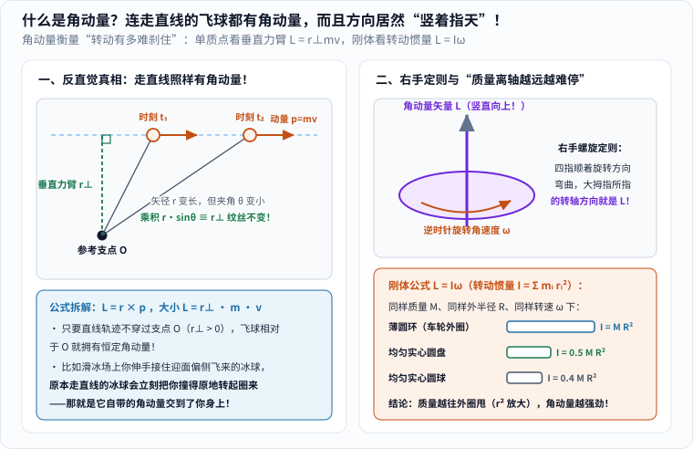
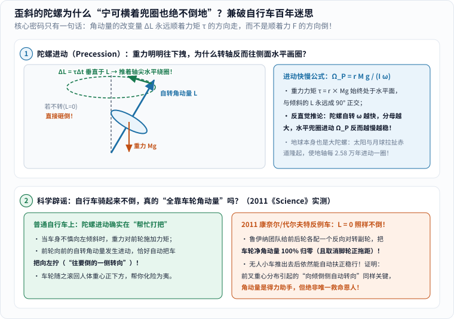
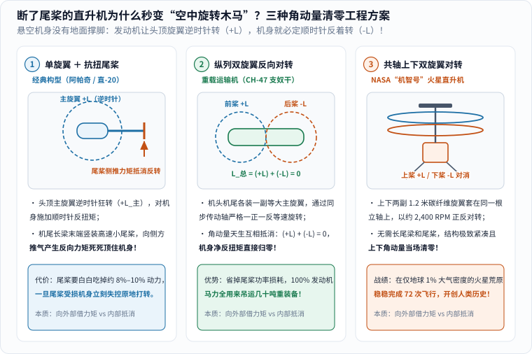
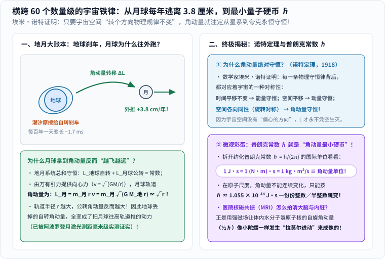

如果要在整个经典物理学里挑一个**最爱跟人类直觉对着干**的概念，**角动量（Angular Momentum）**绝对排得进前三名。

不信你看身边这一连串天天发生、细想却让人头皮发麻的怪事：

- **花样滑冰运动员**在冰面上单足旋转，既没人推她、冰刀也没蹬地，只是把平伸的双臂往胸口一抱，转速“嗖”地暴涨三四倍——更邪门的是，如果你拿公式算一算她的旋转动能，会发现能量居然也翻了好几倍！冰面明明没做功，这笔多出来的能量是谁悄悄塞给她的？
- **抽起来的小陀螺**明明已经歪了三十度，眼看就要“啪”地拍在桌面上，它却偏偏不往下倒，反而慢悠悠地绕着竖直轴**横着画起圈来**；还有人从小听科普说“自行车骑起来不倒全靠车轮的陀螺角动量”，可为什么康奈尔大学的科学家偏偏造出一辆**车轮总角动量严格等于零**的小车，推一把照样稳稳当当不倒？
- **断了尾桨的直升机**，为什么不管飞行员怎么拉杆，机身都会瞬间变成一台失控狂转的“空中滚筒洗衣机”？而在大气密度只有地球 $1\%$ 的火星荒原上，NASA 的“机智号”无人直升机根本没装尾桨，又是靠什么飞完 72 趟的？
- 最绝的是**一只四脚朝天从半空松手掉下来的猫**：松手那一瞬间它完全静止（总角动量严格等于 $0$），半空中既没有墙可蹬、也没有空气可借力，按照角动量守恒定律，它的总角动量在落地前每一毫秒都必须死死等于 $0$——那它凭什么能在短短 $0.3\text{ 秒}$ 里凌空翻过 $180^\circ$，优雅地四脚着地？甚至连 **NASA 都在 1969 年专门掏钱立项研究猫怎么翻身**，去教阿波罗宇航员在太空失重时徒手转身，还用同款原理让 **11 吨重的哈勃太空望远镜不烧一滴燃料精准调头**！

今天这篇文章，我们就把繁琐的微积分黑话放到一边，顺着这六个鲜活的谜题，把**角动量**从滑冰场、自行车、猫咪脊柱一路扒到月球轨道与微观量子世界。

---

## 一、先破两个最大误区：走直线也有角动量，而且它的方向“竖着指天”！

### 1. 什么是角动量？先从“走直线的冰球”说起

学过中学物理的人都知道**动量** $\mathbf{p} = m\mathbf{v}$：一辆重卡车以很快的速度冲过来，质量 $m$ 乘以速度 $\mathbf{v}$ 很大，你想拦停它就极难。

那**角动量 $\mathbf{L}$** 是什么？通俗讲，它衡量的就是**“一个旋转（或绕某点掠过）的运动到底有多难被刹住”**。

但第一个反直觉的冷知识马上就来了：**并不是只有绕着圈转的东西才有角动量——哪怕一颗沿直线匀速飞行的冰球或子弹，只要它的飞行路线没有正对着你（支点 $O$）的胸口撞过来，它对你而言就拥有实打实的角动量！**

为什么？想象你穿溜冰鞋站在光滑的冰面中心 $O$ 点，朋友从远处贴着冰面打出一颗冰球。冰球沿着一条偏离你右侧垂直距离为 $r_\perp$ 的直线飞驰而过。如果你突然伸出球杆把这颗走直线的冰球死死接住——猜猜会发生什么？**你整个人会瞬间在冰面上原地旋转起来！**

既然你接球后转了起来（获得了角动量），说明这颗原本走直线的冰球在撞上你之前，身上就已经揣着这笔角动量了！物理学用位置矢量 $\mathbf{r}$（从支点 $O$ 指向物体）与动量 $\mathbf{p} = m\mathbf{v}$ 的叉乘来严格定义质点角动量：

$$
\begin{aligned}
\mathbf{L} &= \mathbf{r} \times \mathbf{p} \\
L &= r p \sin\theta = r_\perp m v
\end{aligned}
$$

这里国际单位是 **$\text{kg}\cdot\text{m}^2/\text{s}$**（千克·米²/秒，等价于焦耳·秒 $\text{J}\cdot\text{s}$）。你看左图就会豁然开朗：冰球沿直线往前飞时，虽然它离支点 $O$ 的连线长度 $r$ 越拉越长，但连线与速度的夹角 $\theta$ 也在同步变小，两者一乘，$r\sin\theta$ 永远严格等于那条固定的**垂直力臂 $r_\perp$**！只要没有外力拉扯，直线飞行的物体角动量天生守恒——正如我们在[《从开普勒到牛顿：行星为什么不会掉进太阳》]()里见过的，开普勒第二定律“行星与太阳连线在相等时间内扫过相等面积（$\frac{dA}{dt} = \frac{L}{2m}$）”，底层其实就是角动量守恒的几何化身！

_图 1：先看左栏——沿直线飞行的物体只要垂直力臂 $r_\perp > 0$，它相对于支点 $O$ 的角动量 $L = r_\perp mv$ 就恒定不变；再看右栏——刚体旋转时用右手螺旋定则确定 $\mathbf{L}$ 的轴向，且质量越往外边缘集中（$r^2$ 权重），转动惯量 $I$ 越大。_

### 2. 为什么角动量的箭头不顺着圈画，非要“竖着指天”？

看图 1 右栏，你会撞见第二个反直觉设计：明明转盘是在水平桌面上打转，为什么物理学家非要把角动量矢量 $\mathbf{L}$ 的箭头画成**垂直于桌面竖直朝上**？

试想一下：如果让你用一个箭头来表示水平转盘此刻的旋转状态，你若顺着盘面画箭头，转盘左边往前走、右边往后走、前边往左走……盘面上每一处的运动方向每秒钟都在变！整个三维空间里，**唯独那根穿过圆心的旋转轴是纹丝不动的**！

于是物理学家定下了极度聪明的**右手螺旋定则**：伸出你的右手，让四根手指顺着物体旋转的方向弯曲，**大拇指竖直指向的那一端，就是角动量矢量 $\mathbf{L}$（以及角速度 $\boldsymbol{\omega}$）的方向**！

对于由无数个小质量块 $m_i$ 拼成的刚体（比如飞轮、车轮、地球），因为离转轴越远的点线速度 $v_i = r_i \omega$ 越大，算角动量时还要再乘一次半径 $r_i$，于是半径被平方放大成了**转动惯量（Moment of Inertia）** $I = \sum m_i r_i^2$：

$$
\mathbf{L} = I \boldsymbol{\omega}
$$

这就是为什么机械工程师设计储能飞轮和自行车轮时，总会把沉甸甸的金属尽量往最外圈的轮辋上堆：同样重 $1\text{ kg}$、同样外半径 $R$ 的铁块，做成**薄圆环（$I = MR^2$）**转起来攒下的角动量，整整是做成**实心圆盘（$I = \frac{1}{2}MR^2$）**的 **$2\text{ 倍}$**，是**实心铁球（$I = \frac{2}{5}MR^2$）**的 **$2.5\text{ 倍}$**！

---

## 二、花滑选手收臂飙出四倍速：可“翻了四倍的动能”到底是谁给的？

### 1. 不蹬冰也能狂飙：转动惯量缩水四分之三的魔术

有了 $L = I\omega$，牛顿第二定律在转动世界里的孪生兄弟就水到渠成了——只有外部施加**净力矩** $\boldsymbol{\tau} = \mathbf{r} \times \mathbf{F}$，才能改变系统的总角动量：

$$
\sum \boldsymbol{\tau}_{\text{外} } = \frac{d\mathbf{L} }{dt}
$$

当系统不受外力矩（或外力矩微弱到可以忽略，$\sum\boldsymbol{\tau}_{\text{外} } = \mathbf{0}$）时，系统的总角动量就锁死不变：

$$
I_0 \omega_0 = I_1 \omega_1 = \text{常数}
$$

花样滑冰收尾的“立姿高速旋转”就是最经典的现场教学：冰刀尖与冰面接触点极窄（力臂几乎为零）且冰面极滑，外力矩近乎为零。起转时选手双臂双腿大幅平展，把质量远远甩在转轴外侧，转动惯量 $I_0$ 很大，转速只有慢悠悠的 $\omega_0 \approx 1.5\text{ 转/秒}$；紧接着她猛地把双臂和浮腿紧紧贴回身体中轴，等效旋转半径缩减一半，由于 $I \propto r^2$，全身转动惯量瞬间骤降到原来的约 **四分之一（$I_1 \approx \frac{1}{4}I_0$）**——为了保住乘积 $I\omega$ 不变，她的角速度 $\omega_1$ 立刻像踩了电门一样暴涨到 **$4\omega_0 = 6.0\text{ 转/秒}$**！

体操运动员下杠空翻、跳水名将十米台“抱膝团身”全是一个道理：根据大学物理教材（OpenStax *University Physics* 例 11.8）的实测建模，一名身高 $1.8\text{ m}$ 的体操选手空中团身抱膝把等效体长缩到 $0.9\text{ m}$ 时，转动惯量从 $21.6\text{ kg}\cdot\text{m}^2$ 骤降到 $5.4\text{ kg}\cdot\text{m}^2$，短短 $0.5\text{ 秒}$ 的下落滞空时间就足够在空中干净利落地翻完两整周！

_图 2：左栏俯视对比展臂（$I_0, \omega_0$）与抱胸（$I_0/4, 4\omega_0$）的角速度四倍跃升（动画严格按 $1:4$ 真实转角比例播放一次并停在终态，单独打开 [SVG 原图](/assets/images/angular-momentum/skater-spin-and-energy-paradox.svg) 刷新可重播；开启“减少动态效果”时直接静态呈现）；右栏揭开极易被忽略的“动能翻四倍之谜”。_

### 2. 90% 的人没细想过的漏洞：角动量守恒了，动能怎么暴涨了 300%？！

到这里还没完！如果你多长个心眼，顺手算一下花滑选手收臂前后的**转动动能** $E_k = \frac{1}{2}I\omega^2$，马上会惊出一身冷汗：

$$
\begin{aligned}
E_{k0} &= \frac{1}{2} I_0 \omega_0^2 \\
E_{k1} &= \frac{1}{2} \left(\frac{I_0}{4}\right) (4\omega_0)^2 \\
&= 4 \left(\frac{1}{2} I_0 \omega_0^2\right) = 4 E_{k0}
\end{aligned}
$$

等等！**她的动能居然凭空变成了原来的 $4\text{ 倍}$（足足多出了 $300\%$ 的能量）！** 冰面明明没有推她做功，这多出来的三倍动能难道是天上掉下来的永动机吗？

哪怕你从来没滑过冰，只要去公园游乐场的转椅上两手各拎一瓶矿泉水转起来、再试着把水瓶往胸口收一收，你的胳膊酸痛感就会立刻告诉你答案：**高速旋转时，双臂像被一股巨大的离心怪力往外扯，你要费老大劲才能把胳膊硬拽回胸口！**

破案的关键就在**“力矩”与“做功”的几何分工**：
- **为什么角动量不变？** 因为你肩膀往胸口拽胳膊的肌肉拉力 $\mathbf{F}$ 直直指向身体中心转轴，垂直力臂 $r_\perp = 0$，所以**力矩 $\boldsymbol{\tau} = \mathbf{r} \times \mathbf{F} = \mathbf{0}$**，角动量分毫不增；
- **为什么动能暴涨？** 因为在收臂过程中，你的双手并不是沿着原地圆圈走，而是沿着一条**向内收缩的螺旋线**实实在在往里移动了一段径向距离 $-\Delta r$！你的肌肉拉力方向与向内位移同向，实打实地做了正功（$W = \int F_r\,(-dr) = +3E_{k0} > 0$）——**那翻了四倍的飞转能量，全是你燃烧自己肌肉里的卡路里一寸寸拽出来的！**

---

## 三、斜着的陀螺为什么横着兜圈绝不倒地？兼破“自行车不倒”百年迷思

### 1. 陀螺进动：当重力力矩撞上竖直交叉的角动量

如果说花滑收臂还能靠直觉想通，那**陀螺进动（Gyroscopic Precession）**第一次亲手摸到时，真的会让人怀疑牛顿定律出 Bug 了。

拿一只拆下来的自行车前轮，在轮轴一端拴根绳子吊在半空：
- **车轮不转时（$\mathbf{L} = \mathbf{0}$）**：一松手，重力 $Mg$ 往下拉轮心，立刻产生一个水平方向的力矩 $\boldsymbol{\tau} = \mathbf{r} \times M\mathbf{g}$，车轮啪嗒一声翻下来竖直垂吊着，一点悬念都没有；
- **先把车轮猛拨到飞速旋转，再只吊一端松手**：奇迹出现了！几十斤重的悬空车轮居然**稳稳横在半空不往下掉**，而是端端正正地绕着吊绳**在水平面上一圈圈慢悠悠地公转起来**！

为什么重力明明拼命往下拽，车轮却偏偏往侧面横着走？全因为那条矢量铁律：

$$
\Delta \mathbf{L} = \boldsymbol{\tau}\,\Delta t
$$

**请死死盯住图 3 上半幅里的两个箭头方向**：
1. 车轮飞转时，顺着轮轴向外指着一根硕大无比的**自转角动量矢量 $\mathbf{L}$**；
2. 重力向下拉轮心产生的**力矩矢量 $\boldsymbol{\tau} = \mathbf{r} \times M\mathbf{g}$**，用右手定则一比划，不朝下也不朝上，而是**水平指向侧面，跟轮轴 $\mathbf{L}$ 严格成 $90^\circ$ 垂直**！
3. 这就跟地球绕太阳转时“万有引力垂直于速度，所以只改变速度方向、不改变速度大小”一模一样！既然微小的增量 $\Delta\mathbf{L} = \boldsymbol{\tau}\Delta t$ 永远垂直于 $\mathbf{L}$，它就既不会把 $\mathbf{L}$ 变长变短，也不会把轮轴往下压倒，而是**推着 $\mathbf{L}$ 的箭头尖端在水平面上画圆圈**！

用简单几何一除（当自转远快于进动，$\omega \gg \Omega_P$ 时），就能推导出陀螺水平兜圈的**进动角速度**：

$$
\Omega_P = \frac{r M g}{I \omega}
$$

注意看分母里的自转角速度 $\omega$：**陀螺自己转得越快（$\omega$ 越大），它水平晃悠兜圈的速度 $\Omega_P$ 反而越慢、越稳如泰山！** 等到摩擦让陀螺越转越慢（$\omega$ 变小），你就会看到陀螺兜圈的速度越来越疯、倾角越来越大，最后才哐当倒地。连我们脚下的地球本身都是一只超级大陀螺——太阳和月球拽着地球赤道隆起施加微小力矩，让地轴以约 **25,800 年一圈**的周期缓慢进动（这就是天文学上的“岁差”，一万两千年后北极星都要换人当！）。

_图 3：上图拆解陀螺不倒的秘密——水平重力力矩 $\boldsymbol{\tau}$ 与自转角动量 $\mathbf{L}$ 正交，推着轴尖绕竖直轴水平进动；下图还原本世纪著名的《Science》自行车实验：前轮陀螺进动确实能帮普通自行车自动打把救车，但绝非唯一原因。_

### 2. 科学辟谣：自行车骑起来不倒，真的“全靠车轮角动量”吗？

讲到陀螺进动，十本老科普书里有九本会顺嘴举例子：“你看，自行车停着必倒、骑起来不倒，就是靠两个车轮高速旋转的陀螺效应撑住的！”甚至连大数学家菲利克斯·克莱因（Felix Klein）、物理大师索末菲和弗里茨·诺特在 1910 年合著的四卷本《陀螺理论》里也是这么写的。

**这个说法只对了一小半，如果说“全靠角动量”那就彻底错了！**

先说对的那一小半：在普通自行车上，车轮的机身重量高达几十公斤，两个轻飘飘的轮圈攒下的那点角动量，根本不可能像硬扛一样直接顶住人体不往旁边倒；陀螺效应真正立功的地方是**“自动帮你拧车把”**——当车身不小心往左歪时，重力力矩让高速向前转的前轮发生陀螺进动，进动的方向**恰好是把车把往左拧**！车把一往左拐，车轮就顺势滚回你的身体重心正下方，把快要摔倒的你救了回来。

那如果把车轮的角动量彻底清零，自行车是不是就必定摔倒呢？2011 年 4 月，康奈尔大学安迪·鲁伊纳（Andy Ruina）与荷兰代尔夫特理工大学施瓦布团队在顶级期刊《科学》（*Science*）发表了一篇轰动全球的实测论文：

- 他们专门造出一辆造型奇特的无人实验小车，在前后车轮上方各紧贴着装了一只**一模一样、等速反向旋转的副轮**，让全车旋转角动量 **$100\%$ 精确抵消清零（$\mathbf{L}_{\text{净} } = \mathbf{0}$）**！
- 不仅如此，他们还故意取消了超市购物车那种“前轮触地点落后于转向轴（正拖距 Trail）”的脚轮效应（做成 $-4\text{ mm}$ 负拖距）！
- 结果把这辆既没陀螺角动量、又没正拖距的小车往跑道上一推，哪怕从侧面伸手拍它一巴掌，**小车依然能自己拧车把稳稳扶正往前跑！**

谜底终于大白：**一辆自行车能自动平衡的真正本质，是“车身往哪边歪，前轮就自动往哪边打把转向”**。普通自行车是靠**前轮陀螺进动 ＋ 前叉正拖距 ＋ 前车把总成重心分布**三兄弟合力实现自动打把的——车轮角动量是一位尽职的好帮手，但绝不是唯一的救命恩人！

---

## 四、没尾桨的直升机为什么会变“空中滚筒”？三种角动量清零神技

如果把你请到实验室的一把无摩擦转椅上坐好，递给你一只正在水平顺时针狂转的飞轮（角动量朝下 $-\mathbf{L}_0$），然后让你双手使劲把飞轮上下翻个底朝天（变成朝上 $+\mathbf{L}_0$）——瞬间，你连人带椅子就会以两倍的角动量（$-2\mathbf{L}_0$）朝着顺时针方向猛转起来！

这就是悬空飞行器每天都要面对的生死大考：**反扭矩（Anti-torque）与角动量抵消**。

直升机腾空离地那一刻，四周没有任何地面可以撑脚，整架飞机的总角动量初值为 $0$。当涡轴发动机发力，让头顶巨大的主旋翼逆时针高速旋转（获得向上的角动量 $+\mathbf{L}_{\text{主} }$）时，如果没有别的办法干预，为了维持总角动量为零，**底下的座舱机身就必定会顺时针疯狂反着转起来（$-\mathbf{L}_{\text{机身} }$）**！这也就是为什么电影里直升机一旦被击毁尾桨，机身立刻会在半空中像陀螺一样失控乱转。

怎么制服这股要命的反向旋转？航空工程师演化出了图 4 里的三大流派：

_图 4：三种驯服直升机旋翼角动量的工程路线——① 借空气外力矩硬顶（单旋翼＋尾桨）；② 前后异轴正反对消（支奴干纵列双旋翼）；③ 同轴上下叠放正反对消（NASA“机智号”火星直升机）。_

1. **方案一：单旋翼 ＋ 机尾抗扭小尾桨（向外界借反力矩）**
   这是我们平时见得最多的直升机样子。在长长的尾梁末端竖着装一副高速小螺旋桨，专门往侧面吹风，利用长力臂产生一个逆时针的气动外力矩，把机身想顺时针打转的劲儿死死顶回去。缺点也很实在：这副不产生半点升力的尾桨，平时要白白吃掉发动机 **$8\%\text{–}10\%$** 的宝贵功率。
2. **方案二：纵列双旋翼一正一反（内部角动量归零）**
   像大名鼎鼎的 CH-47“支奴干”重型运输直升机，干脆砍掉尾桨，在机头和机尾各装一副大旋翼，通过同步传动轴让前桨和后桨严格**一正一反等速旋转**：

   $$
   \mathbf{L}_{\text{总} } = (+\mathbf{L}) + (-\mathbf{L}) = \mathbf{0}
   $$

   两副旋翼的角动量在机身内部直接清零，全部发动机马力一滴不漏全用来往上抬几十吨重的货物！
3. **方案三：共轴双旋翼上下反转（送去火星飞行的终极减重方案！）**
   2021 年至 2024 年，人类首架外星飞行器——NASA **“机智号”（Ingenuity）火星直升机**——在大气密度还不到地球 $1\%$ 的火星杰泽罗陨石坑成功飞了整整 **72 次**。在火星上每多 1 克死重都飞不起来，根本装不起长长的尾梁和尾桨。工程师用的正是精妙绝伦的**共轴反转双旋翼**：两副长 $1.2\text{ m}$ 的超轻碳纤维桨叶上下叠套在同一根立轴上，以约 **$2{,}400\text{ 转/分}$** 的超高转速一正一反迎风切气，既凑够了稀薄空气里的升力，又把机身净角动量锁死在零！

---

## 五、悬空零借力怎么翻身？从“落猫四步扭腰术”到哈勃望远镜的无燃料调头

### 1. 困扰麦克斯韦、惊动 NASA 立项的“落猫问题”

现在，轮到物理学史上最迷人的一桩悬案出场了：**四脚朝天掉下来的猫，到底是怎么在不违反角动量守恒的前提下翻过身来的？**

早在 19 世纪中叶，剑桥大学三一学院的斯托克斯和**麦克斯韦**就对这件事着了迷（麦克斯韦在给妻子的信里还幽默地辟谣说，外头传言他在三一学院往窗外扔猫，其实他是让猫从离桌床仅两英寸高的地方肚皮朝上松手，看猫怎么一眨眼就四脚落地！）。当时很多物理学家坚信：**猫一定是在松手瞬间偷蹬了人手一把攒下了初始角动量**——因为他们脑子里默认“总角动量 $\mathbf{L} = \mathbf{0}$ 就意味着绝对不能转过任何角度”！

1894 年，法国生理学家**马雷（Étienne-Jules Marey）**搬出每秒连拍几十张的高速计时摄影枪，把猫下落的连拍照片拍在了法国科学院院刊和《自然》（*Nature*）杂志桌上：照片铁证如山——松手那一刻猫一丁点旋转都没有（$\mathbf{L} = \mathbf{0}$），却在半空中硬生生翻过了 $180^\circ$！到了 **1969 年阿波罗登月时代**，**NASA 更是专门拨款资助斯坦福大学力学大师托马斯·凯恩（Thomas R. Kane）建立双圆柱数学模型**，只为搞懂猫的绝技，好教身穿笨重宇航服、飘在太空舱中央无处借力的宇航员怎样徒手转身！

猫到底耍了什么花招？秘密只有八个字：**刚体不行，软体可以！**

把猫咪极其柔韧的脊柱想象成连接“前半身”和“后半身”两节圆筒的万向节，跟我一步步算下面这笔连小学生都能看懂的加减法（图 5 上半幅）：

1. **第一步（缩前爪、伸后腿扭腰）**：猫先把两只前爪死死抱紧胸口（前半身半径极小，转动惯量只有 $I_{\text{前} } = 1$），同时把两条后腿直挺挺往外蹬开（后半身转动惯量放大到 $I_{\text{后} } = 3$）。这时猫腰发力一拧！因为总角动量必须严格等于零：

   $$
   \begin{aligned}
   I_{\text{前} }\Delta\phi_{\text{前} } + I_{\text{后} }\Delta\phi_{\text{后} } &= 0 \\
   1 \times (+120^\circ) + 3 \times (-40^\circ) &= 0
   \end{aligned}
   $$

   看见没有！轻巧的前半身顺时针狂转了 **$+120^\circ$**，而笨重的后半身只逆时针微微退了 **$-40^\circ$**！
2. **第二步（伸前爪、缩后腿回扭）**：紧接着猫立刻互换姿势——把前爪大大张开稳住（$I'_{\text{前} } = 3$），把后腿缩回肚皮底下（$I'_{\text{后} } = 1$），再把刚才拧歪的猫腰原样扳直：

   $$
   3 \times (-40^\circ) + 1 \times (+120^\circ) = 0
   $$

   这一扳，轻巧的后半身顺时针猛追了 **$+120^\circ$**，而张开的前半身只往回退了区区 **$-40^\circ$**！
3. **算总账**：一轮动作做完，猫的腰完全恢复笔直，前半身净转了 $120^\circ - 40^\circ = \mathbf{+80^\circ}$，后半身也净转了 $-40^\circ + 120^\circ = \mathbf{+80^\circ}$！（真实猫咪还会配合无扭转的“圆锥式晃腰”，一气呵成就能在 $0.3\text{ 秒}$ 内净赚整整 **$+180^\circ$**！）**从头到尾每一毫秒系统的总角动量都严格等于 $0$，物理定律半点没破，身体却凭空翻了个面！**（在现代高等力学里，这叫“非完整约束系统的几何相位 / 规范场和乐”。）

_图 5：上图用精确的 $1:3$ 转动惯量比拆解猫咪如何在 $\mathbf{L}\equiv\mathbf{0}$ 下净翻转身体；下图展示 11 吨重的哈勃太空望远镜怎样把“猫扭腰”简化成机身肚子里四只 $45\text{ kg}$ 的电动反作用飞轮。_

### 2. 11 吨重的哈勃与韦伯太空望远镜：不喷一滴燃料，怎么瞄准百亿光年外？

理解了悬空翻身的猫，你就瞬间看懂了价值上百亿美元的**哈勃太空望远镜**、**詹姆斯·韦伯太空望远镜**以及**中国空间站**是怎么在真空里转身的！

很多人以为卫星在太空调头都是靠屁股后面“噗噗”喷火的小火箭。但在哈勃这种顶级光学望远镜上，**推进剂喷气是绝对禁止的**——因为哪怕喷出几毫克联氨燃料废气，飘散在望远镜周围形成一层薄雾，就会污染镀膜镜面、毁掉紫外与红外深空曝光！

那重达 **11 吨**（足有一辆大校车那么大）、飘在真空里一处着力点都没有的哈勃望远镜，靠什么调头呢？据 NASA 官方工程档案披露，全靠藏在它肚子里的 **4 台各重 $45\text{ kg}$（直径仅约 $0.6\text{ m}$，比汽车轮胎还小）的“反作用飞轮（Reaction Wheels）”**！

原理简直不能更优雅：太阳能帆板晒太阳发电，驱动其中一只小飞轮顺时针加速旋转（获得角动量 $+I_{\text{轮} }\omega_{\text{轮} }$）。因为整座望远镜不受外力矩、总角动量恒为零：

$$
\begin{aligned}
I_{\text{轮} }\omega_{\text{轮} } + I_{\text{镜} }\omega_{\text{镜} } &= 0 \\
\omega_{\text{镜} } &= -\frac{I_{\text{轮} } }{I_{\text{镜} } }\,\omega_{\text{轮} }
\end{aligned}
$$

11 吨重的镜筒立刻乖乖朝着逆时针方向平稳地转过去！想停在目标星系上？只要让电机把飞轮刹停（$\omega_{\text{轮} } \to 0$），整座望远镜就瞬间纹丝不动地钉死在太空中！配合每分钟 $19{,}200$ 转的超高精度陀螺仪与导星传感器，这套飞轮系统能让哈勃的指向锁定精度达到不可思议的 **$0.007\text{ 角秒}$**——用 NASA 自己的比喻，这相当于**从华盛顿特区打出一束激光，稳稳照在 320 公里外纽约帝国大厦顶上一枚一角硬币的罗斯福头像上，整整 24 小时不晃一下**！（万一长期抵消稀薄大气阻力让飞轮越转越快接近极限转速怎么办？哈勃身上还装了 4 根 $2.4\text{ m}$ 长的电磁铁棒“磁力矩器”，通电后借地球磁场推一把，悄悄把攒多了的角动量卸回给地球！）

---

## 六、横跨 60 个数量级的终极铁律：从月球逃离，到微观世界的最小硬币 $\hbar$

### 1. 地月大账本：地球自转踩刹车，为什么反而把月球越推越远？

把视线拉大到整个星球尺度，角动量守恒还在默默改写着地球的日历。

正如我们在[《宇宙里的星球为什么都在转？》]()和上一篇[《一眨眼绕地球七圈半的光，人类是怎么测出速度的？》]()里提过的阿波罗激光测月实验那样：月球引力每天掀起地球海洋的潮汐隆起，海水与海底摩擦就像两块刹车片一样给地球自转减速，让地球上的一天**每过一百年变长约 $1.7\text{ 毫秒}$**（恐龙时代的地球一年足有 370 多天！）。

可地月系统孤悬太空，地球自转弄丢的这笔庞大角动量去哪儿了？**全通过潮汐引力矩转移到月球的公转轨道上去了！**

很多人直觉以为“月球得到能量和角动量应该转得更快、离地球更近才对”，但把万有引力充当向心力（$v = \sqrt{GM_{\oplus}/r}$）代进月球轨道角动量公式一看，真相恰恰相反：

$$
L_{\text{月公转} } = m_{\text{月} } r v = m_{\text{月} }\sqrt{G M_{\oplus} r} \propto \sqrt{r}
$$

看清那个根号 $\sqrt{r}$ 了吗？在引力轨道上，**轨道半径 $r$ 越大，公转角动量反而越大！** 所以月球每接过一笔地球传过来的角动量，就被迫往更高的轨道上爬一点——每年稳稳远离地球 **约 $3.8\text{ 厘米}$**，和我们手指甲生长的速度差不多！

_图 6：左栏算清地月潮汐账本——地球自转减速损失的角动量推高了月球的轨道半径（$L \propto \sqrt{r}$）；右栏直抵现代物理地基：1918 年诺特定理揭示角动量守恒源于空间旋转对称性，而量子力学的标志常数 $\hbar$ 本身就是一粒不可再分的最小角动量硬币！_

### 2. 诺特定理与普朗克常数 $\hbar$：宇宙为什么非要守住角动量不可？

读到这里，你心里一定会升起最后一个终极追问：**凭什么大到几万光年的银河系悬臂、中到冰场上的女孩和半空中的猫、小到一颗电子，全都得乖乖听“角动量守恒”的号令？这条定律到底是谁立的规矩？**

1918 年，伟大的德国女数学家**埃米·诺特（Emmy Noether）**发表了我们在[《为什么有了牛顿还需要分析力学》]()里专门致敬过的**诺特定理**，一举揭开了宇宙最底层的底牌：

- 物理定律在今天做和明天做结果一样（**时间平移对称性**） $\implies$ 必然导出 **能量守恒**；
- 物理定律在北京做和在纽约做结果一样（**空间平移对称性**） $\implies$ 必然导出 **动量守恒**；
- 物理定律把实验室原地转个朝向做结果完全一样（**空间旋转对称性 / 各向同性**） $\implies$ **必然导出角动量守恒！**

换句话说，角动量守恒根本不是一条碰巧成立的经验巧合——**只要我们身处的宇宙空间没有偏心地规定“朝北比朝东更尊贵”，角动量就注定一分一毫都不能凭空生灭！**

更让人起鸡皮疙瘩的彩蛋藏在微观量子世界里。大家都听过量子力学最神圣的身份证——**约化普朗克常数 $\hbar = \dfrac{h}{2\pi} \approx 1.055 \times 10^{-34}\text{ J}\cdot\text{s}$**。你不妨动手把它的单位 $\text{J}\cdot\text{s}$（焦耳·秒）拆开来看看：

$$
\begin{aligned}
1\text{ J}\cdot\text{s} &= 1\ (\text{N}\cdot\text{m})\cdot\text{s} \\
&= 1\ \left(\text{kg}\cdot\frac{\text{m} }{\text{s}^2}\cdot\text{m}\right)\cdot\text{s} = 1\ \text{kg}\cdot\text{m}^2/\text{s}
\end{aligned}
$$

**这完完全全就是角动量的单位！**

这不是巧合：微观世界之所以被称为“量子（一份一份不连续）”的世界，最核心的特征正是**在原子尺度上，角动量不再能连续取任意小数，而是被大自然铸造成了一枚枚面值为 $\hbar$ 的最小硬币**！原子里电子绕核运动的轨道角动量只能一格格取 $0, 1\hbar, 2\hbar\dots$；而电子、质子本身还自带半枚硬币大小的内禀**自旋角动量（$\frac{1}{2}\hbar$）**。今天全世界大医院里不用开刀就能把大脑血管、关节软骨拍得纤毫毕现的**核磁共振成像仪（MRI）**，干的事情说穿了只有一件：用超导强磁场给你身体水分子里的氢原子核（质子）施加一个力矩，让它身上那半枚 $\frac{1}{2}\hbar$ 的量子小陀螺像桌面陀螺一样跳起固定频率的**进动之舞**，再听着回波把你体内的图像画出来！

---

## 七、一图速览：角动量六大奇妙现象与工程应用对照表

| 场景／装置 | 关键角动量方程 | 谁跟谁交换／抵消了角动量？ | 最容易踩坑的直觉误区与真相 |
| :--- | :--- | :--- | :--- |
| **花样滑冰收臂旋转 / 跳水抱膝** | $I_0\omega_0 = I_1\omega_1$；$E_{k1} = E_{k0}(I_0/I_1)$ | 选手自身质量向转轴收缩，$I$ 减小为 $\frac{1}{4}$ 则 $\omega$ 暴涨 $4\text{ 倍}$ | **误区**：以为动能也不变。**真相**：动能同步暴涨 $4\text{ 倍}$，全靠手臂肌肉向内硬拽做正功！ |
| **斜立不倒的旋转陀螺** | $\Delta\mathbf{L} = \boldsymbol{\tau}\Delta t$；$\Omega_P = \dfrac{rMg}{I\omega}$ | 水平重力力矩 $\boldsymbol{\tau}$ 始终垂直于 $\mathbf{L}$，只改方向不改大小 | **误区**：以为转得越快兜圈越快。**真相**：自转 $\omega$ 越快，水平进动 $\Omega_P$ 反而越慢越稳！ |
| **行驶中的自行车自动平衡** | 前轮进动辅助转向 $\boldsymbol{\tau} = \boldsymbol{\omega}_{\text{倾} } \times \mathbf{L}_{\text{轮} }$ | 车身左倾时前轮进动帮车把自动左打，配合前叉重心与拖距救车 | **误区**：以为不倒 100% 靠车轮角动量。**真相**：2011《Science》零角动量对转轮实验车照样不倒！ |
| **直升机尾桨与火星“机智号”** | $\sum\boldsymbol{\tau}_{\text{外} } = 0 \implies \mathbf{L}_{\text{桨} } + \mathbf{L}_{\text{机} } = \mathbf{0}$ | 单旋翼靠尾桨向空气借反力矩；支奴干与“机智号”靠双桨正反转内部清零 | 断掉尾桨不是掉下来那么简单，而是座舱立刻顺着主旋翼反方向失控狂转！ |
| **半空翻身的猫 & 哈勃望远镜** | $I_1\omega_1 + I_2\omega_2 \equiv 0$（全程 $\mathbf{L}=\mathbf{0}$） | 猫靠前后躯干交替收腿变惯量扭腰；哈勃靠体内 4 只 $45\text{ kg}$ 飞轮反转调头 | **误区**：以为 $\mathbf{L}=\mathbf{0}$ 就转不了身。**真相**：只有死板刚体转不动，变形体与内飞轮零燃料照样调头！ |
| **月球每年远离 3.8 cm & 医院 MRI** | $L_{\text{月} } \propto \sqrt{r}$；量子单元 $\hbar \approx 1.055\times 10^{-34}\text{ J}\cdot\text{s}$ | 地球潮汐刹车把自转角动量传给月球推高轨道；MRI 操控质子 $\frac{1}{2}\hbar$ 自旋进动 | 月球拿到角动量不是飞得更近，而是被迫爬向更高的轨道！ |

下次再在电视上看到花滑姑娘收拢双臂化作一道残影，或是看见自家猫咪从沙发背上肚皮朝天跳下来却轻巧四爪落地时，不妨会心一笑：从你家客厅地毯到百亿光年外的哈勃望远镜，它们全都在跳着同一支由空间旋转对称性谱写的角动量圆舞曲。

---

## 参考资料与核查来源

1. **莱斯大学 OpenStax 开源大学物理教材**：Ling, S. J., Sanny, J., & Moebs, W., *University Physics Volume 1*, [11.2 Angular Momentum](https://openstax.org/books/university-physics-volume-1/pages/11-2-angular-momentum)、[11.3 Conservation of Angular Momentum](https://openstax.org/books/university-physics-volume-1/pages/11-3-conservation-of-angular-momentum) 及 [11.4 Precession of a Gyroscope](https://openstax.org/books/university-physics-volume-1/pages/11-4-precession-of-a-gyroscope) —— 核查质点与刚体角动量定义（$\mathbf{l}=\mathbf{r}\times\mathbf{p}$、$\sum\boldsymbol{\tau}=d\mathbf{L}/dt$）、花样滑冰与体操团身转动惯量缩减时转动动能放大 $K'_{\text{rot} } = K_{\text{rot} }(I/I')$ 的径向肌肉做功机制，以及陀螺进动角速度公式 $\omega_P = rMg/(I\omega)$ 与地球约 2.6 万年岁差周期。
2. **康奈尔大学与代尔夫特理工大学无陀螺自稳定自行车研究**：Kooijman, J. D. G., Meijaard, J. P., Papadopoulos, J. M., Ruina, A., & Schwab, A. L. (2011), *A bicycle can be self-stable without gyroscopic or caster effects*, *Science*, 332(6027), 339–342；项目官方档案页 [Cornell Bicycle Mechanics Lab](http://ruina.tam.cornell.edu/research/topics/bicycle_mechanics/stablebicycle/index.htm) —— 核查利用反向对转副轮消除车轮净自转角动量（$\mathbf{L}=\mathbf{0}$）且具 $-4\text{ mm}$ 负拖距的双质量滑板自行车（TMS）自稳定实验，以及对克莱因、索末菲与弗里茨·诺特（1910）传统纯陀螺解释的修正。
3. **NASA 哈勃太空望远镜指向控制系统工程档案**：NASA Science, [*Hubble Observatory Design: Pointing Control*](https://science.nasa.gov/mission/hubble/observatory/design/pointing-control/) —— 核查哈勃望远镜禁用化学推进器防镜面污染、采用 4 台 $45\text{ kg}$（$100\text{ lb}$）反作用飞轮组件与 $19{,}200\text{ RPM}$ 陀螺仪实现 $0.007\text{ 角秒}$ 锁定精度，以及利用 4 根 $2.4\text{ m}$（$8\text{ ft}$）磁力矩棒与地球磁场交互卸载角动量的工程细节。
4. **NASA 技术报告服务器（NTRS）关于“落猫问题”与宇航员失重自转身档案**：Kane, T. R., & Scher, M. P. (1969), [*A dynamical explanation of the falling cat phenomenon*](https://ntrs.nasa.gov/citations/19690058843)（NASA Grant `NGR-05-020-209`，发表于 *Int. J. Solids Structures*, 5(7), 663–670）及 Kane, T. R. (1970), [*Dynamics of human self-rotation*](https://ntrs.nasa.gov/citations/19700012125)（JPL 第 4 届航天机构研讨会论文集），并参校马雷（É.-J. Marey, 1894, *Comptes Rendus* 119: 714–717）高速连拍实验史实。
5. **美国联邦航空管理局（FAA）与 NASA 火星直升机档案**：FAA [*Helicopter Flying Handbook*](https://www.faa.gov/regulations_policies/handbooks_manuals/aviation/helicopter_flying_handbook)（第 2–4 章旋翼反扭矩、尾桨与纵列/共轴构型原理）及 NASA [*Ingenuity Mars Helicopter*](https://science.nasa.gov/mission/mars-2020-perseverance/ingenuity-mars-helicopter/)（2021–2024 年在火星完成 72 次飞行的共轴反转双旋翼设计）。
6. **美国国家标准与技术研究院（NIST）基本物理常数数据库**：[CODATA Value: reduced Planck constant $\hbar$](https://physics.nist.gov/cgi-bin/cuu/Value?hbar) —— 核查约化普朗克常数精确值 $\hbar = 1.054\,571\,817\ldots \times 10^{-34}\text{ J}\cdot\text{s}$ 及其与角动量量纲 $\text{kg}\cdot\text{m}^2/\text{s}$ 的严格一致性。
