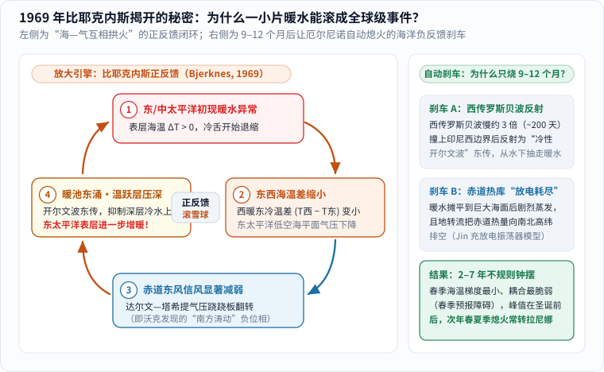
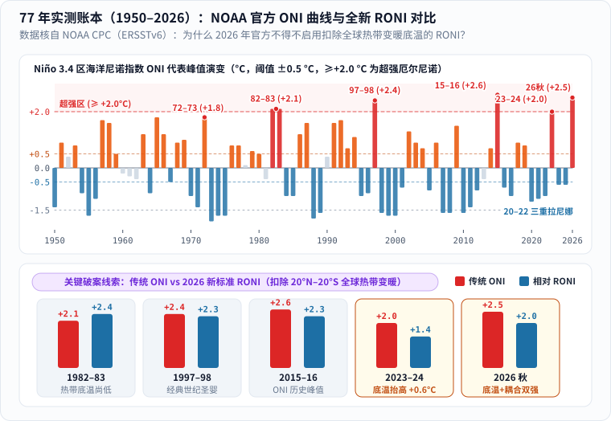
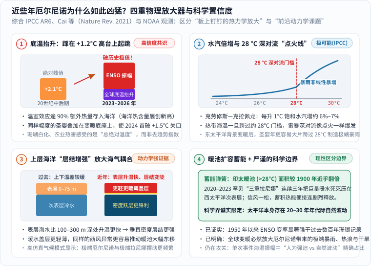
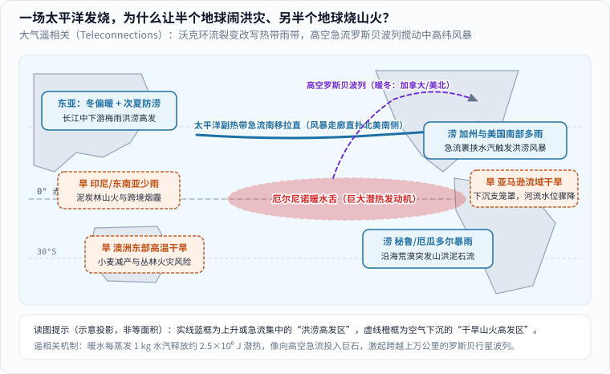
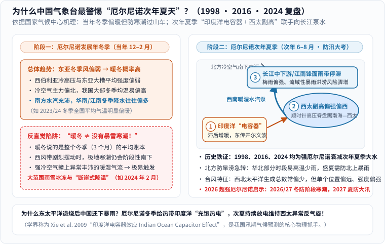

如果复盘这几年的天气新闻，很多人都会有一种强烈的体感：**地球的脾气好像越来越“暴烈”了。**

先是 2020 到 2023 年初罕见地连拉了三年“三重拉尼娜”；紧接着话锋一转，2023 至 2024 年一头扎进强厄尔尼诺，直接把 **2024 年推上了人类有气象记录以来最热的一年**（全球地表均温首次突破工业化前 $$+1.5\ ^\circ\mathrm{C}$$ 关口），我国江南与长江中下游在 2024 年初夏遭遇凶猛“暴力梅”与华南极端暴雨；还没等大家喘匀气，**2026 年夏秋，赤道太平洋又以惊人的速度再次烧了起来**——据中国气象局国家气候中心实况监测，2026 年 9 月赤道中东太平洋海温监测候指数接连跳上 $$3.01\ ^\circ\mathrm{C}$$、$$3.02\ ^\circ\mathrm{C}$$，**有观测记录以来首次突破 $$3.0\ ^\circ\mathrm{C}$$**，正式形成继 1982–83、1997–98、2015–16 之后的又一次**超强厄尔尼诺事件** [3]；美国国家航空航天局（NASA）的 `Sentinel-6` 测高卫星也在东太平洋拍到了比常年鼓起 **$$30\text{–}40\ \mathrm{cm}$$** 的巨大暖水脊 [5]。

看着新闻里滚动播报的“厄尔尼诺（El Niño）”，绝大多数人心里都会冒出三个大大的问号：

1. **那片发烧的海水远在距离中国一万多公里的赤道中东太平洋，而且表层只比平时高了 $$2\text{–}3\ ^\circ\mathrm{C}$$——连洗澡水冷热差别都算不上，凭什么能让半个地球发洪水、另半个地球闹大旱？**
2. **为什么中国气象专家每次一提厄尔尼诺，总要特别叮嘱一句：“当年冬天防冷暖过山车，真正防大洪水的硬仗在【次年夏天】”？**
3. **也是大家最关心的问题：为什么近几十年来，“超强厄尔尼诺”仿佛越来越密集、破坏力一次比一次吓人？到底是错觉，还是地球气候系统的底层逻辑真的变了？**

别急，我们先把地图摊在赤道太平洋上，从几百年前南美渔民发现的一桩“圣诞节怪事”说起。

---

## 一、名字从哪来？从秘鲁渔民的“圣诞圣婴”，到横跨大洋的破案拼图

### 1. 秘鲁海岸圣诞节前后的“怪暖水”与饿肚子的鳀鱼

按地理常识，南美洲西岸的秘鲁和厄瓜多尔正好贴着赤道南侧，海水本该热得像汤一样才对。但恰恰相反，在正常年份里，这里是全世界最著名的**冷水高产渔场**之一 [4]。

原因在于：常年从东往西吹的风，把秘鲁海岸表层的海水往大洋深处推走了；为了填补空缺，海底一两百米深处**冰凉（约 $$20\text{–}22\ ^\circ\mathrm{C}$$）却富含硝酸盐与磷酸盐**的深层海水源源不断地翻涌上来——海洋学上叫作**涌升流（Upwelling）** [4]。这股天然“海底化肥”养活了漫山遍野的浮游植物，进而喂饱了数以亿计的秘鲁鳀鱼（Anchoveta）和漫天海鸟。

然而早在 17 世纪（1600 年代），秘鲁和厄瓜多尔的渔民就发现了一种每隔几年就会降临的怪事 [4]：

每到岁末**圣诞节（12 月底）前后**，沿岸冰凉翠绿的海水会突然变得温吞吞、蓝汪汪，鱼群在一夜之间消失无踪，海鸟成批饿死；与此同时，平日滴雨难求的南美沿海沙漠却突然乌云压顶、暴雨倾盆。因为这股反常暖流总是赶在圣诞节前后达到高潮，讲西班牙语的南美渔民便给它起了个带着敬畏的名字——**`El Niño de Navidad`**，直译就是**“圣诞节的小男孩”**，也就是天主教语境里的**“圣婴”** [4]。

有趣的是，过去渔民靠肉眼看水色判断灾年，今天卫星在太空看得一清二楚：2026 年秋季，NASA 搭载高光谱海洋水色仪的 `PACE` 卫星实测发现，随着厄尔尼诺切断深层营养盐上翻，赤道太平洋原本因浮游植物繁盛而泛绿的海域明显萎缩，大洋正在肉眼可见地**“变蓝、变贫瘠”** [5]。

### 2. 1924 年沃克的“大气跷跷板”与 1969 年比耶克内斯的世纪合体（ENSO）

在长达两百多年的时间里，人们一直以为“厄尔尼诺”只是秘鲁家门口的一场局部洋流感冒，跟万里之外的亚洲、澳洲八竿子打不着。

直到两块看似毫不相干的拼图撞在一起：

- **第一块拼图在天上（1924 年，南方涛动）**：20 世纪初，驻印度的英国数学物理学家**吉尔伯特·沃克爵士（Sir Gilbert Walker）**为了搞明白印度季风为什么偶尔失灵导致大饥荒，调集了全球气象站的气压账本做统计相关分析。1924 年他震惊地发现，太平洋东西两岸的大气压力就像踩在同一块跷跷板上——**每当澳大利亚达尔文港（西岸）气压异常偏高时，南太平洋塔希提岛（东中岸）的气压就必定异常偏低，反之亦然**！沃克把这种横跨半个地球的大气压力摇摆命名为**“南方涛动”（Southern Oscillation）**。可惜当时没人知道是谁在底下踩这块跷跷板。
- **第二块拼图在海气交界处（1969 年，ENSO 合体）**：又过了整整 45 年，1957–58 年国际地球物理年攒下了第一批横跨太平洋的海洋与气象同步观测数据。1969 年，美籍挪威气象学家**雅各布·比耶克内斯（Jacob Bjerknes）**在《每月天气评论》（*Monthly Weather Review*）发表经典论文，一举捅破了窗户纸：**秘鲁渔民说的海洋“厄尔尼诺”，和沃克发现的大气“南方涛动”，根本不是两件事，而是同一台巨型海—气耦合发动机的两面！**

从此，科学界把这套每隔 **$$2\text{–}7$$ 年**在赤道太平洋来回摆动的自然气候韵律统称为 **`ENSO`（El Niño–Southern Oscillation，厄尔尼诺—南方涛动）** [4]。既然暖位相叫“小男孩 / 圣婴（El Niño）”，科学家便顺理成章地把反向过度冷却的冷位相命名为**“小女孩 / 圣女”（La Niña，拉尼娜）** [4]。

---

## 二、先把“常态太平洋”看懂：一台信风筑坝的巨型斜坡浴缸

要想弄懂厄尔尼诺是怎么闹翻天的，最直观的办法就是把赤道太平洋从西（印尼/澳大利亚，约 $$120^\circ\mathrm{E}$$）到东（秘鲁/厄瓜多尔，约 $$80^\circ\mathrm{W}$$）切开一刀，看看这口横跨 **$$15{,}000\ \mathrm{km}$$** 的超级浴缸平时长什么样。

_先看上半幅“常态年”：赤道东风信风常年从东往西吹，把表层晒热的暖水堆在印尼一侧（海面比东岸高出约 40–50 cm，温跃层深达 150–200 m），东岸秘鲁深层冷水顺势上翻；再看下半幅“厄尔尼诺年”并对照 ①→④ 编号：一旦西风爆发松开信风这堵“无形风坝”，水下赤道开尔文波便在约 67 天内向东横穿太平洋，把东岸温跃层压深、切断冷水上翻，连头顶的深对流暴雨云团也跟着搬家到了中东太平洋。（注：为清晰展示海面厘米级落差与百米级温跃层倾角，图中海洋深度相对于 1.5 万公里水平跨度做了纵向放大示意；支持动画的浏览器打开时可看到一次水下开尔文波与雨带东移过程，。）_

### 1. 常态年：赤道东风信风怎么把太平洋吹成“西高东低、西暖东冷”？

受地球自转偏向力（科里奥利力）与副热带高压带驱动，赤道太平洋海面上常年刮着稳定强劲的**偏东信风（Trade Winds，从美洲吹向亚洲）** [4]。

千万别小看这股日夜不停的风推力！它像一台不知疲倦的推土机，把赤道表层被太阳晒得滚烫的海水一路往西推，硬生生在印度尼西亚、菲律宾与新几内亚周围堆出了地球上最大的一团热水库——**印太暖池（Indo-Pacific Warm Pool）** [6]：

- **海面高度居然是斜的**：在正常年份，西太平洋印尼附近的海平面，比东太平洋厄瓜多尔和秘鲁沿岸足足**高出约 $$40\text{–}50\ \mathrm{cm}$$**！是东风信风像一堵无形的“风坝”，顶住了这半米高的水头不往回流。
- **水下“温跃层”也是斜的**：海洋并不是从上到下一样热——表层是混合均匀的暖水，往下过了一道温度骤降的分界线（通常以 **$$20\ ^\circ\mathrm{C}$$ 等温线**为标志，称为**温跃层 Thermocline**），底下全是漆黑冰冷的深海冷水。常态下，西太平洋暖池表层常年高达 **$$29\text{–}30\ ^\circ\mathrm{C}$$**，温跃层被压在 **$$150\text{–}200\ \mathrm{m}$$** 深处；而东太平洋温跃层极浅，距离海面只有 **$$30\text{–}50\ \mathrm{m}$$**，秘鲁沿岸翻上来的冷水让东太平洋拖出一条长长的**“赤道冷舌”（约 $$20\text{–}24\ ^\circ\mathrm{C}$$）**。
- **天上的“沃克环流”严丝合缝**：西太平洋海水滚烫（$$>28\ ^\circ\mathrm{C}$$），烤热空气携带着巨量水汽猛烈上升，在印尼与东南亚上空凝结成常年不断的雷暴大雨；干冷空气升到对流层顶后向东流回南美上空下沉，再顺着海面信风吹回西方——这圈沿赤道东西向旋转的大气风圈，就是气象学大名鼎鼎的**沃克环流（Walker Circulation）**。

### 2. 大坝决口：西风爆发与水下“赤道开尔文波”怎样在两个多月里横扫 1.5 万公里？

既然西太平洋比东太平洋高了近半米、攒了厚达两百米的滚烫暖水，一旦顶住它的“东风大坝”松劲，会发生什么？

导火索往往是赤道中西太平洋上空持续数天到数周的**西风爆发事件（Westerly Wind Bursts，常与热带大气 30–60 天季节内振荡 MJO 联动）** [6]。当东风减弱甚至局部反转成西风时，被憋在西太平洋的巨量暖水瞬间像大坝决口一样向东回涌！

更奇妙的是，热量向东传递的主力并不是靠表层海水慢慢漂，而是靠温跃层上激发出的一列水下高速巨浪——**赤道开尔文波（Equatorial Kelvin Wave）** [5]。我们可以用海洋流体力学的**约化重力浅水波公式**算一算它的真实跨洋速度：

$$c = \sqrt{g'\,H} = \sqrt{\frac{\Delta \rho}{\rho}\,g\,H}$$

把赤道太平洋的真实物理量代进去：上层暖水与下层冷水的相对密度差 $$\Delta \rho / \rho \approx 0.0046$$，重力加速度 $$g = 9.8\ \mathrm{m/s^2}$$，因此有效约化重力 $$g' \approx 0.045\ \mathrm{m/s^2}$$；取上层暖水厚度 $$H \approx 150\ \mathrm{m}$$，则水下开尔文波的相速度为：

$$c \approx \sqrt{0.045\ \mathrm{m/s^2} \times 150\ \mathrm{m} } \approx 2.6\ \mathrm{m/s} \approx 225\ \mathrm{km/\text{天} }$$

横跨整座赤道太平洋（$$L \approx 15{,}000\ \mathrm{km}$$）需要多久？

$$t = \frac{L}{c} \approx \frac{15{,}000\ \mathrm{km} }{225\ \mathrm{km/\text{天} } } \approx 67\ \text{天} \quad (\text{约 } 2.2\ \text{个月})$$

**算出来的数字和太空实测分毫不差！** 翻开 NASA 喷气推进实验室（JPL）对 2026 年超强厄尔尼诺的追踪报告 [5]：`Sentinel-6` 测高卫星在 **2026 年 1 月**于西太平洋密克罗尼西亚附近首次捕捉到一团下沉暖性开尔文波脉冲；仅仅两个多月后的 **2026 年 4 月初**，这列水下热浪就准时撞上南美洲海岸！由于热胀冷缩加上暖水堆积，东太平洋局地海平面被硬生生垫高了 **$$30\text{–}40\ \mathrm{cm}$$**（$$1\text{–}1.3$$ 英尺），而印尼与北澳周围的海平面则比常年塌陷了 **$$15\text{–}20\ \mathrm{cm}$$** [5]。

随着东太平洋温跃层被深深压到 $$120\text{–}150\ \mathrm{m}$$ 以下，抽水机够不着底下的冷水了，秘鲁寒流冷水上翻宣告中断；滚烫的暖水铺满中东太平洋，原本定居在印尼头顶的超级暴雨中心，也打包行李一路向东搬到了日界线以东！

---

## 三、为什么一小片暖水不会自己散掉，反而越烧越旺？又为什么 9–12 个月后会自动熄火？

读到这里，爱动脑筋的读者一定会追问：**大自然里大多数波动（比如往池塘扔块石头）都是越传越弱、很快平息的负反馈；凭什么太平洋上一阵短短几周的西风扰动，能越烧越旺，滚成持续一整年的全球级气候事件？**

答案正是 1969 年比耶克内斯揭开的**海—气正反馈闭环（Bjerknes Positive Feedback）**。

_先顺着左侧 ①→②→③→④ 顺时针看“油门”：东太平洋稍一变暖 → 东西温差缩小 → 东风信风减弱 → 更多暖水东涌压深温跃层 → 东太平洋更暖，海洋与大气互相拱火；再看右侧绿框的“自动刹车”：慢速西传的赤道罗斯贝波（约 200 天）在印尼西边界反射成冷性开尔文波抽底，叠加赤道暖水向高纬“放电”排空，决定了厄尔尼诺烧到 9–12 个月就会自动熄火。_

### 1. 放大器：比耶克内斯四步正反馈闭环（海气互相拱火）

在日常天气里，如果某片海面偶然变热，蒸发吸热和成云遮阳很快就会把它降回原温。但在赤道太平洋这根特殊的“波导”上，海洋和大气联手玩起了滚雪球游戏：

1. **初现暖水（①）**：水下开尔文波东传，让原本冰凉的东/中太平洋海表温度小幅升高（$$\Delta T > 0$$）。
2. **温差缩水（②）**：常态下东风之所以强劲，全靠“西太平洋滚烫（低压）—东太平洋冰凉（高压）”拉出的气压梯度力；如今东边变暖了，东西两岸的温差 $$(T_{\text{西} } - T_{\text{东} })$$ 明显缩小，东太平洋低空气压随之降低。
3. **信风泄气（③）**：东西气压差一变小，赤道东风信风就跟着进一步松劲减弱（甚至在中西太平洋转为持续的异常西风）——这正是南方涛动指数跌入负值的大气表现。
4. **暖水狂涌（④）**：信风越弱，西太平洋暖池就越肆无忌惮地向东倾泻，东太平洋温跃层被压得更深、冷水上翻更弱，导致东太平洋表层海水**变得更烫（回到 ①）**！

你看，**海水变暖削弱了信风，信风减弱又反过来让海水更暖**——就像把麦克风凑近音箱产生的啸叫一样，只要北半球春夏季节的背景海气耦合跨过临界点，哪怕最初只是几次不起眼的西风爆发，也会顺着这条正反馈滑梯一路冲向年底（11–12 月）的巅峰！顺便说一句，每年北半球春季（3–5 月）是赤道太平洋东西温差最小、信风最弱、小扰动最容易改变走向的敏感窗口，气候预报模式在这个季节最难算准半年后的结局，这就是气象界著名的**“春季预报障碍”（Spring Predictability Barrier）**。

### 2. 刹车片：西传罗斯贝波反射与“充放电振荡器”（为什么不会变成金星？）

既然是正反馈，为什么厄尔尼诺不会无限烧下去，通常持续 **$$9\text{–}12$$ 个月** [4] 就会在第二年春天迅速退烧，甚至反手甩出一个冰冷的拉尼娜？

原来，就在西风异常激发出一列向**东**狂奔的暖性开尔文波的同时，它还在赤道南北两侧激发出了一列向**西**慢吞吞传播的海洋行星波——**赤道罗斯贝波（Equatorial Rossby Wave）**。

流体力学严格证明，第一斜压模赤道罗斯贝波的西传速度只有开尔文波的**三分之一**（$$c_R \approx c/3 \approx 0.87\ \mathrm{m/s}$$）。因此：

- 它慢悠悠往西穿过太平洋撞上印尼—菲律宾群岛这堵“西墙”，需要大约 **$$6\text{–}7$$ 个月（约 $$200$$ 天）**；
- 撞墙之后，它会反射成一列**冷性（上翻型）赤道开尔文波**，再花 **$$2$$ 个多月**潜行到东太平洋水下，从底部把温跃层重新往上顶、给暖水“釜底抽薪”（延迟振子机制）！
- 与此同时，气象学家金飞飞（Fei-Fei Jin，1997）提出的**充放电振荡器模型（Recharge–Discharge Oscillator）**指出：厄尔尼诺期间，原本深藏在西太平洋水下的热量被摊平到辽阔海面上剧烈蒸发，同时地转流把赤道上层暖水大量排向南北更高纬度——相当于把赤道这节“蓄电池”的电量彻底放空了。

两道物理刹车同时踩下，厄尔尼诺便在圣诞节登顶后迅速在次年春夏熄火；而放空了热量的赤道太平洋往往矫枉过正，直接摆向冷位相**拉尼娜**，攒够两到七年的热量后再开启下一轮循环 [4]。

---

## 四、科学家怎么给太平洋“量体温”？为什么 NOAA 在 2026 年紧急换了一把新尺子？

平时新闻里常说“中等厄尔尼诺”“超强厄尔尼诺”，气象学家到底拿着温度计测哪块海面？

### 1. Niño 3.4 区与传统 ONI 指数（±0.5 °C 门槛与 +2.0 °C 超强红线）

国际上最通用的“体温贴”贴在赤道中东太平洋正中央的一块矩形海域——**`Niño 3.4` 区（南北纬 $$5^\circ\mathrm{N}\text{–}5^\circ\mathrm{S}$$，西经 $$170^\circ\mathrm{W}\text{–}120^\circ\mathrm{W}$$）** [1]。为什么选这里？因为太靠东（秘鲁岸边 `Niño 1+2` 区）只反映局地海岸温度，太靠西（`Niño 4` 区）温度常年偏高波动小；唯有正中间的 `Niño 3.4` 区，最精准地卡在沃克环流与暴雨中心东西摇摆的咽喉要道上。

美国国家海洋和大气管理局气候预测中心（NOAA CPC）据此定义了最权威的**海洋尼诺指数（Oceanic Niño Index，简称 `ONI`）** [1]：

- 计算 `Niño 3.4` 区海表温度相对于 **30 年滑动气候基准期**的距平（偏高或偏低多少摄氏度），再取 **3 个月滑动平均**（如 `NDJ` 代表 11–1 月均值）；
- 只要 `ONI` **连续 $$5$$ 个滑动季达到或超过 $$+0.5\ ^\circ\mathrm{C}$$**，即判定为一次**厄尔尼诺事件**（反之连续 $$5$$ 个季 $$\le -0.5\ ^\circ\mathrm{C}$$ 为拉尼娜事件）[1]；
- 按峰值强度分级：$$+0.5\text{–}0.9\ ^\circ\mathrm{C}$$ 为弱，$$+1.0\text{–}1.4\ ^\circ\mathrm{C}$$ 为中等，$$+1.5\text{–}1.9\ ^\circ\mathrm{C}$$ 为强，而一旦冲上 **$$\ge +2.0\ ^\circ\mathrm{C}$$**，就迈入了破坏力惊人的**极强 / 超强厄尔尼诺（Very Strong / Super El Niño）**俱乐部！（注：中国气象局国家气候中心业务监测采用《厄尔尼诺/拉尼娜事件判别方法》国家标准，同步发布月/候实时海温指数，由于单候或单月尖峰未被 3 个月滑动窗口抹平，实时候/月峰值读数会比 NOAA 的 3 个月滑动 `ONI` 更高，例如 2026 年 9 月我国实测候指数突破 $$+3.02\ ^\circ\mathrm{C}$$ [3]，同期 NOAA `SON` 季滑动 `ONI` 为 $$+2.5\ ^\circ\mathrm{C}$$ [1]，两者物理趋势完全一致。）

_先看上半幅 1950–2026 年实测账本（数据引自 NOAA CPC `ERSSTv6` [1]）：77 年间冲破 +2.0 °C 红线的超强事件高度集中在 1982 年之后（1982–83、1997–98、2015–16、2023–24 与 2026 秋）；再重点看下半幅红蓝双柱对比：2023–24 年传统 ONI 高达 +2.0 °C，但扣掉全球热带海洋变暖底温后的相对指数 RONI 只有 +1.4 °C——那多出来的 +0.6 °C，正是全球变暖给整片热带海洋垫高的“高烧底座”！_

### 2. 破案关键！为什么 2026 年 NOAA 正式启用“相对海洋尼诺指数 RONI”？

看上面那张图的下半部分，我们立刻抓到了理解“近年厄尔尼诺为什么变了味”的**头号破案线索**！

过去几十年里，为了消除长期气候变暖的影响，NOAA 采用“每 5 年滚动更新一次 30 年气候平均值”的办法来算 `ONI` [1]。但进入 21 世纪 10–20 年代后，人类温室气体排放导致的**全球海洋变暖速度实在太快了**——最近几年的海水温度，哪怕跟仅仅十年前的基准比，也自带了一截明显的正偏高！

结果在 2023–2024 年出现了让预报员极其头疼的一幕：

- `Niño 3.4` 区的传统 `ONI` 一路飙到了 **`+2.0 °C`**（跨进超强门槛）[1]；
- 可气象学家一看周围：不仅赤道东太平洋在发烧，连印度洋、热带大西洋和西太平洋**整个全球热带海区都在破纪录发烧**！大气环流真正响应的是“东太平洋比周围热带海水额外热出多少”，而不是大家一起涨水！

为此，2026 年 NOAA 国家气象局发布第 `26-05` 号公共信息公告（*NWS Public Information Statement 26-05*），**正式将业务判别标准升级为“相对海洋尼诺指数”（Relative ONI，简称 `RONI`）** [2]：先用 `Niño 3.4` 区的海温距平**减去全球整个热带海区（$$20^\circ\mathrm{N}\text{–}20^\circ\mathrm{S}$$）的平均海温距平**，再做方差标准化校准：

$$\mathrm{RONI} \propto \Delta T_{\text{Niño 3.4} } - \Delta T_{20^\circ\mathrm{N}\text{–}20^\circ\mathrm{S} }$$

把 NOAA 官方刚刚公布的 `ERSSTv6` 实测表 [1][2] 拉出来一对比，真相瞬间大白：

| 标志性事件年份 | 传统指数 **`ONI` 峰值** (`ERSSTv6`) [1] | 相对指数 **`RONI` 峰值** (`PNS 26-05`) [2] | 两者差值 $$( \mathrm{ONI} - \mathrm{RONI} )$$ | 揭示的海洋与气候真相 |
| --- | --- | --- | --- | --- |
| **1972–1973** | $$+1.8\ ^\circ\mathrm{C}$$ | $$+2.0\ ^\circ\mathrm{C}$$ | $$-0.2\ ^\circ\mathrm{C}$$ | 当时全球热带海洋背景偏冷，纯海气耦合极强 |
| **1982–1983** | **$$+2.1\ ^\circ\mathrm{C}$$** | **$$+2.4\ ^\circ\mathrm{C}$$** | $$-0.3\ ^\circ\mathrm{C}$$ | 20 世纪首次现代观测级超强圣婴 |
| **1997–1998** | **$$+2.4\ ^\circ\mathrm{C}$$** | **$$+2.3\ ^\circ\mathrm{C}$$** | $$+0.1\ ^\circ\mathrm{C}$$ | 经典“世纪厄尔尼诺”，次年诱发 1998 长江特大洪水 |
| **2015–2016** | **$$+2.6\ ^\circ\mathrm{C}$$** | **$$+2.3\ ^\circ\mathrm{C}$$** | $$+0.3\ ^\circ\mathrm{C}$$ | 传统 `ONI` 历史最高纪录，背景变暖已垫高 $$0.3\ ^\circ\mathrm{C}$$ |
| **2023–2024** | **$$+2.0\ ^\circ\mathrm{C}$$** | $$+1.4\ ^\circ\mathrm{C}$$ | **$$+0.6\ ^\circ\mathrm{C}$$** | **惊人反差！** 整片热带海洋集体高烧垫高了 $$0.6\ ^\circ\mathrm{C}$$，助推 2024 全球首破 $$+1.5\ ^\circ\mathrm{C}$$ |
| **2026 秋（发展中）** | **$$+2.5\ ^\circ\mathrm{C}$$** (`SON`) | **$$+2.0\ ^\circ\mathrm{C}$$** (`SON`) | **$$+0.5\ ^\circ\mathrm{C}$$** | **双重王炸！** 扣掉 $$0.5\ ^\circ\mathrm{C}$$ 热带变暖底温后，纯耦合强度依然冲上 $$+2.0\ ^\circ\mathrm{C}$$ 超强线 [1][2][3] |

---

## 五、深度拆解：近些年厄尔尼诺为什么如此强烈、破坏力屡破纪录？

看懂了上面这张表，我们就能用最严谨的物理学与气候动力学，正面回答那个核心问题：**为什么近些年的厄尔尼诺给人感觉如此凶猛、极端灾害频频破纪录？**

综合联合国政府间气候变化专门委员会第六次评估报告（**IPCC AR6**）以及蔡文炬（Wenju Cai）等数十位国际顶尖学者在《自然综述：地球与环境》（*Nature Reviews Earth & Environment*，2021）发表的权威综述 [7]，背后并不是单一原因，而是**四重物理机制层层叠加**的结果——同时，哪些是已经板上钉钉的铁律、哪些是仍在攻关的前沿边界，我们也要分得清清楚楚。

_按 ①→④ 顺序阅读四个象限及其右上角的科学置信度标签：① 全球变暖垫高 +1.2 °C 以上底温与海洋热含量（高信度共识）；② 每升温 1 °C 饱和水汽增加约 6%–7%，且更容易大面积跨过 28 °C 深对流“点火开关”（IPCC 认定极可能放大降水震荡）；③ 表层海水升温快于深层导致“上层层结增强”，放大海气正反馈（动力学强证据）；④ 印太暖池翻倍与“三重拉尼娜”蓄能弹射，同时严谨区分人为强迫与太平洋 20–30 年自然波动边界。_

### 1. 第一重放大（板上钉钉）：踩在 +1.2 °C 全球变暖高台与创纪录“海洋热含量”上起跳

如果一个篮球运动员原地摸高能跳 $$80\ \mathrm{cm}$$，平地起跳时他摸不到篮筐；但如果你在他脚底下垫上一张 **$$50\ \mathrm{cm}$$ 高的凳子**，他用完全相同的力气起跳，就能轻松把篮筐扣碎！

今天的地球气候系统，脚底下就垫着这样一张越来越高的凳子：

- 工业化以来，人类排放温室气体锁住的额外热量中，**超过 $$90\%$$ 都被海洋默默吞进了肚子里**，全球上层 2000 米**海洋热含量（Ocean Heat Content）**近年来几乎年年刷新历史极值；
- 全球平均地表温度基线已经比工业化前抬高了 **$$1.2\text{–}1.3\ ^\circ\mathrm{C}$$** 以上（全球热带海表如上节 `ONI - RONI` 所示，光相对近三十年均值就又垫高了 $$0.5\text{–}0.6\ ^\circ\mathrm{C}$$）[1][2]。

千万记住：**珊瑚礁会不会白化死亡、农作物会不会热害绝收、户外工人会不会热射病，看的从来不是气象局扣掉趋势后的“相对指数”，而是实打实的【绝对总温度 = 全球变暖底温 + 厄尔尼诺附加升温】！** 因此，哪怕是一场耦合强度中等偏强的厄尔尼诺（如 2023–24 年 `RONI +1.4 °C`），只要踩在历史最高的海洋热底座上起跳，照样能把全球气温推向史无前例的极值；更不用说像 2015–16 和 2026 年这样“底温高台 + 超强起跳”同时撞车的年份了！

### 2. 第二重放大（热力学铁律）：每升温 1 °C 水汽增加 6%–7%，叠加快门式的“28 °C 深对流点火线”

很多人不理解：海水底温也就多了不到 $$1\ ^\circ\mathrm{C}$$，为什么天上砸下来的暴雨和台风却像开了倍速放大器？

这里藏着大气物理学两条极具爆发力的**非线性定律**：

第一条是**克劳修斯—克拉佩龙方程（Clausius–Clapeyron Relation）**。空气能容纳的最大水汽压 $$e_s(T)$$ 随温度呈指数级攀升：

$$\frac{1}{e_s}\frac{\mathrm{d}e_s}{\mathrm{d}T} = \frac{L_v}{R_v T^2} \approx 6\%\text{–}7\% \ /\ ^\circ\mathrm{C}$$

（精确代入水汽潜热与气体常数：在 $$27\ ^\circ\mathrm{C}$$ 热带海表附近每升高 $$1\ ^\circ\mathrm{C}$$ 饱和水汽增加约 $$5.9\%$$，在对流层中下层平均凝结温度 $$7\ ^\circ\mathrm{C}$$ 附近增加约 $$6.9\%$$，整层大气可降水量平均每升温 $$1\ ^\circ\mathrm{C}$$ 暴涨约 **$$7\%$$**！）这意味着变暖后的热带大气就像一块吸饱了水的超大海绵，一旦触发上升运动，倾泻下来的雨量天然比四十年前猛得多。

第二条更致命，叫作**热带深对流“$$28\ ^\circ\mathrm{C}$$ 门槛效应”**：

在热带海洋上，并不是海水 $$25\ ^\circ\mathrm{C}$$ 下中雨、$$26\ ^\circ\mathrm{C}$$ 下大雨那样平滑过渡的；观测表明，**只有当海表绝对温度跨过约 $$27.5\text{–}28\ ^\circ\mathrm{C}$$ 的临界点火线时，大气浮力才能冲破逆温盖，爆发直冲万米高空的深对流雷暴云团！**

这就好比一道高门槛：在几十年前背景海温较低的年代，东太平洋平时只有 $$24\text{–}25\ ^\circ\mathrm{C}$$，普通厄尔尼诺升温 $$+1.5\ ^\circ\mathrm{C}$$ 也就到 $$26.5\ ^\circ\mathrm{C}$$，还够不着 $$28\ ^\circ\mathrm{C}$$ 点火开关；**但在背景海温普遍抬升的今天，东太平洋在厄尔尼诺年轻而易举就能大片大面积跨过 $$28\ ^\circ\mathrm{C}$$ 红线！** 一旦跨线，原本干旱少雨的赤道东太平洋就会瞬间点燃史诗级暴雨，同时通过剧烈上升气流把西太平洋和亚马逊抽得更干。正因如此，**IPCC AR6 与 Cai 等（2021）给出极高信度结论：温室增暖正在显著放大厄尔尼诺与拉尼娜引发的极端降水与干旱摆动幅度** [7]！

### 3. 第三重放大（海洋动力学）：赤道太平洋“上层海洋层结增强”，让海—气耦合更敏感

除了热力学“水涨船高”，全球变暖有没有直接把厄尔尼诺这台发动机本身的马力改大？

蔡文炬等学者在 2021 年《自然综述》论文中系统梳理多模式集成与观测证据后指出了一个极其关键的海洋动力学机制——**赤道太平洋上层海洋垂直层结增强（Enhanced Upper-Ocean Stratification）** [7]：

温室气体给海洋加热是从海面往下渗的，因此**赤道太平洋最上面 $$0\text{–}75\ \mathrm{m}$$ 的表层海水，升温速度明显快于 $$100\text{–}300\ \mathrm{m}$$ 深处的次表层冷水** [7]。这会带来什么后果？

- 上热下冷的垂直温差 $$\Delta T / \Delta z$$ 变得更陡峭，表层海水因为更热而密度更轻，像一层**更轻、更滑的“薄油盖”**浮在冷水之上，中间的密度跃层更加锋利；
- 过去需要很大风力才能推动深厚笨重的混合层，如今同样强度的西风异常吹在这层轻薄的表层暖盖上，**更容易驱动暖水大幅向东滑移，海表温度对风场和温跃层起伏的响应更加剧烈（即比耶克内斯耦合效率升高）** [7]！

在能够准确模拟非线性海气反馈的高分辨率气候模式中，温室增暖背景下**极端厄尔尼诺事件（特别是暴雨中心直抵东太平洋的事件）以及紧随其后的极端拉尼娜“急转弯”事件，发生频率均呈显著上升趋势**；来自热带太平洋珊瑚骨骼氧同位素的古气候重建也印证：**20 世纪 50 年代以来的 ENSO 变率，确实显著强于过去几百年的前工业化时期** [7]。

### 4. 第四重视角与科学边界：印太暖池翻倍、“三重拉尼娜”蓄能弹射，以及什么问题科学界仍在谨慎求证？

再补上最后一块拼图——为什么偏偏是 **2023–2024** 与 **2026** 这短短四年里接连掀起巨浪？

1. **印太暖池百年来面积近乎翻倍**：NOAA 资助、Roxy 等人发表于《自然》（*Nature*，2019）的观测研究显示 [6]，1900–2018 年间，海温常年高于 $$28\ ^\circ\mathrm{C}$$ 的印太暖池面积几乎扩大了一倍；尤其是 1981 年后加速扩张，每年新增面积相当于整个美国加利福尼亚州（约 $$40\ \text{万}\ \mathrm{km^2}$$）[6]。这扭曲了热带季节内振荡（MJO）在西太平洋的停留时间，更容易激发触发厄尔尼诺的西风爆发。
2. **“三重拉尼娜”压簧蓄能**：2020 至 2023 年初连续三年的罕见“三重拉尼娜”，靠超强东风信风把巨量太阳辐射热量死死压进了西太平洋次表层。弹簧压得越紧，一旦松手回弹释放的热量就越惊人！

**但在这里，我们必须守住一条严谨的科学诚实边界** [7]：

虽然**“全球变暖垫高绝对温度极值”**和**“水汽增加放大厄尔尼诺极端洪旱灾害”**已是学界高度共识，但太平洋本身还存在着周期长达 20–50 年的**太平洋年代际振荡（PDO / IPO）等内部自然变率**。对于“单次超强厄尔尼诺的海温振幅（如 `RONI` 本身）里，究竟百分之多少来自人类温室气体强迫、百分之多少来自海洋多年代际自然起伏”，不同气候模式之间仍存在一定分歧，仍是国际气候学界正在攻关的最前沿课题 [7]。不把七分证据说成十分铁律，恰恰是现代地球科学最可贵的地方。

---

## 六、万里之外的蝴蝶风暴：它怎样把全球天气拧成麻花，又为什么中国最怕“次年夏天”？

最后回到和每个人日常生活息息相关的问题：**远在赤道太平洋的这团暖水，到底是怎样跨越千山万水，把全球和中国的天气搅得天翻地覆的？**

### 1. 全球遥相关：为什么秘鲁沙漠发洪水的同时，印尼雨林和亚马逊在闹干旱？

在气象学里，这种相隔万里却同呼吸共命运的连锁反应叫作**大气遥相关（Atmospheric Teleconnections）** [4][8]。它的武器是惊人的**蒸发潜热**：赤道中东太平洋暖水每向空中多蒸发 $$1\ \mathrm{kg}$$ 水汽并在高空凝结成雨，就会向对流层中高层释放约 **$$2.5 \times 10^6\ \mathrm{J}$$** 的凝结潜热——整片太平洋异常暖舌每天释放的能量，相当于成千上万颗氢弹在高空持续加热大气！

_先找到图中央红色虚线圈出的“厄尔尼诺暖水舌”，再分两路看它激起的全球连锁反应：在热带（沿 0° 赤道线），上升暴雨区东移使秘鲁/厄瓜多尔沿海荒漠豪雨成灾（实线蓝框），而原本多雨的印尼、澳洲东部与亚马逊雨林被迫笼罩在下沉干空气下遭遇严重干旱与山火（虚线橙框）；在北半球中高纬，潜热巨石把太平洋副热带高空急流向南推并拉直，把风暴走廊直直引向美国加州与南部，同时激起高空罗斯贝波列让加拿大和美国北部度过暖冬。（注：本图为示意投影，旨在呈现大气环流连接关系，非等面积比例地图。）_

顺着这张图，全球“旱涝两重天”的账本一目了然 [4][8][9]：

- **直接搬家组（沃克环流裂变）**：暴雨中心东移到中东太平洋，**秘鲁、厄瓜多尔沿岸**暴雨泥石流频发；反过来，下沉气流死死按住了**印度尼西亚、东南亚、澳大利亚东部**以及南美洲东侧的**亚马逊流域**，导致雨季迟到、森林泥炭大火肆虐、农作物减产（巴拿马运河在 2023–24 厄尔尼诺期间甚至因缺水被迫限航！）。
- **高空急流改道组（罗斯贝行星波列）**：热带太平洋高空释放的潜热像往湍急的河流里扔进一块巨石，激起一串向高纬度传播的**大气罗斯贝波列（Rossby Wave Train）**，同时把北太平洋上空的**副热带西风急流向南压低并向东拉长** [4]——结果一条满载水汽的“大气长河”风暴走廊直扑**美国加利福尼亚州与南部墨西哥湾沿岸**引发洪涝，而急流北侧的**加拿大与美国北部**则被暖脊控制，出现显著暖冬 [4]。

### 2. 聚焦中国之一：厄尔尼诺当年冬天，“暖冬概率高”为什么照样会挨寒潮冻雨暴击？

我国并不直接挨着赤道东太平洋，而是处在欧亚大陆东岸、西太平洋副热带高压与东亚季风的交汇十字路口，因此厄尔尼诺对我国的影响是一场精妙的**“跨季节接力赛”** [8][9]。

先看**厄尔尼诺发展年冬季（即峰值所在的当年 12 月至次年 2 月）**：

据国家气候中心统计分析，厄尔尼诺年冬季，东亚大槽和东亚冬季风总体偏弱，西伯利亚冷空气南下的“平均推力”不足，因此**我国大部地区冬季平均气温偏高的概率很大（即常说的“暖冬”趋势）** [8]。

**但千万别一听“暖冬”就把羽绒服收起来！** 气象台反复提醒一个反直觉常识：**“暖冬”算的是整整三个月的平均分，绝不等于没有强寒潮！** 在全球变暖与厄尔尼诺叠加的背景下，高空西风带更容易出现大振幅蛇形摆动；平时偏暖攒足了底温，一旦极地涡旋阶段性决口南下，极寒空气撞上厄尔尼诺年异常充沛的南方暖湿水汽，反而极易在短时间内制造**“断崖式降温”与大范围冻雨暴雪**（回想一下 2024 年 2 月春运期间席卷湖北、湖南等地的罕见雨雪冰冻天气，正是强厄尔尼诺暖冬背景下的经典冷暖急转！）[8]。

### 3. 聚焦中国之二：为什么 1998、2016、2024 大水全出在“厄尔尼诺次年夏天”？读懂“印度洋电容器 + 西太副高”接力棒！

如果翻开中国当代防汛史，你会发现一串令人背脊发凉的年份巧合：

- **1997–1998 超强厄尔尼诺** $$\longrightarrow$$ **1998 年夏天**长江全流域特大洪水；
- **2015–2016 超强厄尔尼诺** $$\longrightarrow$$ **2016 年夏天**长江中下游严重梅雨洪涝；
- **2023–2024 强厄尔尼诺** $$\longrightarrow$$ **2024 年初夏**长江中下游“暴力梅”、洞庭湖团洲垸险情与华南破纪录暴雨！

奇怪了：**到了第二年夏天（6–8 月），赤道东太平洋的厄尔尼诺明明都已经退烧甚至消失了，为什么中国长江流域反而迎来了最凶险的暴雨大考？**

_对比左右两个阶段：左侧为厄尔尼诺发展年冬季（总体易偏暖，但冷空气遇强水汽易致阶段性寒潮冻雨）；右侧按 ①→②→③ 拆解“次年夏季防汛大考”的物理接力棒：虽然东太平洋已在春季退烧，但头年冬天被晒热的“热带印度洋电容器”（①）在次年夏天持续放电，顶住“西太平洋副热带高压”使其异常偏强、偏西、脊线偏南（②），副高西北侧的顺时针气流化身超级抽水泵，把南海与孟加拉湾水汽源源不断泵向长江中下游与江南（③），与北方冷空气交汇停滞形成持续强梅雨。_

揭开这桩“延迟破案”谜团的，是华人气候学家谢尚平（Shang-Ping Xie）团队在 2009 年提出的著名**“印度洋电容器效应”（Indian Ocean Capacitor Effect）** [10]，也是如今我国国家气候中心汛期预测最核心的物理抓手 [8][9]：

1. **冬季充电（①）**：在厄尔尼诺鼎盛的头年冬天，大气环流异常让整个**热带印度洋**云量减少、风速变化，海水被晒得全区一致增暖——就像给一只巨大的“热力电容器”充饱了电 [10]。
2. **次夏放电顶住“西太副高”（②）**：到了第二年春夏季，哪怕东太平洋的厄尔尼诺已经退烧，热容量巨大的热带印度洋依然烫手！它在次年夏天持续向高空释放热量（放电），激发出向东传播的大气开尔文波，在南海至西北太平洋低空稳稳托住一个巨大的顺时针高压系统——让**西太平洋副热带高压（简称“西太副高”）异常偏强、面积偏大、位置偏西且脊线偏南** [8][9][10]！
3. **超级水汽泵对准长江（③）**：北半球高压系统是顺时针旋转的。当肥大的西太副高盘踞在南海与台湾以东洋面上时，它西北侧边缘的西南气流就像一条昼夜轰鸣的**“空中抽水机”**，把孟加拉湾、南海和西太平洋滚烫潮湿的水汽源源不断地泵向我国**长江中下游与江南地区**；恰逢副高脊线偏南挡路，雨带迟迟北抬不动，与北方南下的冷空气在长江一线死磕——持续数周的“暴力梅”与流域性洪涝风险便由此拉满 [8][9]！（与此同时，由于强盛的副高下沉气流压制了热带扰动，次年西北太平洋和南海生成的**台风总数往往偏少，但一旦在更偏东南的暖水区生成，有充足距离蓄能，单个台风强度反而容易偏强** [9]。）

正因如此，面对 2026 年秋季已经成型的这场超强厄尔尼诺，气象部门不仅在紧盯 2026/2027 年冬季的阶段性寒潮与南方雨雪，更已经把防灾减灾的战略目光提前锁定在了 **2027 年夏季**的江河防汛大考上 [3][8][9]。

---

## 七、小结与延伸核查资料

回看整条脉络，厄尔尼诺从来不是什么神秘莫测的“天谴”，而是地球这颗蓝色水球在赤道上呼吸吐纳的物理律动：

- **它的本质**，是东风信风松劲后，西太平洋积蓄的暖池顺着水下开尔文波向东回涌，并在**比耶克内斯海—气正反馈**推动下持续 $$9\text{–}12$$ 个月的海气大摇摆；
- **它近年愈发强烈的根源**，首先是全球温室变暖垫高了 $$1.2\ ^\circ\mathrm{C}$$ 以上的温度底座与创纪录的海洋热含量（迫使 NOAA 在 2026 年专门启用扣除热带底温的 `RONI` 新标尺），其次是每度 $$6\%\text{–}7\%$$ 水汽倍增与 $$28\ ^\circ\mathrm{C}$$ 深对流点火门槛放大了极端暴雨和干旱，再加上赤道太平洋上层海洋层结增强提高了海气耦合灵敏度；
- **而它给我们的启示**也很实在：读懂了“暖冬不等于无寒潮”和“印度洋电容器驱动次年夏季长江多雨”，当我们再在天气预报里听到“厄尔尼诺”四个字时，看到的就不再是模糊的恐慌，而是一张清晰、可预警、可防范的地球流体物理图谱。

如果你想亲手查看实时更新的赤道太平洋海温与卫星观测（需联网与浏览器支持，不影响本文独立阅读），可以直接访问以下官方公开监测页：

- **NOAA 气候预测中心（CPC）`ONI v6` 与 `RONI` 实时月度数据表**：每月初更新 1950 年至今全部滑动季数值。
- **NASA 科学可视化工作室（SVS）2026 厄尔尼诺卫星对比页**：展示 `Sentinel-6` 海面高度与 `PACE` 海洋叶绿素水色变化。

### 参考资料与出处说明

1. **NOAA Climate Prediction Center (CPC)**, *Cold & Warm Episodes by Season — Oceanic Niño Index (ONI v6, ERSSTv6)*, [https://www.cpc.ncep.noaa.gov/products/analysis_monitoring/enso/oni/v6/](https://www.cpc.ncep.noaa.gov/products/analysis_monitoring/enso/oni/v6/) —— 核查 1950–2026 年 `Niño 3.4` 区（$$5^\circ\mathrm{N}\text{–}5^\circ\mathrm{S},\ 120^\circ\mathrm{W}\text{–}170^\circ\mathrm{W}$$）官方 `ONI` 定义、连续 5 个滑动季 $$\pm 0.5\ ^\circ\mathrm{C}$$ 阈值，以及 1972–73（$$+1.8\ ^\circ\mathrm{C}$$）、1982–83（$$+2.1\ ^\circ\mathrm{C}$$）、1997–98（$$+2.4\ ^\circ\mathrm{C}$$）、2015–16（$$+2.6\ ^\circ\mathrm{C}$$）、2023–24（$$+2.0\ ^\circ\mathrm{C}$$）与 2026 秋（`SON` $$+2.5\ ^\circ\mathrm{C}$$）实测数值。
2. **NOAA Climate Prediction Center (CPC)**, *Relative Oceanic Niño Index (RONI) — NWS Public Information Statement 26-05*, [https://www.cpc.ncep.noaa.gov/products/analysis_monitoring/enso/roni/](https://www.cpc.ncep.noaa.gov/products/analysis_monitoring/enso/roni/) —— 核查 2026 年 NOAA 启用相对海洋尼诺指数（扣除 $$20^\circ\mathrm{N}\text{–}20^\circ\mathrm{S}$$ 全球热带平均海温距平并做方差重标定）的方法学原因及 1950–2026 年各次事件 `RONI` 精确对照值（如 2023 `NDJ` 为 $$+1.4\ ^\circ\mathrm{C}$$、2026 `SON` 为 $$+2.0\ ^\circ\mathrm{C}$$）。
3. **中国气象局 / 新华社专访国家气候中心主任巢清尘**，《超强厄尔尼诺事件形成！将带来哪些气候影响？》（2026 年 9 月 30 日），[https://www.cma.gov.cn/2011xwzx/2011xmtjj/202609/t20260930_8076164.html](https://www.cma.gov.cn/2011xwzx/2011xmtjj/202609/t20260930_8076164.html) —— 核查我国业务监测中 2026 年 5 月进入厄尔尼诺状态、9 月前五候监测指数达 $$2.70\text{–}3.02\ ^\circ\mathrm{C}$$（有观测记录以来候指数首破 $$3.0\ ^\circ\mathrm{C}$$）及 1982–83、1997–98、2014–16 超强事件序列。
4. **NOAA National Ocean Service**, *What are El Niño and La Niña?*, [https://oceanservice.noaa.gov/facts/ninonina.html](https://oceanservice.noaa.gov/facts/ninonina.html) —— 核查 17 世纪南美渔民命名 *El Niño de Navidad* 的历史渊源、信风与秘鲁涌升流营养盐生态机制、$$2\text{–}7$$ 年重现期、$$9\text{–}12$$ 个月持续时长及北美急流南北移动遥相关特征。
5. **NASA Science (Erica McNamee & Sally Younger, JPL / GSFC)**, *NASA Satellites Observe Historic 2026 El Niño* (Oct 15, 2026), [https://science.nasa.gov/earth/nasa-satellites-observe-historic-2026-el-nino/](https://science.nasa.gov/earth/nasa-satellites-observe-historic-2026-el-nino/) —— 核查 `Sentinel-6` 雷达高度计观测 2026 年 1 月至 4 月初赤道开尔文波跨洋传播、东太平洋海平面抬升 $$30\text{–}40\ \mathrm{cm}$$、印尼周边海平面降低 $$15\text{–}20\ \mathrm{cm}$$，以及 `PACE` 高光谱卫星观测浮游植物减少导致海水变蓝的实证。
6. **NOAA Climate.gov & Roxy, M. K. et al.**, *A warm pool in the Indo-Pacific Ocean has almost doubled in size, changing global rainfall patterns* (*Nature* 575, 647–651, 2019), [https://www.climate.gov/news-features/featured-images/warm-pool-indo-pacific-ocean-has-almost-doubled-size-changing-global](https://www.climate.gov/news-features/featured-images/warm-pool-indo-pacific-ocean-has-almost-doubled-size-changing-global) —— 核查 1900–2018 年印太暖池（$$>28\ ^\circ\mathrm{C}$$）面积近乎翻倍、1981 年后每年扩张约 $$40\ \text{万}\ \mathrm{km^2}$$ 及其对季节内振荡 MJO 与全球降水格局的影响。
7. **Cai, W. et al.**, *Changing El Niño–Southern Oscillation in a warming climate*, *Nature Reviews Earth & Environment* **2**, 628–644 (2021) 及 **IPCC AR6 WG1**（2021）—— 核查温室增暖下赤道太平洋上层海洋垂直层结增强放大海气耦合、ENSO 极端降水变率极可能增强、1950 年后 ENSO 变率高于过去数百年古气候记录，以及多年代际内部自然变率与人为强迫归因边界。
8. **中国气象局 / 科技日报专访国家气候中心首席预报员顾薇**，《厄尔尼诺发威，会带来暖冬还是极寒？》（2026 年 10 月 12 日），[https://www.cma.gov.cn/2011xwzx/2011xmtjj/202610/t20261012_8085467.html](https://www.cma.gov.cn/2011xwzx/2011xmtjj/202610/t20261012_8085467.html) —— 核查厄尔尼诺发展年冬季我国总体偏暖与阶段性强寒潮/雨雪冰冻并存机制，以及次年夏季西太平洋副热带高压偏强偏西导致长江流域洪涝风险升高的业务结论。
9. **海南省气象局转载科普时报专访国家气候中心郭增元**，《一文读懂“超强厄尔尼诺”的蝴蝶效应》（2026 年 10 月 13 日），[https://hi.cma.gov.cn/xwzx/mtjj/202610/t20261013_8087939.html](https://hi.cma.gov.cn/xwzx/mtjj/202610/t20261013_8087939.html) —— 核查全球旱涝并存遥相关格局、1998/2016/2024 次年夏季洪涝复盘及西北太平洋台风生成偏少但强度偏强的气候特征。
10. **Bjerknes, J.** (1969), *Atmospheric Teleconnections from the Equatorial Pacific*, *Monthly Weather Review* **97**(3), 163–172；以及 **Xie, S.-P. et al.** (2009), *Indian Ocean Capacitor Effect on Indo–Western Pacific Climate during the Summer following El Niño*, *Journal of Climate* **22**(3), 730–747 —— 分别提供比耶克内斯海气正反馈理论原始文献与厄尔尼诺次年夏季“印度洋电容器效应”原始动力学文献支撑。
