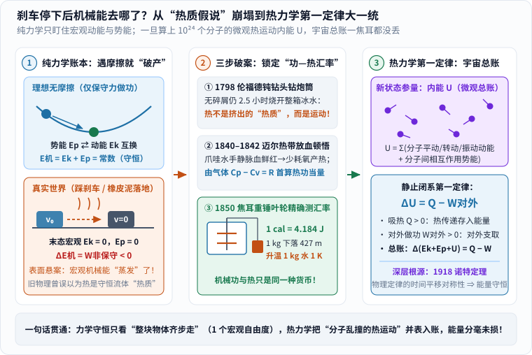
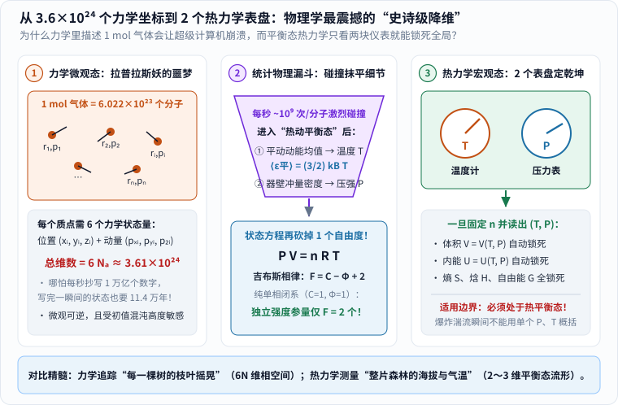
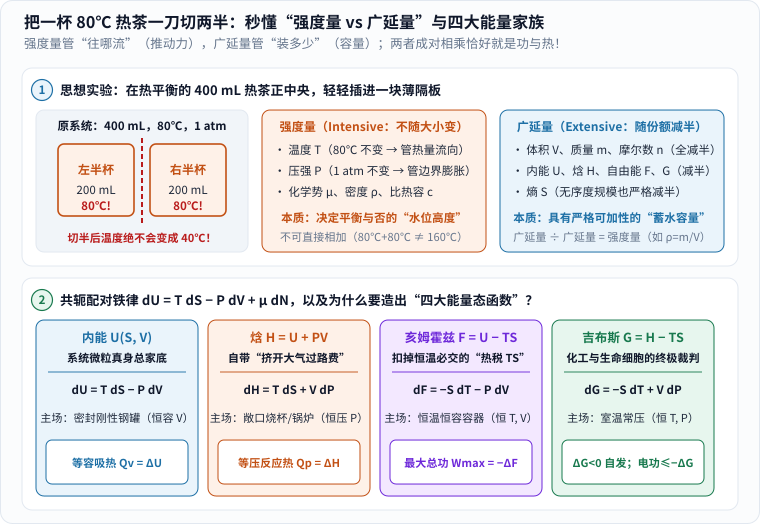
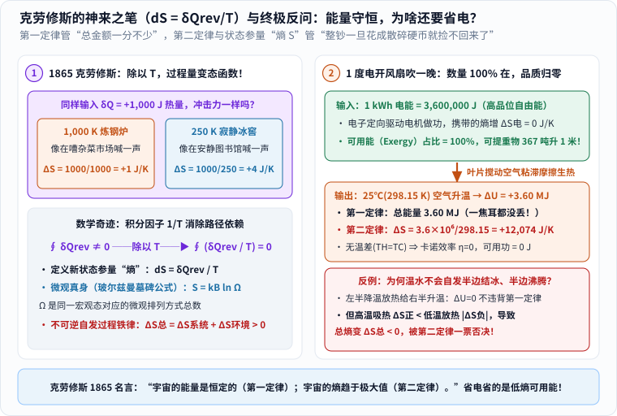

想象你在高速公路上开着一辆重 $1.5$ 吨（$m = 1{,}500\text{ kg}$）的家用轿车，车速表指在 $108\text{ km/h}$（即 $v = 30\text{ m/s}$）。

按中学物理最熟悉的动能公式一算，这辆车此刻怀揣着一笔相当可观的“运动巨款”：

$$E_k = \frac{1}{2}mv^2 = 675{,}000\text{ J}$$

$67.5$ 万焦耳是什么概念？如果全用来克服重力做功，足够把这辆 $1.5$ 吨的汽车垂直举上 **$45.9$ 米高空**——差不多是 **15 层居民楼的楼顶**！

可下一秒，前方突发状况，你一脚急刹到底。轮胎与地面嘶鸣摩擦，刹车钳死死咬住刹车盘，短短三四秒后，汽车稳稳停在平地上：

- 末态速度 $v = 0$，**动能归零**；
- 路面水平，车子高度没变，**重力势能没涨**；
- 车头也没撞上弹簧墙，**弹性势能也是零**。

如果只拿一本纯牛顿力学的账本去查账，你会当场冷汗直冒：**整整 $67.5$ 万焦耳的机械能，在光天化日之下“人间蒸发”了！**

再换一个你可能真动过念头的脑洞：**既然摩擦、搅拌能把机械运动变成热，那我拿一把勺子拼命搅拌杯子里的冰美式，能不能不插电把它活活搅沸腾？**

这两个看似一正一邪的问题，恰恰踩中了整个物理学史上最波澜壮阔的一次“跨界并账”——**从经典力学的机械能守恒，升级到热力学的普遍能量守恒；也逼着物理学家发明了一套偷懒到极致、却精准无比的语言：状态参量（State Variables）**。

今天，我们就顺着这笔“失踪巨款”，把力学与热力学的能量账本和状态密码彻底翻个底朝天。

---

## 一、纯力学的“半本账”：为什么一碰上摩擦，机械能守恒就失灵？

在经典力学（无论是牛顿力学，还是我们在[《为什么有了牛顿还需要分析力学》]()里聊过的拉格朗日与哈密顿力学）中，**动能定理**本身其实是永远成立的：合外力对物体做的总功，严格等于物体动能的增量（[OpenStax《大学物理》第 1 卷 §8.3](https://openstax.org/books/university-physics-volume-1/pages/8-3-conservation-of-energy)）。

但要想把“力做功”改写成“**能量守恒**”，力学必须满足一个苛刻的前提：**干活的力，必须是“保守力”（Conservative Force）**。

什么叫保守力？像万有引力、理想弹簧弹力、静电力这样，它们做功有一个极其优美的脾气——**只认起点和终点，绝不计较中间绕了多少弯路**。哪怕你把一颗铁球从一楼搬到十楼，再沿滑梯滑回一楼，只要回到出发点，重力做的净功一定严格为零：

$$\oint \mathbf{F}_{\text{保守} } \cdot \mathrm{d}\mathbf{r} = 0$$

正因为“绕一圈归零、跟路径无关”，数学家才获准给每一个空间位置 $\mathbf{r}$ 贴上一个唯一的“能量存款标价牌”——**势能 $E_p(\mathbf{r})$**（重力势能 $mgh$、弹性势能 $\frac{1}{2}kx^2$）。于是，在没有摩擦和空气阻力的理想世界里，动能 $E_k$ 和势能 $E_p$ 就像左右两个口袋倒腾零花钱，总机械能纹丝不动：

$$E_{\text{机} } = E_k + E_p = \text{常数}$$

**可一旦滑动摩擦力 $\mathbf{f}$ 登场，这套优美的势能魔法瞬间失灵！**

为什么物理老师从来不让你写“**摩擦势能**”？因为滑动摩擦力永远死死对着干——你往东推箱子 $5$ 米，它做负功；你再把箱子推回原位 $5$ 米，它非但不把刚才扣掉的能量吐回来，反而掉转枪口继续做负功！绕一圈回到原点：

$$\oint \mathbf{f} \cdot \mathrm{d}\mathbf{r} = -f \cdot L_{\text{总路程} } < 0$$

既然连回到同一个位置都算不出唯一的值，摩擦力根本**不存在只由位置决定的势能函数**。反映在宏观力学账面上，只要有非保守耗散力做功，机械能就必定一路缩水：

$$\Delta (E_k + E_p) = W_{\text{非保守} } < 0$$

在 18 世纪末以前，绝大多数科学家并不觉得这意味着“机械能变成了热”。当时统治学界的是大化学家拉瓦锡推崇的**“热质说”（Caloric Theory）**——人们坚信“热”是一种没有重量、不生不灭的隐形流体（热质）；钻木取火或刹车发烫，只不过是因为摩擦把木头、金属磨碎挤压，像拧湿毛巾一样把原本藏在材料缝隙里的“热质”挤了出来！

直到三位性格迥异的“破案高手”接力出手，才彻底撕碎了这张假账单。

---

## 二、大炮钻孔、鲜红静脉血与酿酒师少爷：锁定 $1\text{ cal} = 4.184\text{ J}$ 的铁打汇率

我们先看下面这张三步破案全景图。阅读时请**从左到右按 ① → ② → ③ 跟读**：左边是纯力学面对刹车停驻时的“账面亏空”，中间是历史上击碎热质说并测准“功—热汇率”的三记重锤，右边则是把微观分子运动并表入账后的热力学第一定律总账：

*图 1：从宏观机械能“消失悬案”到热力学第一定律大一统（[点击单独打开高清原图](/assets/images/thermo-mechanics/mechanical-loss-to-joule-bridge.svg)）。左栏展示保守力场中 $E_k + E_p$ 守恒与摩擦制动下宏观机械能归零的反差；中栏串联 1798 年伦福德钻炮实验、1840–1842 年迈尔的热功当量推算与 1850 年焦耳重锤叶轮精密实验；右栏展示引入微观状态参量“内能 $U$”后，宇宙总账重归严格守恒。*

### 1. 1798 年慕尼黑兵工厂：钝钻头烧开一箱冰水

第一锤砸在德国巴伐利亚的慕尼黑兵工厂。负责监造大炮的伦福德伯爵（Count Rumford，本名 Benjamin Thompson）发现，马匹拉着钻头给黄铜炮坯钻膛时，炮筒烫得惊人。

如果按“热质说”解释，热是从被削成碎屑的铜末里“挤”出来的，那么：第一，削不出碎屑就挤不出热；第二，被挤干了热质的铜屑，比热容肯定要比完整铜块小得多。

1798 年，伦福德干了一件绝妙的逆向实验（发表于英国皇家学会会刊 *Phil. Trans. R. Soc.* **88**, 80–102，[实验史料档案](https://en.wikipedia.org/wiki/An_Inquiry_Concerning_the_Source_of_the_Heat_Which_Is_Excited_by_Friction)）：他故意换上一把**彻底磨钝的钢钻头**，把整根炮筒泡进装满约 $12\text{ kg}$ 冷水的木箱里，让两匹马不停转圈干磨。

结果令全场围观者目瞪口呆：整整两个半小时下来，炮筒里只磨出了薄薄几十克金属粉，可木箱里的冷水竟然在**完全没点火**的情况下咕嘟咕嘟**剧烈沸腾**了！更致命的是，伦福德测了那点铜粉的比热容，和原封未动的黄铜块**一模一样**。他在论文里一针见血地写道：任何能从一个孤立物体里源源不断、无穷无尽榨出来的东西，绝不可能是守恒的物质实体——**唯一合理的解释，热就是运动（Motion）！**

### 2. 1840 年爪哇海港的一管鲜血：医生算出了第一笔“热功汇率”

知道“热是运动”还不够，想把账本合二为一，必须回答：**1 焦耳机械功，到底能换多少热？反过来，1 卡路里热又能换多少机械功？**

谁也没想到，第一个捅破这层窗户纸的不是物理教授，而是一位年仅 26 岁的德国随船医生——**尤利乌斯·罗伯特·冯·迈尔**（Julius Robert von Mayer）。

1840 年夏天，迈尔随荷兰商船抵达赤道附近的印尼爪哇岛（今雅加达）。在给患病水手做当时常见的静脉放血治疗时，他吃惊地发现：**水手手臂流出的静脉血鲜红欲滴，几乎和富含氧气的动脉血一个颜色！**（[休斯敦大学工程学院科学史档案第 722 期](https://engines.egr.uh.edu/episode/722)）

别的医生只当是热带怪病，迈尔脑中却劈过一道闪电：人体就像一台烧燃料的炉子，靠食物与氧气缓慢氧化来维持 $37^\circ\text{C}$ 体温并驱动肌肉干活；到了酷热的赤道，向环境散热极少，身体不需要烧那么多氧来产热，静脉血里自然剩下了大量氧气！顺着这条线索，他意识到：**食物化学能、身体散发的热量、肌肉输出的机械功，本质上是同一种守恒量在不同马甲下的转换！**

1842 年 5 月，迈尔发表成名短文，用极其漂亮的纯逻辑算出了人类历史上第一个“热功当量”：拿同样 $1\text{ mol}$ 气体升温 $1\text{ K}$，如果锁死容器体积（定容摩尔热容 $C_{V,m}$），吸收的热全用来给气体升温；如果让活塞顶着大气压自由膨胀（定压摩尔热容 $C_{P,m}$），气体除了升温，还必须额外多吸一笔热，专门用来推开活塞对外做机械功 $W = P\Delta V = R\Delta T$！因此两者之差必然等于气体常数 $R$（即**迈尔公式**）：

$$C_{P,m} - C_{V,m} = R$$

把当时测得的空气比热数据与气体膨胀功一对表，迈尔算出了每千卡热量对应的机械功（早期值约 $365\text{ kgf}\cdot\text{m/kcal}$，随后修正至 $425\text{ kgf}\cdot\text{m/kcal}$，与现代精确值 $426.6\text{ kgf}\cdot\text{m/kcal}$ 误差不到 $0.4\%$！）。

### 3. 1843–1850 年曼彻斯特叶轮：为什么搅不沸一杯冰咖啡？

真正用无可辩驳的实验精度让整个物理学界心服口服的，是英国曼彻斯特酿酒厂老板的儿子——**詹姆斯·普雷斯科特·焦耳**（James Prescott Joule）。

为了酿出好啤酒，焦耳练就了一手出神入化的测温绝活，他找工匠定制的水银温度计能读准到 **$(1/200)^\circ\text{F}$（约 $0.0028^\circ\text{C}$，不到千分之三摄氏度！）**。从 1843 年到 1850 年，焦耳换了四五种花样死磕：用手摇发电机通电发热、用活塞强行把水挤过细孔、压缩空气测温，最后定格在最经典的**重锤驱动铜叶轮搅水实验**（*Phil. Trans. R. Soc.* **140**, 61–82, 1850，[焦耳热功当量史料](https://en.wikipedia.org/wiki/Mechanical_equivalent_of_heat)）：

已知质量的铅锤在重力拉动下缓慢下落高度 $h$，减少的宏观重力势能 $mgh$ 通过细绳带动绝热铜桶里的叶轮疯狂搅水，叶轮与隔板把整块水的宏观旋转切碎成水分子的无规则碰撞，精准测出水温升高 $\Delta T$。无论用通电、压气还是叶轮搅水，换算汇率全都死死收敛在同一个常数上！

按现代国际单位制（[NIST CODATA 2022 基本物理常数](https://physics.nist.gov/cgi-bin/cuu/Value?r)），热化学卡路里与焦耳的精确换算定格为：

$$1\text{ cal}_{\text{th} } = 4.184\text{ J}$$

这就意味着，常温下让 $1\text{ kg}$ 液态水升温区区 $1\text{ K}$（即 $1^\circ\text{C}$），需要整整 $4{,}184\text{ J}$ 的能量。如果我们像焦耳一样靠 $1\text{ kg}$ 重锤自由落体来做功（取标准重力加速度 $g \approx 9.81\text{ m/s}^2$），重锤必须下坠多高？

$$h = \frac{4{,}184\text{ J} }{1\text{ kg} \times 9.81\text{ m/s}^2} \approx 426.5\text{ m}$$

**整整 $427$ 米！比上海金茂大厦屋顶还高！**

现在，我们可以笑着回答开头的两个问题了：

1. **急刹车的 $675{,}000\text{ J}$ 动能去哪了？** 一焦耳都没少！如果这辆车装了总重约 $20\text{ kg}$ 的铸铁刹车盘（铸铁比热容约 $460\text{ J/(kg}\cdot\text{K)}$），假设 $80\%$ 的制动能量灌进四只刹车盘，它们的平均温度将在短短三秒内暴涨 $\Delta T \approx \frac{540{,}000}{20 \times 460} \approx \mathbf{+58.7^\circ\text{C} }$——要是连续下长坡踩刹车，刹车盘真的会烧到 $500^\circ\text{C}$ 以上暗红发光！
2. **为什么你拿勺子搅不沸一杯凉咖啡？** 一杯 $300\text{ g}$ 的 $20^\circ\text{C}$ 凉咖啡烧开到 $100^\circ\text{C}$，哪怕杯子完全绝热不漏一丁点热，也需要：

   $$Q = m c \Delta T \approx 0.3 \times 4{,}184 \times 80 \approx 100{,}416\text{ J}$$

   而你单手拿小勺拼命搅水，传递进水里的机械功率撑死只有 **$1\text{ W}$（每秒 $1\text{ J}$）**。算一下时间：$100{,}416\text{ s} \approx \mathbf{27.9\text{ 小时} }$！在真实敞口杯里，杯壁每秒散掉的热早就远超 $1\text{ W}$，所以你哪怕把手腕摇脱臼，咖啡也只会稳稳凉透；反倒是功率高达 $1{,}200\text{ W}$ 的高速破壁料理机，空转打汤五六分钟真能靠刀片摩擦把冷水活活搅成滚烫浓汤！

### 4. 1918 年诺特定理：为什么微观总能量“绝对不可能”不守恒？

到了 1850 年，德国物理学家鲁道夫·克劳修斯（Rudolf Clausius）正式引入了一个核心概念——**内能 $U$（Internal Energy）**，把所有分子无规则平动、转动、振动的微观动能，以及分子间相互吸引排斥的微观势能全部打包进同一个账户，写下了**热力学第一定律**（[OpenStax《大学物理》第 2 卷 §3.3](https://openstax.org/books/university-physics-volume-2/pages/3-3-first-law-of-thermodynamics)；[NASA 格伦研究中心热力学第一定律导论](https://www1.grc.nasa.gov/beginners-guide-to-aeronautics/first-law-conservation-of-energy/)）：

$$\Delta E_{\text{宏观} } + \Delta U = Q - W$$

对于静止不动的封闭系统（$\Delta E_{\text{宏观} } = 0$），它就简化为我们最熟悉的样子：

$$\Delta U = Q - W$$

其中：
- **$\Delta U$**：系统内能的变化量（单位：$\text{J}$）；
- **$Q$**：系统从外界吸收的热量（吸热 $Q > 0$，放热 $Q < 0$）；
- **$W$**：系统对外界所做的功（膨胀推活塞对外做功 $W > 0$，被外界压缩对内做功 $W < 0$）。

> **防晕贴士：物理书和化学书的加减号为什么相反？**
> 物理与工程热力学诞生于蒸汽机时代，工程师最关心“机器对外干了多少活”，所以定义**系统对外做功 $W > 0$**，对外干活消耗家底，自然写 **$\Delta U = Q - W$**；而化学（IUPAC 惯例）把系统当成烧瓶里的反应物，定义**外界对系统做功 $W_{\text{外} } > 0$**（$W_{\text{外} } = -W$），自然写 **$\Delta U = Q + W_{\text{外} }$**。两本账说的完全是同一个事实：**期末余额变动 = 存入热 − 支取功**！

更震撼的底层答案在 1918 年揭晓：德国数学家**艾米·诺特**（Emmy Noether）发表了统领现代物理的**诺特定理**（[诺特定理数学与物理史料](https://en.wikipedia.org/wiki/Noether%27s_theorem)）——自然界的每一条连续对称性，都严格对应一条守恒定律：
- 空间平移对称性 $\implies$ **动量守恒**；
- 空间旋转对称性 $\implies$ **角动量守恒**；
- **时间平移对称性**（今天做实验和明天做实验遵循完全相同的基本物理规律） $\implies$ **总能量严格守恒**！

换句话说，踩刹车时根本没有什么“时间对称性破缺”！在原子尺度上，电磁相互作用是完全保守的；所谓“摩擦耗散”，仅仅是能量从“**整辆车 $10^{27}$ 个原子朝着同一个方向齐步走**”（宏观动能），打散成了“**刹车盘和空气里 $10^{25}$ 个原子各自向四面八方乱颤**”（热力学内能 $U$）。

---

## 三、到底什么是“状态参量”？一张银行账单与三条 $P\text{–}V$ 登山路

打通了能量守恒，紧接着就是热力学最让人拍案叫绝、也最容易让初学者踩坑的第二个核心概念：**状态参量（State Variable，又称态函数 State Function）**。

为什么物理老师总是一脸严肃地纠正你：
- 可以说“这罐气体现在的**温度**是 $300\text{ K}$、**压强**是 $2\text{ bar}$、**内能**是 $3\text{ kJ}$”；
- **绝对不准说**“这罐气体体内**含有** $5\text{ kJ}$ 的**热量**”或“**含有** $4\text{ kJ}$ 的**功**”？！

用一张**银行卡**打个比方，三秒钟就能通透：

- **内能 $U$（以及 $P, V, T, S, H$）是“账户实时余额”**：此时此刻打开手机银行，卡里显示余额 `4,500 元`。这个数字只取决于账户**当前所处的状态**——至于这 `4,500 元` 是你上个月省吃俭用存下来的，还是先中了十万彩票又刷卡买了九万五千五百块设备剩下的，余额数字**完全没有历史记忆**。这就叫**状态参量**！
- **热量 $Q$ 和功 $W$ 是“转账与刷卡流水”**：存款可以增加余额，刷卡可以减少余额，但它们只在“交易发生的过程”中存在。一旦交易结束回到静态账户，卡里躺着的统统叫“余额（内能 $U$）”，绝不存在“卡里躺着 `3,000 元` 现金存款 + `1,500 元` 微信红包”的区别！这就叫**过程量（Path Function）**！

口说无凭，我们直接拿 **$1\text{ mol}$ 单原子理想气体**（如氦气或氩气，内能精确满足 $U = \frac{3}{2}nRT = \frac{3}{2}PV$）在 $P\text{–}V$ 状态图上真刀真枪算三笔账！

请看下面这张交互式分步图解（支持一次自动描迹动画，[点击单独打开 SVG 并刷新可重播绘制过程](/assets/images/thermo-mechanics/pv-paths-state-vs-process-anim.svg)；若系统开启“减少动态效果”则直接展示完整终态）。阅读顺序：**先看左图的起点 A 和终点 B → 对比橙、蓝、绿三条不同过程曲线下方的阴影面积（即对外做功 $W = \int P\,\mathrm{d}V$） → 再核对右栏三张对账单里的 $W$、$Q$ 与 $\Delta U$**：

*图 2：状态参量 vs 过程量的精确数值验证（[点击单独打开 SVG 动画](/assets/images/thermo-mechanics/pv-paths-state-vs-process-anim.svg)）。$1\text{ mol}$ 单原子理想气体从完全相同的初态 $A(2.0\text{ bar}, 10\text{ L})$ 出发，抵达完全相同的末态 $B(1.0\text{ bar}, 30\text{ L})$：三条路线对外做功 $W$（曲线下面积）依次为 $4.00\text{ kJ}$、$3.00\text{ kJ}$、$2.00\text{ kJ}$，吸热 $Q$ 依次为 $5.50\text{ kJ}$、$4.50\text{ kJ}$、$3.50\text{ kJ}$，但差值 $Q - W$ 毫厘不差地锁死在 $\Delta U = +1.50\text{ kJ}$！*

我们来亲手验算一下这组漂亮得像艺术品的数字（注意单位换算：$1\text{ bar} = 10^5\text{ Pa}$，$1\text{ L} = 10^{-3}\text{ m}^3$，因此 $1\text{ bar}\cdot\text{L} = 100\text{ J} = 0.10\text{ kJ}$）：

1. **先锁定起点与终点的“海拔高度”（内能 $U$）**：
   - 初态 $A$（$P_A = 2.0\text{ bar}, V_A = 10\text{ L}$）：$P_A V_A = 20\text{ bar}\cdot\text{L} = 2.00\text{ kJ}$，故初态内能 $U_A = \frac{3}{2}P_A V_A = \mathbf{3.00\text{ kJ} }$（对应温度 $T_A = \frac{P_A V_A}{nR} \approx 240.5\text{ K}$）；
   - 末态 $B$（$P_B = 1.0\text{ bar}, V_B = 30\text{ L}$）：$P_B V_B = 30\text{ bar}\cdot\text{L} = 3.00\text{ kJ}$，故末态内能 $U_B = \frac{3}{2}P_B V_B = \mathbf{4.50\text{ kJ} }$（对应温度 $T_B \approx 360.8\text{ K}$）；
   - **内能增量**：无论中间怎么折腾，只要从 $A$ 走到 $B$，必然有：

     $$\Delta U = U_B - U_A = +1.50\text{ kJ}$$

2. **再算三条不同“登山路线”的做功 $W$ 与吸热 $Q$**（[OpenStax《大学物理》第 2 卷 §3.2](https://openstax.org/books/university-physics-volume-2/pages/3-2-work-heat-and-internal-energy)）：
   - **路线 ①（上折线：先保持 $2.0\text{ bar}$ 高压膨胀到 $30\text{ L}$，再锁死体积冷却到 $1.0\text{ bar}$）**：
     高气压下推活塞最费劲！做功等于最高的大矩形面积 $W_1 = 2.0\text{ bar} \times (30 - 10)\text{ L} = \mathbf{+4.00\text{ kJ} }$。为了在对外大把花掉 $4.00\text{ kJ}$ 的同时，还能让卡里余额净涨 $1.50\text{ kJ}$，全程必须狂吸热量 $Q_1 = \Delta U + W_1 = \mathbf{+5.50\text{ kJ} }$！
   - **路线 ②（中斜线：一边均匀降压、一边膨胀到终点）**：
     曲线下方是一块直角梯形，面积 $W_2 = \frac{2.0 + 1.0}{2}\text{ bar} \times 20\text{ L} = \mathbf{+3.00\text{ kJ} }$；相应净吸热 $Q_2 = 1.50 + 3.00 = \mathbf{+4.50\text{ kJ} }$。
   - **路线 ③（下折线：先把气缸锁死在 $10\text{ L}$ 放热降压到 $1.0\text{ bar}$，再在低压下轻松膨胀到 $30\text{ L}$）**：
     低气压下推活塞省了一半力气！做功只剩底下扁矩形面积 $W_3 = 1.0\text{ bar} \times 20\text{ L} = \mathbf{+2.00\text{ kJ} }$；全程净吸热只需 $Q_3 = 1.50 + 2.00 = \mathbf{+3.50\text{ kJ} }$！

你看！为了提醒大家千万别把这两类量搞混，微积分在写法上专门设了一道“防呆红线”：

$$\mathrm{d}U = \delta Q - \delta W$$

- 左边状态参量用正体微元 **$\mathrm{d}U$**（全微分 Exact Differential），积分只看两端：$\int_A^B \mathrm{d}U = U_B - U_A$，走闭合一圈必定归零 $\oint \mathrm{d}U = 0$；
- 右边过程量必须用希腊字母 **$\delta Q$、$\delta W$**（不完全微分 Inexact Differential），积分严重依赖路径，绝对不能写成什么“$Q_B - Q_A$”！

更妙的是，假如你让气缸**顺着路线 ① 从 $A$ 膨胀到 $B$（对外做功 $+4.00\text{ kJ}$），再顺着路线 ③ 逆行压回 $A$（外界仅耗功 $-2.00\text{ kJ}$）**——回到起点 $A$ 时，所有状态参量（$P, V, T, U$）分毫不差复原（$\oint \mathrm{d}U = 0$），但这一去一回却白白净赚出了图 2 中间那块橙色矩形面积的机械功（$\oint \delta W = 4.00 - 2.00 = \mathbf{+2.00\text{ kJ} }$），代价恰好是净吸了 $+2.00\text{ kJ}$ 的热！**人类所有蒸汽机、汽轮机和汽车发动机的循环做功原理，全浓缩在这块闭合面积里了。**

这也顺手解释了一个生活小体验：**为什么给自行车轮胎打气时，打气筒底部会烫手？** 因为你猛压活塞的速度极快，空气来不及向管壁散热（近似绝热过程 $Q \approx 0$），你压活塞对气体做功（$W < 0$），根据 $\Delta U = -W > 0$，你手臂输出的机械功直接灌成了气体内能，空气温度瞬间飙升几十摄氏度！

---

## 四、从 $3.61\times 10^{24}$ 个力学坐标到 2 个表盘：物理学最疯狂的“降维打击”

既然力学和热力学都有“状态参量”，这两门学科挑选状态参量的胃口到底差了多少？

答案是：**整整差了二十四个数量级！**

我们在[《为什么有了牛顿还需要分析力学》]()中见过，在经典力学（哈密顿相空间）里，你想彻底锁定一颗台球此时的“力学状态”，从而用运动方程预测它下一秒去哪，你必须同时报出 **6 个独立数字**：三维空间坐标 $(x, y, z)$ 加上三维动量 $(p_x, p_y, p_z)$。缺了动量，你连球正往哪边飞都不知道！

那如果把研究对象换成你手心里一只普通气球——里面装着区区 **$1\text{ mol}$ 氦气**（标准状况下约 $22.4\text{ L}$，质量才 $4$ 克），按纯力学规矩，要写清它此刻的“力学微观态”，一共需要多少个状态参量？

根据阿伏伽德罗常数 $N_A = 6.02214076 \times 10^{23}\text{ mol}^{-1}$（[NIST 精确常数定义](https://physics.nist.gov/cgi-bin/cuu/Value?k)），总自由度是：

$$D_{\text{力学} } = 6 N_A \approx 3.613 \times 10^{24}$$

**$3.61$ 万亿亿亿个实数！** 这是什么概念？哪怕召集全世界最顶级的超级计算机，以每秒钟抄写 **1 万亿（$10^{12}$）** 个坐标的恐怖速度日夜不停地记账，仅仅把这只小气球“**此时此刻这一瞬间**”的力学状态抄完，也要整整抄上 **$11.45$ 万年**——从尼安德特人一直抄到今天还没抄完！

可到了热力学工程师手里，他连看都不看单个分子一眼，只在气罐上拧了一支**温度计（$T$）**和一块**压力表（$P$）**，瞄了一眼两个读数，一拍胸脯说：“行了，这 $1\text{ mol}$ 气体的状态我已经 **100% 彻底锁死**了！”

凭什么 $3.61 \times 10^{24}$ 个数字，能被硬生生压缩成 **2 个数字**？请顺着图 3 的三步漏斗往右看：

*图 3：从 $6N_A$ 维哈密顿相空间到 2 维平衡态流形的降维机制（[点击单独打开高清原图](/assets/images/thermo-mechanics/microstate-6n-to-macrostate-funnel.svg)）。左栏为经典力学追踪每个分子 $(\mathbf{r}_i, \mathbf{p}_i)$ 的微观态；中栏统计物理漏斗通过高频碰撞达到热动平衡，将平均平动动能映射为温度 $T$、动量冲量映射为压强 $P$，再由状态方程砍掉一个冗余度；右栏在固定物质的量 $n$ 的单相闭系中，仅需 2 个独立表盘即可唯一确定所有热力学态函数。*

这场“史诗级降维”靠的是两把快刀：

1. **第一刀：统计平均抹平个体差异（连接微观与宏观的桥梁）**
   常温常压下，每个气体分子每秒要和邻居撞击约 **$10^9$（十亿）次**。哪怕你刚开始往左半边吹了一口快分子，不到几毫秒，密集的碰撞就会把速度分布彻底洗牌成最稳定的麦克斯韦—玻尔兹曼分布，系统进入宏观性质不再随时间乱跳的**热动平衡态（Thermodynamic Equilibrium）**（[OpenStax《大学物理》第 2 卷 §2.1](https://openstax.org/books/university-physics-volume-2/pages/2-1-molecular-model-of-an-ideal-gas)）。
   在平衡态下，热力学温度 $T$ 的微观真身水落石出——它就是单个分子平均平动动能的标尺：

   $$\langle \varepsilon_{\text{平} } \rangle = \frac{3}{2} k_B T$$

   其中玻尔兹曼常数 $k_B = 1.380649 \times 10^{-23}\text{ J/K}$ 就像一座纳米汇率桥，把微观的“每分子焦耳”直接翻译成宏观的“开尔文温度”；而无数分子密集撞击器壁产生的平均法向冲量，则稳稳汇聚成了宏观压强 $P$。

2. **第二刀：状态方程与吉布斯相律再砍自由度**
   对于固定了摩尔数 $n$ 的纯净气体，$P$、$V$、$T$ 三个宏观参量并不是各自独立的，它们被一条铁律绑在同一张二维曲面上（对稀薄气体就是理想气体状态方程）：

   $$P V = n R T$$

   更一般地，美国物理学家吉布斯（J. Willard Gibbs）证明了著名的**吉布斯相律**：对含 $C$ 种化学组分、$\Phi$ 个相的平衡热力学系统，独立强度状态参量的个数为：

   $$F = C - \Phi + 2$$

   对于一杯纯水或一罐纯氦气（单组分 $C = 1$，单相 $\Phi = 1$），独立强度度恰好只有 **$F = 1 - 1 + 2 = 2$**！一旦给定总物质的量 $n$ 并读出 $(T, P)$ 两个表盘，体积 $V(T,P)$、密度 $\rho(T,P)$、内能 $U(T,P)$、声速、折射率乃至粘度，全都像多米诺骨牌一样被唯一敲定！

> **关键边界与反例：什么时候“状态参量”会当场失效？**
> 记住热力学这把降维神剑的唯一前提——**系统必须处于（或局部处于）热动平衡态！**
> 想象一颗手雷刚起爆的微秒瞬间，或者隔板突然抽走、气体向真空猛扑的**自由膨胀瞬间**：容器左边气压高、右边接近真空，不同方向分子速度乱成一锅粥，此时你要问“这团气体现在的压强 $P$ 是多少？温度 $T$ 是多少？”，答案是**根本没有单一全局的 $P$ 和 $T$**！在 $P\text{–}V$ 图上，只有准静态平衡过程才能画出实线，剧烈非平衡过程只能画虚线，因为中间根本没有落在平衡态曲面上！

---

## 五、一刀切开一杯 $80^\circ\text{C}$ 热茶：强度量 vs 广延量，以及为什么要造出“四大能量兄弟”？

打开一本热力学手册，状态参量琳琅满目：$T, P, V, m, n, \rho, \mu, U, H, F, G, S\dots$ 难道要死记硬背？

完全不用！只要做一次**“热茶切半思想实验”**，所有状态参量当场自动站成整整齐齐的两排。请先看图 4 上半部分的隔板实验，再看下半部分四个能量态函数的“主场分工”：

*图 4：状态参量的“切半分类法”与四大热力学势家族（[点击单独打开高清原图](/assets/images/thermo-mechanics/extensive-intensive-and-potentials.svg)）。上半图展示在 $400\text{ mL}$、$80^\circ\text{C}$ 热茶正中插入薄隔板后，强度量（$T, P, \mu, \rho$）保持原值，广延量（$V, m, n, U, S$）严格减半；下半图展示通过共轭变量配对构造的内能 $U$、焓 $H$、亥姆霍兹自由能 $F$ 与吉布斯自由能 $G$ 各自统治的真实工程场景。*

### 1. 切一刀立判高下：管“往哪流”的强度量 vs 管“装多少”的广延量

桌上有满满一杯处于热平衡的热茶：体积 $400\text{ mL}$、温度 $80^\circ\text{C}$（$353.15\text{ K}$）、压强 $1\text{ atm}$。现在你在杯子正中央悄无声息插进一块极薄的隔板，把它平分成左右两半杯，请问每一半的参数怎么变？

- **第一排：纹丝不动的“强度量”（Intensive Variables）**
  左半杯茶是 $80^\circ\text{C}$，右半杯茶依然是 **$80^\circ\text{C}$**——绝不可能一刀切出两杯 $40^\circ\text{C}$ 的温水！同理，压强还是 $1\text{ atm}$，茶水密度 $\rho$ 没变，水分子的化学势 $\mu$ 也没变。
  **核心脾气**：强度量与系统规模无关，**不能直接相加**（两杯 $80^\circ\text{C}$ 的水倒在一起还是 $80^\circ\text{C}$，不是 $160^\circ\text{C}$！）。它们扮演的角色是**“水位高度／驱动势”**——正如我们在[《傅里叶怎样把温度拆成波》]()与[《明明从同一张嘴吹出来，为什么哈气暖手、吹气却冰凉？》]()中看到的，热量从不管谁的内能总家底厚（太平洋总内能比一根烧红的铁钉大亿万倍，但把红铁钉扔进太平洋，热量照样从铁钉流向大海！），**热量只听从强度量“温度 $T$”的高低差指挥**；体积膨胀只听从“压强 $P$”的高低差指挥；物质扩散与相变只听从“化学势 $\mu$”的高低差指挥！

- **第二排：严格减半的“广延量”（Extensive Variables）**
  左半杯体积变成 $200\text{ mL}$，质量 $m$ 减半，水分子摩尔数 $n$ 减半，所含的微观总内能 $U$ 减半，连微观混乱规模——熵 $S$ 也严格减半！
  **核心脾气**：广延量代表“蓄水容量”，具有**严格可加性**。更有意思的是，**任意两个广延量一相除，规模因子上下抵消，立刻变成强度量**（例如质量除以体积 $\rho = m/V$ 是密度，内能除以质量 $u = U/m$ 是比内能，[NASA 比状态参量讲义](https://www1.grc.nasa.gov/beginners-guide-to-aeronautics/first-law-conservation-of-energy/)）！

更令物理学家着迷的是：**在全宇宙所有的能量交换公式里，永远是一个“强度量”牵手一个“广延量的微元”，成双成对出现！**
- 力学拉弹簧：$F\,\mathrm{d}x$（拉力强度 $\times$ 伸长广延量）；
- 电池充放电：$\Phi\,\mathrm{d}q$（电势强度 $\times$ 电荷广延量）；
- 流体体积功：$-P\,\mathrm{d}V$（压强强度 $\times$ 体积广延量）；
- 可逆热传递：$T\,\mathrm{d}S$（温度强度 $\times$ 熵广延量）；
- 开放系加减粒子：$\mu\,\mathrm{d}N$（化学势强度 $\times$ 粒子数广延量）。

把它们合体，就是统领整个平衡态热力学的**热力学基本方程**：

$$\mathrm{d}U = T\,\mathrm{d}S - P\,\mathrm{d}V + \mu\,\mathrm{d}N$$

### 2. 既然已经有了内能 $U$，为什么还要发明焓 $H$、自由能 $F$ 和 $G$？

很多同学背热力学公式最抓狂的就是：**明明内能 $U$ 已经是系统的真实微观总能量了，科学家吃饱了撑的，干嘛还要造出焓 $H$、亥姆霍兹自由能 $F$、吉布斯自由能 $G$ 这三个“马甲能量”？**

答案特别接地气：**因为我们在实验室和日常生活里做饭、做化学反应、用手机电池，几乎从来不在“密封钢罐”里干活，而是在“敞口大气压”和“恒定室温”下干活！**

拿最常见的**敞口烧水／敞口烧杯化学反应**举例：
你在厨房（恒定大气压 $P = 1\text{ atm}$）烧开一壶水，部分水变成水蒸气，体积膨胀了 $\Delta V$。这时候，水蒸气要想在地球大气层底下腾出自己的一席之地，**必须像交“占地过路费”一样，先把头顶沉甸甸的大气层往上顶开，硬付出一笔体积膨胀功 $W = P\Delta V$！**

于是根据第一定律 $\Delta U = Q_P - P\Delta V$，你在炉灶下输入的燃料热量 $Q_P$，自动分成了两笔：

$$Q_P = \Delta U + P\Delta V = \Delta (U + PV)$$

如果每次测个营养热量或化学反应热，都得拿精密尺子去量气体膨胀了多少毫升再补回 $P\Delta V$，全世界的化学家都要疯掉！于是荷兰物理学家昂内斯与吉布斯干脆把“本身家底 $U$”和“推开大气的占地费 $PV$”打包成一个全新的状态参量，取名**焓（Enthalpy）**：

$$H = U + PV$$

只要压强 $P$ 恒定，你在敞口烧杯里测到的吸放热 $Q_P$，**一分不差就等于状态参量焓的增量 $\Delta H$**！食品包装袋背面的“能量表”，测的其实就是营养物质氧化时的焓变！

同理（数学上这叫把自变量从难控制的 $(S, V)$ 切换到好控制的 $(T, P)$ 的**勒让德变换**）：
- 如果环境锁死**恒温恒容**（如刚性反应釜），系统对外干活时必须和恒温热源交换一笔“热税 $T\Delta S$”，扣掉热税后真正能榨出来的最大总功由**亥姆霍兹自由能 $F = U - TS$** 说了算；
- 如果环境锁死**室温常压**（比如你手里的锂电池放电、或者人体细胞里 ATP 供能），既要扣掉挤大气的体积功，又要扣掉恒温热税，真正能输出的**最大非体积有用功（比如电能！）**，完全由**吉布斯自由能**拍板：

  $$G = H - TS = U + PV - TS$$

  $$W_{\text{非体积,max} } = -\Delta G$$

这就是为什么氢氧燃料电池反应时，虽然总放热焓变 $|\Delta H|$ 高达 $285.8\text{ kJ/mol}$，但在 $25^\circ\text{C}$ 常压下理论上最多只能发出 $-\Delta G = 237.1\text{ kJ/mol}$ 的电能——剩下的 $48.7\text{ kJ/mol}$ 是向环境交纳的热力学“法定熵税 $T|\Delta S|$”，天王老子来了也免不掉！

---

## 六、终极追问：既然能量一分钱都不会少，我们为什么还要“节约能源”？

讲到这里，每一个动脑筋的读者心里都会浮现出那个终极灵魂拷问：

> **既然热力学第一定律和诺特定理拍着胸脯保证“宇宙总能量永远严格守恒、一焦耳都不会少”，那全世界为什么还会闹“能源危机”？爸妈为什么从小教育我们要随手关灯省电？**

更进一步，再想一个细思极恐的日常反例：
桌上放着一杯 $400\text{ mL}$、$25^\circ\text{C}$ 的温水。如果左半杯水把自己的 $20\text{ kJ}$ 内能悄悄传给右半杯水，变成“**左半杯结成冰碴、右半杯滚烫冒烟**”，我们来查查热力学第一定律的账：左半杯少 $20\text{ kJ}$，右半杯多 $20\text{ kJ}$，总能量变化 $\Delta U_{\text{总} } = -20 + 20 = 0$——**完全遵守能量守恒！** 可为什么从盘古开天辟地到今天，从来没有任何人见过一杯温水自己一半结冰、一半沸腾？

因为第一定律只管**“总金额对不对”**，却是个彻底的“方向盲”；真正掌管时间箭头与能量身价高低的，是克劳修斯在 1865 年揪出来的最后一个王牌状态参量——**熵 $S$（Entropy）**（[OpenStax《大学物理》第 2 卷 §4.6](https://openstax.org/books/university-physics-volume-2/pages/4-6-entropy)；[克劳修斯生平与 1865 论文史料](https://en.wikipedia.org/wiki/Rudolf_Clausius)）。

请顺着图 5 从左栏（克劳修斯怎样把过程量 $\delta Q$ 点石成金变成状态参量 $S$）读到右栏（$1$ 度电吹一晚风扇的真实账单）：

*图 5：状态参量“熵 $S$”的诞生与能量品质贬值（[点击单独打开高清原图](/assets/images/thermo-mechanics/clausius-entropy-and-energy-quality.svg)）。左栏对比同样 $+1{,}000\text{ J}$ 热量注入 $1{,}000\text{ K}$ 高温炉与 $250\text{ K}$ 冰窖时的冲击差异，揭示除以绝对温度 $T$ 如何使不完全微分 $\delta Q_{\text{rev} }$ 变为全微分 $\mathrm{d}S$；右栏拆解 $1\text{ kWh}$ 电能耗散为室温内能时“数量 100% 守恒、可用功归零”的真相，并解释温水为何不能自发冷热分离。*

### 1. 克劳修斯的数学魔术：除以温度 $T$，流水单秒变余额表！

前面我们刚说过，热量 $\delta Q$ 是个跟路径绑死的“过程量”，绕闭合循环一圈 $\oint \delta Q_{\text{rev} } \neq 0$。可克劳修斯在研究卡诺热机循环时发现了一个惊人的数学奇迹：

同样往系统里塞进 $1{,}000\text{ J}$ 的热量，它造成的微观混乱冲击，完全取决于系统原本有多热！
- 往 **$1{,}000\text{ K}$ 沸腾喧嚣的炼钢炉**里添 $1{,}000\text{ J}$ 热，就像在人声鼎沸的菜市场里喊了一嗓子，几乎掀不起波澜（比值 $\frac{1{,}000}{1{,}000} = +1\text{ J/K}$）；
- 往 **$250\text{ K}$ 寂静寒冷的冰窖**里添 $1{,}000\text{ J}$ 热，就像在鸦雀无声的深夜图书馆里吼了一嗓子，微观无序度当场剧增四倍（比值 $\frac{1{,}000}{250} = +4\text{ J/K}$）！

一旦把可逆微元热量 $\delta Q_{\text{rev} }$ **除以当时的绝对温度 $T$**（数学上称 $1/T$ 为积分因子），奇迹发生了——沿任意可逆闭合循环绕一圈，积分精确归零：

$$\oint \frac{\delta Q_{\text{rev} } }{T} = 0$$

既然绕一圈归零、只看起点和终点，说明 $\frac{\delta Q_{\text{rev} } }{T}$ 已经褪去了路径记忆，脱胎换骨成了一个真正的**状态参量**！克劳修斯特意挑选希腊语“转化（τροπή）”一词，模仿“能量（Energy）”的拼写，为这个新态函数取名 **Entropy（熵，1923 年中国物理学家胡刚复取“热量与温度之商”加火字旁造出的神译！）**：

$$\mathrm{d}S = \frac{\delta Q_{\text{rev} } }{T}$$

十几年后，奥地利物理学家玻尔兹曼（Ludwig Boltzmann）揭开了熵在微观统计世界里的底牌（刻在他维也纳墓碑上的永恒公式）：

$$S = k_B \ln \Omega$$

其中 $\Omega$ 是同一个宏观平衡态背后对应的**微观分子排列方式总数**！温水之所以绝不会自己变成“半杯冰 + 半杯开水”，是因为热量从低温往高温倒流会让高温区增加的熵小于低温区减少的熵（例如 $\frac{+20\text{ kJ} }{350\text{ K} } + \frac{-20\text{ kJ} }{273\text{ K} } \approx -16.1\text{ J/K} < 0$），意味着微观状态数 $\Omega$ 缩水了 $e^{16.1 / k_B} \approx 10^{5 \times 10^{23} }$ 倍——比猴子在键盘上乱敲一次性打出全套《莎士比亚全集》还要离谱无数亿倍！**热力学第二定律（孤立系统 $\Delta S_{\text{总} } \ge 0$）当场一票否决！**

### 2. 1 度电吹一晚风扇：钱没少，但一分都花不出去了

现在再看你卧室里开了整整一夜、耗掉 **1 度电（$1\text{ kWh} = 3{,}600{,}000\text{ J}$）** 的电风扇：

- **出发时**：墙上插座送来的 $3.60\text{ MJ}$ 电能，是电子高度有序推动电机做功的**顶级高品位能量**，它不携带热混乱（熵增贡献为 $0$），工程热力学称之为 **$100\%$ 可用能（Exergy，中文专名“㶲”）**——如果接上理想卷扬机，这 1 度电足足能把 **$367$ 吨货物吊高 $1$ 米**！
- **天亮后**：风扇叶片吹出的风撞上墙壁、窗帘，在空气粘滞摩擦中彻底平息，整整 $3.60\text{ MJ}$ 能量一分不差地留在了密闭房间里，让全屋空气温度微微升高了一点点。
  - **查第一定律（数量账）**：能量丢了吗？**一焦耳都没丢！** $3{,}600{,}000\text{ J} = 3{,}600{,}000\text{ J}$。
  - **查第二定律（品质账）**：这笔能量散入 $25^\circ\text{C}$（$T_0 = 298.15\text{ K}$）的环境空气后，直接制造了巨大的不可逆熵增：

    $$\Delta S = \frac{3.60 \times 10^6\text{ J} }{298.15\text{ K} } \approx +12{,}074\text{ J/K}$$

  此时整间屋子冷热均匀，找不到更冷的低温热源（$T_H = T_C = T_0$）。哪怕你搬来全宇宙最完美的卡诺热机，最大热功转换效率也是：

  $$\eta_{\text{max} } = 1 - \frac{T_C}{T_H} = 0$$

  **你能从中重新榨回来的机械功或电能，严格等于 $0\text{ J}$！**

这就像你原本手握一张崭新的百元大钞（高品位电能／化石与核能／太阳辐射自由能），随手把它磨成了十万粒混进撒哈拉沙漠里的金粉——金子的总原子数一粒没少（**能量守恒**），但你再也筛不回来买半个馒头了（**熵增贬值**）。**我们交电费买的、全社会拼命节约的，从来不是第一定律里那个永生不灭的“能量总数”，而是极其珍贵、一旦耗散就有去无回的“低熵自由能”！**

---

## 七、一张总表收官：力学 vs 热力学的能量与状态全景对照

最后，我们把经典力学与平衡态热力学这两套人类智慧巅峰的账本放在同一张桌面上，做一次清清楚楚的终极合账：

| 对比维度 | 经典力学（牛顿 / 哈密顿视角） | 平衡态热力学（克劳修斯 / 吉布斯视角） |
| :--- | :--- | :--- |
| **追踪对象** | 单个质点、刚体或少数天体 | 含 $\sim 10^{23}$ 个微粒的宏观连续物质系统 |
| **独立状态参量个数** | $N$ 粒子需 **$6N$ 个**（如 $1\text{ mol}$ 需 $3.61\times 10^{24}$ 个坐标与动量） | 纯单相固定质量闭系仅需 **2 个**（如温度 $T$ 与压强 $P$） |
| **核心状态参量（态函数）** | 位置 $\mathbf{r}$、动量 $\mathbf{p}$、角动量 $\mathbf{L}$、保守势能 $E_p(\mathbf{r})$ | 强度量 $(T, P, \mu)$；广延量 $(V, n, U, H, F, G, S)$ |
| **核心过程量（路径函数）** | 外力功 $W = \int \mathbf{F}\cdot\mathrm{d}\mathbf{r}$、冲量 $\mathbf{I} = \int \mathbf{F}\,\mathrm{d}t$ | 热量 $Q$（$\delta Q$）、各类体积功与非体积功 $W$（$\delta W$） |
| **能量守恒定律形态** | 仅保守力做功时：$E_k + E_p = \text{常数}$；遇摩擦则宏观机械能减少 | **普遍严格守恒**：$\Delta E_{\text{宏观} } + \Delta U = Q - W$（无惧摩擦与相变） |
| **时间方向与可逆性** | 微观运动方程时间反演对称（倒放录像同样合法） | 第二定律 $\Delta S_{\text{总} } \ge 0$ 赋予不可逆的宏观**时间箭头** |

1865 年，克劳修斯在那篇诞生了“熵”字的传世论文结尾，用两行简短的德文写下了整座热力学大厦的宇宙墓志铭：

1. **宇宙的能量是恒定的。**（第一定律：守住数量底线）
2. **宇宙的熵趋向于极大值。**（第二定律：指明演化方向）

下次当你踩下汽车刹车感受轮毂散发的余温、给单车轮胎打气摸到发烫的气筒、看烧水壶顶起壶盖噗噗冒汽，或者离开房间顺手关掉那盏灯时，你看到的就不再是零散的生活琐事——那是 $10^{24}$ 个微观粒子正在精确执行诺特定理的守恒铁律，也是温度、压强、内能与熵这几个精巧的状态参量，正在替人类稳稳看管着浩瀚宇宙的能量总账。

---

## 参考资料与核查来源

1. **NIST CODATA 2022 基本物理常数官方数据库**：[玻尔兹曼常数 $k_B = 1.380649 \times 10^{-23}\text{ J/K}$](https://physics.nist.gov/cgi-bin/cuu/Value?k) 与 [摩尔气体常数 $R = 8.314462618\dots\text{ J/(mol}\cdot\text{K)}$](https://physics.nist.gov/cgi-bin/cuu/Value?r) — 核查现代国际单位制精确定义、阿伏伽德罗常数 $N_A = R/k_B$ 及热化学卡路里 $1\text{ cal}_{\text{th} } = 4.184\text{ J}$ 换算基准。
2. **OpenStax 莱斯大学同行评议开源教材 *University Physics***：
   - [Vol. 1 §8.3 Conservation of Energy](https://openstax.org/books/university-physics-volume-1/pages/8-3-conservation-of-energy) — 核查保守力环路积分、势能函数存在条件及非保守力做功与机械能变化关系；
   - [Vol. 2 §2.1 Molecular Model of an Ideal Gas](https://openstax.org/books/university-physics-volume-2/pages/2-1-molecular-model-of-an-ideal-gas) — 核查理想气体状态方程 $PV = Nk_B T = nRT$ 与分子平均平动动能 $\frac{3}{2}k_B T$ 的统计推导；
   - [Vol. 2 §3.2 Work, Heat, and Internal Energy](https://openstax.org/books/university-physics-volume-2/pages/3-2-work-heat-and-internal-energy) 与 [§3.3 First Law of Thermodynamics](https://openstax.org/books/university-physics-volume-2/pages/3-3-first-law-of-thermodynamics) — 核查准静态过程功 $W = \int P\,\mathrm{d}V$ 与热量 $Q$ 的路径依赖性、内能 $\Delta U = Q - W$ 的路径无关性及闭合循环 $\oint \mathrm{d}U = 0$；
   - [Vol. 2 §4.6 Entropy](https://openstax.org/books/university-physics-volume-2/pages/4-6-entropy) — 核查可逆热量除以绝对温度构成态函数微元 $\mathrm{d}S = \delta Q_{\text{rev} }/T$、循环积分 $\oint \mathrm{d}S = 0$ 及不可逆过程总熵增判据。
3. **NASA 格伦研究中心（Glenn Research Center）**：[*First Law — Conservation of Energy*](https://www1.grc.nasa.gov/beginners-guide-to-aeronautics/first-law-conservation-of-energy/) — 核查工程热力学中广延状态参量与比状态参量（Specific State Variables）、内能与焓（$h = e + pv$）在封闭系与流动系能量方程中的表述。
4. **伦福德伯爵 1798 年钻炮筒实验史料**：Benjamin Thompson (Count Rumford), *An Inquiry Concerning the Source of the Heat Which Is Excited by Friction*, *Philosophical Transactions of the Royal Society of London* **88**, 80–102 (1798)（[论文背景与实验参数综述](https://en.wikipedia.org/wiki/An_Inquiry_Concerning_the_Source_of_the_Heat_Which_Is_Excited_by_Friction)）— 核查钝钻头水下钻磨黄铜炮坯约 $2.5$ 小时煮沸冷水及金属碎屑比热容不变的实验细节。
5. **迈尔 1840 年爪哇航海观察与 1842 年热功当量推导**：休斯敦大学卡伦工程学院 John H. Lienhard 教授科学史专题 [*No. 722: Julius Mayer*](https://engines.egr.uh.edu/episode/722) — 核查迈尔在雅加达给水手静脉放血发现血液鲜红、由此联系生物氧化产热与机械功，并利用气体定压与定容热容差 $C_P - C_V = R$ 首次算出热功当量的历史过程。
6. **焦耳 1843–1850 年重锤叶轮实验与热功当量测定**：James Prescott Joule, *On the Mechanical Equivalent of Heat*, *Phil. Trans. R. Soc.* **140**, 61–82 (1850)（[热功当量实验史综述](https://en.wikipedia.org/wiki/Mechanical_equivalent_of_heat)；[焦耳传记与测温精度档案](https://en.wikipedia.org/wiki/James_Prescott_Joule)）— 核查焦耳精密温度计分辨率与叶轮搅拌量热数据。
7. **克劳修斯 1850/1865 年论文与诺特 1918 年定理**：[Rudolf Clausius 学术档案](https://en.wikipedia.org/wiki/Rudolf_Clausius)（1850 年确立内能 $U$，1865 年命名熵 *Entropie* 并提出宇宙能量与熵双命题）与 Emmy Noether, *Invariante Variationsprobleme*, *Nachr. Ges. Wiss. Göttingen* 235–257 (1918)（[诺特定理词条与对称性对应关系](https://en.wikipedia.org/wiki/Noether%27s_theorem)）— 核查时间平移对称性与能量守恒的严格数学对应。
