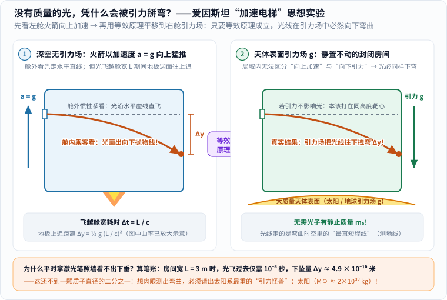
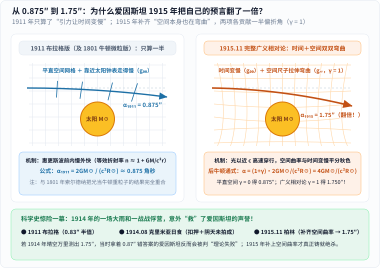
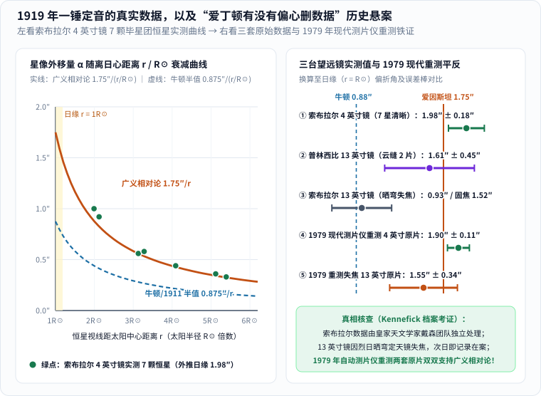
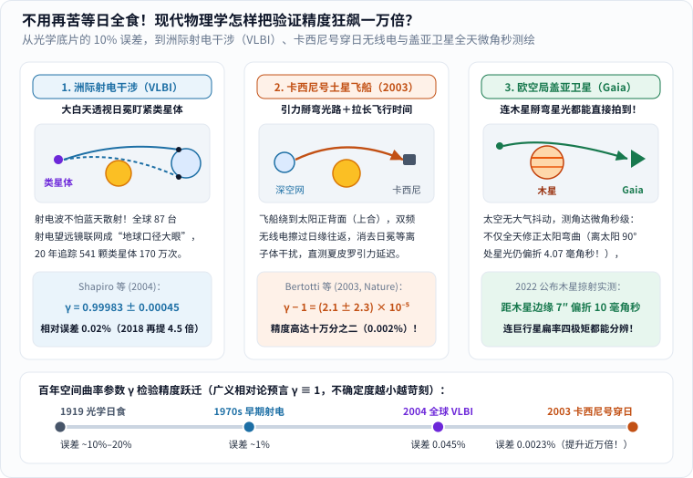
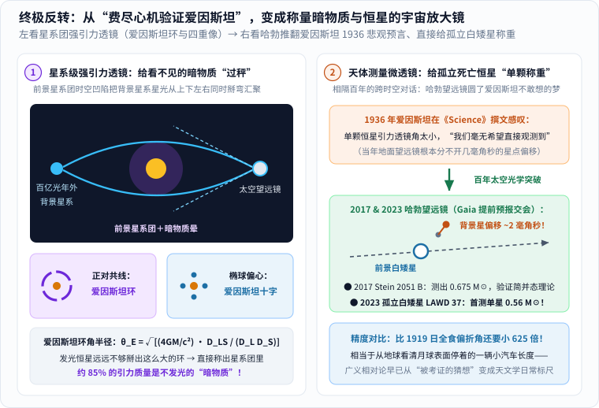

如果今天交给你一道硬核实验题：**“爱因斯坦预言，光线经过太阳旁边时会被引力掰弯——请你设计一套可执行的方案，去验证他到底说得对不对。”** 你会从哪下手？

很多人听到这个题目的第一反应，先卡在了物理直觉上：

> “不对啊！牛顿万有引力公式不是写着 $F = G\dfrac{M m}{r^2}$ 吗？光子根本没有静止质量（$m_0 = 0$），连质量都没有的东西，引力凭什么拽得动它？”
>
> “退一步说，要是引力真能掰弯光线，我拿支激光笔在客厅里横着照向对面的墙，光束怎么没像喷泉水柱那样往下掉？”

这两个问题问得极其毒辣。它们恰好也是 1907 年到 1915 年间，爱因斯坦自己一步步死磕出来的突破口。

更传奇的是，围绕“光线到底弯不弯、弯多少”这件事，物理学史上演了一出比谍战片还跌宕的大戏：爱因斯坦先算出了一个**漏掉一半**的半成品答案；紧接着一战爆发，去俄国测日食的德国天文学家被当成战俘关了起来，让他侥幸逃过“被当场证伪”的社死；等他在 1915 年底补齐空间弯曲、把预言精准翻倍成 **$1.75\text{ 角秒}$** 后，英国天文学家又跨洋远征巴西雨林与西非海岛，在两张叠在一起的玻璃底片上，量出了**只有三分之一根头发丝宽**的星点挪动。

今天，我们就顺着“**怎么想出来的 → 为什么翻了一倍 → 怎么在日全食里抓现行 → 现代人怎么把精度再推高一万倍**”这四步，亲自把这场跨越百年的终极验证走一遍。

---

## 一、没有质量的光凭什么会弯？一部“加速电梯”捅破窗户纸

想搞懂光为什么会弯，先别急着背弯曲时空的张量方程。1907 年，还在瑞士伯尔尼专利局上班的爱因斯坦，做了一个他后来称为“一生中最快乐的思想”的脑洞实验——**电梯思想实验**（我们在[《空间站为什么会失重》]()里见过它失重下坠的一面，今天我们反过来，看它**向上加速**的一面）。

请看下面这张分步对比图。我们先看左边深空里的火箭电梯，再平移到右边天体表面的房间：

_图 1：先看左舱（深空无引力场，火箭以加速度 $a = g$ 向上猛推）→ 光横穿舱宽 $L$ 的极短时间里，地板迎面往上追了一截，舱内乘客必然看到激光画出一条向下弯曲的弧线；再看右舱（静止在引力场 $g$ 中的封闭房间）→ 根据等效原理，引力场内的光也必然一模一样地向下弯曲（图中曲率已大幅放大示意）。_

跟着图里的序号，只需三步就能推出来：

1. **先去没有引力的宇宙深空（图左）**：假设你坐在一间全封闭、宽度为 $L$ 的电梯舱里，脚下火箭发动机点火，推着整个舱室以恒定加速度 $a = g$ 向上猛冲。此时左墙小窗外射进一束水平激光（关于光速 $c \approx 3\times 10^8\text{ m/s}$ 是怎样测出来的，可参看[《一眨眼绕地球七圈半的光，人类是怎么测出速度的？》]()）。在舱外漂浮的惯性系观察者看来，深空没有引力，光老老实实走水平直线；但光飞过舱宽需要时间：

$$
\Delta t = \frac{L}{c}
$$

在这短短的 $\Delta t$ 时间里，电梯地板正带着右墙迎面往上加速托举，向上窜升了：

$$
\Delta y = \frac{1}{2} g (\Delta t)^2 = \frac{g L^2}{2 c^2}
$$

所以在舱内的你看来，这束光打在右墙上的光斑，结结实实地比左墙入射口**矮了一截 $\Delta y$**——光在加速舱里画出了一条向下弯曲的抛物线！

2. **再用“等效原理”平移回引力场（图右）**：爱因斯坦抓住了物理学里最深刻的一条对称性——在任何一个足够小的封闭房间里，你做任何力学或光学实验，都**绝对无法区分**“脚下火箭正以 $a = g$ 向上推你”和“房间静置在一颗引力加速度为 $g$ 的星球表面”。这就是广义相对论的基石：**等效原理（Equivalence Principle）**。既然加速舱里的激光往下弯，那么静止在地球或太阳引力场里的激光，也**必定往下弯**！

3. **顺手解开客厅激光笔之谜**：那为什么我们在地球客厅里拿激光笔照墙，完全看不出光往下掉？把数字代进去算一笔账就全明白了。取房间宽 $L = 3\text{ 米}$，$g = 9.8\text{ m/s}^2$，$c = 2.998\times 10^8\text{ m/s}$：

$$
\Delta y = \frac{9.8 \times 3^2}{2 \times (2.998 \times 10^8)^2} \approx 4.9 \times 10^{-16}\text{ m}
$$

$4.9 \times 10^{-16}\text{ 米}$是什么概念？一颗原子核里的**质子直径**大约是 $1.7 \times 10^{-15}\text{ 米}$——也就是说，激光飞越整个客厅，下垂的距离还**不到半颗质子宽**！不是光没弯，而是光跑得太快、地球引力又太温柔，地球实验室里的任何尺子在它面前都粗笨得像木桩。

注意这里最颠覆的一点：整个推导从头到尾，**根本不需要光子拥有静止质量**！引力并不是伸出一只钩子去拽光子的“重量”，而是大质量天体把周围的**时空本身压弯了**；光依然在恪尽职守地走“两点之间最直的路线”（数学上叫**零测地线**），只不过跑道本身弯了，光自然跟着拐弯。

既然地球太轻，要想在自然界抓到光线弯曲的现行，我们别无选择，必须请出太阳系里占了 $99.86\%$ 质量的终极巨无霸——**太阳**（$M_\odot \approx 1.988 \times 10^{30}\text{ kg}$）。

---

## 二、从 0.875″ 到 1.75″：为什么 1915 年爱因斯坦把答案翻了一倍？

把目标锁定在“紧贴太阳边缘（半径 $R_\odot \approx 6.957 \times 10^8\text{ m}$）掠过的星光”之后，接下来的问题是：**爱因斯坦的理论到底预言它弯多少度？**

如果我们要设计验证实验，光定性测出“弯了”还不够，必须拿**精确的数字**去跟牛顿旧理论对决。而恰恰在这个数字上，爱因斯坦自己先踩了一个大坑——又被历史阴差阳错地救了回来。

### 1. 1911 年布拉格半成品：只算了“时间变慢”

1911 年夏天，在布拉格德国大学任教的爱因斯坦发表了经典论文《论引力对光传播的影响》（*Über den Einfluß der Schwerkraft auf die Ausbreitung des Lichtes*, *Annalen der Physik* **35**, 898–908）。当时他还没有建立完整的广义相对论引力场方程，手头只有等效原理推导出的一个效应：**离大质量天体越近，引力势越深，钟表走得越慢（引力时间膨胀）**。

就像一排并肩齐步走的仪仗队（惠更斯波前）擦过太阳表面：靠太阳内侧的那一端因为时间流逝变慢，等效光速慢了一丁点；靠外侧的那一端走得快。内慢外快，整道光波的波前自然就向太阳内侧歪斜拐弯了！爱因斯坦把整条路径积分下来，算出了紧贴日缘的偏折角：

$$
\alpha_{1911} = \frac{2 G M_\odot}{c^2 R_\odot} \approx 0.875''
$$

（注：当年爱因斯坦代入 1911 年略旧的天文常数，在论文末尾四舍五入写成了 $0.83''$；用现代国际天文学联合会常数算出的精确值是 $0.875''$，即 **$0.875\text{ 角秒}$**。）

当时的爱因斯坦并不知道，早在 **1801 年**（1804 年正式刊出），德国天文学家**约翰·索尔德纳**（Johann Georg von Soldner）就已经按照牛顿微粒说——把光当成以光速 $c$ 飞行的牛顿小弹珠，受太阳万有引力拉扯画双曲线——算过几乎一模一样的一笔账，得出的偏折角也是 **$0.84''$**（精确同式即 $\dfrac{2GM_\odot}{c^2 R_\odot} \approx 0.875''$）！换句话说，1911 年的半成品相对论和牛顿微粒说居然撞车了。

_图 2：左栏为 1911 年爱因斯坦（及 1801 年牛顿微粒版）在平直空间假设下仅计“引力时间变慢”（$g_{00}$），算出半值 $0.875''$；右栏为 1915 年 11 月完整广义相对论补齐“空间本身也在弯曲”（$g_{rr}$，空间曲率参数 $\gamma = 1$），偏折角严格翻倍至 $1.750''$。底栏为 1914 年克里米亚日食惊险插曲。_

### 2. 1914 年的一场大雨和战俘营，“救”了爱因斯坦

算出 $0.83''$ 后，爱因斯坦兴奋极了，四处给各国天文台写信，催促天文学家赶紧趁日全食去拍太阳旁边的星星。年轻热忱的柏林天文学家**欧文·弗罗因德利希**（Erwin Finlay-Freundlich）立刻响应，扛着全套精密照相望远镜奔赴俄国克里米亚，准备观测 **1914 年 8 月 21 日**的日全食；美国利克天文台的坎贝尔（W. W. Campbell）和阿根廷科尔多瓦天文台的佩赖因（C. D. Perrine）也各自带队赶往俄国。

谁也没想到，就在日全食前二十天，**第一次世界大战爆发了**！

德国与俄国宣战，身处俄国境内的弗罗因德利希一行瞬间成了“敌国侨民”，望远镜被沙俄军警当做间谍器材全部没收，人也被关进了战俘拘留营（后来靠战俘交换才获释回国）；而没被抓起来的美国队和阿根廷队，又在日全食当天遭遇浓云密布，一张星像都没拍成！

如今回头看，这场狼狈的失败简直是老天爷送给爱因斯坦的大礼：**幸亏 1914 年没测成！** 要是当年克里米亚万里无云、真拍出了高精度的 $1.75''$，而爱因斯坦白纸黑字押注的是 $0.83''$，全世界都会宣布“爱因斯坦的新理论错得离谱”。

### 3. 1915 年 11 月柏林绝杀：补齐“空间曲率”，精准乘以 2

躲过一劫的爱因斯坦回到柏林苦思冥想，终于在 **1915 年 11 月**建成了完整的广义相对论引力场方程。这时他恍然大悟：1911 年他漏掉了整整一半的物理图景！

为什么平时算行星绕太阳公转（比如地球公转速度 $v \approx 30\text{ km/s}$，只有光速的万分之一），只看“时间变慢”（对应牛顿引力势）就几乎全准了？因为行星跑得太慢，它在每一秒里走过的**时间维度跨度**（$c\,\Delta t$）是它走过的**空间距离**（$v\,\Delta t$）的一万倍，空间尺子那一点点弯曲根本显不出来。

但**光**不一样！光就跑在极限速度 $v = c$ 上——它在时间里走一光秒，在空间里也实打实跨过了一光秒！因此，太阳质量压出来的**空间尺子弯曲**（径向度规分量 $g_{rr}$），对光线的掰弯贡献，与**时间变慢**（时间度规分量 $g_{00}$）完全平分秋色、一模一样大！

在现代检验引力理论的“参数化后牛顿（PPN）框架”中，科学家专门用希腊字母 **$\gamma$** 来衡量“单位质量到底把空间压弯了多少”：

$$
\alpha(b) = (1 + \gamma)\,\frac{2 G M}{c^2 b}
$$

公式里的每一个符号都清清楚楚：
- $M$ 是透镜天体的质量，$b$ 是光线掠过天体中心的最近距离（碰撞参数）；
- 前面括号里的“$1$”代表**引力时间变慢**，括号里的“$\gamma$”代表**空间本身的弯曲**；
- 如果空间是平直的（$\gamma = 0$，1801 牛顿微粒版 / 1911 爱因斯坦半成品），紧贴太阳边缘（$b = R_\odot$）得 **$0.875''$**；
- 如果广义相对论正确（**$\gamma = 1$**，时间与空间同等弯曲），偏折角直接翻倍：

$$
\alpha_{\text{GR} }(R_\odot) = \frac{4 G M_\odot}{c^2 R_\odot} \approx 1.750''
$$

**$0.875''$ 对决 $1.75''$（差整整两倍），外加“完全不弯”的 $0''$**——物理学史上最干净利落的一场三方生死赌局，就此摆上了桌面。

---

## 三、如果让你去测这 1.75 角秒，实验到底怎么做？

现在轮到我们当实验总设计师了。手握 $\alpha(b) = \dfrac{4GM_\odot}{c^2 b}$ 这条公式，真要把望远镜架出去验证它，你会迎面撞上**三个魔鬼级难题**，以及一个**连许多物理系学生第一次画光路都会画反的几何坑**。

请先看图 3（图中包含一段 2.8 秒的单次光路演示动画；若需重播，可[单独打开 SVG 原图](/assets/images/einstein-light-bending/eclipse-measurement-geometry-outward-shift.svg)刷新查看；开启系统“减少动态效果”时自动静态呈现完整光路）：

_图 3：上栏演示“内折外移”几何原理——真实星光经过太阳附近时向内弯折（橙色实线），但地球望远镜顺着入射切线反向直指（紫色虚线），拍到的星像 $S'$ 反而比无太阳时的真位置 $S$ **向外推开**了角度 $\alpha$（图中偏折角为看清光路已大幅夸大）；左下展示日全食底片与夜间基准底片叠合后呈 $\alpha \propto 1/b$ 辐射状外扩；右下换算 $1.75''$ 的真实苛刻尺度。_

我们把实验方案拆解成三步实操手册：

### 第一步：借月亮当“天然遮光板”，还得挑准百年一遇的背景星团

白天太阳周围当然也有满天繁星，但大气层把阳光散射成了刺眼的蓝天，背景星光被彻底淹没。在射电天文学诞生之前，人类唯一的办法就是等**日全食**——让月亮严丝合缝地挡住太阳圆面，天空瞬间暗如黄昏，躲在日冕旁边的星星才会露脸。

但光有日全食还不够！太阳一年四季在黄道十二宫里巡游，大多数日子里，太阳身边恰好全是暗淡无光的荒凉天区——日冕本身还很亮，五六等以下的暗星根本拍不出来。

1917 年，英国格林尼治皇家天文学家**弗兰克·戴森**（Sir Frank Watson Dyson）翻遍星表，发现了一个天赐良机：**1919 年 5 月 29 日**将发生一次全食时间长达近 **6 分钟**的超级日全食，而那一天，太阳正巧一头扎进金牛座**毕星团（Hyades）**最密集的亮星窝里！十几颗三四等的明亮恒星紧贴在太阳四周，几百年都碰不上一次这么好的星场。

### 第二步：别搞反方向！光线“向内弯”，照片上的星星反而“向外跑”

看图 3 上半部分，这是整个实验最核心的判据：
- **没有太阳挡路时**（比如半年前或半年后的夜晚），远方恒星 $S$ 发出的光沿水平虚线直飞地球；
- **日全食当天太阳挡在中间时**，本来应该从太阳上方斜飞错过地球的一束星光，在掠过太阳身边（距离日心 $b$）时被太阳引力**往下（向太阳内侧）拽弯了 $\alpha$ 角**，刚好钻进了地球上的望远镜筒（橙色曲线 ①）；
- 可是我们的眼睛和照相底片“不知道光线半路拐过弯”啊！望远镜永远顺着光线最后进镜筒的那条切线**笔直往回指**（紫色虚线 ②）。结果在日全食底片上，这颗星的成像位置 $S'$ 被推到了更远离太阳的外侧！

更妙的是，根据公式 $\alpha(b) = 1.75'' \times \dfrac{R_\odot}{b}$，每颗星往外蹦的距离还不一样：**离太阳边缘越近的星，往外推得越猛；离太阳越远的星，几乎纹丝不动**（图 3 左下）。这就形成了一枚独一无二的“引力指纹”——把日全食当天拍的玻璃底片，和几个月后夜晚对着同一片毕星团拍的“夜间基准底片”**药膜贴药膜**叠在一起，必须看到所有星星围着太阳呈 $1/b$ 反比规律向外辐射张开，才算真正抓到了引力弯曲！

### 第三步：算出显微镜下的惊魂数字——只有三分之一根头发丝！

很多科普书只告诉你“$1.75\text{ 角秒}$很小”，到底有多小？我们亲手换算一下：
1 度等于 $60$ 角分，1 角分等于 $60$ 角秒，所以 $1^\circ = 3{,}600''$。也就是说：

$$
\begin{aligned}
1.75'' &= \frac{1.75}{3600}\text{ 度} \approx 0.000486^\circ \\
&\approx 8.48 \times 10^{-6}\text{ rad}
\end{aligned}
$$

拿大家兜里最熟的硬币做参照：一枚直径 **$25\text{ 毫米}$** 的 1 元硬币，你要把它拿到 **$2.95\text{ 公里}$**（将近 6 里地！）以外，它两边张开的夹角才差不多是 $1.75\text{ 角秒}$（图 3 右下）！

再算算它在照相底片上能挪动几毫米。1919 年远征队在巴西索布拉尔架设的那支功勋备用镜头，焦距长达 $19\text{ 英尺}$（$f \approx 5{,}791\text{ mm}$）。即便在紧贴太阳边缘（$r = 1\,R_\odot$）的极限位置，星像在底片上的位移也只有：

$$
\begin{aligned}
\Delta x_{\text{日缘} } &= f \cdot \alpha \approx 5791\text{ mm} \times 8.48 \times 10^{-6} \\
&\approx 0.049\text{ mm}
\end{aligned}
$$

而真正在日全食里能看清的毕星团恒星，因为不能被耀眼的内日冕淹没，最近也在距日心约 **$2\,R_\odot$ 到 $5\,R_\odot$** 的位置——那里的偏折角只剩 $0.3'' \sim 0.9''$，落在玻璃底片上的真实移动距离只有 **$0.01 \sim 0.025\text{ 毫米}$**，大约只相当于**人类一根头发丝直径的三分之一**！

要在热带丛林的临时帐篷里，守住百分之几毫米的精度，哪怕昼夜温差让镜筒稍微热胀冷缩一丁点、或者被烈日晒烫的反射镜面翘起几微米，整盘实验就会前功尽弃。1919 年那场远征的惊心动魄，全埋在这个微米级的魔鬼细节里。

---

## 四、1919 双城远征与“爱丁顿有没有偏心作弊”历史悬案

1918 年 11 月一战刚刚停火，戴森和剑桥天文学家**亚瑟·爱丁顿**（Arthur Stanley Eddington）立刻争分夺秒启动了双保险远征计划。1919 年 3 月 8 日，两支英国观测队同乘“安塞尔姆号”（*SS Anselm*）邮轮从利物浦起航，分头奔赴日全食带上的两个据点：
- **西非几内亚湾的普林西比岛（Príncipe）**：由爱丁顿与钟表匠科廷厄姆（E. T. Cottingham）驻守，携带牛津大学 13 英寸天体照相仪镜头（为保证像质将光圈缩至 8 英寸）；
- **巴西东北部内陆小城索布拉尔（Sobral）**：由格林尼治天文台的克罗姆林（A. C. D. Crommelin）与戴维森（Charles R. Davidson）驻守，除携带格林尼治同款 13 英寸主镜外，幸亏临行前听从科尔蒂神父（Father Aloysius Cortie）建议，顺带捎上了一支口径虽小（**4 英寸**，约 $10\text{ 厘米}$）、焦距却长达 19 英尺、配套小巧 **8 英寸定天镜**（coelostat，用平面反射镜把星光水平折入固定长镜筒）的备用镜头！

### 1. 暴雨云缝里的西非海岛 vs 酷暑苦守两个月的巴西小镇

1919 年 5 月 29 日当天，两地的命运截然不同：

在西非**普林西比岛**，上午竟然下起了倾盆雷阵雨！爱丁顿绝望地听着雨声，直到全食开始前不久雨才停歇，14 时 13 分全食降临时，太阳仍裹在翻涌的云层里。两人硬着头皮连拍 16 张玻璃底片，前 14 张全被厚云挡死，直到全食快结束的最后两张底片上，终于从云缝里透出了 **5 颗恒星**！

而在大洋彼岸的**索布拉尔**，全食关键的五分多钟里云开雾散，两台望远镜一口气拍下了数十张底片。但当晚冲洗出来一看，戴维森心里咯噔一下：**那台寄予厚望的 13 英寸主力大镜拍出的星点竟然全都糊成了拖尾的麻团！** 原来，索布拉尔上午烈日当空，配套的那面硕大的 16 英寸定天镜平面玻璃受热不均发生了微米级的弯曲形变，直接导致主镜严重失焦（戴维森在 **5 月 30 日凌晨**的现场观测日记里就如实记下了这一故障）。万幸的是，旁边那支不起眼的 **4 英寸备用镜**因为定天镜小、热容量均匀，拍出的 8 张底片里有 7 张清晰锐利，稳稳抓住了 **7 颗毕星团恒星**！

为了拿到绝对同条件的“无太阳基准底片”，索布拉尔队在巴西内陆酷热中硬生生多守了近两个月，直到 **1919 年 7 月中旬黎明前**——此时太阳已远远走开，而毕星团正好在清晨升到与 5 月 29 日日全食**完全相同的天空方位与高度角**（这样大气折射误差就能完美对消），用原封未动的同一支 4 英寸望远镜拍下了基准对比片，并巧妙利用一块反向曝光的玻璃中介比例尺底片，实现了“药膜贴药膜”的测微显微镜直接比对。

_图 4：左栏根据戴森、爱丁顿与戴维森 1920 年皇家学会原始论文重构索布拉尔 4 英寸镜头 7 颗恒星的径向偏移实测点（绿点），清晰落在广义相对论 $1.75''/(r/R_\odot)$ 橙色实线上，远高于牛顿半值蓝色虚线；右栏对比三台望远镜换算至日缘的原始结果与 1979 年格林尼治现代自动测片机复核铁证。_

### 2. 拆穿流传甚广的流言：爱丁顿真的“偏心删数据”了吗？

把底片带回英国逐颗测微计算后，戴森、爱丁顿与戴维森在 1920 年《伦敦皇家学会哲学汇刊》（*Phil. Trans. R. Soc. A* **220**, 291–333）上公布了全部三套原始结果（换算到紧贴太阳边缘 $r = R_\odot$ 处，论文原始报告采用当年的“概然误差 probable error”，下方同时附上现代通用的 $1\sigma$ 标准误差）：

| 观测站点与仪器 | 有效底片与恒星数 | 日缘偏折角实测值（概然误差） | 折合现代 $1\sigma$ 标准误差 | 仪器状态记录 |
| :--- | :--- | :--- | :--- | :--- |
| **索布拉尔 4 英寸备用镜** | 7 张底片，7 颗亮星 | **$1.98'' \pm 0.12''$** | $1.98'' \pm 0.18''$ | 星像圆润锐利，权重最高 |
| **普林西比 13 英寸镜** | 2 张云缝片，5 颗星 | **$1.61'' \pm 0.30''$** | $1.61'' \pm 0.45''$ | 云层减光，星数少但一致 |
| **索布拉尔 13 英寸主镜** | 18 张失焦片 | 自由缩放 $\sim 0.93''$（固焦 $1.52''$） | 系统失焦畸变 | 5 月 30 日现场日记已记录定天镜热变形失焦 |

后世不少畅销书和网络文章曾绘声绘色地流传一种说法：“爱丁顿是个狂热崇拜爱因斯坦的和平主义者，为了捧红广义相对论，他故意扔掉了索布拉尔 13 英寸主镜测出的 $0.93''$ 牛顿派数据！”

科学史学家、物理学家**丹尼尔·肯尼菲克**（Daniel Kennefick）深入格林尼治皇家天文台原始手稿档案核查后，用三条硬核史实彻底洗清了这桩百年冤案：
1. **索布拉尔的数据根本不是爱丁顿处理的！** 普林西比的数据由爱丁顿处理，而巴西索布拉尔的全部底片测量与归算，是由坐镇格林尼治的皇家天文学家**弗兰克·戴森**与戴维森独立完成的——而且戴森最初对爱因斯坦的新奇理论相当保守怀疑；
2. **故障记录在测数据之前，绝非事后挑拣**：戴维森在日全食次日（还没量过任何一颗星的位置，根本不知道它会算出 $0.93''$ 还是 $1.75''$）就已经白纸黑字记录了 13 英寸主镜因定天镜晒弯而严重失焦。当镜头焦距改变时，“底片整体放大率变化”和“引力偏折引起的辐射外扩”在数学上会混在一起互相污染：如果把畸变全当成放大率变化扣掉，算出约 $0.93''$；如果认定焦距变化处理，同一批底片算出的其实是 $1.52''$。因此在 1920 年正式论文里，戴森不仅**一字未删地公开刊出了这组失焦数据**，还客观解释了为什么不能拿受损仪器去否决图像清晰的 4 英寸镜头；
3. **1979 年现代自动测片机终极平反**：1919 年那批珍贵的索布拉尔玻璃原片一直保存在格林尼治天文台。**1979 年**（爱因斯坦诞辰百年），天文学家哈维（G. M. Harvey）用现代光电自动测片机和完整的多参数天体测量软件，把当年的两组索布拉尔玻璃底片重新扫了一遍——结果 **4 英寸底片得出 $1.90'' \pm 0.11''$**，就连当年**被晒糊失焦的那批 13 英寸底片，在严格分离焦距畸变与比例尺后也得出了 $1.55'' \pm 0.34''$**！两套底片双双倒向爱因斯坦的 $1.75''$，戴森与爱丁顿当年的专业判断经受住了六十年后的机器复核。

1919 年 9 月 27 日，荷兰物理学泰斗洛伦兹给柏林的爱因斯坦发去电报，提前告知英国观测队测出了支持广义相对论的偏折；**1919 年 11 月 6 日**，伦敦皇家学会与皇家天文学会举行历史性的联合大会正式公布结果。皇家学会会长、电子发现者 J. J. 汤姆孙当场赞叹这是“自牛顿时代以来人类思想最伟大的成就之一”（关于牛顿万有引力当年如何统一天地运行，可参看[《从开普勒到牛顿：行星为什么不会掉进太阳？》]()）。四天后，《纽约时报》打出那行著名的多行通栏标题：“**天上的光全歪了（Lights All Askew in the Heavens）**”——爱因斯坦一夜之间成为全世界家喻户晓的科学偶像。

---

## 五、告别日全食！现代科学家怎样把验证精度狂飙一万倍？

平心而论，1919 年日全食观测足以淘汰牛顿的 $0.875''$，但受限于短短几分钟曝光、地球大气湍流和底片颗粒，它的相对误差还在 **$10\% \sim 20\%$** 左右。直到 20 世纪 60 年代，其他竞争引力理论（如布兰斯-迪克标量张量理论）纷纷登场，它们预言的空间曲率参数 $\gamma$ 只比 $1$ 偏离千分之一甚至万分之一——靠几年才等来一次的光学日全食，早就力不从心了。

怎么办？现代物理学家甩出了**三记彻底摆脱日全食的神仙绝招**（图 5）：

_图 5：现代检验引力偏折与空间曲率参数 $\gamma$ 的三大利器——左：全球甚长基线射电干涉（VLBI）大白天透视日冕测类星体；中：卡西尼号土星飞船太阳上合双频无线电夏皮罗延迟（$\gamma$ 检验精度达 $0.0023\%$）；右：欧空局盖亚（Gaia）空间望远镜全天微角秒测绘并直接拍到木星掰弯星光。_

### 1. 洲际射电干涉（VLBI）：大白天直接透视太阳盯紧类星体

光学望远镜怕白天的蓝天散射，但**射电波（无线电波）根本不怕蓝天**！大白天太阳挂在头顶，射电望远镜照样能清楚看见宇宙边缘发出的强射电信号源——**类星体（Quasars）**。

更绝的是，把分布在五大洲的几十台射电望远镜联网同步记录（配合氢原子钟授时），就能拼成一面**口径相当于整个地球直径**的超级干涉仪——**甚长基线干涉测量（VLBI）**，测角分辨率一下子飙到**零点几毫角秒**（比 1919 年精细上万倍）。每年十月前后，太阳都会从几颗著名类星体（如 `3C 279`）跟前经过。美国天体物理学家欧文·夏皮罗团队（S. S. Shapiro et al., 2004, *Phys. Rev. Lett.* **92**, 121101）汇总了 1979—1999 年间全球 **87 台射电望远镜**对 **541 颗射电源**多达 **170 万次**的观测数据，测出空间曲率参数：

$$
\gamma = 0.99983 \pm 0.00045
$$

与爱因斯坦预言的 $\gamma = 1$ 在**万分之四**的误差内严丝合缝！2018 年，Titov 等人（*A&A* **618**, A8）利用更贴近日面的全球 VLBI 观测，又把不确定度进一步压缩到了 $\pm 9 \times 10^{-5}$。

### 2. 卡西尼号穿日双频无线电：给电磁波“掐秒表”（精度 0.002%！）

1964 年，欧文·夏皮罗还指出了光线弯曲的“孪生兄弟”——**夏皮罗引力时间延迟（Shapiro Delay）**：电磁波擦过太阳引力井时，不仅路径被压弯，而且掉进弯曲时空凹坑里时间变慢、空间路程变长，往返一趟会比平直时空多花大约 **$200\text{ 微秒}$**，延迟量同样正比于 $(1 + \gamma)$！

**2002 年 6 月**，正在飞往土星途中的**卡西尼号（Cassini）**探测器刚好绕到太阳正背面（太阳上合）。意大利物理学家贝尔托蒂团队（Bertotti, Iess & Tortora, 2003, *Nature* **425**, 374–376）从地球深空网向卡西尼号同时发射 **X 波段与 Ka 波段双频无线电波**——因为日冕带电等离子体对电波的折射跟频率平方成反比，而广义相对论的时空弯曲对任何频率一视同仁，用双频相减就能把日冕干扰剥得干干净净！最终测得：

$$
\gamma - 1 = (2.1 \pm 2.3) \times 10^{-5}
$$

这意味着爱因斯坦的光线弯曲与时空曲率预言，在**十万分之二（$0.0023\%$）**的惊人精度上依然屹立不倒——比 1919 年日全食足足精确了近**一万倍**！

### 3. 欧空局盖亚卫星（Gaia）：连木星掰弯星光都被抓了个正着！

进入太空时代后，欧洲空间局发射的**盖亚（Gaia）**天体测量卫星远离大气抖动，测角精度达到了不可思议的**微角秒（百万分之一角秒）**量级。

在这个精度下，出现了一件让爱丁顿做梦都想不到的事：**根本不需要太阳靠近星星，全天空到处都能看见太阳掰弯星光！** 算一笔简单的账：哪怕你扭头往跟太阳**垂直 $90^\circ$** 的方向看一颗恒星，那束星光飞进地球轨道时，也不可避免地穿过了太阳的引力场，偏折角仍有：

$$
\alpha(90^\circ) = \frac{2 G M_\odot}{c^2 \cdot (1\text{ AU})} \approx 4.07\text{ 毫角秒}
$$

对于精度在微角秒级的盖亚卫星来说，$4.07\text{ 毫角秒}$简直大得像一头大象！如果不把爱因斯坦的光线弯曲写进底层代码每分每秒实时修正，人类绘出的 18 亿颗银河系恒星三维星图就会全部错位。

还不止太阳！**2022 年**，盖亚团队（Abbas et al., 2022, *A&A* **664**, A143）正式公布：当背景恒星的星光从距离**木星边缘仅 $7\text{ 角秒}$**处擦过时，盖亚在可见光波段直接拍到了木星引力把星光掰弯了约 **$10\text{ 毫角秒}$**（紧贴木星赤道边缘的单极偏折为 $16.2\text{ 毫角秒}$），甚至精细到分辨出了“木星不是完美圆球、而是自转甩扁的椭球”所带来的四极引力偏折（约 $240\text{ 微角秒}$）！

---

## 六、终极反转：从“验证爱因斯坦”，变成给宇宙暗物质和死亡恒星称重

科学史上最浪漫的结局莫过于此：**昨天全人类屏住呼吸去检验的大胆假说，今天已经变成了天文学家手里最趁手的日常标尺。**

既然偏折角公式 $\alpha = \dfrac{4GM}{c^2 b}$ 已经被检验到十万分之二的精度，那我们把等式倒过来用呢？——**只要量出远处星光被掰弯了多少度，不就能反过来直接称出中间那个天体的质量 $M$ 吗——哪怕那个天体一丁点光都不发！**

这就是现代天体物理学的王牌工具：**引力透镜（Gravitational Lensing）**（图 6）。

_图 6：光线弯曲的现代逆向应用——左栏为前景星系团及暗物质晕把百亿光年外背景星系掰弯汇聚成“爱因斯坦环”或“爱因斯坦十字”四重像，直接称出约 85% 的不可见暗物质；右栏为哈勃太空望远镜推翻爱因斯坦 1936 年《Science》悲观判断，利用约 2 毫角秒微透镜偏移首次直接称出孤立白矮星的质量。_

### 1. 星系团级“宇宙放大镜”：给看不见的暗物质过秤

当几百亿倍太阳质量的前景星系团正好挡在更遥远的背景星系跟前时，星光会从上下左右四面八方同时向内弯折汇聚到地球。如果三者严格共线，背景星系会被拉成一圈晶莹璀璨的光环——**爱因斯坦环（Einstein Ring）**，其角半径由前景总质量 $M$ 与距离比直接决定：

$$
\theta_E = \sqrt{\frac{4 G M}{c^2}\,\frac{D_{LS} }{D_L D_S} }
$$

（其中 $D_L$、$D_S$、$D_{LS}$ 分别是我们到透镜、我们到光源、以及透镜到光源的角直径距离。）如果前景引力场略呈椭球偏心，背景天体就会分裂成四颗对称的光点——**爱因斯坦十字（Einstein Cross）**。2014—2015 年，哈勃太空望远镜在星系团 `MACS J1149.6+2223` 里不仅拍到了同一颗遥远超新星（“雷夫斯达尔超新星” Supernova Refsdal）分裂成的四重十字像，天文学家还靠计算四条弯曲光路的引力时间差，**提前预言了这颗超新星第五个像在另一处准时重现**——宇宙尺度的直播重放，分毫不差！

更重要的是，当天文学家把拍到的爱因斯坦环半径代回公式算前景星系团总质量 $M$ 时，震惊地发现：星系团里所有发光恒星和炽热气体加起来，连掰出这么大光环所需质量的六分之一都不到——**星系团里约 85% 的物质，是完全不发光、不吸光、却结结实实压弯了时空的“暗物质”**！光线弯曲，成了人类称量暗物质最直接的宇宙杆秤。

### 2. 跨越 87 年的圆梦：哈勃替爱因斯坦做成了他当年断言“不可能”的实验

故事的最后，还有一个格外温暖的彩蛋。

**1936 年**，流亡美国的爱因斯坦受捷克业余工程师曼德尔（Rudi W. Mandl）来信恳请，在《科学》（*Science* **84**, 506–507）杂志上发表了一篇只有一页半的小短文，推导出单颗恒星也能充当微型引力透镜。但在文章结尾，爱因斯坦悲观地叹了口气写道：恒星与恒星贴近对齐的概率太低，分出来的光环角半径只有几毫角秒，地面望远镜大气模糊完全分不开，因此**“我们没有太大希望直接观测到这一现象”**。

整整八十多年后，太空里的接力棒传到了**盖亚卫星**与**哈勃太空望远镜**手里：
- 先由盖亚卫星精确扫描全天恒星自行轨迹，提前几年算准哪颗近邻致密恒星会从哪颗遥远背景星跟前擦肩而过；
- **2017 年**，美国太空望远镜科学研究所的萨胡（Kailash Sahu）团队调动哈勃望远镜，连续盯守距离地球 17 光年的白矮星 **`Stein 2051 B`** 从一颗背景恒星旁掠过，精准测出背景星点被掰偏了约 **$2\text{ 毫角秒}$**，算出这颗白矮星质量为 **$0.675 \pm 0.051\,M_\odot$**，完美验证了钱德拉塞卡的简并态物质理论；
- **2023 年**，同一团队再用哈勃追踪仅 15 光年外的孤立白矮星 **`LAWD 37`**（没有伴星绕转，过去除了模型估算外根本没法直接称重），靠着比 1919 年日全食偏折角**小 625 倍**（相当于从地球看清月球表面停着的一辆家用轿车长度！）的微弱引力星位偏移，人类历史上**第一次直接称出了一颗单身孤立白矮星的真实质量：$0.56\,M_\odot$**！

---

## 小结：一束星光走过的百年验证之路

回望这道“怎样验证爱因斯坦光线弯曲”的实验题，人类在过去一百多年里交出了四份越来越惊艳的答卷：

1. **思想破局（1907–1915）**：从向上加速的电梯思想实验与等效原理出发，打破“光子没质量就不受引力管”的牛顿直觉；再补齐空间本身的几何弯曲（$\gamma = 1$），把紧贴日缘的偏折角从半成品 $0.875''$ 翻倍锁定在 **$1.75''$**。
2. **日食首胜（1919）**：趁月亮遮住日面，对比日全食底片与夜间基准底片，抓住恒星像“光线内弯、视位外扩（$\alpha \propto 1/b$）”的微米级位移——索布拉尔 $1.98''$ 与普林西比 $1.61''$（以及 1979 年自动测片机复核的 $1.90''$ 与 $1.55''$）一举改写人类时空观。
3. **射电与深空极限（1970s–2022）**：洲际 VLBI 在大白天透视日冕测类星体（$0.02\%$），卡西尼号穿日双频无线电直测夏皮罗时间延迟（**$0.002\%$**），盖亚卫星连木星边缘 $7''$ 处区区 $10\text{ 毫角秒}$的星光弯曲都尽收眼底。
4. **化验题为标尺（今天）**：广义相对论早已走下考场，化身宇宙级放大镜与天平——向上称量百亿光年星系团里的暗物质，向下单颗称重十多光年外孤独冷却的白矮星。

下次晴朗的夜晚抬头看星星时，不妨想一想：此刻钻进你瞳孔里的每一缕星光，在穿过太阳系引力场的最后一程里，其实都悄悄拐了一个只有几毫角秒的温柔小弯——那是时空本身留给我们的签名。

---

## 参考资料与核查来源

本文核心公式、历史事件时间线与现代实测数据均核查自以下一手原始论文与权威科研机构档案：

1. **爱因斯坦 1911 年布拉格原始论文（等效原理与引力时间膨胀半值 $0.83''\text{–}0.875''$ 推导）**：Albert Einstein, *Über den Einfluß der Schwerkraft auf die Ausbreitung des Lichtes*, *Annalen der Physik* **35**(10), 898–908 (1911)，开放获取馆藏页：[Zenodo Record 1424213](https://zenodo.org/records/1424213)；另见爱因斯坦布拉格时期史料考证（含 1801 年索尔德纳牛顿微粒计算与 1914 年克里米亚日食远征始末）：[Einstein Website — Prague (1911–1912)](https://einstein-website.de/en/prague/)。
2. **1919 年日全食皇家学会原始观测报告（索布拉尔 $1.98'' \pm 0.12''$、普林西比 $1.61'' \pm 0.30''$ 及 13 英寸镜热畸变记录）**：F. W. Dyson, A. S. Eddington, and C. Davidson, *A Determination of the Deflection of Light by the Sun's Gravitational Field, from Observations Made at the Total Eclipse of May 29, 1919*, *Philosophical Transactions of the Royal Society of London A* **220**, 291–333 (1920)，开放获取馆藏页：[Zenodo Record 1432106](https://zenodo.org/records/1432106)。
3. **格林尼治皇家天文台官方档案（戴森 1917 毕星团选址、4 英寸备用镜与 7 月基准片拍摄细节、1979 年现代测片机重测）**：Robin Catchpole & Graham Dolan, [*Testing general relativity: the 1919 solar eclipse*](https://www.royalobservatorygreenwich.org/articles.php?article=1283)，Royal Observatory Greenwich Official History Archive。
4. **“爱丁顿是否偏心删数据”科学史档案核查与 1979 年 RGO 重测数据（$1.90'' \pm 0.11''$ 与 $1.55'' \pm 0.34''$）**：Daniel Kennefick, *Not Only Because of Theory: Dyson, Eddington and the Competing Myths of the 1919 Eclipse Expedition* ([arXiv:0709.0685](https://arxiv.org/abs/0709.0685)) 及百周年综述 *No Shadow of a Doubt* / [arXiv:1907.10687](https://arxiv.org/abs/1907.10687)；索布拉尔观测专题访谈见巴西圣保罗研究基金会科学期刊 [*Pesquisa FAPESP*: *The importance of Sobral*](https://revistapesquisa.fapesp.br/en/daniel-kennefick-the-importance-of-sobral-2/) 与 [*When light bent*](https://revistapesquisa.fapesp.br/en/when-light-bent-2/)。
5. **马克斯·普朗克引力物理研究所（阿尔伯特·爱因斯坦研究所）光线弯曲与全球 VLBI 类星体测量综述**：Steven S. Shapiro & Irwin I. Shapiro, [*Gravitational deflection of light*](https://www.einstein-online.info/en/spotlight/light_deflection/)；Irwin I. Shapiro, [*Measuring light deflection with radio telescopes*](https://www.einstein-online.info/en/spotlight/Measuring-light-deflection-with-radio-telescopes/)（涵盖 Shapiro et al. 2004 *PRL* **92**, 121101 对 541 颗射电源 170 万次观测得出 $\gamma = 0.99983 \pm 0.00045$，以及卡西尼号 Bertotti, Iess & Tortora 2003 *Nature* **425**, 374 得出 $\gamma - 1 = (2.1 \pm 2.3)\times 10^{-5}$）。
6. **欧洲空间局盖亚卫星（ESA Gaia）木星引力偏折星光直接测量公报**：ESA Science & Technology / Gaia Collaboration, [*Gaia sees gravity of Jupiter deflecting light from distant stars*](https://www.cosmos.esa.int/web/gaia/iow_20220923)（对应论文 U. Abbas et al. 2022, *Astronomy & Astrophysics* **664**, A143，实测木星边缘外 $7''$ 处约 $10\text{ mas}$ 光学偏折及四极扁率项）。
7. **NASA 与欧空局哈勃太空望远镜引力透镜与孤立白矮星微透镜称重公报**：NASA Hubble Science, [*Gravitational Lenses*](https://science.nasa.gov/mission/hubble/science/science-behind-the-discoveries/hubble-gravitational-lenses/)；ESA/Hubble 2017 年白矮星 `Stein 2051 B` 微透镜测质量记录 [*Stein 2051 B and a distant background star*](https://esahubble.org/images/potw1724c/)；NASA 2023 年首次直接测量孤立白矮星 `LAWD 37` 质量公报 [*For the First Time, Hubble Directly Measures Mass of a Lone White Dwarf*](https://science.nasa.gov/missions/hubble/for-the-first-time-hubble-directly-measures-mass-of-a-lone-white-dwarf/)。
