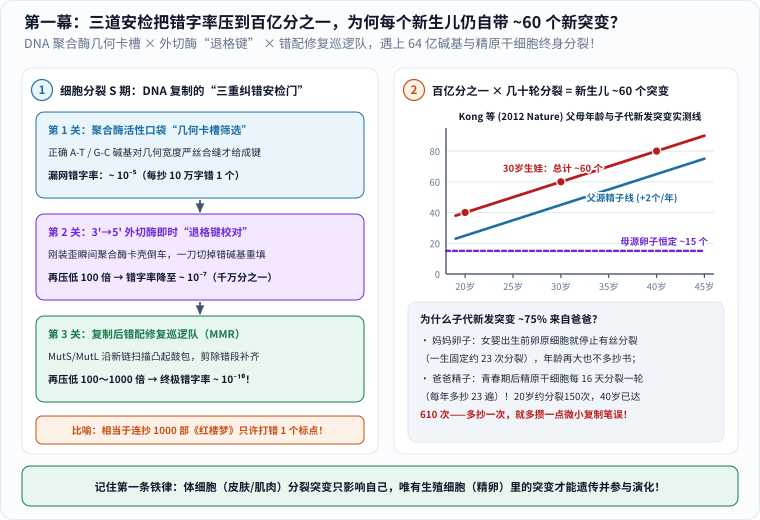
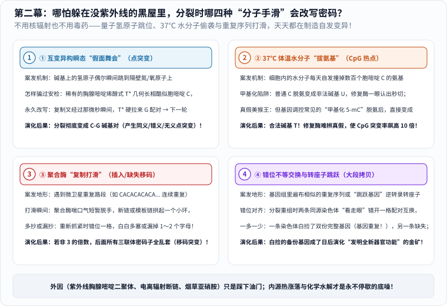
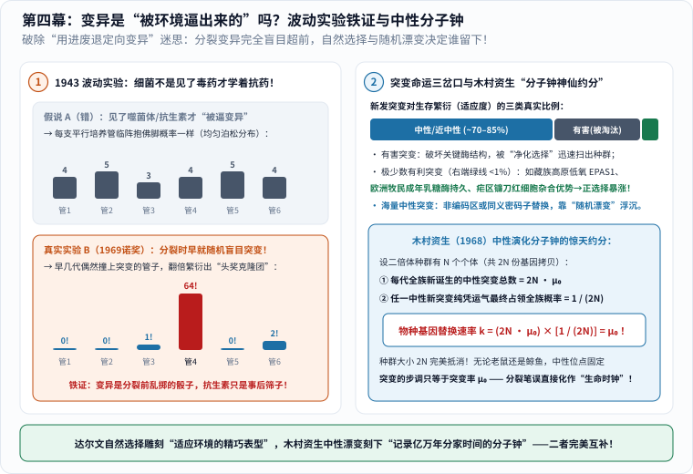
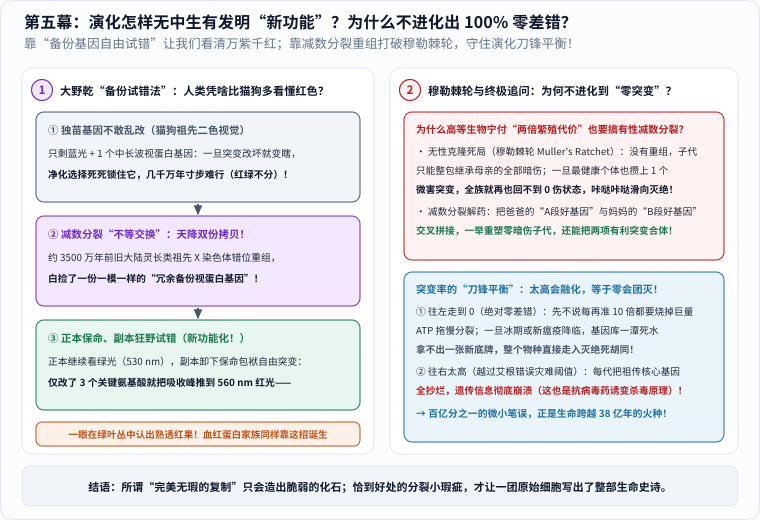

把一双儿女的照片和父母放在一起端详时，每个人都会撞见生命最迷人的矛盾：

一方面，**遗传保真得令人敬畏**——[一个直径仅 6 微米的细胞核里塞着整整 2 米长、64 亿个碱基字母的 DNA 细线]()，从一颗受精卵分裂出几十万亿个细胞，鼻子还是像爸爸、酒窝还是像妈妈，甚至几百年前家族画像上的下巴弧度都能原样复刻；
可另一方面，**变异又无处不在**——同一对父母生下的亲兄妹，身高、脾气、过敏体质甚至对同一种药物的反应可能截然不同；放眼更漫长的亿万年尺度，当初地球海洋里同一团原始单细胞，竟然硬生生分化出了蓝鲸、红杉、雨燕和正在读这篇文章的你。

这就引出了两个环环相扣的核心追问：

1. **既然生命靠“一分为二”抄写基因传代，细胞分裂时到底是什么原因让原本严丝合缝的遗传密码一次次“跑偏”产生变异？**
2. **这些绝大多数看起来像“抄书笔误”和“乱洗扑克牌”的变异，究竟是怎样一步步筛选、记录甚至无中生有发明出全新器官，推动整部生物演化史的？**

今天，我们就顺着一条 DNA 双螺旋走进细胞分裂的微观车间，揭开从**分子笔误、减数洗牌**到**自然选择、中性分子钟与备份基因创新**的五幕大戏。

---

## 一、第一幕：三道安检把错字率压到百亿分之一，为什么每个宝宝仍自带 ~60 个新突变？

在追问“为什么会出错”之前，我们得先弄清一件前提铁律（[美国国家人类基因组研究所 NHGRI — Mutation](https://www.genome.gov/genetics-glossary/Mutation)）：**并不是所有细胞分裂产生的变异都能传给下一代、参与生物演化。**

人体有两套截然不同的细胞分裂账本：

- **体细胞分裂（有丝分裂 Mitosis）**：你晒太阳后皮肤细胞突出了一个黑痣，或者熬夜抽烟让某颗肺泡细胞积累了突变——这些突变只局限于你自己的身体（最多引发个体衰老或肿瘤），一旦生命终结就随之归零，**绝不会写进精子或卵子传给孩子**；
- **生殖系细胞分裂（Germline Divisions，通向精子与卵子）**：只有发生在生殖干细胞有丝分裂扩增、以及最终形成精卵的**减数分裂（Meiosis）**过程中的基因变异，才会进入受精卵，复制进下一代全身每一个细胞，成为演化真正能拿来锻造的原材料。

### 1. 复制叉上的“三重纠错安检门”：连抄一千部《红楼梦》只许错一个标点

每次细胞一分为二之前（分裂间期的 **S 期**），都必须先把细胞核里全套双链 DNA 完整抄写一遍。如果只靠化学分子的热运动自由配对，腺嘌呤（$\text{A}$）配胸腺嘧啶（$\text{T}$）、鸟嘌呤（$\text{G}$）配胞嘧啶（$\text{C}$）的氢键能量差其实相当微弱，大约每抄 $100\sim 1{,}000$ 个字母就会配错 1 个——真按这个错误率抄一遍人类基因组，细胞当场就会暴毙。

为了保住祖传代码，生命在亿万年演化中给 DNA 复制装上了严密的**三级串联纠错漏斗**（详见 [OpenStax 生物学教材 14.6 节 DNA Repair](https://openstax.org/books/biology-2e/pages/14-6-dna-repair) 与 [Proofreading 校对机制综述](https://en.wikipedia.org/wiki/Proofreading_%28biology%29)）：

1. **第一道门：DNA 聚合酶活性口袋的“几何卡槽筛选”**
   负责抄书的主力聚合酶（真核生物中的 $\text{Pol }\delta$ 与 $\text{Pol }\varepsilon$）就像一把精密游标卡尺：只有标准的 $\text{A–T}$ 或 $\text{G–C}$ 沃森—克里克碱基对，外轮廓宽度和糖苷键角度才完全一致，能严丝合缝卡进催化口袋合拢成键；一旦塞进歪扭的错配碱基，催化速度骤降。单凭这一关，错字率就被压到了 **$10^{-4}\sim 10^{-5}$**（每抄十万字才漏网 1 个）。
2. **第二道门：$3'\to 5'$ 外切核酸酶即时“退格键校对（Proofreading）”**
   万一聚合酶手快塞错了一个字母，新合成的双链末端立刻会因为几何变形“卡壳”停顿。此时聚合酶自带的 **$3'\to 5'$ 外切酶结构域**就像键盘上的 `Backspace` 退格键——把刚接上去的错碱基当场一刀切掉，退回一格重新填上正确字母！这一关把错误率再压低约 **$100\text{ 倍}$**，降到 **$10^{-7}$**。
3. **第三道门：复制后错配修复巡逻队（Mismatch Repair, MMR）**
   复制叉跑过去之后，专门的修复蛋白复合体（如原核 $\text{MutS/MutL}$ 或真核 $\text{MSH/MLH}$）还会紧跟在新链后面巡检。一旦摸到漏网错配造成的双螺旋微小鼓包，它们会精准识别出哪条是刚抄出来的新链（比如靠新链尚未闭合的切口或甲基化标记），把包含错字的一小段新链剪掉重抄！这一关又把漏网率压低 **$100\sim 1{,}000\text{ 倍}$**。

三道大关连乘下来，细胞每抄写一轮 DNA 的最终综合错字率低到了惊人的**百亿分之一**：

$$
p_{\text{终极错字率} } \approx 10^{-5} \times 10^{-2} \times 10^{-3} = 10^{-10}
$$

一部百万字的《红楼梦》约含 $10^6$ 个汉字，**$10^{-10}$ 的错字率，相当于一位抄书匠连续手抄一万部百万字巨著（或一万本新华字典），从头到尾只打错了一个标点符号！**

### 2. 冰岛家系全基因组破案：为什么每个新生儿仍带 ~60 个全新突变，且爸爸岁数越大越多？

既然精确到百亿分之一，人类单倍体基因组只有约 $32\text{ 亿}$（$3.2\times 10^9$）个碱基对，抄一遍顶多错 $0.3\text{ 个}$ 字母才对——**为什么全基因组测序却发现，每一个刚出生的健康婴儿体内，平均都携带着约 $60\sim 70\text{ 个}$ 父母双方体细胞里根本没有的“新发单碱基突变（*de novo* SNVs）”？**

答案就藏在**“从受精卵到精子/卵子，中间到底抄了多少遍书”**里！

2012 年，冰岛解码遗传学公司（deCODE genetics）的孔奥古斯特（Augustine Kong）团队在《自然》（*Nature*）发表了一项里程碑研究（[Harvard BioNumbers 110292](https://bionumbers.hms.harvard.edu/bionumber.aspx?id=110292&ver=2) 与 [BioNumbers 110294](https://bionumbers.hms.harvard.edu/bionumber.aspx?id=110294)）：他们对 **78 个“父母—子女”三口之家**进行了高深度全基因组测序，测出人类每一代每个核苷酸位点的平均新发突变率约为：

$$
\mu \approx 1.20 \times 10^{-8}\text{ 每碱基对}\cdot\text{每代}
$$

更震撼的是，当科学家把孩子身上的新突变按“来自妈妈”还是“来自爸爸”拆开统计时，画出了一幅泾渭分明的曲线：

*图 1：先看左卡三道串联纠错关卡如何把单轮复制错字率压到 $10^{-10}$；再看右卡冰岛家系实测曲线——母亲卵子一生分裂次数在出生前就已锁定，传给孩子的新发突变恒定约 $15\text{ 个}$；而父亲精原干细胞青春期后每 16 天分裂一轮，爸爸每长 1 岁，孩子平均就多带约 $2\text{ 个}$ 全新突变！（[单独打开高清大图](/assets/images/genetic-variation/replication-fidelity-three-gates.svg)）*

- **妈妈的卵子走的是“一次性囤货制”**：女性还在妈妈肚子里当胎儿时，体内所有卵原细胞就已经完成了约 **$22\sim 23\text{ 次}$** 有丝分裂，随后停滞在减数分裂前期进入休眠。因此无论妈妈是 20 岁还是 40 岁生宝宝，卵子经历的 DNA 抄写轮数几乎不变，母源新发点突变始终平稳保持在 **约 $15\text{ 个}$** 左右（注：高龄产妇面临的主要是后文要讲的纺锤丝老化导致的“染色体不分离”风险，而非点突变激增）；
- **爸爸的精子走的却是“终身流水线现造制”**：男性青春期启动后，睾丸里的精原干细胞每隔 **约 $16\text{ 天}$** 就要有丝分裂一轮（一年多抄 **约 $23\text{ 遍}$** 全套基因组）！一位 **20 岁**父亲的精子大约经历了 $150\text{ 次}$ 细胞分裂，传给孩子约 **$25\text{ 个}$** 新突变；到了 **40 岁**，精子已经累计抄写了超过 **$610\text{ 遍}$**，传给孩子的新突变涨到了约 **$65\text{ 个}$**！

也就是说，**父亲年龄每增加 1 岁，新生儿基因组里平均就多出约 $2\text{ 个}$ 全新的单碱基突变，全人类每一代约 $75\%$ 的新点突变其实都诞生在父亲的精原细胞分裂流水线上！**

---

## 二、第二幕：哪怕躲在没紫外线的黑屋里，分裂时哪四种“分子手滑”在改写密码？

提起基因突变，影视剧最爱拍绿巨人照了伽马射线、蜘蛛侠被放射性蜘蛛咬一口。不可否认，外源诱变剂（**诱导突变 Induced Mutations**）确实能猛踩油门：比如阳光紫外线会把相邻两个胸腺嘧啶焊成“胸腺嘧啶二聚体”，烟草焦油里的苯并芘会卡进双螺旋，X 射线会直接砸断糖—磷酸骨架。

但分子生物学家早就证实：**就算把一只动物世世代代养在绝对漆黑、恒温、零核辐射、无化学污染的纯净地底实验室里，基因突变依然会源源不断地准时发生！** 因为真正驱动生命底噪的，是细胞分裂时无法用任何铠甲屏蔽的**四大内源“分子手滑”（自发突变 Spontaneous Mutations）**：

*图 2：无需任何外部辐射或毒物，细胞内部自身的量子氢原子跳位（左上）、$37^\circ\text{C}$ 水分子拔氨基偷袭甲基化位点（右上）、微卫星重复路段聚合酶打滑（左下）以及错位不等交换（右下），时刻都在制造点突变、移码突变与基因拷贝数变异。（[单独打开高清大图](/assets/images/genetic-variation/four-molecular-glitches.svg)）*

### 1. 互变异构瞬态“假面舞会”：一微秒的氢原子跳位

这是沃森和克里克在 1953 年刚搭出双螺旋模型时就预言的天才洞见。DNA 四个碱基并不是僵硬的塑料积木，它们边缘负责配对的氢原子偶尔会受热涨落与量子隧穿驱动，跳到隔壁的氮原子或氧原子上，从常见的“酮式/氨基式”瞬间变成极其稀有的**“烯醇式/亚氨基式”互变异构体（Tautomer，概率约 $10^{-4}\sim 10^{-5}$，寿命仅微秒级）**。

偏偏就在复制叉扫过的那一微秒里，如果胸腺嘧啶 $\text{T}$ 刚好变成了烯醇式 $\text{T}^*$，它的氢键供体—受体排列居然跟胞嘧啶 $\text{C}$ 长得一模一样，连聚合酶的几何卡尺都被当场骗过，欢天喜地拉来一个鸟嘌呤 $\text{G}$ 与它配对！一微秒后氢原子跳回原位，但错配已经写进子链；等到下一轮细胞分裂时，那条带 $\text{G}$ 的链就会堂而皇之配上 $\text{C}$，把原本的 $\text{T–A}$ 永久篡改成了 $\text{C–G}$ **点突变（碱基替换）**！

落在蛋白质编码区里，单字母替换会产生三种截然不同的后果：
- **同义突变（沉默突变 Silent）**：因为 64 种三联体密码子只编码 20 种氨基酸（密码子简并性，如 `GCC` 和 `GCA` 都翻译成丙氨酸），改在第三位往往连一个氨基酸都不变；
- **错义突变（Missense）**：把一种氨基酸换成了另一种（比如镰刀型细胞贫血症，就是血红蛋白 $\beta$ 链第 6 位密码子从 `GAG` 谷氨酸变成了 `GTG` 缬氨酸）；
- **无义突变（Nonsense）**：直接把氨基酸密码子改成了终止密码子（`UAA`/`UAG`/`UGA`），导致蛋白质翻译半途腰斩报废！

### 2. $37^\circ\text{C}$ 体温水分子偷袭：为什么 CpG 是人类基因组“十倍突变雷区”？

[我们在讲远古遗骸古 DNA 保存之谜时提到过]()，水分子其实是 DNA 天生的慢性腐蚀剂。即便在活细胞里，$37^\circ\text{C}$ 的水分子每天也会在每个人类细胞里自发撞掉数千个嘌呤（脱嘌呤）和数百个胞嘧啶的氨基（**胞嘧啶脱氨基作用**）。

按理说，普通胞嘧啶 $\text{C}$ 被水拔掉氨基后会变成**尿嘧啶 $\text{U}$**——因为正经 DNA 里根本不该出现 $\text{U}$（那是 RNA 专属字母），巡逻的“尿嘧啶糖苷酶”一眼就能认出这个外来户，瞬间把它抠掉修好。

**但最狡猾的漏洞出在基因开关常用的“甲基化胞嘧啶（$5\text{-mC}$）”身上！** 在哺乳动物的 `CpG` 双核苷酸位点上，胞嘧啶常被挂上一个甲基用来调控基因沉默；而**一旦 $5\text{-mC}$ 被水分子拔掉氨基，它生成的不是非法的 $\text{U}$，而是彻头彻尾合法的标准碱基——胸腺嘧啶 $\text{T}$！** 面对错配的 $\text{T–G}$，如果在修复酶赶到之前细胞恰好启动了分裂复制，其中一条子代细胞就会永远变成 $\text{T–A}$！正因这场“真假美猴王”骗局，人类基因组里 **`CpG` 位点的突变速率比其他普通位点整整高出了约 $10\text{ 倍}$**，成为遗传病与演化最快的热点区。

### 3. 微卫星路段的“复制打滑”：差之毫厘、全盘乱码的移码突变

当聚合酶抄到一长串单调重复的序列（比如 `CACACACACACA...` 微卫星序列，这也是亲子鉴定使用的指纹位点）时，极易发生**复制打滑（Replication Slippage）**：新合成链瞬间松脱拱起一个小发夹环再重新贴回模板，结果往前窜了一格或退了一格，多抄或漏抄了 $1\sim 2\text{ 个}$ 碱基（**插入或缺失 Indel**）。

别小看漏掉 1 个字母！核糖体读基因是**每 3 个字母一组**往下读的：
- 原本：`THE FAT CAT ATE THE BIG RAT`（肥猫吃了大鼠，句意清晰）；
- 漏掉第 4 个字母 `F` 后：**`THE ATC ATA TET HEB IGR AT...`**（后面整整几百个氨基酸全部错位变成天书乱码，叫**移码突变 Frameshift**）！

### 4. 错位不等交换与转座子跳跃：整段基因的“复制粘贴”

变异绝不只是小打小闹改一两个字母。人类基因组里塞满了高达约 $45\%$ 的重复序列与远古残留的**转座子（跳跃基因，如 LINE-1）**。当两条同源染色体在分裂配对时，如果两段高度相似的重复序列“看走了眼”错开一格对齐并发生交换（**不等交换 Unequal Crossing-Over**），分家后一条染色体会白白丢掉一段基因，而**另一条染色体则白捡了一整份一模一样的双拷贝基因（基因重复 Gene Duplication）**！请一定记住这份“白捡的备份”，第五幕我们会看到它是演化发明新器官的最大功臣。

---

## 三、第三幕：减数分裂不是“复印机”，而是演化最疯狂的“三层基因洗牌机”！

如果地球生命只靠单细胞“一分为二”无性克隆（像细菌裂殖），那么变异就只能苦苦干等上面那点微乎其微的复制笔误。

可大约十多亿年前，真核生物发明了一套表面看起来极其“亏本”、实则统治了整个高等动植物界的分裂绝技——**有性生殖与减数分裂（Meiosis）**（详见 [OpenStax 生物学教材 11.1 节 The Process of Meiosis](https://openstax.org/books/biology-2e/pages/11-1-the-process-of-meiosis)）。

不同于体细胞有丝分裂“复制一次、分裂一次”造出两颗一模一样的二倍体（$2n = 46$ 条），生殖细胞减数分裂采用**“DNA 只复制一次，细胞却连续分裂两次”**，把染色体数目精准减半，造出 4 颗只含 $n = 23$ 条染色体的单倍体精子或卵子。更惊人的是，在这趟减半之旅中，细胞竟然主动开启了**三层组合变异洗牌机**：

*图 3：上图单次动画展示减数分裂怎样在不依赖新点突变的前提下创造天文数字级变异：① 前期 I 由 SPO11 酶主动剪断双链，迫使父母同源染色体交叉互换片段；② 中期 I 二十三对同源染色体随机左右站队（$2^{23}$ 种配子）；③ 终局造出 4 颗序列各异的嵌合配子。下图对比体细胞保真复印与纺锤丝失手引发的非整倍体及全基因组加倍。（[单独打开图片，刷新可重播单次洗牌动画](/assets/images/genetic-variation/meiosis-recombination-shuffle-anim.svg)）*

### 1. 第一层洗牌：细胞派酶“自残式断链”——同源重组与交叉互换

减数第一次分裂刚开始（**前期 I**），细胞干了一件放在体细胞里无异于自杀的疯狂举动：**它专门派出一种名叫 $\text{SPO11}$ 的核酸内切酶，拿着剪刀在自己完好无损的染色体双链 DNA 上，故意咔嚓咔嚓剪出 $200\sim 300\text{ 处}$ 双链断裂（DSBs）！**

为什么要故意剪断自己的基因？为了逼迫分别来自你爸爸（爷爷系）和你妈妈（外婆系）的两条同源染色体紧紧拉链般贴合在一起（**联会 Synapsis**），在修补缺口的过程中，把爷爷染色体上的一截片段和外婆染色体上的对应片段**交叉互换（Crossing-over）**！

在人类每一次减数分裂中，平均会发生 **$30\sim 50\text{ 次}$** 成功的交叉互换（每对染色体至少要有 $1\text{ 个}$ 交叉结 Chiasma 才能保证后续正常拉开）。结果，你传给孩子的每一条染色体，既不是纯粹你爸爸给你的那条，也不是纯粹你妈妈给你的那条，而是**把祖父母两大家族的优缺点重新剪辑拼贴出的全新“混剪版”染色体**！

### 2. 第二层洗牌：中期赤道板抛硬币——$2^{23}$ 与 $70\text{ 万亿}$ 种底牌

到了**减数第一次分裂中期（中期 I）**，23 对已经混剪过的同源染色体排在细胞中央，准备往左右两极分家。第 1 号染色体是偏父本那条去左边、还是偏母本那条去左边？纯属随机抛硬币（$2$ 种可能）！第 2 号、第 3 号……直到第 23 对性染色体，每一对都彼此独立抛硬币（**孟德尔自由组合定律 / 独立分配 Independent Assortment**）。

哪怕我们暂时不算交叉互换，单凭这 23 次独立抛硬币，同一个人能造出的不同染色体组合配子数就已经高达：

$$
2^{23} = 8{,}388{,}608\quad (\text{约 }839\text{ 万种})
$$

当一位父亲的 $2^{23}$ 种精子与一位母亲的 $2^{23}$ 种卵子随机相遇受精，一对夫妻在不计交叉互换的保守下限下，也能拼出约 **$70.4\text{ 万亿}$种受精卵**：

$$
2^{23} \times 2^{23} = 2^{46} \approx 7.04 \times 10^{13}
$$

要知道地球今天总人口也才 $80\text{ 多亿}$（$8\times 10^9$），**一对普通夫妻潜在的基因底牌组合数，就已经是全人类总人口的 $8{,}500\text{ 倍}$ 以上**；再叠加上第一层每对染色体随机位点的交叉互换，地球上除了同卵双胞胎，过去、现在和未来永远不可能诞生两个基因序列一模一样的人！

### 3. 第三层剧变：纺锤丝拉拽失手——非整倍体与“全基因组翻倍”

在减数分裂后期拉扯染色体分家时，如果纺锤丝没拽稳，导致某一对同源染色体或姐妹染色单体没分开、双双挤进了同一颗配子（**染色体不分离 Nondisjunction**），就会引发宏大尺度的染色体数目变异：

- **非整倍体（Aneuploidy）**：单单多出或少掉某一条染色体（如多出一条 21 号染色体的唐氏综合征），因为打破了成百上千个基因精密配合的剂量平衡，在动物中绝大多数对个体生存有害；
- **多倍化 / 全基因组加倍（Polyploidy / Whole-Genome Duplication）**：如果整套染色体在减数分裂时完全没减半（$2n$ 配子结合变成 $4n$ 四倍体），所有基因按相同比例一起翻倍，剂量反而平衡了！在植物界，这是**“一代之内直接诞生新物种”**的高速公路——我们今天吃的面包小麦（六倍体 $6n$）、草莓（八倍体 $8n$）、棉花和香蕉全都是多倍体演化的杰作；甚至连包括人类在内的**所有脊椎动物远古祖先**，在约 5 亿年前寒武纪生命大爆发前后，也正是靠连续经历了**两轮全基因组加倍（著名的“2R 假说” Ohno 1970）**，才瞬间攒够了建造复杂大脑、骨骼与适应性免疫系统的豪华基因工具箱！

---

## 四、第四幕：变异是“被环境逼出来的”吗？波动实验铁证、自然选择筛子与中性分子钟

搞清楚了分裂变异是怎么来的，现在进入下半场最关键的问题：**这些随机冒出来的变异，究竟是怎样推动生物演化的？**

在这里，我们必须先联手拆掉大众对演化论**流传最广、最根深蒂固的一个误区**！

### 1. 1943 年波动实验：细菌不是见了抗生素才“憋出抗药基因”的！

在日常聊天里，人们常说：“长颈鹿为了够到高处的树叶，脖子越伸越长传给了后代”；或者“总吃抗生素，把体内的细菌逼得学会抗药变异了”。这种“环境需要什么，生物就朝哪个方向定向变异”的想法（拉马克式后天获得性遗传），听起来很励志，但在分子遗传学上**完全反了**！

早在 DNA 双螺旋发现十年前的 **1943 年**，微生物学家萨尔瓦多·卢瑞亚（Salvador Luria）与物理学家出身的马克斯·德尔布吕克（Max Delbrück）就受赌场老虎机“头奖波动”的启发，设计了一个永载史册的判决性实验——**卢瑞亚—德尔布吕克波动实验**（[Luria–Delbrück experiment](https://en.wikipedia.org/wiki/Luria%E2%80%93Delbr%C3%BCck_experiment)，两人因此共获 1969 年诺贝尔生理学或医学奖）：

他们把大肠杆菌分装进几十支完全独立、**连一滴噬菌体病毒都没见过的营养肉汤试管**里，让细菌各自安静分裂繁衍；等长满之后，再同时把每一支试管里的细菌倒进涂满致命 T1 噬菌体的培养皿上数幸存菌落：

- **假如“细菌是见了病毒才被逼出抗性突变的”**：那么每支试管里的细菌都是在倒进培养皿那一刻才开始“临阵抱佛脚”，每颗细菌突变存活的概率完全相同，各培养皿长出的抗性菌落数应该非常均匀（服从方差等于均值的**泊松分布**，比如每盘都是 $3\sim 6\text{ 个}$）；
- **真实实验结果**：各培养皿幸存菌落数波动大得离谱！绝大多数盘子里是 **$0\text{ 个}$** 或 **$1\text{ 个}$**，偏偏有那么一两支试管倒出来突然爆出了**几百个抗性菌落（“头奖克隆团 Jackpot”）**！

为什么会爆出头奖？因为**那支试管里的某颗细菌，早在根本没见过病毒的第 3 代或第 4 代普通细胞分裂时，就已经纯属手滑随机抄错出了抗病毒受体突变**，随后在肉汤里一变二、二变四繁衍出了几百个抗性子孙！

*图 4：左卡重现 1943 年波动实验的判决逻辑——“头奖克隆团”的剧烈方差铁证了分裂变异发生在环境压力之前，变异完全盲目随机；右卡展示新发突变的三岔命运，并给出木村资生 1968 年中性演化理论最震撼的约分公式 $k = (2N\mu_0)\cdot\frac{1}{2N} = \mu_0$，解释随机分裂笔误为何能化作跨越物种尺度的恒定“生命分子钟”。（[单独打开高清大图](/assets/images/genetic-variation/luria-delbruck-and-kimura-clock.svg)）*

这记重锤确立了现代演化生物学的基石：**基因分裂变异是完全盲目、无方向、不知未来祸福的“乱掷骰子”；环境（抗生素、严寒、捕食者）从来不会教基因怎么变，它只是一把事后冷酷无情的筛子（自然选择 Natural Selection）！**

### 2. 自然选择筛子下的三岔口：淘汰残次品、放大幸运儿、放行中性客

当每一代新生儿带着几十个新点突变和减数重组的新底牌走进大自然这把筛子时，变异按对个体生存与繁衍（**适应度 Fitness**）的影响，分流向三条截然不同的演化河道：

1. **有害突变（约占功能区突变的绝大多数）$\to$ 净化选择（Purifying Selection）守护祖传精品**
   往一台精密运转的瑞士机械表里闭着眼塞一颗螺丝钉，大概率会把齿轮卡死。改变核心酶活性位点或移码的突变大多降低生存力，自然选择会迅速把它们筛掉清零——这也是为什么人类和酵母菌隔了十亿年，核心组蛋白的氨基酸序列依然高度一致！
2. **极少数有利突变（$< 1\%$）$\to$ 达尔文正选择（Positive Selection）塑造惊艳适应**
   一旦某次盲目手滑恰好撞上了环境剧变的风口，繁殖优势就会像复利滚雪球一样在几百代内席卷全族！更妙的是，**“好”与“坏”完全取决于具体环境**：
   - **疟疾疫区的“镰刀型红细胞杂合优势”**：血红蛋白 `HBB` 基因单个碱基突变（$\text{A}\to\text{T}$），如果父母给的两份全突变（纯合子）会得致命贫血；但如果只带一份突变拷贝（杂合子），平时不仅基本健康，红细胞一旦被恶性疟原虫入侵就会提前微缩被脾脏清除，**让携带者在疟疾横行的非洲低地存活率大幅飙升**！
   - **牧民的成年乳糖耐受与藏族的高原基因**：绝大多数哺乳动物断奶后就会关停乳糖酶基因；约几千年前欧洲与东非畜牧人群在 `LCT` 基因上游调控区偶然发生单点突变，让开关终身常开，饥荒年多了一口救命牛奶，几千年内频率从零飙升到北欧的 $80\%$ 以上！同样，青藏高原人群携带的 `EPAS1` 低氧调控变异，则让他们在海拔 $4{,}000\text{ 米}$ 稀薄空气里既能高效供氧，又不会因红细胞过度增生而血液黏稠中风。
3. **海量中性与近中性突变（占全基因组固定差异的大头）$\to$ 木村资生的“分子钟神仙约分”！**
   人类基因组里真正编码蛋白质的外显子只占 **约 $1.5\%$**，剩下 $98.5\%$ 大多是非编码区，再加上密码子第三位同义替换——大量突变对生存繁衍既没好处也没坏处（**中性突变**）。
   1968 年，日本群体遗传学家**木村资生（Motoo Kimura）**提出了震动学界的**分子演化中性理论**（[Neutral theory of molecular evolution](https://en.wikipedia.org/wiki/Neutral_theory_of_molecular_evolution)），并推导出全生物学最优雅的一行约分公式：
   假设一个二倍体物种有 $N$ 个个体（全族共有 $2N$ 份基因拷贝），每份基因每代产生中性突变的速率为 $\mu_0$：
   - 每一代整个种群里**新诞生的中性突变总数** $= 2N \cdot \mu_0$；
   - 由于大家不偏不倚全凭随机运气传代（**遗传漂变 Genetic Drift**），几百几千代之后，这 $2N$ 份拷贝里最终必然有且只有 1 份幸运拷贝的后代占领整个物种（称为**固定 Fixation**），因此**任何一个新中性突变最终占领全族的概率恰好等于** $\frac{1}{2N}$！
   把“每代新冒出的数量”乘以“最终占领全族的概率”，整个物种在漫长演化中积累基因替换的速率 $k$ 就是：

$$
k = (2N\,\mu_0) \times \frac{1}{2N} = \mu_0
$$

**看清这个结果了吗？！种群大小 $2N$ 竟然一分不差地完美约掉了！**

不管这个物种是有十亿只田鼠，还是只剩一万头蓝鲸（只要突变是中性的），物种基因组按世代固定下中性差异的速度 $k$，**分毫不差就等于细胞分裂时的中性突变率 $\mu_0$**！正是这行神奇的约分，让原本看似杂乱无章的分裂复制笔误，变成了以恒定节拍滴答作响的**“生命分子钟（Molecular Clock）”**——今天科学家只要比对人类与黑猩猩中性 DNA 序列差了约 $1.2\%$，除以每年的突变滴答速度，就算出我们两家大约在 **$600\sim 700\text{ 万年前}$** 挥手分家，与古人类化石年代严丝合缝！

---

## 五、第五幕：演化怎样无中生有发明“新功能”？为什么不进化出 100% 零差错？

读到这里，最爱动脑筋的读者一定会追问最后两个终极难题：

1. **点突变修修补补改个牛奶消化酶好理解，可眼睛三色视觉、复杂免疫系统这些“全新功能”怎么可能靠瞎改改出来？把原来的老基因改坏了岂不是先死了？**
2. **既然绝大多数非中性突变都是有害的（甚至引发遗传病和癌症），历经 38 亿年残酷筛选，为什么细胞不干脆把 DNA 聚合酶进化到 $100.0000\%$ 绝对零差错？**

### 1. 大野乾的“备份试错法”：基因重复如何让我们在绿叶丛中看见红苹果？

1970 年，日裔遗传学家大野乾（Susumu Ohno）在名著《通过基因重复的演化》（*Evolution by Gene Duplication*）里一语道破天机：**单靠点突变只能给旧机器“拧螺丝微调”；真正无中生有的跨代飞跃，靠的是分裂时“不等交换”或“全基因组翻倍”白送的冗余备份基因！**（详见 [Gene duplication](https://en.wikipedia.org/wiki/Gene_duplication)）

道理就像你写毕业论文：如果电脑里只有唯一一份孤本原稿，你连删改一个段落都心惊胆战，生怕改崩了毕不了业（这就是自然界“净化选择”锁死独苗关键基因的原因）；可一旦你先按了一下 `Ctrl+C`、`Ctrl+V` **复制出一个副本文件**——**正本锁在保险箱里照常交差保命，那个多余的副本就可以卸下全部生存压力，天马行空地随便乱改试错！**

- 如果副本改废了？没关系，反正正本还在正常工作，顶多变成一段沉默的“假基因”留在基因组里；
- 万一副本改着改着撞大运，拼出了一项前所未有的绝活呢？这就叫**新功能化（Neofunctionalization）**（或者正副本把原活儿拆成更精细的两半，叫**亚功能化 Subfunctionalization**）！

就在你此刻盯着屏幕看红绿蓝彩色配图时，你的视网膜里就运行着一场距今 **约 $3{,}500\text{ 万年}$** 的基因重复奇迹（[灵长类色觉演化史 Evolution of color vision in primates](https://en.wikipedia.org/wiki/Evolution_of_color_vision_in_primates)）：

*图 5：左卡拆解大野乾“备份试错法”的鲜活铁证——旧大陆灵长类祖先 X 染色体在减数分裂时发生不等交换，将单一中长波视蛋白基因复制成双份，随后副本仅靠 3 个氨基酸突变将吸收峰推至 $560\text{ nm}$ 红光，使我们重获猫狗没有的三色视觉；右卡揭示有性减数分裂重组如何打破无性克隆的“穆勒棘轮”，以及为何突变率必须停留在“零差错团灭”与“错误灾难融化”之间的刀锋平衡点。（[单独打开高清大图](/assets/images/genetic-variation/gene-duplication-and-mullers-ratchet.svg)）*

恐龙横行的中生代里，哺乳动物的远古夜行祖先为了在黑夜里求生，丢掉了爬行类原本四色视锥蛋白里的两个，只剩**蓝光视蛋白**和**唯一一个中长波视蛋白**——所以今天的猫、狗、牛、马、老虎全都是红绿不分的“二色视觉”（在狗眼里，绿草地上的红飞盘只是灰黄色）。如果那唯一的视蛋白基因敢乱突变，动物立刻失明被淘汰。

直到约 $3{,}000\sim 4{,}000\text{ 万}$ 年前，人类与旧大陆猴的共同祖先在某次减数分裂中，X 染色体发生了一次美丽的**“错位不等交换”**，让中长波视蛋白基因一分为二变成了相邻两份拷贝！从此一份继续稳稳负责 **$530\text{ nm}$ 绿光（`OPN1MW`）**，另一份备份基因自由积累了区区 **3 个关键位点的氨基酸替换**，把吸收峰值推到了 **$560\text{ nm}$ 红光（`OPN1LW`）**——我们的祖先瞬间能在茂密的绿叶丛中一眼锁定挂满枝头的成熟甜红果！（而这也顺带解释了为什么人类红绿色盲男性高达约 $5\%\sim 8\%$：因为这两个同源基因至今紧挨在 X 染色体上长得太像，减数分裂时偶尔还会再次“看走眼”发生不等交换！）

不仅色觉，你血液里胎儿期抓氧极猛的**胎儿血红蛋白（$\gamma$ 链）**、出生后接班的**成人血红蛋白（$\alpha/\beta$ 链）**与肌肉里储氧的**肌红蛋白**，全都是几亿年前同一个古老珠蛋白基因一次次“分裂重复 + 分工试错”开枝散叶出来的大家族。

### 2. 穆勒棘轮与“刀锋上的突变率”：为什么有性重组与微小笔误缺一不可？

最后，我们终于可以回答那两个终极之问了：

**第一，既然有性生殖找对象这么麻烦、雄性还不能直接生娃（著名的“有性生殖两倍代价”），为什么高等生物还要死守减数分裂重组？**

1964 年，诺奖遗传学家赫尔曼·穆勒（Hermann Muller）指出了无性克隆种群逃不掉的死局——**穆勒棘轮（[Muller's ratchet](https://en.wikipedia.org/wiki/Muller%27s_ratchet)）**：
在没有基因重组的无性克隆种群里，后代只能整包原样继承母亲的全部基因组。哪怕自然选择淘汰掉重病个体，只要种群规模有限，某一代里“全身上下 0 个微害突变”的最健康个体迟早会因为偶然运气没留下后代或新添了 1 个微害暗伤。**一旦“0 暗伤阶层”归零，就像只能往前咔哒卡死、绝不能倒转的机械棘轮一样，全族最少暗伤变成了 1 个、2 个、3 个……微害突变世代单向累加，最终把整个无性物种拖入灭绝深渊！**（[红皇后假说 Red Queen Hypothesis](https://openstax.org/books/biology-2e/pages/11-2-sexual-reproduction) 进一步指出，面对每几十分钟就变异一代的病毒与寄生虫，不洗牌重组的宿主就像站在原地当活靶子。）

而**减数分裂的交叉互换**，正是砸碎穆勒棘轮的唯一神锤！哪怕爸爸的染色体左半截带了 1 个暗伤、右半截完好，妈妈的染色体左半截完好、右半截带了 1 个暗伤，减数分裂往中间一剪一换，**当场就能重新拼出一条“左右两半全都完好无损（0 暗伤）”的纯净染色体**，还能把不同祖先各自撞上的两个有利突变强强联手拼到同一个后代身上！

**第二，为什么 DNA 聚合酶不把百亿分之一的错字率干脆降到绝对的 $0$？**

因为地球生命的突变率，恰好处在一道两边都是万丈深渊的**“演化刀锋平衡”**上：

- **往右跨一步（错字率太高 $\to$ 艾根“错误灾难阈值 Error Catastrophe”）**：如果校对失灵、突变率飙高，每一代分裂都会把祖传几亿年好不容易攒下的核心生存基因抄得面目全非，遗传信息像烈日下的冰雕一样彻底融化崩溃！（今天人类研发的某些广谱抗 RNA 病毒药物如莫诺拉韦 Molnupiravir，正是故意诱使病毒复制疯狂出错、把它推进“错误灾难”自我毁灭！）
- **往左退到底（错字率绝对等于 $0$ $\to$ 能量破产与灭绝死胡同）**：首先在热力学上，约翰·霍普菲尔德（John Hopfield）的动力学校对理论证明，每把复制错误率再压低一个数量级，聚合酶都必须消耗成倍暴涨的 ATP 能量去反复撕掉重抄，细胞分裂会慢到寸步难行；更致命的是在演化尺度上——**地球从来不是温室，小行星撞击、超级火山、冰期交替与新型病原体每隔几百万年就会把牌桌掀翻一次**。如果一个物种真把复制做到了 $100.0000\%$ 零变异，它在风调雨顺时固然精致完美，可一旦气候骤变或新瘟疫降临，基因库里一潭死水拿不出一张新底牌，等待它的只有整族团灭！

---

## 结语：四句话读懂基因分裂变异与演化

合上这幅跨越纳米分子与亿万年地质时光的画卷，你会发现“分裂变异”与“生命演化”其实是同一枚硬币的两面：

1. **三道安检保底盘，百亿分一留火种**：聚合酶几何卡槽、外切酶退格校对与错配修复把单次复制错字率压到 $10^{-10}$，守住了物种的遗传根基；但 64 亿碱基乘上几十上百轮生殖细胞分裂，依然让每个人类新生儿带着约 $60\text{ 个}$ 新发突变降生；
2. **内源手滑造新词，减数洗牌拼万象**：无需外在辐射，氢原子互变异构跳位、$37^\circ\text{C}$ 水分子脱氨与复制打滑源源不断创造新等位基因“字母”；而减数分裂的 $\text{SPO11}$ 主动断链交叉互换与 $2^{23}$ 独立分配，则把字母重组成亿万种前所未有的生命新底牌，顺手砸碎了无性克隆的“穆勒棘轮”；
3. **变异盲目先投骰，选择漂变后分流**：1943 年波动实验早已证明变异从不迎合环境定向发生；有害突变被净化选择清扫，罕见有利突变被正选择放大成高原耐氧与抗疟奇观，海量中性突变则在 $k = \mu_0$ 的精妙约分下化作丈量演化历史的“分子钟”；
4. **基因备份敢试错，微小瑕疵铸史诗**：减数分裂不等交换与全基因组翻倍送出的“备份基因”，让生命得以在不危及生存的前提下自由试错，点亮了我们看清红花绿叶的三色视觉。

如果生命是一台绝对零差错的完美复印机，地球直到今天也只是一锅单调苍白的原初汤；**恰恰是细胞每次分裂时那百亿分之一的温柔手滑，才让一粒微尘写出了漫山遍野的万物生灵。**

---

## 参考资料与核查来源

1. **OpenStax *Biology 2e* — Section 14.6: DNA Repair**：DNA 聚合酶 $3'\to 5'$ 外切核酸酶即时校对（Proofreading）、复制后错配修复（Mismatch Repair）、核苷酸切除修复机制，以及点突变（转换、颠换、沉默、错义、无义）与移码突变（Frameshift）分类。链接：[https://openstax.org/books/biology-2e/pages/14-6-dna-repair](https://openstax.org/books/biology-2e/pages/14-6-dna-repair)
2. **Proofreading (Biology) — Replication Fidelity Cascade**：Hopfield 与 Ninio 动力学校对原理，原核与真核复制聚合酶（$\text{Pol }\delta / \varepsilon$）三级保真度级联及外切酶失活导致的超突变表型。链接：[https://en.wikipedia.org/wiki/Proofreading_(biology)](https://en.wikipedia.org/wiki/Proofreading_%28biology%29)
3. **National Human Genome Research Institute (NHGRI) — Mutation**：体细胞突变（Somatic）与生殖系突变（Germline）在跨代遗传与演化中的严格区分。链接：[https://www.genome.gov/genetics-glossary/Mutation](https://www.genome.gov/genetics-glossary/Mutation)
4. **Harvard BioNumbers BNID 110292 & BNID 110294（引自 Kong et al., *Nature* 2012, 488:471–475）**：78 个冰岛父母—子女三口之家高深度全基因组测序实测数据——人类生殖系平均新发突变率 $\mu \approx 1.20 \times 10^{-8}\text{ /bp/代}$，母源新发突变恒定约 $15\text{ 个}$，父源新发突变随父亲年龄每年线性增加约 $2\text{ 个}$（20 岁约 $25\text{ 个}$，40 岁约 $65\text{ 个}$）。链接：[https://bionumbers.hms.harvard.edu/bionumber.aspx?id=110292&ver=2](https://bionumbers.hms.harvard.edu/bionumber.aspx?id=110292&ver=2) 与 [https://bionumbers.hms.harvard.edu/bionumber.aspx?id=110294](https://bionumbers.hms.harvard.edu/bionumber.aspx?id=110294)
5. **OpenStax *Biology 2e* — Section 11.1 & 11.2: The Process of Meiosis & Sexual Reproduction**：减数分裂前期 I 联会复合体与非姐妹染色单体交叉互换（Crossing-over）、中期 I 同源染色体独立分配（$2^n$ 组合），以及有性生殖演化的“红皇后假说（Red Queen Hypothesis）”。链接：[https://openstax.org/books/biology-2e/pages/11-1-the-process-of-meiosis](https://openstax.org/books/biology-2e/pages/11-1-the-process-of-meiosis) 与 [https://openstax.org/books/biology-2e/pages/11-2-sexual-reproduction](https://openstax.org/books/biology-2e/pages/11-2-sexual-reproduction)
6. **Luria–Delbrück Experiment (1943 Fluctuation Test)**：卢瑞亚与德尔布吕克波动实验的泊松分布对比与“头奖克隆”幂律尾部，证实微生物抗性突变在接触选择压力前的细胞分裂中已随机发生。链接：[https://en.wikipedia.org/wiki/Luria%E2%80%93Delbr%C3%BCck_experiment](https://en.wikipedia.org/wiki/Luria%E2%80%93Delbr%C3%BCck_experiment)
7. **Neutral Theory of Molecular Evolution（Kimura 1968 / Ohta 近中性理论）**：木村资生中性突变固定速率推导 $k = 2N\mu_0 \cdot \frac{1}{2N} = \mu_0$、功能约束与密码子第三位高替换率、分子钟原理及太田朋子有效种群规模效应。链接：[https://en.wikipedia.org/wiki/Neutral_theory_of_molecular_evolution](https://en.wikipedia.org/wiki/Neutral_theory_of_molecular_evolution)
8. **Gene Duplication & Evolution of Primate Color Vision & Muller's Ratchet**：不等交换、复制打滑、逆转录转座与脊椎动物祖先两轮全基因组加倍（2R 事件）；旧大陆灵长类 X 染色体中长波视蛋白基因重复分化出 $530\text{ nm}$ 与 $560\text{ nm}$ 三色视觉；以及有性重组消除无性种群有害突变不可逆累积（穆勒棘轮）的群体遗传学机制。链接：[https://en.wikipedia.org/wiki/Gene_duplication](https://en.wikipedia.org/wiki/Gene_duplication)、[https://en.wikipedia.org/wiki/Evolution_of_color_vision_in_primates](https://en.wikipedia.org/wiki/Evolution_of_color_vision_in_primates) 与 [https://en.wikipedia.org/wiki/Muller%27s_ratchet](https://en.wikipedia.org/wiki/Muller%27s_ratchet)
