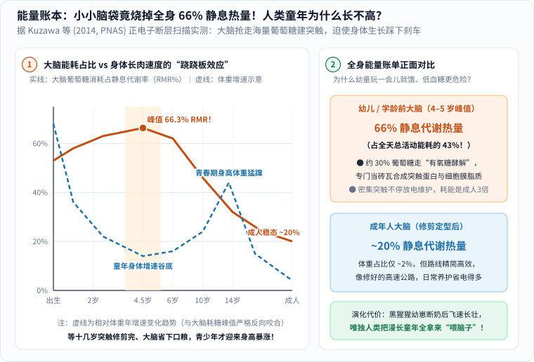
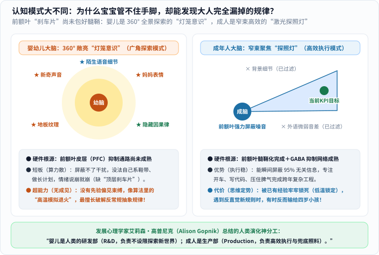
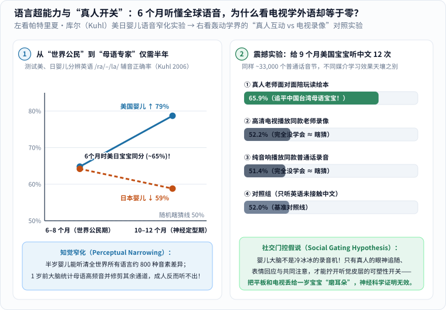

家里养过人类幼崽的朋友，一定都见识过一种极其魔幻的**“智商反差萌”**。

一方面，一岁上下的小宝宝在日常生存技能上简直是个“小迷糊”：不会自己系扣子，够不着桌上的饼干能原地崩溃大哭十分钟，走路摇摇晃晃像喝醉了酒，刚答应“不抓妈妈眼镜”，手却完全不听脑子使唤地一把薅了上去（在之前的[《进入孩子的视角》]()里，我们曾蹲到一米以下体验过他们眼中的感官世界）。

但另一方面，就是这个连鼻涕都不会自己擦的小家伙，却在好几项最硬核的脑力赛道上，把受过高等教育的成年人按在地上摩擦：
- 把一个半岁婴儿放进中、英、法三语混杂的家庭，他不用背一张单词卡、不用学半条语法规则，就能在短短几个月里精准拆解三门语言的声调与辅音边界；而他的博士爸妈苦背十年外语，开口依然带着浓重的母语口音。
- 在发展心理学家的因果推理盒子实验里，面对“违反日常经验的奇怪机关”，三四岁幼童猜出隐藏规律的速度，有时居然比名校大学生还要快！

这不禁让人好奇：**婴儿的大脑，到底是一台怎样运转的机器？**

在很长一段时间里，人们想当然地以为，婴儿大脑不过是一台**“还没装满零件的缩小版成人大脑”**——就像一台内存只插了一半、硬盘还没写入数据的低配电脑，等年纪大了、脑细胞长齐了，自然就变成大人了。

然而，过去三十年间，随着纵向无创磁共振成像（MRI）、正电子发射断层扫描（PET）、皮层电镜计数，乃至 **2025 年《Science》刚刚发表的清醒婴儿功能核磁共振（fMRI）实验**陆续揭晓答案，神经科学家发现事实恰恰相反：

> **婴儿的大脑根本不是“残缺版成人脑”，而是演化专门为生命早期定制的另一套操作系统。**
> 甚至在神经元存量、突触密集度、全身能量掠夺比例、广角探索算力等核心指标上，那个只有成人四分之一重的小脑袋，比成年人还要狂野得多！

今天，我们就顺着**硬件存量、线路修剪、能量账单、注意力光束、语言门控与三岁前记忆之谜**这六条线索，把婴儿与成人大脑最颠覆直觉的六大差异一次拆透。

---

## 一、硬件存量之谜：刚出生就有约 860 亿颗神经元，脑体积凭什么还要再涨 4 倍？

很多人看到新生儿的小脑袋只有成人拳头大一点，第一反应都是：“宝宝刚出生脑细胞还没长多少吧？得多补点营养让脑细胞多生几百亿个！”

这是关于大脑发育流传最广的**第一大误区**。

2009 年，巴西神经科学家苏珊娜·埃尔库拉诺-乌泽尔（Suzana Herculano-Houzel）在《Frontiers in Human Neuroscience》发表了著名的“等各向同性分馏计数法”实测研究（[PMC2776484](https://pmc.ncbi.nlm.nih.gov/articles/PMC2776484/)），一举修正了旧教科书“人脑有 1,000 亿神经元和 10 倍胶质细胞”的估算：成年人脑大约拥有 **860 亿（$$8.6 \times 10^{10}$$）颗神经元**和约 **850 亿颗非神经元胶质细胞**（比例接近 $$1:1$$）。

更惊人的是，加州大学圣迭戈分校琼·斯泰尔斯（Joan Stiles）与特里·杰尼根（Terry Jernigan）在发育神经科学综述《The Basics of Brain Development》（2010，[PMC2989000](https://pmc.ncbi.nlm.nih.gov/articles/PMC2989000/)）中明确指出：人类大脑皮层的神经元发生（Neurogenesis）早在受精后第 42 天（`E42`）就已经启动，并且**在妈妈怀孕中期结束前，绝大多数皮层神经元就已经全部生产完毕、各就各位了**！（出生后除了海马体齿状回和室下区极少数区域仍有新生神经元外，大脑几乎不再批量新增神经元。）

换句话说：**刚从产房抱出来的足月新生儿，小脑袋里已经揣着几乎和爱因斯坦一样多的约 860 亿颗神经元“原装芯片”了！**

那问题来了：既然芯片颗数出生时就已经配齐，为什么足月新生儿的大脑体积只有约 **$$341\text{ cm}^3$$**（男婴平均约 $$347\text{ cm}^3$$，女婴约 $$336\text{ cm}^3$$，重量约 $$350\text{ g}$$，仅为成年人约 $$1{,}300\text{–}1{,}400\text{ g}$$ 的**四分之一到三分之一**），随后却能在短短几年里暴涨近 4 倍呢？

2014 年，加州大学戴尔·霍兰德（Dale Holland）团队在《JAMA Neurology》上对 87 名健康婴儿从出生第 2 天追踪扫描到第 90 天（[PMC4940157](https://pmc.ncbi.nlm.nih.gov/articles/PMC4940157/)），拍下了生命最初三个月惊心动魄的生长速度：
- **出生头几天，新生儿全脑体积每天净增约 $$1\%$$**！仅仅出生头 90 天，全脑总体积就狂飙了 **$$64\%$$**（冲上约 $$560\text{ cm}^3$$，超过成人脑容量的一半）；其中负责运动平衡协调的**小脑（Cerebellum）更是在 90 天内直接翻了一倍多（增长 $$108\%$$–$$113\%$$）**！
- 到 **2 岁**时，脑容量已达成年人的约 **$$80\%$$**；到 **6 岁**时达到约 **$$90\%$$**（[Stiles & Jernigan, 2010](https://pmc.ncbi.nlm.nih.gov/articles/PMC2989000/)）。
- 而在 2022 年剑桥大学与宾夕法尼亚大学领衔发表于《Nature》的里程碑论文《Brain charts for the human lifespan》（汇总全球 **123,984 份核磁共振扫描**，覆盖受精后 115 天至 100 岁，[PMC9021021](https://pmc.ncbi.nlm.nih.gov/articles/PMC9021021/)）中，人类大脑不同组织的达峰时间表被精确到了小数点后一位：**平均皮层厚度在 `1.7 岁` 就早早见顶**，**皮层灰质总体积在 `5.9 岁` 达峰**，而负责跨脑区远距离通信的**脑白质（White Matter）体积则一路稳步增长到 `28.7 岁` 才达到一生巅峰**！

*图 1：先看左栏脑容量狂飙时间轴——婴儿出生时约 860 亿神经元已基本就位，随后暴涨近 4 倍的重量主要来自树突分支丛林、胶质细胞扩增以及包裹轴突的“髓鞘”；再看右栏——婴儿未髓鞘化的裸露轴突信号传导仅约 $$0.5\text{–}2\text{ m/s}$$，而成年人包好脂肪髓鞘后，电脉冲在郎飞结之间“蛙跳”前进，速度飙升至 $$50\text{–}100\text{ m/s}$$。（）*

多出来的这 1,000 克重量到底长了些什么？答案是两样东西：**神经元之间伸展出的茂密树突丛林，以及少突胶质细胞给神经纤维裹上的“绝缘皮”——髓鞘（Myelin）**。

如果像我们在[《计算机是如何工作的》]()里打比方那样把神经元看作逻辑门，那么连接神经元的轴突（Axon）就是电线：
- **婴儿的神经电线大多是“没包橡胶皮的裸铜丝”**。电信号只能沿着细胞膜一寸寸连续爬行，不仅容易向旁边漏电串扰，传导速度 $$v_{\text{inf} }$$ 也只有可怜的 **$$0.5\text{–}2\text{ m/s}$$**。
- **成人的长程神经纤维则裹满了富含脂质的白色髓鞘（因此叫“脑白质”）**。绝缘髓鞘大幅降低了轴突膜电容，迫使动作电位只在两段髓鞘之间的裸露缝隙——**郎飞结（Nodes of Ranvier）**上“蛙跳”前进（跳跃式传导，Saltatory Conduction），传导速度 $$v_{\text{adult} }$$ 直接飙升到 **$$50\text{–}100\text{ m/s}$$**！

我们可以算一笔直观的跨脑区响应延迟账。假设一段从枕叶视觉区传往额叶运动区的神经通路长度为 $$L = 0.15\text{ m}$$（15 厘米）：

$$
\begin{aligned}
\Delta t_{\text{婴儿} } &= \frac{L}{v_{\text{inf} } }
\approx \frac{0.15\text{ m} }{1.0\text{ m/s} } = 150\text{ ms} \\[6pt]
\Delta t_{\text{成人} } &= \frac{L}{v_{\text{adult} } }
\approx \frac{0.15\text{ m} }{60\text{ m/s} } = 2.5\text{ ms}
\end{aligned}
$$

同样的 15 厘米路程，**成年人大脑只需 2.5 毫秒就能传到，而小婴儿光在路上就要跑 150 毫秒——足足慢了 60 倍**！这就是为什么你拿一个彩色摇铃逗三个月大的宝宝，他明明看见了，却要呆萌地愣上一两秒，小手才慢吞吞、一顿一顿地挥过来。

这里还有一个儿科放射科医生才懂的冷知识（[Holland et al., 2014](https://pmc.ncbi.nlm.nih.gov/articles/PMC4940157/)）：因为新生儿脑白质还没裹上脂肪髓鞘、含水量高达 $$88\%$$ 以上，如果拿成年人的常规 T1 加权核磁共振去扫新生儿大脑，**照片上的灰质和白质黑白明暗竟然是完全反过来的**！直到两三岁髓鞘铺得差不多了，核磁图像才会翻回成年人的熟悉模样。

---

## 二、连线账本之怪：为什么 2 岁宝宝的突触密度竟是成年人的近 2 倍？长大居然靠“砍掉一半连线”！

如果说“神经元不增反涨重”已经够反直觉了，那第二个真相更颠覆常理：**如果数一数大脑皮层里神经元之间的连接点（突触，Synapse）有多少，两三岁小宝宝竟然把成年人远远甩在身后！**

哈佛大学儿童发展中心（Center on the Developing Child）在核心科普报告《Brain Architecture》（[Harvard Developing Child](https://developingchild.harvard.edu/key-concept/brain-architecture/)）中给出了一个震撼神经科学界的数字：在生命最初几年里，婴幼儿大脑**每秒钟会新建超过 100 万个神经连接（$$>10^6\text{ synapses/s}$$）**！

这是什么概念？一天 $$86{,}400$$ 秒下来，小宝宝脑子里每天新冒出来的突触触点高达 **$$8.64 \times 10^{10}$$ 个**！芝加哥大学神经病理学家彼得·胡滕洛赫尔（Peter Huttenlocher）团队通过人类不同年龄段大脑皮层的电子显微镜切片逐一计数（Huttenlocher & Dabholkar, 1997；详见 [Stiles & Jernigan, 2010](https://pmc.ncbi.nlm.nih.gov/articles/PMC2989000/) 图 10b），发现了一个先冲顶、再腰斩的戏剧性曲线：

1. **爆发期（出生 → 2–3 岁）**：出生时皮层突触密度还不高，但随后以火箭般的速度疯长，在婴幼儿期冲上顶峰——此时**单位体积大脑皮层里的突触数量，竟然高达成年人稳态水平的约 $$150\%\text{–}200\%$$（近 2 倍）**！
2. **修剪期（童年 → 青春期 → 25 岁左右）**：从幼年后期穿过整个青春期，大脑非但不再净增突触，反而启动小胶质细胞（Microglia）这支“园艺修剪队”，**系统性地剪除掉约 $$40\%\text{–}50\%$$ 的冗余突触连接**，最终回落到成年人的 $$100\%$$ 精简水平。

*图 2：先看左栏三大脑区分波达峰与修剪曲线——视听感官皮层在半岁左右率先冲顶，语言区在 1 岁前后达峰，而负责自控与规划的前额叶皮层最晚达峰、一路修剪到 25 岁左右才彻底定型；再看右栏三阶段网格重塑（含单次播放的修剪强化动画，最终停留在完整结果；开启系统“减少动态效果”时直接展示静态终态）——幼儿期全城铺满羊肠小道（约 200% 密度），成年期剪除虚线闲置支路、将高频主干道加粗成八车道高速路。（）*

为什么大自然要干这种“先费劲建好两倍连线，再花十几年砍掉一半”的赔本买卖？直接按成年人的图纸一次性连好不行吗？

**答案是：绝对不行！因为人类基因根本装不下那张图纸，而且未来的环境也没法提前写死。**

人类基因组只有约 2 万个编码蛋白质的基因，就算全部拿来写配线说明书，也远远不够精确指定 860 亿颗神经元之间数百万亿个突触谁连谁。更何况，一个婴儿可能降生在零下三十度的北极冰原、亚马逊热带雨林，或者 2026 年充满触控屏与普通话的现代都市——基因怎么可能未卜先知他将来要听哪种语言、用哪种工具？

于是，演化想出了一套比任何人工神经网络（我们在[《机器到底是怎么学会思考的？从一条直线到大模型》]()里聊过权重训练）都高明的**“两步自适应建城法”**：
- **第一步（基因搭毛坯，先把所有可能的小路全铺满）**：在两岁前不计成本地让神经元彼此乱连，甚至在视觉皮层、听觉皮层和体感皮层之间搭起许多成年人根本没有的跨界临时通道（这也是为什么有学者认为婴儿的感官世界带有某种奇妙的“联觉”色彩）。
- **第二步（经验当总设计师，用进废退）**：遵循赫布定律（Hebbian Learning）——**“一起放电的神经元连得更紧，不同步闲置的突触被剪掉”**。如果宝宝每天听到爸爸妈妈温柔地和他说中文、做“发球—回球（Serve and Return）”的眼神与声音互动，中文语音与社交回路就会频繁同步放电、抢到更多神经营养因子（BDNF 等）并被髓鞘牢牢加固；而长期没人走动的荒草小径，就会被打上补体蛋白标记，由小胶质细胞精准吞噬回收。

请注意图 2 左栏里一个极其关键的育儿细节——**不同脑区的施工进度表完全不同步（Heterochronicity）**：
- **视觉与听觉感官皮层**：约 **4–8 个月**突触密度冲顶，学龄前就基本修剪定型（所以先天性白内障等视觉剥夺必须在婴幼儿早期干预，错过窗口视觉皮层就会被挪作他用）；
- **语言相关皮层**：约 **9–12 个月**迎来高峰，随后在幼年期快速塑形；
- **前额叶皮层（Prefrontal Cortex，负责情绪刹车、延迟满足、长远规划与逻辑自控）**：排在全脑施工队的最后一名——突触密度在两三岁才慢悠悠见顶，**修剪与髓鞘化工程一直要拖到 25 岁左右才彻底竣工**！

下次当你家三岁娃因为香蕉皮剥断了就趴在地上嚎啕大哭、怎么讲道理都听不进去时，先别急着怀疑人生——真不是他故意跟你作对，而是他脑门后面那块负责“讲道理和踩刹车”的前额叶工地，脚手架才刚搭了一半呢！

---

## 三、能量账本之惊：那颗小脑袋竟烧掉全身 66% 静息热量！人类童年为什么几乎不长个儿？

既然两三岁到四五岁孩子的大脑里塞满了成年人两倍密度的突触，每时每刻都在疯狂放电、合成蛋白、铺设髓鞘，这台超级施工机得烧掉多少电？

2014 年，美国西北大学人类学家克里斯托弗·库扎瓦（Christopher Kuzawa）团队在《美国国家科学院院刊》（*PNAS*）发表了一项轰动演化生物学界的重磅研究《Metabolic costs and evolutionary implications of human brain development》（[PMC4246958](https://pmc.ncbi.nlm.nih.gov/articles/PMC4246958/)）。研究团队将不同年龄段人类的脑部 PET 葡萄糖代谢扫描数据与核磁共振脑体积数据逐一对齐，算出了人类一生大脑的真实“吃粮账单”：

- **成年人**：大脑重量只占体重的约 **$$2\%$$**，在安静躺平状态下消耗全身约 **$$20\%$$** 的静息代谢率（Resting Metabolic Rate，简称 RMR）——这在动物界已经算是耗能大户了。
- **足月新生儿**：大脑占体重约 $$10\%\text{–}12\%$$，一出生就吞掉了全身 **$$52.5\%$$（男婴）至 $$59.8\%$$（女婴）** 的静息代谢能量！
- **4–5 岁学龄前儿童（一生能耗最高峰！）**：随着突触总数冲上历史巅峰，一个四五岁孩子的大脑竟然单枪匹马烧掉了**全身静息代谢总热量的 $$66.3\%$$（男孩）/ $$65.0\%$$（女孩）**！就算把白天跑跳玩耍的所有活动热量全算进去，这颗小脑袋依然霸占了**全天总能量需求的 $$43.3\%\text{–}43.8\%$$**！

*图 3：左栏依据 Kuzawa 等（2014，PNAS）数据展示人类大脑葡萄糖消耗占静息代谢率比例（橙色实线）与相对体重增速趋势（蓝色虚线）的精准反向咬合——4 至 5 岁大脑耗能冲上 66.3% 峰值时，身体长肉速度恰好跌入童年谷底；右栏对比幼童与成人的能量分配。（）*

我们可以用代谢占比公式一眼看出四五岁幼童与成年人的恐怖差距：

$$
\begin{aligned}
\eta_{\text{成人脑} } &= \frac{E_{\text{脑,静息} } }{E_{\text{全身,静息} } } \approx 20\% \\[6pt]
\eta_{\text{4.5岁幼脑} } &= \frac{E_{\text{脑,静息} } }{E_{\text{全身,静息} } } \approx 66.3\% \\[4pt]
&\approx 3.3 \times \eta_{\text{成人脑} }
\end{aligned}
$$

不仅如此，Kuzawa 团队还指出了另一个细胞层面的秘密：在幼童大脑吞下的海量葡萄糖里，有高达约 **$$30\%$$** 并没有像普通器官那样彻底氧化烧成 ATP 发电，而是走了看似低效的**“有氧糖酵解（Aerobic Glycolysis）”**通道——因为高速施工的突触需要直接拿葡萄糖拆出来的碳骨架当“砖头和水泥”，日夜不停地合成全新的细胞膜脂质与突触蛋白！

把这张大脑耗糖曲线和人类身高体重生长曲线叠在一起时，困扰演化生物学家几十年的一个谜题瞬间迎刃而解：**为什么黑猩猩和大猩猩幼崽断奶后立刻像吹气球一样飞速长壮，唯独人类小孩从 2 岁到 10 岁之间长个子慢得像乌龟爬？**

看一眼图 3 左栏那两条严丝合缝反向咬合的曲线就全明白了：
- **四五岁时，大脑抢走了全身三分之二的基础口粮**，留给骨骼和肌肉长肉的预算被压到了极限——人类幼崽不是长不动，而是身体为了给大脑突触施工队让路，主动踩下了生长刹车！
- 等到十二三岁进入青春期，大脑皮层近一半的冗余突触修剪完毕，大脑能耗占比从 $$66\%$$ 一路回落到 $$30\%$$ 以下，省下来的海量卡路里瞬间释放给骨骼和肌肉——于是青少年迎来了每年猛蹿十厘米的**“青春期身高突增”**！

这也顺带解释了两个日常带娃现象：第一，为什么三四岁小孩明明没干体力活，玩两个小时就喊肚子饿、一旦低血糖就立刻暴躁哭闹（因为脑子里那台 66% 功率的反应堆一刻也不能断糖！）；第二，为什么人类幼崽需要父母、祖父母整个家庭长达十几年无微不至的喂养保护——**我们漫长而脆弱的童年，是智人为了换取地球最强可塑性大脑签下的演化契约。**

---

## 四、认知光束之别：“灯笼意识”对决“探照灯注意力”，为什么小孩有时比大学生更聪明？

既然成年人的大脑髓鞘包好了、传导快了 60 倍、前额叶自控力也上线了，那是不是在所有动脑子的任务上，成年人都全面碾压婴幼儿呢？

加州大学伯克利分校发展心理学家艾莉森·高普尼克（Alison Gopnik）与普林斯顿大学计算认知科学家托马斯·格里菲斯（Thomas Griffiths）等人，在 2015 年发表的论文《When Younger Learners Can Be Better (or at Least More Open-Minded) Than Older Ones》（[Princeton Research Record / DOI: 10.1177/0963721414556653](https://collaborate.princeton.edu/en/publications/when-younger-learners-can-be-better-or-at-least-more-open-minded-/)）里，展示了一组让大人们大跌眼镜的实验：

研究人员设计了一个叫“Blicket 检测器”的发光音乐盒。通常生活经验告诉我们，都是“单个积木触发机关”（比如 A 积木放上去就亮，B 放上去不亮）。但这一次，实验者偷偷把底层物理规则改成了反直觉的**“组合触发律”**——必须两块特定积木同时放上去盒子才亮。结果发现：**4 岁幼儿园小朋友观察几次试错后，准确推断出“组合新规则”的比例，竟然显著高于加州大学伯克利分校的成年本科生！** 大学生们死死咬住“肯定是某块积木单独有效，刚才不亮大概是接触不良”的旧经验，怎么都转不过弯来。

为什么“没长熟”的幼童大脑反而赢了？高普尼克用了一个极其传神的比喻——**灯笼（Lantern）与探照灯（Spotlight）**：

*图 4：左栏展示婴幼儿由于前额叶自上而下抑制通路尚未成熟，注意力像一盏 360° 全景漫射的“灯笼”，虽难以集中执行单一任务，却能无偏见地捕捉环境中的隐藏规律；右栏展示成年人成熟前额叶形成窄束聚焦的“激光探照灯”，执行效率极高，却容易被先验成见锁死。（）*

- **成年人大脑 = 窄束高能“探照灯”（低温度高利用 Exploitation）**：成年人成熟的前额叶皮层搭配全脑抑制性神经递质 **GABA（$$\gamma$$-氨基丁酸）**网络，像一道严密的防火墙，自动把视野和听觉里 $$95\%$$ “看似跟当前工作无关”的背景细节统统过滤屏蔽掉（顺便一提，在极早期未成熟神经回路中，由于细胞内氯离子转运体 `NKCC1` 占主导、胞内 $$\text{Cl}^-$$ 浓度高，连成年脑里当“总刹车片”用的 GABA 递质在生命最早期都是起**兴奋促连线作用**的，直到后来 `KCC2` 表达上升才翻转为抑制性刹车！）。探照灯让我们能一边顶着嘈杂地铁声一边改代码、赶飞机、规划房贷，但代价是**探照灯照不到的暗处，我们视而不见**。
- **婴幼儿大脑 = 360° 敞亮“灯笼意识”（高温度高探索 Exploration）**：正因为婴儿前额叶“抑制刹车”还没装好，他们没法屏蔽干扰，一有风吹草动就扭头去看——可也正因如此，**世界万物未经删减地涌进他们的大脑**！

在计算机优化与强化学习里，这完美对应着经典的**模拟退火（Simulated Annealing）玻尔兹曼探索概率公式**（设候选假设 $$h$$ 的后验得分为 $$U(h)$$，认知搜索温度为 $$T$$）：

$$
\begin{aligned}
P(h) &= \frac{\exp\!\left(U(h) / T\right)}{\sum_{h'} \exp\!\left(U(h') / T\right)} \\[6pt]
T_{\text{婴儿} } &\gg T_{\text{成人} } \\[6pt]
&\begin{cases}
T_{\text{high} }：\text{广撒网探索反常规规律} \\
T_{\text{low} }：\text{锁定旧经验，高效但固执}
\end{cases}
\end{aligned}
$$

高普尼克说得妙极了：**如果把整个人类社会看作一家跨国科技公司，婴幼儿就是公司的“前沿研发部（R&D）”——不用背 KPI、不管柴米油盐，专职负责天马行空地摸索新一代环境规则；而成年父母则是“生产运营部（Production）”——靠成熟稳健的执行力打猎做饭、赚钱养家，给研发部兜底买单！**

---

## 五、语言超能力与“真人开关”：6 个月听清全球语音，为什么看外语电视却完全白看？

“灯笼意识”加“两倍突触可塑性”最耀眼的杰作，就是婴儿在生命第一年里展现出的**语言破译神技**。

成年人学外语有多痛苦？让一个成年日本人区分英语里的 `right`（`/r/`）和 `light`（`/l/`），或者让一个成年欧美老外区分普通话的“妈、麻、马、骂”四个声调，哪怕听上一千遍，他们脑电波里的听觉皮层反应依然糊成一团。因为全世界所有人类语言加起来大约有 **800 多种音素（Phonemes，区分词义的最小语音单位，约 600 种辅音 + 200 种元音）**，而任何一门单一母语通常只用到其中约 **40 种**。

刚出生的宝宝能听出这 800 种音素的区别吗？华盛顿大学脑与学习科学研究所所长帕特里夏·库尔（Patricia K. Kuhl）院士在《Neuron》经典综述《Brain Mechanisms in Early Language Acquisition》（2010，[PMC2947444](https://pmc.ncbi.nlm.nih.gov/articles/PMC2947444/)）中，展示了半个世纪语音发育研究最迷人的发现：

1. **0–6 个月：名副其实的“世界公民（Citizens of the World）”**。无论是生在东京、西雅图、北京还是内罗毕的半岁婴儿，只要放进实验室测试，他们分辨世界上任何一门陌生语言微小音差的能力**几乎一模一样**！比如测试英语 `/ra/` 与 `/la/` 的区分率（Kuhl et al., 2006），**6–8 个月大的日本婴儿和美国婴儿同拿约 $$65\%$$ 的高分**，毫无国界之分。
2. **6–12 个月：闪电般的“知觉窄化与母语神经定型（Neural Commitment）”**。仅仅过了四个月，到 **10–12 个月大**再去测同一批宝宝：每天听英语的美国宝宝成绩飙升到近 **$$79\%$$**；而每天听日语（日语不区分 `/r/` 和 `/l/`）的日本宝宝，区分率迅速跌落到 **$$59\%$$**（逼近随机瞎猜的 $$50\%$$）！

短短半年里发生了什么？婴儿的前部海马体与听觉皮层就像一台全天候运转的**贝叶斯统计分析仪**，默默统计着父母嘴里几万个音节的频率分布：英语宝宝统计出 `/r/` 和 `/l/` 是两个清晰的山峰，于是加固这道边界；日语宝宝统计出它们混在同一个单峰里，于是大刀阔斧地把这道“无用边界”修剪合并，换取识别母语语流的高速效率！

*图 5：先看左栏——6 至 8 个月美日婴儿同等分辨英语 `/ra/–/la/`，10 至 12 个月迅速分化为母语专用回路；再看右栏轰动全球的 Kuhl 等（2003，PNAS）对照实验——同样给 9 个月美国婴儿输入约 33,000 个普通话音节，真人面对面陪玩组学会率追平中国台湾母语婴儿（65.9%），而看高清电视录像组（52.2%）与纯听录音组（51.4%）学习效果彻底归零！（）*

看到这里，无数望子成龙的商家立刻嗅到了商机：“既然 1 岁前是语言黄金窗口，赶紧买全套外语早教动画片、早教机录音，每天给半岁宝宝循环播放‘磨耳朵’，岂不是躺赢？”

库尔团队紧接着做了一个直接把早教视频神话砸得粉碎的经典实验（Kuhl, Tsao & Liu, 2003, *PNAS*；详见 [PMC2947444](https://pmc.ncbi.nlm.nih.gov/articles/PMC2947444/) 图 5）：

他们请来从没接触过中文的 **9 个月大美国婴儿**，在 4–5 周内安排了 12 次中文输入课，累计听到约 **33,000 个普通话音节**，但分成三组不同方式：
- **第 ① 组（真人面对面互动）**：中国留学研究生阿姨坐在宝宝面前，一边看着宝宝的眼睛微笑回应，一边指着绘本和玩具用普通话陪玩；
- **第 ② 组（高清电视录像）**：把第 ① 组一模一样的老师讲绘本画面和声音录下来，用高清大彩电放给宝宝看（宝宝盯着屏幕看的时间甚至也很长！）；
- **第 ③ 组（纯音频磨耳朵）**：用音响播放一模一样的普通话录音，旁边放玩具。

一个月后检测宝宝分辨普通话特有辅音（如舌面音 `jqx` / 翘舌音）的能力和脑电波（MMN），结果震惊了所有人：
- **真人陪玩组得分高达 $$65.9\%$$**——短短 12 次课（总共才几个小时！），这群美国宝宝分辨中文语音的水平，竟然直接追平了在中国台北天天听中文长到 10 个月大的母语宝宝！
- **高清电视组（$$52.2\%$$）与纯录音组（$$51.4\%$$）**——和根本没听过一句中文的纯英语对照组（$$52.0\%$$）毫无差别，**学习效果彻彻底底等于零**！

库尔由此提出了著名的**“社交门控假说（Social Gating Hypothesis）”**：
> **婴儿的大脑绝不是一台只要通电就能录音的磁带机！**
> 在复杂的自然语言世界里，必须有**真人的眼神交汇、顺着宝宝目光指认物品的共同注意（Joint Attention），以及“宝宝咿呀一声—大人立刻温柔接话”的实时互动**，社交脑才会拧开听觉皮层的神经可塑性大门。没有温度的单向电子屏幕声光，对一岁婴儿的语音统计引擎来说，只是一堆被挡在门外的背景白噪音。

---

## 六、睡梦施工队与“三岁前失忆之谜”：2025《Science》清醒婴儿核磁如何改写教科书？

讲到这里，最后两个每个爸爸妈妈都困惑过的问题终于浮出水面了：
1. **为什么小婴儿每天要睡十六七个小时，而且睡着了还老是眼皮乱翻、咧嘴偷笑、手脚一惊一乍？**
2. **既然两三岁前宝宝的大脑突触最多、学东西最快，为什么我们长大以后，却几乎全员记不得自己 3 岁以前发生过的任何一件具体往事？**

### 1. 婴儿睡觉不是在“待机休息”，而是在拉闸搞基建

成年人每天睡 $$7\text{–}8$$ 小时，一入睡先进入深沉安静的非快速眼动睡眠（NREM），整晚做梦的快速眼动睡眠（REM）只占约 **$$20\%$$**（每天约 $$1.5$$ 小时），而且做梦时脑干会把全身骨骼肌死死“锁住”（肌张力消失），防止你梦见踢球真把旁边伴侣踹下床。

可新生儿完全相反！新墨西哥大学医学院玛德琳·格里格-丹伯格（ Madeleine Grigg-Damberger）在临床睡眠医学综述《Infants Sleep for Brain》（2017，[PMC5656471](https://pmc.ncbi.nlm.nih.gov/articles/PMC5656471/)）中总结道：
- 足月新生儿每天要睡 **$$16\text{–}18$$ 小时**，其中高达 **$$50\%$$ 是活跃的快速眼动睡眠（Active / REM Sleep，每天超过 8 小时，绝对时长是成人的 5.5 倍；早产儿甚至高达 $$80\%$$）**，而且新生儿一闭眼是**直接跳进 REM 活跃睡眠**的！
- 更奇妙的是，婴儿脑干的运动封锁机制还没建好，所以在 REM 睡眠里，宝宝会频繁出现**眼珠乱转、皱眉微笑、手指脚趾突然抽动（Myoclonic Twitches）**。

千万别以为宝宝做噩梦被吓着了，更别急着去拍醒他或抱起来哄！近年发育神经生物学发现，**睡梦中的每一次小手小脚抽动，都会顺着外周感觉神经向大脑体感与运动皮层发射一串清脆的“自发校准脉冲”**——就像新装好的机械臂在出厂前自动逐个关节通电点动一样，婴儿大脑正是靠着每天八个多小时 REM 睡眠里的几万次微抽动，在黑暗中一笔一画绘出了“左手无名指归哪块皮层管、右脚踝怎么发力”的全身运动地图！

*图 6：左栏对比足月新生儿与成年人 24 小时睡眠结构——新生儿每天超 8 小时的 REM 活跃睡眠正通过肢体微抽动校准大脑体感运动地图；右栏图解 2025 年 3 月耶鲁大学发表于《Science》的清醒婴儿 fMRI 突破——1 岁婴儿的后部海马体其实已经能够编码单次情景记忆，成年后失忆并非“当年没写入”，而是“海马体神经发生重塑＋缺乏语言索引导致提取失败”。（）*

### 2. “婴儿期遗忘症（Infantile Amnesia）”的百年反转：不是没存盘，而是丢了目录锁！

最后来看看那个困扰了弗洛伊德和无数脑科学家的终极悬案：**为什么我们记不住自己当小宝宝时的事？**

过去几十年，最主流的教科书解释非常省事：**“因为婴儿负责情景记忆（Episodic Memory，即某年某月某日在哪儿干了啥）的海马体（Hippocampus）还没发育成熟，根本没法把经历写进硬盘。”**（毕竟前文 Holland 等 2014 年的数据也显示，出生头 90 天里海马体是全脑长得最慢的结构之一。）

但这个旧假说一直有个尴尬的漏洞：两岁宝宝明明记得上个月去动物园看大象的路、记得外婆家抽屉里藏着贴纸——要是一点情景记忆都写不进去，他怎么认出来的？问题在于，让一岁半的小婴儿乖乖躺在轰隆作响的核磁共振仪里不哭不闹、清醒着做记忆实验，实在太难了！

直到 **2025 年 3 月 20 日**，耶鲁大学心理与脑科学系尼克·特克-布朗（Nick Turk-Browne）与特里斯坦·耶茨（Tristan Yates）团队历经多年攻关，用奶嘴、毛毯和投影动画稳住了 **26 名 4 至 24 个月大的清醒婴儿**，在顶级期刊《Science》发表了轰动全球的论文《Hippocampal encoding of memories in human infants》（*Science* 387(6740), 1316–1320；详见[耶鲁大学官方科学公报](https://news.yale.edu/2025/03/20/why-dont-we-remember-being-baby-new-study-provides-clues)）：

研究团队给清醒躺着看屏幕的宝宝先后展示从未见过的新人脸、新玩具和新风景照片，隔一会儿再把“刚才看过的旧图”和“全新图片”并排播放（婴儿天生爱盯着认出来的熟悉图像多看一会儿），同时用高分辨率 fMRI 实时监测宝宝海马体的血氧信号，结果一举改写了教科书：
1. **两套海马体系统分批上线**：位于海马体更靠前区域的**“统计学习系统”**（负责抽取语言规律、环境套路等共性知识）早在 **3 个月大**就已经火热开工；而负责记录具体单次事件的**后部海马体（Posterior Hippocampus）情景记忆系统，在宝宝满 1 岁左右就已经明确上线了**！
2. **铁证如山的编码信号**：一个 12 个月以上的宝宝第一次看到某张新照片时，**他后部海马体亮起的激活强度越高，几分钟后再次见到这张照片时认出它的准确率就越高**——这种后部海马体编码模式，与成年人记住人生瞬间的脑区机制如出一辙！

既然 1 岁宝宝的大脑已经在认认真真地往硬盘里“存照片”了，为什么二十年后的你却一张都翻不出来？结合动物神经生物学（如 Akers 等 2014 年《Science》关于海马齿状回神经发生的研究）与特克-布朗团队的最新推论，真凶指向了**“物理寻址重塑 + 操作系统升级不兼容”**：
- **原因一（海马体齿状回持续挤进新神经元，冲乱了旧路标）**：婴幼儿期海马体齿状回仍在大量塞入新生颗粒神经元，新神经元强行接入既有回路时，虽然大幅提升了学习新事物的算力，却把旧情景记忆的提取突触路径改得面目全非（不过别可惜——具体哪天摔了一跤虽然忘了，但“台阶滑要小心”的统计规律早已被转移备份进大脑皮层，伴随你一生！）。
- **原因二（当年存的是“无字原始档”，长大后你只会用“语言关键词”搜索）**：一岁半的宝宝还没有成熟的语言词汇，也没有清晰的“自我时间轴（Autobiographical Self）”，他存下的记忆是一团光影、气味与妈妈怀抱温度交织的原始感官编码；等你长大升级成“中文/英文语言操作系统”后，你想用“两岁生日那天”这串文字密钥去检索，自然怎么搜都提示“找不到匹配文件”！

---

## 七、一张总表看清：婴儿大脑 vs 成人大脑六大核心差异与科学养育减负清单

把上面六大发现合拢在一起，我们可以列出一张清晰的对比总表：

| 对比维度 | 婴幼儿大脑（0–3 岁为主） | 成年人大脑（25 岁完全成熟后） | 演化与日常行为意义 |
| :--- | :--- | :--- | :--- |
| **1. 神经元与白质硬件** | 约 **860 亿神经元已就位**，但体积仅成人的 $$27\%\text{–}80\%$$；轴突缺髓鞘，传导慢（$$\sim 1\text{ m/s}$$） | 约 **860 亿神经元**，体积 $$\sim 1{,}350\text{ g}$$；髓鞘在 **28.7 岁**达峰，跳跃传导快（$$50\text{–}100\text{ m/s}$$） | 宝宝不是笨，是跨脑区电线还没包完绝缘皮，反应物理延迟高 |
| **2. 突触连接密度** | 每秒新建 $$>100$$ 万个连接，2–3 岁密度冲上**成人的 $$150\%\text{–}200\%$$** | 剪除近一半闲置支路，保留 **$$100\%$$ 精简高速主干道**（前额叶最后定型） | 幼年靠“广撒网＋经验修剪”适配任意出生环境，可塑性无敌 |
| **3. 全身能量账单** | 新生儿占静息代谢 $$53\%\text{–}60\%$$，**4–5 岁冲上峰值 $$66.3\%$$**（占全天总耗能 $$43\%$$） | 仅占静息代谢约 **$$20\%$$**（体重占比 $$\sim 2\%$$） | 人类漫长童年身体长个慢，是因为卡路里全优先拿去喂脑子建突触了 |
| **4. 注意力与认知模式** | 前额叶抑制弱，呈 **360° 敞亮“灯笼意识”**（高温探索 $$T_{\text{high} }$$，无先验成见） | 前额叶＋GABA 抑制强，呈**窄束“探照灯”**（低温高效执行 $$T_{\text{low} }$$，易思维定势） | 宝宝管不住手脚脾气，但发现反常规新规律有时比大学生还敏锐 |
| **5. 语音感知与学习条件** | 6 个月前听辨全球 ~800 种音素；**必须靠真人面对面互动才能拧开学习开关** | 母语神经早已固化定型，外语音差被自动归并过滤，但可靠理性背单词语法 | 给一岁娃看电视/平板“磨外语”效果为零，真人眼神回应才是金钥匙 |
| **6. 睡眠与记忆存储** | 每天睡 16–18 小时，**50% 为活跃 REM 睡眠**（抽动校准地图）；1 岁海马体已能写入事件 | 每天睡 7–8 小时，REM 占 ~20%；具备完整语言与自传体检索索引 | 3 岁前经历并非没存盘，而是检索路径被神经重塑，且已化作底层性格与能力 |

读懂了这套精妙绝伦的大脑设计图，我们做父母的（正如在[《关于新世代儿童未来》]()里聊过的那样），其实瞬间就能卸下市面上九成以上的育儿焦虑，换成三条真正顺应脑科学的温柔行动：

1. **省下昂贵的“婴儿闪卡课”和“电子屏幕磨耳朵”预算，多做最朴素的“发球—回球”真人互动**：当宝宝指着窗外的小鸟“啊啊”叫（发球），你蹲下来顺着他的目光笑着说“对呀，一只黄色的小鸟飞走啦！”（回球）——这一来一回的眼神与语音同步，胜过全世界最顶级的早教平板。
2. **对三岁前后的“情绪风暴”与“讲不通道理”多一分物理层面的体谅**：当前额叶要到二十多岁才彻底包完髓鞘，苛求一个两三岁幼儿像成年人一样冷静克制，就像苛求一台还没装刹车的跑车精准停进车位。先抱住他帮他做“外置前额叶”平复情绪，比大声说教有效一百倍。
3. **永远别觉得“反正他三岁前记不住，带他看世界、好好爱他都是白费劲”**：虽然二十年后的他确实翻不出“一岁半某个周日下午爸爸陪我在草地上滚皮球”那张具体照片，但那天阳光下的安全感、语言节奏、运动协调与被回应的信任，早已被小胶质细胞和少突胶质细胞一砖一瓦地砌进了他的大脑皮层主干道里——**他忘了那件事，但那件事变成了他自己。**

---

## 参考资料与核查来源

1. **Harvard University, Center on the Developing Child — *Key Concept: Brain Architecture***：阐明生命早期每秒新建超过 100 万个神经连接（`>1 million new neural connections per second`）、自下而上（感官运动 → 语言 → 高级执行功能）的分波建构顺序、突触增殖与修剪，以及养育者“发球—回球（Serve and Return）”互动的决定性作用。官方原页：[https://developingchild.harvard.edu/key-concept/brain-architecture/](https://developingchild.harvard.edu/key-concept/brain-architecture/)
2. **Herculano-Houzel, S. (2009). *The Human Brain in Numbers: A Linearly Scaled-up Primate Brain*. Frontiers in Human Neuroscience, 3:31**：采用等各向同性分馏法精确测定成年人脑拥有约 **860 亿颗神经元**与约 **850 亿颗非神经元细胞**，澄清“1,000 亿神经元与 10 倍胶质细胞”的传统教材误传。PubMed Central 全文：[https://pmc.ncbi.nlm.nih.gov/articles/PMC2776484/](https://pmc.ncbi.nlm.nih.gov/articles/PMC2776484/)
3. **Holland, D., Chang, L., Ernst, T., et al. (2014). *Structural Growth Trajectories and Rates of Change in the First 3 Months of Infant Brain Development*. JAMA Neurology, 71(10), 1266–1274**：87 名健康足月婴儿出生 2–90 天纵向 MRI 追踪，测得新生儿全脑体积约 $$347\text{ cm}^3$$（男）/$$336\text{ cm}^3$$（女），出生初期每日增长约 $$1\%$$、90 天总体积暴涨 $$64\%$$（小脑翻倍），并记录新生儿未髓鞘化白质导致的 T1 核磁明暗反转现象。PubMed Central 全文：[https://pmc.ncbi.nlm.nih.gov/articles/PMC4940157/](https://pmc.ncbi.nlm.nih.gov/articles/PMC4940157/)
4. **Stiles, J., & Jernigan, T. L. (2010). *The Basics of Brain Development*. Neuropsychology Review, 20(4), 327–348**：系统综述胚胎第 42 天启动、孕中期基本完成的神经元发生，出生后胶质细胞扩增与轴突髓鞘化，以及引用 Huttenlocher & Dabholkar (1997) 人类皮层突触密度冲至成人近两倍后再修剪近半的组织学证据。PubMed Central 全文：[https://pmc.ncbi.nlm.nih.gov/articles/PMC2989000/](https://pmc.ncbi.nlm.nih.gov/articles/PMC2989000/)
5. **Bethlehem, R. A. I., Seidlitz, J., White, S. R., et al. (2022). *Brain charts for the human lifespan*. Nature, 604, 525–533**：聚合全球 101,457 名受试者共 **123,984 次 MRI 扫描**构建人类全生命周期脑发育常模，精确测定皮层平均厚度在 **1.7 岁**达峰、皮层灰质体积在 **5.9 岁**达峰、脑白质体积持续增长至 **28.7 岁**达峰。PubMed Central 全文：[https://pmc.ncbi.nlm.nih.gov/articles/PMC9021021/](https://pmc.ncbi.nlm.nih.gov/articles/PMC9021021/)
6. **Kuzawa, C. W., Chugani, H. T., Grossman, L. I., et al. (2014). *Metabolic costs and evolutionary implications of human brain development*. PNAS, 111(36), 13010–13015**：结合脑 PET 葡萄糖摄取与 MRI 体积实测，证明新生儿脑耗能占静息代谢率 $$52.5\%\text{–}59.8\%$$，在幼年（约 4–5 岁）冲上 **静息代谢率 $$66.3\%$$ / 全天总能耗 $$43.3\%$$** 的一生峰值（含约 $$30\%$$ 有氧糖酵解用于突触生物合成），并与人类童年缓慢的体重增速严格反向对应。PubMed Central 全文：[https://pmc.ncbi.nlm.nih.gov/articles/PMC4246958/](https://pmc.ncbi.nlm.nih.gov/articles/PMC4246958/)
7. **Gopnik, A., Griffiths, T. L., & Lucas, C. G. (2015). *When Younger Learners Can Be Better (or at Least More Open-Minded) Than Older Ones*. Current Directions in Psychological Science, 24(2), 87–92**：阐释前额叶未成熟带来的“灯笼意识”、模拟退火高温探索（Exploration vs Exploitation）机制，以及幼童在反常规抽象因果推断任务中超越成年人的实验证据。普林斯顿大学学术档案页：[https://collaborate.princeton.edu/en/publications/when-younger-learners-can-be-better-or-at-least-more-open-minded-/](https://collaborate.princeton.edu/en/publications/when-younger-learners-can-be-better-or-at-least-more-open-minded-/)
8. **Kuhl, P. K. (2010). *Brain Mechanisms in Early Language Acquisition*. Neuron, 67(5), 713–727**：系统阐述 6–12 个月婴儿从“世界公民”向母语神经定型（Neural Commitment）的知觉窄化曲线，以及 Kuhl, Tsao & Liu (2003, *PNAS*) 9 个月美国婴儿学习普通话“真人面对面互动有效 vs 电视录像与纯音频学习为零”的社交门控实验。PubMed Central 全文：[https://pmc.ncbi.nlm.nih.gov/articles/PMC2947444/](https://pmc.ncbi.nlm.nih.gov/articles/PMC2947444/)
9. **Grigg-Damberger, M. M., & Wolfe, K. (2017). *Infants Sleep for Brain*. Journal of Clinical Sleep Medicine, 13(11), 1233–1234**：综述足月新生儿每日 16–18 小时睡眠中 **50% 快速眼动（REM）活跃睡眠**（早产儿达 80%）对突触生成、体感运动神经地图校准与髓鞘化的关键作用。PubMed Central 全文：[https://pmc.ncbi.nlm.nih.gov/articles/PMC5656471/](https://pmc.ncbi.nlm.nih.gov/articles/PMC5656471/)
10. **Yale University News (2025-03-20) — *Why don’t we remember being a baby? New study provides clues*（对应原始论文：Yates, T. S., Feldkamp, J., ..., & Turk-Browne, N. B., 2025, *Hippocampal encoding of memories in human infants*, *Science*, 387(6740), 1316–1320）**：通过对 26 名 4–24 月龄清醒婴儿实施高分辨率 fMRI 扫描，证实婴儿后部海马体在 1 岁左右已能编码具体单次情景记忆，推翻“婴儿海马体完全无法写入记忆”的传统假说，指向长期巩固重塑与提取检索瓶颈。耶鲁大学官方公报：[https://news.yale.edu/2025/03/20/why-dont-we-remember-being-baby-new-study-provides-clues](https://news.yale.edu/2025/03/20/why-dont-we-remember-being-baby-new-study-provides-clues)
