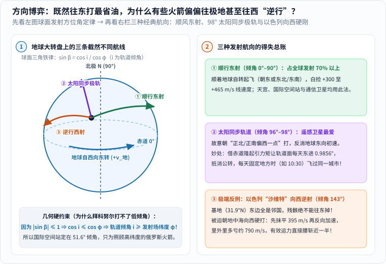
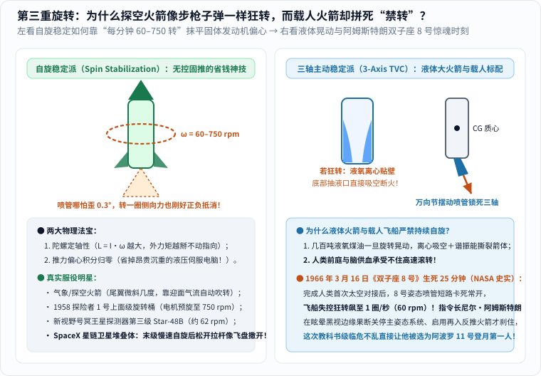
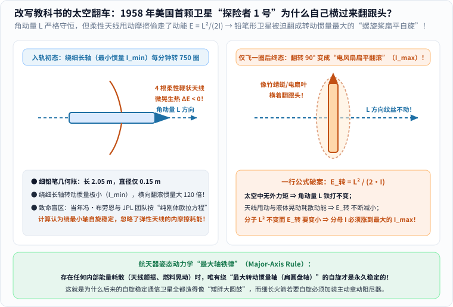
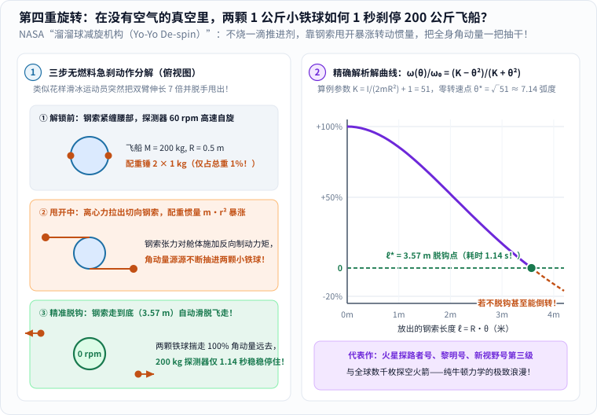

如果你仔细看过火箭发射的直播画面，脑子里很可能会冒出四个看起来**互相打架**的疑问：

1. **发射场为什么总爱往南搬、火箭总爱往东打？** 从中国海南文昌、美国佛罗里达卡纳维拉尔角，到欧洲特意跑到南美洲赤道边上租地建起来的法属圭亚那库鲁发射场，大家仿佛都在拼命往赤道挤 [1, 2]。可偏偏有些气象卫星非要往偏西方向打，以色列的运载火箭甚至干脆顶着地球自转**朝正西逆行发射** [4]——它们不怕费油吗？
2. **刚离地几秒钟，火箭为什么要在半空“拧一下腰”？** 发射塔架刚让开，几十层楼高、几百吨重的钢铁巨兽还没飞多高，箭体就会绕着自己的竖直中心轴转过几十度，紧接着才微微低头钻进云层 [5, 8]。这么危险的低空，老老实实直着往上冲不好吗？
3. **步枪子弹靠高速旋转保准头，为什么大火箭不干脆“转着飞”？** 射击运动员都知道膛线能让子弹一秒钟转几千圈、迎风不翻跟头；可你看长征五号、猎鹰 9 号或者载人飞船升空时，箭体表面涂着的国旗与徽标稳稳朝向镜头，严禁像电钻一样持续自转——唯独到了高空抛卫星的最后一刻，有些上面级又突然自己狂转起来 [7, 9]。这到底是“要转”还是“不要转”？
4. **更离奇的是：万一上面级转得太快，太空里连空气阻力都没有，怎么在 1 秒钟内不烧一滴燃料把它刹停？** 工程师给出的答案居然是：**栓两根钢丝绳，像小孩玩溜溜球一样甩出去！** [12]

这四个问题拧在一起，恰好串起了现代航天动力学里最迷人的一条暗线。原来，“火箭发射与旋转的关系”根本不是一句话能答完的单向因果，而是横跨了**借地球之转、起飞拧腰对向、箭体控转博弈、太空甩绳急刹**四层环环相扣的物理大戏。今天，我们就顺着一枚火箭从选址点火到卫星入轨的全过程，把这四重旋转玄机一层层剥开。

---

## 一、第一重旋转：借地球自转当“免费弹弓”——为什么文昌比酒泉天生多赚 87 m/s？

### 1.1 脚下这颗直径 1.27 万公里的大陀螺，每秒钟都在往东狂奔

我们在之前的文章[《宇宙里的星球为什么都在转？从金星西升东落、月球永远露正脸，讲到每秒 716 圈的脉冲星》]()里聊过，46 亿年前太阳系原始星云坍缩时的角动量守恒，把地球变成了一颗一刻不停自西向东旋转的大陀螺。

注意一个极其关键的时间细节：地球对着太阳转一圈是 24 小时（太阳日，$$86{,}400\text{ s}$$），但如果以遥远星空为绝对惯性参考系——这也是卫星入轨真正认准的坐标系——地球自转整整 $$360^\circ$$ 的**恒星日（Sidereal Day）**其实是 **23 小时 56 分 04.09 秒**，也就是 $$T_{\text{sid} } = 86{,}164.09\text{ s}$$ [4]。

把地球赤道半径 $$R_e = 6{,}378.137\text{ km}$$ 代进去，站在赤道地面上的任何物体，哪怕一动不动，相对于地心惯性系都已经自带了一股惊人的向东线速度 [1]：

$$
\begin{aligned}
v_{\text{eq} } &= \frac{2\pi R_e}{T_{\text{sid} } } = \frac{2\pi \times 6{,}378{,}137\text{ m} }{86{,}164.09\text{ s} } \\
&\approx 465.1\text{ m/s} \approx 1{,}674\text{ km/h}
\end{aligned}
$$

**每秒 465.1 米、时速 1,674 公里！** 这是海平面音速（约 $$340\text{ m/s}$$）的 **1.37 倍**，比大多数民航客机巡航速度的两倍还要快。

可问题来了：并不是所有发射场都修在赤道上。当你从赤道往北或往南走到地理纬度为 $$\varphi$$ 的地方，你绕地轴旋转的圆周半径就不再是地球半径 $$R_e$$，而是缩水成了水平截面半径 $$r(\varphi) = R_e\cos\varphi$$。于是，当地地面能白送给火箭的东向初速度严格遵循一条余弦定律：

$$
v(\varphi) = v_{\text{eq} }\cos\varphi = 465.1\cos\varphi \;\text{ (m/s)}
$$

我们把世界几大著名航天发射场的真实纬度代进去算一算，一张层次分明的“地球免费弹弓排行榜”立刻浮出水面 [1, 2, 4]：

- **法属圭亚那库鲁航天中心**（北纬 $$5.2^\circ$$，欧洲空间局主力港）：$$\cos 5.2^\circ \approx 0.996$$，白捡 **$$463\text{ m/s}$$**，几乎吃满赤道红利 [2]！
- **中国海南文昌航天发射场**（北纬 $$19.6^\circ$$）：$$\cos 19.6^\circ \approx 0.942$$，白捡 **$$438\text{ m/s}$$**；
- **美国肯尼迪航天中心 / 卡纳维拉尔角**（北纬 $$28.5^\circ$$）：$$\cos 28.5^\circ \approx 0.879$$，白捡 **$$409\text{ m/s}$$**；
- **中国甘肃酒泉卫星发射中心**（北纬 $$41.0^\circ$$）：$$\cos 41.0^\circ \approx 0.755$$，白捡 **$$351\text{ m/s}$$**；
- **哈萨克斯坦拜科努尔发射场**（北纬 $$45.9^\circ$$）：$$\cos 45.9^\circ \approx 0.696$$，只剩 **$$323\text{ m/s}$$**；
- **俄罗斯普列谢茨克发射场**（北纬 $$62.9^\circ$$）：$$\cos 62.9^\circ \approx 0.456$$，只剩 **$$212\text{ m/s}$$**；如果到了南北极点（$$\varphi = 90^\circ$$），$$\cos 90^\circ = 0$$，弹弓彻底归零！

光看海南文昌（$$438\text{ m/s}$$）和甘肃酒泉（$$351\text{ m/s}$$）的差值，你可能会嘀咕：我们在[《从发射卫星读懂三大宇宙速度》]()里算过，近地轨道（LEO）第一宇宙速度高达 $$7.8\text{–}7.9\text{ km/s}$$（算上重力损耗和空气阻力，火箭实际要攒够约 $$9{,}300\text{ m/s}$$ 的特征速度 $$\Delta v$$）。区区 **$$87\text{ m/s}$$**（甚至赤道与中纬度的百来米每秒差距），连总速度的 $$5\%$$ 都不到，值得各国砸几百亿往热带海边搬家吗？

### 1.2 齐奥尔科夫斯基指数放大镜 + 同步轨道“拐弯罚单”：差之百米，运力翻倍！

答案藏在航天界最残酷的一条铁律——**齐奥尔科夫斯基理想火箭方程（Ideal Rocket Equation）**里 [3]：

$$
\begin{aligned}
\Delta v &= v_e \ln\left(\frac{m_0}{m_f}\right) \\
\implies \frac{m_0}{m_f} &= \exp\!\left(\frac{\Delta v}{v_e}\right)
\end{aligned}
$$

式子里的符号非常直白：
- $$\Delta v$$ 是火箭必须靠自身喷气攒出来的速度增量（单位 $$\text{m/s}$$）；
- $$v_e = I_{\text{sp} } g_0$$ 是发动机喷气等效排气速度（比如液氧煤油机真空比冲约 $$310\text{–}350\text{ s}$$，液氧液氢机约 $$440\text{ s}$$，对应 $$v_e \approx 3{,}000\text{–}4{,}400\text{ m/s}$$）；
- $$m_0$$ 是起飞总重，而 $$m_f$$ 是烧光推进剂后剩下的“干重 + 有效载荷”。

要命的就在那个指数函数 $$\exp(\Delta v / v_e)$$ 上！为了达到入轨所需的 $$\sim 9{,}300\text{ m/s}$$，一枚现代运载火箭起飞重量里，**大约 $$88\%\text{–}91\%$$ 全是推进剂**，箭体结构占去 $$6\%\text{–}8\%$$，真正能换钱的卫星有效载荷（Payload）往往只占起飞总重的 **$$2\%\text{–}4\%$$** [3]！

这意味着什么？假如地球自转帮你省下了 $$350\text{–}460\text{ m/s}$$ 的 $$\Delta v$$，虽然在分子总账里只少了 $$4\%$$，但省下来的每一公斤燃料都会通过指数质量比层层放大，直接等价变成**多装上去的纯卫星重量**——同一枚火箭向东发射，近地轨道有效载荷立刻能比原地无自转时暴涨 **$$12\%\text{–}18\%$$**！

而如果我们要打的是[《同步卫星为什么能“钉”在头顶不动？》]()里讲过的 **35,786 公里地球静止轨道（GEO）**，纬度差距还会再挨第二记重锤：**轨道倾角变轨惩罚** [2, 4]！

静止卫星必须严格运行在赤道正上方（轨道倾角 $$i = 0^\circ$$）。可任何从纬度 $$\varphi$$ 起飞、途中不硬拐弯的火箭，打进太空后的初始轨道倾角最小只能等于当地纬度 $$i_{\min} = \lvert\varphi\rvert$$。等卫星飞到远地点，必须额外点火，硬把倾斜了 $$\Delta i = \varphi$$ 的轨道平面“掰平”到赤道面。空间轨道平面纯旋转 $$\Delta i$$ 所需的速度代价是：

$$
\Delta v_{\text{plane} } = 2 v_{\text{ap} } \sin\left(\frac{\Delta i}{2}\right)
$$

即便选在速度较慢的地球同步转移轨道远地点（$$v_{\text{ap} } \approx 1{,}600\text{ m/s}$$）变轨：
- 从北纬 $$5.2^\circ$$ 的**库鲁**出发，只需掰平 $$5.2^\circ$$，变轨仅耗约 **$$145\text{ m/s}$$**；
- 从北纬 $$19.6^\circ$$ 的**文昌**出发，掰平 $$19.6^\circ$$ 约耗 **$$545\text{ m/s}$$**；
- 从北纬 $$28.5^\circ$$ 的**卡纳维拉尔角**出发，约耗 **$$788\text{ m/s}$$**；
- 若从北纬 $$45.9^\circ$$ 的**拜科努尔**硬打静止卫星，光把轨道掰平就得狂烧 **$$1{,}248\text{ m/s}$$**（若在近地轨道 $$v \approx 7.8\text{ km/s}$$ 硬掰，更是高达恐怖的 $$6{,}000\text{ m/s}$$）！

把“初速红利”和“赤道变轨省油”两笔账合在一起，欧洲空间局（ESA）专门算过：同样一枚“阿里安”或“联盟”火箭，在赤道边的库鲁发射同步轨道卫星，有效运载能力比在中高纬度发射场整整高出 **$$30\%\text{–}50\%$$**，而且东边紧邻一望无际的大西洋，助推器残骸绝不会砸到居民区——这就是海南文昌成为长征五号、天问一号和天宫空间站母港的硬核物理逻辑 [2]。

*图 1：先看左半幅地球剖面——所有纬度与地轴保持同一角速度 $$\omega_{\oplus}$$，但旋转半径随 $$\cos\varphi$$ 缩水，赤道地面向东线速度达 $$465.1\text{ m/s}$$，海南文昌（$$19.6^\circ\text{N}$$）拿到 $$438\text{ m/s}$$，酒泉（$$41.0^\circ\text{N}$$）剩 $$351\text{ m/s}$$。再看右半幅——齐奥尔科夫斯基公式的指数杠杆与地球静止轨道（GEO）倾角掰平公式 $$\Delta v = 2v\sin(\Delta i/2)$$ 双重叠加，让低纬度海滨发射场的同步轨道运力优势飙升数成（地球尺寸与高空轨道为教学示意比例）。*

---

## 二、为什么气象卫星偏要“往西歪”，以色列火箭甚至顶着地球自转硬刚？

既然向东发射这么香，为什么全世界并不是 $$100\%$$ 的火箭都往东打？

把地面发射方位角记作 $$\beta$$（正北定义为 $$0^\circ$$，顺时针转到正东为 $$90^\circ$$，正南为 $$180^\circ$$，正西为 $$270^\circ$$）。在球面三角学里，不考虑自转速度微调时，发射场纬度 $$\varphi$$、起飞方位角 $$\beta$$ 与入轨倾角 $$i$$ 之间锁死了一条极其优美的**球面余弦几何关系** [4]：

$$
\cos i = \cos\varphi \sin\beta
$$

看着这条公式，两个关键推论一眼就能看穿：

1. **想拿最小倾角（$$i = \varphi$$）？必须正东起飞（$$\beta = 90^\circ$$）！** 因为 $$\lvert\sin\beta\rvert \le 1$$，所以 $$\lvert\cos i\rvert \le \cos\varphi$$，即直接入轨的倾角永远不可能小于发射场纬度（$$i \ge \lvert\varphi\rvert$$）。这也是为什么北纬 $$45.9^\circ$$ 的拜科努尔当年和美国商量国际空间站（ISS）轨道倾角时，只能定在两边都够得着的 **$$51.6^\circ$$** [4]。
2. **想覆盖全球每一寸土地（极轨道 $$i = 90^\circ$$）？一分钱地球自转红利都别想蹭！** 要让 $$\cos 90^\circ = 0$$，惯性速度必须正南北指向。更损的是，发射台本身正带着 $$465.1\cos\varphi\text{ m/s}$$ 的东向初速往东跑！火箭要想合成出纯正北或纯正南的轨道速度，机头必须**故意朝偏西方向歪一点点**，专门分出一股推力把地球白送的东向速度“抵消归零”！

### 2.1 太阳同步轨道（SSO，$$i \approx 96^\circ\text{–}98^\circ$$）：倒贴燃料换“每天准点打卡”

更有意思的是气象卫星、农业普查卫星和光学侦察卫星最钟爱的**太阳同步轨道（Sun-Synchronous Orbit, SSO）**——它们的轨道倾角不是 $$90^\circ$$，而是故意打成 **$$96^\circ\text{–}98^\circ$$ 的轻微逆行轨道** [4]！

为什么要放着顺风车不坐，非要贴燃料往偏西打？

原来，地球由于自转离心力，并不是一颗正球体，它的赤道半径比极半径鼓出了约 **21.4 公里**（扁率参数 $$J_2 \approx 1.0826 \times 10^{-3}$$）。这圈多出来的“赤道赘肉”会对倾斜轨道产生一个微弱但持久的引力力矩，拽着卫星轨道平面像斜转的陀螺一样发生**长期进动（Nodal Precession）**，进动角速度正比于 $$-\cos i$$：

- 如果顺行发射（$$i < 90^\circ$$，$$\cos i > 0$$），轨道面每天会**向西退行**；
- 如果逆行一点点，把高度 $$600\text{–}800\text{ km}$$ 卫星的倾角精准调到 **$$i \approx 98^\circ$$**（$$\cos 98^\circ \approx -0.139 < 0$$），赤道隆起拽着轨道面**向东进动**的速率刚好等于：

$$
\dot{\Omega} = \frac{360^\circ}{365.2422\text{ 天} } \approx +0.9856^\circ/\text{天}
$$

**每天向东转 $$0.9856^\circ$$！** 这不多不少，刚好和地球绕太阳公转每天转过的角度严丝合缝！结果就是：无论春夏秋冬地球公转到哪一侧，卫星轨道面与太阳光线的夹角永远锁死不变——卫星每天都会在**完全相同的当地太阳时**（比如每天上午 10:30）飞过北京、上海或亚马逊雨林头顶，地面阴影长度一模一样，简直是为对比地表变化量身定做的“太空定时照相机” [4]！

### 2.2 最悲催的地缘反例：以色列“沙维特”火箭向西硬刚

如果说太阳同步轨道只是“微微偏西 $$8^\circ$$”，那地球上还真有一款专门跟地球自转硬刚到底的奇葩火箭——以色列的 **“沙维特”（Shavit）运载火箭**。

打开中东地图你就明白了：以色列帕尔马希姆空军基地（北纬 $$31.9^\circ$$）东边紧挨着约旦、叙利亚、伊拉克等陆上邻国。如果像全世界一样向东发射，一二级火箭烧完脱落的几十吨金属残骸，或者万一发射失败爆炸的碎片，全都会掉进邻国领土引发严重外交甚至军事危机！

唯一的生路，是转身面朝西边的地中海狭长水道，以约 **$$142^\circ\text{–}144^\circ$$ 倾角向西北偏西方向逆行发射**！算一笔物理苦命账：北纬 $$31.9^\circ$$ 地面正以 $$465.1\cos 31.9^\circ \approx 395\text{ m/s}$$ 向东跑。沙维特火箭向西点火后，必须先烧掉 **$$395\text{ m/s}$$** 把自己相对于地心“刹停”，再反方向加速到入轨速度——跟同纬度向东顺射相比，里外里白白多亏了整整 **$$2 \times 395 \approx 790\text{ m/s}$$** 的速度增量，导致它的近地轨道有效载荷直接被砍掉了将近一半！

*图 2：先看左半幅北极俯视图——地球逆时针（自西向东）自转，顺行东射顺势叠加地速；太阳同步轨道（紫色，$$i\approx 98^\circ$$）故意略偏西起飞，利用赤道隆起引力矩产生每天 $$+0.9856^\circ$$ 的东向进动；以色列“沙维特”火箭（橙色）受地缘地形所迫向西逆射，承受双倍地速罚款。右半幅汇总三类轨道的工程账本。*

---

## 三、第二重旋转：起飞几秒后的“空中拧腰”——滚转程序与重力转弯

选好了发射场、算准了向东或向东北的发射方位角 $$\beta$$，倒计时归零，点火！

这时候如果你紧盯慢动作回放，会发现火箭刚窜出避雷塔尖几秒钟，立刻在半空中做了一套极其丝滑的连招：**先绕自身纵轴拧转几十度（Roll Program，滚转程序），紧接着轻轻低头 $$2^\circ\text{–}3^\circ$$（Pitch-over，程序俯仰），随后一路斜着划出一道大弧线飞向天际** [5, 6, 8]。

为什么要多此一举先“拧腰”？直接在发射台上把火箭摆成朝目标方向低头的姿势不行吗？

### 3.1 钢筋水泥导流槽不能天天拆，但太空目标天天在变！

还真不行！想象一下发射台是什么样子的：地下是深达几十米、浇筑了几万吨耐高温特种混凝土的**导流槽（Flame Trench）**，地上是挂满液氧液氢加注管、高压氮气管和上千根电缆摆杆的**脐带塔（Umbilical Tower）**。这套庞然大物一旦建成，火箭在发射台上的安装朝向（比如朝正东 $$90^\circ$$ 或正北 $$0^\circ$$）就彻底焊死了。

可每一次任务要去的目标轨道倾角都不一样！今天打空间站要飞东北 $$42^\circ$$，下个月打探月器要飞东南 $$105^\circ$$。如果火箭不先绕纵轴“拧腰”，直接硬往斜刺里掰俯仰角和偏航角，不仅刚离地时尾焰和弹体容易扫到一旁的脐带塔，飞行员（对于载人飞船或航天飞机）的“头顶—肚皮”朝向也会跟转弯平面拧成麻花，机载雷达天线和光学跟踪标志更会转出地面测控站的最佳视野 [5, 8]。

NASA 解密的阿波罗与天空实验室飞行评估报告里就记录了一个教科书级的真实案例：**1973 年 5 月 14 日发射“天空实验室 1 号”（Skylab 1）的土星五号巨型火箭（编号 SA-513）** [8]。在肯尼迪航天中心 39A 发射台上，36 层楼高的土星五号原本是按固定工位对准**正东 $$90^\circ$$ 发射方位角**安装的；离塔仅几秒钟，五台 F-1 发动机外圈的四台万向节喷管立刻默契地“一顺一逆”差动微摆，产生纯滚转力矩，让这头三千吨巨兽在半空中优雅地绕纵轴拧转了 **$$49.12^\circ$$**，精准对准了**东北 $$40.88^\circ$$ 飞行方位角**（对应 $$50^\circ$$ 倾角轨道） [8]！

当年的美国航天飞机（Space Shuttle）更绝：不仅点火离塔后要靠滚转程序对准轨道面，还会顺手把自己拧成**机腹朝天、宇航员头朝大地倒挂着飞（Heads-down）**的姿势——一是为了让头顶遮挡最少、方便与中继卫星通信，二是为了让硕大的三角机翼在稀薄高空产生向下的负升力，减轻主翼根部的气动弯矩载荷 [5]！

### 3.2 重力转弯（Gravity Turn）：铅笔顶在指尖不能横着吹风

对准了飞行方向之后，火箭立刻把喷管偏转几度，让箭体轻轻低头 **$$2^\circ\text{–}3^\circ$$**，随即把喷管回正，进入航天工程里最省力也最保命的轨迹——**重力转弯（Gravity Turn，又称零攻角转弯）**。

很多人误以为火箭升空主要是为了“飞高”（克服重力势能）。算一笔能量账就能打破这个错觉：把 $$1\text{ kg}$$ 飞船举到 $$400\text{ km}$$ 高的空间站高度，所需的重力势能只有：

$$
\begin{aligned}
e_{\text{pot} } &\approx g h \approx 9.5\text{ m/s}^2 \times 400{,}000\text{ m} \\
&\approx 3.8\text{ MJ/kg}
\end{aligned}
$$

而让它在 $$400\text{ km}$$ 轨道上以 $$v \approx 7{,}670\text{ m/s}$$ 绕地球飞起来、不掉回地面所需的水平动能高达：

$$
e_{\text{kin} } = \frac{1}{2}v^2 = \frac{1}{2}\times (7{,}670)^2 \approx 29.4\text{ MJ/kg}
$$

**水平动能占了入轨总机械能的近 $$89\%$$，垂直爬高只占约 $$11\%$$！** 火箭真正拼命干的活儿，是尽快冲出浓密的低层大气，然后躺平了玩命攒**水平速度**。

可它为什么不能在 $$5\text{ km}$$ 低空就直接横过来 $$45^\circ$$ 猛踩油门呢？因为起飞后约 50 到 80 秒（高度 $$11\text{–}14\text{ km}$$ 附近），火箭正以超音速冲过大气动压峰值区 **Max-Q（$$q = \frac{1}{2}\rho v^2$$ 最大点）**。现代液体火箭为了极致的轻量化，贮箱铝锂合金壁厚只有 **2 到 4 毫米**——按比例缩小后，比桌上的易拉罐还要薄！易拉罐竖着踩能承重上百斤，可侧面轻轻一捏就瘪。如果火箭在 Max-Q 区横着歪出哪怕 $$6^\circ\text{–}8^\circ$$ 的迎风攻角（$$\alpha$$，箭体纵轴与来流空气的夹角），每秒数百米的超音速狂风侧面一拍，细长的火箭当场就会像火柴棍一样拦腰折断！

**重力转弯**的绝妙之处在于：低空轻轻低头 $$2^\circ\text{–}3^\circ$$ 后，火箭不再强行掰弯自己，而是让地球引力 $$g\sin\gamma$$ 自然而然地把速度矢量 $$\vec{v}$$ 往下拉弯，同时控制系统始终让箭体尖端严丝合缝地对准速度方向（保持**攻角 $$\alpha \approx 0^\circ$$**），让超音速狂风永远顺着鼻锥正面劈开，侧向弯矩几乎为零！

*图 3：先看左半幅——发射塔与导流槽朝向固定（如土星五号 SA-513 固定朝正东 $$90^\circ$$），离塔数秒后外圈喷管差动微摆，驱动箭体绕纵轴滚转 $$49.12^\circ$$ 对准东北 $$40.88^\circ$$ 目标平面。再看右半幅（含单次轨迹推演动画，[单独打开图片](/assets/images/rocket-rotation/roll-program-and-gravity-turn-sequence.svg)刷新可重播；开启系统“减弱动态效果”时自动展示完整静态轨迹）——垂直拔地后轻点俯仰 $$2^\circ\text{–}3^\circ$$，借重力自然拉平航迹角，全程锁定 $$\alpha \approx 0^\circ$$ 安全闯过 Max-Q 区，最终入轨时近 $$90\%$$ 能量化作 $$7.8\text{ km/s}$$ 水平速度（高度与水平射程为压缩示意比例）。*

---

## 四、第三重旋转：步枪子弹越转越稳，为什么液体火箭和载人飞船严禁“转着飞”？

闯过大气层之后，就轮到第三个经典灵魂拷问登场了：**步枪子弹和橄榄球都是靠绕纵轴高速自旋（Spin Stabilization）来稳住方向的，为什么长征、猎鹰、土星五号这些主力液体大火箭，不干脆从头到尾像钻头一样转着飞呢？**

其实，航天工程师并不是不用“自旋稳定”——恰恰相反，**在固体燃料上面级、探空火箭和一箭多星释放阶段，自旋稳定至今仍是省钱又高效的绝活；但在大型液体运载火箭和载人飞船上，持续高速自旋却是足以机毁人亡的禁区！**

### 4.1 什么时候“越转越香”？无控固体上面级与星链“甩扑克牌”

我们在[《花滑收臂暴涨四倍速、猫咪半空翻身、陀螺斜着不倒：一文读懂无处不在的角动量》]()里详细推导过角动量矢量关系 $$\vec{\tau} = \mathrm{d}\vec{L}/\mathrm{d}t$$：一个高速旋转的刚体拥有强大的沿轴角动量 $$L = I\omega$$，就像高速旋转的陀螺一样具备天然的**定轴性（Gyroscopic Stiffness）**。

对于把卫星送入深空或高轨的**固体火箭上面级**（比如把“新视野号”冥王星探测器加速推走的 **Star-48B** 固体上面级，工作转速约 **$$60\text{–}62\text{ rpm}$$**；又比如 1958 年把美国第一颗人造卫星送入太空的“朱诺一号”高速旋转筒，转速高达 **$$450\text{–}750\text{ rpm}$$** [9]），自旋稳定有两个无可替代的好处：

1. **省掉整套昂贵沉重的伺服摆动喷管与制导电脑**：固体发动机燃烧时间往往只有几十秒，如果装一套液压万向节、三轴陀螺仪和飞行计算机，死重直接吃掉几百公斤卫星载荷。让它在点火前先转起来，陀螺定轴性就能死死锁住推力指向。
2. **一转抹平推力偏心（Thrust Misalignment Averaging）**：任何固体药柱燃烧都不可能绝对均匀，喷管安装哪怕歪了 $$0.1^\circ$$，不转的火箭几十秒就会歪到姥姥家去；可一旦火箭每秒钟转上好几圈，歪向一侧的侧向推力分量就会在 $$360^\circ$$ 圆周上每秒正负抵消好几轮，净侧向偏移几乎归零 [9]！

哪怕到了今天，SpaceX 的猎鹰 9 号在释放成摞的“星链”（Starlink）卫星时，依然在玩一招更聪明的旋转借力：二级火箭在解锁卡箍前，会故意慢悠悠地自身旋转起来，然后啪地松开压紧杆——整摞几十颗扁平卫星就像发牌员甩出的扑克牌一样，不花一颗弹簧的重量，仅凭旋转切向离心速度差就自动呈扇形优雅散开，互不碰撞！

### 4.2 什么时候“一转就要命”？液体推进剂爬壁断流与阿姆斯特朗的 1 秒 1 圈生死劫

那为什么一二级大型液体火箭和载人飞船绝对不敢这么玩？两大物理死穴拦在面前 [7, 10, 11]：

- **死穴一：液体推进剂离心“爬壁”与涡流吸空（Centrifugal Slosh & Outlet Uncovering）**。固体火箭里装的是冻得硬邦邦的固态药柱，怎么转都纹丝不动；可液体火箭肚子里装着几百吨晃荡不止的液氧和煤油/液氢！一旦箭体高速绕纵轴旋转，强大的离心加速度 $$\omega^2 r$$ 会把液体统统甩向圆柱贮箱的**侧壁**，中间直接掏空成一口深不见底的旋转漏斗——装在贮箱底部的发动机吸液口瞬间吸进大量增压气体！高速涡轮泵一旦发生“气蚀空转”（每秒几万转的金属叶轮失去液体阻尼瞬间飞车解体），火箭几秒钟内就会在空中爆炸。不仅如此，旋转液体的晃动波还会与箭体章动发生恶性共振，越晃越疯 [10]。
- **死穴二：人类前庭耐受极限——尼尔·阿姆斯特朗的“双子星 8 号”惊魂 30 分钟**。如果是载人飞船，持续旋转更是对宇航员生理极限的摧残。1966 年 3 月 16 日，后来第一个踏上月球的**尼尔·阿姆斯特朗（Neil Armstrong）**与大卫·斯科特驾驶 **“双子星 8 号”（Gemini VIII）**完成了人类历史上首次太空交会对接；谁知对接刚成功，飞船 8 号姿态推进器因电路短路卡死在常开状态 [11]！脱离目标飞行器后，变轻的飞船像失控的陀螺一样疯狂翻滚，转速迅速飙升到惊人的 **每秒整整 1 圈（$$1\text{ rev/s} = 60\text{ rpm}$$）** [11]！此时阿姆斯特朗和斯科特眼球剧烈震颤、视野开始发黑模糊（Tunnel Vision），距离彻底晕厥只剩几十秒——幸亏阿姆斯特朗凭着试飞员的极度冷静，果断拉闸切断整套轨道机动系统（OAMS），改用独立的再入控制系统（RCS）反向喷气，才在鬼门关前硬生生刹住了这场致命狂转 [11]！

所以，现代大型液体火箭和载人飞船无一例外采用**三轴姿态稳定 + 推力矢量控制（3-Axis TVC）**：靠发动机万向节液压/机电摆动微调俯仰与偏航，靠成对发动机差动摆动或小型姿态喷嘴锁死滚转角，让箭体稳稳当当地刺破苍穹 [7]。

*图 4：左半幅展示无控固体上面级的“自旋稳定”绝招——$$60\text{–}750\text{ rpm}$$ 的高速自旋利用角动量定轴性锁住航向，并把喷管微小安装偏角在圆周上均匀抵消；猎鹰 9 号亦借慢速自旋离心甩散星链卫星。右半幅揭示液体与载人火箭严禁持续自旋的两大死穴——液氧液氢离心爬壁导致箱底吸空爆炸，以及 1966 年“双子星 8 号”卡死推进器以 $$60\text{ rpm}$$ 险些令阿姆斯特朗晕厥的真实险情，因此必须改用万向节三轴推力矢量控制（TVC）。*

---

## 五、航天史上最著名的旋转翻车案：1958 年美国第一颗卫星为什么 90 分钟就翻成了“螺旋桨”？

讲到火箭上面级的自旋稳定，航天史上还出过一桩写进全世界所有《理论力学》教科书的惊天大乌龙——**1958 年 1 月 31 日美国第一颗人造卫星“探险者 1 号”（Explorer 1）的扁平自旋翻转事件** [9, 10]！

当时的故事是这样的：为了追赶苏联的斯普特尼克卫星，冯·布劳恩团队与喷气推进实验室（JPL）联手打造了细如铅笔的“探险者 1 号”——它连同第四级固体发动机外壳一起入轨，总长 **$$L = 2.05\text{ m}$$**，直径却只有 **$$2R = 0.15\text{ m}$$（15 厘米）**，总重约 $$13.97\text{ kg}$$；箭体中段还对称伸出了 **4 根柔性的钢丝鞭状十字天线（Whip Antennas）** [9]。

按理说，这根细长的金属铅笔在起飞前就被旋转筒加速到了 **$$750\text{ rpm}$$（每秒 12.5 圈）** 绕着细长对称轴像步枪子弹一样稳稳飞旋 [9]。地面测控站满心欢喜地以为它会永远保持这个帅气的“子弹钻头”姿态。

结果，入轨仅仅飞了不到一圈（约 90 分钟后）再经过地面接收站时，无线电信号强弱周期竟然全乱套了！原本每秒 12.5 次的信号调制不见了，取而代之的是每 **7 秒左右**才慢吞吞闪过一次的诡异周期——**这根两米长的细铅笔，竟然在没人碰它的外太空自己翻了 $$90^\circ$$，变成头尾大风车一样横躺着旋转的“螺旋桨”！**

### 5.1 最小动能陷阱：角动量铁打不动，鞭状天线却在偷偷“吃能量”！

太空中明明是真空，没有任何外力矩，为什么“子弹自旋”会自动翻成“横躺大风车”？

用我们在中学和大学普通物理里就学过的两个公式，三行就能破案 [10]！

第一步，比较这根细长圆柱（长 $$L = 2.05\text{ m}$$，半径 $$R = 0.075\text{ m}$$）绕两根不同主轴旋转时的**转动惯量（Moment of Inertia）**：
- 绕细长中心轴（子弹自旋轴）转时，所有质量都紧贴转轴，转动惯量极小：$$I_{\text{spin} } \approx \frac{1}{2}mR^2$$；
- 绕腰部横轴（螺旋桨翻滚轴）转时，两米长的头尾离转轴老远，转动惯量暴涨：$$I_{\text{trans} } \approx \frac{1}{12}m(3R^2 + L^2)$$。

两者相差多少倍？把真实尺寸代进去一除：

$$
\begin{aligned}
\frac{I_{\text{trans} } }{I_{\text{spin} } } &\approx \frac{\frac{1}{12}(3R^2 + L^2)}{\frac{1}{2}R^2} = \frac{1}{2} + \frac{L^2}{6R^2} \\
&= 0.5 + \frac{2.05^2}{6 \times 0.075^2} \approx 125\text{ 倍！}
\end{aligned}
$$

（扣除内部仪器集中分布后，实测横轴惯量依然是自旋轴惯量的百倍量级！）

第二步，抓住太空里的两条生杀予夺的守恒与耗散定律 [10]：
1. **外太空无外力矩 $$\implies$$ 总角动量大小 $$\lvert\vec{L}\rvert$$ 严格守恒，一分一毫都不能少！**
2. **卫星不是理想绝对刚体 $$\implies$$ 机械旋转动能 $$E_{\text{rot} }$$ 不守恒，会通过内摩擦变成热量散掉！**

“探险者 1 号”身上那 4 根软趴趴的钢丝鞭状天线就是罪魁祸首！只要箭体受到一丁点分离扰动产生极其微弱的晃动（章动），4 根鞭状天线就会像钓鱼竿一样来回弯曲抖动，金属内部结构阻尼每抖一下就把一丁点机械动能变成热量散进太空 [9, 10]。

现在，把旋转动能 $$E_{\text{rot} } = \frac{1}{2}I\omega^2$$ 改写成用守恒量 $$L = I\omega$$ 表达的形式，真相瞬间水落石出：

$$
E_{\text{rot} } = \frac{L^2}{2I}
$$

你看这个分母上的 $$I$$！既然分子 $$L^2$$ 被角动量守恒铁打不动地锁死了，而鞭状天线又逼着总动能 $$E_{\text{rot} }$$ 一路往下掉，唯一的数学出路是什么？**分母上的有效转动惯量 $$I$$ 必须一路变大，直到爬上整颗卫星最大的那根横轴 $$I_{\max} = I_{\text{trans} }$$ 为止！**

算算翻成横躺螺旋桨之后的结果：转速跌落为 $$\omega_f = \omega_0 (I_{\text{spin} }/I_{\text{trans} })$$，周期瞬间拉长上百倍（实测约数秒一圈），而超过 **$$99\%$$ 的初始旋转动能**全被那四根小天线像海绵吸水一样耗散成了微弱的热量！

从那一天起，全世界所有卫星姿态动力学手册第一页都印上了一条血泪写成的铁律——**最大惯量轴稳定判据（Major-Axis Rule）** [10]：

> **在存在任何内部能量耗散（柔性天线、太阳能帆板抖动、贮箱燃料晃动）的自由自旋航天器中，只有绕“最大转动惯量轴”（扁圆飞盘式）的自旋才是长期渐近稳定的；绕“最小转动惯量轴”（细长铅笔式）的无控自旋必然失稳翻倒！**

这就是为什么后来所有采用自旋稳定的通信卫星（比如早期的“辛康”同步卫星）和行星探测器，全都长得像**又矮又胖的扁圆大鼓或大飞盘**，再也没人敢做成细长铅笔直接甩出去不管了！

*图 5：先看左半幅——1958 年美国首颗卫星“探险者 1 号”长 $$2.05\text{ m}$$、直径仅 $$0.15\text{ m}$$，初始以 $$750\text{ rpm}$$ 绕细长最小惯量轴 $$I_{\text{spin} }$$ 像子弹一样飞旋，但腰部 4 根柔性鞭状天线在微小晃动中不断弯曲发热。再看右半幅——由于外太空无外力矩、角动量 $$L$$ 严格守恒，动能公式 $$E_{\text{rot} } = L^2 / (2I)$$ 迫使系统随着能量耗散滑向分母最大的横轴 $$I_{\max}$$，90 分钟内自动翻倒 $$90^\circ$$ 变成横躺大风车。*

---

## 六、第四重旋转：太空里没有刹车片，怎么用两颗 1 公斤“溜溜球”在 1.14 秒内把火箭刹停？

故事讲到最后一关：固体上面级靠每秒 1 圈（$$60\text{ rpm}$$）的自旋稳稳把精密科学卫星送到了预定轨道，发动机烧完了，马上要星箭分离。

可是，这颗科学卫星装满了要对准遥远星系的精密望远镜和大面积折叠太阳翼，它**绝对不能带着每分钟 60 圈的狂转打开太阳翼**（否则太阳翼当场就会被离心力撕碎）！如果装一套反推小火箭和燃料罐专门用来“反喷刹停”，又白白浪费十几公斤宝贵载荷。

怎么办？20 世纪 60 年代初，NASA 兰利研究中心的工程师们发明了一招四两拨千斤、至今仍在探空火箭与深空探测器（例如“黎明号”小行星探测器、“火星探路者”巡航级）上屡试不爽的机械神技——**溜溜球减旋机构（Yo-Yo De-Spin Mechanism）** [12]！

### 6.1 两根钢丝绳甩出去，1 公斤重锤如何吃光 200 公斤箭体的全部旋转？

它的构造简单到让人拍案叫绝：不用电脑、不用电路、不用一滴推进剂！只需要在半径为 $$R$$ 的圆柱箭体赤道外壁上，对称地顺着旋转方向缠上**两根等长的细钢丝绳**，绳子末端各拴一颗质量仅为 $$m$$ 的小金属重锤，绳根挂在箭体侧面的**开口挂钩（Open Hook）**上 [12]。

当需要刹停时，火工切割器“啪”地剪断固定重锤的卡箍：
1. 两颗小重锤在离心力作用下瞬间飞离箭体表面，拽着两根钢丝绳沿着箭体圆柱切线方向迅速往外解开；
2. 随着绳子越放越长，两颗小重锤距离旋转中心的半径暴涨了好几倍，切向线速度也跟着狂飙，通过钢丝绳的张力产生巨大的反向制动扭矩，像抽水机一样疯狂抽走中心箭体的角动量；
3. 当绳子正好沿着箭体切线转到**径向垂直伸直**的那一瞬间，挂在开口挂钩上的绳环顺势自动滑脱！两颗小重锤连同钢丝绳拎着**整枚火箭 $$100\%$$ 的角动量**飞向茫茫太空，而留在原地的 200 公斤卫星，转速精准归零，纹丝不动 [12]！

听起来像变魔术？别急，NASA 技术报告 `NASA-TM-X-60068` 给出了严丝合缝的精确解析解——而且因为这个纯机械系统**没有任何摩擦发热，总角动量 $$L$$ 和总旋转机械能 $$E$$ 同时严格守恒**，推导出来的结果优雅得像一首诗 [12]！

设中心箭体质量为 $$M$$、半径为 $$R$$、转动惯量为 $$I$$，两颗重锤质量各为 $$m$$，初始角速度为 $$\omega_0$$。当两侧钢丝绳相对于箭体各自解开了弧度角 $$\theta$$（已展开的绳长 $$\ell = R\theta$$）时，联立角动量守恒与动能守恒方程，可以精确解出无量纲惯量比常数 $$K$$ 与瞬时转速比 $$\omega(\theta)/\omega_0$$ [12]：

$$
\begin{aligned}
K &= \frac{I}{2 m R^2} + 1 \\
\frac{\omega(\theta)}{\omega_0} &= \frac{K - \theta^2}{K + \theta^2}
\end{aligned}
$$

而且更神奇的是，绳子解开的相对角速度竟然全程恒定不变，正好等于初始自旋角速度 $$\dot{\theta} = \omega_0$$（即 $$\theta(t) = \omega_0 t$$） [12]！

### 6.2 算一笔真实工程数字账：两颗 1 公斤铁疙瘩，1.14 秒归零！

光看字母不过瘾，我们把一枚典型的 **$$M = 200\text{ kg}$$** 上面级与卫星组合体代进去亲手算一遍：
- 箭体半径 $$R = 0.5\text{ m}$$，均匀圆柱转动惯量 $$I = \frac{1}{2}MR^2 = \frac{1}{2}\times 200\times 0.5^2 = 25\text{ kg}\cdot\text{m}^2$$；
- 初始转速 $$60\text{ rpm}$$（每秒 1 圈，即 $$\omega_0 = 2\pi \approx 6.283\text{ rad/s}$$）；
- 我们在两侧各配一颗**只有 $$m = 1\text{ kg}$$**（两颗合起来才占箭体总重 **$$1\%$$**！）的小重锤。

第一步，算常数 $$K$$：

$$
K = \frac{25}{2 \times 1 \times 0.5^2} + 1 = \frac{25}{0.5} + 1 = 51
$$

第二步，要让卫星彻底停稳（$$\omega(\theta^*) = 0$$），只需要让分子 $$K - (\theta^*)^2 = 0$$，立刻算出所需的精确解绳角 $$\theta^*$$、钢丝绳长度 $$\ell^*$$ 和总刹车时间 $$t^*$$：

$$
\begin{aligned}
\theta^* &= \sqrt{K} = \sqrt{51} \approx 7.141\text{ rad} \approx 409^\circ \\
\ell^* &= R\theta^* = 0.5 \times \sqrt{51} \approx 3.57\text{ m} \\
t^* &= \frac{\theta^*}{\omega_0} = \frac{\sqrt{51} }{2\pi} \approx 1.14\text{ s}
\end{aligned}
$$

**你敢信吗？每边只需要一根 $$3.57\text{ m}$$ 长的细钢丝绳和一颗 $$1\text{ kg}$$ 的小铁球，从剪断卡箍到整颗 $$200\text{ kg}$$ 卫星在太空里完全静止，全程只花 $$1.14\text{ 秒}$$！**

那这时候全部能量和角动量去哪儿了？在脱钩瞬间（$$t^* = 1.14\text{ s}$$），卫星动能归零，两颗 $$1\text{ kg}$$ 小重锤正以切向高速 **$$v_{\text{tip} } = \omega_0 R \sqrt{K} = 2\pi \times 0.5 \times \sqrt{51} \approx 22.4\text{ m/s}$$（时速 81 公里）** 飞离现场！验算一下两颗重锤带走的动能：$$\frac{1}{2}(2m)v_{\text{tip} }^2 = 1 \times (\pi\sqrt{51})^2 \approx 503.3\text{ J}$$，跟初始 $$200\text{ kg}$$ 箭体的旋转动能 $$\frac{1}{2}I\omega_0^2 + \frac{1}{2}(2m)(\omega_0 R)^2 = \frac{1}{2}(25.5)(2\pi)^2 \approx 503.3\text{ J}$$ 分毫不差！

最后看一眼公式分子里的减号 $$K - \theta^2$$，还藏着一个让人忍俊不禁的彩蛋：**万一设计师把钢丝绳裁长了（比如裁成了 $$5\text{ m}$$，或者挂钩卡死没及时脱落），会发生什么？**

当 $$\theta > \sqrt{K}$$ 时，分子 $$K - \theta^2$$ 变成了**负数**！也就是说，两颗小重锤把火箭刹停到 $$0\text{ rpm}$$ 之后并不会罢休，继续绷紧的钢丝绳会反过来拽着中心火箭**往相反方向倒着转起来**（极限情况下如果绳子无限长且死死栓住，甚至能把箭体反向加速到 $$-\omega_0$$） [12]！难怪自动脱钩的切向开口挂钩角度，是整套溜溜球机构里卡得最死的一道尺寸红线。

*图 6：先看左半幅太空俯视图——两颗各 $$1\text{ kg}$$ 的小重锤挣脱卡箍后，拖着 $$3.57\text{ m}$$ 钢丝绳沿切线甩开，靠大力臂张力抽干中心 $$200\text{ kg}$$ 箭体的角动量并在径向点自动脱钩。再看右半幅根据 NASA 报告精确方程 $$\omega/\omega_0 = (K-\theta^2)/(K+\theta^2)$$（$$K=51$$）绘制的实算曲线——仅需 $$1.14\text{ s}$$（展开 $$\ell^*=3.57\text{ m}$$）转速即精准穿过零线；若绳长超标未脱钩（橙色虚线区），箭体甚至会被重锤反向拽着倒转！*

---

## 七、一张总表收尾：一枚火箭一生经历的“四场旋转接力”

下次再看火箭点火升空的直播时，不妨在脑海里跟着时间轴对号入座——那枚看似直来直去的白色巨箭，其实从选址图纸落笔的那一刻起，就在和宇宙中最古老的角动量定律跳一支四幕交响舞：

| 飞行阶段 | 旋转主角 | 火箭是“顺着转”还是“对着干”？ | 核心物理机制与典型实测数据 |
| :--- | :--- | :--- | :--- |
| **第一幕：选址与射向** | 地球自转（恒星日 $$86{,}164\text{ s}$$） | 主力向东**借转**；太阳同步微逆；以色列向西**硬扛** | $$v(\varphi)=465.1\cos\varphi\text{ m/s}$$，文昌拿 $$+438\text{ m/s}$$；火箭方程指数放大 + GEO 变轨省油 [1–4] |
| **第二幕：离塔与穿云** | 箭体滚转轴 & 俯仰转弯 | 先绕纵轴**拧腰对向**，再零攻角**借重力拉平** | 土星五号 SA-513 离塔滚转 $$49.12^\circ$$ 对准轨道面；重力转弯锁定 $$\alpha \approx 0^\circ$$ 安全闯过 Max-Q [5, 8] |
| **第三幕：高空入轨段** | 箭体自旋轴 vs 三轴万向节 | 固体上面级**高速自旋保准**；液体/载人火箭**严禁持续自旋** | 固体级 $$60\text{–}750\text{ rpm}$$ 均化推力偏心；液体防推进剂离心爬壁吸空；探险者 1 号 $$E=L^2/(2I)$$ 翻成横躺风车 [7, 9–11] |
| **第四幕：星箭分离前** | 溜溜球配重钢丝绳 | 甩出小重锤**无燃料瞬间刹停** | $$\omega/\omega_0=(K-\theta^2)/(K+\theta^2)$$：两颗 $$1\text{ kg}$$ 重锤配 $$3.57\text{ m}$$ 绳，$$1.14\text{ s}$$ 刹停 $$200\text{ kg}$$ 箭体 [12] |

从脚下这颗每秒钟向东奔跑 465 米的蓝色星球，到两百公里高空两颗一公斤小铁锤划出的优雅切线，人类之所以能用薄如易拉罐的金属壳子把探测器送到太阳系边缘，靠的从来不是跟自然规律蛮干，而是把每一分旋转的脾气摸得透透彻彻——**该借力时顺水推舟，该定身时毫厘不差，该放手时一秒归零**。

---

## 参考资料与核查来源

1. **NASA Space Place**, *What Is a Launch Window? (Launching from a Spinning Earth)* — 官方科普页，核实地球自转方向与赤道地面约 $$1{,}675\text{ km/h}$$（$$465\text{ m/s}$$）东向线速度对顺行发射初速度的加成：  
   <https://spaceplace.nasa.gov/launch-windows/en/>
2. **European Space Agency (ESA)**, *Europe's Spaceport — An Ideal Launch Site (Kourou, French Guiana)* — 官方发射场技术说明，核实北纬 $$5^\circ$$ 库鲁航天中心靠近赤道的自转“弹弓效应”（Slingshot effect）、地球静止轨道极小倾角修正优势及向东入海安全走廊：  
   <https://www.esa.int/media/europe-s-spaceport-an-ideal-launch-site-en-260439>
3. **NASA Glenn Research Center**, *Ideal Rocket Equation (Beginner's Guide to Aeronautics)* — 官方动力学教材，核实齐奥尔科夫斯基火箭方程 $$\Delta u = V_{\text{eq} }\ln(m_f/m_e)$$ 及现代运载火箭约 $$90\%$$ 质量为推进剂的指数放大关系：  
   <https://www1.grc.nasa.gov/beginners-guide-to-aeronautics/ideal-rocket-equation/>
4. **NASA Earth Observatory**, *Catalog of Earth Satellite Orbits*（Riebeek, H., 2009）— 核实恒星日周期、轨道倾角与发射场纬度约束（国际空间站 $$51.6^\circ$$、库鲁 vs 拜科努尔）、极轨道以及倾角 $$96^\circ\text{–}98^\circ$$ 逆行太阳同步轨道（SSO）的节点进动机制：  
   <https://science.nasa.gov/earth/earth-observatory/catalog-of-earth-satellite-orbits/>
5. **NASA Glenn Research Center**, *Rocket Roll Motion* — 核实火箭绕纵轴滚转运动定义、尾翼偏转与万向节喷管差动滚转机动（含航天飞机起飞后滚转机动对准轨道与通信视角）：  
   <https://www1.grc.nasa.gov/beginners-guide-to-aeronautics/rocket-roll-motion/>
6. **NASA Glenn Research Center**, *Rocket Rotations (Roll, Pitch, and Yaw)* — 核实火箭通过重心的三根主旋转轴（滚转、俯仰、偏航）力学定义：  
   <https://www1.grc.nasa.gov/beginners-guide-to-aeronautics/rocket-rotations/>
7. **NASA Glenn Research Center**, *Rocket Control* — 核实气动舵面、万向节推力矢量控制（Gimbaled Thrust）、游动发动机（Vernier Rockets）与燃气舵的姿态控制边界：  
   <https://www1.grc.nasa.gov/beginners-guide-to-aeronautics/rocket-control/>
8. **NASA Marshall Space Flight Center (NTRS)**, *Saturn 5 Launch Vehicle Flight Evaluation Report — SA-513, Skylab 1*（`NASA-TM-X-69537`, 1973）— 一手飞行评估报告，核实土星五号 SA-513 在 39A 工位以 $$90^\circ$$ 固定发射方位角点火离塔后，执行滚转机动对准 $$40.88^\circ$$ 东北飞行方位角（$$50^\circ$$ 轨道倾角）的实测数据：  
   <https://ntrs.nasa.gov/citations/19730025115>
9. **NASA History Division**, *Explorer-I and Jupiter-C* — 官方史料档案，核实 1958 年 1 月 31 日“探险者 1 号”尺寸质量参数、朱诺一号上面级旋转筒以 $$450\text{–}750\text{ rpm}$$ 自旋均化固体火箭簇推力偏心，以及中段 4 根柔性鞭状十字天线结构：  
   <https://www.nasa.gov/history/sputnik/expinfo.html>
10. **NASA Technical Reports Server (NTRS)**, * Nutation Time Constant Determination and Spinning Propellant Slosh Dynamics*（`20100027426`, NASA KSC / SwRI）— 核实绕最小惯量轴（细长轴）自旋航天器在内部能量耗散（柔性结构阻尼或旋转液体推进剂晃动）作用下章动发散并翻转至最大惯量轴的动力学判据：  
    <https://ntrs.nasa.gov/citations/20100027426>
11. **NASA Official Mission Page**, *Gemini VIII* — 官方任务档案，核实 1966 年 3 月 16 日“双子星 8 号”8 号姿态推进器卡死导致尼尔·阿姆斯特朗与大卫·斯科特乘组以约 $$1\text{ rev/s}$$（$$60\text{ rpm}$$）高速翻滚并改用再入控制系统（RCS）紧急脱险的史实：  
    <https://www.nasa.gov/mission/gemini-viii/>
12. **NASA Langley Research Center (NTRS)**, Bush, K. S., *Yo-yo despin mechanisms*（`NASA-TM-X-60068`, 1967）— 经典工程报告，核实无燃料溜溜球减旋机构角动量与动能守恒解析公式 $$\omega/\omega_0 = (K-\theta^2)/(K+\theta^2)$$、临界绳长及过长反转特性：  
    <https://ntrs.nasa.gov/citations/19680018324>
