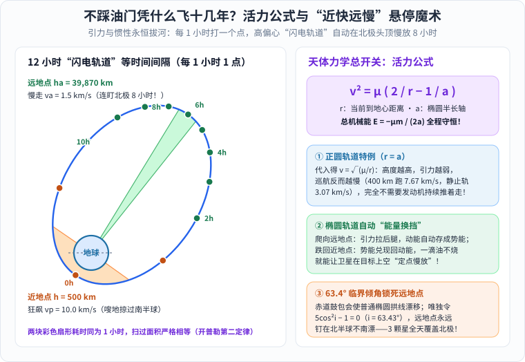
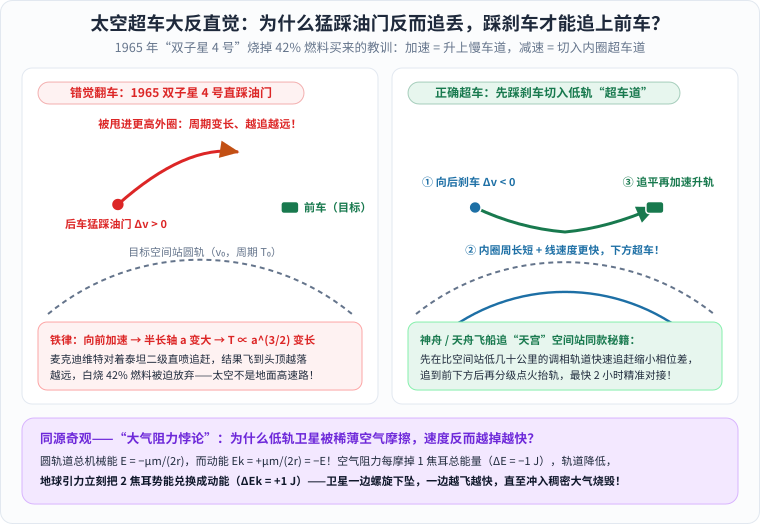
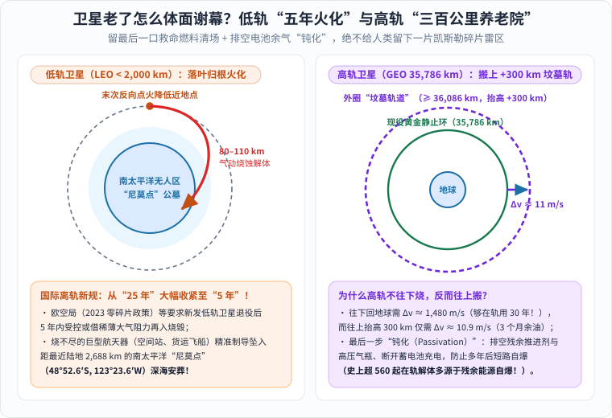

抬头望向晴朗的黄昏天空，如果你耐心盯上几分钟，常常能看到一颗不闪烁的小亮点，正安安静静、匀匀整整地划过天幕——那大概率不是飞机，而是一颗正在几百公里高空狂飙的人造卫星。

据[欧洲空间局（ESA）空间碎片办公室实时统计数据库](https://sdup.esoc.esa.int/discosweb/statistics/)记录，截至 2020 年代中期，地球头顶已经有超过 **1.5 万颗**正在工作的卫星，日夜不停地为我们转发手机信号、播报台风路径、给车载导航定位。

但只要拿日常经验稍微一比，每个人心里都会冒出四连问：

1. **它怎么没掉下来？** 汽车没油会停在路边，民航客机一旦双发熄火就只能滑翔迫降；凭什么几吨重的铁疙瘩在把火箭扔掉之后，**关着发动机能一口气飞上十年、十五年**？
2. **它在天上怎么“变道”和“超车”？** 如果后面一艘飞船想追上前面的空间站，飞行员朝着目标猛踩油门往前冲，结果竟然会**越追越远**——为什么在太空里想超车，反而得**先踩一脚刹车**？
3. **没有方向盘也没有空气舵面，它在真空里怎么转弯对准地球拍照？** 如果每次转头都靠喷气，那点燃料岂不是几个星期就喷光了？
4. **等它老了、没油了怎么办？** 难道永远留在天上当一颗每秒十公里的“超级暗器”？

今天，我们就跟着一颗人造卫星，从地面发射塔倒计时点火的那一秒出发，亲历它**“十级剥壳入轨 → 黄金一小时求生 → 无动力永恒滑行 → 太空变道与超车 → 无燃料飞轮稳像 → 尼莫点火化或搬进三百公里养老院”**的完整一生。

---

## 一、第一幕：10 分钟“竹笋剥壳”与生死攸关的“黄金 60 分钟”

在上一篇[《飞向太空的火箭为什么要“借转、拧腰又禁转”？》]()里我们算过，要把卫星送进近地轨道，关键不是“竖着飞多高”，而是要横着加速到约 **$$7.7\text{–}7.9\text{ km/s}$$** 的水平入轨速度（推导详见[《从发射卫星读懂三大宇宙速度》]()）。

受齐奥尔科夫斯基火箭方程 $$\Delta v = v_e \ln(m_0/m_f)$$ 支配，起飞时重达几百吨的运载火箭，真正装在顶端“蚌壳”里的卫星往往只有几百公斤到几吨——也就是说，整枚火箭 **95% 以上的体重都是推进剂和装着推进剂的金属壳子**。要跑赢这场残酷的减重接力，火箭必须在短短 **8 到 10 分钟**里上演一连串干净利落的“竹笋剥壳”（[NASA/JPL《航天飞行基础》第 14 章：发射段](https://science.nasa.gov/learn/basics-of-space-flight/chapter14-1/)）：

- **第 1 步：助推器与一子级分离（约 $$T+120\text{–}160\text{ s}$$，高度 $$50\text{–}80\text{ km}$$）**：低空最费力气的第一棒烧完燃料后立刻解锁抛弃，绝不让二子级背着几十吨空铁桶往上爬；
- **第 2 步：冲过卡门线，炸开“蚌壳”抛整流罩（约 $$T+180\text{–}220\text{ s}$$，高度约 $$110\text{ km}$$）**：起飞穿过稠密大气时，折叠收拢的卫星脆弱得像一只刚蜕皮的螃蟹——薄如蝉翼的太阳翼、微米级精度的光学镜头，根本扛不住几倍音速的狂风动压和气动摩擦高温，必须藏在火箭顶端的流线型**整流罩（Payload Fairing）**里。但整流罩本身重达数吨！一旦爬升越过 $$100\text{ km}$$ 卡门线、冲到 $$110\text{ km}$$ 左右，空气稀薄到近乎真空，工程上只要**自由分子气动热流密度跌破 $$1{,}135\text{ W/m}^2$$**（恰好约等于正午阳光照在身上的热流强度），两瓣整流罩就会瞬间解锁向两侧弹开，让卫星第一次真正暴露在漆黑的太空里；
- **第 3 步：星箭分离——不是炸飞，而是精密弹簧“温柔一推”（约 $$T+500\text{–}600\text{ s}$$）**：当末级火箭把速度推到入轨点并关机后，连接环上的低冲击包带或非火工螺母瞬间解锁（[NASA/JPL《航天飞行基础》第 11 章](https://science.nasa.gov/learn/basics-of-space-flight/chapter11-4/)），几组严格配平的压缩弹簧轻轻把卫星往前推开，相对分离速度只有 **$$0.5\text{–}1.5\text{ m/s}$$**（相当于人慢悠悠散步的速度），既保证末级箭体不会追尾撞上卫星，又不震坏星上精密仪器。

*图 1：先看左栏深色剖面曲线——火箭在约 10 分钟内依次完成助推/一级分离、过 110 km 抛整流罩与星箭分离；再看右栏四张卡片——分离那一刻卫星其实还是个只靠蓄电池硬撑的“盲童”，必须在 45–90 分钟黄金窗口内自主完成消旋、展开太阳翼寻日充电和测控建链。*

很多观众看到电视直播里喊出“星箭分离，发射圆满成功”，以为事情已经结束了。其实对卫星团队来说，**真正手心冒汗的“鬼门关”才刚刚开始**！这段时间在航天工程上叫作 **LEOP（Launch and Early Orbit Phase，发射与早期轨道段）**。

刚离开火箭母体的卫星，太阳翼还紧紧折叠绑在肚子上，全星上下几千个电子器件全靠肚子里那块**自带蓄电池**供电——而这块电池通常只能撑 **45 到 90 分钟**！如果在这短短一小时里没能自己把太阳能帆板打开对准太阳，电池一旦耗尽、星上电脑冻僵失联，价值数亿元的卫星就会当场变成一块冻死在太空里的废铁。

因此，星箭分离的微动开关一弹开，星载计算机无需地面指挥，就会按预设时间表自动打响“四步求生战”：

1. **阻尼消旋（Detumbling）**：弹簧推离总难免有一丁点力矩偏差，让卫星带着每秒几度的慢速翻滚。星上陀螺仪立刻感知角速度，点动几下微推力器或接通磁力矩器，先把“头晕目眩”的翻滚刹停；
2. **剪绳展翼与寻日充电（Sun Acquisition）**：热刀或火工切割器剪断高强压紧绳，铰链弹簧推着折叠太阳翼像手风琴一样徐徐铺开、咔哒锁死；紧接着全向**太阳敏感器**找到阳光方向，把帆板正面稳稳转向太阳——**直到遥测屏幕上跳出稳定的太阳翼充电电流，地面大厅里紧绷的工程师们才会真正松一口气！**
3. **展开天线与锁定地面测控网（TT&C）**：与全球地面站或天基中继卫星建立双向通信，把全星几千路温度、电压、气压遥测传回地面做“新生儿全身大体检”；
4. **在轨测试与变轨就位**：用几天到几个月时间爬升到预定工作车位，校准相机与转发器，正式上岗值班。

---

## 二、第二幕：不烧一滴油凭什么飞十几年？“活力公式”与闪电轨道悬停魔术

现在卫星已经关掉了主发动机，在几百甚至几万公里高空自由滑行。为什么它既不会掉回地面，也不会越飞越慢停下来？

核心原因只有两句话：**第一，太空几乎没有空气摩擦来偷走它的机械能；第二，地球引力刚好充当了掰弯航线的向心力——卫星一直在往地球方向“自由下落”，只是它横着跑得太快，地面向下弯曲的弧度恰好跟它下落的弧度一模一样**（这也是空间站里宇航员飘起来的根本原因，详见[《空间站为什么会失重？》]()）。

但真实宇宙里，完美正圆轨道只是极特殊的巧合，**绝大多数卫星飞的都是椭圆轨道**（开普勒第一定律，地球乖乖坐在椭圆的两个焦点之一上）。一旦轨道是椭圆，卫星离地心的距离 $$r$$ 时近时远，它的速度怎么变？

天体力学里有一把统帅一切无动力轨道的“万能瑞士军刀”——**活力公式（Vis-Viva Equation）**。只要把单位质量机械能守恒

$$
\frac{1}{2}v^2 - \frac{\mu}{r} = -\frac{\mu}{2a}
$$

移项整理，就能直接写出任意时刻卫星的速率 $$v$$：

$$
v^2 = \mu\left(\frac{2}{r} - \frac{1}{a}\right)
$$

式子里的符号非常干净：

- $$\mu = GM_\oplus \approx 3.986\times 10^5\text{ km}^3/\text{s}^2$$ 是地球引力常数；
- $$r$$ 是卫星**此时此刻**到地心的距离；
- $$a = \frac{r_p + r_a}{2}$$ 是整条椭圆轨道的**半长轴**（近地点地心距 $$r_p$$ 与远地点地心距 $$r_a$$ 的平均值），它唯一决定了轨道总机械能 $$E = -\frac{\mu m}{2a}$$ 和轨道周期 $$T = 2\pi\sqrt{\frac{a^3}{\mu} }$$。

别小看这短短一行公式，它藏着卫星飞行的两大绝技：

**第一，当轨道是正圆（$$r = a$$）时**，括号里 $$\frac{2}{a}-\frac{1}{a}=\frac{1}{a}$$，公式瞬间退化成我们熟悉的环绕速度 $$v = \sqrt{\frac{\mu}{r} }$$：**轨道越高，$$r$$ 越大，巡航速度反而越慢**！在 $$400\text{ km}$$ 高空飞行的中国空间站每秒狂飙 **$$7.67\text{ km/s}$$**（约 92 分钟绕地球一圈）；而远在 $$35{,}786\text{ km}$$ 的地球静止轨道通信卫星，每秒只需要慢悠悠走 **$$3.07\text{ km/s}$$**（恰好 24 小时一圈，详见[《同步卫星为什么能钉在头顶不动？》]()）。

**第二，当轨道拉成扁椭圆（$$r_p \ll r_a$$）时，卫星会自动上演“近快远慢”的无燃料悬停魔术！**

想想俄罗斯和加拿大北部靠近北极圈的冰原：赤道上空的静止卫星从高纬度地区望过去贴近地平线，极易被山脉大楼挡住，到了北极点更是彻底沉在地平线以下看不见。苏联轨道动力学大师们没有硬造悬停发动机，而是巧妙利用活力公式与开普勒第二定律（卫星与地心连线在相等时间内扫过相等面积），设计出了著名的**“闪电轨道”（Molniya Orbit）**（[NASA 地球观测站《地球卫星轨道图谱》](https://science.nasa.gov/earth/earth-observatory/catalog-of-earth-satellite-orbits/)、[ESA 轨道类型指南](https://www.esa.int/Enabling_Support/Space_Transportation/Types_of_orbits)）：

*图 2：左图按开普勒方程精确解出 12 小时“闪电轨道”（偏心率 $$e=0.722$$）每隔整整 1 小时的真实位置点——注意南半球近地点附近 1 小时扫过的矮胖橙色扇形，与北半球远地点附近 1 小时扫过的细长绿色扇形面积严格相等！右图总结活力公式与 $$63.4^\circ$$ 临界倾角如何让卫星一滴油不烧就在北极上空“慢放” 8 小时。*

我们拿实打实的轨道参数算一笔账：设这颗卫星每 **12 小时**绕地球一圈（半长轴 $$a \approx 26{,}562\text{ km}$$），偏心率拉高到 $$e = 0.722$$：

- **掠过南半球近地点时**（高度仅约 $$500\text{ km}$$，$$r_p \approx 6{,}878\text{ km}$$）：代入活力公式算得 $$v_p \approx \mathbf{10.0\text{ km/s} }$$！它像闪电一样“嗖”地一声擦过南半球没人用它的空域，不到 1 小时就溜走了；
- **爬上北半球远地点时**（高度高达 $$39{,}870\text{ km}$$，$$r_a \approx 46{,}246\text{ km}$$）：一路往上爬时地球引力拼命拉后腿，把绝大部分动能自动存成了引力势能，到顶时速度跌到只有 $$v_a \approx \mathbf{1.5\text{ km/s} }$$！因为走得极慢、视野又极高，整整 12 小时周期里，它有**连续 8 个多小时**慢吞吞地高悬在北半球高纬度头顶，简直像钉在天上一样好用，只要 3 颗星轮流接班就能实现北极全天候通信！

更妙的是，地球赤道有一圈微隆起的“啤酒肚”（扁率摄动 $$J_2$$），本来会把普通椭圆轨道的远地点逐年拧到南半球去；但天体力学证明拱线漂移率正比于 $$(5\cos^2 i - 1)$$。工程师只要把轨道倾角精准卡在令 $$5\cos^2 i - 1 = 0$$ 的**临界倾角 $$i = 63.43^\circ$$**，赤道鼓包的拧转力矩就恰好归零——远地点一辈子乖乖锁死在北冰洋头顶！

---

## 三、第三幕：太空变道怎么换高轨？霍曼两脚油门“快车” vs 氙离子螺旋“慢车”

刚和火箭分手的卫星，通常还停留在几百公里的低空停泊轨道或扁平的过渡轨道上。如果它的最终岗位在 $$35{,}786\text{ km}$$ 高的静止轨道，它该怎么自己“爬楼梯”升上去？

你可能会想：“这还不简单，对着天顶竖着猛喷火往上顶呗！”——**千万使不得！** 在轨道力学里，朝径向（竖直向上）硬喷是出了名的“败家子操作”，既浪费燃料又只能把轨道歪扭拉偏。1925 年，德国土木工程师**瓦尔特·霍曼（Walter Hohmann）**在专著《天体的可达性》中严格证明：在同一平面两条圆轨道之间转移，**最省燃料的走法永远是沿着飞行切线方向点两次火，走一条恰好内切低轨、外切高轨的半椭圆“搭桥轨道”**——这就是大名鼎鼎的**霍曼转移（Hohmann Transfer）**（[NASA/JPL《航天飞行基础》第 4 章](https://science.nasa.gov/learn/basics-of-space-flight/chapter4-1/)、[第 3 章](https://science.nasa.gov/learn/basics-of-space-flight/chapter3-4/)）。

记住轨道变道最核心的一句口诀：**“近地点点火管对岸远地点，远地点点火管对岸近地点。”**

我们算一遍从 $$h_1 = 200\text{ km}$$ 低轨（$$r_1 = 6{,}578\text{ km}$$，原圆轨速度 $$v_1 = 7.78\text{ km/s}$$）升往 $$h_2 = 35{,}786\text{ km}$$ 静止轨道（$$r_2 = 42{,}164\text{ km}$$，目标圆轨速度 $$v_2 = 3.07\text{ km/s}$$）的标准账本，设搭桥椭圆半长轴 $$a_t = \frac{r_1+r_2}{2} = 24{,}371\text{ km}$$：

$$
\begin{aligned}
\Delta v_1 &= \sqrt{\mu\left(\frac{2}{r_1} - \frac{1}{a_t}\right)} - \sqrt{\frac{\mu}{r_1} } \\
&\approx 10.24 - 7.78 = \mathbf{+2.46\text{ km/s} } \\[4pt]
\Delta v_2 &= \sqrt{\frac{\mu}{r_2} } - \sqrt{\mu\left(\frac{2}{r_2} - \frac{1}{a_t}\right)} \\
&\approx 3.07 - 1.59 = \mathbf{+1.48\text{ km/s} }
\end{aligned}
$$

你看这两脚油门配合得多默契：

1. **第一脚油门（近地点切向加速 $$+2.46\text{ km/s}$$）**：趁着卫星在引力井底飞得最快（$$7.78\text{ km/s}$$）时顺着前进方向猛踹一脚！由于动能增量 $$\Delta E_k \approx m\vec{v}\cdot\Delta\vec{v}$$ 正比于当前速度 $$v$$（**奥伯特效应 Oberth Effect**），在高速低空点这一把火赚到的机械能极高，一下子把地球正对面的远地点甩到了 $$35{,}786\text{ km}$$。随后发动机彻底熄火，卫星安静滑行半圈，耗时 $$t_{\text{trans} } = \pi\sqrt{\frac{a_t^3}{\mu} } \approx \mathbf{5\text{ 小时 }15\text{ 分钟} }$$；
2. **第二脚油门（远地点圆化点火 $$+1.48\text{ km/s}$$）**：当卫星慢悠悠爬到 $$35{,}786\text{ km}$$ 顶点时，速度已跌到只剩 $$1.59\text{ km/s}$$——如果这时不管它，它会立刻掉头摔回 $$200\text{ km}$$ 近地点！所以星上的**远地点发动机**必须准时再向前踹出 $$+1.48\text{ km/s}$$（如果发射场不在赤道，还会顺便在远地点低速处把轨道倾角拧平，省下大笔转向燃料，见 [NASA/JPL 第 5 章](https://science.nasa.gov/learn/basics-of-space-flight/chapter5-1/)），稳稳补齐 $$3.07\text{ km/s}$$ 的正圆速度，成功泊入高轨车位！

*图 3：左侧橙色弧线用单次动画演示 1925 年霍曼双脉冲转移——底部近地点第一脚油门（$$+2.46\text{ km/s}$$）拉高远地点，熄火滑行 5 小时 15 分抵达顶部后，第二脚油门（$$+1.48\text{ km/s}$$）把轨道圆化并入绿虚线静止轨（[单独打开图片]( /assets/images/satellite-flight/hohmann-vs-electric-spiral-transfer.svg )刷新可重播；开启系统“减弱动态效果”时直接展示完整转移轨迹）；右侧蓝线展示现代全电推卫星靠氙离子微推力绕地数千圈螺旋慢爬。*

但化学火箭有一个天然软肋：双组元液体燃料喷气速度只有 $$v_e \approx 3.1\text{ km/s}$$。算进齐奥尔科夫斯基方程就会发现，一颗 5 吨重的传统通信卫星，**肚子里居然要装 2 吨多的化学燃料专门用来爬高变轨**！

有没有办法把这 2 吨油箱砍掉一半，换成赚钱的通信转发器？

有！这就是近二十年席卷全球商业卫星的**全电推进（霍尔电推 / 离子电推）**技术（[NASA/JPL《航天飞行基础》第 11 章：电推进](https://science.nasa.gov/learn/basics-of-space-flight/chapter11-4/)）。它不靠化学燃烧，而是用太阳能帆板发出的电，把惰性气体**氙（Xe）或氪（Kr）**电离成带正电的离子，再用上千伏高压静电场或洛伦兹力加速到 **$$15\text{–}30\text{ km/s}$$** 的惊人速度喷出，在漆黑太空里拖出一道科幻感十足的幽蓝色羽流！

| 对比维度 | 化学双脉冲快车（霍曼 / GTO 变轨） | 全电推进慢车（氙 / 氪离子螺旋升轨） |
| :--- | :--- | :--- |
| **有效喷气速度 $$v_e$$** | 约 $$3.0\text{–}3.2\text{ km/s}$$（比冲约 $$310\text{ s}$$） | **$$15\text{–}30\text{ km/s}$$**（比冲高达 $$1{,}500\text{–}3{,}000\text{ s}$$） |
| **推力大小** | **$$400\text{–}500\text{ N}$$**（猛踹一脚立竿见影） | **$$0.08\text{–}0.5\text{ N}$$**（仅相当于手心托起一枚硬币或几张 A4 纸） |
| **爬升耗时** | 几小时至数天（通常分 3–5 次远地点点火完成） | **3–6 个月**（全天开机绕地几千圈慢慢把螺旋线撑大） |
| **经济账（核心优势）** | 时间极快，但燃料占卫星起飞重近一半 | 慢工出细活，**省下 1–2 吨推进剂死重**，换小一号火箭省数千万美元！ |

时间紧迫的载人飞船和应急卫星坐“霍曼快车”，精打细算的商业通信星座和马斯克的数千颗“星链”（氪/氩霍尔电推）则纷纷坐上了“离子螺旋慢车”——航天工程从来都是物理学与经济学的精妙平衡。

---

## 四、第四幕：太空超车大反直觉——为什么猛踩油门反而追丢，踩刹车才能追上前车？

如果此时天上有两艘航天器飞在**同一条圆形轨道**上：中国空间站“天宫”在前面飞，货运飞船“天舟”落后它几十公里在后面追。如果你坐在驾驶舱里握着手柄，你会怎么追上去？

在地面高速公路或大气层开战斗机时，答案连三岁小孩都知道：**踩油门加速往前冲啊！**

1965 年 6 月 3 日，美国**“双子星 4 号”（Gemini IV）**指令长吉姆·麦克迪维特（Jim McDivitt）也是这么想的。根据 [NASA“双子星 4 号”官方任务档案](https://www.nasa.gov/mission/gemini-iv/)记载，飞船与泰坦二号上面级分离后，任务要求他操纵飞船追回几百米外的上面级练习编队伴飞。当时地面和舱内还没有现代交会雷达与轨道计算机，麦克迪维特凭着王牌试飞员的直觉，把飞船鼻子对准前方的火箭残骸，打开推进器往前喷火加速。

结果发生了令两位宇航员目瞪口呆的诡异一幕：

每当他往前踩一脚油门，飞船非但没有贴近目标，反而**慢慢往上飘到了目标头顶，接着被目标越甩越远**！麦克迪维特不信邪，压低船头再追、再喷，一口气烧掉了全船 **42% 的机动推进剂**，飞船轨道从最初的 $$162\times 282\text{ km}$$ 硬生生抬高到了 $$166\times 290\text{ km}$$，目标却在视野里缩成了一个遥不可及的小亮点，地面指挥中心不得不紧急下令放弃追赶！

为什么在太空里“往前猛踩油门，反而会落到后头去”？把刚才的圆轨道周期公式和活力公式联立起来看，谜底一秒揭晓：

$$
v = \sqrt{\frac{\mu}{r} }, \quad \omega = \sqrt{\frac{\mu}{r^3} }, \quad T = 2\pi\sqrt{\frac{a^3}{\mu} }
$$

当你在同轨道上**顺着前进方向踩油门（$$\Delta v > 0$$）**时，你的瞬时速度确实变快了一点；但正因为速度超过了当前高度所需的环绕速度，向心力拉不住你，你立刻被甩进了**更高的外圈椭圆轨道**（半长轴 $$a$$ 变大）！而在爬升的过程中，地球引力把你刚加进去的动能全吃掉换成了双倍势能，结果你在高轨上的平均线速度更慢、绕圈周长更长，绕地周期 $$T \propto a^{3/2}$$ 显著拉长——**就像操场跑道上你突然从第 1 道拐进了第 8 道外圈，眼睁睁看着内道选手轻松把你套圈甩开！**

*图 4：对比左栏 1965 年“双子星 4 号”直踩油门升入外圈慢车道导致追丢目标，与右栏现代神舟 / 天舟飞船“先向后踩刹车降入低轨超车道、从前下方追平后再加速升轨对接”的标准调相秘籍；底部紫卡揭示同源物理奇观——稀薄空气阻力反而会让坠落中的低轨卫星越飞越快！*

那正确的太空超车姿势是什么？恰恰相反——**先踩一脚刹车（$$\Delta v < 0$$）！**

1. **踩刹车切进内圈“超车道”**：飞船调转喷口**降低速度**，向心力大于离心趋势，飞船顺势跌入比空间站**低几十公里的内圈调相轨道**（半长轴 $$a$$ 变小）；
2. **引力帮你加速超车**：在掉往低轨的过程中，地球引力做正功，飞船不仅绕圈周长更短，连真实飞行线速度 $$v$$ 都变得比高处的空间站更快！飞船从下方内道一路风驰电掣往前赶，迅速抹平两者的角度差；
3. **追到前下方再踩油门并道**：算准提前量，等追到空间站后下方合适位置时，再向前点火做一次迷你霍曼抬轨，稳稳停在空间站门前完成毫米级对接！从 1965 年底“双子星 6A/7 号”首次成功交会，到今天神舟载人飞船最快 **2–6.5 小时自主快速交会对接**，全人类航天员用的都是这套“欲速则先刹”的轨道芭蕾。

顺着这条公式往下想一步，你还会撞见一个更让人拍案叫绝的同源奇观——**“卫星大气阻力悖论”（Satellite Drag Paradox）**（[NASA 地球观测站](https://science.nasa.gov/earth/earth-observatory/catalog-of-earth-satellite-orbits/)）：

假如一颗在 $$400\text{ km}$$ 飞行的低轨卫星燃料耗尽，每天被高层极其稀薄的空气分子迎面摩擦阻挡，它的飞行速度会变慢还是变快？

直觉喊“肯定越摩越慢”——**物理真相却是：它越摩越快！** 因为近圆轨道总机械能 $$E = -\frac{\mu m}{2r}$$，而动能恰好是 $$E_k = +\frac{\mu m}{2r} = -E$$。空气阻力每摩擦消耗掉 **1 焦耳**总机械能（$$\Delta E = -1\text{ J}$$），卫星轨道高度 $$r$$ 微微下降一点，地球引力就立刻释放出 **2 焦耳**引力势能（$$\Delta E_p = -2\text{ J}$$）——其中 1 焦耳拿去填补摩擦损失，**剩下的净赚 1 焦耳全变成了卫星的新增动能（$$\Delta E_k = +1\text{ J}$$）**！于是低轨卫星在阻力中一边螺旋下降，一边越跑越快，直到跌进 $$100\text{ km}$$ 以下稠密大气层，被剧烈气动加热烧成夜空里的一道璀璨流星。

---

## 五、第五幕：在轨打工十几年——无燃料飞轮怎么转头？谁在偷偷挪动卫星车位？

等卫星顺利泊入工作车位，它接下来要勤勤恳恳“打工”五到十五年。这期间它每天都要干两件看似矛盾的大事：**既要把相机和天线稳到“几百公里外看清地面斑马线”（姿态控制），又要抵抗各路宇宙摄动死守自己的轨道车位（轨道维持）**。

### 1. 姿态控制（AACS）：靠“拍星星”认路，靠肚子里的飞轮“无燃料转身”

卫星在漆黑真空里既没有指南针（高轨地磁场极弱且不断扭曲），也没有地平线参照，它怎么知道自己鼻子朝哪儿？

现代高精度卫星头顶都装着两双“火眼金睛”（[NASA/JPL《航天飞行基础》第 11 章：姿态控制](https://science.nasa.gov/learn/basics-of-space-flight/chapter11-2/)）：一双是**光纤 / 半球谐振陀螺仪**，感知每一毫秒的微小转动；另一双则是**星敏感器（Star Tracker）**——它本质上是一台背对阳光、专拍夜空恒星的微型数码相机，每秒拍下几十颗暗星的几何图案，跟星载内存里的全天星图一比对，瞬间就能把三轴指向测准到**几角秒**（$$1'' = \frac{1}{3600}^\circ$$，相当于在 1 公里外看清一枚硬币的厚度）！

知道朝向之后，如果要让几吨重的遥感卫星向左偏转 $$15^\circ$$ 去拍邻省的森林大火，总不能每次都喷宝贵的推进剂吧？我们在[《一文读懂无处不在的角动量》]()里讲过**角动量守恒**：只要在卫星肚子里沿 $$X, Y, Z$$ 三个互相垂直的方向各装一个电机驱动的金属圆盘——**反作用飞轮（Reaction Wheel）**（空间站等百吨级巨无霸则升级为力矩更大的控制力矩陀螺 CMG）：

$$
\begin{aligned}
L_{\text{total} } &= I_s \omega_s + I_w \omega_w = 0 \\
\Longrightarrow \quad \omega_s &= -\frac{I_w}{I_s}\omega_w
\end{aligned}
$$

想让卫星往左转？星载电脑只需要用**太阳能发出的免费电力**，驱动飞轮顺时针加速转起来（$$\omega_w > 0$$），整颗卫星立刻顺从地逆时针转过去（$$\omega_s < 0$$）；拍完照想停住？把飞轮刹停，卫星就分毫不差地定在原处——**全程只耗电、不烧一滴油，而且没有任何喷气抖动！**

*图 5：左栏拆解卫星姿态控制系统——顶部星敏感器拍星空定姿，金色多层隔热膜（MLI）舱体内的三轴正交反作用飞轮靠内部角动量守恒实现零燃料转身，并借地磁场磁力矩器实现“无尾气动量卸载”；右栏列出终身消耗推进剂的三大轨道维持场景。*

不过这里藏着一个工程师必须解决的小麻烦：太空中虽然近乎真空，但太阳光照射帆板存在极其微弱却日积月累的**太阳光压不对称力矩**。为了抵消这股单向推扭，飞轮不得不每天多加速一点点，几个星期下来转速就会飙升到每分钟五六千转的机械极限——这叫**飞轮角动量饱和**！

飞轮快“转爆表”了怎么给它减速卸载，又不让卫星跟着乱转？

- **近地轨道绝活——磁力矩器（Magnetorquer）**：在近地轨道地球磁场还挺强，卫星只需给三根电磁线圈通上电流产生磁矩 $$\vec{m}$$，借地磁场 $$\vec{B}_\oplus$$ 白嫖一股外力矩 $$\vec{\tau} = \vec{m}\times\vec{B}_\oplus$$ 按住机身，同时把飞轮慢悠悠降回低速！**哈勃空间望远镜**之所以能在轨拍出深空神作三十多年，全靠磁力矩器给飞轮卸载——它全身上下**连一个推进器喷嘴都没装**，因为哪怕喷出一丁点肼类尾气分子凝结在镜面上，紫外光学镜头就彻底毁了（[NASA/JPL 第 11 章](https://science.nasa.gov/learn/basics-of-space-flight/chapter11-2/)）！
- **高轨与深空卸载**：到了地磁场微弱的静止轨道或行星际空间，卫星才会每隔几天点动两下 $$1\text{ N}$$ 级微推力器，帮飞轮把攒满的角动量“吐”出去。

### 2. 轨道维持（Station-Keeping）：定期交“太空物业费”，对抗三大偷车贼

既然巡航不用油、转头也不用油，那卫星肚子里的剩余推进剂到底花在哪儿了？答案是：**花在对抗三大“偷车贼”的终身轨道维持上——燃料哪天烧干，卫星的寿命就哪天到头！**

1. **低轨头号小偷：随“太阳脾气”暴涨暴跌的高层大气阻力**。$$400\text{–}600\text{ km}$$ 热层里依然游荡着稀薄氧原子。更刺激的是，每逢约 **11 年一轮的太阳活动极大年**，强烈的太阳极紫外辐射和地磁暴会把地球高层大气烤得像热气球一样剧烈膨胀上涌！据 [NASA 地球观测站](https://science.nasa.gov/earth/earth-observatory/catalog-of-earth-satellite-orbits/)记录，低轨卫星在太阳平静年一年只需点火抬轨约 **4 次**；一旦赶上太阳活动峰年，大气密度暴增数倍，**每隔 2 到 3 个星期就得紧急点火抬高一次轨道**，否则几个月内就会坠毁！
2. **高轨头号小偷：日月引力拉扯 + 地球赤道“椭圆重力谷”**。远在 $$35{,}786\text{ km}$$ 的静止卫星虽然没有空气阻力，但头顶有太阳和月亮斜着拽它，每年会把它的轨道平面掰歪约 **$$0.85^\circ$$**，如果不做**南北位置保持**（每年得花掉约 $$\Delta v \approx 45\text{–}50\text{ m/s}$$ 的昂贵推进剂），地面老百姓的固定卫星电视锅就会跟它失联；同时地球赤道截面其实是个长短半径相差约 $$70\text{ m}$$ 的微椭圆，形成东经 $$75^\circ$$ 和西经 $$105^\circ$$ 两个“引力低谷”，不停把卫星往谷底拽，卫星必须每两周微喷一次做**东西位置保持**，死死钉在国际电联分配的 $$\pm 0.05^\circ$$ 窄小车位盒里！
3. **最惊险的暗器：超高速太空碎片规避机动**。目前全球空间监视网正实时追踪约 **4.7 万个**大于 $$10\text{ cm}$$ 的在轨物体，此外还有上百万颗厘米级碎片（[ESA 空间碎片概览](https://www.esa.int/Space_Safety/Space_Debris/About_space_debris)）。近地轨道交叉碰撞的相对速度高达 **$$10\text{–}14\text{ km/s}$$**（是步枪出膛子弹的十倍以上，一颗 1 克重的小铝珠撞上去动能堪比手榴弹爆炸！）。2009 年 2 月 10 日，现役通信卫星“铱星 33 号”与报废的“宇宙 2251 号”在西伯利亚上空 $$776\text{ km}$$ 处以 **$$11.7\text{ km/s}$$** 迎头相撞，瞬间炸出两千多块可追踪大碎片！如今只要地面算出未来几天碰撞概率超过警戒线（通常 $$10^{-4}$$ 量级），卫星就会提前半圈微喷几厘米每秒的 $$\Delta v$$，把高度错开几百米潇洒避险。

---

## 六、第六幕：体面谢幕——低轨“五年火化 / 尼莫点安葬”与高轨“三百公里养老院”

十年、十五年寒暑过去，当油箱里的推进剂只剩下最后几公斤“救命底油”时，一颗负责任的现代卫星绝不能赖在黄金轨道上混吃等死——因为一旦演变成美国科学家唐纳德·凯斯勒（Donald Kessler）1978 年警告的**“凯斯勒综合征”（Kessler Syndrome）**，连环碰撞产生的碎片云将把近地太空彻底封死，锁住全人类通往星辰大海的大门。

根据卫星生前工作轨道的高低，国际航天界定下了两条截然不同的“体面养老与谢幕规矩”（[ESA 空间碎片减缓与零碎片准则](https://www.esa.int/Space_Safety/Space_Debris/Mitigating_space_debris_generation)）：

*图 6：左栏展示 2,000 km 以下低轨卫星退役方案——响应收紧后的国际“5 年离轨新规”再入大气层烧蚀，烧不尽的巨型航天器精准制导落入距最近陆地 2,688 km 的南太平洋“尼莫点”；右栏展示 35,786 km 高轨卫星为何只花 $$11\text{ m/s}$$ 往上搬进 $$+300\text{ km}$$ 坟墓轨道并执行排空断电“钝化”。*

### 1. 低轨卫星（LEO $$< 2{,}000\text{ km}$$）：五年内落叶归根，巨兽魂归“尼莫点”

过去几十年，国际通行标准是低轨卫星退役后 **25 年内**掉进大气层烧掉即可；但面对如今动辄上万颗的巨型星座浪潮，25 年太慢了！欧洲空间局（2023 年《零碎片宪章》新规）与美国联邦通信委员会（FCC）已相继把红线大幅收紧为**“退役后 5 年内离轨”**。

中小型低轨卫星会在生命终点调转船头，打光最后一口燃料做反向制动，把近地点压低到稠密大气边缘，在 $$80\text{–}110\text{ km}$$ 高空彻底气化火化，不留一片残骸。

那如果是重达十几吨甚至上百吨的空间站、大型货运飞船（比如当年的“和平号”空间站、天舟货运飞船，以及未来退役的国际空间站），钛合金球形气瓶和厚重对接环在大气层里烧不干净怎么办？

航天工程师在地球上找出了离所有人类陆地最遥远的一片孤独海域——位于南太平洋中央（**南纬 $$48^\circ 52.6'$$，西经 $$123^\circ 23.6'$$**）的**“海洋难抵极”**，也就是以凡尔纳科幻小说里鹦鹉螺号船长命名的**“尼莫点”（Point Nemo）**。据[美国国家海洋和大气管理局（NOAA）官方档案](https://oceanservice.noaa.gov/facts/nemo.html)核定，这里距离最近的陆地（皮特凯恩群岛迪西岛、复活节岛摩托努伊岛）足足有 **$$2{,}688\text{ km}$$**——有时候，头顶 $$400\text{ km}$$ 掠过的空间站宇航员，反而比地球上任何岸边的人离它都近！大型航天器在最后一次精准制动后，未燃尽的少量残骸会安全坠入四千米深的南太平洋海底长眠，因此这片海域也被浪漫地称为**“航天器公墓”**。

### 2. 高轨卫星（GEO $$35{,}786\text{ km}$$）：只花 11 m/s 搬上“+300 公里养老院”，再彻底“钝化”

那远在 $$35{,}786\text{ km}$$ 的地球静止轨道通信卫星老了，为什么不让它也掉回大气层烧掉？

我们用第三幕的活力公式一算就明白：如果想把一颗高轨卫星的近地点拉回地球大气层（$$r_p \approx 6{,}478\text{ km}$$），需要反向猛刹 **$$\Delta v \approx 1{,}480\text{ m/s}$$**——这笔燃料足够这颗卫星在天上多干 **30 年**！谁舍得背这么大一桶“自毁油”上天？

反过来，如果让它**往上再爬高 $$300\text{ km}$$**（彻底腾出静止轨道外侧 $$200\text{ km}$$ 法定保护区，升入 $$\ge 36{,}086\text{ km}$$ 的正圆**坟墓轨道 Graveyard Orbit**，国际机构间空间碎片协调委员会 IADC 公式规定最小抬升高度 $$\Delta H_{\min} = 235\text{ km} + 1000\,C_R\frac{A}{m}$$，工程上普遍抬高 $$300\text{ km}$$ 以上），需要多少速度增量？

$$
\Delta v_{\text{grave} } \approx \frac{1}{2}\sqrt{\frac{\mu}{r_{\text{GEO} } } }\,\frac{\Delta r}{r_{\text{GEO} } } \approx \mathbf{10.9\text{ m/s} }
$$

只要区区 **$$11\text{ m/s}$$**——仅仅相当于它在轨两三个月的位置保持余油！

搬进这座永不干扰现役卫星的“三百公里高空养老院”之后，地面测控大厅还会向这位老兵发出人生最后几条指令，执行至关重要的**“钝化（Passivation）”**手术：

1. 打开所有阀门，**把贮箱里残留的最后一点推进剂和高压气瓶里的增压氦气排得一干二净**；
2. 彻底断开太阳翼对蓄电池的充电回路，放空电池余电，让飞轮停转；
3. 关闭无线电发射机，避免变成干扰现役频段的“幽灵电台”。

为什么要做得这么绝？因为 [ESA 空间碎片统计](https://www.esa.int/Space_Safety/Space_Debris/About_space_debris)揭示了一个触目惊心的教训：**人类航天史上已经发生过超过 560 起在轨航天器解体事件，其中绝大多数根本不是被别人撞碎的，而是报废多年后残余燃料泄漏混触、或老旧蓄电池过充短路引发的“太空自爆”！** 只有把体内最后一丝脾气彻底放空，这位陪伴人类十几年的钢铁老兵，才能在三万六千公里外的静谧星海里安详沉睡亿万年。

---

## 七、下次抬头看见那颗匀速划过夜空的亮星

现在，当你在一个夏夜散步抬头，再次看到一颗不眨眼的白色小光点正从头顶星空间从容滑过时，你看到的就不再只是一粒冰冷的金属反光：

- 你知道它曾在一团震耳欲聋的烈焰中经历过 **10 分钟剥掉 96% 体重**的生死冲刺，又在星箭分离后的黑暗里争分夺秒张开双翼拥抱阳光；
- 你知道它此刻根本没开油门，正顺着**活力公式 $$v^2 = \mu(\frac{2}{r}-\frac{1}{a})$$** 编织的无形引力滑梯，在坠向地球与冲向深空的永恒平衡中每秒飞掠七千多米；
- 你知道在它的世界里，变道要靠两脚切向点火或一缕幽蓝色的氙离子微风，想追上前方的伙伴竟然要先向后踩一脚刹车，而它肚子里嗡嗡轻转的三只小飞轮，正借着遥远恒星的坐标把镜头稳稳对准我们的家园；
- 你甚至知道，等十几年后它油尽灯枯的那一天，它要么化作南太平洋尼莫点上空最后一朵绚烂的烟火，要么悄悄爬高三百公里、放空全身余气，把清朗安全的轨道留给下一代后来者。

人类并没有改写牛顿与开普勒写下的任何一条宇宙铁律；我们只是摸透了引力的脾气，把一整套精密到极致的物理学，折叠塞进了那只高悬头顶的小小铁盒子里。

---

## 参考资料与核查来源

1. **NASA / Jet Propulsion Laboratory (JPL)**, *Basics of Space Flight — Chapter 14: Launch Phase*：权威梳理多级运载火箭接力减重、整流罩（Payload Fairing）气动与热防护及入轨抛罩、有效载荷适配器低冲击星箭分离与早期深空网捕获流程。链接：<https://science.nasa.gov/learn/basics-of-space-flight/chapter14-1/>
2. **NASA / JPL**, *Basics of Space Flight — Chapter 3: Gravity & Mechanics* & *Chapter 4: Interplanetary Trajectories*：详解自由落体环绕本质、近拱点/远拱点切向变速规律，以及 1925 年瓦尔特·霍曼（Walter Hohmann）最小能量双切向脉冲转移轨道原理。链接：<https://science.nasa.gov/learn/basics-of-space-flight/chapter3-4/> 与 <https://science.nasa.gov/learn/basics-of-space-flight/chapter4-1/>
3. **NASA / JPL**, *Basics of Space Flight — Chapter 5: Planetary Orbits*：核查开普勒轨道六根数、地球同步转移轨道（GTO）远地点发动机圆化与倾角修正、轨道位置保持（Station-Keeping）及太阳同步轨道进动机制。链接：<https://science.nasa.gov/learn/basics-of-space-flight/chapter5-1/>
4. **NASA / JPL**, *Basics of Space Flight — Chapter 11: Typical Onboard Systems (Attitude & Articulation Control / Propulsion / Thermal)*：支持星敏感器（Star Tracker）、太阳敏感器、激光/半球谐振陀螺、三轴正交反作用飞轮、哈勃空间望远镜利用地磁场磁力矩器（Magnetic Torquers）无污染卸载角动量、金色多层隔热膜（MLI）以及氙离子电推进与化学推进对比。链接：<https://science.nasa.gov/learn/basics-of-space-flight/chapter11-2/> 与 <https://science.nasa.gov/learn/basics-of-space-flight/chapter11-4/>
5. **NASA Official Mission Page**, *Gemini IV*：核查 1965 年 6 月 3 日麦克迪维特（Jim McDivitt）与怀特（Ed White）尝试目视直线加速追赶泰坦二号上面级失败的原始史实（轨道由 $$162.3\times 282.1\text{ km}$$ 升至 $$166\times 290\text{ km}$$，消耗 42% 推进剂后被迫取消交会）。链接：<https://www.nasa.gov/mission/gemini-iv/>
6. **NASA Earth Observatory**, *Catalog of Earth Satellite Orbits*（Riebeek, H., 2009）：支持高偏心闪电轨道（Molniya，$$i=63.4^\circ, e=0.722$$）12 小时周期北极慢速悬停、低轨稀薄大气阻力使衰减卫星线速度反而加快（引用 Blitzer 1971 *Satellite orbit paradox*）以及太阳活动极大年每 2–3 周抬轨频率。链接：<https://science.nasa.gov/earth/earth-observatory/catalog-of-earth-satellite-orbits/>
7. **European Space Agency (ESA)**, *Types of Orbits*：核查 LEO、MEO、GEO（$$35{,}786\text{ km}$$，$$3.07\text{ km/s}$$）、GTO、SSO 与超同步坟墓轨道工程定义。链接：<https://www.esa.int/Enabling_Support/Space_Transportation/Types_of_orbits>
8. **ESA Space Debris Office**, *About Space Debris*, *Mitigating Space Debris Generation* & *DISCOSweb Space Environment Statistics*：核查全球在轨活跃卫星与可追踪碎片规模、2009 年 2 月 10 日铱星 33 号与宇宙 2251 号在 $$776\text{ km}$$ 处 $$11.7\text{ km/s}$$ 碰撞事件、超 560 起在轨爆炸解体成因、凯斯勒综合征、低轨“5 年离轨新规”、高轨坟墓轨道保护区及末期排空断电“钝化（Passivation）”规范。链接：<https://www.esa.int/Space_Safety/Space_Debris/About_space_debris>、<https://www.esa.int/Space_Safety/Space_Debris/Mitigating_space_debris_generation>（需网络访问；统计页 <https://sdup.esoc.esa.int/discosweb/statistics/> 依赖浏览器 JavaScript 渲染图表，正文已独立给出核心数据）。
9. **NOAA National Ocean Service**, *Where is Point Nemo?*：核查南太平洋“海洋难抵极 / 尼莫点”精确坐标（$$48^\circ 52.6'\text{S}, 123^\circ 23.6'\text{W}$$）及距最近陆地 $$2{,}688\text{ km}$$ 的官方地理数据。链接：<https://oceanservice.noaa.gov/facts/nemo.html>
