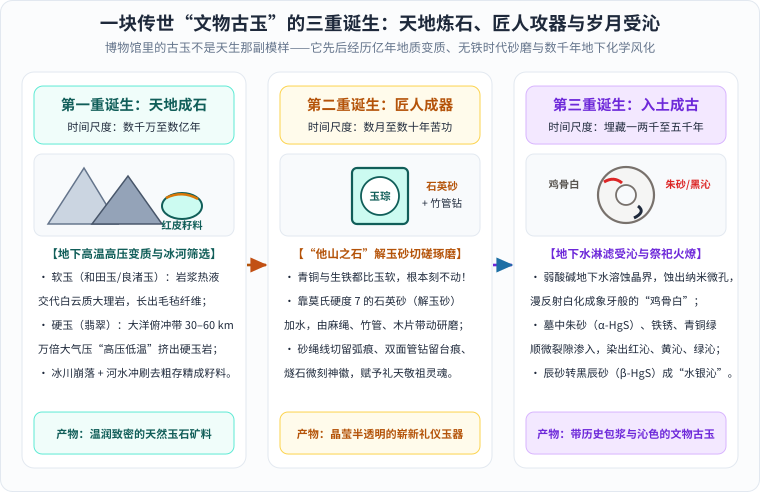
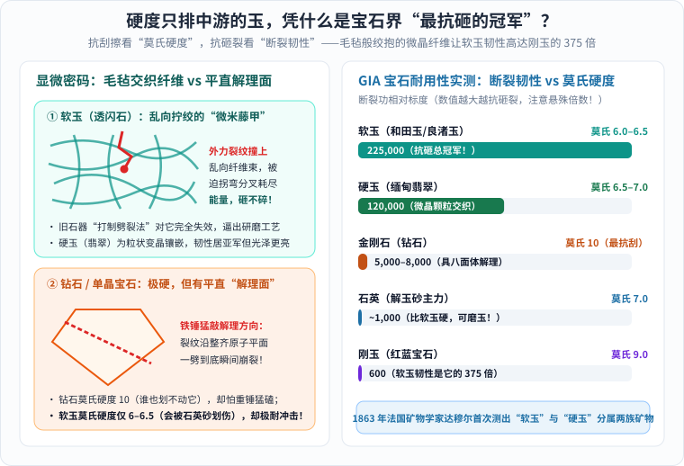
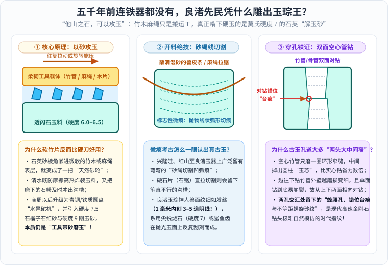
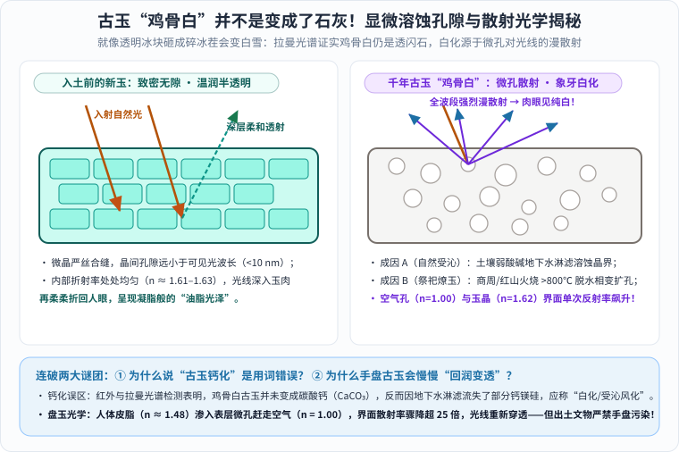

走进中国各大博物馆的玉器展厅，玻璃展柜聚光灯下的高古玉器总带着一种让人屏息的神秘感：

- 五千年前**良渚反山王陵**出土的“玉琮王”，方柱圆孔间刻满神人兽面纹，细到 **1 毫米宽度里并行排布 4 到 5 道互不重叠的阴线**，而整件玉器早已褪去半透明青绿，通体泛着温润如象牙的乳白色（俗称**“鸡骨白”**）；
- 三千多年前商代**殷墟妇好墓**与春秋战国诸侯大墓里的玉龙、玉璧，有的染着夺目的枣皮朱红，有的浸着翠绿斑块，还有的披上一层乌黑发亮的包浆（古玩行称为**“黑漆古”**或**“水银沁”**）。

面对这些跨越几千年的“国之重器”，哪怕是最爱逛博物馆的朋友，脑海里也常会蹦出四个直击灵魂的疑问：

1. **玉到底和普通鹅卵石有什么区别？** 钻石的莫氏硬度高达 $$10$$，玉的莫氏硬度只有 $$6\text{–}7$$（连沙滩上随手抓一把石英砂都能划伤它），凭什么古人说玉“宁折不弯、坚韧无比”，铁锤砸钻石能碎，砸和田玉却直冒火星？
2. **天地是怎么把石头“炼”成玉的？** 同叫一个“玉”字，商周帝王祭天用的**和田玉**，和清代乾隆、慈禧痴迷的**缅甸翡翠**，在地下长出来的方式竟然完全相反？
3. **没有铁刀和金刚石钻头的石器时代，古人拿什么雕玉？** 连商周最锋利的青铜剑（莫氏硬度 $$3\text{–}4$$）和战国铁刀（硬度 $$4\text{–}5.5$$）在玉石面前都会瞬间卷刃，八千年前兴隆洼、五千年前红山与良渚的工匠，靠麻绳和竹管怎么把玉石切开、钻穿？
4. **“鸡骨白”真是玉变成了石灰吗？“血沁”真是墓主人咽气时喷上的冤血吗？** 刚雕好的新玉和埋在地下三千年挖出来的“文物玉”，中间究竟发生了怎样翻天覆地的物理化学变化？

要真正读懂一件**“文物—玉”**的形成方式，绝不能只盯着矿山看——**矿山里挖出来的只是“玉石原料”，匠人手里磨出来的只是“新玉器”，唯有再走完地下几千年水土火金的洗礼，它才最终蜕变为博物馆里的“文物古玉”。**

今天，我们就顺着**“亿年地质炼石 → 无铁时代以砂攻玉 → 墓葬千年受沁包浆”**这三重锻造，揭开传世古玉跨越亿万年的前世今生。

*图 1：先从左向右通览“文物古玉”的三重形成尺度——第一重在地下几公里至几十公里深处耗时数千万到数亿年完成变质成矿与河流分选（成石）；第二重由古代匠人借硬度 $$7$$ 的石英“解玉砂”配合麻绳、竹管历时数月乃至数年琢磨赋形（成器）；第三重在墓葬弱酸碱地下水、随葬朱砂青铜或祭祀烈火中经历数千年风化受沁（成古）。*

---

## 一、先破第一个误区：一字之差，“软玉”和“硬玉”根本不是同一种石头！

在中文里，“和田白玉”和“缅甸翡翠”都顶着一个“玉”字；在英文里，它们也统称为 *Jade*（这个词源自 16 世纪西班牙航海者在中美洲见到的印第安治肾痛佩石 *piedra de ijada*，意为“腰胁之石”，见[美国宝石研究院 GIA《玉石历史与文化考据》](https://www.gia.edu/jade-history-lore)）。

直到 **1863 年**，法国矿物学家亚历克西·达穆尔（Alexis Damour）对来自中国的清宫圆明园流散玉器做化学定量分析时才惊讶地发现：世人混称了几千年的“玉”，在矿物学上竟然是**两族化学成分、晶体结构乃至诞生地质环境都截然不同的变质岩**（[GIA《玉石宝石学百科与分类》](https://www.gia.edu/jade-description)）：

1. **软玉（Nephrite，透闪石—阳起石玉）——中华八千年古玉的真正主角**：
   从距今约 8000 年的内蒙古兴隆洼文化玉玦、红山文化碧玉C形龙、良渚文化玉琮，到商代妇好墓、西汉金缕玉衣，**中国先秦至明代几乎所有真正意义上的文物古玉，统统都是软玉**（[史密森尼学会国立亚洲艺术博物馆《中国古代玉器导论》](https://asia-archive.si.edu/learn/ancient-chinese-jades/)）。它的主体矿物属于角闪石族（双链硅酸盐），化学通式为：

   $$
   \text{Ca}_2(\text{Mg}, \text{Fe})_5\text{Si}_8\text{O}_{22}(\text{OH})_2
   $$

   它的颜色完全由晶格里镁与二价铁的摩尔比 $$f = \frac{\text{Mg} }{\text{Mg} + \text{Fe} }$$ 决定（[Bao 等，2018，《Scientific Reports》古玉相变研究](https://pmc.ncbi.nlm.nih.gov/articles/PMC6131398/)）：当几乎不含铁（$$f \ge 0.9$$）时，它是洁白如凝脂的**透闪石（Tremolite，如羊脂白玉）**；当 $$\text{Fe}^{2+}$$ 部分替代 $$\text{Mg}^{2+}$$（$$0.5 \le f < 0.9$$）时，它便过渡为温润沉稳的**阳起石（Actinolite，如青玉、碧玉）**。其莫氏硬度为 **$$6.0\text{–}6.5$$**，相对密度约 **$$2.95$$**，抛光后泛着含蓄内敛的**油脂光泽**（[GIA《Jade 数据档案》](https://www.gia.edu/jade)）。

2. **硬玉（Jadeite，缅甸翡翠）——18 世纪末才风靡中国的“后起之秀”**：
   主体矿物属于辉石族（单链硅酸盐），主要由钠铝硅酸盐组成（部分深绿品种含绿辉石 Omphacite）：

   $$
   \text{NaAlSi}_2\text{O}_6
   $$

   纯硬玉本是白色，当微量铬离子（$$\text{Cr}^{3+}$$）混入晶格替代铝离子时，就会迸发出鲜艳欲滴的翠绿色（帝王绿）；含铁或锰则显春带彩紫罗兰与翡红。它的莫氏硬度略高一点，达到 **$$6.5\text{–}7.0$$**，相对密度约 **$$3.34$$**（拿在手里明显比同体积和田玉压手约 $$13\%$$），抛光后呈现清亮锐利的**玻璃光泽**。缅甸优质翡翠直到**清代乾隆晚期（18 世纪末）**才大规模进入中国宫廷（[GIA《玉石历史》](https://www.gia.edu/jade-history-lore)）——所以如果你在古玩地摊上看见一件自称“商周出土满绿老翡翠”的物件，不用掏放大镜就能一票否决！

> **顺带认清古墓里的“假玉亲戚”**：在考古发掘中，古人讲究“美石为玉”，除了透闪石真玉外，也常就地取材使用**蛇纹石玉**（如部分辽宁岫岩玉，莫氏硬度仅 $$2.5\text{–}4$$，指甲或铜针有时能划动）、**独山玉**（斜长石为主）或**绿松石**（[亚利桑那矿物教育中心《软玉与硬玉鉴别》](https://azmineraleducation.org/lessons/jade-nephrite-jadeite-difference/)）。但凡能担得起王权祭祀核心礼器的顶级古玉，无一例外偏爱最难加工的透闪石软玉。

### 为什么叫“软玉”的和田玉，反而是自然界最难砸碎的石头？

很多人一听“软玉”两个字就容易误会，以为它很软。其实“软玉”只是相对于莫氏硬度 $$6.5\text{–}7.0$$ 的硬玉而言，抗刮擦能力略低半级；但如果比拼**“谁更抗铁锤猛砸、谁更不容易崩裂”**，软玉不仅秒杀硬玉，甚至把莫氏硬度 $$10$$ 的钻石按在地上摩擦！

材料力学严格区分两个完全不同的指标（[GIA《超越莫氏硬度：宝石耐用性与韧性》](https://4cs.gia.edu/en-us/blog/more-than-mohs-scale-gem-durability/)）：

- **莫氏硬度（Scratch Hardness）**：衡量矿物表面**抵抗尖锐异物刮擦划伤**的能力。钻石排第 $$10$$（谁也划不动它），刚玉（红蓝宝石）排第 $$9$$，石英排第 $$7$$，硬玉 $$6.5\text{–}7$$，软玉 $$6\text{–}6.5$$。
- **断裂韧性（Fracture Toughness / Work of Fracture）**：衡量矿物内部**阻止裂纹扩展、抵抗冲击碎裂**吸收能量的本领。

在 GIA 引用的矿物断裂功实测对比标度上，数据悬殊到令人瞠目结舌：

| 矿物 / 宝石名称 | 莫氏抗刮硬度 | GIA 相对断裂韧性标度 | 微观结构与受冲击表现 |
| :--- | :---: | :---: | :--- |
| **软玉（和田玉 / 良渚古玉）** | $$6.0\text{–}6.5$$ | **$$225{,}000$$（总冠军）** | 微米级毛毡状纤维拧绞交织，裂纹寸步难行 |
| **硬玉（缅甸翡翠）** | $$6.5\text{–}7.0$$ | **$$120{,}000$$（亚军）** | 细小辉石颗粒变晶紧密咬合镶嵌 |
| **金刚石（钻石）** | **$$10.0$$（最硬）** | $$5{,}000\text{–}8{,}000$$ | 单晶具完美八面体解理面，顺解理重击即碎 |
| **石英（水晶 / 解玉砂）** | $$7.0$$ | $$\sim 1{,}000$$ | 贝壳状断口，硬而脆，压碎后棱角极其锋利 |
| **刚玉（红宝石 / 蓝宝石）** | $$9.0$$ | **$$600$$** | 软玉的抗砸断裂韧性高达刚玉的 **375 倍**！ |

为什么软玉这么抗揍？秘密全藏在扫描电镜放大几千倍后的**微观织构**里。

*图 2：先看左侧微观结构对比——钻石虽硬，但作为单晶体内部存在平直整齐的原子“解理面”，重锤敲在解理方向会一劈到底；而软玉根本不是单颗大晶体，是由无数根细如发丝的透闪石微晶纤维像擀毡子、编藤甲一样乱向拧绞咬合而成的集合体，外力裂纹刚走几微米就会撞上横斜纤维被迫分叉熄灭。再看右侧按 GIA 断裂功实测数据绘制的条形图：软玉（$$225{,}000$$）的抗碎裂韧性是钻石的约 $$30$$ 倍、刚玉的 $$375$$ 倍！*

正是这种**“毛毡状显微纤维交织结构”**，在人类文明史上改写了石器技术路线（[香港中文大学、社科院考古所与大英博物馆联合研究《东亚古代玉器线切割技术》](https://research.cuhk.edu.hk/en/projects/string-sawing-technique-on-jades-in-ancient-east-asia/)）：旧石器时代猿人敲打燧石、黑曜石制造石斧的“打击劈裂法”，遇到软玉彻底失灵——因为不管你怎么拿石头砸它，它都敲不出整齐锋利的石片！古人要想驯服玉石，不得不彻底放弃“敲砸”，被逼发明出一套全新的精密研磨工艺。

---

## 二、第一重形成（天地造石）：两座脾气截然相反的“地下炼丹炉”

构成玉石的硅（$$\text{Si}$$）、镁（$$\text{Mg}$$）、钙（$$\text{Ca}$$）、铝（$$\text{Al}$$）、铁（$$\text{Fe}$$）与铬（$$\text{Cr}$$）原子，原本都是百亿年前恒星核聚变与超新星爆发撒向宇宙的灰烬（详见[《你血液里的铁和手上的黄金是从哪炼出来的？》]()）。但要把这些普通造岩元素熬炼成致密无瑕的美玉，地球必须动用两座极其苛刻的地质熔炉。

### 1. 软玉的摇篮：昆仑山深处的“岩浆热液交代炉”与冰河淘洗

以最负盛名的新疆昆仑山和田玉（以及青海透闪石玉、辽宁岫岩老玉等主流古玉矿源）为例，属于典型的**镁质大理岩接触交代型（白云岩相关型）软玉矿床**（[Gao、Lu 等，2020，GIA《Gems & Gemology》软玉氢氧稳定同位素溯源研究](https://www.gia.edu/gems-gemology/summer-2020-hydrogen-oxygen-stable-isotope-ratios-of-nephrite)）：

1. **第一步：远古海底沉积白云岩（数亿年前）**：浅海环境里沉积了厚厚的富含钙和镁的碳酸盐岩，经区域变质形成**白云质大理岩** $$\text{CaMg}(\text{CO}_3)_2$$，此时它还只是松脆粗糙的白色石头。
2. **第二步：中酸性花岗岩浆闯入“送硅送水”（华力西期等造山运动）**：灼热的花岗闪长岩浆从地壳深处向上侵入，撞上白云质大理岩。在地下数公里至十余公里深处——温度恰好处在 **$$300\text{–}500^\circ\text{C}$$**、压力处在 **$$0.2\text{–}0.7\text{ GPa}$$（约两千到七千倍标准大气压）**的黄金窗口内，岩浆分异出的富硅热液与深循环大气降水混合，沿着构造裂隙渗透交代白云岩，发生经典的成玉脱碳化学反应：

   $$
   \begin{aligned}
   &5\,\text{CaMg}(\text{CO}_3)_2 + 8\,\text{SiO}_2 + \text{H}_2\text{O} \\
   &\longrightarrow \text{Ca}_2\text{Mg}_5\text{Si}_8\text{O}_{22}(\text{OH})_2 \\
   &\quad + 3\,\text{CaCO}_3 + 7\,\text{CO}_2\uparrow
   \end{aligned}
   $$

   如果在成矿瞬间伴有强烈的定向构造剪切应力，新生的透闪石晶体就会被反复拉长、揉搓、重结晶成极细密的毛毡状交织纤维——唯有长出这种纤维织构，大理岩才真正蜕变为温润细腻的和田软玉！（顺便一提，自然界还有第二种**蛇纹岩相关型软玉**，由超基性岩蛇纹石化后经钙质交代形成，因富含来自地幔橄榄岩的 $$\text{Fe}^{2+}$$ 与 $$\text{Cr}^{3+}$$，常呈现浓郁菠菜绿并带黑色铬铁矿斑点，即清宫大名鼎鼎的**玛纳斯碧玉、俄罗斯碧玉**与部分新石器时代碧玉，见[Gao 等，2020](https://www.gia.edu/gems-gemology/summer-2020-hydrogen-oxygen-stable-isotope-ratios-of-nephrite)。）

3. **第三步：为什么古代玉匠把河滩里的“籽料”奉若神明？**
   印度板块与欧亚板块猛烈碰撞，把深埋地下的昆仑山原生玉矿脉顶上了海拔 **$$4{,}000\text{–}5{,}000\text{ m}$$** 的雪线之上。暴露在悬崖峭壁上的原生矿叫**“山料”**——块头虽大，但棱角锋利、内部常布满构造爆裂留下的暗伤和杂质。
   随后，大自然启动了一场持续几十万年的**“暴力质检”**：高山冰川冻融把玉矿震落成半棱角的**“山流水”**；每逢盛夏昆仑冰雪消融，狂暴的山洪裹挟着玉块冲进**玉龙喀什河（白玉河）**与**喀拉喀什河（墨玉河）**。在几十上百公里的激流翻滚与巨石对撞中，凡是内部有暗裂、结构疏松的劣质部分统统被撞碎淘汰，**最终能活着滚到下游河床鹅卵石滩里的，只剩下最致密、最油润的“优胜玉核”——这就是身价百倍的“籽料”！**
   更妙的是，河床泥沙里的铁、锰离子顺着籽料表皮极细微的碰撞毛孔渗入氧化，花几万年时间在白玉外面染出一层薄如蝉翼的金黄或红褐外衣——即**“洒金皮”“秋梨皮”“枣红皮”**，成为历代玉雕大师“俏色巧雕”的天然画布。

*图 3：对比软玉与硬玉两套截然不同的地质成矿系统。左栏展示昆仑山白云质大理岩与中酸性岩浆接触交代生成透闪石软玉（$$300\text{–}500^\circ\text{C}$$、$$0.2\text{–}0.7\text{ GPa}$$），随后抬升至海拔 $$4{,}000\text{ m}$$ 以上经冰川与玉龙喀什河激流搬运筛选成红皮籽料（蓝色河道含单次搬运动画，支持减少动态效果模式；）。右栏展示大洋板块快速俯冲至 $$30\text{–}60\text{ km}$$ 深处，在 $$1.0\text{–}2.5\text{ GPa}$$ 高压却仅 $$200\text{–}450^\circ\text{C}$$ 的反常低温通道里结晶出硬玉翡翠。*

### 2. 硬玉（翡翠）的奇迹：大洋板块俯冲带的“高压低温冷缝”

如果把昆仑山软玉比作“文火慢炖”，那么缅甸帕敢翡翠（硬玉岩）的诞生简直违背日常直觉（[国际宝石协会 IGS《玉是如何形成的》](https://www.gemsociety.org/article/how-does-jade-form/)）。

正常情况下，往地下每深挖 $$1\text{ km}$$，地温就会升高约 $$25\text{–}30^\circ\text{C}$$；到了地下 $$50\text{ km}$$ 深处，温度本该超过 $$1{,}200^\circ\text{C}$$，硬玉一旦遇到这种高温就会分解成普通的钠长石和霞石！硬玉要想稳定结晶，偏偏需要一个极其变态的**“高压低温（HP-LT）”**环境——压力高达 **$$1.0\text{–}2.5\text{ GPa}$$（一万到两万五千倍大气压，相当于地下 $$30\text{–}80\text{ km}$$ 深处）**，温度却必须死死压在 **$$200\text{–}450^\circ\text{C}$$**（地温梯度低至每公里不到 $$10^\circ\text{C}$$）！

全地球只有一种地方能同时满足这两个矛盾条件：**正在活跃吞噬冰冷大洋地壳的板块俯冲带**。当浸透海水的冰冷大洋板块以极快速度斜插进地幔楔底部时，还没来得及被周围地幔烤热，就已经承受了上万倍大气压；高压从俯冲板片里榨出富含 $$\text{Na}$$、$$\text{Al}$$、$$\text{Si}$$ 的超临界流体，灌入上覆蛇纹石化橄榄岩裂隙中结晶成硬玉岩，顺带从超基性围岩里捎上一撮微量的铬离子（$$\text{Cr}^{3+}$$），点染出惊艳绝伦的翠绿。正因为这种冷俯冲带掘进折返不退变的概率微乎其微，全球虽有十余处硬玉露头，达到宝石级透明度的翡翠矿床却几乎被缅甸北部雾露河流域一地垄断。

---

## 三、第二重形成（匠人攻玉）：没有铁刀和钻头，五千年前怎么雕玉琮？

现在，一块经历了上亿年地质锤炼的透闪石籽料，被距今五千年前太湖流域的**良渚先民**（公元前 3300—前 2300 年，已被列入[联合国教科文组织《良渚古城遗址》世界遗产名录](https://whc.unesco.org/en/list/1592)）捧在了手里。

难题来了：**当时整个东亚既没有铁器，甚至连成熟的青铜器都还没诞生！** 退一万步说，就算把两千年后的商周青铜刀（莫氏硬度 $$3.5\text{–}4$$）或汉代百炼钢刀（硬度 $$5\text{–}5.5$$）穿越时空递给良渚工匠，往硬度 $$6.0\text{–}6.5$$ 的透闪石玉上一划——**受伤卷刃的永远是金属刀，玉石连道白印都不会留！**

那古人到底是怎么把整块顽石开片、掏膛、钻穿十几厘米深的圆孔，还雕满精细神徽的？

答案早就浓缩在《诗经·小雅·鹤鸣》那句千古名言里：**“他山之石，可以攻玉。”**

### 1. 真正的隐形刀锋：硬度 $$7$$ 的石英“解玉砂”

古人很早就参透了一个绝妙的摩擦学真理：**切开玉石的根本不是工具本身，而是夹在工具和玉石之间的那把沙子——“解玉砂”！**（[史密森尼学会国立亚洲艺术博物馆《良渚文化与治玉工艺》](https://asia-archive.si.edu/learn/ancient-chinese-jades/the-liangzhu-culture/)）

河滩和砂岩里到处都能筛出富含二氧化硅（$$\text{SiO}_2$$）的**石英砂**。回头看一眼前面的硬度表：石英的莫氏硬度是 **$$7.0$$**，刚好比透闪石软玉（$$6.0\text{–}6.5$$）高出整整半级到一级！

更神奇的是，为什么古人偏偏喜欢拿**柔韧的麻绳、牛皮条、空心竹管和软木片**来带砂磨玉，效果反而比硬石头更好？

- 当工匠把棱角锋利的石英砂拌上清水（砂浆），用竹管或麻绳压在玉石表面来回拉动、旋转时，**硬度 $$7$$ 的石英砂粒会半嵌进微软的竹木或麻绳纤维里**——软工具瞬间变成了一把镶满无数微米级石英刀齿的“柔性砂轮”；
- 每一粒石英砂在滚动和刮擦中，都会在硬度 $$6$$ 的玉表铲下极其微小的石粉；清水一方面给剧烈摩擦降温（防止玉料受热崩裂），一方面把磨钝的废砂和玉粉冲走，再补上新砂。
- 到了商周秦汉至明清，工匠发明了脚踏旋转的**“水凳砣机”**，把竹木换成了圆盘形的青铜砣、熟铁砣（所谓“扎、冲、压、勾、撤”），解玉砂也从硬度 $$7$$ 的石英黄砂，一路升级到硬度 **$$7.5$$ 的石榴子石“红砂”**，乃至明清时期硬度高达 **$$9.0$$ 的刚玉“黑砂（宝砂）”**——但无论工具怎么换代，**“软铁不啃玉，全靠铁轮蘸砂浆”**的底层物理逻辑五千年未变！

*图 4：从左至右拆解史前治玉三大核心绝活与微痕鉴定密码。① 左栏：莫氏硬度 $$7.0$$ 的多棱角石英解玉砂嵌入柔韧竹管/麻绳表层，对硬度 $$6.0\text{–}6.5$$ 的透闪石实施三体微磨削；② 中栏：麻绳或皮条蘸湿砂来回拉锯开料（线切割），因绳索自然下垂弯曲，在玉片切面上留下标志性的抛物线状凹凸弧痕；③ 右栏：用空心竹管/骨管蘸砂从玉琮上下两端相向旋转对钻，既省力取下圆柱“玉芯”，又在孔道中央交汇处留下两头大中间窄的“蜂腰孔”与错位“对钻台痕”。*

### 2. 微痕考古破案：真古玉身上擦不掉的“三大工痕指纹”

正因为古代每一寸玉面都是靠人力一点点磨出来的（切开一块几十厘米宽的良渚大玉料，往往要几个匠人轮班拉锯整整几个月！），工具与解玉砂在玉器死角里留下了现代每分钟几万转的电动金刚石钻头根本模仿不出来的**微痕指纹**：

1. **砂绳线切割的“抛物线弧痕”与“起锯台”**：兴隆洼、红山与良渚工匠用兽皮条或麻绳蘸砂拉锯开料时（[港中大与社科院考古所《东亚砂绳切割研究》](https://research.cuhk.edu.hk/en/projects/string-sawing-technique-on-jades-in-ancient-east-asia/)），柔性绳索在吃力时必然呈弧形弯曲，因此切开的玉璧表面常能迎光看到一道道优美柔和的**浅凹弧形波浪痕**（[史密森尼学会《良渚玉璧工艺解析》](https://asia-archive.si.edu/learn/ancient-chinese-jades/liangzhu-jade-bi/)）；若改用扁平硬石片（石锯）直拉切割，则会留下笔直宽浅的沟槽。
2. **双面空心管钻的“蜂腰孔”与“对钻台痕”**：要在十几厘米高的玉琮中心打通圆孔，如果拿实心棒硬磨，工作量会大到绝望。聪明的史前匠人砍下一截**空心竹管或禽兽肢骨管**，蘸着石英砂浆用弓弦带动旋转——只需磨掉薄薄一圈环形窄缝，中间就能完整掉出一根圆柱形的**“玉芯”**（考古现场出土了大量这种治玉废料玉芯！）。由于竹管越往下钻外壁越磨损变细，且单面钻穿容易崩底，匠人总是**从上下两头同时往中间对钻**。两头锥形孔道在正中间会师时，几乎不可避免会产生一丁点轴线偏差，形成两头大中间窄的**“蜂腰孔”**，以及交接处那一圈极难磨平的台阶——**“对钻错位台痕”**！孔壁上还布满砂粒深浅不一耕出的粗细不等螺旋纹。
3. **每毫米 5 道线的微雕之谜**：至于良渚玉琮王上细若游丝的繁复羽冠神徽，考古实验证实，当玉面经过极细石粉与兽皮、葫芦漫长抛光（即《诗经》“如切如磋，如琢如磨”中的精磨）后，老练的匠人攥着打制得如针尖般锋利的**燧石尖状器（石英质微晶，莫氏硬度 $$7$$）**甚至鲨鱼齿，凭千百次屏息凝神的寸劲反复刮刻，方才在坚硬玉面上镌刻出人神沟通的礼制图腾（正如[《两张黑白点阵凭什么流传几千年？读懂河图洛书》]()中所见，凌家滩玉龟玉版与良渚外方内圆玉琮玉璧，共同构成了华夏早期宇宙观的物质载体）。

---

## 四、第三重形成（入土成古）：“鸡骨白”不是钙化，世上更没有“墓主血沁”！

当一件晶莹温润、半透明的礼仪美玉随王侯贵族葬入深土，或者投入祭祀圣火，它漫长的**第三重形成**才刚刚拉开帷幕。

几千年后，当考古队员用竹签和毛刷将它从泥土里轻轻清理出来时，它早已脱胎换骨：有的通体洁白如煮熟风干的鸡骨（**鸡骨白 / 象牙白**），有的晕染着朱红、秋葵黄、鹦哥绿，有的乌黑如墨（**黑漆古 / 水银沁**）。

在缺乏现代显微与光谱仪器的旧时代，古董商人和志怪笔记围绕这些神奇变化编出了无数玄乎其玄的传说——什么“古玉埋久了会变成碳酸钙石头（钙化）”，什么“墓主人含冤咽气时一口鲜血喷在玉上化作千年血沁”，什么“秦汉帝王灌水银防腐钻进玉肉成了水银沁”。

今天，借助**拉曼光谱、微区 X 射线衍射（$$\mu\text{-XRD}$$）、扫描电镜（SEM）以及飞秒泵浦—探测非线性光学三维显微术**，科技考古学家已经把这三大千古谜团拆解得明明白白！

### 1. 拆穿迷信一：“鸡骨白”是玉变成了石灰（钙化）吗？为什么手盘会“回润”？

古玩圈至今常把发白的出土高古玉叫做“钙化玉”，字面意思听起来像是透闪石变成了石灰石（碳酸钙 $$\text{CaCO}_3$$）。

**这是彻头彻尾的化学误称！** 复旦大学、故宫博物院及多所高校文物保护实验室对良渚、殷墟、春秋战国白化古玉的无损光谱与化学成分测试一致证实（[Chen、Wang 与 Ji，2023，《Research》古玉无损三维光学显微研究](https://pmc.ncbi.nlm.nih.gov/articles/PMC10644832/)；[Bao 等，2019，《Scientific Reports》古玉受沁机理](https://pmc.ncbi.nlm.nih.gov/articles/PMC6934827/)）：

> **“鸡骨白”古玉的晶体骨架依然是实打实的透闪石，并没有变成碳酸钙；恰恰相反，它在土壤地下水淋滤中还流失了一部分钙、镁和硅离子！科学界规范的叫法应当是“受沁白化”或“溶蚀风化”。**

既然矿物成分还是透闪石，为什么原本半透明的青玉、白玉会变成一点不透光的粉白色？

你想一想冬天的冰块就秒懂了：**一整块纯净的冰是完全透明的；可你拿锤子把这块透明冰砸成碎冰碴，或者看天上飘落的雪花，成分一丁点没变（全是纯 $$\text{H}_2\text{O}$$），肉眼看上去却变成了耀眼的纯白色！**

这就是光学的**界面反射与米氏散射（Mie Scattering）定律**在施展魔法：

*图 5：左栏为入土前的新玉——透闪石微晶严丝合缝，内部折射率处处均匀（$$n \approx 1.61\text{–}1.63$$），入射光深入玉肉后再柔和折回，呈现凝脂光泽；右栏为埋藏数千年或经祭祀烈火灼烧后的“鸡骨白”古玉——晶界被蚀刻出成千上万个百纳米至微米级空气微孔（$$n_{\text{air} } = 1.00$$），光线刚进表层就在无数“玉—气”界面遭遇全波段强烈漫散射，叠加成象牙白！底部同时揭晓“盘玉回润”的折射率匹配公式。*

在古玉身上，制造出无数“碎冰微孔”的推手主要有两条路径：

- **路径 A（地下几千年弱酸碱水淋滤溶蚀）**：墓葬土壤特别是南方潮湿偏酸性红壤（如良渚遗址周边）或腐殖质积水中，地下水和微生物分泌的有机酸顺着透闪石纤维晶界极其缓慢地溶解淋滤，花两三千年时间在致密玉肉间蚀刻出密密麻麻的**纳米至亚微米级孔隙网**（孔径恰与可见光波长 $$400\text{–}700\text{ nm}$$ 相当）。
- **路径 B（下葬前的“燎祭”圣火高温灼烧）**：考古学家在红山文化、商代殷墟及良渚部分高等级墓葬中还发现了另一类特殊的“火烧鸡骨白”（[Bao 等，2018，《Scientific Reports》红山与殷墟燎祭古玉热相变研究](https://pmc.ncbi.nlm.nih.gov/articles/PMC6131398/)）。古人有用烈火焚烧玉帛祭祀天地祖先的**“燎祭”**大礼：实验证明，当透闪石受热超过 **$$500^\circ\text{C}$$** 时结构水开始松动变色；一旦火温冲上 **$$800\text{–}900^\circ\text{C}$$**，透闪石便发生脱羟基相变重结晶为透辉石（$$\text{CaMgSi}_2\text{O}_6$$）与顽火辉石，释放出的水蒸气在玉内撑开多级微纳孔隙，短短几小时就能让青玉通体化作坚硬致密的象牙白！

我们还可以用菲涅耳正入射反射率公式，一举算清为什么古人发现鸡骨白古玉拿手盘玩几个月后会慢慢**“回润变透”**：

$$
R = \left( \frac{n_1 - n_2}{n_1 + n_2} \right)^2
$$

- 当受沁微孔里填满**空气**（$$n_{\text{air} } = 1.000$$）时，透闪石（$$n_{\text{玉} } \approx 1.615$$）与空气单次界面的散射反射率为：

  $$
  R_{\text{气} } = \left( \frac{1.615 - 1.000}{1.615 + 1.000} \right)^2 \approx 5.53\%
  $$

  光线穿过上百层微孔界面就会被百分之百散射回来，玉器显得干白不透。
- 当人手分泌的**皮脂油汗**（折射率 $$n_{\text{油} } \approx 1.475$$，与透闪石接近得多！）渗入表层微孔赶走空气后，单次界面散射反射率瞬间暴跌至：

  $$
  R_{\text{油} } = \left( \frac{1.615 - 1.475}{1.615 + 1.475} \right)^2 \approx 0.21\%
  $$

  **每一个微孔界面的散射损耗直接暴降了超过 $$26$$ 倍！** 光线得以重新穿过表层深入内部，白化古玉看起来自然就像“活过来”一样恢复了温润半透明——这根本不是什么人体灵气滋养，而是纯粹的**折射率匹配光学效应**！（切记：现代博物馆馆藏出土古玉严禁上手盘玩，因为汗液里的盐分、脂肪酸氧化变质后会永久污染文物微孔并抹掉珍贵的墓葬残留物信息。）

### 2. 拆穿迷信二与三：五彩“沁色”的真凶——没有一滴人血，连“水银沁”都不是纯液态汞！

一旦受沁白化为古玉打开了纳米级的疏松微孔通道，墓室周围的金属离子与矿物颜料就有了趁虚而入的走廊，这便是古玉**“受沁（沁色）”**的由来（[Bao 等，2019，《Scientific Reports》](https://pmc.ncbi.nlm.nih.gov/articles/PMC6934827/)；[Chen、Wang 与 Ji，2023，《Research》](https://pmc.ncbi.nlm.nih.gov/articles/PMC10644832/)）：

*图 6：用现代科技考古实测证据逐一还原四大古玉沁色的真实化学身份——① 鲜艳红沁来自敛葬铺洒的朱砂（辰砂 $$\alpha\text{-HgS}$$）或赤铁矿（$$\text{Fe}_2\text{O}_3$$），与腐败极快的人血毫无关系；② 土黄/栗子黄沁来自地下水沉淀的针铁矿（$$\text{FeOOH}$$）；③ 翠绿沁来自紧邻陪葬青铜礼器锈蚀析出的铜离子（孔雀石）；④ 困扰学界多年的“水银沁/黑漆古”，经 2023 年飞秒非线性光学三维显微证实主要为红色辰砂向黑色同质多象变体“黑辰砂（$$\beta\text{-HgS}$$）”的转化。*

1. **为什么绝对不存在“人血沁”？**
   古人见出土玉器上有殷红如血的沁斑，便附会成墓主生前含血或殉葬鲜血渗入玉中（甚至催生了残忍拿活狗活羊塞玉伪造“血玉”的造假骗局）。然而生物化学常识告诉我们：血液中的血红蛋白是分子量高达 $$64{,}500$$ 的庞大蛋白质分子，既钻不进纳米级晶界，下葬后短短数周就会被微生物彻底腐败分解，其中的二价铁氧化后也只会变成暗褐铁锈色。
   拉曼光谱对妇好墓及两周大墓红沁玉器的检测给出了标准答案：**鲜艳的朱红是先秦贵族敛葬时成筐铺洒在遗体周围辟邪的朱砂（天然辰砂 $$\alpha\text{-HgS}$$）颗粒嵌入风化微孔；而顺着微裂隙自然晕散的枣皮红、铁锈红，则是地下水携带铁离子氧化沉淀生成的赤铁矿（$$\text{Fe}_2\text{O}_3$$）！**
2. **秋葵黄、栗子黄与鹦哥绿从哪来？**
   土壤中溶解的 $$\text{Fe}^{2+}$$ 随毛细水长年浸润玉表，氧化水解沉淀为羟基氧化铁——**针铁矿 / 褐铁矿（$$\text{FeOOH}$$）**，便染出由表及里深浅自然过渡的土黄与栗子黄；如果玉器在墓里恰好紧贴着青铜鼎、青铜戈陪葬，青铜器锈蚀溶出的 $$\text{Cu}^{2+}$$ 迁移进白化古玉微孔，与碳酸根结合生成翠绿的**孔雀石** $$\text{Cu}_2\text{CO}_3(\text{OH})_2$$，就会留下一抹惊艳的**“铜绿沁”**。
3. **2023 年刚破案的千年悬疑：“水银沁 / 黑漆古”到底是不是水银泡出来的？**
   高古玉里最神秘的当属漆黑锃亮的“水银沁（黑漆古）”。古籍相传大墓以水银为百川江河，液态水银钻进玉里染黑了古玉；可实验室把软玉泡进纯液态金属水银（$$\text{Hg}$$）里做模拟实验却傻了眼——**液态水银表面张力极大、完全不润湿硅酸盐，根本钻不进完整的透闪石玉！**
   直到 **2023 年**，复旦大学季敏标、王荣团队在《Research》发表论文（[PMC10644832](https://pmc.ncbi.nlm.nih.gov/articles/PMC10644832/)），首次用不伤文物分毫的**飞秒泵浦—探测显微镜（Pump-Probe）结合二次谐波（SHG）三维成像**穿透春秋时期黑沁古玉表层下 **$$0\text{–}38\,\mu\text{m}$$** 深处，终于抓到了真凶：玉石微孔里藏着的黑色物质，竟然是**黑辰砂（Metacinnabar，$$\beta\text{-HgS}$$）**！
   原来，红色的朱砂（$$\alpha\text{-HgS}$$，三方晶系）与黑色的黑辰砂（$$\beta\text{-HgS}$$，立方闪锌矿结构）化学式一模一样，是一对“同质多象双胞胎”。在封闭大墓漫长的埋藏岁月里，随葬的大量红朱砂在遗体腐解产生的硫化物、铁锰杂质或局部微环境催化下（或墓中汞蒸气与硫缓慢化合），在玉表微孔内原位转相结晶成了乌黑致密的黑辰砂！困扰文物界上百年的“水银沁之谜”，终于在飞秒激光下水落石出。

---

## 五、尾声：现代科学怎么给无字古玉“验明正身”？

读到这里，你可能会顺着上一篇同位素科普好奇地追问一句：**既然碳十四（$$^{14}\text{C}$$）测年那么神，能不能直接刮一丁点古玉测出它是哪一年雕的？**

答案是：**不能直接测玉本身，但同位素依然是古玉溯源与断代的王牌神探！**（详见[《“双胞胎原子”为什么能给万物测年龄？从同位素神探家族讲到碳十四》]()）

- **断年代靠墓葬伴生有机碳（$$^{14}\text{C}$$）+ 微痕工痕学**：透闪石 $$\text{Ca}_2(\text{Mg},\text{Fe})_5\text{Si}_8\text{O}_{22}(\text{OH})_2$$ 是几亿年前结晶的无机硅酸盐，不含生物碳，因此现代造假者最爱拿“几十亿年的真和田老籽料 + 现代超声波高速电脑雕刻 + 氢氟酸强酸泡三天伪造假鸡骨白 + 化工染料烤色”来冒充高古玉！但酸咬出来的假白化层在电镜下呈粗糙崩塌的蜂窝坑（缺乏自然淋滤数千年由表及里致密渐变的微纳孔隙层次），高速电动陀轮留下的则是等距生硬的平行条纹，拉曼光谱更是一照就能揪出有机染料和现代环氧树脂胶。在正规科学考古中，考古学家通过测定同一墓坑棺木、丝绸或果核炭屑的 $$^{14}\text{C}$$ 年代，就能为出土古玉建立铁板钉钉的时代标尺。
- **追产地靠氢氧稳定同位素（$$\delta\text{D}$$ 与 $$\delta^{18}\text{O}$$）**：透闪石分子式末尾那两个羟基 $$(\text{OH})_2$$ 里，完好封存着当年成矿热液的氢、氧同位素比值（[Gao、Lu 等，2020，GIA《Gems & Gemology》](https://www.gia.edu/gems-gemology/summer-2020-hydrogen-oxygen-stable-isotope-ratios-of-nephrite)）。由于新疆昆仑山（冰雪融水混合岩浆水）、青海昆仑东段、辽宁岫岩、俄罗斯贝加尔湖与韩国春川成矿时的纬度和水源同位素指纹各不相同，科学家只需在“$$\delta\text{D}\text{—}\delta^{18}\text{O}$$ 二维坐标图”上一投点，就能帮博物馆追查出五千年前先民手里的美玉究竟来自哪座远古山脉。

下次当你再站在博物馆展柜前，凝视一块泛着象牙白与一点朱砂红的良渚玉琮或商周玉佩时，你看到的就不再只是一块冰冷的石头——

你看到的，是**三亿年前古海底的碳酸盐与地壳深处灼热岩浆的相逢，是昆仑冰河十万次惊涛拍岸的筛选，是五千年前无名工匠攥着竹管与一把石英砂成千上万个日夜的寸寸摩挲，更是三千年黄土微孔对每一束光线的温柔散射**。唯集齐天地、匠心与岁月这三重锻造，顽石方成文物。

---

## 参考资料与核查来源

1. **美国宝石研究院（GIA）宝石百科：《Jade（玉石总论、物理参数与矿物分类）》**（核查软玉 $$\text{Ca}_2(\text{Mg},\text{Fe})_5\text{Si}_8\text{O}_{22}(\text{OH})_2$$ 莫氏硬度 $$6.0\text{–}6.5$$、相对密度 $$2.95$$ 与硬玉 $$\text{NaAlSi}_2\text{O}_6$$ 莫氏硬度 $$6.5\text{–}7.0$$、相对密度 $$3.34$$，以及 1863 年达穆尔矿物学区分与 18 世纪末缅甸翡翠入华史实）：
   - [GIA — Jade Overview](https://www.gia.edu/jade)
   - [GIA — Jade Description](https://www.gia.edu/jade-description)
   - [GIA — Jade History and Lore](https://www.gia.edu/jade-history-lore)
2. **美国宝石研究院（GIA 4Cs）：《More Than the Mohs Scale: Gem Durability（超越莫氏硬度：宝石耐用性与断裂韧性）》**（核查软玉相对断裂韧性 $$225{,}000$$、硬玉 $$120{,}000$$、金刚石 $$5{,}000\text{–}8{,}000$$、刚玉 $$600$$ 的定量对比与解理面机制）：
   - [GIA 4Cs — More Than the Mohs Scale: Gem Durability](https://4cs.gia.edu/en-us/blog/more-than-mohs-scale-gem-durability/)
3. **Kong Gao, Taijin Lu 等（2020），《Gems & Gemology》（GIA 季刊，Summer 2020）：《Hydrogen and Oxygen Stable Isotope Ratios of Dolomite-Related Nephrite: Relevance for Its Geographic Origin and Geological Significance》**（核查白云岩接触交代型与蛇纹岩相关型两类软玉成因、新疆和田原生山料与玉龙喀什河/喀拉喀什河红褐皮籽料地质过程及 $$\delta\text{D}/\delta^{18}\text{O}$$ 产地溯源）：
   - [Gems & Gemology — Hydrogen and Oxygen Stable Isotope Ratios of Nephrite](https://www.gia.edu/gems-gemology/summer-2020-hydrogen-oxygen-stable-isotope-ratios-of-nephrite)
4. **国际宝石协会（IGS）与亚利桑那矿物教育中心（Mineral Classroom）：玉石高压低温俯冲成因及相似玉石鉴别**（核查硬玉在大洋板块俯冲带高压低温 HP-LT 变质成因、透闪石毛毡纤维织构与蛇纹石硬度对比）：
   - [International Gem Society — How Does Jade Form?](https://www.gemsociety.org/article/how-does-jade-form/)
   - [Mineral Classroom — Jade: Nephrite vs Jadeite Difference](https://azmineraleducation.org/lessons/jade-nephrite-jadeite-difference/)
5. **联合国教科文组织世界遗产中心（UNESCO World Heritage Centre）：《Archaeological Ruins of Liangzhu City（良渚古城遗址，No. 1592）》**（核查良渚文化约公元前 3300—前 2300 年年代范围与玉琮、玉璧等级礼制体系）：
   - [UNESCO World Heritage List — Archaeological Ruins of Liangzhu City](https://whc.unesco.org/en/list/1592)
6. **美国史密森尼学会国立亚洲艺术博物馆（Smithsonian National Museum of Asian Art / Freer Gallery）：《Ancient Chinese Jades（中国古代玉器与良渚治玉技术专题）》**（核查石英/石榴子石/刚玉解玉砂加水研磨机制、柔性砂绳切割凹弧痕、空心管钻双面对钻留存错位台痕与抛光工艺）：
   - [Smithsonian — Ancient Chinese Jades](https://asia-archive.si.edu/learn/ancient-chinese-jades/)
   - [Smithsonian — The Liangzhu Culture](https://asia-archive.si.edu/learn/ancient-chinese-jades/the-liangzhu-culture/)
   - [Smithsonian — Liangzhu Jade Bi Working Marks](https://asia-archive.si.edu/learn/ancient-chinese-jades/liangzhu-jade-bi/)
7. **香港中文大学中国考古艺术研究中心、中国社会科学院考古研究所与大英博物馆联合课题：《String-Sawing Technique on Jades in Ancient East Asia（东亚古代玉器线切割技术）》**（核查软玉毛毡状交织纤维为何令旧石器打击法失效，以及公元前 6000—前 3000 年兴隆洼、红山至良渚砂绳切割技术演进）：
   - [CUHK Research — String-Sawing Technique on Jades in Ancient East Asia](https://research.cuhk.edu.hk/en/projects/string-sawing-technique-on-jades-in-ancient-east-asia/)
8. **Yi Bao 等（2018 & 2019），《Scientific Reports》两篇古玉科技考古论文**（核查透闪石—阳起石 $$f = \text{Mg}/(\text{Mg}+\text{Fe})$$ 划分、红山与商代殷墟“燎祭”火烧古玉在 $$500^\circ\text{C}$$ 至 $$>800^\circ\text{C}$$ 的脱羟基透辉石相变与多级微孔白化机制，以及古玉七类出土受沁颜色的铁、铜、辰砂与淋滤成因）：
   - [PMC6131398 — Phase transformation and microstructure of heated nephrite jades (Scientific Reports, 2018)](https://pmc.ncbi.nlm.nih.gov/articles/PMC6131398/)
   - [PMC6934827 — Alteration mechanisms of ancient Chinese jades (Scientific Reports, 2019)](https://pmc.ncbi.nlm.nih.gov/articles/PMC6934827/)
9. **Yaxin Chen, Rong Wang & Minbiao Ji（2023，复旦大学），《Research》（AAAS Science Partner Journal）：《Nondestructive 3D Imaging and Quantification of Ancient Jade Alteration Using Nonlinear Optical Microscopy》**（核查受沁风化微纳孔隙结构，以及用飞秒泵浦—探测与二次谐波三维显微术在 $$0\text{–}38\,\mu\text{m}$$ 深度证实春秋黑沁古玉“水银沁/黑漆古”源于红色辰砂 $$\alpha\text{-HgS}$$ 向黑色黑辰砂 $$\beta\text{-HgS}$$ 转化而非液态金属汞浸染）：
   - [PMC10644832 — Nonlinear Optical Microscopy of Ancient Jade Mercury Alteration (Research, 2023)](https://pmc.ncbi.nlm.nih.gov/articles/PMC10644832/)
