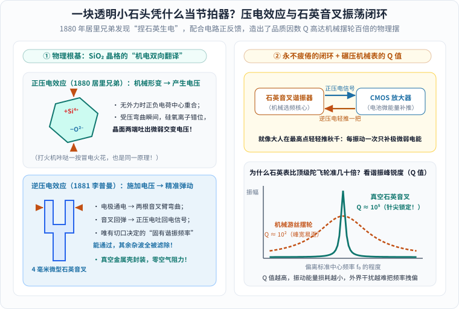
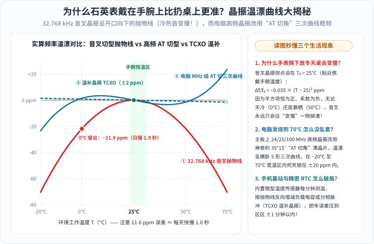
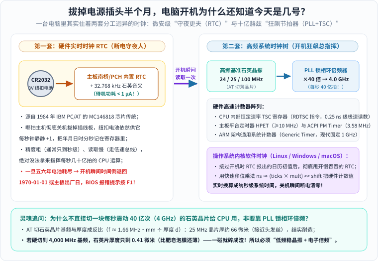
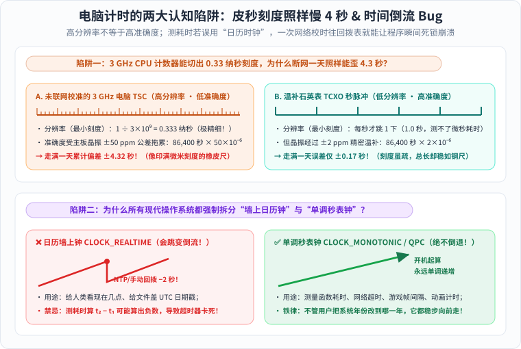
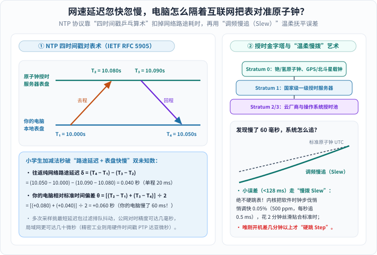

如果你把两块身价悬殊的手表摆在同一张桌子上观察一个月，往往会看到一幕让机械迷既着迷又无奈的反差：

- 左边是一块售价二十万元、由三百多个微米级齿轮与擒纵叉手工组装的瑞士顶级机械表，哪怕调校到天文台认证水准，**每天依然会快慢 $2\text{–}5$ 秒**，一个月下来能偏出一两分钟；
- 右边是一块便利店二十块钱买来的普通石英电子表，里面既没有游丝也没有摆轮，只焊着一颗比米粒还小的银色小铁罐，**走满整整一个月误差却不到 $10\text{–}15$ 秒（每天不到 $0.5$ 秒）**！

更让人纳闷的事情，就藏在你每天敲键盘的电脑主机里：

1. **把台式机插头彻底拔掉半个月、家里路由器也关掉，按开机键的那一秒，屏幕右下角凭什么还准确记得今天是几月几号几点几分？** 可一旦用了五六年的老电脑某天开机突然提示 `CMOS Checksum Error`，系统时间为什么会瞬间“穿越”回 **1970 年 1 月 1 日**或主板出厂那天？
2. **为什么拆开全世界的石英表、智能手环、电饭煲和电脑主板，上面的小晶振几乎众口一词地印着同一个怪数字——`32.768 kHz`（每秒震动 $32{,}768$ 次）？** 为什么不选凑整好记的 $10{,}000$ 次或者 $100{,}000$ 次？
3. **现代电脑 CPU 主频高达 $3\text{–}5\text{ GHz}$（每秒打拍子几十亿次，最小刻度细到 $0.3$ 纳秒），按理说应该比二十块钱的石英表准得多吧？** 恰恰相反！如果拔掉网线不联网对时，一台高配电脑跑一天歪掉三四秒是家常便饭——为什么“刻度切得极细”不等于“走得准”？而在网速延迟忽快忽慢的互联网上，电脑又是怎么把时间对准到几毫秒之内的？

今天，我们就拆开这颗藏在手表与电脑心脏里的**二氧化硅（$\text{SiO}_2$）透明小石头**——没错，正是上一篇[《读懂文物玉的三重形成》]()里帮良渚先民磨开硬玉的那种石英晶体——看它如何引发人类计时史的大洗牌，又如何在电脑内部演化出一套精妙绝伦的**“双时钟帝国”**。

---

## 一、会呼吸的石头：为什么再精密的金属齿轮也跑不赢石英音叉？

要搞懂任何一台钟表，先得记住[美国国家标准与技术研究院（NIST）《计时与时钟问答》](https://www.nist.gov/pml/time-and-frequency-division/timekeeping-and-clocks-faqs)里那句最朴素的第一性原理：

> **全宇宙所有的钟，本质上只干两件事：第一，找一个来回重复、节奏尽量恒定的“物理摆”；第二，配一个计数器数它摆了多少下。**

在之前的[《摆线为什么绕远路反而先到？》]()中我们讲过，1656 年惠更斯把伽利略的等时摆装进挂钟，瞬间把人类计时日误差从十几分钟压到了十几秒；后来怀表与腕表改用“金属游丝 + 摆轮”，每秒钟“滴答”摆动 $4$ 到 $5$ 个来回（$4\text{–}5\text{ Hz}$）。

但金属机械摆天生背着三座甩不掉的大山：**轴承摩擦阻力、热胀冷缩改变游丝刚度，以及手腕翻动时地球重力方向的拉扯**。哪怕制表大师发明了旋转笼架（陀飞轮）去平均重力误差，一个机械摆轮的**谐振品质因数 $Q$ 值**（衡量每次摆动存住能量与损耗能量之比的指标）通常也只有 **$100\text{–}300$** 左右——就像一口敲一下马上闷声停振的破铁锅，稍有风吹草动频率就会飘移。

怎样才能找到一口“敲一下余音绕梁十万拍、几乎没有摩擦损耗”的超级编钟？

### 1. 1880 年居里兄弟捏出的“机电双向翻译官”

1880 年春天，年仅 21 岁的法国物理学家皮埃尔·居里（Pierre Curie，后来与居里夫人共获诺贝尔奖）和哥哥雅克·居里（Jacques Curie），在巴黎实验室里用锡箔、胶水和珠宝锯测试天然晶体时，发现了一个奇妙现象（[美国物理学会 APS《物理学史：1880 年居里兄弟发现压电效应》](https://www.aps.org/apsnews/2014/03/this-month-in-physics-history)）：

当你拿重物挤压或弯曲一块不对称的**石英晶体（$\text{SiO}_2$）**时，晶格内部带正电的硅离子（$\text{Si}^{4+}$）与带负电的氧离子（$\text{O}^{2-}$）中心会发生微小错位，晶体表面立刻凭空冒出电压！这就是**正压电效应（Direct Piezoelectric Effect，词根源自希腊语“挤压”）**——今天厨房燃气灶和一次性电子打火机“咔哒”一按冒出一串蓝火花，里面锤击的就是一小块压电陶瓷或石英。

更关键的反转发生在次年（**1881 年**）：物理学家加布里埃尔·李普曼（Gabriel Lippmann）从热力学对称性预言，既然“捏石英能生电”，那么反过来**“给石英通电，它也一定会自己变形伸缩”**！居里兄弟连夜实验，当场证实了**逆压电效应（Converse Piezoelectric Effect）**。

### 2. 把石头塞进电路闭环：从一排大铁柜浓缩到手腕上的 4 毫米音叉

有了“形变 $\leftrightarrow$ 电压”这对双向翻译绝活，1927 年美国贝尔实验室工程师沃伦·马里森（Warren Marrison）与霍顿（J. W. Horton）灵光一闪，把一块石英晶体接进了电子管放大器与分频电路，造出了人类历史上**第一台石英钟**（[美国国家发明家名人堂 Warren Marrison 档案](https://www.invent.org/inductees/warren-marrison)）。到 1940 年代，各国天文台纷纷淘汰摆钟，改用石英钟作为国家时间基准。

不过早年的实验室石英钟足足有几个大文件柜那么高，耗电惊人。直到 **1969 年 12 月 25 日圣诞节**，日本精工（諏访精工舍）中村恒也团队历时十年攻关“59A 计划”，用激光微雕石英音叉、混合集成电路与微型步进马达，在东京推出了世界上第一款量产石英腕表 **Seiko Quartz Astron 35SQ**（[IEEE 工程历史里程碑 #57 档案](https://ethw.org/Milestones:Electronic_Quartz_Wristwatch,_1969)）——虽然首发 18K 金版售价高达 $1{,}250$ 美元（当时能买一辆丰田轿车！），但它一举把腕表月误差干到了惊人的 **$\pm 5$ 秒**，掀起了席卷全球制表业的“石英风暴”。

*图 1：先看左栏——二氧化硅晶格兼具“受压吐出电信号（正压电）”与“通电发生微米级弯曲（逆压电）”双向本领，加工成密封在真空金属小罐里的 $4\text{ mm}$ 微型音叉后完全没有空气阻力。再看右栏上方闭环：CMOS 放大器像在秋千最高点轻轻补推一把的大人，让石英音叉永远锁定在其固有机械频率上；右下角谐振曲线解释了精度碾压的根源——真空石英晶体的品质因数 $Q \approx 10^5$，谐振峰细如针尖，比机械摆轮（$Q \approx 10^2$）窄上百倍！[单独打开高清原图](/assets/images/quartz-computer-clock/piezoelectric-quartz-tuning-fork-loop.svg)*

看懂了图 1 右下角那根细如针尖的绿色谐振峰，你就彻底明白了为什么二十块钱的石英表能赢二十万的机械表：

- 密封在小真空罐里的微型石英音叉，既没有齿轮啮合摩擦，也没有空气阻尼，内部晶格弹性损耗极低，**品质因数 $Q$ 轻松达到 $50{,}000\text{–}100{,}000$**；
- 它就像一个脾气极其轴的音乐家：**不管电路里混进来什么杂波，它只允许激光切口尺寸决定的那唯一一个固有频率通过**，偏离哪怕万分之一的杂乱频率都会被它当场掐灭！

---

## 二、神秘数字 `32,768`：为什么不选整整齐齐的 `10,000 Hz`？

如果你拆开一块现代石英表或者观察电脑主板南桥芯片旁边那颗圆柱形小晶振，会发现上面几乎清一色刻着 **`32.768 kHz`**（每秒振动 $32{,}768$ 次）。有趣的是，1969 年第一代精工 Astron 腕表用的其实是 **$8{,}192\text{ Hz}$**（[IEEE Milestone 档案](https://ethw.org/Milestones:Electronic_Quartz_Wristwatch,_1969)），随后短短几年全球工程师便不约而同定格在了 $32{,}768\text{ Hz}$。

$8{,}192$ 和 $32{,}768$ 这两个看似零散的怪数字背后，藏着同一个令数字电路工程师狂喜的数学血统——**它们全都是 $2$ 的整次幂**：

$$
2^{13} = 8{,}192, \qquad 2^{15} = 32{,}768
$$

为什么非得凑成 $2^n$，而且偏偏停在 **$n = 15$（$32{,}768\text{ Hz}$）** 这个刻度上？因为这里恰好是**数字逻辑极简性、人耳听觉上限与电池微安级续航**三大物理铁律的唯一交汇点！

*图 2：顶部展示 $32{,}768\text{ Hz}$ 石英脉冲流经 15 级串联二分频触发器（每过一级频率对半除以 $2$：$32{,}768 \to 16{,}384 \to 8{,}192 \to \dots \to 1\text{ Hz}$）最终吐出精准 $1.000$ 秒脉冲的过程（蓝色总线含单次传递动画，支持减少动态效果模式；[单独打开原图刷新可重播](/assets/images/quartz-computer-clock/why-32768-hz-binary-divider-chain.svg)）。底部三栏解释为何不能更低（会落入人耳可听声波区发出高频蚊鸣）、为何不能更高（CMOS 翻转功耗翻倍），以及高频分频对绝对误差的压缩效应。*

我们来逐一算清这三笔精打细算的工程账：

1. **第一笔账（极简硬件）：在二进制世界里，“除以 $2$”比“除以 $10$”省事太多了！**
   假如晶振每秒振动 $10{,}000$ 次，想得到“每秒 $1$ 下”的秒针脉冲，电路必须设计复杂的多位十进制比较与清零逻辑；而用最基础的双稳态 **T 触发器（Toggle Flip-Flop）**——每输入 $2$ 个脉冲，输出端刚好翻转 $1$ 个完整周期，天然就是一个**“除以 $2$ 机器”**！把 **15 个**这样的触发器首尾串成一条链：

   $$
   \begin{aligned}
   32{,}768\text{ Hz} &\div \underbrace{2 \div 2 \div \dots \div 2}_{15\text{ 次二分频} } \\
   &= \frac{32{,}768}{2^{15} } = 1.000\text{ Hz}
   \end{aligned}
   $$

   仅仅百来颗晶体管，就能干净利落地吐出**整整 $1$ 秒钟一次**的方波脉冲！在指针石英表里，这个 $1\text{ Hz}$ 脉冲驱动拉维特微型步进马达（Lavet Stepping Motor）每次转过 $180^\circ$，带动秒针“咔哒”跳一格；在电脑主板里，它则让日历秒数寄存器老老实实加 $1$。
2. **第二笔账（静音门槛）：为什么淘汰了初代的 $8{,}192\text{ Hz}$ 和 $2^{14} = 16{,}384\text{ Hz}$？**
   健康年轻人的耳朵能听见最高约 **$20{,}000\text{ Hz}$（$20\text{ kHz}$）** 的声音。$8{,}192\text{ Hz}$ 和 $16{,}384\text{ Hz}$ 都落在人耳可听声波范围内——夜深人静把早期石英表贴在枕边，真能听见一丝像蚊子哼哼般的尖锐高频啸叫，而且频率越低，所需的石英音叉尺寸越长越厚。往上一跳到 $2^{15} = 32{,}768\text{ Hz}$，瞬间跨过 $20\text{ kHz}$ 听觉天花板进入**超声波静音区**，音叉还能缩到 $3\text{–}4\text{ mm}$ 长！
3. **第三笔账（电池寿命）：那为什么不干脆选更高的 $2^{16} = 65{,}536\text{ Hz}$ 或 $2^{20} \approx 1\text{ MHz}$？**
   在现代 CMOS 数字集成电路里，晶体管每次翻转充放电消耗的动态功率严格正比于工作频率 $f$：

   $$
   P_{\text{动态} } = C \cdot V_{\text{DD} }^2 \cdot f
   $$

   其中 $C$ 是电路负载电容，$V_{\text{DD} }$ 是供电电压。**第一级振荡器与前几级分频器跑得最快，吃掉了整块表芯片绝大部分的电！** 如果把频率翻到 $1\text{ MHz}$，电路功耗立刻暴涨 $30$ 倍以上，纽扣电池几个月就歇菜了；而守在刚好跨过超声波线的 $32.768\text{ kHz}$，现代超低功耗实时时钟电路整机电流不到 **$0.3\text{–}1\text{ 微安}$（$\mu\text{A}$）**，一颗硬币大小的纽扣电池足以默默跳动 **5 到 10 年**！

而且正如 [NIST《计时问答》](https://www.nist.gov/pml/time-and-frequency-division/timekeeping-and-clocks-faqs) 给出的漂亮算例：**先高频振动、再分频数数，本身就是天然的“误差缩骨功”**。假设外界震动让物理摆产生了同样的 **$0.1\text{ Hz}$ 绝对偏差**：
- 对老式 $1\text{ Hz}$ 大摆钟来说，$0.1\text{ Hz}$ 意味着整整 $10\%$ 的误差，**才走 $10$ 秒钟就错出 $1$ 秒**；
- 对 $32{,}768\text{ Hz}$ 石英晶振来说，$0.1\text{ Hz}$ 只占总频率的 $\frac{0.1}{32{,}768} \approx 3.05 \times 10^{-6}$（百万分之三），要足足数够 $327{,}680$ 秒才会攒出 $1$ 秒误差——折合**每天只差 $0.26$ 秒**！

### 顺手解开一个生活冷知识：为什么石英表“戴在手腕上”反而比冬天放窗台更准？

再厉害的石英也不是神仙，温度一变，晶格弹性和尺寸也会跟着微变。但有趣的是，微电子工程师在切割 $32.768\text{ kHz}$ 音叉晶振时，故意耍了一个贴心的小心机（[Microchip 官方技术文档《32.768 kHz 晶体振荡器温度公差特性》](https://onlinedocs.microchip.com/oxy/GUID-E1A9010A-4FFF-4CCD-912A-926ED28D22D6-en-US-8/GUID-B4848C3F-4549-4FE8-BD83-D354AC17A63D.html)）：

音叉型石英晶体的频率随温度 $T$ 变化的曲线，是一条**开口朝下的二次抛物线**：

$$
\frac{\Delta f}{f_0} = B \cdot (T - T_0)^2
$$

其中顶点拐点温度通常精准切割在 **$T_0 \approx 25^\circ\text{C}$**，抛物线曲率系数为负数（典型值 $B \approx -0.034 \sim -0.04\text{ ppm}/^\circ\text{C}^2$，$1\text{ ppm}$ 即百万分之一，相当于每天快慢 $0.0864$ 秒）。

*图 3：左图按真实二次与三次方程绘制三类晶振的频率温漂曲线。红色抛物线为 $32.768\text{ kHz}$ 音叉晶振——拐点定在 $25^\circ\text{C}$（贴近人体手腕传导给表壳的恒温区），无论冬天降到 $0^\circ\text{C}$ 还是夏天晒到 $50^\circ\text{C}$，平方项恒正乘上负系数 $B$，都会让手表往“变慢”一侧掉速！蓝色 S 形曲线为电脑主板 MHz 级“AT 切角”晶振，青色虚线为内置测温补偿晶振（TCXO）。[单独打开高清原图](/assets/images/quartz-computer-clock/tuning-fork-parabolic-vs-at-cut-temp-drift.svg)*

盯着这个平方公式看两秒钟，两个日常现象瞬间破案：

1. **为什么天天戴着更准？** 人的体表手腕紧贴金属表底盖时，表芯内部常年维持在 **$25^\circ\text{C}\text{–}28^\circ\text{C}$** 左右，正好稳稳骑在抛物线最高点最平坦的“零误差甜区”里！
2. **为什么天冷放抽屉里总变慢、绝不变快？** 因为 $(T - 25)^2 \ge 0$ 永远非负，乘上负号 $B \approx -0.035\text{ ppm}/^\circ\text{C}^2$，**不管冬天室温掉到 $0^\circ\text{C}$，还是夏天车里晒到 $50^\circ\text{C}$，偏离 $25^\circ\text{C}$ 的那一刻起，普通音叉石英表永远只会单向变慢！** 算一笔账：在 $0^\circ\text{C}$ 窗台上放一天，$\Delta f / f_0 = -0.035 \times (-25)^2 \approx -21.9\text{ ppm}$，每天就会固定多慢 $86{,}400 \times 21.9 \times 10^{-6} \approx \mathbf{1.89\text{ 秒} }$！

---

## 三、走进电脑主机：为什么一台电脑里非要养“两套完全不同的时钟”？

搞懂了手腕上的石英表，现在我们拧开机箱侧板，看看[《计算机是如何工作的》]()中那颗每秒吞吐几十亿条指令的现代电脑，究竟是怎么管时间的。

很多人以为电脑里只有一块表。其实从 1984 年 IBM PC/AT 定下规矩直到今天的最新款台式机、笔记本和手机，每台电脑主板上都住着**两套脾气、频率与供电完全独立的时钟系统**（[Linux 内核接口手册 `rtc(4)`：实时时钟与系统时钟](https://man7.org/linux/man-pages/man4/rtc.4.html)）：

### 1. 第一套时钟：断电守夜的“老更夫”——硬件实时时钟（RTC / CMOS 时钟）

当你在深夜关掉电脑、甚至顺手拔掉墙上的电源插头出差半个月时，整块主板上的 CPU、内存条、显卡全都断电死寂了。唯独主板角落里一颗直径 $20\text{ mm}$、亮闪闪的 **`CR2032` 3V 锂锰纽扣电池**，还在以不到 **$1\,\mu\text{A}$** 的涓流，悄悄喂养着南桥/PCH 芯片组内部的一小块独立电路——**硬件实时时钟（Real-Time Clock，简称 RTC，传承自早期摩托罗拉 `MC146818` 芯片架构）**。

它的拍档，正是我们刚认识的老朋友：**一颗 $32.768\text{ kHz}$ 微型石英音叉**！

- 关机断电期间（ACPI `S5` 状态），RTC 就像一个不知疲倦的守夜老更夫，每秒钟听着 15 级分频器传来的“滴答”把年月日时分秒寄存器加 $1$，甚至还能在你设定的定时开机闹钟到达时唤醒整台电脑；
- **那为什么老电脑电池没电后，时间会倒退回 `1970-01-01` 或主板出厂年份？** 因为一旦这颗两块钱的 `CR2032` 电池耗尽且插座断电，$32.768\text{ kHz}$ 音叉立刻停摆，RTC 寄存器丢失供电清零，下次开机 BIOS 读出无效时间，只能重置回默认纪元起点（Unix/POSIX 纪元正是 **1970 年 1 月 1 日 00:00:00 UTC**）并停在黑屏报错界面等你按 `F1`！

### 2. 第二套时钟：每秒狂飙几十亿拍的“总指挥”——高频主晶振 + PLL 锁相环 + 高速计数器

既然主板上有现成的 RTC 守着时间，开机之后让 CPU 直接去问 RTC 现在几点不就完了吗？

**绝对不行！** 因为这位“守夜老更夫”有两个致命短板：第一，它通常只精确到“秒”（就算开周期中断最高也就 $8{,}192\text{ Hz}$）；第二，它挂在极慢的低速外设总线上，CPU 去读它一次要耗费微秒级的漫长等待（[Microsoft Learn《获取高分辨率时间戳与硬件定时器架构》](https://learn.microsoft.com/en-us/windows/win32/sysinfo/acquiring-high-resolution-time-stamps)）。

而一颗主频 **$4.0\text{ GHz}$** 的现代 CPU，每秒钟要整齐划一地推进 **40 亿拍**流水线动作；测量一段代码耗时、调度几百个线程切换、控制网卡发包，全都需要**纳秒级（$10^{-9}\text{ s}$）**的极速刻度！

这时候，你肯定会冒出一个极聪明的问题：**既然石英能当节拍器，那干脆直接切一块每秒振动 40 亿次（$4\text{ GHz}$）的石英晶片焊在主板上，不就一步到位了吗？**

物理定律会当场给你泼一盆冷水：在高频段，主板上改用的是沿石英光轴呈 **$35^\circ 15'$ 倾角切割的“AT 切型”薄圆片**（它的温漂不再是抛物线，而是图 3 里那条在 $-20^\circ\text{C}\text{–}70^\circ\text{C}$ 宽温区都极平坦的蓝色三次 S 曲线，不怕机箱发热！）。AT 切石英片做厚度切变振动时，基频 $f$ 与晶片厚度 $d$ 严格成反比：

$$
f \approx \frac{1.66\text{ MHz}\cdot\text{mm} }{d}
$$

我们来算算厚度：
- 切一块 **$25\text{ MHz}$** 的主板基准晶振，石英片厚度 $d \approx \frac{1.66}{25} \approx 0.066\text{ mm}$（**$66$ 微米**，差不多一根人类头发丝粗细），结实可靠、成本几毛钱；
- 可要是硬想切出一块 **$4{,}000\text{ MHz}$（$4\text{ GHz}$）** 基频的石英片，它的厚度只剩 $d \approx \frac{1.66}{4{,}000} \approx \mathbf{0.00041\text{ mm} }$（**$0.41$ 微米**，比吹出来的彩色肥皂泡水膜还要薄）——别说通电振动了，工厂刀片还没碰到就已经碎成粉末了！

怎么破解这个物理死局？电子工程师搬出了现代芯片里的“倍频魔术师”——**锁相环（Phase-Locked Loop，简称 PLL）**！

*图 4：完整拆解电脑开机前后的“双时钟交接班”。左栏为靠 `CR2032` 纽扣电池常年续命的 $32.768\text{ kHz}$ 硬件实时时钟（RTC）；按下开机键瞬间，操作系统内核只找 RTC 问一次当前年月日初值，随后便彻底把计时大权移交给右栏的“高频系统时钟树”——由 $24\text{–}100\text{ MHz}$ 结实的 AT 切基准晶振喂给 PLL 锁相环倍频出 $4\text{ GHz}$ 脉冲，驱动 CPU 内部的恒定速率 TSC 寄存器与主板 HPET 定时器，提供纳秒级高速计时。[单独打开高清原图](/assets/images/quartz-computer-clock/computer-dual-clock-architecture-rtc-pll-tsc.svg)*

看着图 4 右半边，你就看清了按下开机键后一秒钟内发生的精密交接：

1. **PLL 锁相倍频**：主板上焊一颗结实稳定的 **$24\text{ MHz}$、$25\text{ MHz}$ 或 $100\text{ MHz}$** AT 切石英晶振作为“基准领唱”；芯片内部的压控振荡器（VCO）每秒狂飙 **40 亿次（$4.0\text{ GHz}$）**，PLL 电路把这 $4.0\text{ GHz}$ 先除以 $40$ 变回 $100\text{ MHz}$，时刻跟石英晶振比对相位——慢半拍就加速，快半拍就减速，从而把高达 $4\text{ GHz}$ 的电脉冲死死“锁”在石英晶体的稳定节奏上！
2. **开机一次性“对表交班”**：操作系统（Windows / Linux / macOS）启动瞬间，先读取一次慢吞吞的硬件 **RTC**，拿到“今天是 2026 年 11 月 15 日 07:31:53”这个日历起点；紧接着就甩开 RTC，改由硬件高速计数器接管后续每一纳秒的流逝！
3. **多层硬件计数器各司其职**（[Microsoft Learn 硬件定时器规范](https://learn.microsoft.com/en-us/windows/win32/sysinfo/acquiring-high-resolution-time-stamps)；[Linux 内核官方文档《Clock sources 与 timekeeping》](https://docs.kernel.org/timers/timekeeping.html)）：
   - **头号主力——CPU 时间戳计数器（Invariant TSC，x86 `RDTSC` 指令 / ARM `CNTVCT_EL0` 通用计数器）**：直接长在每颗 CPU 核心肚子里！早期老 CPU 变频省电时 TSC 也会忽快忽慢，而现代处理器全部配备**恒定速率 TSC（Invariant TSC）**——不管 CPU 睿频冲到 $5\text{ GHz}$ 还是降频歇息，TSC 都按恒定基准频率雷打不动地往上加，程序花十几个时钟周期（约 **$20\text{–}30$ 纳秒**）就能零系统调用读出当前计数值！
   - **主板保底裁判——HPET（高精度事件定时器，$\ge 10\text{ MHz}$）与 ACPI PM Timer（$3.579545\text{ MHz}$）**：用来在开机瞬间标定 TSC 的真实频率，或在不支持跨核同步 TSC 的老机器上充当全局统一标尺。（顺带一提，为什么 ACPI 电源管理定时器偏偏是古怪的 $3.579545\text{ MHz}$？因为早年 PC 工程师为了省几毛钱成本，直接复用了北美彩色电视机上产量最大、最便宜的 NTSC 彩电副载波石英晶振！）
4. **内核的算术巧劲**：CPU 每秒被查询时间成百上千万次，如果在内核里每次都做 `纳秒 = 计数值 ÷ 频率` 这种慢吞吞的 64 位整数除法，性能会大打折扣。因此 Linux 与 Windows 内核统一采用极速的**定点乘法移位公式**（[Linux `timekeeping.html`](https://docs.kernel.org/timers/timekeeping.html)）：

   $$
   \text{ns} \approx \frac{\text{ticks} \times \text{mult} }{2^{\text{shift} } }
   $$

   只需一条硬件乘法加一条右移指令，几纳秒就换算完毕！而且使用 **64 位无符号整数**记录纳秒数时，$2^{64}\text{ ns}$ 要足足走完 **约 $584.9$ 年**才会溢出归零，彻底告别了 32 位计数器在 $100\text{ MHz}$ 下每 **$42.95$ 秒**就翻篇一次的烦恼。

---

## 四、电脑计时的两大经典大坑：皮秒刻度照样慢 4 秒 & 时间倒流死机案

理解了电脑的双时钟硬件，我们就能顺手揭穿两个连不少资深程序员都会踩中的认知大坑。

### 大坑一：“分辨率高达 0.33 纳秒”的 3 GHz 电脑，为什么断网一天竟比电子表跑偏更远？

直觉常骗我们说：“石英表每秒才数 $32{,}768$ 下，电脑 CPU 的 TSC 计数器每秒数 **30 亿下**（最小刻度细达 $333$ 皮秒，即 $0.333$ 纳秒），电脑走时肯定比石英表准一万倍吧？”

[微软官方架构文档（Microsoft Learn）](https://learn.microsoft.com/en-us/windows/win32/sysinfo/acquiring-high-resolution-time-stamps) 专门用整整一节算术敲响警钟：**千万别把“分辨率（Resolution，最小刻度有多密）”当成“准确度（Accuracy，尺子总长准不准）”！**

- 电脑的 $3\text{ GHz}$ 脉冲并不是凭空变出来的，它是把主板上那颗几毛钱的基准石英晶振放大几十倍得来的；**锁相环把频率放大多少倍，也把基准晶振的出厂偏差等比例放大了多少倍！**
- 个人电脑和服务器主板上的普通晶振，为控制成本通常允许 **$\pm 30\text{–}50\text{ ppm}$（百万分之三十到五十）**的出厂频率公差。假设你的主板晶振偏了 $+50\text{ ppm}$，尽管你的 TSC 能读出小数点后九位的纳秒数字，但一天 $86{,}400$ 秒累积下来：

  $$
  \begin{aligned}
  \Delta t_{\text{日误差} } &= 86{,}400\text{ s} \times 50 \times 10^{-6} \\
  &= \mathbf{4.32\text{ 秒/天} }
  \end{aligned}
  $$

  如果两台分别偏 $+50\text{ ppm}$ 和 $-50\text{ ppm}$ 的服务器断网对跑一天，它们俩的表盘能足足岔开 **$8.64$ 秒**！这就像在一条会随温度伸缩的橡皮筋上用激光刻满了纳米刻度——**测几微秒的短跑耗时它准得惊人，但拿它独立守一整天的大钟，它还跑不赢你手腕上经过温调的二十块石英表！**

*图 5：上半部分直观拆解“密刻度橡皮尺 vs 疏刻度钢尺”——$3\text{ GHz}$ 电脑计数器虽有 $0.333\text{ ns}$ 精细刻度（高分辨率），受主板晶振 $\pm 50\text{ ppm}$ 公差拖累每天仍可偏 $4.32\text{ s}$；而 $\pm 2\text{ ppm}$ 温补晶振每秒只跳一下（低分辨率），日误差却仅 $0.17\text{ s}$。下半部分展示为何写代码测耗时严禁混用会倒退跳变的日历钟 `CLOCK_REALTIME`，必须使用单调递增秒表钟 `CLOCK_MONOTONIC` / `QPC`。[单独打开高清原图](/assets/images/quartz-computer-clock/resolution-vs-accuracy-and-monotonic-clock.svg)*

### 大坑二：为什么现代操作系统里，程序看时间必须分“日历表”和“秒表”？

正因为主板晶振每天会自己歪掉几秒钟，电脑一连上网就会自动校准系统时间。可这一校准，在早期软件史上惹出过无数次惊天故障：

假设一个后台服务在 `12:00:00.500` 记录了任务开始时间 $t_{\text{start} }$，准备等满 $1$ 秒超时就切换备用通道；偏偏在 `12:00:00.800` 这一刻，网络校时发现本机快了 $2$ 秒，啪地一下把系统日历时间往回拨到了 `11:59:58.800`！程序一减：

$$
t_{\text{now} } - t_{\text{start} } = -1.700\text{ 秒} < 0
$$

如果代码里写的是无符号整数相减，$-1.7$ 秒当场下溢变成几百亿秒，或者定时器傻傻原地多等两秒乃至死锁崩溃！（2012 年与 2017 年全球互联网著名的“闰秒宕机事故”，不少系统正是栽在时间回跳或重走一秒上。）

为了根治这类灾难，Linux（[`clock_gettime(2)` 手册](https://man7.org/linux/man-pages/man2/clock_gettime.2.html)）、Windows（`QueryPerformanceCounter`）、macOS 以及 Python（`time.monotonic()`）、Rust、Go 等所有现代编程语言，都在内核层立下了铁律——**给程序员同时发两块表**：

1. **墙上日历钟（`CLOCK_REALTIME` / `GetSystemTimePreciseAsFileTime`）**：从 1970 年元旦算起的真实人类世界时间，专门用来在桌面角落显示几点、给照片和交易日志盖日期戳——**允许被用户手动修改，也允许在同步时往前或往后跳变**；
2. **单调秒表钟（`CLOCK_MONOTONIC` / `CLOCK_BOOTTIME` / Windows `QPC`）**：以“电脑开机那一刻”为零点往上数的纯秒表！**不管管理员把系统日期改成 1999 年还是 2099 年，单调时钟承诺生生世世只往前走、绝不倒退半步**——凡是测函数耗时、算游戏帧率、控制网络重传超时，统统只准看这块秒表！

---

## 五、终极闭环：隔着忽快忽慢的互联网，电脑怎么跟原子钟对表？

最后还剩下一个最妙的问题：既然每台电脑和手机肚子里的石英晶振每天都会漂移几秒，而今天我们打开手机和电脑，两块屏幕上的秒数却能分秒不差地一起跳动——**它们是怎么隔着拥堵、延迟忽高忽低的互联网，跟远在千里之外的国家授时中心原子钟对准的？**

这里有位幕后无名英雄，叫做 **NTP（Network Time Protocol，网络时间协议）**，由美国特拉华大学大卫·米尔斯（David L. Mills）教授于 1985 年设计并一路演进至现行互联网标准 **[IETF RFC 5905（NTPv4）](https://datatracker.ietf.org/doc/html/rfc5905)**。

在地球顶端，坐镇着被称为 **Stratum 0（零级基准源）** 的铯-133 喷泉原子钟（以铯原子基态超精细能级跃迁 **$9{,}192{,}631{,}770\text{ Hz}$** 定义国际标准秒，不确定度达上亿年不差一秒，见[《人类是怎么测出光速的》]()）以及头顶[《卫星飞行原理》]()讲过的 GPS / 北斗导航卫星星载原子钟；紧接着直连它们的国家级授时服务器叫 **Stratum 1**，云厂商时间池是 **Stratum 2/3**，一层层给全球数十亿台电脑对表。（顺便澄清一个常见商家噱头：市面上所谓的“电波原子表”肚子里并没有装原子钟，正如 [NIST《授时常见问题》](https://www.nist.gov/pml/time-and-frequency-division/what-time-it-faqs) 特别指出的，它们平时全靠内部的 $32.768\text{ kHz}$ 石英晶振走时，只是每天半夜用微型天线接收国家低频长波电台——如中国商丘 BPC $68.5\text{ kHz}$ 或美国 WWVB $60\text{ kHz}$——发来的原子钟时间码自动拨正一次而已！）

### 1. 小学生加减法破局：NTP“四时间戳乒乓对表术”

想象一下难点在哪儿：你的电脑向授时服务器问一句“现在几点？”，服务器答“现在 `10:00:00.090`”。可这封信在网线和路由器里跑过来到底花了 $10$ 毫秒还是 $80$ 毫秒，你根本不知道！如果信在路上耽搁久了，你岂不是把表对慢了？

`RFC 5905` 第 8 节用了一招堪称教科书典范的**“四时间戳乒乓握手法”**，只靠加减除以二，就把“路途耗时”和“两表误差”同时算了出来！

*图 6：左栏跟着红紫两条斜线走完一次 NTP 对表——你的电脑在本地表盘 $T_1=10.000\text{ s}$ 发包，服务器在标准表盘 $T_2=10.080\text{ s}$ 收到、处理 $10\text{ ms}$ 后于 $T_3=10.090\text{ s}$ 回包，你的电脑在本地表盘 $T_4=10.050\text{ s}$ 收妥。下方算式两步算出纯路途往返延迟 $\delta=40\text{ ms}$ 与真实表盘偏差 $\theta=+60\text{ ms}$！右栏展示算出 $60\text{ ms}$ 偏差后，内核如何靠微调 `mult` 倍率“慢拨追赶（Slew）”避免时间倒流。[单独打开高清原图](/assets/images/quartz-computer-clock/ntp-four-timestamp-handshake-and-slewing.svg)*

跟着图 6 左栏的具体数字算一遍，保证你过目不忘：

1. **去程发包**：你的电脑看了一眼自己（有点慢的）本地表盘，记下出发时刻 **$T_1 = 10.000\text{ s}$**，把纸条塞进数据包寄给服务器；
2. **服务器收包与回包**：授时服务器收到包瞬间看了一眼自己的原子钟表盘，记下到达时刻 **$T_2 = 10.080\text{ s}$**；服务器内部准备回信花了 $0.010\text{ s}$，在发出回信瞬间再盖上第三个戳 **$T_3 = 10.090\text{ s}$**，连同 $T_1, T_2, T_3$ 一起寄回给你；
3. **回程收包**：你的电脑收到回信瞬间看了一眼自己本地表盘，记下第四个时刻 **$T_4 = 10.050\text{ s}$**。

现在你手里攒齐了 $T_1, T_2, T_3, T_4$ 四个数字！

- **第一步：算纯网络路途往返总时间 $\delta$（完全消掉两块表的快慢差！）**
  在你的表盘上，从发信到收信一共过了 $T_4 - T_1 = 10.050 - 10.000 = 0.050\text{ s}$；扣掉服务器自己扣留信件办手续的 $T_3 - T_2 = 10.090 - 10.080 = 0.010\text{ s}$，剩下的岂不就是数据包在网线上来回纯跑路的时间吗！

  $$
  \begin{aligned}
  \delta &= (T_4 - T_1) - (T_3 - T_2) \\
  &= 0.050 - 0.010 = 0.040\text{ s（40 ms）}
  \end{aligned}
  $$

- **第二步：算你的电脑到底慢了多少 $\theta$（假定去程与回程网速对称，各花 $\delta/2 = 20\text{ ms}$）**
  既然去程路上跑了 $0.020\text{ s}$，服务器在 $10.080\text{ s}$ 收到信，说明你发信那一刻的真实标准时间其实是 $10.080 - 0.020 = 10.060\text{ s}$！而你自己的表当时显示 $T_1 = 10.000\text{ s}$——真相大白：**你的电脑整整慢了 $+0.060\text{ 秒}$（$60\text{ ms}$）！** 写成通用对称公式就是：

  $$
  \begin{aligned}
  \theta &= \frac{(T_2 - T_1) + (T_3 - T_4)}{2} \\
  &= \frac{0.080 + 0.040}{2} = +0.060\text{ 秒}
  \end{aligned}
  $$

在实际公网中，遇到偶尔路由器排队拥堵怎么办？NTP 客户端会连续向多台授时服务器打乒乓球，用滤波算法专挑往返延迟 $\delta$ 最小、路况最通畅的那几次采样，在普通宽带上就能把你的电脑时间锁在**几毫秒误差**以内；而在金融高频交易机房与 5G 基站局域网里，升级版硬件时间戳协议（PTP / IEEE 1588）甚至能把同步精度推到**亚微秒级（$< 1\,\mu\text{s}$）**！

### 2. 最后一招温柔艺术：“慢拨追赶（Slew）”绝不硬掰指针

算出电脑慢了 $60\text{ ms}$（或者快了 $60\text{ ms}$）之后，操作系统会立刻把日历时钟硬生生跳过去吗？

**不会！** 在 NTP 的时钟驯服算法（Clock Discipline Algorithm，[RFC 5905 第 11.3 节](https://datatracker.ietf.org/doc/html/rfc5905)）里，只要偏差小于 **$128\text{ ms}$**，内核绝不“硬跳（Step）”，而是调用 `adjtimex()` 走**“温柔慢拨（Slew）”**：

还记得前面内核把硬件计数值换算成纳秒的乘数 `mult` 吗？如果电脑慢了 $60\text{ ms}$，内核就把软件时钟的步伐悄悄调快万分之五（$+500\text{ ppm}$，即每过 $1$ 秒钟多走 $0.5\text{ ms}$），花 **$120$ 秒**时间不知不觉、丝滑连续地贴回标准原子钟轨道；反之如果电脑快了 $60\text{ ms}$，内核绝不把表往回拨，而是让软件时钟稍微走慢万分之五，等真实时间在两分钟后稳稳追上来！这样既校准了石英晶振的天然温漂，又保证了系统里的每一条时间戳都严格先后有序。

---

## 六、结语：一粒沙子撑起的现代文明节拍

回顾这场跨越一百四十多年的计时接力，你会发现现代科技最迷人的地方，往往是把最深奥的物理藏进最不起眼的日常物件里：

海滩上一粒最普通的二氧化硅砂砾，因为晶格里正负电荷那一点点不对称，被居里兄弟捏出了微弱的电压；被工程师雕成 $4$ 毫米长的音叉、借着 $2^{15} = 32{,}768$ 的二进制阶梯，化作了每个人手腕上十年不停的秒针，也化作了电脑断电时默默守夜的微安级更夫；而在开机点亮屏幕的刹那，另一片 $66$ 微米厚的石英晶片又在锁相环的倍频轰鸣中，指挥着数十亿颗晶体管整齐行军，并隔着万里光缆与太空中的原子钟频频握手。

下次当你听见墙上石英钟轻轻“咔哒”一声，或是瞥见电脑屏幕右下角跳动的分钟数字时，不妨在心里向那颗每秒钟正为你默默弹动 **32,768 次**的透明小石头致意。

---

## 参考资料与核查来源

1. **美国物理学会（APS，《APS News》物理学史专栏）：《March 1880: The Curie Brothers Discover Piezoelectricity》**（核查 1880 年雅克·居里与皮埃尔·居里发现石英正压电效应、1881 年加布里埃尔·李普曼预言逆压电效应及居里兄弟实验证实史实）：
   - [APS Physics History — The Curie Brothers Discover Piezoelectricity](https://www.aps.org/apsnews/2014/03/this-month-in-physics-history)
2. **美国国家发明家名人堂（National Inventors Hall of Fame）与 IEEE 工程历史里程碑（ETHW Milestone #57）**（核查 1927 年贝尔实验室沃伦·马里森发明首台电子分频石英钟 U.S. Patent 1,788,533，以及 1969 年 12 月 25 日精工推出全球首款量产石英腕表 Seiko Quartz Astron 35SQ、$8{,}192\text{ Hz}$ 晶振与月误差 $\pm 5\text{ s}$ 参数）：
   - [NIHF — Warren Marrison: Quartz Clock](https://www.invent.org/inductees/warren-marrison)
   - [IEEE Milestone — Electronic Quartz Wristwatch, 1969](https://ethw.org/Milestones:Electronic_Quartz_Wristwatch,_1969)
3. **美国国家标准与技术研究院（NIST）时间与频率处官方问答**（核查 $32{,}768\text{ Hz}$ 分频计数原理、$0.1\text{ Hz}$ 频偏在 $1\text{ Hz}$ 摆钟与 $32{,}768\text{ Hz}$ 石英表中的误差放大对比 $0.26\text{ s/day}$、铯-133 原子钟 $9{,}192{,}631{,}770\text{ Hz}$ 标准秒，以及“电波表”内部实为石英晶振配合低频无线电校时的说明）：
   - [NIST — Timekeeping and Clocks FAQs](https://www.nist.gov/pml/time-and-frequency-division/timekeeping-and-clocks-faqs)
   - [NIST — What Time Is It? FAQs (WWVB Radio-Controlled Clocks & ITS)](https://www.nist.gov/pml/time-and-frequency-division/what-time-it-faqs)
4. **Microchip 官方晶体振荡器应用指南：《Selecting and Testing 32.768 kHz Crystal Oscillators — 1.7 Temperature Tolerance》**（核查 $32.768\text{ kHz}$ 音叉晶振以 $T_0 = 25^\circ\text{C}$ 为顶点的开口向下二次抛物线温漂公式 $f = f_0 [1 + B(T - T_0)^2]$）：
   - [Microchip Docs — 32.768 kHz Crystal Temperature Tolerance](https://onlinedocs.microchip.com/oxy/GUID-E1A9010A-4FFF-4CCD-912A-926ED28D22D6-en-US-8/GUID-B4848C3F-4549-4FE8-BD83-D354AC17A63D.html)
5. **Linux 内核官方文档与程序员手册（`rtc(4)`、`timekeeping`、`clock_gettime(2)`）**（核查 PC 主板 `MC146818` 兼容硬件 RTC 纽扣电池断电守夜与开机初始化系统时钟流程、内核 `ns ~= (clocksource * mult) >> shift` 移位换算与 64 位纳秒约 $585$ 年溢出周期，以及 `CLOCK_REALTIME` 与 `CLOCK_MONOTONIC` / `CLOCK_BOOTTIME` 的严格区分）：
   - [Linux Manual Page — rtc(4): Real-Time Clock vs System Clock](https://man7.org/linux/man-pages/man4/rtc.4.html)
   - [Linux Kernel Documentation — Clock sources, Clock events, sched_clock() and delay timers](https://docs.kernel.org/timers/timekeeping.html)
   - [Linux Manual Page — clock_gettime(2)](https://man7.org/linux/man-pages/man2/clock_gettime.2.html)
6. **Microsoft Learn（Win32 官方系统架构指南）：《Acquiring high-resolution time stamps》**（核查 `QueryPerformanceCounter`、恒定速率 `TSC` / `RDTSC`、`HPET`、`ACPI PM Timer` 与 ARM `Generic Timer` 硬件机制，以及 $3\text{ GHz}$ 高分辨率计数器在 $\pm 50\text{ ppm}$ 晶振公差下每日累积 $\pm 4.32\text{ s}$ 偏差的“分辨率 vs 准确度”定量分析）：
   - [Microsoft Learn — Acquiring high-resolution time stamps](https://learn.microsoft.com/en-us/windows/win32/sysinfo/acquiring-high-resolution-time-stamps)
7. **互联网工程任务组（IETF）正式标准 `RFC 5905`（David L. Mills 等，2010）：《Network Time Protocol Version 4: Protocol and Algorithms Specification》**（核查 NTP Stratum 层级、第 8 节四时间戳往返延迟 $\delta = (T_4 - T_1) - (T_3 - T_2)$ 与时钟偏差 $\theta = \frac{1}{2}[(T_2 - T_1) + (T_3 - T_4)]$ 公式，以及第 11.3 节 $128\text{ ms}$ 阈值下的 Slew 调频慢拨与 Step 跳变驯服机制）：
   - [IETF Datatracker — RFC 5905: NTPv4 Specification](https://datatracker.ietf.org/doc/html/rfc5905)
