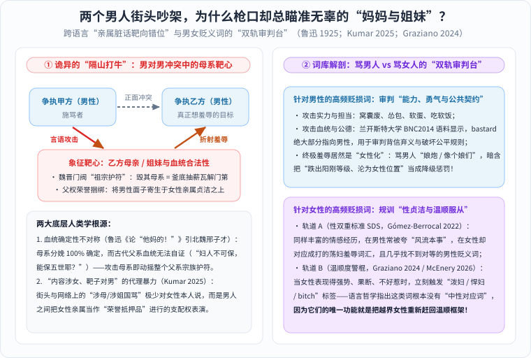
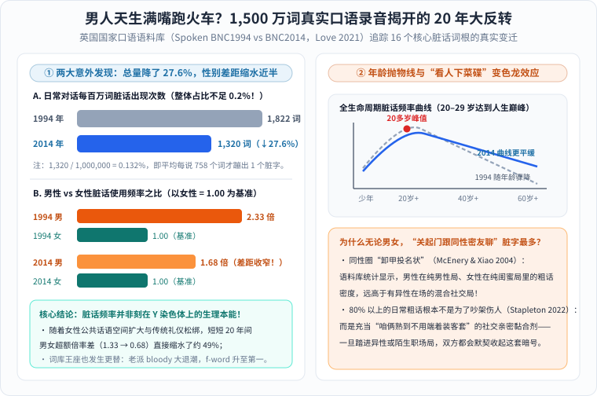
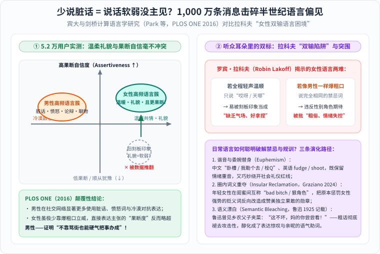
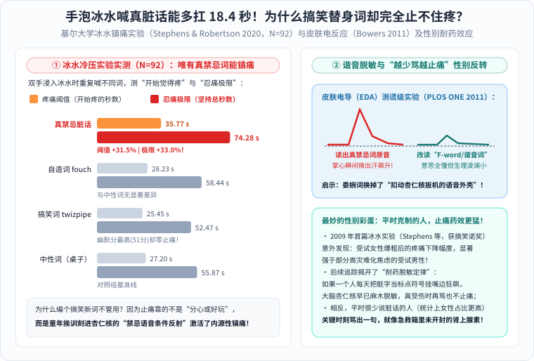

深夜关灯去洗手间，你的右脚小脚趾以毫米级精度，迎面撞上了实木床脚。

就在那一瞬间——根本来不及等大脑组织任何主谓宾语法，甚至来不及想清楚自己是受过高等教育的文明人——一串短促、爆裂、带着火药味的音节已经夺门而出。更奇妙的是，不仅痛感似乎真被这声怒吼卸掉了一截，如果你冷静下来把人类几千年来攒下的各路粗话摊在桌面上盘点一番，还会撞见一个让人既好笑又纳闷的千古谜题：

明明是**两个血气方刚的大男人在马路边因为抢车位吵架**，现场连半个女性的影子都没有，为什么他们互相投掷的语言炮弹，十有八九却精准瞄准了对方远在家里买菜做饭的**妈妈、祖母或姐妹**？为什么同样是骂人，骂男人最毒的词往往指向“没本事、软蛋、私生子”，而骂女人最狠的词却齐刷刷扑向了“私生活不检点”或“脾气太强势”？

过去人们总觉得脏话太粗鄙，登不上学术大雅之堂。直到近三十年，语料库语言学家悄悄录下了上千万词的街头真实闲聊，神经科学家把失语症病人请进核磁共振仪，心理学家甚至让志愿者把双手泡进刺骨冰水里一边喊脏话一边掐秒表（还凭这拿下了搞笑诺贝尔奖）。今天，我们就卸下道德说教的滤镜，拿手术刀剖开这门全人类最隐秘的“情绪地下语言”，看看脏话里究竟藏着怎样的**性别密码、演化算计与大脑机关**。

---

## 一、千古奇观：两个男人吵架，为什么枪口却总瞄准对方的妈？

不管你翻开汉语、西班牙语、阿拉伯语、俄语还是印地语的街头俚语词典，都会发现一个跨越大陆板块的惊人巧合：地球上相隔万里的陌生民族，居然不约而同发明了以**“侵犯或贬低对方母亲、姐妹”**为核心的“国骂”体系。

早在 1925 年 7 月 19 日，鲁迅先生就在《语丝》周刊发表过一篇妙趣横生的考据名篇——[《论“他妈的！”》](https://zh.wikisource.org/zh-hans/%E8%AB%96%E3%80%8C%E4%BB%96%E5%AA%BD%E7%9A%84%EF%BC%81%E3%80%8D)。鲁迅敏锐地指出，丹麦作家勃兰兑斯曾嘲笑俄国人吵架爱骂对方的妈，殊不知中国的“国骂”比俄国还要博大精深得多——**“上溯祖宗，旁连姊妹，下递子孙，普及同性”**，简直是一张立体交叉的宗族火力网。

可问题来了：既然是甲男恨乙男，直接骂“你真蠢”“你是个骗子”岂不痛快？为什么要绕个大弯子去扯人家的母亲？鲁迅在故纸堆里翻出了唐代释道宣《广弘明集》卷七里的一桩北魏历史公案，一针见血地揪出了背后的**门第与血统焦虑**。

原来，自晋代至南北朝，豪门士族全靠祖宗牌位和血统门第垄断高官厚禄——先祖的名分就是子孙吃饭的“护身符”。要毁掉一个男人的傲气，最狠的办法不是打肿他的脸，而是**釜底抽薪，宣布他根本不是那个高贵父系血统的真种**。当时北魏名士邢子才曾留下一句让整个父权宗族脊背发凉的大实话：**“妇人不可保……能保五世耶？”**

这句话点破了古代生物学上一个绝对不对称的事实：**母亲生下孩子，母系血缘是 $100\%$ 铁板钉钉、肉眼可见的；而在没有 DNA 亲子鉴定的几千年里，父系血统永远只能靠“推断”与女性亲属的贞洁来担保。**于是，攻击一个男人的母亲，在宗法逻辑里就等于引爆了他整个家族谱系的合法性根基——意思是：“你引以为傲的门第算老几？我一句话就能在辈分上占你便宜，顺便让你怀疑自己到底姓什么！”

_图 1：先看左栏三角箭头（[单独打开此图](/assets/images/swearing-gender/lu-xun-genealogical-swearing-asymmetry.svg)）：街头男性冲突中的涉母/涉姐脏话并非冲着女性本人发泄，而是借“母系血统确定性与父权荣誉抵押品”实施隔山打牛式的降维羞辱；再看右栏上下两轨对比，骂男性的词重点审判“实力、公德与阳刚等级”，骂女性的词则精准卡在“性贞洁”与“温顺度”两条规训红线上。_

到了现代社会，虽然早就没人靠魏晋九品中正制当官了，这套“隔山打牛”的底层逻辑依然在街头巷尾幽灵般游荡。2025 年发表在医学与公共卫生期刊 *Journal of Family Medicine and Primary Care* 上的一项[跨文化涉亲属辱骂社会学分析（Kumar, 2025）](https://pmc.ncbi.nlm.nih.gov/articles/PMC12858106/)揭示了一个耐人寻味的互动悖论：**绝大多数充满母系、姐妹字眼的粗话，在真实生活和网络对战中几乎全发生在“男性对男性”之间，极少被男人直接拿来当面骂陌生女性——用论文的话说，叫作“内容高度涉女，靶向却高度对男”（gendered in content, male-targeted in interaction）。**

为什么会这样？因为在传统父权荣誉观里，一个男人的尊严与统治力，被死死捆绑在他能否“看管并保护好自家女性亲属”之上。女性亲属在语言上被降格成了男性的**“荣誉抵押品”**；甲方在嘴上侵犯乙方的母亲或姐妹，本质上是在向乙方宣告：“你连自家的领地都守不住，你在男人堆里彻底输了。”

### 词典里的“双轨审判台”：骂男人靠贬能力，骂女人靠卡规训

当我们把视线从“拐弯抹角骂亲戚”移向“直接往本人头上扣帽子”的贬义词时，脏话里的性别不对称就暴露得更加赤裸了。

2026 年，英国兰开斯特大学语料库语言学家在 *Discourse Studies* 上发表了一项[基于英国国家口语语料库（Spoken BNC2014）的性别辱骂词话语研究（Sha, Vallery & McEnery, 2026）](https://eprints.lancs.ac.uk/id/eprint/235978/)，专门对比了英语里最典型的两个性别化贬损词——主要指向男性的 `bastard` 与主要指向女性的 `bitch`。把汉语和英语放在一起对照，你会看到两座截然不同的**“语言审判台”**：

1. **审判男性的第一轨道：实力、勇气、契约与“开除男籍”**
   骂一个男人最扎心的词是什么？在中文里是“窝囊废、怂包、软蛋、吃软饭”；在兰开斯特大学的英语真实对话语料里，`bastard` 绝大多数时候指向男性，用来审判他在公共领域**不讲武德、背信弃义、破坏公平或心狠手辣**。更讽刺的是，人类骂男人“不够格”的终极杀招，居然是**把他往女性身上比**——比如骂男人“娘炮”“像个娘们儿”，甚至英语里把 `bitch` 扣到男人头上时，意思立刻变成了“唯唯诺诺的受气包”。你看，连骂男人的脏话都在暗戳戳传递一个潜台词：掉出阳刚等级、滑落到“女性位置”，就是最大的耻辱。
2. **审判女性的第二轨道：性双重标准与“温顺度电击项圈”**
   反过来，针对女性的高频贬损词几乎全挤在两条狭窄的胡同里。
   第一条胡同叫**“性双重标准”（Sexual Double Standard, SDS）**。西班牙格拉纳达大学团队在 *Frontiers in Psychology* 上对 $1{,}206$ 名受试者开展的[性双重标准实证测量（Gómez-Berrocal 等, 2022）](https://pmc.ncbi.nlm.nih.gov/articles/PMC9599746/)证实，社会对男女在“性自由”与“性矜持”两个维度上长期握着两把不同的尺子：同样的情感经历，放在男性身上叫“风流倜傥、有本事”，放在女性身上却对应着一整排杀伤力极强的“荡妇羞辱”词汇——哪怕你翻烂词典，都找不到一个能对等羞辱男性的同义词。
   第二条胡同则是**“温顺度警棍”**。当一个男人在会议室里拍桌子力排众议，大家常夸他“有魄力、霸气”；可一旦换成一个女人同样果断强硬、拒绝讨好退让，“泼妇、悍妇、母老虎”或者英语里的 `bitch` 就会立刻飞过来。意大利语言哲学家玛蒂尔德·格拉齐亚诺在 *Phenomenology and Mind* 发表的[性别贬义词言语行为分析（Graziano, 2024）](https://journals.openedition.org/phenomenology/4099)一针见血地指出：像种族歧视词往往还有一个中性的国籍/族裔对应词，但像 `slut` 或 `bitch` 这类性别贬损词**在语言里根本不存在“中性对应词”**——因为它们打从被造出来的那一刻起，就不是为了客观描述某类人群，而是专门用来惩罚那些“胆敢越过贞洁红线或温顺红线的女性”，把她们重新赶回顺从框子里的语言警棍。

---

## 二、谁才是真正的“爆粗口大户”？1,500 万词偷录日常揭开的 20 年大反转

聊完脏话“骂的是谁”，下一个问题自然是：**在真实生活里，到底是男人说脏话多，还是女人说脏话多？**

如果靠拍脑袋猜，十个人里有九个会觉得：“那还用问？肯定是老爷们儿满嘴跑火车，而且现在年轻人受网络影响，脏话肯定比二十年前泛滥十倍！”

别急，科学最迷人的地方就是专治“我以为”。英国兰开斯特大学与剑桥大学出版社联合打造的[英国国家口语语料库（Spoken BNC2014）](https://cass.lancs.ac.uk/cass-projects/spoken-bnc2014/)，是语言学界公认的“真实人话显微镜”——研究人员招募了数百名不同年龄、阶层、性别的志愿者，让他们随身带着录音设备，录下在家里吃晚饭、在酒吧撸串、跟闺蜜吐槽、和哥们儿吹牛的**超 1,000 万词纯自然非正式对话**，并与二十年前同样方法采集的 1994 年口语语料库（Spoken BNC1994）做了一场跨越二十年的硬核对比。

2021 年，英国阿斯顿大学语言学家罗比·洛夫（Robbie Love）在期刊 *Text & Talk* 发表了[覆盖逾 1,500 万词口语录音的 16 个核心脏话词根统计报告（Love, 2021）](https://publications.aston.ac.uk/id/eprint/42874/)（亦可参阅[德古意特出版社官方学术解读](https://blog.degruyter.com/exploring-expletives-new-research-finds-27-decline-in-swearing-since-the-1990s/)）。数据一跑出来，直接把两项大众直觉全都掀翻了：

$$
\begin{aligned}
\text{1994 年口语脏话率} &= 1{,}822\text{ 词 / 百万词}\;(0.182\%) \\
\text{2014 年口语脏话率} &= 1{,}320\text{ 词 / 百万词}\;(0.132\%) \\
\text{20 年总体变化率} &= \frac{1{,}320 - 1{,}822}{1{,}822} \approx \mathbf{-27.6\%}
\end{aligned}
$$

没错，你没看错——**现代人嘴里的脏话非但没有爆炸，反而在二十年间实打实下降了 $27.6\%$！**在 2014 年的日常闲聊里，脏话只占全部口语词汇的 **$0.132\%$**，换算下来，普通人平均每说 **758 个词**，才会蹦出 1 个脏字。之所以大家总觉得“现在满屏都是粗话”，主要是因为老派温和感叹词（比如英国人祖传的 `bloody`）大幅退潮，而视觉冲击力极强的 `f-word` 逆势登顶成了头号高频词，给人造成了“火力更猛”的错觉。

而更精彩的发现在性别一栏。我们把男女两性的每百万词脏话频率做个比值：

$$
\begin{aligned}
\text{1994 年 男 : 女 脏话频率比} &= \mathbf{2.33 : 1} \\
\text{2014 年 男 : 女 脏话频率比} &= \mathbf{1.68 : 1}
\end{aligned}
$$

如果以女性使用频率 $1.00$ 为基准线，1994 年男性比女性多出来的“超额倍率”是 $1.33$，到了 2014 年则压缩到了 $0.68$——**短短二十年间，男女爆粗口的性别鸿沟直接缩水了近一半（约 $48.9\%$）！**

_图 2：先看左栏上下两组横向条形图（[单独打开此图](/assets/images/swearing-gender/bnc-swearing-gender-gap-1994-vs-2014.svg)）：1994 至 2014 年间，英国日常口语脏话总频次从每百万词 1,822 次降至 1,320 次（降幅 27.6%），同时男女比例从 2.33:1 大幅收窄至 1.68:1；再看右栏生命周期曲线与语境卡片，20–29 岁是人生爆粗峰值，且无论男女，在“纯同性密友局”里的粗话密度都远高于异性混杂场合。_

这组跨越二十年的数据强有力地证明了一件事：**说不说脏话，绝不是刻在 Y 染色体或睾酮激素里的天生本能，而是一面折射社会权力结构的镜子**——就像我们在[《为什么七八十年代全中国都在读诗写诗？》]()里看到整个时代的精神风向能重塑大众表达一样，随着近几十年女性大规模进入职场与公共话语空间、传统“淑女笑不露齿、怒不出声”的严苛枷锁逐渐松绑，两性在日常情绪宣泄上的语言水位正在肉眼可见地靠拢。

### 同性局里的“卸甲投名状”：为什么跟闺蜜或铁哥们独处时脏字最多？

除了性别总比例收窄，麦克内里与肖忠华在 *Language and Literature* 发表的[英国国家语料库经典社会语言学研究（McEnery & Xiao, 2004）](https://research.edgehill.ac.uk/en/publications/swearing-in-modern-british-english-the-case-of-fuck-in-the-bnc-2/)以及阿尔斯特大学团队在 *Lingua* 发表的[当代脏话功能权威综述（Stapleton 等, 2022）](https://pure.ulster.ac.uk/en/publications/the-power-of-swearing-what-we-know-and-what-we-dont/)还揪出了一个每个人都深有体会的**“看人下菜碟效应”**：

决定你今天下午说不说脏话的最大变量，往往不是你自己的性别，而是**坐在你对面听你说话的那个人是谁**！

* 当男人在纯男性死党局（比如球场更衣室、宵夜摊），或者女人在纯女性闺蜜局（比如关起门来的卧谈会、下午茶吐槽局）时，双方的脏话频率都会飙升到最高点；
* 一旦变成有异性在场的混合社交局、相亲局或正式办公场合，男女双方都会像变色龙一样瞬间收起粗口，切换成礼貌得体的文明模式。

为什么会这样？因为现代语言学统计发现，**日常对话里超过 $80\%$ 的粗话，根本不是用来攻击或侮辱别人的！**恰恰相反，它们干的是“社交润滑剂”的活儿——比如闺蜜试穿新裙子时一句夸张的赞叹，或者老友重逢锤一下胸口的调侃。因为禁忌词在公开场合是“违规品”，当我在你面前毫不设防地吐出一句粗话时，潜台词其实是：**“咱俩铁到不需要穿西装端架子，我把社交软肋亮给你看，因为我知道你绝不会拿礼仪大棒举报我。”**这在社会语言学里被称为**“同性圈内亲密团结标志”（in-group solidarity marker）**。

---

## 三、少说脏话 = 软弱好欺负？1,000 万条消息击碎半个世纪的语言偏见

看到男性平均爆粗频率依然是女性的 $1.68$ 倍，很多人脑子里会冒出另一个流传了半个世纪的老观念：

1975 年，美国语言学先驱罗宾·拉科夫（Robin Lakoff）在名著《语言与女性的位置》里观察到，当时社会规训女性说话必须多用委婉词（把真怒火咽回去，换成软绵绵的“哎呀”“天哪”）、多加反问句尾巴，结果导致女性的语言听起来犹豫、顺从、缺乏权威。久而久之，不少人居然得出一个歪理：**“是不是只有像老爷们儿那样拍桌子爆粗口才叫有气场？说话礼貌温柔就等于软弱没主见？”**

为了检验这个假设到底站不站得住脚，宾夕法尼亚大学、斯坦福大学与剑桥大学心理测量中心的联合团队干了一件大事。他们在征得同意后，调取了 **52,000 多名 Facebook 用户的逾 1,000 万条真实社交文本**，并用心理学经典的“人际环状模型”（横轴测**温暖亲和度 Affiliation**，纵轴测**果断自信度 Assertiveness**）对另外 $15{,}000$ 多名用户的语言风格做了精密坐标测绘，成果于 2016 年发表在 [*PLOS ONE*（Park, Yaden, Schwartz 等, 2016）](https://journals.plos.org/plosone/article?id=10.1371/journal.pone.0155885)上。

测绘结果出来后，全场哗然——数据画出的二维地图，狠狠打了“温柔等于软弱”一记响亮的耳光！

_图 3：先看左栏二维象限图（[单独打开此图](/assets/images/swearing-gender/facebook-warmth-assertiveness-and-double-bind.svg)）：右下角虚线圆是“礼貌=低果断”的旧偏见，而 5.2 万用户的真实文本显示，男性高频语言簇集中在左上象限（脏话、愤怒、论辩、聊器物），女性高频语言簇则稳居右上象限——既极度温暖共情，在直接表达立场的“果断度”上反而略高于男性！再看右栏，展示拉科夫揭示的“听众双标陷阱”与三条民间语言突围术。_

在这份千万级消息的大样本里：

* **自我认同为男性的语言簇**，显著集中在左半侧“低亲和 / 对抗区”——高频词大量围绕着**脏话（swearing）、愤怒敌意词、长篇政治哲学争辩以及具体器物（汽车、电子设备、球赛）**打转；
* **自我认同为女性的语言簇**，不仅稳稳占据右半侧“高温暖、高共情、高频礼貌词”区域，当研究人员测量纵轴——**谁在表达需求和拿主意时更直接、更自信果断（Assertiveness）**——女性得分非但没有垫底，反而**以微弱优势反超了男性**！

换句话说，**“温和有礼”和“柔弱没主见”压根儿就是两码事！**不用靠满嘴脏字虚张声势，照样可以把立场亮得清清楚楚、把事情办得斩钉截铁。

真正让女性在职场和公共表达里感到别扭的，从来不是女性自己不会果断说话，而是听众耳朵里那套著名的**“拉科夫双输陷阱”（Double Bind）**：

* 如果一位女性全程轻声细语，哪怕遇到不公也只说一句“哎呀真讨厌”，很容易被刻板印象当成“没脾气、好拿捏的软柿子”；
* 可如果她像隔壁工位的男同事一样，拍案而起骂出一模一样的禁忌词，听众往往不会夸她“真性情、有魄力”，反而会皱起眉头给她贴上“粗俗、情绪失控、没有女人味”的负面标签。

### 民间的三大语言突围智慧：谐音替身、词义重夺与“语义漂白”

面对社会礼仪红线与双输评判，鲜活的人类口语从来不会坐以待毙，而是演化出了三条极其聪明的“地下突围路线”：

1. **穿马甲的“委婉谐音替身”（Euphemism）**：既想借爆破音把胸口那团浊气喷出去，又不想越过文明底线怎么办？于是全世界的舌头都在玩谐音梗——中文把粗鄙原词改装成无公害的**“卧槽、我勒个去、我去、栓Q”**，英语把 `f-word` 拐弯抹角煞车成 `fudge`（软糖）或 `shoot`，瑞典语甚至把魔鬼的名字生生急转弯念成了 **`järnvägar`（字面意思居然是“铁路”！）**。
2. **把砖头锻造成勋章的“圈内词义重夺”（Insular Reclamation）**：在格拉齐诺（[Graziano, 2024](https://journals.openedition.org/phenomenology/4099)）与兰开斯特大学 2026 年语料研究（[Sha 等, 2026](https://eprints.lancs.ac.uk/id/eprint/235978/)）里，学者们记录了一个年轻世代越来越普遍的现象——年轻女性在密友之间开始主动用 `bad bitch`（狠角色/大女主）互相夸奖。原本用来惩罚女性“不够温顺”的脏词，在闺蜜圈内部被强行抽干了羞辱毒液，反向改造成了赞美**“独立、果敢、不好惹”**的荣誉徽章。
3. **骂着骂着变成宠溺的“语义漂白”（Semantic Bleaching）**：最传神的例子，还得看鲁迅在[《论“他妈的！”》](https://zh.wikisource.org/zh-hans/%E8%AB%96%E3%80%8C%E4%BB%96%E5%AA%BD%E7%9A%84%EF%BC%81%E3%80%8D)末尾记录的一幕乡间奇景——河南乡下农民父子俩围桌吃饭，父亲夹起一口好菜觉得倍儿香，满脸慈爱地夹给儿子说：**“这不坏，妈的你尝尝看！”**在这里，原本剑拔弩张的国骂已经被岁月彻底“漂白”了字面意思，醇化成了一句带着泥土体温的感叹词，翻译过来不过是“嘿，真香啊！”

---

## 四、中风失语的绅士，为什么被踩脚时还能字正腔圆地骂人？

聊到这里，你可能会好奇：既然社会礼仪千方百计劝我们别说脏话，为什么人类小脚趾撞上桌角的那 0.2 秒，脏话还是能绕过一切家教修养，像子弹一样自己射出来？

答案藏在你颅骨深处的一套**“双轨神经线路”**里——在神经科学家眼里，**“说脏话”和“正常说话”，在人脑里根本不走同一条公路！**

1861 年，现代神经科学奠基人之一、法国医生保罗·布罗卡（Paul Broca）接诊了一位名叫路易·维克托·勒博涅（Louis Victor Leborgne）的中风患者。这位病人的左脑额叶后部（后来以布罗卡命名的**布罗卡区**）严重受损，彻底丧失了正常造句说话的能力——不管医生问他今天星期几、叫什么名字，他平时只能反反复复发出毫无意义的“Tan, tan”单音节。

然而，医院护工很快发现了一件怪事：**每当这位温文尔雅的病人被惹毛、极度愤怒沮丧时，他原本失灵的嘴巴里，竟然能清清楚楚、流利连贯地蹦出一长串地道的法语粗话——`"Sacre nom de Dieu!"`（见鬼的上帝之名！）**

根据[美国神经科学学会（Society for Neuroscience）官方科普档案 *BrainFacts.org* 对布罗卡病例及皮层下脏话回路的综述（2019）](https://www.brainfacts.org/Thinking-Sensing-and-Behaving/Language/2019/Your-Cursing-Cortex-071019)（整合了纽约大学神经语言学家 Diana Van Lancker Sidtis 1999 年在 *Brain Research Reviews* 的经典模型与 Timothy Jay、Donald MacKay 的研究），我们大脑里其实并排铺设着一新一旧两条发声通道：

_图 4：上下对照阅读两条神经通道（[单独打开此图](/assets/images/swearing-gender/brain-dual-pathway-cortical-vs-limbic-swearing.svg)，刷新页面可重播底部皮层下急救专线脉冲动画，开启系统“减少动态效果”时自动定格完整路径）：上半部“公路 A”展示日常礼貌说话必须经过左脑威尔尼克区选词、布罗卡区组装主谓宾语法并受前额叶审查，一旦左脑中风即告中断；下半部“公路 B”展示脚趾撞桌角时，痛觉直接引爆古老的杏仁核与基底核，联动右脑将整块压缩的禁忌音节瞬间弹射出口，完全绕开左脑病灶！_

* **公路 A（左脑新皮层“命题造句流水线”）**：平时你汇报工作、写邮件、跟邻居客气寒暄“今天天气真不错”，走的全是这条高级公路。左颞叶威尔尼克区负责挑词，左额叶布罗卡区负责像拼乐高一样按主谓宾语法逐字组装，同时还要经过**前额叶皮层**（就是我们在[《难道婴儿只是“没长熟的缩小版大人”吗？》]()里讲过的那块最晚成熟的“理性刹车片”）严格审查场合礼仪。左脑一旦中风，这条流水线当场瘫痪。
* **公路 B（皮层下“边缘系统—基底核情绪急救专线”）**：本能爆出的脏话根本不是按语法现拼出来的“句子”，而是大脑早就打包压缩好的**“情绪声音罐头”**！当剧痛或惊吓袭来，大脑深处负责战或逃警报的**杏仁核（Amygdala）**瞬间点火，直接呼叫负责本能动作序列的**基底核（Basal Ganglia）**与擅长整体语块处理的右脑半球，绕开左脑语法中心，0.2 秒内把整枚脏字发射出去！临床上另一个著名的反向证据是**妥瑞氏症（Tourette syndrome）**中的秽语症患者：正是因为基底核的运动/发声抑制闸门出了故障，哪怕患者本人极度礼貌羞愧，深埋在基底核里的禁忌词也会不受控制地往外蹦。

神经科学家打过一个极其传神的比方：一只正在打盹的家猫突然被人踩了一脚尾巴，它的“杏仁核 → 基底核”古老回路会瞬间触发弓背、炸毛、“哈——！”地嘶叫一声；而演化出复杂语言的人类，只是在同一条几千万年历史的哺乳动物情绪求生回路上，**把猫咪的“炸毛哈气”，升级成了人类社会最具威慑力的禁忌音节！**

---

## 五、冰水实验的惊天彩蛋：真脏话能止痛 33%，而且平时越克制的人药效越猛！

既然本能爆粗口动用了跟“战或逃反应”同源的杏仁核与交感神经急救专线，一个大胆的科学猜想顺理成章地浮出了水面：**疼得龇牙咧嘴时骂出一句脏话，难道真的不只是过嘴瘾，而是能像止痛药一样在生理上减轻疼痛？如果我为了文明礼貌，改喊“哎呀卧槽”或者自己瞎编一个搞笑词，止痛效果还一样吗？**

先看第一道关卡：**委婉谐音词能不能骗过你的交感神经？**

2011 年，英国布里斯托大学心理学家鲍尔斯与普莱德尔-皮尔斯在 [*PLOS ONE* 发表了著名的皮肤电反应实验（Bowers & Pleydell-Pearce, 2011）](https://journals.plos.org/plosone/article?id=10.1371/journal.pone.0022341)。他们给 $24$ 名受试者的手指贴上测谎仪级别的**皮肤电导传感器（Electrodermal Activity, EDA，专门捕捉交感神经兴奋引发的毫秒级手心微出汗）**，让受试者对着屏幕大声朗读两组意思完全一模一样的词：一组是原汁原味的真禁忌脏话，另一组则是对应的礼貌替身词——比如直接读 `"the F-word"` 和 `"the C-word"`。

结果极其震撼（方差分析 $F(3,69) = 10.69,\; p < 0.001$）：尽管受试者脑子里完全明白 `"the F-word"` 指代什么意思，但只有**亲口念出那个真实禁忌发音**的一刹那，手心皮肤电导才会像火山喷发一样剧烈蹿升；一旦换成读委婉替身词，生理唤醒曲线立刻瘪下去一大截！这证明脏话的生理冲击力并不单纯来自抽象词义，而是通过童年一次次“说这个字会被爸妈打手心”的惩罚记忆，把**那串特定的爆破语音外壳**和杏仁核警报器焊死在了一起。

那么，这股被真脏话引爆的交感神经冲击波，真能帮人类扛住剧痛吗？

英国基尔大学心理学家理查德·斯蒂芬斯（Richard Stephens）团队在 2009 年首创了荣获搞笑诺贝尔奖的“冰水骂街实验”，并在 2020 年联合奥利·罗伯特森于 *Frontiers in Psychology* 发表了设计极其严密的[92 人双盲对照冰水冷压镇痛实验（Stephens & Robertson, 2020）](https://www.frontiersin.org/journals/psychology/articles/10.3389/fpsyg.2020.00723/full)。为了彻底排除“是不是只要喊一个发音很像脏字、或者很好笑的新词就能分心止痛”，研究团队专门请语言学家精心捏造了两个假脏话：

1. **`"fouch"`**：把 `f-word` 的辅音开头与痛呼声 `ouch` 嫁接在一起，听感充满爆破感；
2. **`"twizpipe"`**：听起来滑稽古怪的英式搞笑自造词（实验前测评中，受试者给 `twizpipe` 打出的**幽默搞笑分高达 $50.98$ 分**，甚至超过了真脏话的 $48.85$ 分！）。

接着，$92$ 名健康成年志愿者依次把整只手浸入 $3\text{--}5^\circ\text{C}$ 刺骨冰水桶里，在四种随机顺序下，每隔 3 秒重复喊一次指定词汇：**真禁忌词（`f-word`）、`fouch`、`twizpipe` 或中性对照词（比如“木头桌子”）**，用秒表精确记录两个硬指标——**疼痛阈值**（泡进去多少秒开始喊疼）与**忍痛极限**（最多能咬牙坚持多少秒才把手抽出来）。

来看看论文表 2 公布的四组实测秒数：

$$
\begin{aligned}
\text{疼痛阈值提升} &= \frac{35.77 - 27.20}{27.20} \approx \mathbf{+31.5\%} \\
&\quad (\text{从 }27.20\text{ s 延后至 }35.77\text{ s}) \\[4pt]
\text{忍痛极限提升} &= \frac{74.28 - 55.87}{55.87} \approx \mathbf{+33.0\%} \\
&\quad (\text{多扛 }\mathbf{18.41\text{ s} }\text{，达 }74.28\text{ s})
\end{aligned}
$$

_图 5：先看左栏四组冰水实测条形图（[单独打开此图](/assets/images/swearing-gender/euphemism-eda-and-ice-water-hypoalgesia.svg)）：唯有喊出真禁忌脏话，才能把疼痛阈值从 27.20 秒推迟到 35.77 秒（+31.5%）、把忍痛极限从 55.87 秒拉高到 74.28 秒（+33.0%，多扛 18.41 秒），而发音酷似的 `fouch`（58.44 秒）与幽默分最高的 `twizpipe`（52.47 秒）与中性词毫无统计学差异；再看右栏，展示委婉词削弱皮肤电唤醒，以及“平时越少说脏话的人，紧急时刻爆粗止痛药效越强”的耐药反转定律。_

最精彩的是那两个陪跑的假词：无论是听起来很凶的 `fouch`（阈值 $28.23\text{ s}$，极限 $58.44\text{ s}$），还是把大家逗乐了的 `twizpipe`（阈值 $25.45\text{ s}$，极限 $52.47\text{ s}$），**止痛效果统统为零**，跟念叨“这是一张圆桌子”没有任何区别！

这项对照实验漂亮地拍板定案：脏话之所以能产生媲美轻度镇痛剂的**“应激性镇痛效应”（Stress-Induced Analgesia）**，靠的绝不是幽默分心，也不是声带发力，而是只有**承载着真实社会禁忌重量的原版词汇**，才能像一把特制钥匙捅开杏仁核开关，瞬间拉升心率、调动交感神经释放内源性镇痛物质——这与我们在[《古希腊悲剧的起源与回响》]()里探讨过的高强度情绪冲击触发心理“卡塔西斯（宣泄净化）”可谓异曲同工。

### 全文最妙的性别反转彩蛋：为什么“平时克制少骂的人”止痛神效更猛？

故事讲到最后，还藏着一个把**“脏话”与“性别”**严丝合缝扣回一起的绝妙反转。

在斯蒂芬斯团队最初的 2009 年冰水镇痛论文以及 2011 年发表在 *Journal of Pain* 的后续习惯化追踪研究中（详见[Stapleton 等 2022 年 *Lingua* 综述](https://pure.ulster.ac.uk/en/publications/the-power-of-swearing-what-we-know-and-what-we-dont/)），实验人员惊讶地发现了一个个体与性别差异：

1. 在早期冰水实验里，**女性受试者爆粗口后的主观疼痛下降幅度，整体上竟然比部分高焦虑男性受试者还要明显**；
2. 当研究人员进一步按受试者“平日每天说多少句脏话”分组测试时，谜底水落石出——**脏话镇痛存在着显著的“耐药脱敏效应”（Habituation）！**

具体来说：如果一个老兄平时把脏字当成逗号和句号，买根油条要带三个脏字、打把游戏狂飙二百句国骂，他的杏仁核早就对这串语音彻底麻木脱敏了——等到他真的一脚踢在茶几腿上嗷嗷乱叫时，再喊脏话几乎掀不起半点交感神经镇痛波澜；**反过来，那些平日里说话温和克制、极少轻易动用禁忌词的人（从语料库统计来看，女性在人群中的占比恰恰更高），一旦在拔牙、分娩阵痛或搬重物砸脚的紧急关头破例骂出一句真家伙，那枚常年锁在保险柜里的禁忌词就会像一针未开封的急救肾上腺素，爆发出最强劲的止痛奇效！**

---

## 结语：听懂脏话的暗码，才能做语言的主人

回望这场横跨千年历史、千万词录音与大脑深处神经核团的奇旅，你会发现小小几个禁忌音节，简直是照见人类社会与心智演化的万花筒：

1. **它是一块宗法化石**：街头男对男冲突中无处不在的“涉母国骂”，折射着古老父系社会对血统确定性的深层焦虑，以及把女性亲属视为男性“荣誉抵押品”的代理战争；而针对男女截然不同的贬损词库，则清晰标出了旧秩序在不同性别身上架设的规训栅栏。
2. **它是一支社会温度计**：英国国家口语语料库 20 年间男女比例从 $2.33:1$ 收窄到 $1.68:1$，外加 1,000 万条社交消息里女性“高温暖 + 高果断”的双优表现，彻底粉碎了“天生粗鄙”与“温柔即软弱”的双重偏见。
3. **它是一枚急救止痛胶囊**：古老的“杏仁核—基底核”皮层下专线让失语症患者依然保有情绪呐喊的出口，更赋予了真禁忌词在剧痛时刻提升约 $33\%$ 忍痛极限的生理魔力——**前提是，你平时别把它当廉价标点符号随便挥霍光了。**

所以，下次如果不小心被抽屉夹了手、或是听见路边有人面红耳赤地飙国骂，你大概不仅能会心一笑看穿那句脏话背后的千年血统算计，还会懂得语言学送给现代文明人最实用的一条生活建议：

**平时好好说话，既温柔体面又果断有力；把那句最响亮的禁忌词好好存进大脑急救箱里——等哪天小脚趾真撞上实木床脚时，再理直气壮地拿出来止痛！**

---

## 参考资料与核查来源

1. **鲁迅（1925）《论“他妈的！”》**：原载 1925 年 7 月 19 日《语丝》周刊第 36 期，后收入杂文集《坟》。考证中国涉母系亲属“国骂”与魏晋南北朝门第制度、血统合法性护符（引《广弘明集》卷七北魏邢子才“妇人不可保……能保五世耶？”）及民间“妈的你尝尝看”语义漂白现象。全文核查见维基文库：[《论“他妈的！”》](https://zh.wikisource.org/zh-hans/%E8%AB%96%E3%80%8C%E4%BB%96%E5%AA%BD%E7%9A%84%EF%BC%81%E3%80%8D)。
2. **Kumar, P.（2025）跨文化涉母/涉姐脏话的男性靶向悖论**：*Journal of Family Medicine and Primary Care*, 14(12)，分析为何街头与数字空间中母系/女性亲属辱骂词绝大多数发生在“男性对男性”互动中（gendered in content, male-targeted in interaction），及其背后的父权家族荣誉抵押机制。美国国立医学图书馆 PMC 全文：[PMC12858106](https://pmc.ncbi.nlm.nih.gov/articles/PMC12858106/)。
3. **Sha, L., Vallery, R., & McEnery, T.（2026）基于 BNC2014 语料库的性别贬损词对比分析**：*Discourse Studies*（英国兰开斯特大学），对比 `bastard`（主要指向男性、规训公共公平与诚信）与 `bitch`（规训女性人际温顺度、女性圈内强势词义重夺及贬损男性阳刚气概）的不对称话语机制。兰开斯特大学机构知识库：[Lancaster EPrints 235978](https://eprints.lancs.ac.uk/id/eprint/235978/)。
4. **Graziano, M.（2024）性别贬损词的言语行为哲学与词义重夺**：*Phenomenology and Mind*, (26)，论证针对女性的性别贬义词因承担性道德与温顺服从规训而缺乏“中性对应词”，并区分骄傲型重夺与闺蜜圈内重夺（insular reclamation）。开放获取全文：[OpenEdition Journals 4099](https://journals.openedition.org/phenomenology/4099)。
5. **Gómez-Berrocal, C., Vallejo-Medina, P., Moyano, N., & Sierra, J. C.（2022）性双重标准双维度实证研究**：*Frontiers in Psychology*, 13, 987915（$N = 1{,}206$），量化检验社会在“性自由”与“性矜持”两套标尺上的男女双重评价机制。PMC 全文：[PMC9599746](https://pmc.ncbi.nlm.nih.gov/articles/PMC9599746/)。
6. **Love, R.（2021）英国国家口语语料库 1994 vs 2014 脏话变迁研究**：*Text & Talk*, 41(5–6), 739–762，对比 Spoken BNC1994 与 Spoken BNC2014 逾 1,500 万词自然对话录音，核实 16 个核心脏话词根总频次由 $1{,}822\text{ pmw}$ 降至 $1{,}320\text{ pmw}$（下降 $27.6\%$，占口语 $0.132\%$），男女使用比例由 $2.33:1$ 收窄至 $1.68:1$，并在 20 多岁达到年龄峰值。阿斯顿大学档案与德古意特官方解读：[Aston Publications 42874](https://publications.aston.ac.uk/id/eprint/42874/)、[De Gruyter Blog](https://blog.degruyter.com/exploring-expletives-new-research-finds-27-decline-in-swearing-since-the-1990s/) 及兰开斯特大学 [Spoken BNC2014 官方项目页](https://cass.lancs.ac.uk/cass-projects/spoken-bnc2014/)。
7. **McEnery, T., & Xiao, Z.（2004）英国国家语料库一亿词社会语言学脏话语境分析**：*Language and Literature*, 13(3), 235–268，验证说话人与听话人性别组合（同性密友局显著高于异性混合局）、年龄与社会阶层对禁忌词频率的交互影响。机构文献页：[Edge Hill Research Portal](https://research.edgehill.ac.uk/en/publications/swearing-in-modern-british-english-the-case-of-fuck-in-the-bnc-2/)。
8. **Park, G., Yaden, D. B., Schwartz, H. A., Eichstaedt, J. C., Kosinski, M., Stillwell, D., Ungar, L. H., & Seligman, M. E. P.（2016）千万条社交网络消息中的性别、温暖度与果断度**：*PLOS ONE*, 11(6), e0155885，基于 $52{,}000+$ 名用户的约 1,000 万条消息与 $15{,}000+$ 名用户的人际环状模型测绘，证实男性语言高频聚集于脏话、愤怒与器物争辩，女性语言兼具更高人际温暖度与略高于男性的直接果断度（assertiveness）。开放获取全文：[PLOS ONE 10.1371/journal.pone.0155885](https://journals.plos.org/plosone/article?id=10.1371/journal.pone.0155885)。
9. **美国神经科学学会（Society for Neuroscience, 2019）《大脑如何说脏话》（*Your Cursing Cortex*）**：综述 1861 年布罗卡失语症患者保留法语粗话病例、Diana Van Lancker Sidtis 与 Jeffrey Cummings（1999, *Brain Research Reviews*）的皮层—皮层下双通道模型（左脑语法通路 vs 杏仁核—基底核—右脑情绪整体语块通路）及妥瑞氏症神经机制。官方档案：[BrainFacts.org](https://www.brainfacts.org/Thinking-Sensing-and-Behaving/Language/2019/Your-Cursing-Cortex-071019)。
10. **Bowers, J. S., & Pleydell-Pearce, C. W.（2011）真禁忌词与委婉词的皮肤电自主神经反应实验**：*PLOS ONE*, 6(7), e22341（$N = 24$，$F(3,69)=10.69, p<0.001$），证实朗读原版禁忌词比语义相同的委婉替代词（如 `"the F-word"`）诱发显著更强的皮肤电导（EDA）情绪唤醒。开放获取全文：[PLOS ONE 10.1371/journal.pone.0022341](https://journals.plos.org/plosone/article?id=10.1371/journal.pone.0022341)。
11. **Stephens, R., & Robertson, O.（2020）真脏话对比自造伪脏话的冰水冷压镇痛实验**：*Frontiers in Psychology*, 11, 723（$N = 92$，表 2 实测数据），证实重复真脏话使冰水疼痛阈值从 $27.20\text{ s}$ 升至 $35.77\text{ s}$（$+31.5\%$）、忍痛极限从 $55.87\text{ s}$ 升至 $74.28\text{ s}$（$+33.0\%$，延长 $18.41\text{ s}$），而自造词 `"fouch"`（$58.44\text{ s}$）与高幽默评分词 `"twizpipe"`（$52.47\text{ s}$）无镇痛作用。开放获取全文：[Frontiers in Psychology 10.3389/fpsyg.2020.00723](https://www.frontiersin.org/journals/psychology/articles/10.3389/fpsyg.2020.00723/full)。
12. **Stapleton, K., Beers Fägersten, K., Stephens, R., & Loveday, C.（2022）《脏话的力量：已知与未知》综合评述**：*Lingua*, 277, 103406，系统梳理脏话的情绪自主唤醒、人际亲密团结、委婉语（含瑞典语 `järnvägar`）及日常高频说脏话导致的镇痛耐药脱敏（habituation）与性别交互效应。阿尔斯特大学科研档案：[Ulster Pure Portal](https://pure.ulster.ac.uk/en/publications/the-power-of-swearing-what-we-know-and-what-we-dont/)。
