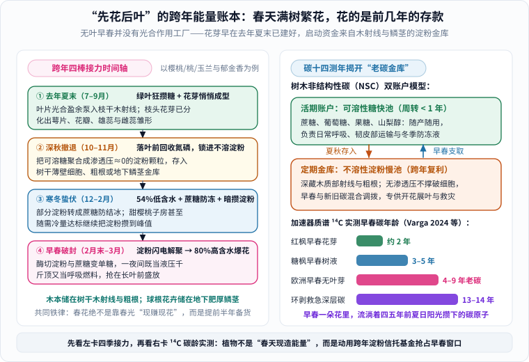
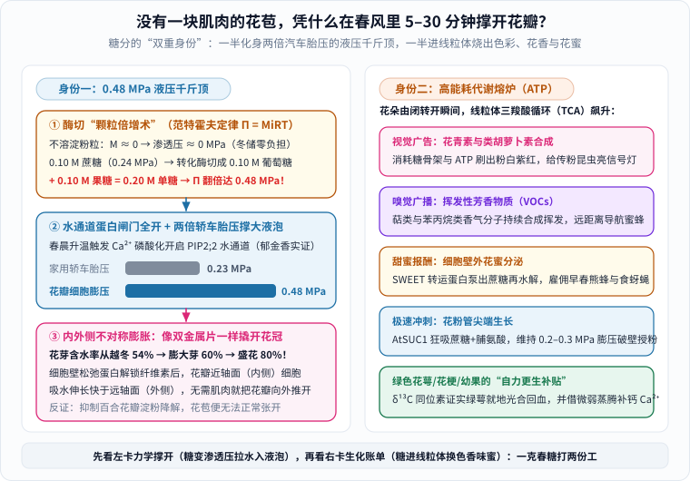
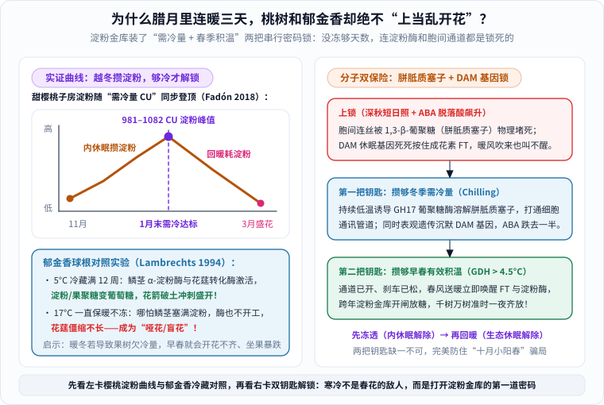
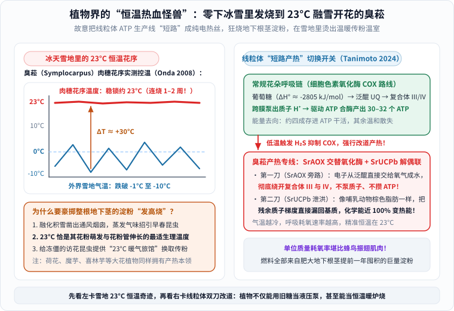

每年农历“二月二，龙抬头”前后，北方的迎春花、白玉兰、山桃与梅花，南方的樱桃与早樱，总会上演一幕违背直觉的魔术：

头一天傍晚走过小区，枝条还是灰扑扑、硬邦邦的“光杆司令”，连半片嫩绿叶子都找不着；可只要吹过两三天暖风，整棵树就像接到了总攻信号，成千上万朵硕大的花瓣突然在光秃秃的枯枝上炸开，刷出漫天粉白，空气里满是甜香，花心里还汪着晶莹的花蜜。

如果蹲在树下认真算一笔物理与化学账，你会发现这件事蹊跷透顶：

1. **“太阳能印钞机”明明还没开机**：中学课本告诉我们，植物的能量来自绿叶叶绿体的光合作用。可这些“**先花后叶**”（植物学称为 **Hysteranthy**）的树木开花时，树冠上叶绿素几乎为零——没有绿叶，造花瓣的纤维素、刷颜色的花青素、招蜜蜂的芳香油和花蜜，这笔巨款是从哪变出来的？
2. **“抽水机”也没装叶轮**：夏天大树能把水抽上十几米高，靠的是满树绿叶气孔蒸腾产生的负压拉力。早春一片叶子都没有，水和养分是怎么克服重力、爬上高高的枝头喂饱花苞的？
3. **没有一块肌肉，怎么把花瓣撑开**？一朵玉兰或郁金香从紧闭花蕾到完全舒展，有时只要十几分钟到一两个早晨；更夸张的是，有些早春植物甚至能在零下十几摄氏度的积雪里自己“发烧”到 $$23^\circ\text{C}$$，把冰雪烫出一个窟窿来开花！

植物当然不会凭空造出能量。早春那场看似“一夜暴富”的繁花盛宴，其实是植物筹备了整整大半年、甚至动用了 **4 到 9 年前陈年存款** 的精密财务工程与液压奇迹。

今天，我们就顺着**跨年账本 $$\to$$ 光杆输水泵 $$\to$$ 两倍胎压千斤顶 $$\to$$ 防骗双密码锁 $$\to$$ 融雪发烧花**五条线索，把植物春天开花的能量来龙去脉彻底拆开看清。

---

## 一、第一笔账：没长绿叶就敢“豪掷千金”，钱从哪个金库掏？

### 1. 花苞不是春天现捏的，而是去年夏末就建好的“预制舱”

很多人以为春天的花是春风吹暖之后才从零开始分化的——其实完全反了。

西班牙果树生理学家埃丽卡·法东（Erica Fadón）团队对甜樱桃（*Prunus avium*）花芽做了跨越四季的显微解剖追踪（[Fadón et al., *Frontiers in Plant Science*, 2018](https://pmc.ncbi.nlm.nih.gov/articles/PMC5818465/)）：早春 3 月盛开的樱桃花，早在**前一年夏末（7—8 月）**绿叶最繁茂、阳光最毒辣的时候就已经在叶腋里悄悄启动了花芽分化；到了深秋 10 月落叶前，米粒大小的花芽鳞片里，**花萼、花瓣、雄蕊群和雌蕊子房四轮器官的微型胚胎早已全部雕刻完毕**（子房壁停在整整齐齐的 13—14 层细胞），只等来年春天吸水充气、放大展开。

木本果树如此，草本球根花卉也是同一套“跨年预制”剧本。郁金香、风信子、水仙在头一年春末地上叶片枯萎前，早就把光合作用赚来的碳水化合物疯狂运进地下肥厚的**变态叶（鳞茎鳞片）**或块茎里，把微缩花芽裹在满仓淀粉正中央（[Lambrechts et al., *Plant Physiology*, 1994](https://pmc.ncbi.nlm.nih.gov/articles/PMC159225/)）。

### 2. 为什么非要聚合成“淀粉”存进树干与树根？

既然去年夏天绿叶赚到了海量葡萄糖和蔗糖，直接把糖水留在细胞里过冬不行吗？

不行！这里藏着植物财务管理最核心的一条物理铁律——**溶解态小分子糖会产生巨大的渗透压，而高分子淀粉几乎不产生渗透压**。

如果把几百克葡萄糖直接溶在树干薄壁细胞的液泡里，细胞外的水分就会失控涌入，把活细胞活活撑爆；反过来，一旦把成千上万个葡萄糖分子手拉手缩聚成不溶于水的**支链淀粉与直链淀粉颗粒（Starch granules）**，它在水里的摩尔浓度 $$M \approx 0$$，渗透压瞬间归零！植物就能在不撑破细胞膜的前提下，把高密度化学能安稳锁进三大“地下与木质金库”（[Tomasella et al., *IJMS*, 2019](https://pmc.ncbi.nlm.nih.gov/articles/PMC6981889/)；[Huang et al., *Frontiers in Plant Science*, 2026](https://www.frontiersin.org/journals/plant-science/articles/10.3389/fpls.2026.1790037/full)）：

- **木本植物的“金库网络”**：树干与枝条木质部里呈辐射状排列的活细胞——**木射线薄壁组织（Ray parenchyma）**与轴向薄壁组织，外加地下的**粗根（Coarse roots）**。整套库存统称为**非结构性碳水化合物（NSC，Non-Structural Carbohydrates）**，也就是没被砌进木头细胞壁死结构里、随时能取出来当钱花的“流动资金”（注：椴树、桦树、松树等所谓的“油脂树”还会把一部分碳存成更高能量密度的脂滴）。
- **宿根与球根花卉的“地下粮仓”**：郁金香的鳞茎鳞片、牡丹的肉质根、荷花的地下莲藕，存的则是满满的**淀粉**与**果聚糖（Fructans）**。
- **秋叶凋落前的“资产大转移”**：深秋树叶变黄掉落前，树木绝不会白白扔掉家当，而是先把叶片叶绿体蛋白质拆解，把宝贵的氮、磷、钾和最后一批蔗糖撤回枝干与根系金库锁好。

### 3. 核试验碳十四铁证：今年春天开的花，烧的竟是 4 到 9 年前的阳光！

更颠覆常识的发现来自核物理与植物生理学的跨界联手。

我们在[《双胞胎原子为什么能给万物测年龄？从同位素神探家族讲到碳十四》]()里讲过：20 世纪中叶大气核试验曾让空气中的放射性 $$^{14}\text{C}$$ 浓度飙升，随后逐年按精确曲线回落。这意味着**每一年大气二氧化碳都有独一无二的 $$^{14}\text{C}/^{12}\text{C}$$“年份指纹”**——只要用加速器质谱仪（AMS）测一测早春新芽里的碳同位素比例，就能算出这颗芽烧的是哪一年存进树干的阳光！

2024 年，匈牙利科学院核物理研究所的塔马斯·瓦尔加（Tamás Varga）团队在 3 月初早春——趁杨树、柳树、夏栎、挪威槭、山茱萸等温带落叶乔灌木刚刚鼓出无叶早春芽、尚未长出任何绿色同化组织之前——采下芽鳞与芽芯做 AMS 碳十四测年（[Varga et al., *Heliyon*, 2024](https://pmc.ncbi.nlm.nih.gov/articles/PMC11226849/)）。结果令人大吃一惊：

- 这些早春新芽里动员出来的碳原子，根本不是“去年的新钱”，它们的校准放射性碳年龄普遍高达 **4 到 9 年**！
- 先前北美对糖枫（*Acer saccharum*）早春树液的同位素追踪同样证实，树液里流淌的蔗糖平均周转年龄为 **3 到 5 年**；如果树木遭遇晚霜冻死新叶或树皮环剥等大灾，甚至会从树干深层金库里挖出 **13 到 14 年前**存下的“压箱底养老碳”来救命（[Huang et al., *Frontiers in Plant Science*, 2026](https://www.frontiersin.org/journals/plant-science/articles/10.3389/fpls.2026.1790037/full)）。

*图 1：。**怎么读这张图**：先看左侧跨年四棒接力——春花早在去年夏末已分化成型，深秋把糖锁成零渗透压淀粉入库，寒冬用蔗糖防冻并攒满子房淀粉，早春一举水解开花；再看右侧双账户模型与 $$^{14}\text{C}$$ 实测条形图——树木同时维护着周转小于 1 年的“可溶性糖活期账户”和跨年混合的“淀粉定期信托基金”，因此今天枝头绽放的一朵春花里，流淌着四五年前甚至九年前某个夏日午后的阳光。*

换句话说，树木的财务系统比月光族稳健得多：它把每年夏天赚来的碳分成“**活期快池**”（可溶性糖，周转 $$<1$$ 年，管日常呼吸和韧皮部周转）与“**定期慢池**”（木射线与粗根深层淀粉，跨多年存取混合）。早春无叶开花，花的就是这笔跨年复利信托基金！

---

## 二、第二笔账：没有一片绿叶当“抽水机”，糖水怎么爬上十几米高的光杆树梢？

钱（淀粉）虽然存在树干和树根里，但花苞长在最高、最细的枝头末端，而且早春开花急需巨量水分——德国柏林洪堡大学对甜樱桃花芽长达 9 年的追踪显示，整个越冬休眠期花芽含水率死死压在 **$$54\%$$** 左右（水少才不容易结成刺破细胞的大冰晶）；可一旦早春启动膨大到花簇盛开，花芽含水率会在短短十几天里飙升到 **$$80\%$$**（[Götz & Chmielewski, *Metabolites*, 2023](https://pmc.ncbi.nlm.nih.gov/articles/PMC9961560/)）！

问题来了：夏天大树靠叶片蒸腾负压把水往上“吸”；早春树顶光秃秃一片叶子都没有，木质部导管甚至因为一冬天的反复结冰塞满了微小的气泡（冻融栓塞，Freeze-thaw embolism），水和糖是怎么克服重力顶上去的？

答案是：早春树木把夏天的“**顶部负压抽水机**”，临时切换成了靠糖分驱动的“**底部与茎干正压增压泵**”！

### 1. 算一算 $$2\%$$ 蔗糖树液能托起多高的水柱？

当早春气温开始在 $$0^\circ\text{C}$$ 上下波动时，树干木射线里的活细胞率先开工：$$\alpha$$-淀粉酶和 $$\beta$$-淀粉酶把库存淀粉切成双糖——**蔗糖**（分子量 $$M_{\text{suc} } = 342.30\text{ g mol}^{-1}$$），主动卸载进相邻的木质部导管里。

别小看树液里那一点点甜味！以早春枫树导管中典型的 **$$2.0\%$$ 蔗糖溶液**（约 $$20\text{ g L}^{-1}$$，摩尔浓度 $$M = 20 / 342.30 \approx 0.0584\text{ mol L}^{-1}$$，非电解质电离系数 $$i = 1$$）为例，在早春 $$T = 2^\circ\text{C} = 275.15\text{ K}$$ 时，根据**范特霍夫渗透压方程（Van 't Hoff equation）**（气体常数 $$R = 8.314\text{ L kPa mol}^{-1}\text{ K}^{-1}$$）：

$$
\begin{aligned}
\Pi &= M \cdot i \cdot R \cdot T \\
&= 0.05843 \times 1 \times 8.314 \times 275.15 \\
&\approx \mathbf{133.7\text{ kPa} } \approx \mathbf{1.32\text{ 个标准大气压} }
\end{aligned}
$$

要知道，地面上每 $$9.81\text{ kPa}$$ 压强就能托起 $$1\text{ 米}$$ 高的水柱！这区区 $$2\%$$ 的蔗糖浓度差，一旦隔着选择性半透壁，理论上就握有托起 **$$\sim 13.6\text{ 米}$$ 水柱**的渗透潜能！

### 2. 寒夜吸升、白昼喷涌：奇妙的“昼夜冻融 × 蔗糖半透壁”增压泵

2024 年，加拿大不列颠哥伦比亚大学与佛蒙特大学的数学与林学联合团队在《树木生理学》（*Tree Physiology*）上用多尺度热力学方程与野外观测，完整还原了糖枫、红枫、黑核桃与桦树等无叶树干在早春打出强劲正压的三步物理机制（[Zarrinderakht et al., *Tree Physiology*, 2024](https://pmc.ncbi.nlm.nih.gov/articles/PMC11448476/)）：

1. **木质化细胞壁充当“天然反渗透膜”**：木质部里充满气体的**木纤维（Wood fibers）**与输水的**导管（Vessels）**之间，隔着一层木质化次生壁——它允许小分子水自由穿过，却把大分子的蔗糖死死拦在导管一侧，构成天然渗透仓。
2. **寒夜（气温 $$< 0^\circ\text{C}$$）结冰吸升蓄能**：夜晚树干降温越过冰点时，木纤维内壁凝结出微米级冰晶薄膜，产生强大的**低温结冰吸力（Cryostatic suction）**，把导管里的水吸向纤维并压缩纤维内的残留气泡；与此同时，地表以下 $$30\text{ cm}$$ 深处的土壤温度依然保持在 **$$> 0^\circ\text{C}$$**，根系源源不断从不冻土里把液态水抽进树干补仓！
3. **白昼（气温 $$> 0^\circ\text{C}$$）融冰正压上顶**：第二天太阳出来、树皮升温跨过 $$0^\circ\text{C}$$ 的瞬间，木纤维里的冰晶融化，受压缩的气泡弹性回弹，叠加导管内高浓度蔗糖的渗透吸水力，在树干内部瞬间打出高达数十至上百千帕的**正压尖峰（Pressure spike）**！如果你此时在糖枫树干上钻个孔，甘甜的树液就会自己哗哗往外冒——这就是北美枫糖浆的来源，而在大自然里，这股正压不仅把越冬堵塞导管的气泡重新压溶修复（[Tomasella et al., *IJMS*, 2019](https://pmc.ncbi.nlm.nih.gov/articles/PMC6981889/)），更把满载蔗糖和矿物质的“能量快车”一路顶上光秃秃的树梢！

*(注：桃、李、樱桃等蔷薇科果树没有枫树那样极端的木纤维冻融结构，它们主要依靠根系主动吸盐吸水产生的**根压**，配合花芽基部木射线细胞**就近把淀粉切成糖卸载**，通过几毫米到几厘米的短距离渗透接力喂饱花苞。)*

*图 2：（刷新页面可重播左卡单次正压升液动画；若系统开启“减弱动态效果”则直接展示静态完整液柱）。**怎么读这张图**：先看左侧对比——盛夏绿叶靠气孔蒸腾负压“往上抽”，早春无叶则靠根压与茎干正压“往上顶”，其中 $$2\%$$ 蔗糖可贡献约 $$133.7\text{ kPa}$$ 渗透压；再看右侧三步物理拆解——木射线卸糖造出半透仓、寒夜结冰吸升压缩气泡、白昼跨过 $$0^\circ\text{C}$$ 融冰打出正压尖峰。糖分在这里既是燃料，又是驱动水流爬坡的液压动力源。*

---

## 三、第三笔账：没有一块肌肉，花苞凭什么在春风里几十分钟撑开花瓣？

现在，水和蔗糖终于送进了枝头的花蕾里。接下来最神奇的一幕发生了：动物伸展四肢靠肌球蛋白拉动肌动蛋白消耗 ATP，可植物全身上下没有一根肌肉纤维，一朵紧闭了一整个冬天的玉兰、樱花或郁金香，是怎么在短短 5 到 30 分钟（或一个温暖的春晨）里有力地推开萼片、舒展花冠的？

法国里昂高等师范学院的洛蕾娜·博扎米（Léa Beauzamy）与阿雷兹基·布达乌德（Arezki Boudaoud）等生物物理学家在《植物学纪事》（*Annals of Botany*）发表的经典综述一语道破天机：**每一颗花瓣细胞，本质上都是一只微型的“高压液压千斤顶”**；而刚刚送进花蕾的糖分，在这里一人分饰两角——**既当“液压油增压剂”，又当“高能耗生化燃料”**（[Beauzamy et al., *Annals of Botany*, 2014](https://pmc.ncbi.nlm.nih.gov/articles/PMC4204789/)；[Borghi et al., *Plant Physiology*, 2022](https://pmc.ncbi.nlm.nih.gov/articles/PMC9434183/)）！

### 1. 身份一：酶切“颗粒倍增术”，造出两倍于家用轿车胎压的细胞膨压！

根据植物水势方程 $$\Psi_w = \Psi_p + \Psi_\pi = P - M i R T$$，范特霍夫定律有个极其狡猾的性质：**渗透压 $$\Pi = M i R T$$ 只认水里溶解了“多少个溶质分子颗粒”，根本不管单个分子是大是小**！

这跟我们在[《为什么一喝牛奶就拉肚子？读懂乳糖不耐受的原理》]()里讲过的肠道渗透吸水遵循完全同一条物理定律——只不过在肠道里它是让人腹泻的麻烦，在花瓣里却是植物演化出的绝顶聪明机关：

- **开花前夜（零压力安全仓储）**：幼嫩花瓣细胞里塞满了不溶性**淀粉颗粒**或大分子**果聚糖**，此时溶解颗粒浓度 $$M \approx 0$$，渗透压接近 $$0\text{ MPa}$$；就算刚运进来 $$0.10\text{ mol L}^{-1}$$ 的**蔗糖**（二糖），在春晨 $$15^\circ\text{C}$$（$$T = 288.15\text{ K}$$）下产生的渗透压也只有：

$$
\begin{aligned}
\Pi_{\text{蔗糖} } &= 0.10 \times 1 \times 8.314 \times 288.15 \\
&\approx 239.6\text{ kPa} \approx \mathbf{0.24\text{ MPa} }
\end{aligned}
$$

- **开花瞬间（一刀切出双倍压强！）**：春光一暖，花瓣液泡与细胞壁上的**细胞壁转化酶（Invertase）**和**淀粉酶**全速开动，不仅把零渗透压的淀粉颗粒切成单糖，还把每一个蔗糖分子（$$\text{C}_{12}\text{H}_{22}\text{O}_{11}$$）精准劈成 **1 个葡萄糖 + 1 个果糖**！总碳量一毫克没加，但溶解溶质摩尔浓度瞬间从 $$0.10\text{ mol L}^{-1}$$ 翻倍成 **$$0.20\text{ mol L}^{-1}$$**（若计入淀粉同步水解与钾离子 $$\text{K}^+$$ 内流还会更高）：

$$
\begin{aligned}
\Pi_{\text{单糖翻倍} } &= 0.20 \times 1 \times 8.314 \times 288.15 \\
&\approx 479.1\text{ kPa} \approx \mathbf{0.48\text{ MPa} } \\
&\approx \mathbf{4.73\text{ 个标准大气压} }
\end{aligned}
$$

**$$0.48\text{ MPa}$$ 是什么概念？** 我们平时给家用小轿车轮胎打气，标准胎压不过是 $$2.2\text{—}2.4\text{ bar}$$，也就是 **$$0.22\text{—}0.24\text{ MPa}$$**！实测植物枝条与花器官细胞的膨压普遍在 **$$0.45\text{—}0.80\text{ MPa}$$** 之间，最高甚至能飙到 **$$2.0\text{ MPa}$$**（足足 20 个大气压，[Beauzamy et al., 2014](https://pmc.ncbi.nlm.nih.gov/articles/PMC4204789/)）——也就是说，看似吹弹可破的一片樱花或郁金香花瓣，每一颗细胞里都憋着**两倍于汽车轮胎**的恐怖水压！

紧接着，三道机关默契配合，把这股水压变成优雅的开花动作：

1. **水通道蛋白开闸放水**：对郁金香花瓣的分子实验证实，春晨气温升高会以钙离子（$$\text{Ca}^{2+}$$）依赖的方式使细胞膜上的 **PIP2;2 水通道蛋白（Aquaporin）**发生磷酸化而大开闸门，水分顺着 $$0.48\text{ MPa}$$ 的渗透压差洪流般灌入中央大液泡；傍晚降温去磷酸化关闭通道，郁金香花瓣又会合拢保暖（[Beauzamy et al., 2014](https://pmc.ncbi.nlm.nih.gov/articles/PMC4204789/)）。
2. **松弛蛋白给细胞壁“松绑”**：光有水压还不够，坚韧的纤维素细胞壁如果不松扣，细胞也撑不大。生长素诱导细胞壁酸化并激活**扩展蛋白（Expansins）**，暂时松开纤维素微纤丝之间的氢键锁扣，让花瓣细胞体积在短短几小时内膨胀数倍。
3. **内外侧不对称生长撬开花冠**：就像温度计里的双金属片一样，花瓣**近轴面（内侧）**表皮细胞的糖水解与吸水膨胀速率显著快于**远轴面（外侧）**——内侧伸长快、外侧伸长慢，花瓣便不可阻挡地向外优雅翻开！科学家在百合花上做过反证实验：只要用抑制剂阻止花瓣里的淀粉降解，哪怕给足水分和阳光，百合花苞也无法正常张开（[Beauzamy et al., 2014](https://pmc.ncbi.nlm.nih.gov/articles/PMC4204789/)）。

### 2. 身份二：线粒体呼吸狂飙，烧出“色、香、蜜”与极速花粉管

除了充当液压千斤顶，另一半单糖立刻被送进花朵细胞的线粒体里。德国马克斯·普朗克分子植物生理研究所的莫妮卡·博尔吉（Monica Borghi）与阿拉斯代尔·费尔尼（Alisdair R. Fernie）团队结合多组学与放射性同位素示踪发现：花朵从闭合跨入盛开的那一刻，**三羧酸循环（TCA）与线粒体 ATP 合成进入全株最高能耗档位**（[Borghi et al., *Plant Physiology*, 2022](https://pmc.ncbi.nlm.nih.gov/articles/PMC9434183/)），把跨年存下的化学能砸向四大烧钱项目：

- **刷亮视觉广告牌（色素合成）**：以糖代谢中间产物为碳骨架，消耗大量 ATP 与还原力（NADPH），在花瓣表皮液泡里突击合成**花青素**（粉红、紫红、蓝紫）或有色体里的**类胡萝卜素**（金黄、橙红）。
- **全天候嗅觉广播（挥发性香气 VOCs）**：持续合成并向寒冷空气中蒸发萜类、苯丙烷类等数十种芳香小分子，给刚出蛰的蜜蜂、食蚜蝇发去远距离导航信标。
- **重金悬赏传粉工（花蜜分泌）**：蜜腺细胞通过 **SWEET9** 等糖转运蛋白把蔗糖泵到细胞壁外，再由细胞壁转化酶切成葡萄糖果糖蜜露——这可是真金白银把去年攒的碳水直接拿出来请昆虫吃饭！
- **花粉管百米冲刺**：花粉一旦落上柱头，膜上的 **AtSUC1** 蔗糖转运蛋白立刻狂吸柱头分泌的糖分，并在管尖富集高浓度脯氨酸，维持约 $$0.2\text{—}0.3\text{ MPa}$$ 的精准膨压，成为植物界生长速度最快的单个细胞，一路破壁把精子送进胚珠（[Beauzamy et al., 2014](https://pmc.ncbi.nlm.nih.gov/articles/PMC4204789/)）。

顺便补一笔容易被忽略的“外快”：英国植物生理学家约翰·雷文（John A. Raven）与霍华德·格里菲斯（Howard Griffiths）通过稳定碳同位素 $$\delta^{13}\text{C}$$ 核算指出，春花也不是 $$100\%$$ 只吃老本——**绿色的花萼、绿色花梗、苞片以及授粉后绿油油的幼果子房壁**自己也含叶绿体，能就地开展“生殖器官光合作用”回血补贴一部分碳账单，并借着花萼微弱的气孔蒸腾把韧皮部运不动的**钙离子（$$\text{Ca}^{2+}$$）**从木质部拉进花朵加固细胞壁（[Raven & Griffiths, *Journal of Experimental Botany*, 2015](https://pmc.ncbi.nlm.nih.gov/articles/PMC4669558/)）。

*图 3：。**怎么读这张图**：先看左卡“一克春糖的第一份工”——淀粉和蔗糖被酶切成单糖后颗粒数倍增，产生约 $$0.48\text{ MPa}$$（超家用轿车胎压两倍）的渗透潜能，配合 $$\text{PIP2;2}$$ 水通道开启与内外侧不对称膨胀把花冠推开；再看右卡“第二份工”——线粒体呼吸飙升烧糖产出 ATP，包揽色素、香气、花蜜与花粉管冲刺，绿色花萼则顺手做光合作用补贴家用。*

---

## 四、第四笔账：腊月里突然暖和三天，桃树和郁金香为什么绝不“上当乱开花”？

讲到这里，一个关乎生死存亡的漏洞浮出水面：

既然花芽去年秋天就已经雕刻好了，树干和球根里也塞满了淀粉，只要一升温酶切放糖就能开花——那万一农历十月出现“小阳春”，或者元旦前后恰逢连续四五天 $$18^\circ\text{C}$$ 的反常大回暖，桃树、樱桃和地下的郁金香岂不是会被骗得提前把满库淀粉全砸出去开花？紧接着寒潮杀个回马枪，一夜冰冻，整年的繁衍岂不是瞬间血本无归？

放心，能在温带活过几千万年的植物，早就给自己的跨年淀粉金库装上了**“冬季需冷量 + 早春积温”两把必须按顺序拧开的串行密码锁**！

### 1. 樱桃边挨冻边攒淀粉，郁金香不冻够 12 周直接变“哑花”

让我们看两组硬核对照实验：

- **甜樱桃的“不眠寒冬”（[Fadón et al., 2018](https://pmc.ncbi.nlm.nih.gov/articles/PMC5818465/)）**：研究者整个冬天每周切开甜樱桃花芽检测发现，在 11 月到次年 1 月看似死寂的**内休眠（Endodormancy）**期，子房细胞不仅没闲着，反而随着冬季有效低温小时数——**需冷量（Chilling Units，简称 CU）**——的累积，**一步步把淀粉颗粒攒到全年最高峰**！早熟品种‘Burlat’必须冻够 **$$981 \pm 83\text{ CU}$$**，晚熟品种‘Bing’必须冻够 **$$1082 \pm 27\text{ CU}$$**，子房淀粉才达到满仓顶点并正式解除内休眠；此后进入 2—3 月**生态休眠（Ecodormancy）**期，随着高于 $$4.5^\circ\text{C}$$ 的**生长度小时（GDH）**累加，这批淀粉才掉头急速消耗，精准点燃开花！
- **郁金香 $$5^\circ\text{C}$$ vs $$17^\circ\text{C}$$ 球根实验（[Lambrechts et al., 1994](https://pmc.ncbi.nlm.nih.gov/articles/PMC159225/)）**：荷兰乌得勒支大学团队把同样塞满淀粉的郁金香鳞茎分成两组——一组放在 **$$5^\circ\text{C}$$ 冷库冻满 12 周**，另一组一直放在舒适的 **$$17^\circ\text{C}$$ 温室保暖**。种下浇水后，冻够 12 周的郁金香鳞茎里 $$\alpha$$-淀粉酶和花莛转化酶活性暴涨，淀粉与果聚糖迅速化作葡萄糖，花箭拔地而起绚烂盛开；而一直待在 $$17^\circ\text{C}$$ 没挨过冻的那组，哪怕鳞茎里粮草堆成山，淀粉酶和转化酶也纹丝不动，花莛缩在鳞茎里根本长不出来，彻底沦为“盲花/哑花”！

### 2. 分子双保险：胼胝质“水泥塞子”与 *DAM* 基因刹车片

植物究竟拿什么物理零件来“数”自己挨了多少天冻？法国国家农业科学研究院的维托尔·法拉维尼亚（Vítor da Silveira Falavigna）等学者梳理出了精妙绝伦的**双门禁机制**（[Falavigna et al., *Frontiers in Plant Science*, 2019](https://pmc.ncbi.nlm.nih.gov/articles/PMC6335348/)）：

1. **深秋上锁（物理封门 + 基因踩刹）**：秋天日照变短、气温初降时，植物激素**脱落酸（ABA）**飙升，指挥细胞合成一种叫**胼胝质（Callose，即 $$1,3\text{-}\beta\text{-葡聚糖}$$）**的多糖凝胶，像打水泥塞子一样，把花芽分生组织细胞之间互通信号的纳米隧道——**胞间连丝（Plasmodesmata）**——彻底堵死！与此同时，细胞核里的 **DAM 基因家族（*Dormancy-Associated MADS-box*）**高水平表达，死死踩住开花启动基因 *FT* 的刹车。这时候哪怕腊月里连暖五天，因为胞间通道被胼胝质塞死、基因锁也没开，任何促生长信号和糖调拨指令都进不去！
2. **第一把钥匙（漫长寒冬解锁“内休眠”）**：只有经历连续几百上千小时 $$0^\circ\text{C}\text{—}7^\circ\text{C}$$ 的湿冷洗礼，一方面会通过组蛋白甲基化（H3K27me3）从表观遗传层面**给 *DAM* 刹车基因贴上沉默封条**，并让脱落酸 ABA 浓度腰斩下跌约 $$50\%$$（[Götz & Chmielewski, 2023](https://pmc.ncbi.nlm.nih.gov/articles/PMC9961560/)）；另一方面激活赤霉素与 **GH17 家族的 $$1,3\text{-}\beta\text{-葡聚糖酶}$$**，把堵在胞间连丝里的胼胝质塞子溶解疏通！此时花芽静悄悄切换到“箭在弦上”的生态休眠态。
3. **第二把钥匙（春风送暖解锁“生态休眠”）**：既然通道已通、刹车已松，只要二三月春风送来足够的有效积温（GDH），*FT* 基因与各类淀粉酶、水通道蛋白便在一夜之间集体引爆，满树花苞整齐划一地破封怒放！

这也给我们敲响了气候变化的现实警钟：我们在[《赤道太平洋“发烧”为什么会搅乱全球天气？读懂厄尔尼诺现象与近年频现超强事件的原因》]()中聊过强厄尔尼诺与全球变暖带来的反常“暖冬”。一旦南方或暖温带果区冬天不够冷、攒不够 $$900\text{—}1100\text{ CU}$$ 的第一把钥匙，第二年春天桃、樱桃、蓝莓就会因为胼胝质塞子和 *DAM* 锁没解干净而出现**开花稀稀拉拉、花期拉长错乱、雄蕊败育、坐果率暴跌**的农业减产危机。

*图 4：。**怎么读这张图**：先看左卡上半部甜樱桃实测曲线——子房淀粉在冬季内休眠期随需冷量（$$981\text{—}1082\text{ CU}$$）同步攀升达峰，达标后才随春季积温下降转化为开花动力，下半部郁金香对照证明缺少 $$5^\circ\text{C}$$ 冷藏连淀粉酶都无法唤醒；再看右卡分子三步曲——冬季低温负责溶解胞间连丝胼胝质塞子并沉默 *DAM* 基因，春季积温负责按下最终点火键。*

---

## 五、终极彩蛋：连春风都懒得等！零下雪地里自己“发高烧”到 $$23^\circ\text{C}$$ 开花的植物怪兽

大多数春花至少还要等春风跨过 $$4.5^\circ\text{C}$$ 才肯动用淀粉金库。但在东北林区、日本北部与北美的冰雪湿地里，生长着一种把“烧钱开花”推向疯狂极致的早春天南星科植物——**臭菘（*Symplocarpus renifolius* / *S. foetidus*，英文俗称 Skunk cabbage）**。

每年二三月林间积雪还有半米厚、夜间气温跌到 **$$-1.1^\circ\text{C}$$ 甚至 $$-15^\circ\text{C}$$** 时，臭菘紫褐色的佛焰苞就像一枚烧红的烙铁，直接把厚厚的冰雪烫融出一个圆筒形天窗！如果你把温度计探头插进它中央的**肉穗花序（Spadix）**，读数会让你以为测到了一只冬眠苏醒的哺乳动物：

无论外面风雪交加、气温在零下十几度到零上十几度之间怎样剧烈过山车，它的花序内部竟能像装了精密空调一样，**连续 1 到 2 周稳稳恒温在 $$23^\circ\text{C}$$ 左右**，与冰天雪地的温差最高超过 **$$30^\circ\text{C}$$**（[Onda et al., *Plant Physiology*, 2008](https://pmc.ncbi.nlm.nih.gov/articles/PMC2245847/)；[Tanimoto et al., *Plant Physiology*, 2024](https://pmc.ncbi.nlm.nih.gov/articles/PMC11142342/)）！单位质量花序组织的耗氧功率，甚至追平了蜂鸟振翅飞行时的胸肌！

### 它是怎么把淀粉变成“23℃ 恒温暖气片”的？

日本岩手大学伊藤菊一（Kikuo Ito）团队深耕十余年，于 2008 年至 2024 年间在《植物生理学》（*Plant Physiology*）连发多篇论文，彻底破译了臭菘线粒体的“**短路产热开关**”：

在普通植物细胞里，$$1\text{ mol}$$ 葡萄糖彻底有氧氧化释放约 $$\Delta H^\circ \approx -2805\text{ kJ}$$ 的焓变（自由能 $$\Delta G^\circ \approx -2870\text{ kJ mol}^{-1}$$）。常规呼吸链让电子依次经过复合体 I $$\to$$ 泛醌（UQ）$$\to$$ 复合体 III $$\to$$ **细胞色素 $$c$$ 氧化酶（COX，复合体 IV）**，把质子 $$\text{H}^+$$ 泵过线粒体内膜，驱动 ATP 合酶攒下 **30—32 个 ATP**——一旦细胞里 ATP 攒满了，呼吸链就会像吃饱了一样自动减速（呼吸控制），根本烧不出多少热量。

但臭菘的小花线粒体干了一件极其豪横的事——**直接把 ATP 生产线“短路”成纯电热丝**：

1. **低温硫化氢精准掐断常规路线（[Tanimoto et al., 2024](https://pmc.ncbi.nlm.nih.gov/articles/PMC11142342/)）**：当外界冰雪严寒袭来，臭菘花序中硒结合蛋白（`SrSBP1`）等生成的微量内源**硫化氢（$$\text{H}_2\text{S}$$）**在低温下强烈抑制常规的 **COX 酶**，把通往 ATP 生产的正常高速路一刀封死！
2. **交替氧化酶（`SrAOX`）+ 解偶联蛋白（`SrUCPb`）双刀泄洪（[Onda et al., 2008](https://pmc.ncbi.nlm.nih.gov/articles/PMC2245847/)）**：电子在泛醌池无路可走，全部涌向臭菘高表达的**抗氰交替氧化酶（`SrAOX`）**，一步直达氧气生成水——彻底绕开了泵质子的复合体 III 和 IV！至于复合体 I 顺手泵出去的那一点点残余质子梯度，又被线粒体内膜上的**解偶联蛋白（`SrUCPb`）**（跟人类婴儿和冬眠动物**棕色脂肪**产热的蛋白同源！）直接开闸漏回基质。

$$
\begin{aligned}
&\text{常规 COX 路线（}\text{C}_6\text{H}_{12}\text{O}_6 + 6\,\text{O}_2\text{）：} \\
&\quad \longrightarrow \mathbf{30\text{--}32\text{ ATP} } + \text{温和余热} \\[4pt]
&\text{臭菘 AOX 短路（}\text{C}_6\text{H}_{12}\text{O}_6 + 6\,\text{O}_2\text{）：} \\
&\quad \longrightarrow \text{极少 ATP} + \mathbf{2805\text{ kJ 热能} }
\end{aligned}
$$

没有了 ATP 满仓的刹车限制，地下肥大根茎里囤积了一整年的海量淀粉被源源不断化成糖送进花序“狂烧”：外界越冷，耗氧产热越猛；外界回暖，呼吸自动收油——硬生生把小花烘在 **$$23^\circ\text{C}$$**！

臭菘这么败家图什么？一箭三雕：**第一**，融雪开窗并靠高温把腐肉般的气味蒸发扩散到几百米外；**第二**，实验证明 **$$23^\circ\text{C}$$ 恰好是臭菘花粉萌发与花粉管伸长的生理最适温度**，低于 $$10^\circ\text{C}$$ 授粉就会瘫痪；**第三**，早春雪地里刚醒来的甲虫与双翅目昆虫冻得瑟瑟发抖，钻进 $$23^\circ\text{C}$$ 的佛焰苞就像住进了免费五星级暖气旅馆，自然死心塌地帮它完成传粉（荷花、魔芋、喜林芋等植物也演化出了类似的 AOX 产热绝技）。

*图 5：。**怎么读这张图**：先看左卡实测控温曲线——哪怕雪地气温跌破 $$-1^\circ\text{C}$$ 至 $$-10^\circ\text{C}$$，臭菘肉穗花序仍能连烧一两周稳守 $$23^\circ\text{C}$$ 生命线；再看右卡线粒体改道图——低温下内源 $$\text{H}_2\text{S}$$ 封堵常规 COX 产 ATP 通道，迫使电子走 `SrAOX` 旁路并配合 `SrUCPb` 质子泄洪，把地下根茎的跨年淀粉近乎 $$100\%$$ 烧成热能。*

---

## 六、收官之问：既然“无叶开花”又冒险又费老本，植物为什么要演化出“先花后叶”？

合上这五笔大账，我们最后不妨退后一步问个演化问题：等 4 月长满绿叶、太阳能印钞机全速运转之后再慢悠悠开花（先叶后花），岂不是既省利息又不用冒倒春寒风险？为什么玉兰、梅花、山桃、连翘、榆树、杨柳乃至臭菘，偏偏要抢在光杆无叶的早春把老本全押上去？

演化生物学家给出了三条极其划算的生态回报：

1. **躲开自家树叶的“挡路与抢钱”**：
   - 对杨树、柳树、榆树、榛树等**风媒树种**来说，宽大的绿叶一旦长出来，就会像一堵堵挡风墙一样拦住飞舞的花粉；趁枝条光秃秃时开花，春风畅通无阻，传粉效率高出几个数量级。
   - 对桃、樱、玉兰等**虫媒树种**来说，没有绿叶遮挡，满树粉白花朵在灰褐色早春大地上就是最醒目的巨幅霓虹灯；更关键的是，**刚萌发的幼嫩新叶在长成前自己也是“吞金兽”（强碳汇 Sink）**——先开花、后展叶，就能避免花朵与嫩叶在同一周里惨烈争夺树干运上来的糖和水分！
2. **垄断早春第一批苏醒的传粉昆虫**：二三月花源极度稀缺，谁敢第一个掏出花蜜甚至提供 $$23^\circ\text{C}$$ 暖气房，刚出蛰的熊蜂蜂王、蜜蜂与食蚜蝇就只能专一地拜访同一种花，不会把花粉乱涂到别的植物柱头上。
3. **给种子和果实抢出更长的成熟季**：早春 3 月授粉完毕，4 月绿叶正好铺满枝头接棒开机，无缝衔接供养迅速膨大的樱桃、杏子或柳絮种子，赶在盛夏酷暑或鸟类迁徙季之前抢先成熟散播。

---

## 结语：每一朵春花，都是一封写自几年前夏天的情书

下次再在春寒料峭的街头，抬头撞见一树毫无绿叶衬托却开得轰轰烈烈的白玉兰、红梅或樱桃花时，你看到的将不再只是一场柔弱浪漫的春景，而是一座精密运转的跨年生物物理大厦：

- 它的**建筑图纸**，早在去年盛夏酷暑的叶腋里就已一笔一画雕刻成型；
- 它燃烧的**碳原子本金**，来自树干木射线与地下根茎里沉淀了 **2 到 9 年**的陈年淀粉信托；
- 它的**高空物流**，靠的是 $$2\%$$ 蔗糖半透仓与昼夜冰火冻融打出的正压水柱；
- 它没有肌肉却能迎风舒展的**机械伟力**，来自淀粉与蔗糖一刀切倍增出的 **$$0.48\text{ MPa}$$ 两倍胎压液压千斤顶**；
- 而它之所以从不被腊月暖阳轻易欺骗，是因为它默默数够了整整一冬天的严寒，才用葡聚糖酶融开胼胝质封条，在真正的春天准时赴约。

**哪有什么一夜爆满繁花的侥幸？不过是把前几个夏天攒下的阳光锁进沉默的年轮，熬过一千个小时的凛冽风雪，再在一个春暖花开的清晨，倾囊相赠。**

---

## 参考资料与核查说明

本文所有植物生理机制、同位素碳龄、热力学公式与实验数据均核查自以下同行评审原始论文与权威综述（均可公开访问全文）：

1. **早春无叶芽的核试验碳十四（$$^{14}\text{C}$$）老碳年龄实测（4—9 年）**：Varga, T., Nagy, M. B., Molnár, M., Jull, A. J. T., Futó, I., & Lisztes-Szabó, Z. (2024). *Spring buds of European woody plants have old $$^{14}\text{C}$$ age*. **Heliyon**, 10(13), e33583. [PMC11226849](https://pmc.ncbi.nlm.nih.gov/articles/PMC11226849/)（证实欧洲温带落叶乔灌木 3 月初无叶春芽动员的碳校准年龄达 4—9 年，芽鳞与芽芯碳龄一致）。
2. **树木非结构性碳水化合物（NSC）快慢双碳池模型与跨年抗逆调拨**：Huang, J., Guan, X., Wang, Z., et al. (2026). *The role of non-structural carbohydrates in tree physiology and forest management*. **Frontiers in Plant Science**, 17, 1790037. [Frontiers 全文](https://www.frontiersin.org/journals/plant-science/articles/10.3389/fpls.2026.1790037/full)（系统综述可溶性糖活期快池与淀粉定期慢池、糖枫早春树液 3—5 年周转期、极端胁迫下 13—14 年深层老碳动员及冬季淀粉转糖防冻机制）。
3. **“先花后叶”甜樱桃花芽夏末分化、冬季随需冷量（981—1082 CU）攒淀粉及早春水解开花**：Fadón, E., Herrero, M., & Rodrigo, J. (2018). *Dormant Flower Buds Actively Accumulate Starch over Winter in Sweet Cherry*. **Frontiers in Plant Science**, 9, 171. [PMC5818465](https://pmc.ncbi.nlm.nih.gov/articles/PMC5818465/)。
4. **甜樱桃花芽 9 年 445 种代谢物追踪、蔗糖冬季防冻峰值、ABA 减半与含水率从 54% 跃升至 80%**：Götz, K.-P., & Chmielewski, F.-M. (2023). *Metabolites That Confirm Induction and Release of Dormancy Phases in Sweet Cherry Buds*. **Metabolites**, 13(2), 231. [PMC9961560](https://pmc.ncbi.nlm.nih.gov/articles/PMC9961560/)。
5. **郁金香鳞茎 $$5^\circ\text{C}\times 12$$ 周冷藏激活淀粉酶与转化酶驱动花莛伸长对照实验**：Lambrechts, H., Rook, F., & Kollöffel, C. (1994). *Carbohydrate Status of Tulip Bulbs during Cold-Induced Flower Stalk Elongation and Flowering*. **Plant Physiology**, 104(2), 515–520. [PMC159225](https://pmc.ncbi.nlm.nih.gov/articles/PMC159225/)。
6. **早春无叶树干昼夜冻融与蔗糖选择性半透壁产生木质部正压的多尺度物理模型与实测**：Zarrinderakht, M., Konrad, W., Wilmot, T. R., Perkins, T. D., van den Berg, A. K., & Stockie, J. M. (2024). *Modeling temperature effects on spring sap exudation in maple and other deciduous trees*. **Tree Physiology**, 44(4), tpae006. [PMC11448476](https://pmc.ncbi.nlm.nih.gov/articles/PMC11448476/)。
7. **树干与根系薄壁组织淀粉/油脂存储及冬季冻融气泡栓塞的渗透修复**：Tomasella, M., Petrussa, E., Petruzzellis, F., Nardini, A., & Casolo, V. (2019). *The Possible Role of Non-Structural Carbohydrates in the Regulation of Tree Hydraulics*. **International Journal of Molecular Sciences**, 21(1), 144. [PMC6981889](https://pmc.ncbi.nlm.nih.gov/articles/PMC6981889/)。
8. **花朵膨压生物力学、范特霍夫水势方程、淀粉水解、$$\text{PIP2;2}$$ 水通道蛋白与花瓣内外侧不对称展开**：Beauzamy, L., Nakayama, N., & Boudaoud, A. (2014). *Flowers under pressure: ins and outs of turgor regulation in development*. **Annals of Botany**, 114(7), 1517–1533. [PMC4204789](https://pmc.ncbi.nlm.nih.gov/articles/PMC4204789/)。
9. **花朵由闭转开瞬间的高能耗线粒体呼吸、糖转运及色素/香气/花蜜合成多组学追踪**：Borghi, M., Perez de Souza, L., Tohge, T., Bouwmeester, H. J., & Fernie, A. R. (2022). *High-energy-level metabolism and transport occur at the transition from closed to open flowers*. **Plant Physiology**, 190(3), 1624–1641. [PMC9434183](https://pmc.ncbi.nlm.nih.gov/articles/PMC9434183/)。
10. **冬季需冷量溶解胞间连丝胼胝质（$$1,3\text{-}\beta\text{-葡聚糖}$$）塞子与表观遗传沉默 *DAM* 休眠基因机制**：Falavigna, V. d. S., Guitton, B., Costes, E., & Andrés, F. (2019). *I Want to (Bud) Break Free: The Potential Role of DAM and SVP-Like Genes in Regulating Dormancy Cycle in Temperate Fruit Trees*. **Frontiers in Plant Science**, 9, 1990. [PMC6335348](https://pmc.ncbi.nlm.nih.gov/articles/PMC6335348/)。
11. **早春臭菘零下冰雪中 $$23^\circ\text{C}$$ 恒温开花与线粒体 `SrAOX` + `SrUCPb` 及低温 $$\text{H}_2\text{S}$$ 切换产热机制**：Onda, Y., Kato, Y., Abe, Y., Ito, T., Morohashi, M., Ito, Y., Ichikawa, M., Matsukawa, K., Kakizaki, Y., Koiwa, H., & Ito, K. (2008). *Functional Coexpression of the Mitochondrial Alternative Oxidase and Uncoupling Protein Underlies Thermoregulation in the Thermogenic Florets of Skunk Cabbage*. **Plant Physiology**, 146(2), 636–645. [PMC2245847](https://pmc.ncbi.nlm.nih.gov/articles/PMC2245847/)；以及 Tanimoto, H., Umekawa, Y., Takahashi, H., Goto, K., & Ito, K. (2024). *Temperature-dependent modulation of aberrant respiration in thermogenic skunk cabbage Symplocarpus renifolius*. **Plant Physiology**, 195(3), 2376–2392. [PMC11142342](https://pmc.ncbi.nlm.nih.gov/articles/PMC11142342/)。
12. **绿色花萼、苞片与幼果的生殖器官就地光合作用及木质部钙离子运输补贴**：Raven, J. A., & Griffiths, H. (2015). *Photosynthesis in reproductive structures: costs and benefits*. **Journal of Experimental Botany**, 66(7), 1699–1705. [PMC4669558](https://pmc.ncbi.nlm.nih.gov/articles/PMC4669558/)。
