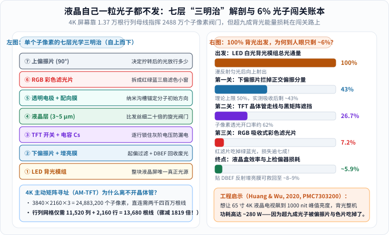
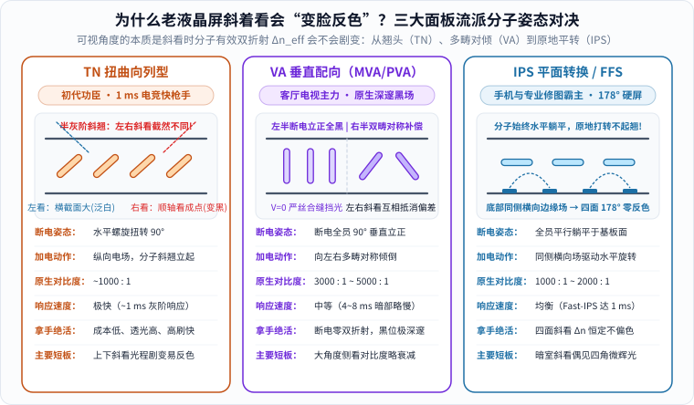
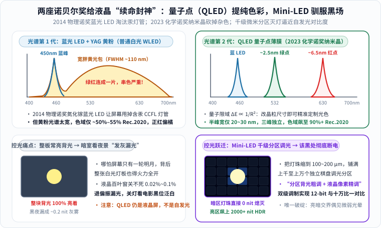
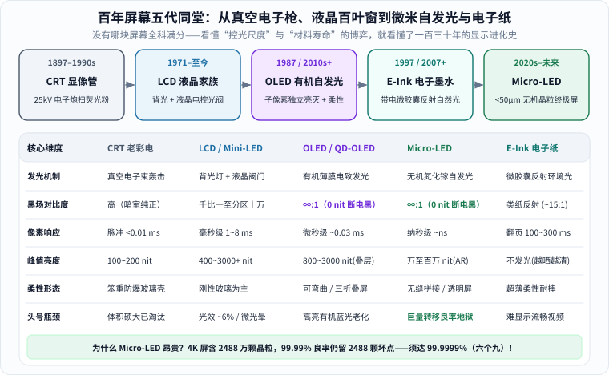

如果你在二十世纪九十年代搬过家，一定对客厅里那尊“镇宅神兽”记忆犹新：一台 29 英寸的显像管老彩电，前脸鼓着厚厚的“龟背”防爆玻璃，身后撅着半米深的“大屁股”，整机重达四五十公斤，非得两个壮汉憋红了脸才能抬上茶几。

仅仅过了二十多年，65 英寸甚至 85 英寸的巨幕电视薄得像一幅挂画，手机屏幕甚至能像钱包一样对折三道塞进口袋。而撬动这场“屏幕拍扁革命”的第一块多米诺骨牌，说出来像个冷笑话——它居然始于 **1888 年一位植物学家从胡萝卜里提炼胆固醇衍生化合物时，撞见的一滴“熔化两次”的怪液体**。

更反直觉的是：统治了手机、电脑显示器、电视机与车载仪表盘长达数十年的**液晶显示器（LCD，Liquid Crystal Display）**，它里头的液晶分子**一辈子连一粒可见光光子都不会发**！不仅不发光，它背后那盏灯拼命发出的光，经过层层关卡最终能钻进你眼睛里的，往往**只剩下可怜巴巴的 $5\%\text{--}8\%$**。

一滴不会发光的“浑浊怪液”，凭什么把光当面团一样拧转 $90^\circ$ 变出亿万色彩？为什么早期笔记本屏幕稍微低头看就会诡异“反色变黑脸”？商场里让人眼花缭乱的 **IPS、VA、WLED、QLED、Mini-LED、OLED、QD-OLED、Micro-LED、E-Ink** 到底谁是“换汤不换药的马甲”，谁才是真正换了物种的代际跨越？

今天，我们就顺着光子穿过屏幕的脚步，把**液晶显示的底层物理**与**人类一百三十年的五代屏幕进化史**一次拆透。

---

## 一、从一根胡萝卜说起：什么叫“既像液体又像晶体”？

### 1. 1888 年布拉格实验室里的“两次熔点”悬案

在中学物理课本里，物质的脾气泾渭分明：**固态晶体**里的分子既守着固定座位（位置有序），又朝着统一方向立正对齐（取向有序），所以坚硬不流动，还常常表现出奇妙的**光学双折射**（光沿着晶体不同方向走，折射率不一样）；而一旦加热超过熔点变成**普通液体**，分子就彻底放飞自我，座位乱串、朝向乱撞（位置与取向双双无序），变成各向同性的透明流体。

1888 年春天，奥地利布拉格德国大学的植物学家兼化学家弗里德里希·莱尼泽尔（Friedrich Reinitzer）为了弄清植物胡萝卜里胆固醇的化学结构，合成了一种名叫**苯甲酸胆固醇酯（Cholesteryl benzoate）**的白色结晶。当他把晶体放进加热管测熔点时，怪事发生了（[Mazza & Schoen, *Int. J. Mol. Sci.*, 2011](https://pmc.ncbi.nlm.nih.gov/articles/PMC3179171/)；[Laschat, *Beilstein J. Org. Chem.*, 2009](https://pmc.ncbi.nlm.nih.gov/articles/PMC2779663/)）：

- 加热到 **$145.5^\circ\text{C}$** 时，固体结晶准时融化了——但它没有变成清澈透明的液体，而是化成了一团泛着奇异蓝紫彩光的**浑浊乳状液体**，能像水一样晃动流淌；
- 继续升温到 **$178.5^\circ\text{C}$** 时，这团浑浊液体突然像被施了魔法一样，“唰”地彻底变清亮透明！

“一种纯物质怎么会有两个熔点？”百思不得其解的莱尼泽尔，在 1888 年 3 月 14 日写信把样品寄给了德国亚琛擅长偏光显微镜的物理学家奥托·莱曼（Otto Lehmann）。莱曼在自己改装的加热偏光显微镜下一看，惊得倒吸一口凉气：在 $145.5^\circ\text{C}$ 到 $178.5^\circ\text{C}$ 这整整 $33^\circ\text{C}$ 的温区里，这种物质明明能像液体一样自由流淌，却同时像石英或方解石晶体一样能强烈改变偏振光的方向！1889 年，莱曼为这种介于固态与液态之间的“第四态介晶相（Mesophase）”起了一个看似自相矛盾的名字——**液态晶体（Flüssige Kristalle，简称液晶 Liquid Crystal）**（[Prévôt et al., *Materials*, 2018](https://pmc.ncbi.nlm.nih.gov/articles/PMC5872956/)）。

### 2. 沙丁鱼群与向列相：法国物理大师德热纳的诺奖洞见

为什么分子能“一边乱跑一边排整齐”？秘密全长在液晶分子的身材上。

绝大多数屏幕使用的液晶（棒状热致液晶，Calamitic thermotropic LC），分子长成一根根两头窄、中间硬的**刚性小木棒**（通常由两个苯环或环己烷环串联而成，长约 $2\,\text{nm}$，宽约 $0.5\,\text{nm}$）。想象早高峰挤进地铁通道的一群人都怀里竖抱着一根长法棍面包——哪怕大家脚底下还在往前挪动（没有固定晶格座位，可以流动），为了不撞成一团，所有人怀里的法棍都会自发顺着同一个平均方向（物理学称为**指向矢 $\hat{\mathbf{n} }$**）大致平行排列！

这就是液晶屏最核心的工作相态——**向列相（Nematic phase，词源来自希腊语“丝线”）**。法国物理学家皮埃尔-吉勒·德热纳（Pierre-Gilles de Gennes）用绝妙的统计物理与连续弹性理论证明：向列相液晶就像一群极其敏感的“微观指南针”，分子间维持取向平行的弹性力非常微弱，只要施加一丁点微弱的交流电场，就能以极低能耗撬动整层分子集体转向——德热纳也因此独享了 **1991 年诺贝尔物理学奖**（[Nobel Prize in Physics 1991 Press Release](https://www.nobelprize.org/prizes/physics/1991/press-release/)）。

---

## 二、不会发光的液晶，怎么当好“光的百叶窗”？

不过，从 1888 年发现液晶到真正做出实用屏幕，人类足足卡了八十多年。1968 年美国无线电公司（RCA）的海尔迈耶（George Heilmeier）虽然做出了第一块“动态散射模式（DSM）”液晶字牌，但需要几十伏高压驱动、对比度差且极易老化。直到 **1970—1971 年**，瑞士物理学家马丁·沙德特（Martin Schadt）与沃尔夫冈·赫尔弗里希（Wolfgang Helfrich）发明了**扭曲向列型（TN，Twisted Nematic）液晶光阀**，再加上 **1973 年**英国赫尔大学乔治·格雷（George Gray）团队合成出室温下极其稳定的氰基联苯类液晶 **`5CB`（4-戊基-4'-氰基联苯，$34^\circ\text{C}$ 以下在室温稳居向列相）**，现代液晶显示器才算真正拿到了准生证（[Dhara & Mukherjee, *RSC Advances*, 2019](https://pmc.ncbi.nlm.nih.gov/articles/PMC9066433/)；[Huang et al., *Light: Sci. Appl.*, 2020](https://pmc.ncbi.nlm.nih.gov/articles/PMC7303200/)）。

一块透明的液体怎么把光“关掉”？正如我们在[《一眨眼绕地球七圈半的光，人类是怎么测出速度的？》]()里聊过的，光是横电磁波，它的电场振动方向就是**偏振方向**。液晶屏玩的，正是一出**“两扇正交铁栅栏 + 一座旋转楼梯”**的绝妙双簧。

*图 1：怎么看这张图——先看上半栏，苯甲酸胆固醇酯在 $145.5^\circ\text{C}$ 与 $178.5^\circ\text{C}$ 之间展现出“既能流动又具双折射”的液晶态；再看下半栏左右对比：左图断电时上下沟槽相差 $90^\circ$，棒状液晶搭成旋转楼梯把竖直偏振光拧成水平偏振放行（亮态）；右图加电后分子顺电场立正（含单次平滑立正遮光动画，支持减少动态效果模式；[单独打开高清原图](/assets/images/lcd-display-tech/carrot-liquid-crystal-and-crossed-polarizer-shutter.svg)刷新可重播），竖直偏振光直接撞上水平检偏器被拦死（暗态）。图中分子尺寸与盒厚为教学放大示意。*

我们对照图 1 下半部分，跟着一束背光走完这趟只有几微米长的奇幻旅程：

### 1. 第一步：先架两扇死活过不去的“正交偏振栅栏”

在液晶盒背面贴一张只允许**竖直方向（$0^\circ$）**电场振动通过的**起偏器 $P_1$**，正面再贴一张只允许**水平方向（$90^\circ$）**通过的**检偏器 $P_2$**。如果两张偏振片之间只有空气或普通水，穿过 $P_1$ 的竖直偏振光撞上 $P_2$ 时，根据**马吕斯定律（Malus's Law）**，透射光强 $I_{\text{out} }$ 等于：

$$
I_{\text{out} } = I_1 \cos^2\theta
$$

这里 $I_1$ 是穿过起偏器后的光强，$\theta = 90^\circ$ 是两片偏振轴的夹角。因为 $\cos^2 90^\circ = 0$，光被拦得严严实实，屏幕一片漆黑。

### 2. 第二步：断电时（$V = 0$），微米级“螺旋波导楼梯”把光拧转 $90^\circ$

现在，工程师在两片涂有透明氧化铟锡（ITO）电极的玻璃内侧，各涂一层聚酰亚胺（Polyimide）配向膜，并用绒布沿着互相垂直的方向轻轻摩擦出纳米级沟槽——下玻璃沟槽朝**竖直（$0^\circ$）**，上玻璃沟槽朝**水平（$90^\circ$）**。

把棒状液晶灌进这层仅有 **$d \approx 3\text{--}5\,\mu\text{m}$**（不到一根头发丝直径二十分之一！）的夹缝里：贴着下玻璃的液晶分子乖乖竖着躺，贴着上玻璃的分子乖乖横着躺，中间成千上万层分子为了减少弹性扭曲能，自发排成了一座**均匀旋转 $90^\circ$ 的螺旋楼梯**！

只要液晶层的厚度 $d$ 与双折射率 $\Delta n = n_e - n_o$ 的乘积，恰好对准古奇—塔里（Gooch–Tarry）第一极值波导条件（以人眼最敏感的绿光波长 $\lambda \approx 0.55\,\mu\text{m}$、典型 $\Delta n \approx 0.10$ 估算）：

$$
\begin{aligned}
d \cdot \Delta n &= \frac{\sqrt{3} }{2}\,\lambda \approx 0.48\,\mu\text{m} \\
\Longrightarrow\quad d &\approx 4.8\,\mu\text{m}
\end{aligned}
$$

奇妙的旋光波导效应就会登场：穿过 $P_1$ 的竖直偏振光踏上这座“分子螺旋梯”后，偏振面会被液晶双折射一步步温柔地**跟着拧转整整 $90^\circ$**，到达上表面时刚好变成水平偏振光，大摇大摆穿过水平检偏器 $P_2$——**断电时像素反而全亮**（这叫**常白模式 Normally White**）。

### 3. 第三步：加电时（$V > V_{\text{th} }$），1.5 伏微弱电压瞬间“拉直关闸”

那怎么把像素变黑，甚至调出深浅不一的灰色呢？因为氰基液晶分子的电偶极矩顺着长轴分布（正介电各向异性 $\Delta\varepsilon = \varepsilon_{\parallel} - \varepsilon_{\perp} > 0$），一旦上下透明 ITO 电极加上电压 $V$，垂直玻璃方向的电场就会像磁铁吸铁屑一样，拽着液晶分子沿光的传播方向“立正站直”。

当外加电压跨过**弗雷德里克兹转变阈值电压（Freedericksz threshold voltage）** $V_{\text{th} }$ 时，螺旋楼梯开始解旋崩塌：

$$
V_{\text{th} } = \pi \sqrt{\frac{K_{11} }{\varepsilon_0\,\Delta\varepsilon} } \approx 1.2\text{--}1.5\,\text{V}
$$

式中的参数含义非常直观（且请注意它居然**与液晶盒厚度 $d$ 无关**）：
- $K_{11}$ 是液晶抗拒展曲形变的弹性常数（量级仅约 $10^{-11}\,\text{N}$，大约十亿分之一克重）；
- $\varepsilon_0 = 8.854\times 10^{-12}\,\text{F/m}$ 是真空介电常数，$\Delta\varepsilon \approx 5\text{--}10$ 是介电各向异性。

只要给透明电极加上 **$3\text{--}5\,\text{V}$** 电压，液晶分子几乎全员顺着光线传播方向笔直站立，螺旋楼梯瞬间消失！此时穿过 $P_1$ 的竖直偏振光看不见任何横向双折射差，偏振方向纹丝不动地直扑水平检偏器 $P_2$，被当场拦腰截断——**像素瞬间变黑**！

更妙的是，如果在 $1.5\,\text{V}$ 到 $4.5\,\text{V}$ 之间精细调节模拟电压，液晶分子就会像百叶窗叶片一样倾斜到不同角度，放行 $0\%$ 到 $100\%$ 之间任意比例的光。给 8-bit 屏幕划分出 $2^8 = 256$ 档精细电压（10-bit 则是 $1024$ 档），红、绿、蓝三个子像素就能混合出 $256^3 = \mathbf{1677\text{ 万种} }$（乃至 $10.7\text{ 亿种}$）绚丽色彩！

> **顺手解开一个冷知识：为什么液晶屏必须用正负交替的“交流电”驱动？**  
> 既然电压决定倾角，一直加 $+4\,\text{V}$ 直流电不行吗？绝对不行！液晶里难免混有微量杂质离子，长期单向直流电场会把正负离子吸附死在两侧配向膜上，形成顽固残影甚至电化学电解液晶。好在液晶转向看的是能量项 $\propto \Delta\varepsilon E^2$（与电场正负号无关！），所以现代屏幕每刷新一帧都会做**极性反转（Polarity Inversion，$+4\,\text{V}$ 与 $-4\,\text{V}$ 轮流切换）**——液晶分子稳稳保持同一个倾角，杂质离子却只能在原地左右打摆子！

---

## 三、拆开一块 4K 液晶屏：1819 倍减线奇迹与“九死一生”的光子账本

明白了单个液晶光阀怎么开关，距离造出一块 65 英寸 4K 彩电还有两座工程大山：**两千多万个阀门怎么接线？白光怎么变成红绿蓝而又不会烫坏机器？**

*图 2：怎么看这张图——左图自上而下拆解单个子像素的七层“光学三明治”，并算清 4K 屏幕如何用 TFT 主动矩阵把引线从 2488 万根压缩到 13680 根（[单独打开高清原图](/assets/images/lcd-display-tech/tft-lcd-subpixel-stack-and-light-budget.svg)）；右图追踪 100% 背光光子一路闯过起偏器、TFT 走线黑矩阵、RGB 吸收滤光片与检偏器后，为什么最终只剩约 $5.9\%$（加贴 DBEF 反射增亮膜约 $8\%\text{--}9\%$）。*

### 1. 为什么叫“TFT-LCD”？4K 屏幕省掉 2486 万根电线的魔法

在我们在[《计算机是如何工作的》]()里见识过晶体管做逻辑门之后，它在液晶玻璃基板上还干了另一件惊天动地的活——**主动矩阵寻址（Active-Matrix Addressing）**。

算一笔简单的乘法账：一块标准 4K 超高清（$3840 \times 2160$）屏幕共有 $8,294,400$ 个像素；每个像素下面并排藏着**红（R）、绿（G）、蓝（B）三个独立子像素百叶窗**，合计：

$$
\begin{aligned}
N_{\text{sub} } &= 3840 \times 2160 \times 3 \\
&= \mathbf{24,883,200}\text{ 个子像素阀门！}
\end{aligned}
$$

如果像老式电子表段码屏那样“一个子像素接一根独立电线”，玻璃边缘得密密麻麻引出 **2488 万根金属线**，根本不可能造出来！于是工程师把电路排成棋盘网格：$2160$ 根水平**栅极扫描线（Gate lines）**加 $3840 \times 3 = 11,520$ 根竖直**源极数据线（Data lines）**，总引线数骤降到 $11,520 + 2,160 = \mathbf{13,680\text{ 根} }$，整整减少了 **$1,819\text{ 倍}$**！

可如果只是单纯把行列导线交叉（早期寻呼机用的 STN 被动矩阵），给第 100 行通电时电流会顺着网格串扰到其他行，而且扫描完这一行跳去下一行时，液晶分子没法锁住电压，画面又糊又慢。解决之道正是在**每一个子像素角落光刻一颗微米级的薄膜晶体管（TFT，Thin-Film Transistor）外加一颗微型储存电容 $C_s$**：

1. 扫描到第 $k$ 行时，这行的栅极线瞬间加高电平，整行 $11,520$ 颗 TFT 水龙头同时拧开几微秒，数据线把各自的目标灰阶电压冲进储存电容 $C_s$；
2. 紧接着栅极关闭（TFT 关断漏电极小，尤其是现代氧化物 **IGZO** 晶体管，漏电流低至飞安级！），储存电容稳稳托住液晶分子的倾角整整一帧（$60\,\text{Hz}$ 下为 $16.67\,\text{ms}$），直到下一轮刷新到来。

### 2. 残酷的“光子过路费”：为什么 100 颗光子出发，只有 6 颗能见天日？

再看图 2 右侧那条让人肉疼的能量漏斗。美国中佛罗里达大学光学学院吴诗聪（Shin-Tson Wu）院士团队在 *Light: Science & Applications* 发表的经典综述（[Huang, Hsiang, Deng & Wu, 2020](https://pmc.ncbi.nlm.nih.gov/articles/PMC7303200/)）中明确指出：**非自发光 LCD 面板的整体光学透过率 $T_{\text{LCD} }$ 通常只有约 $5\%\text{--}8\%$**。九成以上的光到底死在了哪？

1. **第一道砍头闸（下偏振片）：直接腰斩逾五成**。背光灯发出的自然光在各个偏振方向均匀分布，普通吸收型碘系偏振片放行竖直偏振的同时，把另一半水平偏振光直接吸成热量吃掉，实测透过率仅约 **$43\%$**（高端电视会加贴一层 3M 发明的 **DBEF 双重增亮反射偏振膜**，把原本要被吸收的废偏振光反射回导光板打乱重抽，能把这关存活率救回约 $65\%\text{--}68\%$）。
2. **第二道关卡（TFT 走线与黑矩阵遮挡）：再扣近四成**。金属行列线、TFT 晶体管本身不透光，为了防止相邻子像素漏光串色还要印一圈**黑色矩阵（Black Matrix）**，子像素净透光面积比（开口率 Aperture Ratio）通常约 **$62\%$**，幸存光子跌到 **$26.7\%$**。
3. **第三道最狠收费站（RGB 吸收式彩色滤光片）：再砍七成以上！** 红色子像素头顶的红滤光片本身不会把绿光、蓝光“变成”红光——它只是粗暴地**把绿光和蓝光统统吸收吞掉**，只放行约三分之一光谱的红光（扣除颜料自身吸收仅剩约 **$27\%$**），幸存光子瞬间暴跌至 **$7.2\%$**！
4. **第四道损耗（液晶调制度与上检偏器吸收）**：再乘上约 $0.82$ 的检偏与界面透射系数，最终钻出屏幕的光子只剩约 **$5.9\%$**！

这就解释了一个非常硬核的家电常识（[Huang et al., 2020](https://pmc.ncbi.nlm.nih.gov/articles/PMC7303200/) 定量实测）：同样想让一台 65 英寸 4K 液晶电视达到 $1000\,\text{cd/m}^2$（即 $1000\,\text{nit}$）的全屏峰值亮度，背光模组必须发出接近两万尼特的恐怖强光，整机背光功率高达 **$280\text{--}284\,\text{W}$**！你摸着电视机后背温热的风口，摸到的其实就是那 **$92\%\text{--}94\%$ 壮烈牺牲在偏振片和滤色片里的光子遗骸**。

---

## 四、为什么老笔记本斜着看会“变黑脸”？TN、VA、IPS 三大面板门派华山论剑

买显示器或挑手机参数时，你肯定见过 **TN 屏、VA 屏、IPS 屏** 这三个高频词。它们底层全都是向列相液晶，为什么脾气秉性差得像三个物种？

核心病根就藏在**斜着看屏幕时，光线穿过倾斜液晶棒的“有效双折射光程差 $\Gamma = 2\pi d \Delta n_{\text{eff} } / \lambda$”会不会乱变**（[Geivandov et al., *Beilstein J. Nanotechnol.*, 2018](https://pmc.ncbi.nlm.nih.gov/articles/PMC5769088/)）。

*图 3：怎么看这张图——重点盯住中间灰色截面框里棒状液晶在加电半灰阶时的朝向（[单独打开高清原图](/assets/images/lcd-display-tech/tn-va-ips-viewing-angle-physics.svg)）：左栏 TN 分子统一朝一个斜角翘头，导致左斜看与右/下斜看截到的折射率椭圆长短悬殊而发生灰阶反色；中栏 VA 断电全员垂直立正死守黑场（原生对比度最高），加电时拆成左右对称倾倒的多畴互相抵消视角偏差；右栏 IPS/FFS 靠同侧底部电极的横向电场让分子始终躺平在玻璃平面内旋转，从四面八方斜看几乎不偏色。*

1. **TN（扭曲向列型）：天下武功唯快不破的“偏科生”**  
   如图 3 左栏所示，TN 面板在显示中间灰阶时，液晶分子半翘在空中（比如斜向上 $45^\circ$）。如果你坐在正前方，看到的是适中的灰色；可如果你从**右上方顺着分子长轴看过去**，棒状分子在你眼里缩成了一个小圆点，双折射瞬间归零（画面骤然发黑或反色）；反过来从**左上方垂直长轴看过去**，双折射又爆表（画面惨白发雾）！因此 TN 屏可视角度窄、色彩表现弱，但它翻转路径最短、驱动简单，灰阶响应轻松压进 **$1\,\text{ms}$**、刷新率飙上 $360\text{--}540\,\text{Hz}$，至今仍是职业 FPS 电竞选手的独门暗器。
2. **VA（垂直配向型，含富士通 MVA / 三星 PVA）：客厅暗房里的“守夜人”**  
   既然 TN 常白模式加电关光总有一层紧贴玻璃表面的分子拽不动（导致暗态漏光，原生对比度仅约 $1000:1$），1990 年代工程师干脆反其道而行之：**断电时让负介电各向异性（$\Delta\varepsilon < 0$）的液晶分子全员 $90^\circ$ 笔直垂直玻璃站立**！断电时双折射严格为零，正交偏振片把背光堵得滴水不漏，原生静态对比度一举冲上 **$3000:1\text{--}5000:1$**（[Huang et al., 2020](https://pmc.ncbi.nlm.nih.gov/articles/PMC7303200/)），冠绝整个液晶家族！到了加电透光时，再通过微突起或狭缝电极让一个像素里的液晶拆成**左右/上下四个对称方向倾倒（多畴垂直配向 MVA）**——左边斜看亏掉的光程刚好被右边倾倒的一半补回来，一举成为中高端大尺寸液晶电视的主力。
3. **IPS（平面转换型）与 FFS（边缘场开关型）：统治手机与设计屏的“178° 硬屏”**  
   1990 年代日立量产的 **IPS** 与韩国现代电子进一步升级的 **FFS**（苹果当年惊艳世界的 iPhone 4 “Retina 视网膜屏”正是高透光 FFS 技术），给出了最优雅的几何解法：**把正负梳状电极全都挪到同一块下玻璃基板上**！加电时产生的横向边缘电场平行于玻璃表面，液晶分子像平放在桌面上的指南针一样，**始终贴着水平面原地旋转，压根不往上翘头**！无论你从上下左右哪个方向斜睨到 $178^\circ$，视线掠过水平分子长短轴的比例都高度稳定，色彩精准如一，用手指按压屏幕也不会像软屏那样泛起大团水波纹（唯一的小脾气是暗室大角度斜看黑色画面时，四角偶尔会泛起轻微银白“IPS 辉光”）。

---

## 五、两座诺贝尔奖给液晶“换心脏”：WLED、QLED 与 Mini-LED 到底差在哪？

到了 2010 年前后，眼看自发光的 OLED 来势汹汹，很多人断言“液晶马上要进博物馆了”。谁也没想到，**2014 年诺贝尔物理学奖**与 **2023 年诺贝尔化学奖**接连给液晶屏的“背光心脏”装上了两台超级涡轮，硬是把 LCD 的色域、亮度与对比度推上了媲美旗舰影院的新高度！

顺便先帮大家排一个商场导购最容易混淆的坑：**你在卖场看到的 LED 电视、WLED 显示器、QLED 量子点电视、Mini-LED 电视（包括苹果 MacBook Pro / iPad Pro 曾采用的 Liquid Retina XDR 屏），本质上全都是“液晶（LCD）屏幕”！** 它们升级的全是液晶背后的那盏背光灯，前方的偏振片与液晶百叶窗一个都没少。

*图 4：怎么看这张图——上半部分看“光谱胖瘦”：左上普通白光 LED 用蓝光激发宽谱黄粉，绿光与红光糊成一团导致串色；右上 QLED 用不同尺寸的诺奖量子点转换出半峰宽仅 $20\text{--}30\,\text{nm}$ 的纯净三原色尖峰（[单独打开高清原图](/assets/images/lcd-display-tech/backlight-evolution-ccfl-wled-qled-miniled.svg)）。下半部分看“暗场控光”：左下整板常亮背光看夜空发灰；右下 Mini-LED 把背光切成上千个独立微米灯区，暗处直接断电熄灭。*

### 1. 第一跳：从含汞灯管（CCFL）到 2014 物理诺奖蓝光 LED（WLED）

2008 年以前的液晶显示器和液晶电视之所以还是厚墩墩的，是因为背后塞着一排像日光灯管一样的**冷阴极荧光灯（CCFL）**——管内充有微量汞蒸气，靠高压电激发紫外线打亮荧光粉，不仅含汞不环保、升温慢，使用几年后还会老化发黄。

改变世界的是赤崎勇（Isamu Akasaki）、天野浩（Hiroshi Amano）与中村修二（Shuji Nakamura）历时二十年攻克的**高亮度氮化镓（InGaN）蓝光发光二极管**——他们因此荣获 **2014 年诺贝尔物理学奖**（[Nobel Prize in Physics 2014 Press Release](https://www.nobelprize.org/prizes/physics/2014/press-release/)）。诺奖官方公报给出一组震撼数字：白炽灯光效仅约 $16\,\text{lm/W}$，荧光灯约 $70\,\text{lm/W}$，而基于蓝光 LED 的白光光源光效突破 **$300\,\text{lm/W}$**，寿命长达 **$100,000\text{ 小时}$**！只要在米粒大的蓝光 LED 芯片上涂一层钇铝石榴石（**YAG**）黄色荧光粉，蓝光与黄光一混就成了洁白背光（**WLED**），液晶屏厚度瞬间缩进几毫米。

### 2. 第二跳：2023 化学诺奖“量子点（QLED）”如何把浑浊黄光削成激光级三原色？

但普通 WLED 有个先天遗憾（图 4 左上）：YAG 黄粉发出的光谱太“虚胖”了（半峰全宽 $\text{FWHM} \approx 110\,\text{nm}$），绿光、黄光、橙光、红光全粘连在一起。前方的 RGB 彩色滤光片根本切不干净杂色，结果正红色总透着股西红柿偏橘味，超高清电视标准 **Rec. 2020 色域覆盖率只有约 $50\%\text{--}55\%$**（[Huang et al., 2020](https://pmc.ncbi.nlm.nih.gov/articles/PMC7303200/)）。

救场的是叶基莫夫（Aleksey Yekimov）、布鲁斯（Louis E. Brus）与巴文迪（Moungi G. Bawendi）开创并完善的**胶体半导体量子点（Quantum Dots）**，这项成就摘下了 **2023 年诺贝尔化学奖**（[Nobel Prize in Chemistry 2023 Press Release](https://www.nobelprize.org/prizes/chemistry/2023/press-release/)）。当半导体纳米晶粒（如硒化镉或无镉磷化铟 $\text{InP}$）缩小到 **$2\text{--}7\,\text{nm}$**（仅几千个原子大小）时，电子被挤进比德布罗意波长还小的三维“量子盒子”里，能级间隙 $\Delta E$ 不再只看元素种类，而是直接受颗粒半径 $R$ 支配（**量子限域效应 Quantum Confinement**）：

$$
\Delta E(R) \approx E_g + \frac{\hbar^2 \pi^2}{2 \mu R^2}
$$

其中 $E_g$ 是体材料带隙，$\hbar$ 是约化普朗克常数，$\mu$ 是电子—空穴约化有效质量。公式说明了一件极其浪漫的事：**不用换化学配方，光靠把晶粒搓大搓小就能定制颜色**——直径约 **$2.5\,\text{nm}$** 的小量子点吸收蓝光后吐出精准的 **$532\,\text{nm}$ 翡翠绿光**；直径约 **$6.5\,\text{nm}$** 的大量子点吐出纯正的 **$630\,\text{nm}$ 深红光**！而且由于颗粒尺寸高度均一（1993 年巴文迪热注入合成法的看家本领），发射峰半峰宽窄到仅 **$20\text{--}30\,\text{nm}$**（图 4 右上）。在蓝光背光前垫一张**量子点增强膜（QDEF，俗称 QLED）**，液晶屏的 Rec. 2020 色域直接飙升到 **$85\%\text{--}95\%$**！

### 3. 第三跳：Mini-LED 千级棋盘分区，治好液晶暗房“灰黑病”

色彩纯了，液晶还剩最后一个死穴：**只要背光是一整块常亮灯板，晚上关灯看《星际穿越》时，漆黑的宇宙背景总会漏出约 $0.1\text{--}0.3\,\text{nit}$ 的惨白灰雾**。

于是工程师祭出了 **Mini-LED 背光局部调光（Local Dimming）**：把背光 LED 芯片微缩到 **$100\text{--}200\,\mu\text{m}$**，在一块电视或笔记本背板上密密麻麻铺上几千乃至数万颗灯珠，划分出上千个独立控光的“棋盘小格子”（图 4 右下）。画面是深空黑夜的格子，背后灯珠**直接断电熄灭（$0\,\text{nit}$）**；画面是爆炸火光或烈日高光的格子，背后灯珠全力脉冲狂飙到 **$2000\text{--}4000\,\text{nit}$**！这种“**低分辨率 Mini-LED 粗调光 + 高分辨率液晶像素精调光**”的双级调制架构，不仅把动态对比度推上十万比一乃至百万比一，还顺带实现了 12-bit 超平滑 HDR 灰阶（唯一的物理破绽是：当纯黑背景里悬浮着一颗极小的白色鼠标箭头或字幕时，由于一个背光分区仍覆盖着几百个液晶像素，边缘仔细看会有一圈淡淡的**光晕 Halo**）。

---

## 六、百年屏幕五代大演义：CRT $\to$ LCD $\to$ OLED $\to$ Micro-LED 与 E-Ink

如果把视野拉开到整整一百三十年，你会发现人类造屏幕的历史，其实就是一部**“把控光单元越拆越小、把中间商一层层踢出局”**的极简主义史诗。

*图 5：怎么看这张图——上方时间轴按发明与商业化脉络串联五代屏幕物种；下方工程对比矩阵横向并列发光机制、黑场对比度、像素响应速度、峰值亮度、柔性形态与各自头号软肋，底部绿框算清了为什么 4K Micro-LED 哪怕做到 $99.99\%$ 良率仍会留下 $2488$ 颗坏点（[单独打开高清原图](/assets/images/lcd-display-tech/century-display-evolution-crt-lcd-oled-microled-eink.svg)）。*

### 第一代：CRT 阴极射线管（1897—2000s）——笨重却快如闪电的“真空电子炮”

1897 年，德国斯特拉斯堡大学物理学家卡尔·费迪南德·布劳恩（Karl Ferdinand Braun，**1909 年诺贝尔物理学奖得主**）发明了带荧光屏的阴极射线示波管——他当年甚至慷慨地放弃申请专利，只为让全世界科学家自由使用（[Nobel Prize in Physics 1909, Ferdinand Braun Facts](https://www.nobelprize.org/prizes/physics/1909/braun/facts/)）。

我们在[《以前电视天线收的是卫星吗？为什么带宽够看视频》]()里曾拆解过模拟电视隔行扫描的巧妙带宽账：CRT 老彩电肚子里的炽热阴极射出三束高速电子流，在 **$20\text{--}30\,\text{kV}$** 超高压加速与偏转线圈磁场指挥下，穿过精密荫罩孔，一行行轰击玻璃内壁的红绿蓝荧光粉发光。

为了扛住门板大小的大气压抽真空挤压力（一块 30 英寸玻壳表面承受着**超过三吨的大气总压力**！），前脸玻璃不得不做成几厘米厚的沉重弧面“龟背”，电子束偏转角也迫使机身后拖出长长的“大屁股”。但千万别小看老古董——因为荧光粉只在电子束扫过的几微秒内一闪即灭（**脉冲式发光 Impulse Driving**），CRT 的**动态画面响应时间（MPRT）低至惊人的 $\sim 1\,\text{ms}$**（[Huang et al., 2020](https://pmc.ncbi.nlm.nih.gov/articles/PMC7303200/)）！相比之下，现代液晶和 OLED 属于“整帧常亮保持型（Sample-and-Hold）”，只要眼球追着移动目标扫视，在 $60\,\text{fps}$ 帧率下哪怕像素本身切换只需 $0.05\,\text{ms}$，视觉暂留造成的运动模糊时间也逃不脱公式：

$$
\begin{aligned}
\text{MPRT} &= \sqrt{\tau^2 + (0.8\,T_f)^2} \\
&\approx 0.8 \times 16.67\,\text{ms} \approx \mathbf{13.3\,\text{ms} }
\end{aligned}
$$

（其中 $\tau$ 为像素物理响应时间，$T_f = 1/f$ 为单帧时长）。这就是为什么直到今天，硬核怀旧玩家接上老游戏机打高速横版动作游戏时，依然对 CRT 丝滑无拖影的动态清晰度念念不忘——现代屏幕必须靠飙升到 $120\text{--}240\,\text{Hz}$ 高刷新率或插入黑帧（BFI 降低占空比），才能追回当年“大屁股彩电”的动态锐度！（顺便一提，在 2000 年代大尺寸平板黎明期，利用气体放电紫外线激发荧光粉的[等离子电视 PDP]()曾凭借出色黑位与大屏优势短暂风光，但终因难以做进小尺寸高像素密度且功耗偏高，在 2014 年前后惜败给成本狂降的 TFT-LCD。）

### 第二代：LCD 液晶显示（1971—至今）——统治半壁江山的“百变常青树”

凭着从手表、计算器、笔记本电脑、智能手机一路扩张到 115 英寸巨幕电视的超强产线规模效应（高世代玻璃基板一张就有双人床那么大！），外加 IPS/VA 广视角与 QLED/Mini-LED 的持续武装，LCD 至今仍是电脑显示器、中大尺寸电视、车载中控屏里性价比最高、寿命最皮实、完全不惧长期固定图标“烧屏”的中流砥柱。

### 第三代：OLED 有机发光二极管（1987 / 2010s—至今）——踢掉背光、能折三道的“自发光艺术家”

“既然液晶屏九成光都浪费在偏振片和百叶窗上，能不能让**每一个子像素自己就是一盏通电即亮、断电即灭的小灯**？”

1987 年，当时在柯达公司工作的华裔科学家邓青云（Ching W. Tang）与同事史蒂文·范斯莱克（Steven VanSlyke）偶然将超薄芳香二胺空穴传输层与 8-羟基喹啉铝（$\text{Alq}_3$）发光层叠成不到 $100\,\text{nm}$ 的有机异质结薄膜，首次在低于 $10\,\text{V}$ 的低压下点亮了明亮高效的**有机电致发光二极管（OLED）**（[Zysman-Colman, *Beilstein J. Org. Chem.*, 2018](https://pmc.ncbi.nlm.nih.gov/articles/PMC6071687/)）。此后三十年，发光材料完成了从第一代荧光分子（受自旋统计限制内量子效率上限 $25\%$）到第二代重金属铱/铂磷光配合物（俘获三重态激子实现近 $100\%$ 内量子效率）再到第三代热活化延迟荧光（**TADF**）的跨越。

彻底砍掉背光模组与液晶层后，OLED 亮出了三张王牌：
1. **真正的绝对纯黑（$0\,\text{nit}$，对比度 $\infty : 1$）**：显示黑色时直接切断该像素晶体管电流，一颗光子都不漏，完全没有 Mini-LED 的分区光晕；
2. **微秒级极速响应与可折叠形态**：固态电子—空穴复合发光只需约 **$0.03\text{--}0.1\,\text{ms}$**（比液晶分子机械翻身快上百倍，严寒零下二十摄氏度也不拖影！）；把玻璃底板换成柔韧的聚酰亚胺塑料膜，屏幕就能卷进电视底座或做成对折、三折叠手机；
3. **近年两大进阶形态——QD-OLED 与双层串联 Tandem OLED**：为了避开有机材料在全屏高亮度下发热衰减与“烧屏（Burn-in，尤其高能量的深蓝光有机分子化学键最脆弱、寿命最短）”的软肋，三星推出了用蓝光 OLED 打底激发顶层红绿量子点的 **QD-OLED**；苹果则在最新 iPad Pro 上量产了把两层有机发光层像电池串联一样叠起来的 **Tandem OLED（双层串联 OLED）**，在同等电流密度下把全屏持续亮度翻倍推上 $1000\,\text{nit}$、局部峰值飙至 $1600\text{--}3000\,\text{nit}$，寿命延长数倍。

> **又一个反直觉光学细节：OLED 明明不用液晶旋光，为什么表面还要贴一张偏振片？**  
> 细心读过图 5 参数的朋友可能会问：OLED 是自发光，怎么还损失了一半多光效？原来 OLED 像素底部有一层像镜子一样反光的金属电极（[Huang et al., 2020](https://pmc.ncbi.nlm.nih.gov/articles/PMC7303200/)）！如果不贴偏振片，大白天阳光照进屏幕再被金属电极原路反射出来，屏幕就变成了一面梳妆镜，对比度瞬间崩盘。工程师在 OLED 表面贴了一张**“线偏振片 + 四分之一波片”组成的圆偏振片（Circular Polarizer，透过率约 $42\%$）**：外界阳光钻进去变成右旋圆偏振光，经金属镜反射后手性反转成左旋圆偏振光，再经过波片刚好转了 $90^\circ$ 被线偏振片死死卡在里面出不来！正是这张牺牲了约一半亮度的“光学单向捕鼠笼”，换来了手机 OLED 在烈日下依然深邃通透的黑场。

### 第四代分支：E-Ink 电泳电子墨水屏（1997 / 2007—至今）——越晒越清楚的“零功耗活字印刷”

当所有屏幕都在比谁更亮、刷新更快时，阅读器与超市电子价签走上了一条截然相反的禅意路线——**反射式电泳显示（Electrophoretic Display，EPD / E-Ink）**（[Kim et al., *Nano Convergence*, 2019](https://pmc.ncbi.nlm.nih.gov/articles/PMC6584625/)）。

它既没有背光灯，也不发光，而是在两层透明电极之间铺满数百万颗直径仅几十微米的透明**微胶囊（Microcapsules）**，每颗胶囊的透明绝缘油里悬浮着**带负电的白色二氧化钛（$\text{TiO}_2$）纳米颗粒**和**带正电的黑色炭黑颜料颗粒**：
- 底部电极加正电，黑颗粒被顶到屏幕表面吸收环境光，字迹乌黑如墨；底部加负电，白颗粒浮上表面漫反射太阳光，底色洁白如纸；
- 最绝的是**双稳态（Bistability）**：一旦颗粒游到位，哪怕直接抠掉电池断电，静电与流体黏滞力也会把黑白颗粒稳稳锁在原位几个月不褪色——**显示静态书页时功耗严格等于 $0\,\text{W}$**！既无蓝光频闪抑制褪黑素，正午烈日越晒反而越清晰，唯一的代价是物理搬运颜料颗粒需要 $100\text{--}300\,\text{ms}$，不适合刷快节奏视频。

### 第五代：Micro-LED 微米无机自发光（2020s—未来）——被“2488 万颗搬砖良率”卡住脖子的终极神屏

那么，有没有一种终极屏幕，既有 OLED 像素级自发光的 $\infty : 1$ 纯黑对比度与纳秒级极速响应，又彻底摆脱有机材料怕热、怕晒、怕烧屏的娇贵体质？

答案就是把 2014 诺奖那种坚不可摧的无机氮化镓（$\text{InGaN}$）/ 磷化铝镓铟（$\text{AlGaInP}$）LED 晶粒，从毫米级硬生生微缩到 **边长小于 $50\,\mu\text{m}$ 甚至 $5\text{--}15\,\mu\text{m}$**（不到头发丝粗细的十分之一），直接让每一颗微米无机晶粒充当一个红、绿或蓝子像素——这就是 **Micro-LED**（[Wu et al., *Materials*, 2025](https://pmc.ncbi.nlm.nih.gov/articles/PMC12028610/)；[Huang et al., *ACS Appl. Mater. Interfaces*, 2025](https://pmc.ncbi.nlm.nih.gov/articles/PMC12086838/)）！

它的纸面参数简直像开了外挂：响应速度达**纳秒级（$\text{ns}$）**，工作温区横跨极寒酷暑，全无机晶体几乎不烧屏，用于 AR 增强现实眼镜的硅基微显示芯片亮度甚至能突破**一千万尼特（$>10^7\,\text{cd/m}^2$）**（[Huang et al., 2020](https://pmc.ncbi.nlm.nih.gov/articles/PMC7303200/)）！

可为什么今天一台百英寸级家用 Micro-LED 电视依然动辄几十万元天价？卡住全行业咽喉的正是臭名昭著的**“巨量转移（Mass Transfer）”良率地狱**：

红、绿、蓝三色半导体晶圆无法原生同炉长在玻璃背板上，工厂必须像用微米级印章或激光诱导前向转移（**Blister-LIFT**）那样，把在蓝宝石和砷化镓晶圆上长好的微米晶粒，分批抓取、以 $\pm 1\text{--}2\,\mu\text{m}$ 的精度精准焊接到驱动背板的微凸点（Micro-bumps）上。还记得前面算过的 4K 屏幕子像素总数吗？整整 **$24,883,200\text{ 颗}$**！假设你的工厂技术极其高超，单步转移良率做到了惊人的 **$99.99\%$（“四个九”）**，算算整块屏幕还会剩下多少颗死点或暗点：

$$
\begin{aligned}
N_{\text{defect} } &= 24,883,200 \times (1 - 0.9999) \\
&\approx \mathbf{2,488\text{ 颗坏点！} }
\end{aligned}
$$

谁愿意花几万块买一台满脸长着两千多颗麻子亮斑的电视机？要想把整块 4K 屏幕的待修补坏点压到个位数，巨量转移与微凸点键合良率必须冲破 **$99.9999\%$（“六个九”）**，同时还要攻克微小尺寸下芯片侧壁非辐射复合（特别是红光 $\text{AlGaInP}$ 微晶粒效率骤降）的物理难关（[Huang et al., 2020](https://pmc.ncbi.nlm.nih.gov/articles/PMC7303200/)；[Wu et al., 2025](https://pmc.ncbi.nlm.nih.gov/articles/PMC12028610/)）。

---

## 七、结语：每一块发光的玻璃里，都住着四座诺贝尔奖

下次当你点亮手机、推开笔记本电脑，或者在客厅按下遥控器电源键的那一秒，不妨贴近那块只有几毫米厚的玻璃多看一眼：

- 从 **1897 年**布劳恩不申请专利的阴极射线管（**1909 物理诺奖**），到 **1888 年**莱尼泽尔从胡萝卜胆固醇衍生物里偶遇的浑浊怪液，再到德热纳解开向列相秩序密码（**1991 物理诺奖**）；
- 从沙德特、赫尔弗里希与格雷把几微米厚的液晶分子训成“每秒翻身几百次的电控旋光百叶窗”，到赤崎勇、天野浩、中村修二的氮化镓蓝光芯片（**2014 物理诺奖**）与巴文迪、布鲁斯、叶基莫夫的胶体量子点（**2023 化学诺奖**）联手点亮超广色域背光；
- 再到邓青云的百纳米有机发光薄膜，以及正在实验室里冲击“六个九良率”的微米氮化镓阵列——

原来我们每天习以为常地刷着图文、看着电影的那扇小小窗户，从来不是一块简单的玻璃，而是人类横跨植物化学、软物质统计物理、半导体光电子与精密微纳制造整整一百三十余年，接力雕琢出的光学奇迹。

---

## 参考资料与核查来源

1. **Mazza, M. G., & Schoen, M. (2011).** *Structure and Dynamics of Reentrant Nematics: Any Open Questions after Almost 40 Years?* International Journal of Molecular Sciences, 12(8), 5352–5372. [PMC3179171](https://pmc.ncbi.nlm.nih.gov/articles/PMC3179171/) —— 核查 1888 年莱尼泽尔（Friedrich Reinitzer）发现苯甲酸胆固醇酯双熔点（$145.5^\circ\text{C}$ 浑浊液晶态与 $178.5^\circ\text{C}$ 清亮各向同性液体）及向列相、近晶相、胆甾相分类。
2. **Laschat, S. (2009).** *Progress in liquid crystal chemistry.* Beilstein Journal of Organic Chemistry, 5, 48. [PMC2779663](https://pmc.ncbi.nlm.nih.gov/articles/PMC2779663/) —— 核查莱尼泽尔 1888 年原始论文出处与热致液晶化学结构—性质关系。
3. **Prévôt, M. E., Ustunel, S., & Hegmann, E. (2018).** *Liquid Crystal Elastomers—A Path to Biocompatible and Biodegradable 3D-LCE Scaffolds for Tissue Regeneration.* Materials, 11(3), 377. [PMC5872956](https://pmc.ncbi.nlm.nih.gov/articles/PMC5872956/) —— 核查奥托·莱曼（Otto Lehmann）偏光显微镜验证及命名“液态晶体（Liquid Crystals）”史实与棒状/盘状介晶相物理特征。
4. **Royal Swedish Academy of Sciences (1991).** *The Nobel Prize in Physics 1991 — Press Release (Pierre-Gilles de Gennes).* [NobelPrize.org](https://www.nobelprize.org/prizes/physics/1991/press-release/) —— 核查德热纳关于液晶取向序涨落及弱交流电场控制向列相转向的诺奖授奖科学依据。
5. **Dhara, P., & Mukherjee, R. (2019).** *Phase transition and dewetting of a 5CB liquid crystal thin film on a topographically patterned substrate.* RSC Advances, 9(38), 21685–21694. [PMC9066433](https://pmc.ncbi.nlm.nih.gov/articles/PMC9066433/) —— 核查经典室温氰基联苯向列相液晶 `5CB`（$\text{C}_{18}\text{H}_{19}\text{N}$）在室温稳居向列相、清亮化相变点约 $34^\circ\text{C}$（$31.1\text{--}34.4^\circ\text{C}$）及平面/垂直配向锚定机制。
6. **Geivandov, A. R., Barnik, M. I., Kasyanova, I. V., & Palto, S. P. (2018).** *Study of the vertically aligned in-plane switching liquid crystal mode in microscale periodic electric fields.* Beilstein Journal of Nanotechnology, 9, 11–19. [PMC5769088](https://pmc.ncbi.nlm.nih.gov/articles/PMC5769088/) —— 核查 TN、IPS、FFS 与 VA 模式梳状 ITO 电极几何、双折射相位延迟、盒厚（$d \approx 3.5\,\mu\text{m}$）与灰阶电压透射曲线物理机制。
7. **Huang, Y., Hsiang, E.-L., Deng, M.-Y., & Wu, S.-T. (2020).** *Mini-LED, Micro-LED and OLED displays: present status and future perspectives.* Light: Science & Applications, 9, 105. [PMC7303200](https://pmc.ncbi.nlm.nih.gov/articles/PMC7303200/) —— 核查 LCD 面板光学透过率（$T_{\text{LCD} } \approx 5\%$）、DBEF/BEF 增亮回收、65 寸 4K 1000-nit 功耗（$280\text{--}284\,\text{W}$）、MVA（$5000:1$）/ FFS（$2000:1$）/ TN（$1000:1$）对比度、OLED 圆偏振片透过率（$42\%$）、MPRT 动态模糊公式（含 CRT $\sim 1\,\text{ms}$ 对比）及 Rec. 2020 色域数据。
8. **Royal Swedish Academy of Sciences (2014).** *The Nobel Prize in Physics 2014 — Press Release (Isamu Akasaki, Hiroshi Amano, Shuji Nakamura).* [NobelPrize.org](https://www.nobelprize.org/prizes/physics/2014/press-release/) —— 核查高亮度氮化镓蓝光 LED 突破、白光 LED 光效（$>300\,\text{lm/W}$ 对比白炽灯 $16\,\text{lm/W}$、荧光灯 $70\,\text{lm/W}$）与十万小时寿命对液晶背光的革新。
9. **Royal Swedish Academy of Sciences (2023).** *The Nobel Prize in Chemistry 2023 — Press Release (Moungi G. Bawendi, Louis E. Brus, Aleksey Yekimov).* [NobelPrize.org](https://www.nobelprize.org/prizes/chemistry/2023/press-release/) —— 核查量子限域尺寸调色原理、1993 年胶体热注入合成及 QLED 量子点电视与显示器商业化应用。
10. **Nobel Prize Outreach (1909).** *Karl Ferdinand Braun — Facts (The Nobel Prize in Physics 1909).* [NobelPrize.org](https://www.nobelprize.org/prizes/physics/1909/braun/facts/) —— 核查费迪南德·布劳恩生平、阴极射线管先驱工作及不申请专利以共享科学成果的史实。
11. **Zysman-Colman, E. (2018).** *Recent advances in materials for organic light emitting diodes.* Beilstein Journal of Organic Chemistry, 14, 1944–1945. [PMC6071687](https://pmc.ncbi.nlm.nih.gov/articles/PMC6071687/) —— 核查 1987 年邓青云与范斯莱克（Tang & VanSlyke）双层 OLED 奠基工作，以及荧光、重金属磷光与 TADF 三代发光材料演进。
12. **Kim, D. Y., Kim, M.-J., Sung, G., & Sun, J.-Y. (2019).** *Stretchable and reflective displays: materials, technologies and strategies.* Nano Convergence, 6, 21. [PMC6584625](https://pmc.ncbi.nlm.nih.gov/articles/PMC6584625/) —— 核查电泳电子墨水屏（E-paper）微胶囊内带负电白色 $\text{TiO}_2$ 与带正电黑色颜料颗粒迁移机制、近零静态功耗、强光可读性与无短波蓝光优势。
13. **Wu, X., et al. (2025).** *Bump-Fabrication Technologies for Micro-LED Display: A Review.* Materials, 18(8), 1783. [PMC12028610](https://pmc.ncbi.nlm.nih.gov/articles/PMC12028610/)；以及 **Huang, X., et al. (2025).** *High-Yield and High-Accuracy Mass Transfer of Full-Color Micro-LEDs Using a Blister-Type Dynamic Release Polymer.* ACS Applied Materials & Interfaces, 17(19), 28622–28631. [PMC12086838](https://pmc.ncbi.nlm.nih.gov/articles/PMC12086838/) —— 核查 Micro-LED（$<50\,\mu\text{m}$ 晶粒、纳秒响应、$>3000\,\text{PPI}$ 倒装微凸点互连）与激光诱导泡罩巨量转移（Blister-LIFT）良率瓶颈。
