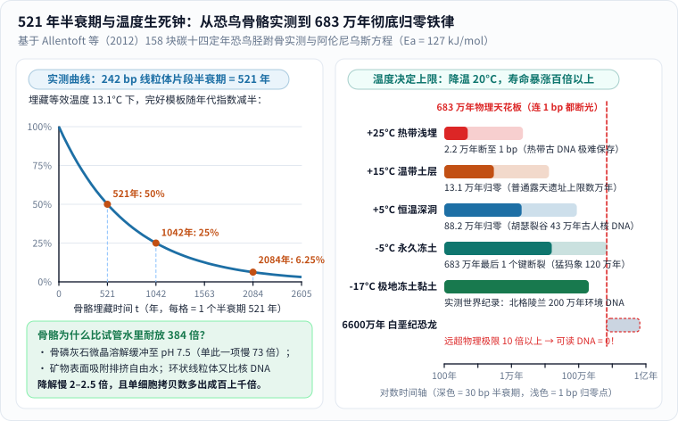
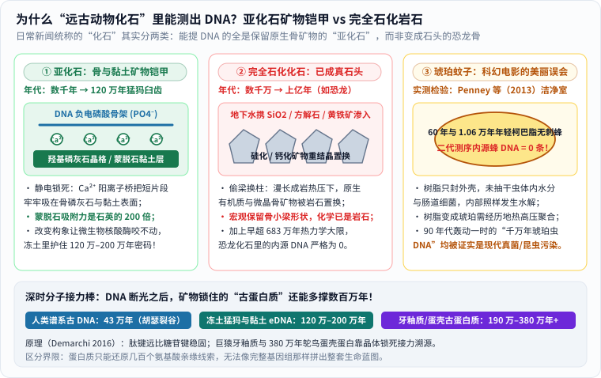
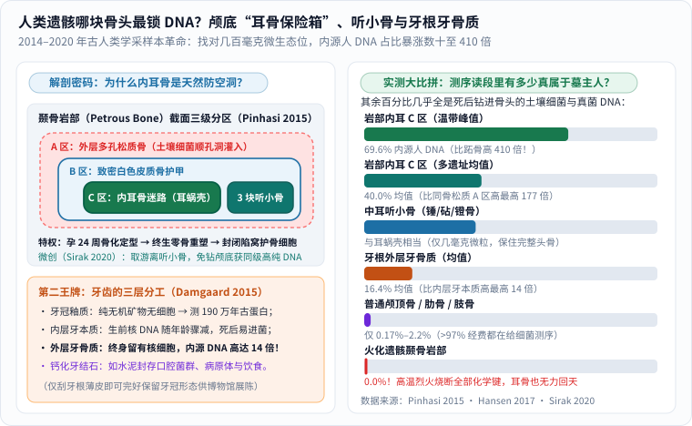
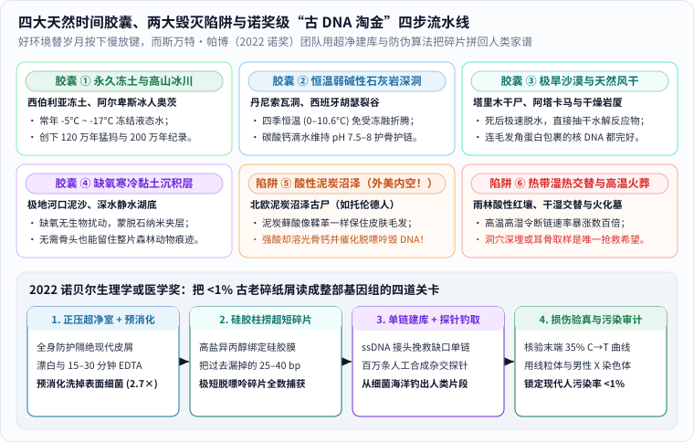

2008 年夏天，俄罗斯考古学家在西伯利亚南部阿尔泰山脉的**丹尼索瓦洞（Denisova Cave）**筛洗泥土时，捡到了一小块不起眼的碎骨头——它只有绿豆粒那么大，是一位生活在约 **4 万年前**的年轻女孩右手小拇指末端指骨的一角。

当时没人指望这块连物种都认不准的碎骨片能说出什么秘密。抱着试一试的心态，研究团队把几毫克骨粉寄给了德国莱比锡马克斯·普朗克演化人类学研究所的**斯万特·帕博（Svante Pääbo）**实验室。2010 年，当测序仪吐出结果时，整个古人类学界炸开了锅：这截小指骨里的 DNA 既不属于现代智人，也不属于欧洲的尼安德特人，而是一支此前从未在任何头骨化石上被命名过的全新古人类——**丹尼索瓦人（Denisovans）**！更神奇的是，后续比对发现，今天生活在青藏高原的藏族同胞体内那段帮助人体适应海拔四千米极度缺氧环境的王牌基因 **`EPAS1`**，正是几万年前我们的祖先与丹尼索瓦人混血时继承下来的生命礼物。凭借开创古基因组学、重写人类家谱的传奇贡献，帕博独享了 **2022 年诺贝尔生理学或医学奖**（[Nobel Prize in Physiology or Medicine 2022 Press Release](https://www.nobelprize.org/prizes/medicine/2022/press-release/)）。

如果说 4 万年前的人类指骨已经足够震撼，那么近几年远古动物刷新的纪录更是让人瞠目结舌：

- **2016 年**，西班牙胡瑟裂谷（Sima de los Huesos）地底深洞的古人类股骨与牙齿里，成功拼出了距今约 **43 万年**的古人类细胞核 DNA（[Meyer et al., *Nature*, 2016](https://pubmed.ncbi.nlm.nih.gov/26976447/)）；
- **2021 年**，西伯利亚永久冻土挖出的三颗猛犸象臼齿中，最古老的一颗“克列斯托夫卡（Krestovka）”成功读出了距今 **110 万—120 万年**的核基因组碎片（[van der Valk et al., *Nature*, 2021](https://pmc.ncbi.nlm.nih.gov/articles/PMC7116897/)）；
- **2022 年底**，丹麦科学家埃斯克·威勒斯列夫（Eske Willerslev）团队从格陵兰最北端冻土泥沙里，直接还原出了 **200 万年前**乳齿象、驯鹿、野兔、鲎与上百种北极森林植物留下的环境古 DNA，再次把地球最古老 DNA 的世界纪录推高了一倍（[Kjær et al., *Nature*, 2022](https://pmc.ncbi.nlm.nih.gov/articles/PMC9729109/)）！

看到这里，一个巨大的问号几乎会同时蹦进所有人脑海里：

> **我们在刑侦纪录片里明明看到，埋在潮湿泥土里的遗体，几个月软组织就腐烂光了，过了几十年连法医做亲子鉴定都头疼；凭什么古人类遗骸和远古动物“化石”里的 DNA 能扛过几万年甚至两百万年？既然两百万年的猛犸象都能测出来，那《侏罗纪公园》里 6600 万年前的霸王龙化石和琥珀蚊子，到底能不能抽出恐龙 DNA？**

今天，我们就拆开这架跨越百万年的分子时光机，从**死后第一秒的化学崩塌、521 年半衰期的物理铁律、“亚化石矿物铠甲”与真石头化石的天壤之别，一直讲到藏在你耳朵深处那座比肋骨强 400 倍的“人体终极 DNA 金库”**。

---

## 一、死后第一秒的崩塌：没了“全天候修补工”，DNA 怎样碎成粉尘？

很多人以为 DNA 既然是生命的蓝图，生来就该像钻石一样坚不可摧。其实恰恰相反——正如我们在[《DNA 里面有多小的世界》]()里看过的，装在细胞核里的双螺旋是一条极长、极纤细、浸在温水里时刻遭受水分子和活性氧狂轰滥炸的脆弱高分子链。

就在你读这句话的这一天里，你身体里**每一个活细胞**的 DNA 上，都会自发发生**上万次**水分子扯落碱基的化学事故！你的基因组之所以没在三天之内变成一锅乱粥，纯粹因为活细胞每年消耗海量能量（ATP），养着一支全天候巡逻的**DNA 修复酶特种部队**（比如碱基切除修复系统 BER）：哪里掉了一颗碱基，酶在几秒钟内就剪开缺口、补上新砖、焊好骨架。

一旦生命停止呼吸、心脏停跳，ATP 断供，这支修补大军当场原地解散。紧接着，三把残酷的“拆迁大锤”会按严格的时间次序砸向遗骸里的 DNA（[Dabney, Meyer & Pääbo, *Cold Spring Harb. Perspect. Biol.*, 2013](https://pmc.ncbi.nlm.nih.gov/articles/PMC3685887/)）：

*图 1：怎么看这张图——先看左栏，生命停止后除了早期内源溶酶体与土壤细菌疯抢外，长期主导古 DNA 碎裂的是水分子攻击嘌呤（$\text{A}/\text{G}$）$N$-糖苷键引发的“水解脱嘌呤 + $\beta$-消除断链”（含单次水分子攻击脱嘌呤与骨架剪断动画，支持减少动态效果模式；[单独打开高清原图](/assets/images/ancient-dna-preservation/dna-postmortem-decay-depurination-and-deamination.svg)刷新可重播），把上亿碱基对的染色体剁成 $30\text{--}100\,\text{bp}$ 的超短碎片；再看右栏，碎片单链悬垂末端的胞嘧啶（$\text{C}$）极易脱氨变成尿嘧啶（$\text{U}$）并在测序中读成胸腺嘧啶（$\text{T}$），在两端第 1 位形成高达 $35\%\text{--}40\%$ 的特征“微笑曲线”，成为科学家一眼揪出现代人污染（$<1\%$ 平线）的防伪金标准。*

### 1. 第一锤（死后几分钟到几年）：内源酶自溶与微生物狂欢

人或动物死后短短几分钟，缺氧肿胀的细胞膜和溶酶体破裂，原本关在笼子里的**内源核酸酶（DNase）**倾巢而出，开始无差别地把自家染色体剪成一段段碎块；几天之内，肠道菌群冲破肠壁，紧接着土壤里的细菌与真菌大军顺着血管孔道涌入软组织和多孔骨松质，把遗骸里的蛋白质、脂质和核酸当成自助大餐吃个精光。

**这是决定遗骸能不能留下古 DNA 的“第一道生死鬼门关”**：如果尸体暴露在温暖潮湿、微生物活跃的环境里（比如热带雨林地表或温暖酸性腐殖土），绝大部分细胞的 DNA 在头几个月到几年内就会被彻底清零，根本轮不到后面的百万年慢反应登场。

### 2. 第二锤（几百年到百万年的终极慢刀）：水解脱嘌呤断链

假如一小撮细胞侥幸躲过了早期微生物的围剿（比如迅速冰封、风干，或被锁在致密骨矿物内部），是不是就能永远高枕无忧了？

不能。只要周围还有哪怕极其微量的水分子和热运动，最致命的纯化学慢刀——**水解脱嘌呤（Hydrolytic depurination）**就会一刀接一刀地砍下去（对照图 1 左栏）：

1. **拔掉嘌呤**：DNA 四个字母（$\text{A、T、C、G}$）里，腺嘌呤（$\text{A}$）和鸟嘌呤（$\text{G}$，反应速率比 $\text{A}$ 更快）统称**嘌呤**，它们牵手脱氧核糖的那根化学键叫 **$N$-糖苷键**，是整条 DNA 分子最怕水、最怕酸的软肋。水分子（$\text{H}_2\text{O}$）日夜不停地撞击这根键，一旦撞断，嘌呤碱基脱落飘走，链上就留下一个没有字母的“空牙槽”——**无嘌呤位点（AP site）**；
2. **$\beta$-消除剪断主链**：掉了碱基的脱氧核糖环变得极不稳定，很快发生开环与 **$\beta$-消除反应（$\beta$-elimination）**，咔嚓一声直接把磷酸二酯骨架拦腰剪断！因此，当我们去观察几万年前古 DNA 碎片的断裂口时，会发现切口外侧几乎清一色曾经站着 $\text{A}$ 或 $\text{G}$；
3. **氧化路障与交联**：与此同时，缓慢氧化还会把嘧啶碱基氧化成扭曲的**海因（Hydantoins）**，或者让 DNA 与腐殖质发生美拉德交联（Maillard cross-links），像公路塌方一样把普通聚合酶死死卡在半路。

在这把慢刀几万年的凌迟下，原本单条长达数千万至上亿碱基对（$\text{bp}$）的完整人类染色体，全都被剁成了只有 **$30\text{--}100\,\text{bp}$**（甚至更短）的“纳米碎纸屑”！

### 3. 第三锤（化敌为友的防伪烙印）：单链末端脱氨与“微笑曲线”

更绝的是，断成短棍的古 DNA 两头往往不是齐平的，而是拖着几个碱基长的**单链小尾巴（Overhangs）**。帕博团队发现：躲在双螺旋内部的胞嘧啶（$\text{C}$）有氢键保护，还算稳当；可一旦暴露在单链小尾巴上，胞嘧啶发生**水解脱氨基（Cytosine deamination）**的速度会暴增 **100 倍以上**（[Dabney et al., 2013](https://pmc.ncbi.nlm.nih.gov/articles/PMC3685887/)）！

胞嘧啶（$\text{C}$）脱掉一个氨基后，当场变成了原本只该出现在 RNA 里的**尿嘧啶（$\text{U}$）**。等科学家做测序扩增时，DNA 聚合酶把 $\text{U}$ 当成了胸腺嘧啶（$\text{T}$）来配对，于是原本的 $\text{C}$ 就全被错读成了 $\text{T}$。

起初科学家烦透了这个让基因序列满篇错别字的“坏毛病”，后来却拍案叫绝——**这简直是老天爷赐给古 DNA 最完美的“时间防伪钢印”**（对照图 1 右栏）：

- 如果测出来的是一段**真正沉睡了几万年到百万年的古 DNA**，它两端第 1 个碱基位置的 $\text{C}\to\text{T}$ 错配率往往高达 **$25\%\text{--}40\%$**（比如北格陵兰 200 万年沉积物古 DNA 末端错配峰值高达 $40.7\%$），往片段中间走则迅速指数回落，在图表上画出一道漂亮的 U 形**“微笑曲线”**；
- 如果测出来的其实是考古队员滴的一滴汗、博物馆管理员打的一个喷嚏（**现代人外源污染**），这些新鲜 DNA 两端干干净净，$\text{C}\to\text{T}$ 比例是一条贴地爬行（**$<1\%$**）的平坦直线，一秒钟就会被计算机当场识破剔除！

---

## 二、158 根恐鸟腿骨算出的物理铁律：521 年半衰期与“热年龄时钟”

既然水分子每时每刻都在剪断 DNA，那一条固定长度的 DNA 埋在地下，到底多久会断掉一半？它最终彻底归零的大限又是多少年？

过去几十年，学界众说纷纭，因为不同遗址的温度、湿度、土壤酸碱度千差万别，没法放在同一把尺子下比。直到 **2012 年**，丹麦哥本哈根大学莫滕·奥伦托夫特（Morten Allentoft）、约克大学马修·柯林斯（Matthew Collins）与威勒斯列夫领衔的国际团队，在《英国皇家学会学报 B》发表了一项教科书级的精妙实验（[Allentoft et al., *Proc. R. Soc. B*, 2012](https://pmc.ncbi.nlm.nih.gov/articles/PMC3497090/)）。

他们在新西兰北岛怀卡托地区找到了相距不到 $5\,\text{km}$、埋藏环境高度一致（常年温度稳定在 **$13.1^\circ\text{C}$**，即 $286.25\,\text{K}$）的三个石灰岩溶洞，收集了 **158 根**已灭绝巨型鸟类——**恐鸟（Moa）的胫跗骨**。团队先用我们在[《双胞胎原子为什么能给万物测年龄？》]()里讲过的**放射性碳十四（$^{14}\text{C}$）测年法**，给每一根骨头标出精准年龄（跨度从距今 $602$ 年一直排到 $7839$ 年），再用定量 PCR 测量每毫克骨骼里还剩多少条完整的 **$242\,\text{bp}$ 线粒体 DNA** 片段。

*图 2：怎么看这张图——左栏是根据 Allentoft 等（2012）实测单键年断裂率 $k=5.50\times 10^{-6}\,\text{yr}^{-1}$（$13.1^\circ\text{C}$）严格绘制的指数衰减曲线：一段 $242\,\text{bp}$ 的 DNA 每隔 **521 年**残存量就腰斩一半，而更短的 $30\,\text{bp}$ 碎片因为“靶子小、不易挨刀”，半衰期延长到约 **4200 年**；右栏用对数时间轴对比不同常年温度下的 $30\,\text{bp}$ 半衰期（深色）与全链断成 $1\,\text{bp}$ 单核苷酸的物理归零大限（浅色），直观展示为什么每降温 $10^\circ\text{C}$ 寿命就能翻 $6.5\text{--}7.5$ 倍，而 $6600$ 万年前的恐龙在任何地表温度下都早已归零。*

实验数据干净利落地证明：**骨骼中 DNA 的长期化学断裂，严格服从放射性核素那样的“一阶指数衰减定律”**！

### 1. 为什么“越短的碎片活得越久”？三步看懂半衰期公式

假设在恒定环境温度下，DNA 链上**任意一个核苷酸连接键**每年发生断裂的概率（单键速率常数）是 $k$。在 $13.1^\circ\text{C}$ 的新西兰溶洞骨骼中，实测得到：

$$
k = 5.50 \times 10^{-6}\;\text{yr}^{-1}
$$

也就是说，单个化学键每年只有约“百万分之五点五”的概率被水分子撞断。听起来很小对不对？可架不住一条 DNA 片段是由许多个化学键串联起来的——只要中间**任意断一刀**，整段序列就不完整了！因此，一段长度为 $L$（单位：$\text{bp}$）的目标片段，经过时间 $t$（年）后还能保持完整的比例 $N(t)/N_0$ 是：

$$
\frac{N(t)}{N_0} = e^{-k L t}, \qquad t_{1/2}(L) = \frac{\ln 2}{k L}
$$

这里 $\ln 2 \approx 0.6931$。把长度 $L = 242\,\text{bp}$ 和 $k = 5.50\times 10^{-6}\,\text{yr}^{-1}$ 代进去一算：

$$
t_{1/2}(242\;\text{bp}) = \frac{0.6931}{5.50\times 10^{-6} \times 242} \approx \mathbf{521\;\text{年} }
$$

这就是科普界著名的**“DNA 半衰期 521 年”**的真实来历！但请你一定注意这个公式里藏着的两个关键门道（很多人看新闻最容易误解的地方）：

1. **半衰期跟你要找的“片段长度 $L$”成反比**：$521$ 年并不是说所有 DNA 都消失了一半，而是 **$242\,\text{bp}$ 这么长的片段**每 $521$ 年少一半！如果你换用现代超短片段测序仪，只要求捞出 **$L = 30\,\text{bp}$** 的超短碎片（$30$ 个字母组合数高达 $4^{30} \approx 1.15\times 10^{18}$，足以唯一比对回人类或猛犸象基因组上的精确坐标），由于靶子缩小到原来的八分之一，在同样 $13.1^\circ\text{C}$ 下它的半衰期立刻拉长到 **$4201$ 年**！
2. **为什么古人类“线粒体 DNA”总比“细胞核 DNA”容易测得多？** Allentoft 团队同时发现，由于核染色质解聚时更容易遭受水解，**细胞核 DNA 的衰减速度比环状线粒体 DNA 快 $2\text{--}2.5$ 倍**；再加上一个普通体细胞里只有 **2 套**细胞核基因组，却塞着 **几百到上千个**线粒体拷贝（起跑线就赢了几百倍）！这就是为什么帕博 1997 年最早测出的是尼安德特人的线粒体片段，又苦熬了 13 年改进技术，才在 2010 年拼出尼安德特人的细胞核基因组草图。

### 2. 阿伦尼乌斯热时钟：温度每降 $10^\circ\text{C}$，寿命暴涨近 7 倍！

为什么西伯利亚和格陵兰能测出百万年古 DNA，而人类真正的摇篮——非洲热带草原，至今连一具几十万年前灭绝古人类的基因组都没测出来（[Nobel Prize 2022](https://www.nobelprize.org/prizes/medicine/2022/press-release/)）？

答案全写在物理化学的**阿伦尼乌斯方程（Arrhenius equation）**里。脱嘌呤断链需要先跨过一道极高的化学能垒——实测骨骼内 DNA 水解的**活化能高达 $E_a = 127\;\text{kJ/mol}$**（气体常数 $R = 8.314\;\text{J/(mol}\cdot\text{K)}$，$T$ 为开尔文绝对温度）：

$$
k(T) = A \exp\!\left(-\frac{E_a}{R T}\right)
$$

因为活化能 $E_a$ 很大，指数项对温度 $T$ 敏感到了近乎夸张的地步：**埋藏环境的常年均温每下降 $10^\circ\text{C}$，DNA 化学键断裂的速度就会暴跌 $6.5\text{--}7.5$ 倍！** 我们直接列出 Allentoft 等（2012）根据实测动力学算出的四档温度生死账本（对照图 2 右栏）：

| 埋藏地层常年均温 | 典型代表环境 | $30\,\text{bp}$ 短片段半衰期 | 平均链长断至 $1\,\text{bp}$ 的彻底归零大限 |
| :--- | :--- | :--- | :--- |
| **$+25^\circ\text{C}$** | 热带地表 / 非洲低地雨林 | 仅约 **$500$ 年** | 约 **$2.2$ 万年** |
| **$+15^\circ\text{C}$** | 温带浅层土壤 / 温暖洞穴 | 约 **$3,000$ 年** | 约 **$13.1$ 万年** |
| **$+5^\circ\text{C}$** | 高纬度冷凉深层溶洞 | 约 **$20,000$ 年** | 约 **$88.2$ 万年** |
| **$-5^\circ\text{C}$** | 亚极地高山永久冻土 | 高达 **$158,000$ 年** | 约 **$683$ 万年** |

更震撼的例子来自 2022 年刷新世界纪录的北格陵兰**卡普哥本哈根组（Kap København，北纬 $82^\circ 24'$）**：那里的永久冻土常年平均温度低至 **$-17^\circ\text{C}$**。科学家用阿伦尼乌斯方程把这 **200 万年**的极寒岁月折算成温带 $+10^\circ\text{C}$ 下的**等效热年龄（Thermal age）**，结果令人倒吸一口凉气——在 $-17^\circ\text{C}$ 冻土里躺满整整 **200 万年**，DNA 承受的热化学折损居然只相当于在 $+10^\circ\text{C}$ 温带土里埋了区区 **2,700 年**，足足慢了 **741 倍**（[Kjær et al., *Nature*, 2022](https://pmc.ncbi.nlm.nih.gov/articles/PMC9729109/)）！

反过来，这张表也给《侏罗纪公园》判了无可上诉的物理死刑：**哪怕一头白垩纪末期（距今 $6600$ 万年）的霸王龙死后一秒就被塞进 $-5^\circ\text{C}$ 的天然超级冰柜，在距今约 $683$ 万年时，它全身最后两个相连的核苷酸也早已彻底断成了单个字母的化学粉末（平均长度 $= 1\,\text{bp}$）**——后面漫长的五千九百万年里，连半个基因片段都不可能剩下来。

---

## 三、核心解惑：为什么“远古动物化石”里还有 DNA？揭开“亚化石矿物铠甲”与真石头的分界

读到这里，细心的你肯定敏锐地抓住了另一个关键悬念：

> 如果在实验室试管的微酸性缓冲液（$\text{pH }5$）里做实验，裸露 DNA 的脱嘌呤速度其实飞快；为什么进了动物骨头和泥沙里，DNA 的寿命会奇迹般地延长几百倍？平时新闻里总说“从古人类化石、猛犸象化石里提取出 DNA”，**难道变成石头的化石真能保住 DNA 吗？**

这正是普通读者最容易被日常汉语“化石”二字绕晕的地方！真相分成两半：**第一，能测出 DNA 的“远古动物化石”，在科学上绝大多数根本还没变成石头，而是披着原装矿物铠甲的“亚化石”；第二，正是骨头与黏土里的纳米矿物晶体，给 DNA 撑起了一座慢上近 400 倍的“化学防空洞”！**

*图 3：怎么看这张图——左栏是距今数千年至 200 万年内能测出古 DNA 的**亚化石（Subfossil）与冻土沉积物**：骨骼保留生前原装纳米微晶生物磷灰石，靠 $\text{Ca}^{2+}$ 阳离子桥吸附 DNA 磷酸骨架并缓冲 $\text{pH}\approx 7.5$，使衰变比 $\text{pH }5$ 纯水慢 **384 倍**（蒙脱石黏土吸附力更是石英的 **200 倍**）；右栏是数千万至上亿年的**完全石化真化石**（如霸王龙）与树脂琥珀，原装骨矿物早已被地下水硅质/方解石置换成真石头，且远超 $683$ 万年热力学大限，内源 DNA 严格为 **0**；底部横栏展示跨越 200 万年极限后接力登场的**古蛋白质组学**。*

### 1. 日常说的“古生物化石”，其实混装了两种截然不同的东西

我们在博物馆里看到的“化石”，在埋藏学（Taphonomy）上严格区分成两个阶段（对照图 3 左右两栏）：

- **左半边：亚化石（Subfossils，几千年—百余万年）**
  无论是 4 万年前的尼安德特人与丹尼索瓦人骨骼、洞穴里的冰期洞熊与洞狮，还是西伯利亚冻土里 120 万年前的猛犸象臼齿，它们虽然年代久远、有机胶原蛋白部分流失、表面甚至布满岁月风化的龟裂纹，但**骨骼和牙齿本身的矿物主体依然是动物活着时自己长出来的原装生物矿物——纳米级微晶碳酸化羟基磷灰石**，化学式可简写为 $\text{Ca}_{10}(\text{PO}_4)_6(\text{OH})_2$。
- **右半边：完全石化真化石（True Permineralized / Replaced Fossils，数千万—上亿年）**
  像距今 $6600$ 万年以上的白垩纪恐龙骨架、寒武纪三叶虫，经过漫长地质年代地下水的浸泡，就像我们在[《黄金有价玉无价，一块石头怎样历劫亿年变成传世古玉？》]()里聊过的地下矿物交代作用一样，含硅、含钙或含铁的地下水把骨头孔隙填死（充矿石化），甚至用二氧化硅（玛瑙/石英 $\text{SiO}_2$）、方解石（$\text{CaCO}_3$）或黄铁矿把原本的生物磷灰石**彻底重结晶、偷梁换柱成了一块真正的石头**——外观还保留着骨骼纹理，里头的原装生物分子却早已荡然无存。

所以，科学家每次从远古动物身上抽出 DNA，抽的都是**尚未彻底石化的“亚化石”或冰封遗骸**，绝不是已经变成硅化木或岩石的真石头化石！

### 2. 慢了 384 倍！生物磷灰石与蒙脱石黏土的“三重矿物铠甲”

那么，为什么装在亚化石骨头里的 DNA，比装在微酸性水（$\text{pH }5$）里慢了整整 **384 倍（约 400 倍）**（[Allentoft et al., 2012](https://pmc.ncbi.nlm.nih.gov/articles/PMC3497090/)）？为什么北格陵兰没有骨头的冻土泥沙也能锁住 200 万年前的动植物 DNA？

秘密在于一套精妙绝伦的**“无机矿物护送有机分子”**物理化学机制：

1. **第一重护盾：$\text{Ca}^{2+}$ 阳离子静电铆钉（晶面锁定）**
   DNA 的磷酸二酯骨架每隔 $0.34\,\text{nm}$ 就带着一个负电荷（$\text{PO}_4^-$）。当细胞死后破裂，骨骼和牙齿里密集排列的纳米羟基磷灰石晶体表面富含带正电的钙离子（$\text{Ca}^{2+}$），就像无数颗强力磁吸铆钉，瞬间通过静电桥把带负电的 DNA 双链死死贴合在矿物晶面上！
   而在没有骨头的泥沙沉积物里，扮演同一角色的大功臣是**层状硅酸盐黏土矿物——尤其是蒙脱石（Smectite）**。威勒斯列夫与矿物学家卡琳·桑德（Karina Sand）团队在 2022 年《自然》论文里用吸附实验定量测出：**蒙脱石黏土对 DNA 的结合容量高达石英砂（$\text{SiO}_2$）的 200 倍**（[Kjær et al., 2022](https://pmc.ncbi.nlm.nih.gov/articles/PMC9729109/)；[SPAAM Community Ancient eDNA Guide](https://www.spaam-community.org/intro-to-ancient-metagenomics-book/introduction-to-edna.html)）！一旦 DNA 借着土壤里的 $\text{Ca}^{2+}/\text{Mg}^{2+}$ 阳离子桥吸附进黏土片层的纳米缝隙，体积庞大的微生物核酸酶（DNase）根本塞不进纳米窄缝，只能望洋兴叹。
2. **第二重护盾：$\text{pH }7.5$ 碱性缓冲罩（单这一招就慢了 73 倍！）**
   脱嘌呤反应是典型的**酸催化水解反应**——环境里氢离子（$\text{H}^+$）越多（越酸），嘌呤氮原子越容易被质子化脱落。如果骨头直接泡在 $\text{pH }5$ 的酸性土壤水里，DNA 会迅速烂光；但羟基磷灰石矿物微溶时会持续中和酸根，把致密骨骼微孔内部的酸碱度牢牢缓冲在微碱性的 **$\text{pH}\approx 7.5$**！Allentoft 等（2012）严格计算证明：**仅仅把微环境从 $\text{pH }5.0$ 抬升缓冲到 $\text{pH }7.5$ 这一项，脱嘌呤速率就当场下降了 73 倍！**
3. **第三重护盾：排斥自由水与抑制构象扭曲（再慢 5 倍以上）**
   紧贴在磷灰石晶面并被胶原纤维包裹的 DNA 处于高度缺水的纳米封闭微腔里，既减少了自由水分子的碰撞频率，又限制了糖环发生 $\beta$-消除所需的空间扭转。**$73\text{ 倍（pH 缓冲）}\times 5.3\text{ 倍（晶面吸附与限水）} \approx 384\text{ 倍}$**——正是这三重矿物铠甲联手，才为人类留住了百万年尺度的生命密码！

### 3. 顺手破除一个童年滤镜：琥珀里的蚊子，真能保住恐龙 DNA 吗？

“等等！骨头会石化，那《侏罗纪公园》里被松脂一秒钟裹住、隔绝空气的琥珀昆虫总该能保住 DNA 吧？”

上世纪 90 年代初，确实有几篇轰动一时的论文宣称用 PCR 从几千万年前的多米尼加琥珀昆虫里扩增出了 DNA。但科学界很快起疑：当时的 PCR 极其容易把实验室空气里的现代真菌或昆虫碎屑放大亿万倍。

**2013 年**，英国曼彻斯特大学古 DNA 权威特里·布朗（Terry Brown）与昆虫化石专家大卫·彭尼（David Penney）团队做了一次“降维打击”式的终极检验（[Penney et al., *PLOS ONE*, 2013](https://pmc.ncbi.nlm.nih.gov/articles/PMC3770633/)）：他们甚至没去刁难几千万年前的老琥珀，而是挑了琥珀尚未彻底聚合变硬的年轻前身——哥伦比亚**柯巴脂（Copal）**里包裹得栩栩如生的无刺蜂，一枚距今 **1.06 万年**，另一枚甚至只有 **不到 60 年**历史！在最严格的古 DNA 超净室里做高通量二代测序后，结果让所有科幻迷心碎：**哪怕在仅仅几十年前刚凝固的天然树脂里，也没能检出任何可信的内源昆虫古 DNA！**

原因其实很朴素：天然松脂并不是液氮速冻机——昆虫被黏住死后，松脂外皮虽然隔绝了大虫子，却无法立刻抽干昆虫体内的水分，内源核酸酶与肠道菌照样在虫肚子里狂切 DNA；而在随后几千到几千万年里，树脂对微量水汽和氧气依然是缓慢半透的，酸性的有机树脂环境反而加速了水解。

### 4. 超过 200 万年怎么办？“古蛋白质组学”接过溯源接力棒！

难道一旦跨过 200 万年的物理红线，远古演化的分子历史就彻底变成瞎子了吗？并没有！就在古 DNA 停下脚步的地方，**古蛋白质组学（Paleoproteomics）**接过了接力棒（对照图 3 底部）：

连接氨基酸的**酰胺键（肽键）**在热力学上远比连接嘌呤碱基的 $N$-糖苷键坚固得多；而当微量结构蛋白被锁死在**牙齿釉质（Enamel）**或**鸟类蛋壳方解石晶体内部**形成封闭系统时，连水分子都钻不进去！

- **2016 年**，比阿特丽斯·德马基（Beatriz Demarchi）与马修·柯林斯团队在炎热的非洲赤道坦桑尼亚莱托利遗址（阿法南方古猿足迹所在地，等效 $+10^\circ\text{C}$ 热年龄高达恐怖的 **1600 万年**！），从距今 **380 万年前的鸵鸟蛋壳**晶格内部提取出了完整的矿化结合蛋白氨基酸序列，比此前的古蛋白纪录推进了约 50 倍（[Demarchi et al., *eLife*, 2016](https://pmc.ncbi.nlm.nih.gov/articles/PMC5039028/)）；
- 而在中国南方湿热溶洞里出土的 **190 万年前步氏巨猿（*Gigantopithecus blacki*）**臼齿，DNA 早已归零，科学家正是靠牙釉质里的古蛋白序列，一举实锤这位身高近三米的远古巨猿是我们现代红毛猩猩的远房叔伯！

---

## 四、人体骨骼里的“超级金库”：为什么耳蜗旁一小块骨头，顶得上肋骨 400 倍？

把视线拉回**人类遗骸**。假如今天考古队在一处温带墓葬或古人类遗址挖出了一副保存尚可的古人骨架，文物局规定只允许取最小的一点点骨样去测全基因组——**你该选大腿骨、肋骨、头盖骨，还是牙齿？**

在 2014 年以前，全世界大多数古 DNA 实验室都在锯肋骨、腿骨或钻牙齿，而且经常做得欲哭无泪：从温带墓葬一根脚掌骨（跖骨）或颅顶骨里抽出来的总 DNA，上测序仪跑完一算，真正属于墓主人自己的**内源人类 DNA（Endogenous DNA）往往只占可怜的 $0.17\%\text{--}2.2\%$**，剩下的 **$98\%\text{--}99.8\%$ 全都是死后钻进骨头里的土壤细菌和真菌 DNA**！这意味着科研经费每烧掉 100 万，有 99 万都在免费帮泥土里的细菌测基因组！

直到 **2014—2015 年**，爱尔兰都柏林大学罗恩·平哈西（Ron Pinhasi）领衔的团队投下了一枚改写整个古人类学游戏规则的“核弹”：他们对同一具古人遗骸全身不同部位做系统对比后发现，藏在耳朵深处颅底**颞骨岩部（Petrous part of the temporal bone）最核心的“内耳骨迷路 / 耳蜗壳（Otic capsule）”**，是一座匪夷所思的天然人类 DNA 超级金库（[Pinhasi et al., *PLOS ONE*, 2015](https://pmc.ncbi.nlm.nih.gov/articles/PMC4472748/)；[Hansen et al., *PLOS ONE*, 2017](https://journals.plos.org/plosone/article?id=10.1371/journal.pone.0170940)）！

*图 4：怎么看这张图——左栏拆解人体全身保存古 DNA 最强的两大解剖王牌：**颅底颞骨岩部的内耳骨迷路（及三块微创听小骨）**与**牙根最外层的牙骨质**；右栏汇总 Pinhasi 等（2015）、Hansen 等（2017）与 Sirak 等（2020）在同一具人类遗骸上的实测对决：内耳骨迷路的内源人类 DNA 占比均值高达 $40\%$（最高近 $70\%$），比同一人多孔的松质岩部高 **177 倍**、比脚部跖骨更是高出惊人的 **267—410 倍**；而一旦遗骸经历过高温火葬，哪怕是最坚硬的颞骨岩部，DNA 也会彻底碳化归零（$0\%$）。*

### 1. 410 倍天壤之别：内耳骨迷路与听小骨凭什么拥有“免死金牌”？

看一眼图 4 右栏的同体实测数据，差距震撼到不像同一具身体长出来的骨头：

- 在平哈西团队检测的温带古代骨架中，同一具遗骸的**脚部跖骨**内源人类 DNA 只有 **$0.17\%$**，哪怕同在颞骨岩部外围的多孔松质区（Part A）也很低；但只要精准钻取包裹耳蜗的那圈薄薄的乳白色最致密骨壳（**骨迷路 Part C**），内源人类 DNA 占比瞬间飙升到 **$35.36\%\text{--}69.63\%$**——富集倍数高达跖骨的 **267 倍至 410 倍**（[Pinhasi et al., 2015](https://pmc.ncbi.nlm.nih.gov/articles/PMC4472748/)）！
- 丹麦汉森（Henrik Hansen）与奥伦托夫特团队对多具配对古人头骨的平行测试也印证：普通**颅顶骨**内源占比均值仅 **$2.2\%$**，**牙根牙骨质**均值升至 **$16.4\%$**，而**颞骨岩部**均值高达 **$40.0\%$**（[Hansen et al., 2017](https://journals.plos.org/plosone/article?id=10.1371/journal.pone.0170940)）！正是靠着颞骨岩部这把金钥匙，2015 年以后全球测定成千上万例古人类全基因组的成本骤降了几十倍，直接引爆了近十年的古基因组学大爆发。

**同样是磷酸钙长出来的骨头，为什么偏偏耳朵深处这一小撮骨头如此逆天？**

**2020 年**，哈佛医学院大卫·赖希（David Reich）与平哈西团队在《基因组研究》上揭开了背后的发育生物学谜底，还顺带解锁了一个更温柔的“微创神器”——**中耳听小骨（锤骨、砧骨、镫骨）**（[Sirak et al., *Genome Research*, 2020](https://pmc.ncbi.nlm.nih.gov/articles/PMC7111520/)）：

1. **终生“零装修”特权**：我们全身的腿骨、肋骨和头盖骨为了承受运动冲击、修复微裂纹，一辈子都在由破骨细胞和成骨细胞不停“拆旧楼盖新楼”（成人骨骼每年约有 $10\%$ 被重塑翻新），因此骨头内部布满了四通八达的哈弗斯血管通道——人一死，土壤细菌就顺着这些高速公路长驱直入。唯独**内耳骨迷路和三块听小骨**承担着精密传导声波振动的任务，一旦密度或结构改变就会导致听觉失真！因此，它们在你还在妈妈肚子里 **孕 18—24 周**时就已经骨化定型到成人尺寸，此后一辈子受到骨保护素（OPG）严格抑制，**骨重塑率几乎为零**！
2. **超高密度“单人防空洞”**：正因为从不翻修，这片全身矿物密度最高的骨质里，保留了极高密度的胚胎期骨陷窝（Lacunae）。每一个骨细胞都像住进了一间没有窗户、纳米级矿化水泥封死的独立单人保险柜——死后地下水进不去，外面的腐败细菌更是连门缝都摸不着！
3. **不伤头骨的微创取样**：过去取颞骨岩部总归要在珍贵的古人颅底钻个小孔，博物馆馆长看着心疼。Sirak 等（2020）证明，中耳腔里只有几毫克重、死后常常自然脱落游离的**听小骨**拥有与耳蜗骨迷路完全同源的“零重塑”基因，轻轻从外耳道倒出一粒听小骨，**连头骨一根毫毛都不用碰**，就能拿到与颞骨岩部不相上下的顶级高纯度人类 DNA！

### 2. 第二王牌“牙根外皮”与两个反直觉冷知识

如果考古现场没挖到头骨，只找到几颗散落的牙齿呢？这里也有讲究！一颗牙齿由三层组成（对照图 4 左下栏，[Damgaard et al., *Sci. Rep.*, 2015](https://pmc.ncbi.nlm.nih.gov/articles/PMC4472031/)）：

- **牙冠最外层的牙釉质（Enamel）**：它是全身最硬的矿物质，但成熟后几乎 $96\%$ 以上是纯无机磷灰石、**不含任何活细胞核**，所以测古 DNA 基本没戏（却是测 190 万年古蛋白的圣地）；
- **牙根内部的牙本质（Dentine）**：虽然占牙齿大头，但它生前细胞体都在牙髓腔边缘，死后牙髓腐烂空洞极易吸进泥水和细菌，核 DNA 随生前年龄增长还会显著流失；
- **真正藏宝的是包裹牙根表面薄薄一层的“牙骨质（Cementum）”**！牙骨质终生保留着大量完整的有核成牙骨质细胞，丹麦团队实测：**刮取外层牙骨质得到的内源人类 DNA 比例最高可达内层牙本质的 14 倍**！如果再用温和的 EDTA 蛋白酶液做 15—60 分钟“表面预消化洗澡”，洗掉粘在外表的现代人手汗和土壤菌，内源人类 DNA 纯度还能再翻 **2.7 倍**，而且整颗牙冠完好无损，照样能摆回博物馆展柜！

此外还有两样特殊遗存与一条铁律值得记住：
- **角蛋白毛发与钙化牙结石**：古冻土或干尸留下的头发（如 4000 年前格陵兰萨卡克古爱斯基摩人的一绺头发，[Der Sarkissian et al., *Phil. Trans. R. Soc. B*, 2015](https://pmc.ncbi.nlm.nih.gov/articles/PMC4275894/)）由疏水致密的角蛋白包裹，细菌钻不进去，外表面甚至可以用漂白水暴力擦洗而不伤内部古 DNA；而古人牙齿上没刷干净的**牙结石（Dental calculus）**高度钙化后堪比水泥，把几千年前古人嘴里的口腔菌群、肺炎病原体甚至嚼过的动植物 DNA 封存得严严实实。
- **火葬遗骸归零铁律**：古人一旦实行高温火葬（柴堆温度通常达 $600^\circ\text{C}\text{--}1000^\circ\text{C}$），有机质瞬间热解碳化，生物磷灰石发生高温重结晶。Hansen 等（2017）对丹麦青铜时代火化墓葬的颞骨岩部实测证明：**哪怕是号称最坚固的耳骨金库，火化后可靠的内源古人类 DNA 也彻底归零（$0\%$）**，测出来的零星人类片段全是后世污染。

---

## 五、大自然的五大“时光胶囊”与沼泽干尸陷阱，以及超净室怎样拼回碎纸片？

把内因（矿物铠甲与耳骨金库）和外因（低温、无水、弱碱、无氧）合在一起，我们就彻底明白了地球上哪几处角落最容易诞生震惊世界的古 DNA 奇迹——同时也能看穿一个连老考古队员都常上当的**“完美干尸陷阱”**（[Morton-Hayward et al., *Proc. R. Soc. B*, 2024](https://pmc.ncbi.nlm.nih.gov/articles/PMC10950470/)）。

*图 5：怎么看这张图——上半栏横向对比大自然四类顶级古 DNA 保存环境与最反直觉的第 ⑤ 类“酸性泥炭沼泽尸陷阱”：极寒冻土、恒温弱碱石灰岩深洞、极旱沙漠与缺氧冷泥都能锁住古 DNA，唯独北欧泥炭沼泽虽然靠泥炭酸鞣制保住了栩栩如生的皮肤与胡茬，却因强酸溶解骨矿物并疯狂催化脱嘌呤而把 DNA 毁得一干二净；下半栏展示帕博团队开创的正压防污染超净室、硅胶柱超短片段回收、单链建库（ssDNA）与计算机散弹枪拼接流水线。*

### 1. 四大黄金保险箱 vs 一个“颜值最高却毁灭 DNA”的温柔陷阱

对照图 5 上半栏，自然界对待遗骸的脾气截然不同：

1. **极地永久冻土与高山冰川（低温冰封 + 液态水冻结）**
   这是无可争议的宇宙第一梯队：从北格陵兰 **200 万年**生态系、西伯利亚 **120 万年**猛犸象、加拿大育空地区 **73.5 万年**古马，到阿尔卑斯山冰川里封存 **5,300 年**的冰人“奥茨（Ötzi）”，极寒不仅冻僵了腐败微生物，更直接把脱嘌呤速率压低了几百倍。但也要警惕：**最怕反复冻融**！一旦气候变暖导致冻土解冻再结冰，冰晶反复膨胀会把细胞和矿物微结构撕得粉碎，氧气与细菌趁虚而入，几十年就能毁掉百万年的积累。
2. **恒温弱碱性喀斯特石灰岩深洞（低温恒温 + $\text{CaCO}_3$ 酸碱护盾）**
   为什么迄今最古老的人类支系核 DNA（西班牙**胡瑟裂谷 43 万年前**早期尼安德特人祖先，[Meyer et al., 2016](https://pubmed.ncbi.nlm.nih.gov/26976447/)）和同时住过尼安德特人、丹尼索瓦人乃至第一代混血少女“丹妮（Denny）”的**丹尼索瓦洞**，全都出在石灰岩深洞里？因为幽深的地底洞穴四季恒温凉爽（胡瑟裂谷常年稳定在 $10.6^\circ\text{C}$，丹尼索瓦洞常年接近 $0^\circ\text{C}$），没有地表冬夏几十度的温差折腾；更重要的是，石灰岩（碳酸钙 $\text{CaCO}_3$）渗水呈天然**弱碱性**，像一层温柔的保护膜牢牢护住骨骼里的羟基磷灰石不被酸蚀！
3. **极度干旱沙漠、干冷洞穴与盐矿（急速脱水断绝水解）**
   脱嘌呤断链的化学反应物本身就是水（$\text{H}_2\text{O}$）。在中国新疆塔里木盆地极旱荒漠、安第斯高寒干洞或古埃及泡碱（Natron）脱水的木乃伊中，遗体水分在腐败菌繁殖前就被迅速抽干，化学水解失去了“弹药”，几千年前的古人类与古病原体基因组得以保存。
4. **深海与寒区湖底缺氧冷泥（无氧抑菌 + 黏土纳米锁死）**
   湖底与海底沉积层隔绝氧气，好氧腐败菌无法生存，低温加上蒙脱石等黏土矿物对游离 DNA 的强力吸附，使科学家哪怕不挖骨头，只取一管湖底泥芯，就能像翻史书一样逐层读出过去几万年岸边走过哪些动物、长过哪些森林。
5. **最反直觉的巨坑：北欧酸性泥炭沼泽“湿地尸（Bog bodies）”！**
   1950 年丹麦日德兰半岛泥炭沼泽挖出距今约 2400 年的铁器时代“图伦男子（Tollund Man）”时，现场所有人以为他是刚遇害几天的失踪者——他脸上连胡茬、眼角鱼尾纹、脚底指纹甚至胃里最后一顿大麦亚麻籽粥都清晰可辨！按直觉，这么完美的遗体测个 DNA 还不是手到擒来？
   **结果恰恰相反：酸性泥炭沼泽尸几乎是古 DNA 学家的噩梦！** 因为泥炭藓释放出大量腐殖酸与泥炭聚糖（Sphagnan），一方面像皮革厂硝皮子一样把皮肤胶原蛋白交联“鞣制”得千年不腐，另一方面却制造出 **$\text{pH }3.2\text{--}4.5$ 的强酸环境**——强酸先把骨头里的羟基磷灰石矿物溶解一空（许多湿地尸骨头软得像泡软的纸板），紧接着海量 $\text{H}^+$ 离子以高出中性环境上百倍的速度把脱嘌呤和交联推向极致，把双螺旋切成了无法识别的残渣！这再次印证了一条黄金准则：**肉眼看着皮肤完好，绝不等于分子层面的 DNA 完好；保住微晶矿物与弱碱低温，远比保住一张皮重要得多！**

### 2. 人类怎么把 $35\,\text{bp}$ 的烂碎纸片，重新拼回 30 亿字母天书？

就算老天爷赏饭吃，留下一块 40 万年前的深洞古骨，递到科学家手里的依然是一堆混着 $99\%$ 细菌 DNA、碎成平均只有 **$35\text{--}50\,\text{bp}$**、满身氧化路障和末端错别字的残破分子。帕博与弟子马蒂亚斯·迈耶（Matthias Meyer）、杰西·达布尼（Jesse Dabney）等人靠三项硬核技术逆天改命（对照图 5 下半栏）：

1. **比芯片厂还严苛的“正压古 DNA 超净室”**：早年用普通 PCR 扩增百余碱基片段时，只要实验员呼吸带出一粒现代人皮屑（里头全是几万 $\text{bp}$ 完好无损的新鲜 DNA），扩增仪就会优先把这粒现代污染放大十亿倍，把真正的古 DNA 彻底淹没——上世纪“测出恐龙 DNA”的乌龙全栽在这儿。现代古 DNA 实验室实行全身连体防护服、室内空气正压过滤（只出不进）、全程紫外线与次氯酸钠漂白剂消杀，样品进入测序文库前绝不踏入普通分子实验室半步。
2. **硅胶柱超短片段捕获 + 单链建库术（ssDNA library）**：过去常规提取试剂盒会把短于 $70\,\text{bp}$ 的小碎片当成废液冲进下水道——可越古老的遗骸，DNA 全都集中在 **$25\text{--}45\,\text{bp}$** 这一档！2013 年达布尼发明高盐异丙醇硅胶柱超短片段回收法（[Dabney et al., *PNAS* / reviewed in *CSH Perspect.*, 2013](https://pmc.ncbi.nlm.nih.gov/articles/PMC3685887/)），配合迈耶发明的**单链 DNA 建库术**（先把受损双链彻底解开成两条独立单链分别接上测序接头，绕开单侧断口与交联死结），一下把古老样本的有效 DNA 回收率暴涨了 **5 到 20 倍**——胡瑟裂谷 43 万年古人类 DNA 和丹尼索瓦高覆盖度基因组全靠这招起死回生！
3. **散弹枪海量测序 + 计算机“碎纸机拼图”**：不再强求一次读几百个字母，而是把几十亿条只有三四十个字母长的超短碎纸片全部读出来，先靠末端 $\text{C}\to\text{T}$“微笑曲线”过滤掉现代污染，再用超算把属于古人类的百万条重叠短句像拼碎纸机文件一样对齐到参考基因组上，哪怕同一个位点每条碎片都有损伤，叠上二三十层就能拼出准确率超过 $99.9\%$ 的远古基因组——甚至连骨头都不需要，直接从洞穴一勺泥土里就能捞出几万年前古人类上厕所或流血留下的沉积物核 DNA！

---

## 六、一张表收尾：远古遗骸分子保存的终极边界

最后，我们把从几十年法医鉴识到上亿年恐龙化石的完整分子保存版图浓缩成一张速查表，下次再刷到“某地挖出远古化石能否复活史前巨兽”的新闻，你一眼就能算出它的科学底牌：

| 时间尺度 | 代表遗骸与典型环境 | 保存状态与核心护盾 | 人类今天能读出什么？ |
| :--- | :--- | :--- | :--- |
| **几年—几千年** | 考古墓葬骨骼、埃及/塔里木干尸、阿尔卑斯冰人奥茨（$5300$ 年） | 颞骨岩部耳蜗壳与牙骨质锁死骨细胞；干寒缺水阻断微生物与水解 | 高覆盖度全基因组、亲缘家谱、发色瞳色、生前感染的鼠疫/结核病原体、甲基化表观遗传年龄 |
| **几万年—$43$ 万年** | 尼安德特人、丹尼索瓦指骨（$4$ 万年）、西班牙胡瑟裂谷古人类（$43$ 万年） | 恒温凉爽石灰岩弱碱深洞（$\text{pH}\approx 7.5$）+ 生物磷灰石 $\text{Ca}^{2+}$ 晶面铆定（衰变慢 $384$ 倍） | 靠超短硅胶柱 + 单链建库拼出古人类核基因组，改写智人走出非洲与混血演化史 |
| **$100$ 万—$200$ 万年** | 西伯利亚冻土猛犸象臼齿（$120$ 万年）、北格陵兰冻土泥沙（$200$ 万年，世界纪录） | $-5^\circ\text{C}$ 至 $-17^\circ\text{C}$ 极寒永久冻土（热年龄折算慢 $741$ 倍）+ 牙釉质/牙骨质或蒙脱石黏土（吸附力为石英 $200$ 倍） | $30\text{--}50\,\text{bp}$ 超短碎片还原远古动物演化支系与两百万年前整个北极森林生态圈 |
| **$190$ 万—$380$ 万年** | 广西步氏巨猿臼齿（$190$ 万年）、坦桑尼亚鸵鸟蛋壳（$380$ 万年） | DNA 已越过断裂极限归零，但牙釉质与蛋壳方解石晶格内部形成纳米封闭系统锁死肽键 | **古蛋白质组学**接力登场，测出数百个氨基酸序列精准判定远古物种亲缘关系 |
| **$6600$ 万年以上** | 白垩纪霸王龙等完全石化恐龙骨骼、琥珀/柯巴脂昆虫 | 地下水硅质/方解石彻底置换为真石头，且远超 $-5^\circ\text{C}$ 下 $683$ 万年全键断裂物理大限 | **内源 DNA 严格为 $0$**；仅存骨骼形态、同位素地球化学信号与极少数争议性的软组织降解聚合物残迹 |

回望这场跨越两百万年的分子接力，你会发现它既残酷又浪漫：热力学第二定律从不留情，水分子与热运动终究会把一切精巧的双螺旋剪成尘埃；但在地球极北的万古冰原里、在幽深寂静的喀斯特溶洞下、在胎儿尚未出世就已悄然封死的内耳微小骨壳中，几粒纳米级的磷酸钙与黏土晶体，竟真的替早已化作尘土的远古生命，把那封由 $\text{A、T、C、G}$ 写就的信件，一路护送到了几百万年后的我们眼前。

---

## 参考资料与核查来源

1. **Nobel Prize Outreach (2022)**, *Press Release: The Nobel Prize in Physiology or Medicine 2022 — Svante Pääbo*, [https://www.nobelprize.org/prizes/medicine/2022/press-release/](https://www.nobelprize.org/prizes/medicine/2022/press-release/) —— 支持帕博团队破译尼安德特人基因组、从西伯利亚丹尼索瓦洞 $4$ 万年前小指骨发现全新古人类丹尼索瓦人、藏族人群 `EPAS1` 高原适应基因来源，以及热带非洲因高温加速降解至今尚未获灭绝古人类基因组的事实。
2. **Allentoft, M. E., Collins, M., Harker, D., Haile, J., Oskam, C. L., Hale, M. L., Campos, P. F., et al. & Bunce, M. (2012)**, *The half-life of DNA in bone: measuring decay kinetics in 158 dated fossils*, **Proceedings of the Royal Society B**, 279(1748), 4724–4733, [https://pmc.ncbi.nlm.nih.gov/articles/PMC3497090/](https://pmc.ncbi.nlm.nih.gov/articles/PMC3497090/) —— 支持 $158$ 根碳十四定年新西兰恐鸟胫跗骨（$13.1^\circ\text{C}$）实测单键年断裂率 $k=5.50\times 10^{-6}\,\text{yr}^{-1}$、$242\,\text{bp}$ 线粒体 DNA 半衰期 $521$ 年、核 DNA 衰变快 $2\text{--}2.5$ 倍、骨内衰变比 $\text{pH }5$ 体外水解慢 $384$ 倍（其中 $\text{pH }7.5$ 缓冲贡献 $73$ 倍）、活化能 $E_a=127\,\text{kJ/mol}$ 及 $+25^\circ\text{C}\text{--}-5^\circ\text{C}$ 各温度下 $30\,\text{bp}$ 半衰期与 $1\,\text{bp}$ 归零大限（$-5^\circ\text{C}$ 下 $683$ 万年归零）。
3. **Dabney, J., Meyer, M., & Pääbo, S. (2013)**, *Ancient DNA Damage*, **Cold Spring Harbor Perspectives in Biology**, 5(7), a012567, [https://pmc.ncbi.nlm.nih.gov/articles/PMC3685887/](https://pmc.ncbi.nlm.nih.gov/articles/PMC3685887/) —— 支持死后内源核酸酶与微生物降解、水解脱嘌呤（$\text{A}/\text{G}$ $N$-糖苷键断裂及 $\beta$-消除主链切断）、海因氧化阻滞损伤、单链悬垂末端胞嘧啶脱氨（$\text{C}\to\text{U}\to\text{T}$）速率快百倍以上并形成末端高达 $40\%$ 的特征验真“微笑曲线”，以及超短片段提取与单链建库原理。
4. **Pinhasi, R., Fernandes, D., Sirak, K., Novak, M., Connell, S., Alpaslan-Roodenberg, S., et al. & Hofreiter, M. (2015)**, *Optimal Ancient DNA Yields from the Inner Ear Part of the Human Petrous Bone*, **PLOS ONE**, 10(6), e0129102, [https://pmc.ncbi.nlm.nih.gov/articles/PMC4472748/](https://pmc.ncbi.nlm.nih.gov/articles/PMC4472748/) —— 支持人类颅底颞骨岩部内耳骨迷路（Part C）的内源人类 DNA 占比最高比外周致密区高 $65$ 倍、比多孔松质区高 $177$ 倍、比同一人脚部跖骨高 $267\text{--}410$ 倍（实测达 $35.36\%\text{--}69.63\%$ vs 跖骨 $0.17\%$）。
5. **Sirak, K. A., Fernandes, D. M., Cheronet, O., Harney, E., Mah, M., Mallick, S., Rohland, N., Adamski, N., et al., Reich, D., & Pinhasi, R. (2020)**, *Human auditory ossicles as an alternative optimal source of ancient DNA*, **Genome Research**, 30(3), 427–436, [https://pmc.ncbi.nlm.nih.gov/articles/PMC7111520/](https://pmc.ncbi.nlm.nih.gov/articles/PMC7111520/) —— 支持内耳骨迷路与中耳三块听小骨在胎儿孕 $24$ 周前完成骨化、终生几乎零骨重塑以密封矿化骨细胞，且游离听小骨可作为免钻颅底的微创同级古 DNA 来源。
6. **Damgaard, P. B., Margaryan, A., Schroeder, H., Orlando, L., Willerslev, E., & Allentoft, M. E. (2015)**, *Improving access to endogenous DNA in ancient bones and teeth*, **Scientific Reports**, 5, 11184, [https://pmc.ncbi.nlm.nih.gov/articles/PMC4472031/](https://pmc.ncbi.nlm.nih.gov/articles/PMC4472031/) —— 支持牙齿外层牙骨质终身保留有核细胞、内源人类 DNA 最高达内层牙本质的 $14$ 倍，以及短时酶法预消化去除表层污染平均提升 $2.7$ 倍内源占比。
7. **Hansen, H. B., Damgaard, P. B., Margaryan, A., Stenderup, J., Lynnerup, N., Willerslev, E., & Allentoft, M. E. (2017)**, *Comparing Ancient DNA Preservation in Petrous Bone and Tooth Cementum*, **PLOS ONE**, 12(1), e0170940, [https://journals.plos.org/plosone/article?id=10.1371/journal.pone.0170940](https://journals.plos.org/plosone/article?id=10.1371/journal.pone.0170940) —— 支持同体配对头骨中颞骨岩部平均内源占比 $40.0\%$、牙根牙骨质 $16.4\%$、普通颅顶骨仅 $2.2\%$，以及高温火葬后的颞骨岩部内源古人类 DNA 归零（$0\%$）。
8. **Meyer, M., Arsuaga, J.-L., de Filippo, C., Nagel, S., Aximu-Petri, A., Nickel, B., Martínez, I., Gracia, A., et al., Kelso, J., Prüfer, K., & Pääbo, S. (2016)**, *Nuclear DNA sequences from the Middle Pleistocene Sima de los Huesos hominins*, **Nature**, 531(7595), 504–507, [https://pubmed.ncbi.nlm.nih.gov/26976447/](https://pubmed.ncbi.nlm.nih.gov/26976447/) —— 支持西班牙胡瑟裂谷恒温石灰岩深洞成功获取距今约 $43$ 万年的迄今最古老古人类支系细胞核 DNA。
9. **van der Valk, T., Pečnerová, P., Díez-del-Molino, D., Bergström, A., Oppenheimer, J., Hartmann, S., Xenikoudakis, G., et al., Hofreiter, M., Götherström, A., & Dalén, L. (2021)**, *Million-year-old DNA sheds light on the genomic history of mammoths*, **Nature**, 591(7849), 265–269, [https://pmc.ncbi.nlm.nih.gov/articles/PMC7116897/](https://pmc.ncbi.nlm.nih.gov/articles/PMC7116897/) —— 支持西伯利亚永久冻土三颗猛犸象臼齿（克列斯托夫卡 $110\text{--}120$ 万年地质年龄）刷新动物实体亚化石最古老核 DNA 纪录。
10. **Kjær, K. H., Pedersen, M. W., De Sanctis, B., De Cahsan, B., Korneliussen, T. S., Michelsen, C. S., Sand, K. K., et al., Allentoft, M. E., Collins, M. J., Durbin, R., & Willerslev, E. (2022)**, *A 2-million-year-old ecosystem in Greenland uncovered by environmental DNA*, **Nature**, 612(7939), 283–291, [https://pmc.ncbi.nlm.nih.gov/articles/PMC9729109/](https://pmc.ncbi.nlm.nih.gov/articles/PMC9729109/) —— 支持北格陵兰卡普哥本哈根组（常年 $-17^\circ\text{C}$，等效 $+10^\circ\text{C}$ 热年龄仅 $2700$ 年）创下 $200$ 万年最古老 DNA 世界纪录，以及蒙脱石黏土对 DNA 的结合容量高达石英砂的 $200$ 倍。
11. **Penney, D., Wadsworth, C., Fox, G., Kennedy, S. L., Preziosi, R. F., & Brown, T. A. (2013)**, *Absence of Ancient DNA in Sub-Fossil Insect Inclusions Preserved in 'Anthropocene' Colombian Copal*, **PLOS ONE**, 8(9), e73150, [https://pmc.ncbi.nlm.nih.gov/articles/PMC3770633/](https://pmc.ncbi.nlm.nih.gov/articles/PMC3770633/) —— 支持超净室高通量测序证实 $<60$ 年及 $1.06$ 万年哥伦比亚柯巴脂昆虫中均无内源古 DNA，推翻树脂琥珀可长期保存昆虫 DNA 的流言。
12. **Demarchi, B., Hall, S., Roncal-Herrero, T., Freeman, C. L., Woolley, J., Crisp, M. K., Wilson, J., et al., Penkman, K. E. H., & Collins, M. J. (2016)**, *Protein sequences bound to mineral surfaces persist into deep time*, **eLife**, 5, e17092, [https://pmc.ncbi.nlm.nih.gov/articles/PMC5039028/](https://pmc.ncbi.nlm.nih.gov/articles/PMC5039028/) —— 支持矿物晶格封闭结合蛋白跨越古 DNA 时间极限，在坦桑尼亚莱托利（等效 $+10^\circ\text{C}$ 热年龄约 $1600$ 万年）成功测出 $380$ 万年前鸵鸟蛋壳蛋白质序列。
13. **Morton-Hayward, A. L., Anderson, R. P., Saupe, E. E., Larson, G., & Cosmidis, J. (2024)**, *Human brains preserve in diverse environments for at least 12 000 years*, **Proceedings of the Royal Society B**, 291(2019), 20232606, [https://pmc.ncbi.nlm.nih.gov/articles/PMC10950470/](https://pmc.ncbi.nlm.nih.gov/articles/PMC10950470/) & **Der Sarkissian, C., Allentoft, M. E., Ávila-Arcos, M. C., Barnett, R., Campos, P. F., Cappellini, E., et al., Willerslev, E., & Orlando, L. (2015)**, *Ancient genomics*, **Philosophical Transactions of the Royal Society B**, 370(1660), 20130387, [https://pmc.ncbi.nlm.nih.gov/articles/PMC4275894/](https://pmc.ncbi.nlm.nih.gov/articles/PMC4275894/) —— 支持脱水、冰冻、皂化与酸性泥炭鞣制等遗骸保存模式差异（解释湿地尸软组织完好而骨矿物溶解、DNA 严重损毁的反差），以及格陵兰萨卡克毛发基因组与古表观遗传学成果。
