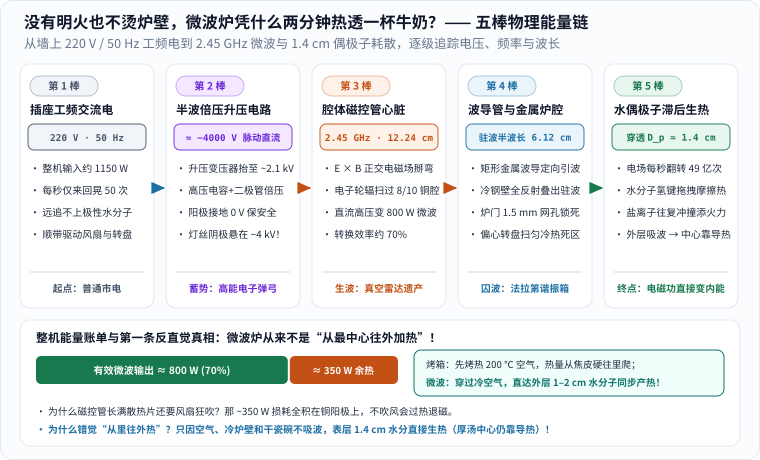
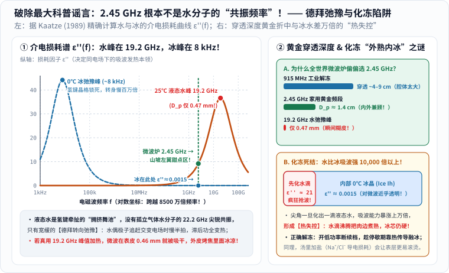
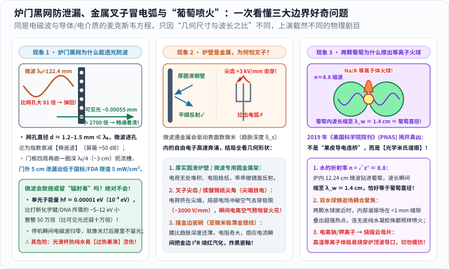

每天早上把一杯冰牛奶放进微波炉，关门、按下启动键，伴随一阵低沉的“嗡嗡”声，不到两分钟牛奶就冒着热气端上了桌。可只要你伸手摸一摸炉膛内壁，再回想一下燃气灶和电烤箱的加热方式，脑子里很容易蹦出一连串越琢磨越反常的问号：

1. **没有火苗也没有红热的电热丝，热量到底是从哪儿钻出来的？** 烤箱得先把一炉子空气烤到 $$200\,^\circ\text{C}$$，连铁盘带炉壁烫得不敢碰；微波炉刚叮完热汤，不锈钢炉壁和干爽的陶瓷碗沿居然还是温凉的！网上常有人解释说这是因为**“微波炉从食物最中心往外加热”**，还有人信誓旦旦地说**“$$2.45\text{ GHz}$$ 恰好是水分子的固有共振频率”**——剧透一下：**这两句流传最广的科普，其实统统都是错的！**
2. **墙上插座明明是每秒只晃 $$50$$ 次的普通交流电，微波炉凭什么造出每秒震荡 $$24.5$$ 亿次的电磁波？** 藏在机身右侧那个长满铝散热片、重达一公斤的铜铁疙瘩（腔体磁控管）究竟施了什么魔法？为什么你明明特意按了温和的**“中火 $$50\%$$”**去融化黄油或热牛奶，过了十来秒还是听到炉膛里“啪”地炸得满壁油星？
3. **为什么化冻一块冻肉，总是“外圈边角已经煮熟发白，正中间还冻得像石头”？** 冰和水明明都是同一种 $$\text{H}_2\text{O}$$ 分子，凭什么它们吸收微波的本领会差出**一万倍以上**？为什么炉膛底下非要装一只慢吞吞的玻璃转盘，而且热单碗汤时**偏心靠边放**比摆在转盘正中央热得均匀得多？
4. **微波炉内壁自己就是全金属的，为什么丢一把金属叉子或描金边瓷碗进去就会劈啪拉电弧？** 炉门玻璃上那层密密麻麻的黑铁网，凭什么既能放可见光出来让你看清食物，又能把微波死死关在里面？网上疯传的“两颗葡萄放进微波炉喷出火球”，背后的真正物理凶手又是谁？

今天，我们就把微波炉的外壳、高压仓、磁控管、谐振炉腔直到一颗水分子的氢键网络逐层剖开，顺着一条完整的**五棒物理能量链**，把这台厨房里最硬核的“雷达近亲”讲个通透。

---

## 一、意外诞生的厨房革命：从二战绝密雷达、口袋里融化的花生糖到五棒能量链

### 1. 1940 年的雷达绝密心脏与 1945 年口袋里融化的花生棒

微波炉并不是哪位厨具工程师坐在画板前凭空构思出来的炊具，它是二战防空雷达技术意外结出的一颗果实 [1]。

1940 年 2 月，英国伯明翰大学的两位物理学家**约翰·兰德尔（John Randall）**与**哈里·布特（Harry Boot）**，把古老的圆筒磁控管与高频空腔谐振器合二为一，造出了人类第一台大功率厘米波**多腔磁控管（Cavity Magnetron）** [1]。在此之前，各国雷达只能发射波长一两米的米波，天线笨重得没法装上夜间战斗机；而兰德尔和布特这只巴掌大的铜块，一举吐出了波长约 $$10\text{ cm}$$、脉冲功率高达数千瓦的微波，让盟军飞机甚至能看清海面上德军潜艇伸出的潜望镜！1940 年 9 月，英国蒂泽德科学使团（Tizard Mission）把这件被称为“运抵美国海岸最珍贵货物”的绝密样品带到北美，交由美国雷神公司（Raytheon）攻克大规模量产难关 [1]。

改变人类厨房命运的那一刻，发生在二战尾声的 **1945 年**。雷神公司自学成才的传奇工程师**珀西·斯宾塞（Percy L. Spencer）**站在有源雷达磁控管试验台旁调试设备时，突然发觉制服口袋里揣着的一块**花生牛轧糖棒（Peanut Cluster Bar）**居然软塌塌地融化了 [1, 2]！换作别人可能只当是体温捂化了，好奇心爆棚的斯宾塞却立刻找来一把生玉米粒摆在波导口前——几秒钟后，玉米粒噼里啪啦炸成了满屋飘香的爆米花；第二天他又和同事把一枚生鸡蛋放进开了口的铁水壶里通上微波，结果蛋黄内部蒸汽暴涨，刚凑过去偷看的同事被炸了一脸热蛋黄！

1945 年 **10 月 8 日**，斯宾塞正式为雷神公司提交了题为《食品处理方法》（*Method of Treating Foodstuffs*，美国专利号 `US2495429A`，1950 年 1 月 24 日授权）的开创性专利 [2]。翻开这份原始专利文献，你会看到斯宾塞在第一页就写下了极其精准的物理洞察：**应当选用波长与食物平均尺寸相当（约 $$10\text{ cm}$$ 量级或更短）的电磁波**，并算出了惊人的能耗对比——传统炉灶煮熟一枚鸡蛋要耗费约 $$36\,\text{kW}\cdot\text{s}$$ 能量，而高频电磁波直接耦合进食物内部只需 $$2\,\text{kW}\cdot\text{s}$$；烤熟一颗土豆更从 $$72{,}000\,\text{kW}\cdot\text{s}$$ 骤降到 $$240\,\text{kW}\cdot\text{s}$$ [2]！

随后在 1946 年 10 月纽约华尔道夫酒店公开演示后，美国联邦通信委员会（FCC）于 1946 年 12 月核准了 **`2450 MHz`（`2.45 GHz`）**频点，国际电信联盟（ITU）也在 1947 年大西洋城无线电大会上正式将 **`2.4–2.5 GHz`** 划为全球通用的**工业、科学与医疗（ISM）免许可频段**（不必担心做顿饭干扰飞机导航，却也埋下了后来它和家里 `2.4 GHz` Wi-Fi 抢车道的伏笔）[3]。1947 年雷神推出的初代商用微波炉 `Radarange` 高近 $$1.8\text{ m}$$、重达 $$340\text{ kg}$$、还得接水管给磁控管水冷，售价约 $$5000$$ 美元；直到二十年后的 **1967 年**，雷神旗下的阿马纳（Amana）推出售价 $$495$$ 美元的台式风冷 `Radarange`，配合夏普（Sharp）在 1960 年代中期引入的旋转转盘结构，这台二战雷达的后代才真正飞入千家万户 [1, 4]。

### 2. 五棒接力总览：从 220 V 插座到 1.4 厘米水层生热，顺手戳破第一个误区

把一台家用微波炉（以最典型的整机输入功率 $$1150\text{ W}$$、额定微波输出功率 $$800\text{ W}$$ 为例）拆开，能量从墙上三孔插座跑到牛奶杯里，一共要跑完严丝合缝的**五棒物理接力** [4, 5]：

*怎么看这张图：请顺着上方“第 1 棒”到“第 5 棒”追踪频率、电压与波长的三级跳——工频 `50 Hz` 先变成 `-4000 V` 脉动直流，再在磁控管里跃升近五千万倍变成 `2.45 GHz`（自由空间波长 $$\lambda_0 = \frac{c}{f} = 12.24\text{ cm}$$）的射频微波；底栏能量条按真实比例画出了 `1150 W` 插座电的去向：约 `70%`（`800 W`）化作微波送进炉膛，剩下约 `30%`（`350 W`）变成磁控管阳极余热、灯丝与风扇转盘功耗，这也是为什么微波炉工作时总有风扇呼呼散热。*

看懂了第 5 棒的 `穿透 D_p ≈ 1.4 cm`，我们就能当场戳破第一个流传甚广的谣言——**微波炉从来不是“从食物最中心往外加热”的！**

正如美国食品药品监督管理局（FDA）在官方微波炉科普指南中专门澄清的那样 [4]：微波照在食物上时，明明也是**从外表面往里钻**，每往富含水分的食物里钻进约 **$$1.4\text{ cm}$$**，微波功率就会被沿途的水分子吃掉 **$$63.2\%$$**（钻进 $$2.8\text{ cm}$$ 就被吃掉了 $$86.5\%$$）！如果炖一大碗厚达 $$8\text{ cm}$$ 的红烧肉或浓汤，正中心根本照不到多少微波，依然得老老实实靠外层热汤向里**热传导**才能熟透。

那为什么吃流心面包、豆沙包或者果酱派时，大家明明经常被“外皮温温的、一口咬下去滚烫的内馅”烫到舌头，从而坚信它“从里往外热”呢？原因只有两个：
1. **炉膛空气和干瓷碗不吸波**：电烤箱靠 $$200\,^\circ\text{C}$$ 热空气先烤焦面包表皮；微波炉里空气是室温凉风，食物表层水分一面发热一面往干燥空气里蒸发散热，所以外皮永远烤不出焦壳。
2. **不同成分的“吸波贫富差距”**：松软干面包皮含水少、比热和介电损耗低，而里面的果酱/豆沙含糖又含水，吸收微波发热的速率比干面皮快得多——**是“含水内馅比干外皮更抢微波”，绝不是微波跳过外皮只照中心！**

---

## 二、第 2 与第 3 棒：腔体磁控管怎样用磁铁把电子拧成“风车轮辐”？“中火 50%”为何是假小火？

### 1. 半波倍压电路与正交电磁场里的“电子风车”

为什么墙上 `220 V / 50 Hz` 的交流电不能直接拿来热牛奶？因为 `50 Hz` 的电场每秒钟只慢悠悠地翻转 `100` 次，水分子跟着转完身还在原地打哈欠，根本摩擦不出多少热量。要想把频率拔高到 **`2.45 GHz`（每秒震荡 `24.5` 亿次，电场正负翻转 `49` 亿次）**，必须请出微波炉里唯一的高能真空电子管——**腔体磁控管**。

但磁控管胃口极刁：它需要高达 **$$4000\text{ V}$$** 左右的直流高压才能把电子猛推上路！工程师用一套极其精简的**“高压升压变压器 + 高压电容 + 高压硅堆二极管”半波倍压整流电路**解决了这个问题：变压器先把 `220 V` 抬升到约 `2100 V` 交流电；在交流电一个半周先给高压电容充满电，下一个半周变压器电压与电容电压顺向串联叠加，一举产生约 **`-4000 V` 的脉动负高压**！

注意一个绝妙的安全细节：**铜阳极外壳直接连在微波炉金属机壳上接地（$$0\text{ V}$$）**，真正悬在 **$$-4000\text{ V}$$** 致命高压上的是密封在真空管正中央的钍钨灯丝阴极！这样一来，紧紧抱住铜阳极外壁的一排排铝合金散热片就能安全地贴在机壳风道里吹风，不会让外壳带电。（也正因为那颗约 $$1\,\mu\text{F}$$ 的高压电容断电后可能残留数千伏电荷，**非专业人员绝对不要自行拆开微波炉外壳触碰内部电路！**）

现在，电子从炙热的 $$-4000\text{ V}$$ 中心灯丝阴极飞出来了，怎么变成 `2.45 GHz` 的电磁波？请看磁控管横截面的物理机关：

*怎么看这张图（可[单独打开高清 SVG 原图](/assets/images/microwave-oven/magnetron-electron-spokes.svg)，刷新页面可重播左侧电子轮辐旋转动画；开启系统“减少动态效果”时自动保持清晰静态图）：左图是沿轴线切开的 8 腔磁控管横截面。正中心红色圆是 `-4 kV` 灯丝阴极，外圈橙色铜块开了 8 个钥匙孔状谐振腔（接地 `0 V`），上下两块环形铁氧体永磁铁在垂直纸面方向施加约 `0.18 T` 的强磁场；右图对比了当你按下“中火 50%”时，普通变压器机型与变频机型完全不同的输出功率波形。*

顺着左图分三步看，你就能彻底读懂这颗“雷达心脏”：

1. **没有磁铁会怎样？直撞铜墙只烧开水！** 如果只有中心阴极（$$-4000\text{ V}$$）到外圈阳极（$$0\text{ V}$$）的径向强电场 $$\mathbf{E}$$（左上灰色虚线箭头 `B = 0`），带负电的电子只会笔直撞上铜阳极，把动能全砸成废热，半点微波都发不出来。
2. **加上轴向强磁铁：洛伦兹力逼电子拐大弯！** 在磁控管上下两端各扣上一块大环形永磁铁，沿管轴方向建立起磁感应强度 $$B \approx 0.18\text{–}0.20\text{ T}$$（约为地球磁场三千多倍）的均匀磁场 $$\mathbf{B}$$，与径向电场 $$\mathbf{E}$$ 垂直正交。电子刚加速往外冲，立刻受到洛伦兹力：

$$
\mathbf{F} = -e\left(\mathbf{E} + \mathbf{v} \times \mathbf{B}\right)
$$

   速度 $$v$$ 越快，侧向掰弯的磁力 $$-e(\mathbf{v}\times\mathbf{B})$$ 就越猛！只要磁场强度超过临界值（赫尔截止磁场 Hull Cutoff），电子在半路上就被硬生生掰回内圈，擦着阳极腔口跳起优美的轮摆线圆舞。
3. **8 个“铜哨子”与 $$\pi$$ 模电子轮辐：把高压电吹成纯正微波！** 外圈厚铜块上铣出的 8 个（或 10 个）扇形圆孔腔，每一个在电磁学上都等价于一组微型**并联 $$LC$$ 谐振电路**：圆孔壁环流电流构成电感 $$L$$，狭缝缺口两侧积累正负电荷构成电容 $$C$$。由于尺寸只有毫米级，$$L$$ 和 $$C$$ 都极小，固有谐振频率精准落在：

$$
f_0 = \frac{1}{2\pi\sqrt{LC}} \approx 2.45\text{ GHz}
$$

   再用两圈同心铜环（均压环，图中紫色虚线圆）把隔一个跳一个的扇片连起来，强迫相邻两个腔口永远保持 **$$180^\circ$$（$$\pi$$ 弧度）反相振荡**（即工作在最稳定的 **$$\pi$$ 模**，腔口交替呈 `+ - + -`）。奇妙的“自动分拣”发生了：凡是撞上顺向射频电场加速的电子，洛伦兹力变大，瞬间被甩回阴极出局；凡是撞上**逆向射频电场被减速**的电子，恰好向外漂移并聚拢成 **$$N/2 = 4$$ 道旋转的“电子轮辐”**！这四道电子风车以完美同步的角速度一格格扫过腔口，像对着一排空啤酒瓶口吹气发哨音一样，源源不断地把 $$-4000\text{ V}$$ 直流电势能泵进铜腔，最终由顶部天线探针抽出来，顺着矩形金属波导管送进炉膛！

### 2. 按下“中火 50%”黄油照样炸？继电器通断脉冲 vs 真变频（Inverter）

理解了磁控管必须靠跨过临界高压和磁场门槛才能起振，你就瞬间明白厨房里另一个让人抓狂的现象了：**为什么用普通微波炉调到“中火 `50%`”去化黄油、热浓汤或解冻肉馅，明明选了半火，食物还是动不动局部沸腾喷溅？**

请看上面第二张图的右侧面板：传统工频铁芯变压器体积笨重、电压固定，根本没法平滑调低磁控管电流。于是绝大多数百元级传统微波炉里的“中火 `50%`”，玩的是**占空比（Duty Cycle）时间障眼法**——它每隔约 `24–30` 秒为一个周期：前 **`15` 秒照样开足 `100%` 满功率（`800 W`）狂轰滥炸**，后 **`15` 秒由继电器“咔哒”一声彻底切断高压（`0 W`）**，靠停歇期让热量自己慢慢匀开！从一分钟总能量看平均确实是 `400 W`，可在那前 `15` 秒的满功率脉冲里，黄油小水滴早已瞬间沸腾炸开了花。

直到后来**变频微波炉（Inverter Microwave）**问世，才真正把笨重的工频铁芯变压器换成了 `20–40 kHz` 的高频 IGBT 开关逆变电源，能够平滑调节磁控管阳极电流，实现**全程不间断的真 `400 W` 温柔慢热**。想知道你家厨房那台是哪一种？今晚热牛奶时调成“中火”趴在旁边听一分钟：如果每隔十多秒听到“咔哒”一声沉闷的电磁嗡鸣消失、只剩风扇声，过十多秒又“嗡——”地响起来，那就是继电器通断式；如果从头到尾声音平稳轻柔，就是真变频！

---

## 三、第 5 棒核心真相：2.45 GHz 根本不是水分子的“共振频率”！读懂德拜弛豫与化冻死结

### 1. 辟谣“水分子共振说”：拥挤氢键舞池里的德拜转向弛豫

现在，波长 $$\lambda_0 = 12.24\text{ cm}$$ 的微波钻进了牛奶和饭菜。翻开不少课外书甚至科普短视频，十有八九会看到这样一句解释：“水分子的固有共振频率正好是 `2.45 GHz`，微波炉选这个频率让水分子发生共振，所以热得飞快。”

这句话听起来既顺耳又像那么回事，但在物理学上却是一桩彻头彻尾的**美丽误会** [5, 6]！

先看一粒水分子（$$\text{H}_2\text{O}$$）长什么样：氧原子抓着两个氢原子张开约 $$104.5^\circ$$ 的夹角，电子云强烈偏向氧原子一侧，使氧端带微弱负电、两个氢端带微弱正电，整粒水分子就像一枚自带正负极的微型指南针——物理学叫**极性电偶极子（偶极矩 $$p \approx 1.85\text{ D}$$）**；而空气里的氮气（$$\text{N}_2$$）、氧气（$$\text{O}_2$$）以及干燥塑料、玻璃、石蜡基本对称无极性，所以微波穿过冷空气和干玻璃杯几乎毫发无损。

那么水分子有没有尖锐的“固有共振频率”？**只有在孤立水蒸气分子（气相）里才有！** 当水分子单枪匹马飘在稀薄空气里自由翻跟头时，它的最低阶量子转动跃迁谱线确实有一条著名的吸收峰落在 **`22.235 GHz`**（天文学家和气象卫星常拿这个频点探测大气水汽，而且它比 `2.45 GHz` 足足高了 **9 倍**！）。

一旦水分子聚集成杯子里的**液态水**，情况天翻地覆：每一颗水分子都被周围四邻八舍的水分子用**氢键（Hydrogen Bond）**手拉手拽住，就像挤在春运车厢或黏稠糖浆里转身一样，根本不可能自由打转“共振”！物理学家、诺贝尔化学奖得主**彼得·德拜（Peter Debye）**早就算清了这种黏滞转向过程——它不叫共振，而叫**偶极转向弛豫（Debye Dielectric Relaxation）** [5, 6]：

- 当 `2.45 GHz` 的微波电场扫过牛奶时，电场方向每 $$0.204\text{ ns}$$（约五分之一纳秒）就正负颠倒一次；
- 水分子偶极子拼命想跟着电场掉头排队，却被身边的氢键网络死死拖拽，总是**比电场的变化慢半拍（产生相位滞后角 $$\delta$$）**；
- 电场推着慢半拍的偶极子硬拽转身所做的功，立刻通过打断和重排氢键、推撞邻近分子，**100% 转化为分子无规则热运动动能——也就是温度升高！**

用德拜弛豫方程写出介质对角频率 $$\omega = 2\pi f$$ 电磁波的复相对介电常数 $$\varepsilon^*(\omega) = \varepsilon'(\omega) - i\varepsilon''(\omega)$$，其中实部 $$\varepsilon'$$ 代表储存电能的能力，**虚部损耗因子 $$\varepsilon''(\omega)$$** 直接决定吸波发热的本领 [5, 6]：

$$
\varepsilon''(\omega) = \frac{(\varepsilon_s - \varepsilon_\infty)\,\omega\tau_D}{1 + (\omega\tau_D)^2}, \qquad P_v = 2\pi f \varepsilon_0 \varepsilon_{\text{eff}}'' E_{\text{rms}}^2
$$

式中的 $$\tau_D$$ 是水分子挣脱氢键重排所需的特征**德拜弛豫时间**，$$P_v$$ 是单位体积食物每秒钟产生的热量（$$\text{W/m}^3$$）。根据德国物理化学家乌多·卡策（Udo Kaatze, 1989）发表在《化学与工程数据杂志》上的高精度实测基准数据 [6]，$$25\,^\circ\text{C}$$ 纯液态水的静态介电常数 $$\varepsilon_s = 78.4$$，高频极限 $$\varepsilon_\infty = 5.2$$，弛豫时间 $$\tau_D = 8.27\text{ ps}$$（皮秒）。代入分母求极值（当 $$\omega\tau_D = 1$$ 时 $$\varepsilon''$$ 最大），常温液态水真正的介电损耗最高峰落在：

$$
f_{\text{rel}} = \frac{1}{2\pi\tau_D} = \frac{1}{2\pi \times 8.27 \times 10^{-12}\text{ s}} \approx 19.25\text{ GHz}
$$

看清这个数字了吗？**液态水吸波最猛的峰值在 `19.25 GHz`，比家用微波炉的 `2.45 GHz` 整整高出近 8 倍！**

### 2. 为什么工程师偏偏不选 19.2 GHz 峰值？1.4 厘米黄金穿透深度账

既然 `19.25 GHz` 才是液态水吸热最猛的山顶，当年斯宾塞和各国工程师为什么放着山顶不用，偏偏挑了山坡左下方只发挥出约三分之一损耗功力的 **`2.45 GHz`** 呢？

让我们把整条跨越八千五百万倍频率的德拜损耗曲线画出来，答案一眼见底：

*怎么看这张图：左图横轴是对数频率（从 `1 kHz` 一直画到 `250 GHz`），橙色实线是 `25 ℃` 液态水的德拜损耗曲线 $$\varepsilon''(f)$$，蓝色虚线是 `0 ℃` 普通六方冰晶（Ice Ih）的损耗曲线；绿色竖虚线标出了家用微波炉工作的 `2.45 GHz` 位置。右图上方对比了三种频率在含水食物中的功率穿透深度，下方揭示了冻肉化冻时“边角煮熟、芯里还硬”的热失控根源。*

想把一块鸡腿或一碗汤热好，“吸波越猛越好”恰恰是个致命陷阱！在电磁波传播理论中，微波钻进介电常数为 $$\varepsilon' - i\varepsilon''$$ 的含水食物时，功率衰减到表面 $$\frac{1}{e}$$（即前一层吃掉 $$63.2\%$$ 能量、只剩 $$36.8\%$$ 继续往里走）的**功率穿透深度 $$D_p$$** 严格等于 [5]：

$$
D_p = \frac{c}{4\pi f \sqrt{\frac{\varepsilon'}{2}\left(\sqrt{1 + \left(\frac{\varepsilon''}{\varepsilon'}\right)^2} - 1\right)}}
$$

我们直接拿公式算出三个频点的真实穿透深度：
- **假如把微波炉做成水弛豫峰 `19.25 GHz`**（此时 $$\varepsilon' \approx 41.8,\;\varepsilon'' \approx 36.6$$）：算出来的功率穿透深度只有 **$$D_p \approx 0.46\text{ mm}$$（不到半毫米！）**。这意味着 $$800\text{ W}$$ 的全部火力会在鸡腿最外层薄如蝉翼的 $$0.5\text{ mm}$$ 表皮里瞬间榨干！不到十秒钟，鸡皮已经碳化冒黑烟，而往里 $$5\text{ mm}$$ 的鸡肉连温热都没感觉到！
- **如果降到工业 ISM 频段 `915 MHz`**（波长 $$32.8\text{ cm}$$）：穿透深度可达 $$4\text{–}9\text{ cm}$$，非常适合肉类加工厂解冻几十公斤的大冰砖 [3]，但因为波长太长，家用台面那么小的炉腔根本装不下几个驻波节点，极难做匀。
- **选在 `2.45 GHz` 山坡左翼甜点区**（$$25\,^\circ\text{C}$$ 水实测 $$\varepsilon' \approx 77.0,\;\varepsilon'' \approx 12.3$$ [5, 6]）：穿透深度正好落在 **$$D_p \approx 1.39\text{ cm}$$（约 $$1.4\text{ cm}$$）**！对日常两三厘米厚的菜肴、包子、牛奶杯来说，微波能一步钻进一两厘米深的外层同步生热，剩下的中心短距离刚好交给热传导从容补齐——这才是斯宾塞在 1945 年专利里强调“波长与食物尺寸相当”的真正工程智慧 [2]！

### 3. 冰与水的“万倍鸿沟”：为什么化冻肉块总是外熟内冰，咸汤却外圈烫嘴？

再看上面德拜曲线图里那条蓝色虚线（`0 ℃` 冰），厨房里最让人头疼的**“微波炉化冻惨案”**也随之水落石出！

你肯定遇到过这种怪事：从冷冻室拿出一块硬邦邦的牛排塞进微波炉高火叮两分钟，端出来一看——**牛排四周薄边已经变成灰白色、滋滋冒肉汤煮熟了，拿刀往中间一戳，芯里居然还是梆硬的冰坨子！**

同样是 $$\text{H}_2\text{O}$$ 分子，为什么冰这么“油盐不进”？因为水一旦结成 `0 ℃` 的六方晶系固态冰（Ice Ih），所有水分子都被规整的四面体氢键晶格死死锁在座位上，弛豫时间从液态水的十几皮秒暴涨一百万倍到 **$$\tau_D \approx 20\,\mu\text{s}$$（微秒）**！它的弛豫峰一路跌到了最左边耳朵听不见的低频段（约 **`8 kHz`**）。等到面对每秒翻转 `49` 亿次的 `2.45 GHz` 微波时，僵硬的冰晶偶极子完全动弹不得——据瑞士物理学家梅茨勒（Christian Mätzler, 1987）的精密测量 [7]，`0 ℃` 纯冰在 `2.45 GHz` 下的损耗因子仅有 **$$\varepsilon_{\text{ice}}'' \approx 0.0015$$**，而刚融化的 `0 ℃` 液态水高达 **$$\varepsilon_{\text{water}}'' \approx 21$$**！

算一算两者的比值：

$$
\frac{\varepsilon_{\text{water}}''(0\,^\circ\text{C})}{\varepsilon_{\text{ice}}''(0\,^\circ\text{C})} \approx \frac{21}{0.0015} = 14{,}000 \quad (\text{相差一万四千倍！})
$$

这在物理学上直接触发了典型的正反馈**热失控（Thermal Runaway）**：冰块对微波近乎透明，可冻肉最薄的尖角或表面霜层只要借室温先化出**一丁点液态水珠**，这滴水的吸波能力瞬间暴涨上万倍，像黑洞一样把路过的微波火力全抢过来，几秒钟就沸腾到 $$100\,^\circ\text{C}$$ 把周围肉丝煮熟，而隔壁毫米之遥的冰晶还在呼呼大睡！因此，微波炉的**“解冻挡（Defrost）”**绝不能傻乎乎一直开火，必须打几秒、停十几秒，逼着边角刚热起来的温水把热量老老实实传导进冰芯里融化下一层冰。

顺便提一句厨房里的“咸汤效应”：如果你热一碗加了较多食盐的浓汤或卤菜，碗边往往烫得更快、中心反而更凉。因为溶解在水里的钠离子（$$\text{Na}^+$$）和氯离子（$$\text{Cl}^-$$）在交变电场驱动下会来回猛冲撞击水分子，在偶极损耗之外再叠加上一项**离子电导欧姆损耗**（$$\varepsilon_{\text{eff}}'' = \varepsilon_{\text{dipole}}'' + \frac{\sigma}{2\pi f \varepsilon_0}$$）[5]。温度越高，离子跑得越欢、电导率 $$\sigma$$ 越大，表层拦截微波就越狠（穿透深度缩水到不足 $$1\text{ cm}$$）——所以热浓汤和剩菜时，中途拿勺子搅一搅，比多叮半分钟管用得多！

---

## 四、第 4 棒空间密码：为什么微波炉离不开转盘？6.12 厘米驻波与厨房芝士测光速

### 1. 冷钢壁反射叠出的“冰火格子间”：半波长 6.12 厘米铁律

搞懂了水分子怎么生热，我们把视线拉回那个方方正正的金属炉膛。既然磁控管吐出了 `800 W` 微波，为什么不让它像手电筒一样照一遍就算完，非要在炉底装一个圆玻璃转盘转个不停？

因为微波炉的六面内壁（包括带金属网的炉门）构成了一只封闭的**金属谐振腔**！微波撞上光滑的金属内壁几乎 $$100\%$$ 反射回来，向右跑的入射波与向左弹回的反射波在空中迎头相撞。拿最直观的一维方向 $$x$$ 来算，两列频率相同、方向相反的电磁波叠加，立刻合成为一列**原地起伏、不再向前推进的驻波（Standing Wave）**：

$$
E(x, t) = E_0 \sin(kx - \omega t) - E_0 \sin(kx + \omega t) = -2E_0 \sin\!\left(\frac{2\pi x}{\lambda_0}\right)\cos(\omega t)
$$

看空间因子 $$\sin\!\left(\frac{2\pi x}{\lambda_0}\right)$$ 的平方（因为食物发热功率 $$P_v \propto E_{\text{rms}}^2$$）：
- 在 $$x = 0,\;\frac{\lambda_0}{2},\;\lambda_0,\;\frac{3\lambda_0}{2}\dots$$ 这些位置，正弦值恒等于 **`0`**！哪怕磁控管开足 `800 W` 轰上一整天，这些**波节（Nodes）**处的电场振幅自始至终死寂为零，掉进这里的食物永远是冰凉的“冷死点”；
- 而在两处波节正中间的**波腹（Antinodes）**，电场振幅翻倍、加热功率冲上四倍峰值！
- 相邻两个热点（或相邻两个冷点）之间的距离，严格等于微波**半波长**：

$$
\Delta x = \frac{\lambda_0}{2} = \frac{12.24\text{ cm}}{2} = 6.12\text{ cm}
$$

三维真实炉膛虽然经过多模设计激发出几十组不同方向的反射波互相交织，但依然不可避免地在空间里织出一团团相隔几厘米的固定冷区和热区！

*怎么看这张图（可[单独打开高清 SVG 原图](/assets/images/microwave-oven/standing-wave-turntable.svg)，刷新页面可重播右侧偏心摆碗扫过冷热区的旋转动画）：左图上方精确绘出了 $$\lambda_0 = 12.24\text{ cm}$$ 驻波电场与 $$\sin^2$$ 加热功率包络，每隔 $$6.12\text{ cm}$$ 就交替出现波节冷点与波腹热点；左图下方展示了取下转盘用芝士或巧克力测量光速的亲子实验；右图俯视玻璃转盘，揭开了“单碗靠边放比放正中央更匀”的几何道理。*

### 2. 摆碗秘诀（偏心放！）与 20 秒芝士片测光速实验

盯着上面右边的俯视图看两秒钟，一个超实用的生活小窍门就不言自明了：

当你只热**一杯牛奶或一小碗剩饭**时，很多人习惯性地把它端端正正摆在玻璃转盘的**正圆心**。可圆心处的旋转半径 $$r = 0$$，线速度 $$v = \omega r = 0$$——杯子只是在原地傻转圈！万一炉膛正中央恰好落在某组驻波的偏冷区，转二十圈杯心还是温吞水。反过来，只要你把杯子**往玻璃转盘边缘挪一挪（偏心放置）**，它就会画出一个大圆圈，一路交替穿过好几个波腹热区和波节冷区，把空间上的“冷热不均”自动平均成整杯热腾腾的牛奶！（至于现在市面上没有玻璃转盘的**平板式微波炉**，并不是消灭了驻波，而是在白色微晶陶瓷底板下面藏了一片不停旋转的金属叶片——**模式搅拌器 Mode Stirrer**，改成每秒钟不停摇晃反射角度，让驻波热点主动满屋子跑去追食物！）

更酷的是，正因为拿掉转盘后驻波热点会老老实实钉在原地，你周末在家花 **20 秒钟**就能带孩子重现物理学史上最浪漫的厨房实验——**亲手测出光速 $$c$$**（想了解伽利略、罗默与斐索当年怎样在天地间追捕光速，可以参看我们之前的文章[《一眨眼绕地球七圈半的光，人类是怎么测出速度的？》]()）：

1. 先把微波炉里的旋转玻璃盘连同底下的三脚滚轮架一起取出来（如果家里是底部带隐藏搅拌扇的平板微波炉，热点会被搅匀，就不适用啦）；
2. 在一只平底大瓷盘上铺满一整排芝士片、棉花糖或一大块扁平排块巧克力，平稳放进炉膛中央；
3. 关门高火加热约 **15–20 秒**——一旦透过玻璃门看到盘子里冒出两三处最先融化起泡的斑点，立刻按停止键端出来；
4. 拿一把学生直尺，量出相邻两个融化鼓包中心之间的距离 $$\Delta x$$，你会惊喜地发现它就在 **$$6.1\text{ cm}$$** 左右！翻到微波炉背后看一眼铭牌上印着的工作频率 `2450 MHz`（即 $$f = 2.45 \times 10^9\text{ Hz}$$），因为相邻热点间距是半个波长（$$\lambda_0 = 2\Delta x \approx 0.122\text{ m}$$），直接相乘：

$$
c = f \times 2\Delta x \approx 2.45 \times 10^9\text{ s}^{-1} \times 0.122\text{ m} \approx 2.99 \times 10^8\text{ m/s}
$$

误差不到百分之一！一盘刚融化的芝士片，当场验证了麦克斯韦在一百六十年前写下的惊天预言：**看不见的微波，和我们眼睛看见的阳光一样，都是以每秒三十万公里飞驰的电磁波！**

---

## 五、边界好奇与安全真相：炉门黑网、叉子闪电、葡萄喷火与纯水暴沸

顺着麦克斯韦电磁方程再往前迈半步，平时围着微波炉打转的最后几个终极好奇问题，全都能在**“几何尺寸与波长之比”**这把标尺下迎刃而解：

*怎么看这张图：三栏用同一套电磁学尺度对比了三种反直觉现象——左栏展示炉门 `1.5 mm` 金属网孔怎样像“筛西瓜放芝麻”一样拦住 `122.4 mm` 微波、放行 `0.00055 mm` 可见光，并算清非电离光子能量账；中栏拆解光滑金属炉壁与尖齿叉子、极薄金边碗的电流差异；右栏图解 2019 年《美国科学院院刊》（PNAS）证实的葡萄缩波米氏谐振等离子体机制。*

### 1. 炉门上的黑网为什么“放光不放波”？微波到底会不会致癌或残留辐射？

每次凑在微波炉门前看牛奶有没有溢出来，你隔着的其实并不是一块普通透明玻璃，而是夹在玻璃后面的一整张**冲孔钢板金属网**——它和另外五面金属内壁合拢，组成了一只严丝合缝的**法拉第电磁屏蔽笼（Faraday Cage）**。

为什么这张开了成千上万个小圆孔的铁网不会漏微波？答案全在**波长对比**：
- 炉内 `2.45 GHz` 微波的波长足有 **$$\lambda_0 = 122.4\text{ mm}$$**，而炉门金属网圆孔的直径只有 **$$d \approx 1.2\text{–}1.5\text{ mm}$$**，不到波长的**八十分之一**！在波导电磁学里，孔径远小于半波长的金属圆孔属于深度“截止波导”，微波根本挤不过去，只能在孔口激起指数衰减的倏逝波（屏蔽衰减超过 $$50\text{ dB}$$，即十万分之九十九点九九九被弹回炉内）。
- 反观照亮食物的**可见光**，波长只有 **$$400\text{–}700\text{ nm}$$（$$0.0004\text{–}0.0007\text{ mm}$$）**，比 `1.5 mm` 的网孔小了两千多倍，就像芝麻穿过篮球框一样畅通无阻！
- 在活动炉门与机身贴合的四周门缝里，工程师还藏了一圈深约 **$$\frac{\lambda_0}{4} \approx 3\text{ cm}$$ 的四分之一波长扼流槽（Choke Seal）**，利用电磁波反射相位翻转把门缝边缘等效成“电磁短路零阻抗”，再配上两到三道物理微动联锁开关（门钩一松动，毫秒级硬切断变压器供电）。无论中国国家标准 `GB 4706.21`、国际电工委员会 `IEC 60335-2-25` 还是美国 FDA `21 CFR 1030.10` 法规，都强制规定微波炉全寿命周期在距离外表面 `5 cm` 处的功率密度不得超过 **$$5\text{ mW/cm}^2$$** [4, 8]，而合格出厂的家用机实测泄漏往往比国标上限还要低一两个数量级，且随距离平方反比迅速归零（退开半米远再除以一百！）。

至于长辈群里常担心的**“微波炉热过的饭菜会残留辐射致癌”**，只需算一下单个微波光子的能量 $$E = hf$$ 就能彻底放心：

$$
E_{\text{microwave}} = h f = 4.136 \times 10^{-15}\text{ eV}\cdot\text{s} \times 2.45 \times 10^9\text{ Hz} \approx 1.01 \times 10^{-5}\text{ eV}
$$

要知道，像 X 射线、伽马射线那样能打断人体 DNA 化学键、诱发基因突变的**电离辐射**，单光子能量门槛至少要 **$$5\text{–}12\text{ eV}$$**——`2.45 GHz` 微波光子的能量比打断一根化学键所需的能量**弱了整整五十多万倍**，甚至比你低头看手机屏幕发出的可见光光子（约 $$2\text{ eV}$$）还要温柔二十万倍！它属于纯粹的**非电离辐射**，唯一本事就是让水分子晃动升温；当微波炉“叮”地一声停机，电磁波在微秒内消散归零，食物里只留下热量，绝不可能残留半点“辐射”，就像关掉台灯后卧室里绝不会残留光一样 [4, 8]。（唯一偶尔能察觉到那丁点合规余波的，是你放在微波炉旁边的 `2.4 GHz` 老路由器或蓝牙耳机——因为它们和微波炉共享同一个 `2.4–2.5 GHz` ISM 免许可频段 [3]，做饭时换连 `5 GHz` Wi-Fi 就丝滑如初了；对电磁频谱与带宽好奇的读者也可以延伸阅读[《以前电视天线收的是卫星吗？为什么带宽够看视频？》]()。）

### 2. 炉膛自己就是不锈钢做的，为什么偏偏怕一把叉子和描金边瓷碗？

细心的孩子常会追问一个绝妙的逻辑漏洞：**“爸爸妈妈总说微波炉里绝对不能放金属，可微波炉四壁自己不就是铁皮做的吗？甚至有些带烧烤功能的微波炉原厂还配了金属烤架！”**

问到点子上了！金属并不会像水那样靠偶极子吸收微波，恰恰相反，良导体内部有海量自由电子，微波一照上去，只在金属最表层几微米厚的薄皮里（物理学叫**趋肤深度** $$\delta_s = \frac{1}{\sqrt{\pi f \mu \sigma}}$$，`2.45 GHz` 下铜约 $$1.3\,\mu\text{m}$$、不锈钢约 $$7\,\mu\text{m}$$）激起高频表面感应电流。接下来平平安安还是电光石火，全看**金属的厚薄与几何曲率**：

1. **厚实圆滑的金属炉壁（与原厂粗圆金属架）**：厚度远大于几微米的趋肤深度，电阻极低，而且所有转角都冲压成光滑大圆弧，表面电流畅通无阻地奔流，把微波干干净净反射回炉腔。
2. **金属餐叉的尖齿、揉皱锡纸的尖角**：当高频感应电流涌向曲率半径极小的尖端时，自由电荷在针尖处剧烈堆积，局部电场强度轻而易举冲破干燥空气的电离击穿极限（约 **$$3000\text{ V/mm}$$**，即 $$3\times 10^6\text{ V/m}$$），直接把尖齿间或尖角与炉壁间的空气撕裂成导电通道，“劈里啪啦”拉出刺眼的电弧火花！
3. **带描金边、银边的精致骨瓷碗**：碗沿那圈金线镀层往往薄到**零点几微米（比趋肤深度还薄！）**，截面积小得可怜、电阻奇高。几安培的高频感应电流硬挤过这圈极细电阻丝，瞬间产生惊人的焦耳热 $$P = I^2 R$$，一两秒钟就把金箔烧红汽化，崩黑整只瓷碗！

### 3. 两颗葡萄叮出火球（PNAS 2019 米氏谐振）与真正要提防的“纯水过热暴沸”

最后，我们来看看曾让无数物理系学生着迷的网红奇观：**把两颗新鲜葡萄紧挨着放进微波炉（或者一颗葡萄切开留一点果皮连着），开机几秒钟，两颗葡萄接缝处竟会轰然喷出一团耀眼的黄紫色火球！**

在长达二十多年的时间里，网络科普都以为这是因为“两半葡萄中间连着的那条湿果皮充当了细导线，短路打火”。直到 **2019 年 3 月**，加拿大特伦特大学物理学家哈姆扎·哈塔克、巴勃罗·比亚努奇与亚伦·斯莱普科夫在《美国国家科学院院刊》（*PNAS*）发表了轰动学界的实验与全波电磁仿真论文 [9]，才用高速热成像和完全没有果皮的**纯水凝胶珠**推翻了旧假说！

真正的幕后推手，是光学与电磁学里美妙的**米氏介电谐振（Mie Resonance）**：
- 常温液态水在 `2.45 GHz` 下高达 $$\varepsilon' \approx 77$$ 的介电常数，赋予了水高达 **$$n \approx \sqrt{\varepsilon'} \approx 8.8$$** 的微波折射率！
- 这意味着炉膛空气里长 $$12.24\text{ cm}$$ 的微波一旦钻进含水量极高的葡萄内部，波长瞬间被压缩 $$8.8$$ 倍，缩水成：

$$
\lambda_{\text{grape}} = \frac{\lambda_0}{n} \approx \frac{12.24\text{ cm}}{8.8} \approx 1.39\text{ cm}
$$

- **$$1.4\text{ cm}$$——不偏不倚，正好等于一颗普通葡萄的直径！** 于是每一颗葡萄都变成了一座天然困住整波长微波的球形介质谐振腔（连外壳完全不导电的纯水球、鹅蛋大小的水凝胶珠甚至蓝莓鹌鹑蛋都能算准尺寸复现）。当两颗葡萄贴近到不足 $$1\text{ mm}$$（约 $$\lambda_0/100$$）时，两座谐振腔的外部倏逝场在狭窄空气缝隙里强力耦合聚焦，叠出比背景场强高出数十倍的极端电场热点，瞬间电离葡萄组织汽化出的**钠（$$\text{Na}$$）、钾（$$\text{K}$$）碱金属离子**，燃起一团真正的**第四态物质——等离子体火球** [9]！（想深入了解等离子体为什么会发光导电，可以阅读[《等离子体到底是什么？》]()。**强烈提醒：高温等离子体极易烧穿炉膛顶部遮挡波导口的云母片并损坏磁控管，千万不要拿家里的微波炉模仿！**）

比葡萄喷火更值得每位家长记在心上的，是美国 FDA 专门挂在官网置顶提醒的一条**真实厨房烫伤隐患——纯水“过热暴沸”（Superheated Water）** [4]：
- 在燃气灶上用铁壶烧水，壶底粗糙划痕上附着无数微小气泡核，水温一到 $$100\,^\circ\text{C}$$ 就咕嘟咕嘟翻滚沸腾；
- 可如果你把一杯**纯净水或蒸馏水**装进内壁极其光滑的新玻璃杯或釉面马克杯里，放进微波炉连续加热两三分钟，热量在液体内部安静生成，没有气泡成核点（Nucleation Sites），水面上看起来风平浪静，实际水温却可能悄悄升到了 **$$102\text{–}105\,^\circ\text{C}$$ 的亚稳态过热液体**！
- 这时只要你端起杯子轻轻一晃，或者倒进一勺速溶咖啡粉、插进一根勺子，瞬间引入成千上万个气化核，积攒的过剩热能会在十分之一秒内化作蒸汽大爆发，“砰”地把滚水喷向手背和脸部！
- **预防方法简单到只需一秒钟**：不要超长时间干叮纯水；热纯水前在杯里放一根非金属搅拌棒（如干净木筷或陶瓷勺），或者直接加好茶叶/咖啡粉一起热，让水到了沸点就能顺畅冒泡释压；同理，**带壳鸡蛋、未剪口板栗、整颗香肠与密封塑料盒**内部蒸汽无处逃逸，也绝不能直接塞进微波炉加热。

---

## 六、一张表收好微波炉的物理密码

下次再听到厨房里传来那声清脆的“叮——”，你可以笑着在脑海里核对一遍这张电磁学与热力学交织的成绩单：

| 常见厨房疑问 | 流传误解 vs 真实物理机制 | 核心定量标尺 |
| :--- | :--- | :--- |
| **食物是怎么热起来的？** | **误**：从最中心往外加热 **真**：微波从外往里钻，只是空气和干碗不吸波；厚块中心仍靠热传导 | $$25\,^\circ\text{C}$$ 水功率穿透深度 $$D_p \approx 1.4\text{ cm}$$ |
| **为什么选 `2.45 GHz`？** | **误**：水分子的固有共振频率 **真**：液态水是宽缓德拜弛豫（真峰值在 `19.25 GHz`）；选 `2.45 GHz` 是为兼顾穿透深度与腔体尺寸 | `19.25 GHz` 穿透仅 $$0.46\text{ mm}$$（糊皮！）；`2.45 GHz` 属 ITU 全球 ISM 频段 |
| **“中火 `50%`”怎么控温？** | **传统机型**：继电器通断脉冲（`15 s` 满火 + `15 s` 停火） **变频机型**：高频逆变连续输出真半功率 | `800 W` 占空比 `50%` vs 恒定 `400 W` |
| **化冻冻肉为何外熟内硬？** | 冰晶氢键锁死偶极子，液态水吸波能力比 `0 ℃` 冰强上万倍，先化水滴抢光微波引发热失控 | $$\varepsilon_{\text{water}}'' \approx 21$$ vs $$\varepsilon_{\text{ice}}'' \approx 0.0015$$（差 $$\sim 1.4\times 10^4$$ 倍） |
| **为什么要装旋转转盘？** | 金属壁反射叠出固定驻波冷热区；单碗**偏心靠边放**才能扫匀波腹与波节 | 波长 $$\lambda_0 = 12.24\text{ cm}$$，热点间距 $$\Delta x = \frac{\lambda_0}{2} = 6.12\text{ cm}$$ |
| **炉门黑网安全吗？有残留辐射吗？** | 网孔远小于波长锁死微波、放行可见光；非电离辐射光子能量极低，停机即归零无残留 | 网孔 $$1.5\text{ mm} \ll 122.4\text{ mm}$$；光子 $$1.01\times 10^{-5}\text{ eV}$$（泄漏限值 $$\le 5\text{ mW/cm}^2$$） |

从八十多年前伯明翰实验室里为拦截轰炸机而生的铜腔磁控管，到斯宾塞口袋里偶然化开的那块花生糖，再到今天每家厨房台面上两分钟热好的一杯早安牛奶——最深奥的洛伦兹力、麦克斯韦驻波与德拜分子弛豫，其实每天都在人间烟火里安静地为你服务。

---

## 参考资料

1. **Science Museum (London)**, *1940s: The Cavity Magnetron*（伦敦科学博物馆馆藏档案：记录 1940 年 2 月伯明翰大学兰德尔与布特发明大功率多腔磁控管、1940 年 9 月蒂泽德使团赴美合作，以及战后衍生出微波炉的技术史脉络）：<https://www.sciencemuseum.org.uk/objects-and-stories/1940s-cavity-magnetron>
2. **Spencer, Percy L.**, *Method of Treating Foodstuffs*, United States Patent `US2495429A`, filed October 8, 1945, granted January 24, 1950, assigned to Raytheon Manufacturing Company（珀西·斯宾塞原始微波烹饪专利全文：明确提出采用波长与食物平均尺寸相当即 `10 cm` 量级的电磁波耦合生热，并给出煮鸡蛋 `2 kW·s` 对 `36 kW·s`、烤土豆 `240 kW·s` 对 `72,000 kW·s` 的实测能耗数据）：<https://patents.google.com/patent/US2495429A/en>
3. **International Telecommunication Union (ITU)**, *Radio Regulations*, Article 5, Footnote `5.150`（国际电信联盟《无线电规则》ISM 频段分配条款：确立 `2400–2500 MHz` 中心频率 `2450 MHz` 及北美区 `902–928 MHz` 中心 `915 MHz` 为工业、科学与医疗应用频段）：<https://www.itu.int/pub/R-REG-RR>
4. **U.S. Food and Drug Administration (FDA)**, *Microwave Ovens — Radiation-Emitting Products*（美国食品药品监督管理局官方指南：给出 `21 CFR 1030.10` 距表面约 `5 cm` 处 `5 mW/cm²` 终身泄漏限值、非电离辐射无残留安全性说明、澄清“由内向外加热”误解，以及光滑杯加热纯水诱发过热暴沸烫伤的安全警示）：<https://www.fda.gov/radiation-emitting-products/resources-you-radiation-emitting-products/microwave-ovens>
5. **Chaplin, Martin**, *Water and Microwaves*, Water Structure and Science（水科学经典综述：系统推导液态水偶极转向德拜弛豫方程、澄清 `2.45 GHz` 并非水分子固有共振频率，给出 `2.45 GHz` 穿透深度及食盐离子电导对穿透深度与边缘过热的影响）：<https://vitroid.github.io/water-science/water/microwave_water.html>
6. **Kaatze, Udo (1989)**, "Complex permittivity of water as a function of frequency and temperature", *Journal of Chemical & Engineering Data*, 34(4), 371–374（液态水宽频复介电常数权威实验基准：测定 `25 °C` 纯水 $$\varepsilon_s = 78.4$$、$$\varepsilon_\infty = 5.2$$、德拜弛豫时间 $$\tau_D = 8.27\text{ ps}$$ 即弛豫峰值频率 `19.25 GHz`）：<https://pubs.acs.org/doi/10.1021/je00058a001>
7. **Mätzler, Christian & Wegmüller, Urs (1987)**, "Dielectric properties of fresh-water ice at microwave frequencies", *Journal of Physics D: Applied Physics*, 20(12), 1623–1630（淡水冰微波介电特性经典测量：证实 `0 °C` 六方冰晶在吉赫兹频段的介电损耗 $$\varepsilon'' \sim 10^{-3}$$ 量级，比同温度液态水低逾四个数量级）：<https://iopscience.iop.org/article/10.1088/0022-3727/20/12/013>
8. **World Health Organization (WHO)**, *Electromagnetic fields (EMF) — Health Topics*（世界卫生组织电磁场公共卫生专题说明：阐明射频与微波属于非电离辐射，合规家用电器门封与屏蔽保护下的日常电磁场暴露不会使食物带有放射性或残留辐射）：<https://www.who.int/health-topics/electromagnetic-fields>
9. **Khattak, Hamza K., Bianucci, Pablo & Slepkov, Aaron D. (2019)**, "Linking plasma formation in grapes to microwave resonances of aqueous dimers", *Proceedings of the National Academy of Sciences (PNAS)*, 116(10), 4000–4005, `PMCID: PMC6410810`（揭开“微波炉叮葡萄产生等离子体火球”真凶的权威论文：证明水的高折射率 $$n \approx 8.8$$ 将波长压缩至约 `1.4 cm` 激发水球米氏谐振，双球倏逝场在接触缝隙聚焦电离钠、钾离子）：<https://pmc.ncbi.nlm.nih.gov/articles/PMC6410810/>
