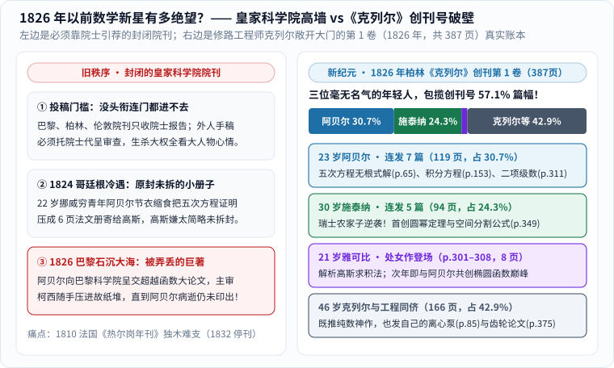
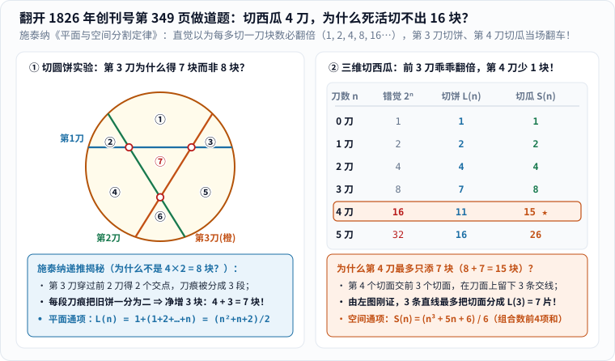
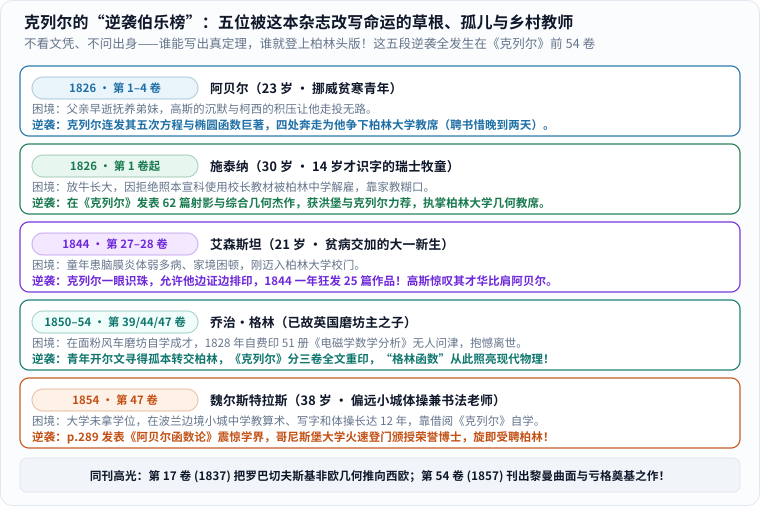

1825 年秋天，普鲁士首都柏林的一间客厅里，45 岁的道路工程官员**奥古斯特·利奥波德·克列尔（August Leopold Crelle，1780–1855）**接待了一位特殊的访客 [[1]](#ref-1)[[2]](#ref-2)。

来人是个年仅 23 岁的挪威小伙子，身材瘦削，口袋空空，德语和法语都带着浓重的北欧口音。在此之前，这个年轻人曾节衣缩食，把一份困扰人类三百年的数学难题证明压成薄薄 6 页小册子寄给“数学王子”高斯，结果高斯连信封都没拆；几个月后他再去巴黎科学院投递一生最重要的长篇手稿，又会被主审大数学家柯西随手塞进故纸堆里忘得一干二净 [[2]](#ref-2)。

换作任何一位名门院士，大概几分钟就会把这个毫无头衔的异乡穷学生打发走。

可修桥铺路出身的克列尔，耐心地坐下来翻开了他的手稿。这一翻，克列尔的后背直冒冷汗——他意识到，眼前这个快要交不起房租的挪威青年**阿贝尔（Niels Henrik Abel）**，手里攥着足以改写整个世纪数学走向的惊世之作；而当时的欧洲，竟然**找不到一本肯为这类无名青年敞开大门的一流数学杂志** [[1]](#ref-1)[[2]](#ref-2)！

短短几个月后的 **1826 年 1 月 1 日**，克列尔在柏林正式印出了《纯粹与应用数学杂志》（*Journal für die reine und angewandte Mathematik*）第 1 卷第 1 期 [[4]](#ref-4)[[5]](#ref-5)。因为德文刊名实在太长，全世界数学家从十九世纪起就亲切地直呼它为**《克列尔》杂志（*Crelle's Journal*）** [[1]](#ref-1)[[4]](#ref-4)。

到 **2026 年**，这本由一位“半路出家的修路工程师”创办的季刊，已经**一卷不落地连续出版了整整两百年**——它是全世界现存最古老的连续出版数学专业期刊，也是两百年来无数草根天才逆天改命的圣地 [[4]](#ref-4)。

---

## 一、1826 年以前，一个没背景的年轻数学家有多绝望？—— 皇家科学院的高墙与一位自学工程师的破局

今天的研究生写完论文，只要打开投稿网站上传 PDF，无论你来自顶尖名校还是偏远小城，稿件都会进入同行评审流程。可在 1826 年以前，科学世界根本不是这样运转的。

_先看左栏的旧壁垒：1826 年以前，欧洲主流科学发表渠道几乎被巴黎、柏林、伦敦等皇家科学院院刊垄断，外人手稿必须托院士代呈，阿贝尔在哥廷根与巴黎先后撞壁。再看右栏的新纪元：根据德古意特数字化原刊目录逐篇核计，1826 年《克列尔》创刊第 1 卷共 387 页，23 岁阿贝尔（7 篇共 119 页，占 30.7%）、30 岁施泰纳（5 篇共 94 页，占 24.3%）与 21 岁雅可比（1 篇 8 页，占 2.1%）三位无名青年合计包揽了整卷 **57.1%** 的篇幅！。_

### 1. 没有院士替你递话，你的手稿连印刷机都摸不到

从 17 世纪牛顿、莱布尼茨时代直到 19 世纪初，欧洲最权威的学术阵地是各国的**皇家科学院院刊**——比如巴黎科学院院刊、柏林科学院院刊、伦敦皇家学会《哲学会刊》 [[1]](#ref-1)。

这些院刊本质上是**院士俱乐部的内部会议记录**：

- 如果你是正式院士，你在例会上读一篇报告，院刊自然替你排印；
- 如果你是个没头衔的局外人，你连直接投稿的资格都没有——必须先求一位大院士替你把论文呈交上去，再由指派的院士委员会审查。要是哪位大忙人院士没空看、看不顺眼或者顺手塞错了抽屉，你的心血就等于判了死刑（我们在[《柯西和他的数学发现》]()里讲过，阿贝尔和伽罗瓦两代奇才的手稿都曾栽在巴黎科学院这套衙门流程里） [[2]](#ref-2)。

在克列尔之前，法国数学家热尔岗（Joseph Diaz Gergonne）曾在 1810 年创办过一份民间月刊《纯粹与应用数学年刊》，只可惜全靠他一人支撑，1831 年他调任大学行政职务后杂志便在 1832 年停刊（法国另一本名刊《刘维尔杂志》则要等到 10 年后的 1836 年才问世） [[1]](#ref-1)。整个德语世界乃至欧洲北方，迫切需要一个**不看出身、不认学阀、向全世界开放投稿**的独立数学舞台。

### 2. 穷泥瓦匠之子、36 岁才拿博士的修路官，决定自掏腰包推倒高墙

挑起这副担子的克列尔，自己就是个标准的“非科班逆袭者” [[1]](#ref-1)。

1780 年，克列尔出生在普鲁士弗里岑（Wriezen）一个贫穷的河堤建筑工家庭。家里根本供不起他上正规中学和大学，少年克列尔白天跟着工地干活，晚上借着油灯拼命自学微积分、力学、法语和古典文学 [[1]](#ref-1)。靠着惊人的工程算学本事，他一步步考进普鲁士内政部道路与桥梁工程署，直到 **36 岁（1816 年）** 才把自己业余写的数学研究寄去海德堡大学，补拿了一顶博士帽 [[1]](#ref-1)。

别以为他只是个挂名官员——克列尔是实打实主持修建了普鲁士全国主干公路网的总工程师，1838 年通车的德国最早铁路之一**柏林—波茨坦铁路（Berlin–Potsdam railway）**，正是由克列尔亲自规划设计的 [[1]](#ref-1)！

正因为尝尽了“没文凭、没门路”的苦，克列尔对年轻人的才华有着雷达般的敏锐度与菩萨般的热心肠。1825 年底，接连遇到落魄青年阿贝尔与失业家教施泰纳后，克列尔一拍桌子：既然皇家院刊高高在上，那我就办一份**每卷四期、不论资排辈、专门刊登最新原创数学与力学成果**的季刊 [[1]](#ref-1)[[5]](#ref-5)！

### 3. 翻开 1826 年第 1 卷原刊账本：三个二十多岁的年轻人掀翻了整个欧洲数学界

今天打开德古意特出版社数字化保存的 **1826 年第 1 卷目录**（全卷共 **387 页**，除去序言与书讯共 **37 篇**研究论文） [[5]](#ref-5)，你会看到科学出版史上最震撼的一张创刊成绩单：

1. **23 岁的阿贝尔，一人狂发 7 篇论文（共 119 页，占全卷 30.7%）** [[5]](#ref-5)：
   - **第 65–84 页**：《证明高于四次的代数方程不可能有一般根式解》——困扰人类三百年的[五次方程求根公式悬案]()，在此正式宣告终结 [[2]](#ref-2)[[5]](#ref-5)！
   - **第 153–157 页**：《一个力学问题的解法》——已知质点从任意高度滑落到底端所需的时间函数，反求滑道曲线形状。阿贝尔借分数阶导数一步解出广义等时降落线，顺手开创了现代数学的**积分方程理论** [[5]](#ref-5)！
   - **第 311–339 页**：《关于级数 $$1 + \frac{m}{1}x + \frac{m(m-1)}{1\cdot 2}x^2 + \dots$$ 的研究》——第一次对任意实数与复数指数 $$m$$ 严格证明了广义二项级数的收敛域，并留下了分析学基石**阿贝尔连续性定理** [[2]](#ref-2)[[5]](#ref-5)！
2. **30 岁的雅各布·施泰纳，连发 5 篇几何杰作（共 94 页，占全卷 24.3%）** [[5]](#ref-5)：系统提出“点对圆的幂（Power of a point）”、施泰纳圆链，以及平面与三维空间分割定律 [[3]](#ref-3)[[5]](#ref-5)。
3. **21 岁的雅可比（C. G. J. Jacobi），献上处女作（第 301–308 页）** [[5]](#ref-5)：用简明代数方法剖析高斯数值求积公式；仅仅一年后，他就将与阿贝尔在《克列尔》上并肩掀起椭圆函数大革命！

有意思的是，土木工程师克列尔创刊时原本真诚地想兼顾“纯粹数学”与“工程应用”——在第 1 卷里，他自己就发了一篇研究**离心水泵（*Schwung-Pumpe*，第 85–94 页）**和一篇研究**异形曲柄齿轮减振（第 375–387 页）**的硬核机械论文 [[5]](#ref-5)。

没想到纯数学天才们的来稿实在太猛，没过几年版面就被高深莫测的代数、数论与复分析占满。德国数学圈里从此传开一个流传两百年的经典谐音梗 [[1]](#ref-1)：把刊名里的 *reine **und angewandte** Mathematik*（纯粹**与应用**数学）故意连读吞音，念成 *reine **unangewandte** Mathematik*——“**纯粹不应用数学杂志**”！克列尔自己听罢哈哈大笑，干脆在 1829 年另外创办了一本《建筑艺术杂志》（*Journal für die Baukunst*，一直办了 30 卷），把桥梁水泵挪过去，让《克列尔》专心当纯数学的华山之巅 [[1]](#ref-1)。

---

## 二、亲手做一道 1826 年创刊号里的真题：切西瓜 4 刀，为什么死活切不出 16 块？

很多读者觉得两百年前的顶级数学神刊一定满纸天书、普通人连标题都看不懂。其实，只要翻开 **1826 年创刊号第 349–364 页**施泰纳写的那篇《关于平面与空间分割的若干定律》（*Einige Gesetze über die Theilung der Ebene und des Raumes*） [[5]](#ref-5)，小学生都能跟着拿笔算出一道绝妙的反直觉好题！

问题非常简单：**拿一把足够长的直刀去切一只大西瓜（切的时候不许挪动瓜块），直直劈 4 刀，最多能把西瓜切成几块？**

十个人里有九个会脱口而出：**16 块**！理由听起来无懈可击：0 刀是 $$1$$ 块，1 刀变 $$2$$ 块，2 刀变 $$4$$ 块，3 刀（横一刀、竖一刀、拦腰水平一刀）正好 $$8$$ 块——每多劈一刀把每一块都一分为二，$$1, 2, 4, 8$$，第 4 刀当然是 $$2^4 = 16$$ 块啦！

施泰纳在第 349 页微笑着摇了摇头：**不管你怎么斜着下刀，第 4 刀最多只能切出 $$15$$ 块，绝对切不出第 $$16$$ 块！**

_跟着施泰纳分两步破案：先看左栏二维“切圆饼”，第 3 刀（橙线）最多穿过前两刀产生 2 个红交点，把刀痕分成 3 段，每段添 1 块新饼，因此 $$L(3) = 4 + 3 = 7$$ 块（中心红字 ⑦ 为新围出的三角形），第一次打破 $$2^n$$ 翻倍幻觉；再看右栏三维“切西瓜”，第 4 刀的切面被前 3 刀划出 3 条交线，刀面本身最多分成 $$L(3)=7$$ 片，故最多只添 7 块新瓜，总块数锁死在 $$S(4) = 8 + 7 = 15$$ 块！。_

### 1. 先降维切一张圆煎饼：第 3 刀为什么停在 $$7$$ 块？

为了看穿三维西瓜里发生了什么，施泰纳先退一步看二维平面上用 $$n$$ 条直线切圆饼的最大块数 $$L(n)$$ [[5]](#ref-5)：

- **第 1 刀**：把整张饼切成 $$L(1) = 2$$ 块；
- **第 2 刀**：跟第 1 刀相交于 $$1$$ 个点，这个交点把第 2 条刀痕分成了 **$$2$$ 段**；每一段刀痕穿过一块旧饼、把它一分为二，于是净增 $$2$$ 块，得到 $$L(2) = 2 + 2 = 4$$ 块；
- **第 3 刀（关键转折！）**：要想切出尽可能多的块，第 3 刀不能过前两刀的交点，也不能跟它们平行。可就算如此，**两点确定一条直线，两条旧直线跟第 3 刀最多只能交出 $$2$$ 个交点**！

看上图左栏那两个红圈交点：$$2$$ 个交点只能把第 3 条橙色刀痕分成 **$$3$$ 段**！这意味着第 3 刀最多只能穿过 $$3$$ 块旧饼（总有第 4 块旧饼躲在刀痕够不着的对侧），每穿过一块添 $$1$$ 块新饼，所以第 3 刀最多净增 $$3$$ 块：

$$
L(3) = 4 + 3 = 7 \neq 8
$$

依此类推，第 $$n$$ 刀最多与前 $$n-1$$ 刀交于 $$n-1$$ 个点，把刀痕分成 $$n$$ 段，净增 $$n$$ 块！把每次净增的块数从 $$1$$ 加到 $$n$$（还记得我们在[《高斯到底发明了什么：从 1 加到 100 开始》]()里算过的等差求和吗？），就得到了施泰纳平面分割公式：

$$
L(n) = 1 + (1 + 2 + 3 + \dots + n) = 1 + \frac{n(n+1)}{2} = \frac{n^2 + n + 2}{2}
$$

代进去一验算：$$L(0)=1,\ L(1)=2,\ L(2)=4,\ L(3)=7,\ L(4)=11,\ L(5)=16$$。

### 2. 再升维切西瓜：刀面上的交线，锁死了三维块数上限

看懂了二维煎饼，三维空间用 $$n$$ 个平面切西瓜的最大块数 $$S(n)$$ 一下子就透明了 [[5]](#ref-5)！

想象你正挥下**第 $$4$$ 刀**。这一刀本身是一个平整的刀面；此前切下去的 **$$3$$ 个旧切面**，会在你第 4 刀的刀面上留下 **$$3$$ 条直直的交线**。

请问：你的刀面被这 $$3$$ 条交线切成了几片小区域？

答案我们一秒钟前刚算完——**$$3$$ 条直线最多把一个平面切成 $$L(3) = 7$$ 片区域**，绝不可能切成 $$8$$ 片！刀面上的每一片区域，正好插进一块旧瓜瓤里把它一劈为二，带来 $$1$$ 块增量；既然刀面只有 $$7$$ 片，第 4 刀就最多只能穿过 $$7$$ 块旧瓜（前 3 刀切出的 $$8$$ 个卦限里，必定有 $$1$$ 个卦限完全避开了第 4 刀）！于是：

$$
S(4) = S(3) + L(3) = 8 + 7 = 15
$$

一般地，第 $$n$$ 个平面被前 $$n-1$$ 个平面划出 $$n-1$$ 条直线，刀面最多分成 $$L(n-1)$$ 片，因此三维递推律就是极其优美的 $$S(n) = S(n-1) + L(n-1)$$！借助我们在[《帕斯卡怎样把一场赌局变成概率论》]()里见过的杨辉—帕斯卡三角组合数 $$\binom{n}{k}$$，平面与三维分割数还能写成一眼见底的统一规律：

$$
\begin{aligned}
L(n) &= \binom{n}{0} + \binom{n}{1} + \binom{n}{2} = \frac{n^2 + n + 2}{2} \\[4pt]
S(n) &= \binom{n}{0} + \binom{n}{1} + \binom{n}{2} + \binom{n}{3} = \frac{n^3 + 5n + 6}{6}
\end{aligned}
$$

看！二维空间停在杨辉三角每一行的**前 $$3$$ 项之和**（所以 $$n \le 2$$ 时等于整行和 $$2^n$$，$$n=3$$ 起少掉 $$\binom{3}{3}=1$$ 块）；三维空间停在每一行的**前 $$4$$ 项之和**（所以 $$n \le 3$$ 时乖乖等于 $$2^n$$，一到 $$n=4$$ 就刚好漏掉最右边那一项 $$\binom{4}{4}=1$$，变成 $$16 - 1 = 15$$ 块）！这就是《克列尔》创刊号流传至今的经典味道：**从人人摸得着的朴素问题出发，一步捅破直觉假象，直抵深层结构。**

---

## 三、克列尔的“逆袭伯乐雷达”：从贫病孤儿、磨坊主之子到乡村体育老师

如果《克列尔》只是发过几道漂亮好题，它还不足以封神。真正让两百年后的数学家提起它仍肃然起敬的，是在克列尔亲自担任主编的整整 **30 年、52 卷（1826–1855）** 里 [[1]](#ref-1)[[4]](#ref-4)，这本杂志像一座永不熄灭的灯塔，一次又一次把险些被贫穷、疾病和偏见埋没的无名奇才捞上了岸。

_按卷号与年份纵览《克列尔》前 54 卷改写的五段人生：1826 年第 1 卷起力推贫寒孤儿阿贝尔与 14 岁才识字的瑞士牧童施泰纳；1844 年第 27–28 卷让 21 岁大一新生艾森斯坦一年狂发 25 篇作品；1850–1854 年跨国重印英国已故磨坊主之子乔治·格林尘封二十余年的《格林函数》孤本；1854 年第 47 卷更让困居偏远中学教书法和体操 12 年的魏尔斯特拉斯一夜成名！。_

### 1. 迟到两天的柏林聘书：克列尔与阿贝尔让人泪目的忘年交

阿贝尔是《克列尔》捧红的第一颗巨星，也是克列尔一生最痛的遗憾 [[1]](#ref-1)[[2]](#ref-2)。

1826 年后，阿贝尔回到寒冷贫瘠的挪威，既背着去世父亲留下的家庭债务，又找不到正式大学教职，只能靠微薄代课费度日，还染上了致命的肺结核。远在柏林的克列尔不仅把第 1 卷到第 4 卷最重要的版面源源不断留给阿贝尔（包括 1827 年第 2 卷开创双周期复函数新纪元的《椭圆函数研究》），还像父亲一样四处给普鲁士教育部写信、托科学巨匠亚历山大·冯·洪堡（Alexander von Humboldt）说情，拼命想在柏林大学为阿贝尔谋一个体面的教授席位 [[1]](#ref-1)[[2]](#ref-2)。

1828 年 9 月 25 日，病榻上的阿贝尔给克列尔写去一封感人肺腑的长信，一边感激克列尔无微不至的关怀，一边拼尽最后力气把椭圆函数核心定理托付给杂志 [[6]](#ref-6)。

**1829 年 4 月 8 日**，苦苦奔走数年的克列尔终于拿到普鲁士教育部的正式任命许可！他狂喜地抓起笔给挪威写信报喜：“放心吧，你所有的烦恼都结束了！你在柏林有了稳妥而体面的位置，快来温和的南方养好身体吧！” [[2]](#ref-2)

克列尔不知道的是，就在他动笔前整整两天——**1829 年 4 月 6 日清晨**，年仅 26 岁的阿贝尔已经在挪威弗罗兰的冰雪中咯血辞世 [[2]](#ref-2)。那封能救命的柏林聘书，终究慢了两天。

### 2. 一年狂发 25 篇的大一新生艾森斯坦，与被跨国“打捞”的磨坊之子乔治·格林

失去阿贝尔的剧痛，让克列尔对后来的寒门天才更加惜才如命：

- **14 岁才学会写字的牧童施泰纳（Jakob Steiner）** [[3]](#ref-3)：在瑞士山村放牛长大的施泰纳，14 岁前大字不识一个，后来到柏林当中学老师，又因为倔强拒绝照搬校长的平庸教材被一脚开除。克列尔不仅在《克列尔》上连发他 **62 篇**射影与综合几何论文，还联合洪堡四处活动，硬是帮这位没受过正规大学训练的前牧童拿下了柏林大学专门设立的几何学教授讲席 [[3]](#ref-3)。
- **一年霸榜 25 篇的 21 岁大一新生艾森斯坦（Gotthold Eisenstein）** [[7]](#ref-7)[[8]](#ref-8)：1844 年初，刚进柏林大学一年级、从小患脑膜炎体弱贫寒的艾森斯坦带着一篇三次型数论手稿拜访克列尔。克列尔读罢惊为天人，立刻写信请洪堡为这孩子申请王室特别生活补助，甚至开启了史无前例的“绿色通道”——允许艾森斯坦把刚算出一半的椭圆函数与高次互反律手稿直接送去排字房，边印边补！翻开 **1844 年第 27 卷和第 28 卷**原刊目录 [[8]](#ref-8)，艾森斯坦一个人在一年之内竟然发表了 **23 篇正式论文外加 2 道公开问题（共 25 项）**！连一向惜字如金的高斯都感叹，艾森斯坦的才华足以与阿贝尔比肩 [[7]](#ref-7)。（顺便说个第 27 卷里的彩蛋：就在艾森斯坦论文旁边的**第 198 页**，克列尔还饶有兴致地刊登了传奇心算大师达泽 Zacharias Dase 纯靠脑算把圆周率 $$\pi$$ 推进到小数点后 **200 位**的奇文 [[8]](#ref-8)！）
- **让英国磨坊主之子的遗作死而复生（George Green，第 39、44、47 卷）** [[9]](#ref-9)：在英国诺丁汉，面粉风车磨坊主的儿子**乔治·格林**几乎没上过学，全靠在磨坊顶楼偷读拉普拉斯著作自学成才。1828 年，格林自掏腰包在当地印了区区 **51 本**小册子《数学分析在电磁学理论中的应用》，在里面破天荒发明了**位势理论、格林定理与格林函数**——这可是后来麦克斯韦电磁学、量子力学乃至费曼图计算的看家神器！可惜英国学界无人识货，格林在 1841 年默默无闻地病逝。1845 年，年轻的威廉·汤姆森（后来的开尔文勋爵）偶然淘到一本残存孤本，读后如获至宝，立刻带到欧洲大陆交给克列尔。尽管这本小册子已经印过二十多年，克列尔毫不在乎“首发权门面”，在 **1850 年至 1854 年的第 39、44、47 卷**分三次将格林遗作全文重印推向全世界 [[9]](#ref-9)！

### 3. 同一本第 47 卷（1854）：38 岁乡村体育老师一夜封神！

如果一定要从《克列尔》两百年上百卷里挑出最具戏剧张力的一本，**1854 年出版的第 47 卷** [[9]](#ref-9) 绝对当仁不让。

在这一卷的第 161–221 页，正连载着刚刚提到的英国磨坊主之子乔治·格林的遗作终篇；而往后翻几十页，在第 **289–306 页**，赫然印着一篇署名 **C. Weierstrass**、发自波兰边境偏远小城布劳恩斯贝格（Braunsberg）天主教中学的论文——《论阿贝尔函数理论》（*Zur Theorie der Abelschen Functionen*） [[9]](#ref-9)[[10]](#ref-10)！

论文发表第二天，柏林、哥廷根和巴黎的大数学家们全都炸开了锅：这个叫**卡尔·魏尔斯特拉斯（Karl Weierstrass）**的人是从石头缝里蹦出来的吗？！阿贝尔和雅可比留下的超椭圆积分反演死结，怎么被一个听都没听过的中学老师三下五除二给解开了？！

一打听才知道，38 岁的魏尔斯特拉斯年轻时被父亲逼着读法律和财政，荒废四年连大学毕业证都没拿到，后来勉强考了个中学教师资格证，在小城中学里一待就是 **12 年**——白天给十几岁的半大孩子教**算术、德文书法和单杠体操** [[10]](#ref-10)，晚上点着蜡烛，捧着借来的早期《克列尔》杂志逐行精读阿贝尔的遗作！因为穷得连寄长信的邮资都得精打细算，又常年眩晕呕吐，他的研究成果在抽屉里整整憋了十几年，直到鼓起勇气投给 74 岁的老主编克列尔 [[10]](#ref-10)。

《克列尔》第 47 卷一印出来，命运的齿轮原地飞转：两个月内，哥尼斯堡大学数学系主任黎世留（Richelot）亲自坐马车赶往布劳恩斯贝格小城，当着全校师生的面把**荣誉博士学位**双手捧到这位体操兼书法老师面前；两年后，魏尔斯特拉斯直接升任柏林大学教授，成为现代严密数学分析的最高宗师（今天大学微积分课本里的 $$\varepsilon\text{-}\delta$$ 极限语言就出自他手） [[10]](#ref-10)！

放眼整个前 55 卷，同样的破壁时刻比比皆是：

- **1837 年第 17 卷（第 295–320 页）** [[11]](#ref-11)：当俄国国内还在嘲笑喀山大学教授**罗巴切夫斯基**的“双曲几何”是疯人呓语时，《克列尔》用法文刊出了他的《虚几何学》（*Géométrie imaginaire*），第一次把[打破唯一平行线的非欧几何]()推到了西欧主流数学家案头；
- **1857 年第 54 卷（第 101–155 页）** [[12]](#ref-12)：30 岁的**黎曼（Bernhard Riemann）**发表《阿贝尔函数理论》，把多值复函数拆解成多层叠合的“**黎曼曲面**”，用“切几刀不断开”的亏格开创了现代代数几何与拓扑学；
- **1858 年第 55 卷（第 25–55 页）** [[13]](#ref-13)：物理与生理学通才**亥姆霍兹（Hermann von Helmholtz）**在此发表流体涡旋运动三大定理，再次证明《克列尔》在应用数学上同样一剑封喉！

---

## 四、当屠龙少年变成守门人：1874–1878 年集合论审稿风暴与两百年神刊长青密码

1855 年 10 月 6 日，75 岁的克列尔在柏林安详辞世，把亲手编完 **52 卷**的心血交到了第二任主编**博夏特（Carl Wilhelm Borchardt，1856–1880 年执掌第 53–90 卷）**手中 [[1]](#ref-1)[[14]](#ref-14)。

博夏特治学极其严谨，把杂志办得蒸蒸日上（当时学界甚至一度称其为《博夏特杂志》） [[14]](#ref-14)。然而到了 19 世纪 70 年代，一个颇具讽刺意味的历史反转出现了：当年靠《克列尔》冲破旧学阀的柏林学派，如今自己坐上了世界数学的铁王座；而在编委会幕后拥有巨大话语权的柏林巨头**克罗内克（Leopold Kronecker）**，偏偏是一位极端排斥“实无穷”的有限主义者（他的名言是：“上帝创造了整数，其余一切都是人造的”） [[15]](#ref-15)。

就在这座山雨欲来的柏林舞台上，30 岁左右的青年学者**格奥尔格·康托尔（Georg Cantor）**投来了两篇足以把传统数学地基掀翻的炸药包（参见[《群论和集合，以及那些数学家》]()） [[15]](#ref-15)[[16]](#ref-16)[[17]](#ref-17)。

_上半部分还原《克列尔》历史上最惊险的两次集合论发表：① 左卡第 77 卷（1874 年，pp. 258–262）康托尔故意用《论全体实代数数的一个性质》作低调标题，顺利绕过克罗内克防线证出实数不可数；② 右卡第 84 卷（1878 年，pp. 242–258）动画演示小数奇偶位“拉链穿插”如何把整个二维正方形的点装进一条单位线段，引发克罗内克压稿风波。下半部分串联 1826–2026 两百年主编传承。（右上穿插数字含一次平滑入场动画，刷新可重播）。_

### 1. 第 77 卷（1874）：穿上“隐身保护色”悄悄诞生的现代集合论

1873 年底，康托尔震惊地证明：**全体实数的无穷大，比全体正整数的无穷大更高一级——无论你怎么编号，实数永远排不成一列（实数不可数）！**

要是直接写一篇《论实无穷存在高低等级》投去《克列尔》，嫉恶如仇的老师辈克罗内克多半会当场撕稿。在好友戴德金与魏尔斯特拉斯的指点下，康托尔想出了一个绝妙的“保护色标题”——**《论全体实代数数的一个性质》**（刊于 **1874 年第 77 卷第 258–262 页**，全篇仅短短 5 页） [[15]](#ref-15)[[16]](#ref-16)！

“代数数”（整系数多项式方程的根，比如 $$\frac{2}{3}$$、$$\sqrt{2}$$）正是克罗内克最心爱的研究对象。康托尔先规规矩矩按多项式次数与系数绝对值之和给全体代数数排好队，证明它们可以与正整数 $$1, 2, 3, \dots$$ 一一对应；紧接着利用闭区间套构造出一个不在任何编号位置上的实数——不动声色地推出两记闷雷 [[16]](#ref-16)：

1. 连续实数区间不可能与正整数一一对应（**不可数无穷诞生**）；
2. 既然代数数能排成一列而实数不能，那么在任意一小段数轴上，不是代数数的**超越数**（如 $$\pi, e$$ 那类数）不仅存在，而且多到密密麻麻占满了一切空隙！

主编博夏特一看证明严丝合缝，痛快签发。人类现代集合论的“出生证明”，就这样在《克列尔》第 77 卷平安落地 [[15]](#ref-15)[[16]](#ref-16)。

### 2. 第 84 卷（1878）：“我看到了，但我简直不敢相信！”—— 把整个正方形压进一条线段的审稿风暴

三年后的 1877 年，康托尔自己都撞上了一个让他怀疑人生的怪兽结果。他最初本想证明：“二维单位正方形 $$[0,1]^2$$ 需要两个独立坐标 $$(x, y)$$，一维单位线段 $$[0,1]$$ 只需要一个坐标 $$z$$，所以正方形里的点肯定比线段里的点多得多吧？”

谁知算着算着，他竟亲手写出了一条把二维坐标压成一维坐标的“拉链规则”！我们用具体数字走一遍他的核心直觉：

随便在单位正方形里挑一个点 $$(x, y)$$，比如

$$
x = 0.\color{#1d6fa5}{3\,8\,5\,2\dots}, \qquad y = 0.\color{#c25014}{7\,1\,4\,9\dots}
$$

现在像拉衣服拉链一样，把 $$x$$ 的各位小数填进奇数位，把 $$y$$ 的各位小数填进偶数位，拼成同一个小数 $$z$$：

$$
z = 0.\color{#1d6fa5}{3}\color{#c25014}{7}\color{#1d6fa5}{8}\color{#c25014}{1}\color{#1d6fa5}{5}\color{#c25014}{4}\color{#1d6fa5}{2}\color{#c25014}{9}\dots \in [0, 1]
$$

反过来，给你 $$[0,1]$$ 线段上的一个小数 $$z$$，把奇数位抽出来做 $$x$$、偶数位抽出来做 $$y$$，不就还原出正方形里的点了吗？！**一整块二维实心正方形里的无穷多个点，竟然跟一条没有宽度的一维细线段里的点“一样多”（等势）！三维立方体乃至 $$n$$ 维超立方体也一样多！**

康托尔盯着草稿纸目瞪口呆，在给好友戴德金的信里用法语写下了数学史上最著名的一句惊叹：**“我看到了，但我简直不敢相信！”（*Je le vois, mais je ne le crois pas!*）** [[15]](#ref-15)

> **严谨补漏小贴士（为什么光靠十进制穿插还差半步？）**：细心的戴德金读信后立刻提醒康托尔一个反例——十进制小数表示并不是处处唯一的（比如 $$0.5000\dots = 0.4999\dots$$）。如果我们规定“禁止使用无穷循环 $$9$$ 结尾”，那么当你反向拆解一维点 $$z = 0.34090909\dots$$ 时，抽出的奇数位是合法的 $$x = 0.3000\dots$$，偶数位却是违规被禁掉的 $$y = 0.4999\dots$$，导致这个 $$z$$ 找不到合法原像！康托尔拍案称谢，在正式定稿时改用**无理数的无限连分数展开**（每一个 $$[0,1]$$ 无理数都与无限正整数序列 $$[a_1, a_2, a_3, \dots]$$ 严格唯一对应，绝无“$$0.4999\dots$$”式重码，再把可数无穷个有理数单独移位配对），把证明补得滴水不漏 [[15]](#ref-15)[[17]](#ref-17)！

1877 年 7 月，康托尔满怀期待地将这篇《流形论一则贡献》（*Ein Beitrag zur Mannigfaltigkeitslehre*）投给《克列尔》。这一次，再也没有什么标题能瞒过克罗内克了。

克罗内克读后勃然大怒，认为这种颠覆空间维数直觉的“无穷魔术”纯属荒唐，在幕后百般阻挠排印 [[15]](#ref-15)。稿件在编辑部一压就是大半年，急得康托尔差点要撤稿自印小册子；幸亏戴德金亲自出面仗义执言，主编博夏特最终顶住压力，将它排进了群星璀璨的 **1878 年第 84 卷第 242–258 页**（翻开那一卷目录 [[17]](#ref-17)，前后紧挨着的作者分别是弗罗贝尼乌斯、埃尔米特、若尔当、凯莱和格拉斯曼，堪称神仙打架）！

论文虽然成功印出，但被压稿寒透了心的康托尔立下重誓：**此生绝不再向《克列尔》投哪怕一篇稿件！** 此后他将 1879–1884 年最辉煌的六篇《一般流形论基础》全部投给了年轻对手菲利克斯·克莱因执掌的《数学年刊》（*Mathematische Annalen*） [[15]](#ref-15)。这段插曲也成了科学史上最深刻的一面镜子：哪怕是最伟大的先锋期刊，一旦让权威的门户之见盖过了对新思想的包容，也会亲手推走下一个时代的阿贝尔。

### 3. 两百年不断刊的奇迹（1826–2026）：一扇永远向真问题敞开的门

历经 19 世纪末的风雨洗礼，《克列尔》并没有沉沦，反而在一代代顶尖数学家的接力守护下愈发稳健 [[4]](#ref-4)：

- **1881–1892 年**：克罗内克与魏尔斯特拉斯联袂接棒；
- **1892–1936 年**：微分方程大师富克斯（Lazarus Fuchs）与发明 **$$p$$-进数（$$p$$-adic numbers）**的亨泽尔（Kurt Hensel）先后执掌逾四十年；
- **1929–1979 年**：代数数论巨匠**赫尔穆特·哈塞（Helmut Hasse）**担任主编长达整整**半个世纪** [[18]](#ref-18)！哪怕在二战炮火摧毁柏林印刷厂、纸张断绝的最黑暗岁月里，哈塞与德古意特出版社依然咬牙护住刊号与学术底线，并在战后迅速将其转型为完全国际化的多语种顶级数学期刊 [[4]](#ref-4)[[18]](#ref-18)。

今天，当你走进任何一所大学数学系的图书馆，看到书架上一排排深色封皮、印着 *Journal für die reine und angewandte Mathematik* 的厚重合订本（如今已出到第 800 多卷 [[4]](#ref-4)），不妨想起 1825 年冬天柏林那个温暖的下午：

一位 36 岁才拿到学位的修路工程师，没有看轻眼前那个连冬衣都买不起的 23 岁挪威青年，而是替他和天下所有没有门第的求真者，推开了一扇整整两百年都没有关上的门。

---

## 参考资料

1. O'Connor, J. J., & Robertson, E. F. *August Leopold Crelle (1780–1855)*. MacTutor History of Mathematics Archive, University of St Andrews. [https://mathshistory.st-andrews.ac.uk/Biographies/Crelle/](https://mathshistory.st-andrews.ac.uk/Biographies/Crelle/)（核查克列尔出身贫寒河堤工家庭、自学任普鲁士道路与柏林—波茨坦铁路工程师、1816 年 36 岁获海德堡博士、1826–1855 年亲编 52 卷及“纯粹不应用数学”谐音典故）
2. O'Connor, J. J., & Robertson, E. F. *Niels Henrik Abel (1802–1829)*. MacTutor History of Mathematics Archive, University of St Andrews. [https://mathshistory.st-andrews.ac.uk/Biographies/Abel/](https://mathshistory.st-andrews.ac.uk/Biographies/Abel/)（核查阿贝尔 1824 年小册子寄高斯未拆、1826 年巴黎大论文被柯西积压、在《克列尔》发表五次方程与椭圆函数代表作，以及克列尔 1829 年 4 月 8 日柏林教席报喜信晚于 4 月 6 日阿贝尔病逝两天之史实）
3. O'Connor, J. J., & Robertson, E. F. *Jakob Steiner (1796–1863)*. MacTutor History of Mathematics Archive, University of St Andrews. [https://mathshistory.st-andrews.ac.uk/Biographies/Steiner/](https://mathshistory.st-andrews.ac.uk/Biographies/Steiner/)（核查施泰纳 14 岁前未识字、在柏林被中学解雇后在《克列尔》发表 62 篇几何论文并获聘柏林大学几何学讲席）
4. Walter de Gruyter GmbH. *Journal für die reine und angewandte Mathematik (Crelles Journal) — Journal Overview & Complete Issues Archive (1826–present)*. [https://www.degruyterbrill.com/journal/key/crll/html](https://www.degruyterbrill.com/journal/key/crll/html)（官方出版主页：核查 1826 年 1 月 1 日创刊日期、连续出版 200 周年历史及现代国际编委会体制）
5. *Journal für die reine und angewandte Mathematik*, **Volume 1** (1826), pp. 1–387. Digitized Table of Contents at De Gruyter. [https://www.degruyterbrill.com/journal/key/crll/1826/1/html](https://www.degruyterbrill.com/journal/key/crll/1826/1/html)（一手核查创刊第 1 卷全部 387 页目录：阿贝尔 7 篇论文页码、施泰纳 5 篇论文及第 349–364 页《平面与空间分割定律》、雅可比第 301–308 页处女作、克列尔第 85–94 页离心水泵与第 375–387 页异形齿轮论文）
6. Abel, N. H. *Niels Abel writes to August Crelle (25 September 1828)*. MacTutor Extras, University of St Andrews. [https://mathshistory.st-andrews.ac.uk/Extras/Abel_Crelle/](https://mathshistory.st-andrews.ac.uk/Extras/Abel_Crelle/)（一手书信：阿贝尔病重期间致克列尔的亲笔信英译全文）
7. O'Connor, J. J., & Robertson, E. F. *Ferdinand Gotthold Max Eisenstein (1823–1852)*. MacTutor History of Mathematics Archive, University of St Andrews. [https://mathshistory.st-andrews.ac.uk/Biographies/Eisenstein/](https://mathshistory.st-andrews.ac.uk/Biographies/Eisenstein/)（核查 1844 年 21 岁大一新生艾森斯坦获克列尔与洪堡资助、一年在《克列尔》刊出 25 篇论文与问题之史实）
8. *Journal für die reine und angewandte Mathematik*, **Volume 27** (1844). Digitized Table of Contents at De Gruyter. [https://www.degruyterbrill.com/journal/key/crll/1844/27/html](https://www.degruyterbrill.com/journal/key/crll/1844/27/html)（一手核查第 27 卷艾森斯坦密集发文记录及第 198 页达泽 Zacharias Dase 心算圆周率 200 位论文）
9. *Journal für die reine und angewandte Mathematik*, **Volume 47** (1854). Digitized Table of Contents at De Gruyter. [https://www.degruyterbrill.com/journal/key/crll/1854/47/html](https://www.degruyterbrill.com/journal/key/crll/1854/47/html)（一手核查第 47 卷第 161–221 页乔治·格林《电磁学理论中的数学分析》重印终篇，以及第 289–306 页魏尔斯特拉斯《论阿贝尔函数理论》成名作）
10. O'Connor, J. J., & Robertson, E. F. *Karl Theodor Wilhelm Weierstrass (1815–1897)*. MacTutor History of Mathematics Archive, University of St Andrews. [https://mathshistory.st-andrews.ac.uk/Biographies/Weierstrass/](https://mathshistory.st-andrews.ac.uk/Biographies/Weierstrass/)（核查魏尔斯特拉斯在偏远中学任教算术、书法与体操 12 年，凭 1854 年《克列尔》第 47 卷论文获哥尼斯堡荣誉博士并受聘柏林之经过）
11. *Journal für die reine und angewandte Mathematik*, **Volume 17** (1837). Digitized Table of Contents at De Gruyter. [https://www.degruyterbrill.com/journal/key/crll/1837/17/html](https://www.degruyterbrill.com/journal/key/crll/1837/17/html)（一手核查第 295–320 页罗巴切夫斯基法文论文 *Géométrie imaginaire*）
12. *Journal für die reine und angewandte Mathematik*, **Volume 54** (1857). Digitized Table of Contents at De Gruyter. [https://www.degruyterbrill.com/journal/key/crll/1857/54/html](https://www.degruyterbrill.com/journal/key/crll/1857/54/html)（一手核查第 101–155 页黎曼《阿贝尔函数理论》与黎曼曲面奠基作）
13. *Journal für die reine und angewandte Mathematik*, **Volume 55** (1858). Digitized Table of Contents at De Gruyter. [https://www.degruyterbrill.com/journal/key/crll/1858/55/html](https://www.degruyterbrill.com/journal/key/crll/1858/55/html)（一手核查第 25–55 页亥姆霍兹流体涡旋运动方程论文）
14. O'Connor, J. J., & Robertson, E. F. *Carl Wilhelm Borchardt (1817–1880)*. MacTutor History of Mathematics Archive, University of St Andrews. [https://mathshistory.st-andrews.ac.uk/Biographies/Borchardt/](https://mathshistory.st-andrews.ac.uk/Biographies/Borchardt/)（核查第二任主编博夏特 1856–1880 年主持第 53–90 卷）
15. O'Connor, J. J., & Robertson, E. F. *Georg Ferdinand Ludwig Philipp Cantor (1845–1918)*. MacTutor History of Mathematics Archive, University of St Andrews. [https://mathshistory.st-andrews.ac.uk/Biographies/Cantor/](https://mathshistory.st-andrews.ac.uk/Biographies/Cantor/)（核查康托尔 1874 年低调标题策略、“我看到了但我简直不敢相信”书信、戴德金指出十进制重码反例改用连分数、克罗内克阻挠 1878 年论文及康托尔此后转投《数学年刊》）
16. *Journal für die reine und angewandte Mathematik*, **Volume 77** (1874). Digitized Table of Contents at De Gruyter. [https://www.degruyterbrill.com/journal/key/crll/1874/77/html](https://www.degruyterbrill.com/journal/key/crll/1874/77/html)（一手核查第 258–262 页康托尔集合论开山论文《论全体实代数数的一个性质》）
17. *Journal für die reine und angewandte Mathematik*, **Volume 84** (1878). Digitized Table of Contents at De Gruyter. [https://www.degruyterbrill.com/journal/key/crll/1878/84/html](https://www.degruyterbrill.com/journal/key/crll/1878/84/html)（一手核查第 242–258 页康托尔维数等势论文《流形论一则贡献》及同卷弗罗贝尼乌斯、埃尔米特、若尔当、凯莱、格拉斯曼名录）
18. O'Connor, J. J., & Robertson, E. F. *Helmut Hasse (1898–1979)*. MacTutor History of Mathematics Archive, University of St Andrews. [https://mathshistory.st-andrews.ac.uk/Biographies/Hasse/](https://mathshistory.st-andrews.ac.uk/Biographies/Hasse/)（核查哈塞 1929–1979 年担任主编整整五十年及二战前后《克列尔》的延续）
