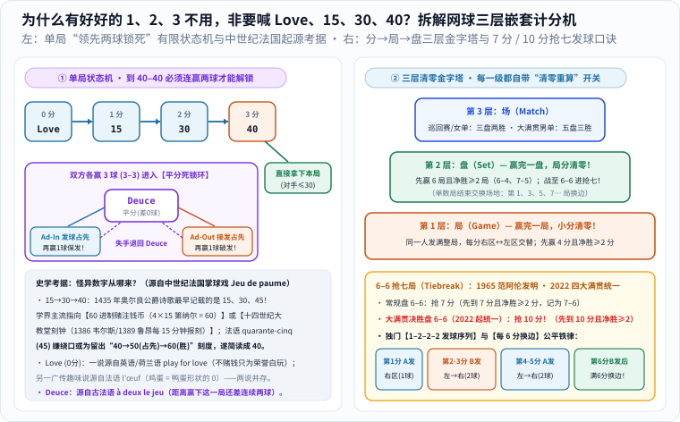
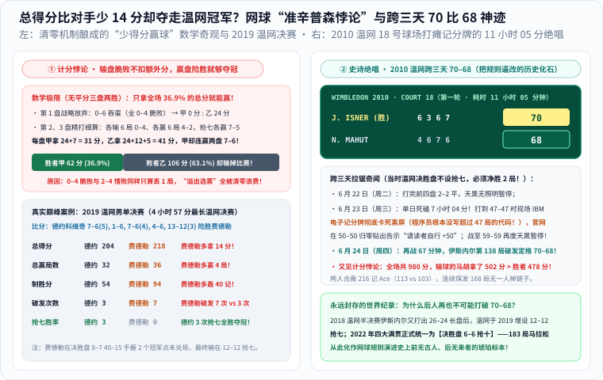
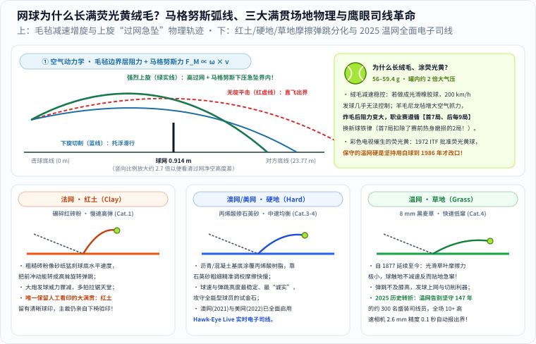

如果你第一次陪朋友或孩子看网球转播，大概率会在前五分钟里连续冒出三个问号：

1. 场上明明只赢了第一球，穿制服的主裁为什么一本正经地报出 **“Fifteen–Love（15 比爱）”**？赢第三球明明该按倍数加到 **45**，怎么又突然缩水成了 **40** [[1]](#ref-1)[[5]](#ref-5)？
2. 发球擦了一下网带落进界内，裁判立刻喊停重发；可两秒钟后双方对拉时球狠狠砸在网带上翻滚过去，对手扑救不及，裁判却眼皮都不抬直接判得分——同样是擦网，凭什么待遇天差地别 [[1]](#ref-1)[[3]](#ref-3)？
3. 更让人怀疑人生的是赛后技术统计：**2019 年温布尔登男单决赛**打了近 5 个小时，费德勒全场赢下 **218 分**、破发 **7 次**，德约科维奇只赢了 **204 分**、破发 **3 次**——总分少拿 **14 分**、总赢局数还少 **4 局**的德约科维奇，竟然合法合规地捧走了冠军金杯 [[5]](#ref-5)[[7]](#ref-7)[[8]](#ref-8)！

表面看，网球像是全世界最跟直觉过不去的“奇葩运动”；可一旦把这些规则背后的**中世纪修道院掌球史、球场勾股几何、分盘清零数学机制和空气动力学**一层层剥开，你会发现：网球几乎是人类体育史上把**数学博弈、心理抗压与地面物理**耦合得最精妙的一套规则杰作。

---

## 一、先认清脚下这片“心机长方形”：压线 1 毫米算界内、绕柱不算犯规与斜线红利

在听懂裁判报分之前，我们先低头看一眼网球场。1874 年英国陆军少校温菲尔德（Walter Clopton Wingfield）最初申请专利推广草地网球时，画出的其实是一块像沙漏一样“中间窄、两头宽”的怪球场；直到 **1875 年玛丽勒本板球俱乐部（MCC）修订规则、1877 年首届温布尔登锦标赛定型**，才拍板确立了沿用至今的国际网联（ITF）标准长方形球场 [[2]](#ref-2)[[4]](#ref-4)：

_先看左图按 $$1\text{ m} = 12.2\text{ px}$$ 严格比例绘制的球场解剖：深蓝内框为单打场地（$$23.77\text{ m}\times 8.23\text{ m}$$），两侧浅蓝走廊为双打边道（各宽 $$1.37\text{ m}$$），橙色与亮黄色轨迹展示从右底角击出直线球与对角斜线球的真实路程对比（支持动画的浏览器会演示一次双球飞行并停在终态；开启“减少动态效果”则直接静态呈现），左侧紫色虚线则是完全合法的“绕柱球”。再看右图：球网中心被白带拉低至 $$0.914\text{ m}$$，配合勾股对角线白捡 $$1.38\text{ m}$$ 缓冲跑道，正是“打斜线更稳”的底层几何原因。_

### 1. 一张球场两套边框：单打走廊、发球格与转球拍开局

标准网球场总长 **78 英尺（$$23.77\text{ m}$$）**，正中央横拉一道球网平分南北半场 [[2]](#ref-2)：

- **单打只看内侧边线**：宽 **27 英尺（$$8.23\text{ m}$$）**；如果打双打，才启用左右两条各宽 $$4.5$$ 英尺（$$1.37\text{ m}$$）的边道（Alley），总宽扩至 **36 英尺（$$10.97\text{ m}$$）** [[2]](#ref-2)。注意一个细节：**双打比赛在发球那一拍，落点范围依然不能进边道**，必须乖乖落在内侧两个距离球网 $$21$$ 英尺（$$6.40\text{ m}$$）的**发球区（Service Box）**里；发球一旦接起进入相持，整条边道才瞬间解锁 [[1]](#ref-1)[[3]](#ref-3)！
- **右区叫“平分区”，左区叫“占先区”**：面向球网站在底线后，中点右侧永远叫**平分区（Deuce Court）**，左侧叫**占先区（Ad Court）**。每局第 1 分（以及任何双方总得分为偶数的时刻，如 `15–15`、`40–40`）一律站在**右半边**往斜对角发球；总得分为奇数（如 `15–0`、`40–30`）一律站到**左半边**往斜对角发球 [[1]](#ref-1)[[3]](#ref-3)。
- **开赛前“转球拍”的隐藏第 3 选项**：业余比赛转球拍底盖（职业赛抛硬币）猜中的一方，除了可以选**① 先发球还是先接发**、**② 选哪一侧场地**（躲避刺眼阳光或逆风）之外，规则还允许选一个极狡猾的**③ 推迟选择权（Defer）**——把难题甩给对手先选，而且对手**无权再推回来** [[1]](#ref-1)！

### 2. 为什么全世界教练都在喊“多打斜线、慎变直线”？

看职业比赛时，你会发现绝大多数底线多拍相持都在两个斜对角之间来回拉扯，谁轻易变直线（Down-the-line）往往不是一拍制胜就是直接下网或出底线。这不是战术保守，而是球场设好的一道**初中几何题** [[2]](#ref-2)：

第一重便宜在**球网高度**。网球网两端的网柱高 **3 英尺 6 英寸（$$1.070\text{ m}$$）**，但规则强制要求用一根白色中心带（Center Strap）把球网正中央死死拽低到 **3 英尺整（$$0.914\text{ m}$$）** [[2]](#ref-2)！也就是说，球网正中间是一道比两头矮了整整 **$$15.6\text{ cm}$$**（逾两颗网球直径！）的天然豁口。打直线球经过边线附近时，网高仍在 $$1.02\text{–}1.05\text{ m}$$ 左右；而打对角斜线球恰好从正中央最低谷飞过，下网风险骤降。

第二重便宜在**勾股定理算出的着陆跑道**。沿单打边线打直线球，底线到底线的可用长度只有 $$L = 23.77\text{ m}$$；而从单打右底角斜拉到对方右底角，可用跑道长度变成直角三角形斜边：

$$
D_{\text{斜线} } = \sqrt{23.77^2 + 8.23^2} = \sqrt{565.0129 + 67.7329} \approx 25.15\text{ m}
$$

整整白捡了 **$$25.15 - 23.77 = 1.38\text{ m}$$** 的缓冲距离！网顶矮了近 $$16$$ 厘米，脚下还多送 $$1.38$$ 米跑道——这就是为什么对角斜线球是网球场上容错率最高的“保命母线”。

### 3. 三条最反直觉的边界与球网铁律

球场上还有三条连老球迷都经常争得面红耳赤的精确判据 [[1]](#ref-1)[[2]](#ref-2)[[3]](#ref-3)：

- **哪怕只蹭到白线外沿 1 毫米，也 100% 算界内（IN）**：网球场地尺寸一律量到白线的**最外侧边缘**。球只有整颗完全落在白线以外、与白线之间留出肉眼或高速相机可见的缝隙才算出界；只要球身变形瞬间有 $$1\text{ mm}$$ 绒毛压上白线，就是无可争议的好球 [[2]](#ref-2)。
- **为什么发球擦网要重发，对拉擦网却算得分？** 发球是死球启动，如果球擦中网带后仍落进斜对角发球区，球路会发生完全无法预判的诡异折射，为了不让发球方凭运气白捡便宜，规则判为 **Let（擦网重发）**，这一球作废重来（注意：如果一发已经失误，二发擦网进区，重发的依然只是**二发**，并不会复活一发！）[[3]](#ref-3)。但一旦接发球成功进入活球相持，双方都在动态移动，此时球砸在网带上翻滚过去只要没出界，就算绝杀好球，被擦网绝杀的一方通常只能苦笑着看对手举手示意致歉 [[1]](#ref-1)[[3]](#ref-3)。
- **球根本不需要“从球网上方飞过去”——绕柱球（Around-the-post）完全合法！** 规则只禁止球穿过球网网眼，却**从未规定球必须高于球网** [[2]](#ref-2)。当对手把你大角度拉出场外，你在救球时把球从网柱外侧、哪怕离地只有 $$30$$ 厘米高紧贴地面旋进对方界内，这记“绕柱神仙球”不仅不算犯规，反而往往直接入选年度十佳球！

---

## 二、为什么好好的 1、2、3 不用，非要喊 Love、15、30、40？拆解三层嵌套计分机

搞清了场地，再来拆解最让人头晕的计分。网球之所以刺激，是因为它不像篮球、足球那样从头到尾累加一块总分牌，而是设计了一台**“分（Point）→ 局（Game）→ 盘（Set）→ 场（Match）”层层清零的三级金字塔** [[1]](#ref-1)[[5]](#ref-5)：

_先看左图：上半部是单局计分的有限状态机——前 3 球依次记为 `15 → 30 → 40`，一旦战至 `3–3` 就锁入紫色 `Deuce ⇄ Ad-In / Ad-Out` 循环，必须连赢两球才能破局；下半部列出中世纪法国掌球戏的文献考据。再看右图：每一局打完小分清零、每一盘打完局分清零，以及 `6–6` 抢七局独有的 `1–2–2–2` 交替发球与每 `6` 分换边规则。_

### 1. 中世纪法国修道院留下的数字化石：60 进制钱币、大教堂刻钟与“鸭蛋”之争

现代草地网球虽然诞生于 19 世纪 70 年代的英国伯明翰与温布尔登，但它的计分口令却是直接从 12 世纪法国修道院回廊里的**掌球戏（*Jeu de paume*，意为“用手掌击球的游戏”，英文称 Real Tennis 皇家网球）**原封不动继承下来的 [[4]](#ref-4)[[5]](#ref-5)。就连英文 **“Tennis”** 这个词本身，都来自 14 世纪盎格鲁-诺曼法语发球前高喊的那声提醒——***“Tenez!”***（意为“接招！拿住！”，早在 1400 年英国诗人高尔献给亨利四世的诗篇中就已出现）[[4]](#ref-4)。

那么，`Love – 15 – 30 – 40 – Deuce` 到底是怎么来的？体育史学界通过一手文献还原出了几条有据可查的线索（同时也澄清了不少民间段子）[[5]](#ref-5)：

1. **最初的第 3 球真的是 `45`，而不是 `40`！** 现存最早的网球比分文献，是 **1435 年法国奥尔良公爵查理（Charles d'Orléans）**写下的一首叙事歌谣，里面明确写着 *quarante-cinq*（**45**）；1522 年的一则拉丁文对话里也写着“我们赢到 30 了，我们赢到 45 了” [[5]](#ref-5)。为什么赢一球算 `15`、四球凑满 `60`？
   - **60 进制赌注钱币说（学界认为最扎实）**：中世纪欧洲通行查理曼货币体系与巴比伦传下的 **60 进制**（$$1$$ 利弗尔 $$= 20$$ 苏，很多地方 $$1$$ 大银币折 $$60$$ 第纳尔，正如[《帕斯卡怎样把一场赌局变成概率论》]()里贵族习惯拿金币赌球一样）。当时打掌球戏几乎场场带彩头，每赢一球推进四分之一注码（$$15$$ 枚钱币），赢满 $$4 \times 15 = 60$$ 刚好赢走整枚大币 [[5]](#ref-5)。
   - **大教堂刻钟拨盘说（半真半假的流行解释）**：民间最爱讲“用钟面分针拨四分之一圈记 `15、30、45、60`”。严谨的钟表史家曾反驳说，普通机械钟要到 1690 年前后惠更斯摆钟擒纵机构普及后才普遍装上分针；但也有史料补充指出，**1386 年英国韦尔斯大教堂天文钟**与 **1389 年法国鲁昂大钟**早已具备 60 分钟内盘并每 **15 分钟（一刻钟）**敲钟报时 [[5]](#ref-5)。至于 `45` 为什么变成了 `40`？一是因为法语 *quarante-cinq*（四十五）比 *quinze*（十五）、*trente*（三十）多了整整两个音节，球场上喊起来太慢，干脆缩读成单词 *quarante*（四十）；二是在引入平分规则后，把 `45` 退回 `40`，刚好能在 60 刻度内留出“`40`（平分）→ `50`（占先）→ `60`（赢局）”的完美两步台阶 [[5]](#ref-5)！
2. **为什么 `0` 分要叫浪漫的 `Love`（爱）？** 这里同样有两个并存的词源假说 [[5]](#ref-5)：语言学家更倾向于英语习语 **“play for love”**（或同源荷兰语 *iets voor lof doen*），意思是“不赌钱、只为荣誉和热爱白玩一场”——既然分文未得，自然就是“只有爱（零分）”；而球迷最津津乐道的另一说法，则是英国人把法语 **“鸡蛋（*l'œuf*）”** 听岔成了音近的英文 *Love*——就像板球里零分出局叫“鸭蛋（Duck's egg）”、中文里把零分叫“吞蛋”一样形象 [[5]](#ref-5)。
3. **为什么 `40–40` 不叫 `40-all`，而叫 `Deuce`？** 它直接来自古法语口令 ***à deux le jeu***，字面意思是“离赢下这一局还差**连续两球**” [[5]](#ref-5)。一旦踏进 `Deuce`：
   - 发球方赢下一球，叫 **Ad-In（发球占先）**；接发球方赢下一球，叫 **Ad-Out（接发占先 / 破发点）**（职业赛场上主裁直接报占先球员的姓氏，如 *“Advantage Zheng”*）[[1]](#ref-1)[[5]](#ref-5)；
   - 如果占先一方紧接着再赢一球，净胜满 2 球拿下本局；可要是下一球失手，比分瞬间被打回 `Deuce`——哪怕拉锯二十个回合，只要没连赢两球，这局就永远完不了 [[1]](#ref-1)[[5]](#ref-5)！

### 2. 从“局”到“盘”再到“抢七”：为什么单数局换边、抢七偏按 `1–2–2–2` 发球？

走出单局，往上再看两层规则设计，处处透着对“绝对公平”的算计 [[1]](#ref-1)[[5]](#ref-5)：

- **保发与破发**：每一整局由同一名球员发球，下一局换对方发球。因为发球方手握主动权（顶尖男子选手一发时速常超 $$200\text{ km/h}$$），守住自己的发球局叫**保发（Hold）**，抢走对手的发球局叫**破发（Break）** [[3]](#ref-3)。
- **为什么偏偏在“单数局（第 1、3、5、7… 局）”结束时交换场地？** 户外球场难免一边顺风、一边顶风，或者一边正对刺眼斜阳。如果在偶数局（每 2 局）换边，那么整盘下来**甲永远在顺风侧发球、乙永远在逆风侧发球**！改成第 1 局打完立刻换边、此后每打完 2 局（总第 3、5、7… 奇数局）换边，就能保证双方在顺风侧和逆风侧发球的局数严格相等 [[1]](#ref-1)[[5]](#ref-5)。
- **6–6 抢七局的 `1–2–2–2` 密码**：常规一盘先赢满 **6 局**且净胜至少 2 局（如 `6–4`；若打到 `5–5` 则需连赢两局到 `7–5`）。如果战至 **`6–6`**，就进入美国网球名宿**吉米·范阿伦（Jimmy Van Alen，1902–1991）**于 1965 年在纽波特赌场赛首创、1970 年美网率先引入大满贯的**抢七局（Tiebreak）** [[5]](#ref-5)[[6]](#ref-6)：
  - 抢七不再喊 `15、30、40`，直接按自然数 `1, 2, 3...` 报分，常规盘**先得 7 分且净胜至少 2 分**者以 `7–6` 拿下该盘（自 **2022 年法网起，四大满贯决胜盘战至 `6–6` 全部统一改为“先得 10 分且净胜 2 分”的抢十局**）[[1]](#ref-1)[[5]](#ref-5)；
  - 发球顺序绝不是一人两球轮流来，而是 **`1 – 2 – 2 – 2…`**：原本轮到发球的 A 先在右区**只发 1 球**；随后换 B 连发 2 球（先左区、后右区），再换 A 连发 2 球（先左区、后右区）……为什么 A 第一轮只发 1 球？因为如果让 A 先发满 2 球，一旦比分咬紧，A 就永远享有“先发球领先施压”的先后手特权；让 A 先发 1 球，后续两人就都能交替站在领先发球位上，而且每打满 **6 分**（双方刚好各发了 3 球！）交换一次场地，连阳光和风向都平分到了极致 [[1]](#ref-1)[[5]](#ref-5)！

---

## 三、网球最烧脑的数学奇观：总得分少拿 14 分凭什么夺冠？跨三天打到 70 比 68 是怎么回事？

理解了“赢完一局小分清零、赢完一盘局分清零”，一个足以让统计学教授拍案叫绝的现象就浮出水面了——在数学上，网球是一座天然的**“准辛普森悖论（Quasi-Simpson's Paradox）”制造机** [[5]](#ref-5)！

_先看左图：上半部算出了三盘两胜制下的理论极限——只拿全场 $$36.9\%$$ 的分数（$$62$$ 比 $$106$$）就能合法赢球；下半部是 2019 年温网男单决赛真实数据，费德勒总得分、总赢局、制胜分、破发数全面碾压，却因输掉全部 3 个抢七丢冠。再看右图：2010 年温网第一轮伊斯内尔与马胡跨三天耗时 11 小时 05 分钟打出 `70–68`、把现场电子记分牌打到 `47–47` 死机、输家总分反而以 `502` 比 `478` 领先的空前绝后纪录。_

### 1. 算一笔反直觉的账：只拿全场 $$36.9\%$$ 的分数，竟然能赢下整场比赛！

在篮球里，哪怕你前三节每节赢 1 分、第四节输 20 分，总分一定输 17 分。但在网球里，**输掉的一局无论是 `0–4` 被剃光头，还是拉锯十几次平分惜败，代价都只是“丢 1 局”；输掉的一盘无论是 `0–6` 吞蛋还是 `6–7` 惜败，代价都只是“丢 1 盘”** [[5]](#ref-5)！这就像选举人团制度：你在输掉的州里输一百万票，跟输一票没有任何区别，多输的分数全被“清零开关”一键销毁了。

我们来算一下，在一场完全没有 `Deuce` 拉锯的标准**三盘两胜抢七赛**里，一个人最少赢多少分就能击败对手？

1. **第 1 盘战略性彻底躺平**：甲连丢 6 局 `0–4`，以 `0–6` 输掉首盘。这一盘甲得 **$$0$$ 分**，乙狂砍 $$6 \times 4 = \mathbf{24}$$ **分**。
2. **第 2 盘与第 3 盘极限“田忌赛马”**：在每一盘里，甲把对手的 6 个发球局全部 `0–4` 放掉（甲得 $$0$$ 分，乙得 $$24$$ 分）；而在自己的 6 个发球局里全部以最小代价 `4–2`（`40–30`）涉险保发（甲得 $$24$$ 分，乙得 $$12$$ 分）；把比赛拖进 `6–6` 抢七后，再以 `7–5` 险胜抢七！算算单盘小分：

$$
\begin{aligned}
\text{甲单盘得分} &= 0 + 24 + 7 = 31\text{ 分} \\
\text{乙单盘得分} &= 24 + 12 + 5 = 41\text{ 分}
\end{aligned}
$$

甲每一盘都比乙少拿 $$10$$ 分，却硬生生连赢两盘 `7–6(5)`！把三盘总分加起来：

$$
\frac{\text{胜者甲总得分} }{\text{全场总分} } = \frac{0 + 31 + 31}{(0 + 31 + 31) + (24 + 41 + 41)} = \frac{62}{168} \approx 36.9\%
$$

**乙轰下了全场 $$63.1\%$$ 的总得分（$$106$$ 分对 $$62$$ 分），最后却只能提着球包淘汰出局！**（如果允许在输掉的局里无限刷 `Deuce`，胜者的总得分占比甚至还能进一步逼近更低的极限。）

你以为这只是纸上谈兵的数学游戏？据统计，职业巡回赛里大约每 **20 到 25 场**比赛就会出现一次“总得分更少却赢下比赛”的倒挂，最震撼全世界的一幕就发生在 **2019 年 7 月 14 日温布尔登中央球场** [[7]](#ref-7)：

那场长达 **4 小时 57 分钟**的史诗决赛里，37 岁的费德勒在几乎每一项硬实力指标上都压制了德约科维奇——总得分 **218 比 204**（多拿 14 分）、总赢局数 **36 比 32**（多赢 4 局）、制胜分 **94 比 54**、Ace 球 **25 比 10**、破发次数 **7 次比 3 次**，甚至在决胜盘 `8–7` 自己的发球胜赛局握有 `40–15` **连续两个冠军点** [[5]](#ref-5)[[7]](#ref-7)！可德约科维奇就像一台专门为关键分而生的精密仪器：输掉的两盘（`1–6`、`4–6`）干脆利落地把落后分数一把清零，而把全部能量锁死在三个抢七局（`7–5`、`7–4` 以及温网当年刚推出的决胜盘 `12–12` 抢七 `7–3`），全场比赛三个抢七零非受迫性失误，硬是在总分落后 14 分的绝境下夺走了温网金杯 [[7]](#ref-7)！

### 2. 打瘫 IBM 记分牌的 11 小时 05 分钟：2010 年温网跨三天 `70–68` 传奇

如果说 2019 年温网展示了“清零机制”的冷酷，那么 **2010 年温网男单第一轮**在 18 号球场（Court 18）上演的那场“无尽之战”，则把**“决胜盘不设抢七（长盘制）”**的规则推向了人类体能与软件工程的荒诞极限 [[8]](#ref-8)。

直到 2018 年之前，除了美网之外，澳网、法网和温网都坚守着老派传统：**决胜盘就算打到 `6–6` 也不抢七，必须实打实净胜对手两局才能结束战斗** [[5]](#ref-5)[[8]](#ref-8)。

2010 年 6 月 22 日傍晚，身高 $$2.08\text{ m}$$ 的美国重炮手**约翰·伊斯内尔（John Isner）**遇上了从资格赛一路杀上来的法国选手**尼古拉·马胡（Nicolas Mahut）** [[8]](#ref-8)。谁也没想到，一场普普通通的首轮比赛，竟然横跨了整整**三天**：

- **第一天（6 月 22 日周二）**：两人中规中矩打成 `6–4, 3–6, 6–7(7), 7–6(3)` 大比分 `2–2` 平，晚上 9 点 07 分因天黑没有灯光照明暂停 [[8]](#ref-8)；
- **第二天（6 月 23 日周三）**：决胜盘开打后，两人在快速草地上化身发球机器，谁也破不了谁的发球局！比分一路从 `10–10`、`20–20` 飙升到 `47–47`——就在这一刻，**18 号球场边由 IBM 提供的电子记分牌突然彻底卡死，随后直接黑屏罢工**！IBM 程序员事后哭笑不得地解释：写代码时压根没人想到人类决胜盘能打过 `47–47` [[8]](#ref-8)！温网官网的在线记分牌更逗，在打到 **`50–50`** 时因为数组上限直接归零成了 `0–0`，逼得官网管理员连夜挂出一行提示：**“请各位网友自行给比分加上 50（Please add 50 to the Isner/Mahut game score）”** [[8]](#ref-8)！当天两人单日死磕 **7 小时 04 分钟**（光这一天的半盘球就已经打破了此前网球史整场最长纪录），一直熬到晚上 9 点 09 分战成 **`59–59`**，在全场观众高喊 *“We want more!”* 的欢呼声中再度因天黑停赛 [[8]](#ref-8)。当晚伊斯内尔饿得说自己“能一口气吞下 12 个巨无霸汉堡”，罗迪克专门跑去给他买回三大盒披萨、炸鸡和土豆泥；IBM 工程师则加班写热补丁修记分牌一直修到半夜 11 点 45 分 [[8]](#ref-8)。
- **第三天（6 月 24 日周四）**：下午续战 67 分钟后，在决胜盘第 **138 局**（`69–68` 马胡发球局），伊斯内尔终于用一记反手直线穿越兑现赛点，将决胜盘比分定格在惊世骇俗的 **`70–68`** [[8]](#ref-8)！

翻开这张足足写了 **7 页纸**的裁判记分卡，一连串世界纪录看得人头皮发麻 [[8]](#ref-8)：

- 全场总耗时 **11 小时 05 分钟**（仅决胜盘一盘就打了 **8 小时 11 分钟**！），总计 **183 局**，双方连续 **168 个发球局保发**，合轰 **216 记 Ace 球**（伊斯内尔 113 记、马胡 103 记，双双打破历史单场纪录）；瑞典主裁拉亚尼（Mohamed Lahyani）在裁判椅上连续坐了七八个小时，高度亢奋到“完全忘了吃饭和上厕所” [[8]](#ref-8)；
- 而最令人唏嘘的，依然是那道计分悖论：**全场共打了 980 分，输掉比赛的马胡总共赢下了 502 分，反而比获胜晋级的伊斯内尔（478 分）足足多了 24 分** [[5]](#ref-5)[[8]](#ref-8)！（筋疲力尽的伊斯内尔第二天在第二轮仅撑了 74 分钟就以 `0–6, 3–6, 2–6` 脆败，全场连 1 记 Ace 都没力气发出来 [[8]](#ref-8)。）

更具宿命感的是，8 年后的 2018 年温网半决赛，又是这位伊斯内尔跟安德森打出了 `24–26`、耗时 6 小时 36 分钟的长盘大战，直接把排在后面的德约科维奇与纳达尔半决赛挤到了第二天 [[8]](#ref-8)。全英俱乐部终于坐不住了：2019 年温网宣布决胜盘 `12–12` 抢七；**2022 年 3 月，四大满贯历史性地联合宣布：所有大满贯决胜盘战至 `6–6` 统一采用“10 分制抢十局”** [[1]](#ref-1)[[5]](#ref-5)[[8]](#ref-8)。从此，温网 18 号球场外墙上那块镌刻着 `70–68` 的铜牌，成了人类体育史上**永远不可能再被后人打破的绝版琥珀**。

---

## 四、一颗荧光黄毛毡球里的物理实验室：旋转弧线、三大满贯场地与鹰眼革命

网球与羽毛球、乒乓球还有一个独一无二的区别：**它是全世界极少数允许在完全不同的地面材质上举办最高级别大满贯的运动** [[2]](#ref-2)。同一名顶尖高手，在巴黎法网可能是战无不胜的“红土之王”，两周后踏上伦敦温网草地却可能首轮爆冷——这背后的秘密，全藏在**毛毡球的空气动力学**与**地面摩擦物理**里 [[2]](#ref-2)[[9]](#ref-9)。

_先看上图：左侧用含空气阻力与马格努斯力的弹道方程积分出三条真实轨迹——无旋平击球（红虚线）稍抬高就直接飞出 $$23.77\text{ m}$$ 底线，而强烈上旋球（绿实线）靠向下的马格努斯力高高越过球网后急坠砸进底线内；右侧拆解荧光黄毛毡球的气压、换球铁律与彩电转播史。再看下图三栏：对比法网红土、澳美硬地与温网草地的触地速度矢量变化，以及 2025 年温网全面启用电子司线与法网红土保留主裁下椅看球印的鲜明反差。_

### 1. 为什么网球要长满绒毛、关进高压罐、每隔 9 局换新球，还要染成荧光黄？

拿起一颗标准网球（直径 $$6.54\text{–}6.86\text{ cm}$$，质量 $$56.0\text{–}59.4\text{ g}$$），上面每一个细节都是被物理和历史逼出来的工程答案 [[9]](#ref-9)：

- **开罐那一声“嗤”的气压秘密**：中世纪的掌球曾用皮革塞羊毛甚至腻子拌头发制作（1480 年法国国王路易十一还专门颁布法令严禁黑心作坊往网球里掺沙子和锯末！）[[9]](#ref-9)。现代网球内部则是充入约 **$$1.8\text{–}2.0$$ 倍标准大气压**氮氧混合气的空心硫化橡胶胆（ITF 验收标准：从 $$254\text{ cm}$$ 高处自由落到混凝土地面，必须弹起 $$135\text{–}147\text{ cm}$$）[[9]](#ref-9)。因为橡胶壁会缓慢漏气，出厂时必须装进同样维持约 $$2$$ 倍大气压的密封拉环罐里“内外顶平”；一旦拉开拉环，球胆就开始不可逆地缓慢跑气变软 [[9]](#ref-9)。
- **为什么非要裹一层羊毛尼龙绒毛（Felt），还要“首 7 后 9”换球？** 如果网球做成光滑橡胶球，职业选手 $$220\text{ km/h}$$ 的重炮发球空气阻力太小，对手根本来不及挥拍，自己打重球也极易出界。表面包裹的羊毛混纺毛毡既能调控边界层阻力让球速可控，又能像无数微小的桨叶一样“咬”住空气产生强烈的**马格努斯力（Magnus Force）**：

$$
\mathbf{F}_M \propto \boldsymbol{\omega} \times \mathbf{v}
$$

当球员向上刷球打出每分钟三四千转的**强烈上旋（Topspin）**时，球体上方毛毡逆风减速（高压）、下方毛毡顺风加速（低压），上下气压差产生一股强大的**向下压球力**——哪怕球高高跃过球网一米多，飞过半场后也会像被无形大手猛按一把似的**急剧下坠砸进底线内**；反之，向下切削打出**下旋（Slice）**时，马格努斯力朝上托举球体，让球贴着网带飘过去，落地后紧贴草皮窜滑 [[9]](#ref-9)。而在大满贯激烈击打中，网球绒毛会迅速被打散“炸毛”，迎风截面积变大、球速变慢，因此职业赛严格执行**“打满前 7 局换第一批新球，此后每打满 9 局换一次新球”**——为什么第一次偏偏少 2 局？因为赛前 5 分钟热身练球时，这批球已经提前挨了相当于 2 局的暴揍！
- **彩色电视逼出来的“光学荧光黄”与温网的 14 年倔强**：在一百多年时间里，网球其实一直是**纯白色**的（偶尔在浅色场地用黑色球）[[9]](#ref-9)。直到 1967 年 BBC 首次对温网试行彩色电视转播，观众纷纷抱怨白色小球在绿草地和白底线之间一闪而过根本看不清。经光学对比实验后，国际网联于 **1972 年**正式引入高对比度的**“光学黄（Optic Yellow，至今仍有一半网友争论它到底是黄还是绿）”** [[9]](#ref-9)。然而，向来把“全白着装”奉若神明的温布尔登却嫌荧光黄不够优雅，硬是顶着全世界的彩电屏幕**继续用了 14 年白球，直到 1986 年才终于低头换成黄球** [[9]](#ref-9)！（顺便说个暖心彩蛋：如今温网每年用完的约 5 万多颗毛毡网球，退役后会被钻出一个小洞挂在英国田野草丛里，给濒危的**欧亚巢鼠 *Micromys minutus*** 当防雨保暖的小木屋 [[9]](#ref-9)！）

### 2. 红土、硬地、草地与鹰眼革命：为什么温网撤掉了 147 年的司线员，法网主裁却还要下椅看泥印？

当同一颗每秒旋转 50 圈的上旋球砸向地面，四大满贯的三种场地会给出截然不同的物理回应 [[2]](#ref-2)：

| 大满贯场地类型 | 代表赛事 | 表面材质构成 | 水平摩擦与球速等级 | 弹跳轨迹与战术风格 | 司线判罚传统与现状 |
| :--- | :--- | :--- | :--- | :--- | :--- |
| **红土（Clay）** | 法国网球公开赛（罗兰·加洛斯） | 碎石地基上铺满极细的**碾碎红砖粉（*Terre battue*）** | **摩擦极大 · 慢速（Cat. 1）** | 砖粉像砂纸猛刹球底水平速度，把上旋动能转化成**高过肩膀的陡峭弹跳**；大炮发球失效，底线超强上旋与滑步拉锯的天堂 | 球砸在砖粉上会留下**清晰的椭圆球印**；至今仍保留人工司线与**主裁亲自走下高椅指认球印**的名场面 |
| **硬地（Hard）** | 澳大利亚网球公开赛、美国网球公开赛 | 沥青或混凝土基底涂覆多层**丙烯酸树脂 + 石英砂**（GreenSet / Laykold） | **石英砂调速 · 中速至中快速（Cat. 3–4）** | 表面刚性均匀，靠涂料中石英砂粗细和用量精准控制快慢；弹跳最规律、最“诚实”，考验无短板全能战士 | 澳网（2021 起）与美网（2022 起）已全面启用 **Hawk-Eye Live** 实时电子司线 |
| **草地（Grass）** | 温布尔登网球锦标赛（自 1877 年延续至今） | 压实硬土上培育修剪至精确 **$$8\text{ mm}$$** 的多年生黑麦草 | **草叶光滑 · 快速（Cat. 4）** | 汁液顺滑的草叶水平阻力极小，球触地几乎不减速，反而**贴地窜滑、弹跳不及膝高**；发球上网与低平切削的致命武器 | **2025 年迎来历史性巨变**：全面启用实时电子司线，正式告别坚守了 **147 年**的约 300 名盛装人工司线员 |

这里还藏着当代网球最后一个有趣的科技故事：**鹰眼（Hawk-Eye）的上位史** [[9]](#ref-9)。

以前看网球，名将麦肯罗对着裁判咆哮 *“You cannot be serious!（你不是认真的吧！）”* 是球场家常便饭——面对时速 $$210\text{ km/h}$$（每秒飞 $$58\text{ m}$$、触地变形仅 $$4\text{–}5$$ 毫秒）的发球，人类肉眼想分辨 $$2\text{ mm}$$ 的出界或压线几乎是不可能的任务。2001 年英国数学与人工智能学者**保罗·霍金斯（Paul Hawkins）**研发出**鹰眼系统**，在球场顶棚四周布设 **10 台以上高速摄像机**，利用多视角计算机视觉**三角测量（Triangulation）**重建网球三维轨迹与触地椭圆，标称平均误差精细到约 **$$2.6\text{ mm}$$** [[9]](#ref-9)。

2006 年网坛引入“球员鹰眼挑战制”（每盘 3 次挑战机会，挑战成功不扣次数，全场上万观众跟着大屏幕拍手伴奏等待三维落点放大的一刻，一度成了网球最经典的互动仪式）；而到了 **2025 年温布尔登锦标赛**，连最讲究英伦古典礼仪的全英俱乐部也迈出了历史性一步：用全天候在 **$$0.1$$ 秒内自动语音报出 *“Out!”* 的实时电子司线（Live ELC）**，彻底取代了自 1877 年以来站在底线旁整整 **147 年**的约 300 名人工司线员 [[9]](#ref-9)。

唯独每年五六月的巴黎罗兰·加洛斯，你依然能看到另一番充满烟火气的景象：当一记贴线重球引来争议，主裁判会利落地翻身爬下高椅，小跑到红砖粉地面前弯下腰，用手指圈出地上那枚真实的浅坑，向球员和全球观众宣布它是擦到了白线还是差了一丝毫厘——在一项连中世纪 `15、30、40` 和 `Love` 都舍不得扔掉的运动里，这份科技与传统并存的倔强，恰恰是网球最迷人的地方。

---

## 五、一分钟看球速查卡：下次打开转播，只需盯紧这 4 个瞬间

最后帮你把整篇文章浓缩成一张随手可用的**看球实战口诀卡**：

1. **听报分先找发球方**：主裁永远**先报发球方分数、再报接发方分数**。听到 `Love` 是 `0`，`40–40` 叫 `Deuce`（必须连赢两球才能破锁），听到 `Ad-Out` 或接发方名字占先，就意味着最刺激的**破发点（Break Point）**来了 [[1]](#ref-1)[[5]](#ref-5)！
2. **看落点盯白线外沿与球网中心**：只要球毛蹭到白线外沿一丝一毫就算界内；发球擦网进区重发（Let），相持擦网过网照打不误；球员拼命拉对角斜线，是因为正中网高矮了 $$15.6\text{ cm}$$ 且对角跑道多送 $$1.38\text{ m}$$ [[2]](#ref-2)[[3]](#ref-3)。
3. **打到 `6–6` 看抢七（或大满贯决胜盘抢十）**：常规盘先到 `7` 分赢 `2` 分，大满贯决胜盘先到 `10` 分赢 `2` 分；发球按 `1–2–2–2` 轮换，每打满 `6` 分交换场地 [[1]](#ref-1)[[5]](#ref-5)。
4. **看懂“关键分运动”的真谛**：因为局局清零、盘盘清零，脆败一盘 `0–6` 并不伤筋动骨；谁能在 `30–30`、`Deuce` 和抢七局里咬住那几颗生死球，哪怕全场总得分比对手少十几分，照样能笑着捧起最后的大满贯奖杯 [[5]](#ref-5)[[7]](#ref-7)！

---

## 参考资料

1. USTA Officiating, [*Scoring Points & Tennis Sets*](https://www.usta.com/en/home/improve/tips-and-instruction/national/tennis-scoring-rules.html), United States Tennis Association — 官方核查赛前转球拍三项选择权（含推迟选择权 Defer）、`Love–15–30–40–Deuce–Ad-In/Ad-Out` 口令、奇数局换边、抢七局 `1–2–2–2` 发球与每 6 分换边，以及 2022 年四大满贯统一决胜盘 `6–6` 抢十规则。
2. Wikipedia / International Tennis Federation Specifications, [*Tennis court*](https://en.wikipedia.org/wiki/Tennis_court) — 核查球场精确几何尺寸（长 `78 ft / 23.77 m`、单打宽 `27 ft / 8.23 m`、双打宽 `36 ft / 10.97 m`、发球线 `21 ft / 6.40 m`、网柱高 `1.07 m` 与中心高 `0.914 m`）、压线外沿判定界内及 ITF 五级场地速度与红土/草地/丙烯酸硬地分类。
3. Wikipedia, [*Serve (tennis)*](https://en.wikipedia.org/wiki/Serve_(tennis)) — 核查平分区（右）与占先区（左）对角交替发球规则、Ace 球定义、一发/二发容错与发球擦网重发（Let）同活球相持擦网继续比赛的判罚边界。
4. Wikipedia, [*History of tennis*](https://en.wikipedia.org/wiki/History_of_tennis) — 核查 12 世纪法国修道院掌球戏（*Jeu de paume*）、1400 年高尔诗篇中盎格鲁-诺曼法语 *Tenez!* 词源、1875 年 MCC 规则与 1877 年首届温布尔登锦标赛场地定型及 1968 年公开赛年代开启。
5. Wikipedia, [*Tennis scoring system*](https://en.wikipedia.org/wiki/Tennis_scoring_system) — 核查 1435 年奥尔良公爵歌谣 `15–30–45` 最早文献、60 进制查理曼钱币赌注与 1386/1389 大教堂刻钟考据、`Love`（*play for love* 与 *l'œuf*）及 `Deuce`（*à deux le jeu*）词源，以及分盘清零导致的“总得分/总赢局更少却赢得比赛”统计现象。
6. International Tennis Hall of Fame, [*Jimmy Van Alen — Inductee Biography*](https://www.tennisfame.com/hall-of-famers/inductees/jimmy-van-alen) — 核查吉米·范阿伦在纽波特赌场创立抢七局（Tiebreak / VASSS）及 1970 年美网首次在大满贯引入抢七的历史过程。
7. Sky Sports, [*Novak Djokovic defeats Roger Federer to win fifth Wimbledon title after historic fifth-set tie-break*](https://www.skysports.com/tennis/news/11762742/novak-djokovic-defeats-roger-federer-to-win-fifth-wimbledon-title-after-historic-fifth-set-tie-break) & Dominating Tennis, [*2019 Wimbledon Men's Final Match Statistics*](https://dominatingtennis.com/finals/2019-wimbledon) — 核查 2019 年温网男单决赛耗时 `4 小时 57 分钟`、比分 `7–6(5), 1–6, 7–6(4), 4–6, 13–12(3)`、费德勒 `8–7 40–15` 双赛点及全场总得分 `218 比 204`、制胜分 `94 比 54`、破发 `7 比 3` 数据。
8. Wikipedia, [*Isner–Mahut match at the 2010 Wimbledon Championships*](https://en.wikipedia.org/wiki/Isner%E2%80%93Mahut_match_at_the_2010_Wimbledon_Championships) — 核查 2010 年 6 月 22–24 日温网 18 号球场跨三天 `11 小时 05 分钟`、`183 局`（决胜盘 `70–68`）、`216` 记 Ace、现场记分牌 `47–47` 死机、官网 `50–50` 归零、总得分马胡 `502` 比伊斯内尔 `478` 及后续推动大满贯决胜盘改制的完整史实。
9. Wikipedia, [*Tennis ball*](https://en.wikipedia.org/wiki/Tennis_ball), [*Hawk-Eye*](https://en.wikipedia.org/wiki/Hawk-Eye) & Al Jazeera, [*Electronic line calling at Wimbledon 2025: How it works, why it's divisive*](https://www.aljazeera.com/sports/2025/6/28/electronic-line-calling-at-wimbledon-2025-how-it-works-why-its-divisive) — 核查网球 ITF 尺寸/质量/弹跳与充气罐规格、毛毡边界层空气动力学、1972 年 ITF 批准荧光黄球与 1986 年温网改用黄球、退役温网球回收作欧亚巢鼠巢穴，以及保罗·霍金斯 10 机位三角测量鹰眼系统（`2.6 mm` 精度）与 2025 年温网启用实时电子司线告别 147 年人工司线员。
