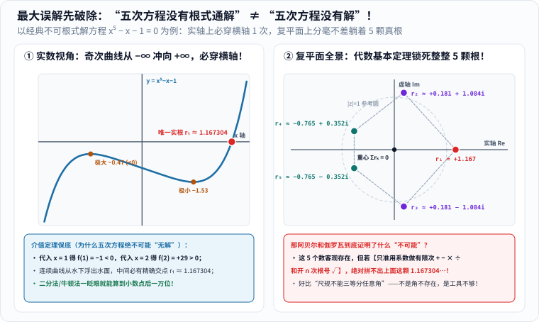
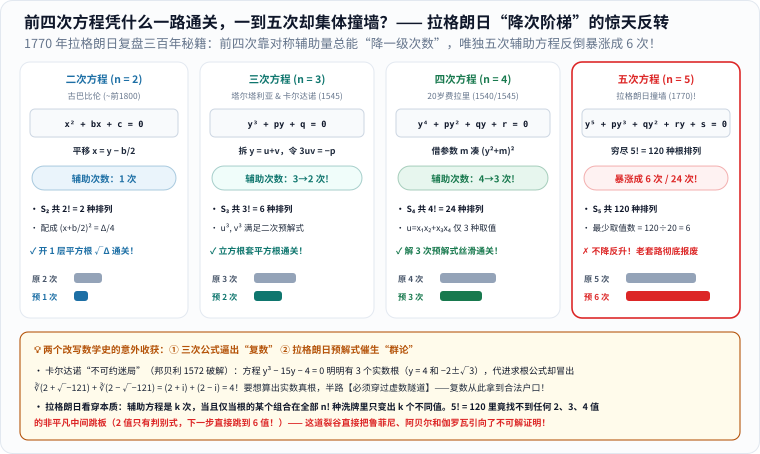
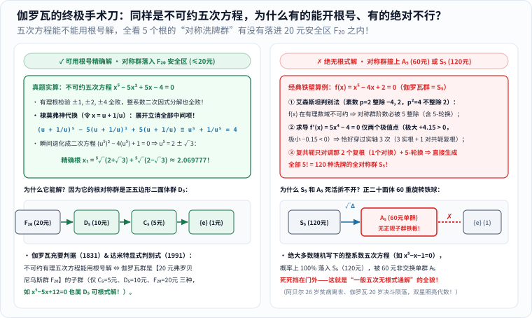
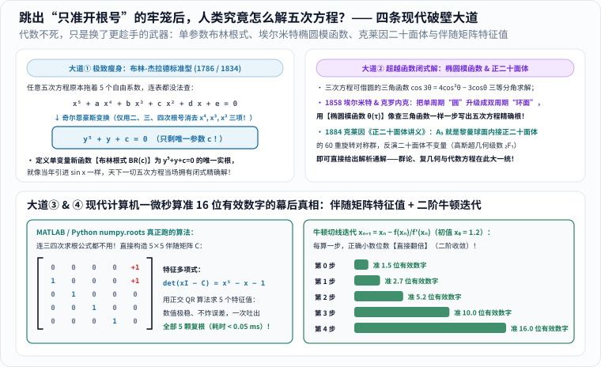

学过初中代数的每个人，脑海里几乎都刻着那句咒语般的口诀——“二分之负 $$b$$ 加减根号下 $$b$$ 方减 $$4ac$$”：

$$
x = \frac{-b \pm \sqrt{b^2 - 4ac}}{2a}.
$$

不管你往 $$ax^2 + bx + c = 0$$ 里填多么刁钻的系数，只要照着这张配方做有限次**加、减、乘、除和开方**，两颗精确答案立刻唾手可得。顺着这条梯子往上爬：十六世纪的意大利数学家在一场场赌上饭碗与名誉的公开决斗中，一口气把**三次方程**和**四次方程**的通用求根公式也全都写了出来 [1]。

按常理推想，五次方程无非是式子再长一截、根号再多套一层罢了吧？

然而历史在这里撞上了一堵令人窒息的铁墙。从十六世纪中叶到十九世纪初，欧拉、贝祖、范德蒙德、拉格朗日等一代代顶尖大脑轮番冲锋，整整**近三百年**，哪怕写出几页纸长的根号嵌套，也没人能拼出一般五次方程的求根公式——直到鲁菲尼、年仅 **21 岁**的挪威青年阿贝尔与 **20 岁**决斗前夜奋笔疾书的法国少年伽罗瓦先后给出一个震动全人类的判决 [3, 4, 5]：

> **五次及更高次的一般代数方程，永远不存在根式求根公式！**

这句话后来成了数学史上最著名、却也**被误解得最惨**的结论之一。无数人听完它的第一反应是：“啊？五次方程居然无解？那工程和计算机里遇到五次方程岂不是彻底抓瞎？”也有人纳闷：“明明 $$x^5 - 32 = 0$$ 一眼就能看出 $$x = 2$$，连稍微复杂点的 $$x^5 - 5x^3 + 5x - 4 = 0$$ 也能用根号解出来，凭什么说五次方程不能开根号？”更让人好奇的是：**既然只靠加减乘除和开根号走不通，那数学家和现代计算机到底是用什么办法把五次方程解出来的？**

今天，我们就把关于“五次方程的解”的前世今生一次性彻底扒开——从破除最大冤案开始，亲手摸一摸前四次方程“降次阶梯”断裂的瞬间，再用不用背群论公理也能亲眼看懂的复平面“溜根换位”动画看穿根号的死穴，最后走通跳出根号牢笼后的四条破壁大道。

---

## 一、先把最大冤案翻过来：“没有根式通解”绝不等于“五次方程没有解”！

在讨论任何高深定理之前，必须先把一盆冷水浇醒那个流传最广的误会：**五次方程不仅有解，而且每一道五次方程的解都老老实实躺在数轴和复平面上，一颗都不少！**

### 1. 实数视角：奇次曲线从负无穷冲向正无穷，闭着眼也必穿横轴一次

我们直接拿整部代数史上最经典的“无根式解标兵”——看似简单到极点的五次方程来做现场实验：

$$
f(x) = x^5 - x - 1 = 0.
$$

它有没有实数解？根本不用任何高深工具，口算两个数就能铁证如山：

- 把 $$x = 1$$ 代进去：$$f(1) = 1^5 - 1 - 1 = -1 < 0$$（曲线还在横轴水下）；
- 把 $$x = 2$$ 代进去：$$f(2) = 2^5 - 2 - 1 = 29 > 0$$（曲线已经冲出水面老高！）。

多项式是一条没有任何断裂的连续光滑曲线。既然它在 $$x = 1$$ 处低于 $$0$$，在 $$x = 2$$ 处高于 $$0$$，根据微积分里最朴素的**介值定理**，它在 $$1$$ 和 $$2$$ 之间**百分之百至少穿过横轴一次**！更一般地说，任何实系数五次方程 $$a_5 x^5 + \dots + a_0 = 0$$（$$a_5 \neq 0$$），因为最高次幂 $$x^5$$ 是**奇数次**，当 $$x \to -\infty$$ 和 $$x \to +\infty$$ 时函数值必然一正一负遥遥相对——所以**每一道实系数五次方程，都至少拥有 $$1$$ 颗实打实的实数根**！

### 2. 复平面全景：代数基本定理锁死整整 5 颗根，真正缺席的只是“根号扳手”

那剩下的根去哪儿了？如果允许我们把视野从一条实数线扩充到二维复平面（关于高斯在 1799 年博士论文中如何严格奠定**代数基本定理**，可参看站内文章《[高斯到底发明了什么？从 1 加到 100 开始]()》），结论更加干脆利落：**任何五次多项式方程在复数域 $$\mathbb{C}$$ 内，计入重数后永远恰好有 $$5$$ 颗根**。

把 $$x^5 - x - 1 = 0$$ 的 $$5$$ 颗根全部算出来摆在台面上（下图左右两栏分别按真实坐标比例画出它的实数曲线与复平面五根分布）：

_先看左栏，再看右栏：① 左栏按真实函数值绘制 $$y = x^5 - x - 1$$，两个局部极值点 $$x = \mp 5^{-1/4} \approx \mp 0.6687$$ 处函数值分别为 $$-0.47$$ 和 $$-1.53$$，都在横轴下方，随后曲线一路上扬，在 $$r_1 \approx 1.167304$$ 处唯一刺穿横轴；② 右栏在复平面画出全部 $$5$$ 颗精确根（$$1$$ 颗实根加 $$2$$ 对上下对称的共轭复根），$$5$$ 颗根相加严格等于 $$0$$（重心落在原点），相乘严格等于 $$+1$$。[单独打开大图](/assets/images/quintic-equation/quintic-has-five-roots.svg)。_

你看，这颗实根 $$r_1 = 1.1673039782614187\dots$$ 是一个确定无疑的实数——你用折半查找（二分法）或者切线逼近（牛顿法），一眨眼就能把它算到小数点后一万位。

那么阿贝尔和伽罗瓦到底证明了什么“不可能”？他们证明的是：**这颗实实在在躺在 $$1.167304\dots$$ 处的数，无论如何都没法用系数的有限次加（$$+$$）、减（$$-$$）、乘（$$\times$$）、除（$$\div$$）和开 $$n$$ 次根号（$$\sqrt[n]{\phantom{x}}$$）拼装出来！**

这和古希腊几何三大难题里的“**尺规不能三等分任意角**”完完全全是孪生兄弟（参看站内《[一把直尺、一个圆规，到底能画出什么？]()》）：$$60^\circ$$ 角的三分之一（$$20^\circ$$）当然稳稳当当存在于纸面上，只是如果你**自缚手脚**，强行规定只准用无刻度直尺（一次方程）和圆规（二次开平方），工具箱的表达能力不够画不出 $$20^\circ$$ 而已。“没有根式解”从来不是数字本身的消失，而是**“四则运算 + 有限次开方”这只五件套工具箱终于撞上了天花板**。

---

## 二、前四次方程凭什么一路破关，一到五次却突然撞墙？—— 从虚数迷宫到拉格朗日“预解降次”的惊天反转

要明白五次方程为什么卡壳，最好的办法不是一上来就背诵抽象定理，而是先看看**二次、三次、四次方程当年究竟是靠什么“通关秘籍”一路打赢的** [1, 2]。

### 1. 二次到四次的连环破壁：每一次胜利，靠的都是“降一级次数”！

无论方程长得多乱，第一步永远是一招毫无门槛的“**平移消次高项**”：对 $$n$$ 次方程 $$x^n + a_{n-1}x^{n-1} + \dots + a_0 = 0$$，只要令 $$x = y - \frac{a_{n-1}}{n}$$，展开后 $$y^{n-1}$$ 这一项就会像变魔术一样自动抵消归零！

消掉次高项之后，前四次方程是怎么一步步拆解的？我们按次数排成一条清晰的流水线：

1. **二次方程（古巴比伦约前 1800 年 / 花拉子米约 820 年）** [1]：
   平移消去一次项后只剩 $$y^2 + q = 0$$，直接开一次平方根 $$y = \pm\sqrt{-q}$$，相当于**从 $$2$$ 次降到了 $$1$$ 次**，当场收工！

2. **三次方程（达尔·费罗约 1515 年秘传、塔尔塔利亚 1535 年决斗大胜、卡尔达诺 1545 年《大术》发表）** [1]：
   平移消去 $$x^2$$ 项后变成“缺项三次方程”：

$$
y^3 + py + q = 0.
$$

   怎么对付它？十六世纪博洛尼亚与威尼斯的数学家想出了一招神来之笔——**把一个未知数拆成两个未知数之和**！令 $$y = u + v$$，代入展开整理成：

$$
(u^3 + v^3 + q) + (3uv + p)(u + v) = 0.
$$

   既然我们多引了一个自由度，就可以主动加上一条约束 $$3uv + p = 0$$（即 $$uv = -\frac{p}{3}$$，从而 $$u^3 v^3 = -\frac{p^3}{27}$$），于是前面那半截立刻给出 $$u^3 + v^3 = -q$$！
   请屏住呼吸看刚才这两行结果：**$$u^3$$ 与 $$v^3$$ 的“和”是 $$-q$$，“积”是 $$-\frac{p^3}{27}$$**！根据韦达定理，$$u^3$$ 和 $$v^3$$ 恰恰是一道**二次辅助方程**（$$t^2 + qt - \frac{p^3}{27} = 0$$）的两颗根！解出这道二次方程，再分别开立方根相加，就得到了著名的**卡尔达诺公式**：

$$
y = \sqrt[3]{-\frac{q}{2} + \sqrt{\frac{q^2}{4} + \frac{p^3}{27}}} + \sqrt[3]{-\frac{q}{2} - \sqrt{\frac{q^2}{4} + \frac{p^3}{27}}}.
$$

   看清套路了吗？**三次方程之所以能解，是因为它借由辅助量 $$u^3, v^3$$ 成功降成了 $$2$$ 次方程！**

3. **四次方程（卡尔达诺年仅 18–20 岁的门生费拉里，1540 年攻克）** [1]：
   消去 $$x^3$$ 项后得到 $$y^4 + py^2 + qy + r = 0$$。费拉里把 $$y^4$$ 强行配成带待定参数 $$m$$ 的完全平方 $$(y^2 + m)^2 = (2m - p)y^2 - qy + (m^2 - r)$$。要想让右边也变成关于 $$y$$ 的完全平方式以便两边同时开平方，右边关于 $$y$$ 的二次判别式必须等于 $$0$$：

$$
q^2 - 4(2m - p)(m^2 - r) = 0 \quad \Longleftrightarrow \quad 8m^3 - 4pm^2 - 8rm + (4pr - q^2) = 0.
$$

   数一数最高次幂：**关于辅助参数 $$m$$ 的方程恰好是 $$3$$ 次方程！** 既然三次方程刚刚已经被师父们攻克了，算出 $$m$$ 代回去开平方，四次方程立刻裂成两个二次方程——**$$4$$ 次降 $$3$$ 次，再降 $$2$$ 次，全线贯通！**

### 2. 插曲：三次公式逼出了“虚数合法户口”！邦贝利与 $$\sqrt{-121}$$ 之谜

在冲向五次方程之前，三次求根公式还顺手干了一件改写整个科学史的大事——**强迫人类承认复数（虚数）的合法存在** [1]！

当时的人们普遍觉得：负数开平方（比如 $$\sqrt{-1}$$）纯属胡说八道，碰到就说明题目“无解”。可卡尔达诺和后来的拉斐尔·邦贝利（Rafael Bombelli，1572 年《代数学》）撞见了一道让所有人后背发凉的三次方程：

$$
y^3 - 15y - 4 = 0.
$$

你把 $$y = 4$$ 口算代进去试试：$$4^3 - 15 \times 4 - 4 = 64 - 60 - 4 = 0$$！它明明有一颗响当当的正整数解 $$y = 4$$（另外两颗也是实打实的实根 $$-2 \pm \sqrt{3}$$）。可是，当你把 $$p = -15,\, q = -4$$ 老老实实代进上面的卡尔达诺求根公式时，滑稽的一幕发生了：

$$
\frac{q^2}{4} + \frac{p^3}{27} = \frac{(-4)^2}{4} + \frac{(-15)^3}{27} = 4 - 125 = -121 < 0,
$$

于是求根公式冷酷地吐出了两个带着负数平方根的“怪物”：

$$
y = \sqrt[3]{2 + \sqrt{-121}} + \sqrt[3]{2 - \sqrt{-121}}.
$$

这就是困扰十六世纪代数学家的**“不可约迷局”（Casus irreducibilis）**：明明三颗根全是实数，通往实数的唯一根式桥梁却逼着你踩过虚数沼泽！邦贝利在 1572 年鼓起勇气大胆按运算法则硬算了一把：他发现 $$(2 + i)^3 = 8 + 12i + 6i^2 + i^3 = (8 - 6) + (12 - 1)i = 2 + 11i = 2 + \sqrt{-121}$$，同理 $$(2 - i)^3 = 2 - \sqrt{-121}$$！两项开完立方一相加：

$$
y = (2 + i) + (2 - i) = 4!
$$

虚部 $$+i$$ 和 $$-i$$ 在半路携手相消，真金白银的实数 $$4$$ 奇迹般走了出来！从此数学家彻底明白：**虚数绝不是捏造的幻影，而是实数世界底下不可或缺的暗河**。

### 3. 1770 年拉格朗日的“降维复盘”：为什么到五次时，辅助方程不降反升暴涨成 6 次？

三次方程靠巧设 $$y = u + v$$，四次方程靠巧配 $$(y^2 + m)^2$$，那五次方程该怎么“巧设”？两百多年里无数数学家试遍了各种变形，全都铩羽而归。直到 **1770–1771 年**，34 岁的拉格朗日向柏林科学院提交了一篇里程碑式的长文《关于方程代数解法的思考》（*Réflexions sur la résolution algébrique des équations*）[2]。

拉格朗日没有再去碰运气瞎凑新技巧，而是问了一个直击灵魂的元问题：**前四次方程那些看似互不相干的“巧招”，背后到底藏着什么共同机关？**

他把辅助未知量反过来用方程原本的根 $$r_1, r_2, \dots, r_n$$ 表示，瞬间看穿了全部天机——**辅助方程之所以是 $$k$$ 次，完全取决于你构造的那个根的组合式，在把 $$n$$ 颗根全部排列洗牌（共 $$n!$$ 种洗法）时，一共能变出多少个不同的取值 $$k$$！**

我们顺着下图四列卡片，从左往右把 $$n = 2, 3, 4, 5$$ 的洗牌账本一笔笔算清楚：

_从左往右逐列对照“原次数 → 洗牌总数 $$n!$$ → 辅助预解方程次数”：① 二次、三次、四次方程总能找到一种根的组合式，它在全部 $$n!$$ 种洗牌下只变出更少的取值个数（$$2 \to 1$$、$$3 \to 2$$、$$4 \to 3$$），让方程一级级往下降；② 一旦跨入第四列红色卡片的五次方程（$$5! = 120$$ 种洗牌），除了退化成 $$1$$ 次或 $$2$$ 次平方根的平凡量外，任何非平凡辅助式最少也会变出 $$120 \div 20 = 6$$ 个不同取值——辅助方程从 $$5$$ 次反倒暴涨成了 $$6$$ 次！[单独打开大图](/assets/images/quintic-equation/resolvent-degree-wall.svg)。_

请看这组惊心动魄的数字反转：

- **$$n = 4$$ 时（$$4! = 24$$ 种洗牌）**：取组合式 $$U = r_1 r_2 + r_3 r_4$$。你把 $$r_1, r_2, r_3, r_4$$ 随便怎么调换位置，总共只能变出 **$$3$$ 种**不同长相：$$r_1 r_2 + r_3 r_4$$、$$r_1 r_3 + r_2 r_4$$、$$r_1 r_4 + r_2 r_3$$！既然只有 $$3$$ 个可能取值，以它们为根的辅助方程自然只是 **$$3$$ 次方程**（$$4 \to 3$$，成功降次！）[2]。
- **$$n = 5$$ 时（$$5! = 120$$ 种洗牌）**：拉格朗日满怀希望地去寻找一种关于 $$r_1, r_2, r_3, r_4, r_5$$ 的组合式，指望它在 $$120$$ 种洗牌下只变出 $$3$$ 个或 $$4$$ 个值，好把 $$5$$ 次降成 $$3$$ 次或 $$4$$ 次。结果他把所有组合翻了个底朝天，惊骇地发现了一个铁律（后来由鲁菲尼 1799 年与柯西 1815 年严格证明 [3]，参看站内《[柯西和他的数学发现]()》）：**在 $$120$$ 种洗牌里，根本不存在任何能让取值个数落在 $$3$$、$$4$$ 或 $$5$$ 的中间跳板！** 除了所有洗牌都不变的对称式（$$1$$ 个值）和按奇偶置换只变正负号的判别式平方根（$$2$$ 个值），下一个最省事的组合式（例如循环五边形能量 $$r_1 r_2 + r_2 r_3 + r_3 r_4 + r_4 r_5 + r_5 r_1$$ 及其同类构造）在 $$120$$ 种洗牌下至少会变出 **$$120 \div 20 = 6$$ 个值**（而拉格朗日通用预解式更是高达 $$120 \div 5 = 24$$ 次）！

想解一道 $$5$$ 次方程，造出来的帮手居然是一道更难的 **$$6$$ 次方程**！“降次阶梯”在 $$n = 5$$ 这一格轰然折断。拉格朗日在论文里敏锐地留下一句预言般的感叹：单靠传统的代数预解套路，五次方程恐怕已经走到了尽头 [2]。

---

## 三、不用背群论公理也能亲眼看见“不可能”！—— 阿诺德“溜根换位”拓扑证明与鲁菲尼、阿贝尔的百年接力

很多科普书讲到这里，就会两手一摊说：“接下来要证明五次方程没法开根号，必须先学完一整本大学抽象代数（正规子群、商群、可解群……）。”

**其实根本不用！** 1963 年，苏联数学大师弗拉基米尔·阿诺德（Vladimir Arnold）在莫斯科科尔莫戈罗夫寄宿中学给高中生讲课时，发明了一套**连一句群论术语都不用背、单靠眼睛盯住复平面上根的运动就能看懂**的绝妙拓扑证明（后来由他的学生 V. B. Alekseev 整理成书出版）[6]。

### 1. 第一步直觉：为什么开根号函数 $$\sqrt[n]{z}$$ 只要“正转一圈再倒转一圈”，就必定回到原地？

我们先看清你手里唯一的秘密武器——**开 $$n$$ 次根号 $$\sqrt[n]{z}$$** 在复平面上是怎么工作的。

大家都知道，正数 $$4$$ 有两个平方根 $$+2$$ 和 $$-2$$；在复平面上，任何非零复数 $$z = r e^{i\theta}$$ 都有 $$n$$ 个 $$n$$ 次方根。如果你牵着自变量 $$z$$ 绕着原点 $$0$$ **逆时针转一整圈**（角度 $$\theta$$ 增加 $$2\pi$$），它的平方根 $$\sqrt{z} = \sqrt{r}\,e^{i\theta/2}$$ 角度只增加了 $$\pi$$（半圈）——也就是从 $$+2$$ 溜达到了对面的 $$-2$$，**两个根互换了位置**！这叫根号函数的“分支切换”。

但是，请你紧盯下面这条**小学生都能算对的加减法铁律** [6]：

> 假如系数走的路线是这样四步组成的“**换位子回路**”：**先顺着路线 $$A$$ 走一圈，再顺着路线 $$B$$ 走一圈，接着把路线 $$A$$ 原路倒退回来（$$A^{-1}$$），最后把路线 $$B$$ 也原路倒退回来（$$B^{-1}$$）**！
> 请问：此时根号里面的式子绕原点总共净转了几圈？

算一下总圈数（绕数）：

$$
\text{净绕数} = (+w_A) + (+w_B) + (-w_A) + (-w_B) = 0!
$$

不管路线 $$A$$ 绕原点转了多少圈（$$w_A$$ 圈）、路线 $$B$$ 绕原点转了多少圈（$$w_B$$ 圈），因为一正一反严格配对抵消，走完 $$A \to B \to A^{-1} \to B^{-1}$$ 之后，**第一层根号 $$\sqrt[n]{f}$$ 净转圈数恒等于 $$0$$，输出值百分之百被冻回出发时的初值！**

“那我多套几层根号呢？比如像卡尔达诺公式那样平方根外面再套立方根 $$\sqrt[3]{\dots + \sqrt{\dots}}$$？”
太好办了！第一轮“正正反反”已经把最里层根号冻住了；你只要把刚才那整套动作再当成新的大动作，做“**换位子的换位子**”，第二层根号也当场冻死！依此类推：**不管你写出多么恐怖、嵌套了 $$k$$ 层根号的求根公式，只要做 $$k$$ 层嵌套的“正转—正转—倒退—倒退”闭合回路，整个根式公式算出来的数字就必须一动不动地回到原地！** [6]

### 2. 第二步暴击：看着 5 颗真根跳“换位子舞”——公式冻僵了，1 号根却当面跑去了 5 号位！

现在到了见证奇迹的时刻：**根式公式被“正正反反”彻底冻僵了，那五次方程真正的 $$5$$ 颗根 $$r_1, r_2, r_3, r_4, r_5$$ 会乖乖冻在原地吗？**

完全不会！当你连续缓慢地改动五次方程的系数再精确改回原样时，方程变回原来的方程，所以 $$5$$ 颗根作为一个整体必须回到原来的 $$5$$ 个座位 $$r_1 \sim r_5$$ 上——**但谁也没规定 $$1$$ 号根必须坐回 $$1$$ 号椅！它们完全可以趁着兜圈子互换座位！** 而且通过连续移动五颗根再展开韦达系数，我们可以随心所欲地指定回路 $$\sigma$$ 和回路 $$\tau$$ 让哪三颗根轮换座位 [6]：

- 让系数走第一条闭合回路 **$$\sigma$$**：只让 $$1, 2, 3$$ 号座位顺时针轮换 **$$(1 \to 2 \to 3 \to 1)$$**，$$4, 5$$ 号纹丝不动；
- 让系数走第二条闭合回路 **$$\tau$$**：只让 $$1, 4, 5$$ 号座位顺时针轮换 **$$(1 \to 4 \to 5 \to 1)$$**，$$2, 3$$ 号纹丝不动。

现在，请跟着下图左栏的红色小圆牌 **“1号”**，一步不漏地走完四步“正正反反”回路 **$$\sigma \to \tau \to \sigma^{-1} \to \tau^{-1}$$**：

_先看左栏五边形座位上的红色“1号”圆牌，再看右栏蓝色绕数框：① 左栏短动画播放一次后停在终局（支持减少动态效果模式，静态红箭头同样标出净位移 $$r_1 \to r_5$$）——走完 $$\sigma \to \tau \to \sigma^{-1} \to \tau^{-1}$$ 后，方程系数丝毫不差回到原点，原先坐在 $$r_1$$ 的真根却稳稳换到了 $$r_5$$ 座位！② 右栏揭示致命矛盾：任何只嵌套有限 $$k$$ 层根号的公式，在第 $$k$$ 层嵌套换位子回路下净绕数全部归零、输出值纹丝不动，而五颗真根的三轮换做一万层换位子依然还是三轮换，永远抓不住！[单独打开动画（刷新可重播）](/assets/images/quintic-equation/arnold-monodromy-commutator-anim.svg)。_

不信我们拿手指头当场验算一遍这四步接力（绝对零作弊！）：

1. **第 ① 步走 $$\sigma\ (1 \to 2 \to 3 \to 1)$$**：原本坐在 $$1$$ 号椅上的“1号真根”，顺着蓝弧搬去了 **【2 号椅】**；
2. **第 ② 步走 $$\tau\ (1 \to 4 \to 5 \to 1)$$**：这一步只动 $$1, 4, 5$$ 号椅上的根！此时正坐在【2 号椅】上的“1号真根”翘着二郎腿看戏，**留在【2 号椅】不动**；
3. **第 ③ 步倒退 $$\sigma^{-1}\ (3 \to 2 \to 1 \to 3)$$**：把第 ① 步反过来走，坐在【2 号椅】上的“1号真根”退回了 **【1 号椅】**；
4. **第 ④ 步倒退 $$\tau^{-1}\ (5 \to 4 \to 1 \to 5)$$**：关键一击来了！刚才第 ② 步它躲在 2 号椅没动，现在它回到了【1 号椅】，正好撞上 $$\tau$$ 的倒退班车 $$(1 \to 5)$$，当场被一把拽去了 **【5 号椅】**！

同样验算其余四颗根，你会发现：走完这一整套“正转 $$\sigma$$ → 正转 $$\tau$$ → 倒退 $$\sigma^{-1}$$ → 倒退 $$\tau^{-1}$$”后，$$5$$ 颗根的总效果是 **$$(1 \to 5 \to 3 \to 1)$$**——**两套三轮换做完正反抵消，非但没有归零，反而生出了一个崭新的三轮换！**

把这句话读两遍，你就彻底看穿了阿贝尔-鲁菲尼定理的灵魂：
- 二次、三次、四次方程之所以能开根号，是因为 $$2, 3, 4$$ 个座位上的换位子跳上 **1 层、2 层、3 层**后，所有座位调换真的会彻底归零（全部坐回原位），所以 **1 层、2 层、3 层根号**刚好够用；
- 而在 **$$5$$ 个座位**上，只要有了 $$1,2,3,4,5$$ 五个宽敞的活动空间，两个三轮换生出一个新三轮换，新三轮换又能继续生出三轮换——哪怕你套上 **一万层、一亿层**“正正反反”回路，真根依然在欢快地互换座位，而任何只套了有限层根号的公式早就冻成冰雕了！**一个冻僵的公式，怎么可能追得上还在换座位的真根呢？** [6]

### 3. 历史现场：被冷落二十年的医生鲁菲尼，与 21 岁自费印 6 页小册子的阿贝尔

今天我们用一幅图就能看清的真相，在两百多年前却是一段浸透心酸与天才孤勇的接力史：

- **保罗·鲁菲尼（Paolo Ruffini，1799 年）** [3]：这位意大利摩德纳大学的数学教授兼仁心内科医生，因拒绝向拿破仑扶植的共和国宣誓而被免去教职。他在行医看病之余埋头苦算，于 **1799 年**出版了厚达 **516 页**的《方程的一般理论》（*Teoria generale delle equazioni*），人类历史上第一次大胆宣布“一般五次方程不可用根式求解”，并创造性地用置换群的阶数缺口抓住了要害。可惜书太厚、记号太生涩，拉格朗日读后迟疑未表态，全欧洲数学界几乎无人理睬（唯有柯西在 1815 年盛赞并推广了他的置换理论）。更遗憾的是，鲁菲尼的证明里默认了一条没补严密的假设——“外层根式总能表示成根的有理函数”。
- **尼尔斯·亨利克·阿贝尔（Niels Henrik Abel，1824 年）** [4]：在战乱与饥荒笼罩的挪威，牧师之子阿贝尔靠中学恩师霍尔姆博资助才读完大学。21 岁时，他一度以为自己找到了五次方程求根公式，结果自己检查出了漏洞，随即掉头一举补上了鲁菲尼缺失的那块关键拼图（严格证明了若方程可根式求解，则求根过程中出现的每一层根式都必定能写成原方程诸根与单位根的有理表达式——现称“阿贝尔定理”）。为了省钱把论文寄给德国和法国的大师们看，穷困潦倒的阿贝尔在 **1824 年**自费印刷时忍痛把证明死死压缩成薄薄 **6 页法文小册子** [4]。高斯收到后连信封都没拆；直到 **1826 年**，柏林工程师克雷尔创办《纯粹与应用数学杂志》（Crelle's Journal）第一卷，全文刊登了阿贝尔扩充后的严密长文，这颗震惊世界的炸雷才终于传遍学界。令人扼腕的是，1829 年 4 月 6 日，年仅 **26 岁**的阿贝尔在贫病交加中因肺结核去世——仅仅两天后，柏林大学聘他为教授的喜讯才迟迟寄到挪威 [4]。

---

## 四、同样是五次方程，为什么有的偏偏能开根号？—— 伽罗瓦的“20 元通行证”与正二十面体铁壁

读到这里，细心的读者一定会立刻举手发问：
“等等！阿贝尔证明的是**一般**五次方程没有统一的根式公式。那如果给你一道**具体的**数字系数五次方程——比如 $$x^5 - 5x^3 + 5x - 4 = 0$$，或者 $$x^5 - 4x + 2 = 0$$——怎么判断它能不能用根号写出来？”

这正是阿贝尔没来得及彻底答完、而由法国少年**埃瓦里斯特·伽罗瓦（Évariste Galois，1811–1832）**在 **18 岁到 20 岁**之间一锤定音的终极问题 [5]（关于伽罗瓦两度落榜综合理工学院、三次投稿石沉大海以及决斗前夜绝笔信的传奇人生，可结合站内《[群论和集合，以及那些数学家]()》一起阅读）。

伽罗瓦给出的手术刀精准到了骨子里：**一道有理系数不可约五次方程能不能用根号解，不看它表面长相凶不凶，只看它那 5 颗根的“对称洗牌群”（伽罗瓦群）有没有落进一个最多只有 20 种洗法的“安全特区” $$F_{20}$$ 里！** [5]

_左右两栏真刀真枪对照两道外观极其相似的不可约五次方程：① 左栏绿色通道中，$$x^5 - 5x^3 + 5x - 4 = 0$$ 借由 $$x = u + 1/u$$ 奇迹般消去全部中间项，算出漂亮的双五次根号精确解，因为它的伽罗瓦群是仅含 $$10$$ 种对称操作的五边形二面体群 $$D_5 \subset F_{20}$$；② 右栏红色通道中，$$x^5 - 4x + 2 = 0$$ 同时拥有 $$5$$-轮换与单对复根对换，直接撑满 $$120$$ 种洗牌的全对称群 $$S_5$$，被 $$60$$ 元单群 $$A_5$$ 死死锁在根号门外。[单独打开大图](/assets/images/quintic-equation/solvable-vs-unsolvable-quintics.svg)。_

光说结论不过瘾，我们就在纸上真刀真枪算两道长相几乎一样的不可约五次方程，亲眼看看“天堂与铁壁”只隔着几毫米：

### 1. 真题实算 ①：不可约五次方程 $$x^5 - 5x^3 + 5x - 4 = 0$$ 居然能开出超漂亮的根号解！

先检查这道方程有没有作弊凑因式：按有理根定理试遍常数项 $$-4$$ 的全部因子 $$\pm 1, \pm 2, \pm 4$$，一个都不等于 $$0$$；尝试拆成“二次 $$\times$$ 三次”整系数因式也彻底无解——它是一道货真价实的**有理数域不可约五次方程**！

可它偏偏藏着瑞士数学家棣莫弗（Abraham de Moivre）发现的一把精妙暗锁：令

$$
x = u + \frac{1}{u}.
$$

先别急着头晕，我们把 $$(u + u^{-1})^5$$ 和 $$(u + u^{-1})^3$$ 按二项式定理直接展开对齐：

- $$(u + u^{-1})^5 = (u^5 + u^{-5}) + 5(u^3 + u^{-3}) + 10(u + u^{-1})$$；
- $$-5(u + u^{-1})^3 = -5(u^3 + u^{-3}) - 15(u + u^{-1})$$；
- $$+5(u + u^{-1}) = +5(u + u^{-1})$$。

把这三行上下相加——看清楚了！$$5(u^3 + u^{-3})$$ 正负消光，$$(10 - 15 + 5)(u + u^{-1})$$ 也分毫不差消成了 $$0$$！整道张牙舞爪的五次方程，一瞬间坍缩成了干净到不可思议的一行：

$$
u^5 + \frac{1}{u^5} - 4 = 0 \quad \Longrightarrow \quad (u^5)^2 - 4(u^5) + 1 = 0!
$$

这不就是一道最普通的关于 $$u^5$$ 的**二次方程**吗？！套用初中求根公式立刻解出 $$u^5 = \frac{4 \pm \sqrt{16 - 4}}{2} = 2 \pm \sqrt{3}$$（注意 $$(2 + \sqrt{3})(2 - \sqrt{3}) = 4 - 3 = 1$$，两者刚好互为倒数！）。于是两边开五次方根代回 $$x = u + \frac{1}{u}$$，这颗不可约五次方程的唯一实根就分毫不差地以纯根号形态诞生了：

$$
x_1 = \sqrt[5]{2 + \sqrt{3}} + \sqrt[5]{2 - \sqrt{3}} \approx 2.069777128383\dots
$$

（其余四颗复根也只需配齐五次单位根 $$e^{2\pi i k/5}$$ 即可全部写出！）

**为什么它能逃过一劫？** 用伽罗瓦的眼睛看，这道方程的 $$5$$ 颗根排在一圈正五边形顶点上，允许的洗牌动作只有“旋转五边形”（$$5$$ 种）和“翻折五边形”（$$5$$ 种），合起来构成仅含 **$$10$$ 个元素的二面体群 $$D_5$$**。而伽罗瓦严格证明了：不可约有理五次方程的伽罗瓦群只有 **$$5$$ 种可能候选人** [5]——

1. **循环群 $$C_5$$（$$5$$ 个元素）**、**二面体群 $$D_5$$（$$10$$ 个元素）**、**弗罗贝尼乌斯群 $$F_{20}$$（$$20$$ 个元素）**：这三位全都包含在 $$20$$ 元可解群 $$F_{20}$$ 之内，可以像剥洋葱一样顺着 $$20 \to 10 \to 5 \to 1$$ 一层层降为素数阶循环步（对应开平方、开五次方），**全部可以用根号精确解出**！（1991 年数学家 David Dummit 还给出过一个著名的 $$6$$ 次辅助判别式：不可约五次方程可根式求解，当且仅当它对应的 $$6$$ 次塞缪尔预解式恰好有一个有理根，比如 $$x^5 - 5x + 12 = 0$$ 也属于 $$D_5$$ 可根式解家族！）
2. **交错群 $$A_5$$（$$60$$ 个元素）** 与 **全对称群 $$S_5$$（$$120$$ 个元素）**：一旦落进这两位手里，**根式公式当场判死刑**！

### 2. 真题实算 ②：只改两个数，$$x^5 - 4x + 2 = 0$$ 为什么被 $$120$$ 种洗牌彻底锁死？

现在把系数轻轻改成一道极简方程：**$$f(x) = x^5 - 4x + 2 = 0$$**。用大学近世代数里最漂亮的三步推理，三分钟就能证明它**绝对不可能用任何根号写出来**：

- **第 ① 步（找 $$5$$-轮换）**：素数 $$p = 2$$ 整除非常数首项外的所有系数 $$-4$$ 和 $$2$$，但 $$p^2 = 4$$ 不整除常数项 $$2$$。由**艾森斯坦判别法**，$$f(x)$$ 在有理数域 $$\mathbb{Q}$$ 上不可约，因此它的伽罗瓦群 $$G$$ 的大小必然是 $$5$$ 的倍数（$$5 \mid \lvert G\rvert$$）。根据柯西定理，$$G$$ 里一定藏着一个把五颗根串成一圈转动的 **$$5$$-轮换**！
- **第 ② 步（数实根个数）**：求导数 $$f'(x) = 5x^4 - 4 = 0$$，全实轴上**只有两个极值点** $$x = \mp (4/5)^{1/4} \approx \mp 0.9457$$。算一下极值：左边极大值 $$f(-0.9457) \approx +4.15 > 0$$（在水面之上），右边极小值 $$f(+0.9457) \approx -0.15 < 0$$（在水面之下）。画条波浪线一连就知道：曲线从 $$-\infty$$ 升到正峰、跌到负谷、再冲向 $$+\infty$$，**恰好穿过实轴 $$3$$ 次**！也就是说，这道方程有 **$$3$$ 颗实根 + $$1$$ 对共轭复根**。
- **第 ③ 步（一招锁满 $$120$$ 种洗牌）**：把复平面上下翻转（复共轭 $$a + bi \mapsto a - bi$$），$$3$$ 颗躺在实轴上的根纹丝不动，只有那 $$1$$ 对复根**两两互换位置**——也就是说，伽罗瓦群 $$G$$ 里还藏着一个只对调两颗根的 **对换（$$2$$-轮换）**！而在 $$5$$ 个元素的世界里，**“一个 $$5$$-轮换 + 一个对换”联手，就能生成全部 $$5! = 120$$ 种排列（即整个 $$S_5$$）**！

为什么 $$S_5$$（$$120$$ 元）拆不开？你先开一层判别式平方根 $$\sqrt{\Delta}$$，最多只能把 $$120$$ 元的 $$S_5$$ 砍半成 **$$60$$ 元的交错群 $$A_5$$**。而 $$A_5$$ 是什么？在三维几何里，它分毫不差就是**正二十面体（或足球形状的截角二十面体）在空间里旋转对称的全部 $$60$$ 种姿态**！它的内部严丝合缝，除了平凡的 $$1$$ 和它自己之外，**没有任何正规子群**（数学上称为最小的非交换**单群**）——就像一颗浑然天成的金刚石，任何有限次开根号的锤子敲上去都连一条裂缝都砸不出来 [5]！

---

## 五、跳出“只准开根号”的牢笼后，人类究竟怎么解五次方程？—— 四条破壁大道

故事讲到这里，千万别以为数学家在伽罗瓦之后就对五次方程认输投降了！恰恰相反：既然证明了“加减乘除 + 开根号”这把旧尺规不够用，**只要允许往工具箱里添一件更趁手的新武器，一般五次方程立刻全线告破**！

从十八世纪末到今天的计算机芯片，人类一共修通了**四条解五次方程的康庄大道**（见下图总览）：

_上排左右分别为纯数学的“代数瘦身道”与“超越函数闭式道”，下排为今天所有科学计算软件真正运行的“数值计算双引擎”：① 左上用纯根式变换把任意 5 参数五次方程削成仅含唯一参数 $$c$$ 的 $$y^5 + y + c = 0$$；② 右上借椭圆模函数或正二十面体超几何函数一步写出精确闭式解；③ 下排左用 $$5 \times 5$$ 伴随矩阵 QR 算法一次性吐出全部 5 颗复根，下排右用牛顿切线迭代仅 4 步就把精度翻倍冲到小数点后 16 位！[单独打开大图](/assets/images/quintic-equation/beyond-radicals-four-highways.svg)。_

### 1. 大道 ①：极致瘦身！布林-杰拉德标准型与“布林根式”（1786 / 1834）

刚才我们说过，平移一下未知数能消掉四次项 $$x^4$$，但式子里还剩 $$x^3, x^2, x, 1$$ 整整四个自由参数，看着就眼晕。**1786 年**瑞典数学家厄兰·布林（Erland Samuel Bring）与 **1834 年**爱尔兰数学家乔治·杰拉德（George Birch Jerrard）先后利用契恩豪斯变换（Tschirnhaus transformation，即令 $$y = x^4 + \alpha x^3 + \beta x^2 + \gamma x + \delta$$），**仅仅动用二次、三次和四次根号**，就一口气把**任意五次方程的四次项、三次项、二次项同时削得干干净净**，再缩放一次系数，天下所有五次方程统统归结为只剩**唯一一个参数 $$c$$** 的极简模样：

$$
y^5 + y + c = 0!
$$

仔细体会一下这一步有多震撼！五次方程原本张牙舞爪的 $$5$$ 个系数，其实全都是障眼法，真正核心的“硬骨头”从头到尾只有 $$y^5 + y + c = 0$$ 这一个单变量函数！

回想一下当年古人面对 $$y^5 - c = 0$$ 解不出有理数时是怎么干的？他们给 $$y^5 = c$$ 的反函数起了个名字叫“五次根号 $$\sqrt[5]{c}$$”，并把它编进了数学字典！完全同理：因为实函数 $$g(y) = y^5 + y$$ 的导数 $$g'(y) = 5y^4 + 1 \ge 1 > 0$$ 处处严格递增，对任意实数 $$c$$ 它都存在**唯一反函数**，数学家把 $$y^5 + y + c = 0$$ 的唯一实根正式命名为**布林根式（Bring radical，记作 $$\operatorname{BR}(c)$$）**，在 $$c$$ 较小时它甚至有极其规整的泰勒级数展开：

$$
\operatorname{BR}(c) = -c + c^5 - 5c^9 + 35c^{13} - 285c^{17} + \cdots
$$

只要往你的计算器面板上多装一个单按键 **`BR(c)`**，宇宙间一切五次方程就都能用“四则运算 + 开根号 + `BR` 键”一步写出精确闭式解！

### 2. 大道 ②：超越函数闭式通解！埃尔米特椭圆模函数（1858）与克莱因正二十面体（1884）

有人会问：“自己新造一个 `BR(c)` 键会不会有点犯规？能不能用数学界**早已独立研究透彻的经典特殊函数**把五次方程解出来？”

**能！而且办法美得令人窒息！**

先看三次方程的一个著名暗号：前面邦贝利撞上的“三实根不可约迷局” $$y^3 + py + q = 0$$，如果不想走虚数立方根，其实只要对照三角三倍角公式 $$\cos(3\theta) = 4\cos^3\theta - 3\cos\theta$$，令 $$y = 2\sqrt{-p/3}\cos\theta$$，就能直接用余弦与反余弦**三等分角度**写出三颗纯实数根：

$$
y_k = 2\sqrt{-\frac{p}{3}}\cos\!\left(\frac{1}{3}\arccos\!\left(\frac{3q}{2p}\sqrt{-\frac{3}{p}}\right) - \frac{2\pi k}{3}\right) \quad (k = 0, 1, 2).
$$

注意：**$$\cos$$ 和 $$\arccos$$ 已经不是代数根号了，它们是超越函数**——用圆周上的单周期函数把三次方程轻巧解开了！

**1858 年**，法国大数学家**夏尔·埃尔米特（Charles Hermite）**灵光乍现 [7]：既然**单周期**的圆函数 $$\cos\theta$$ 能靠“三等分周期”解开三次方程，那把圆升级成复平面上拥有**两个独立周期**（像甜甜圈环面一样）的**椭圆函数 / 雅可比 $$\vartheta$$（Theta）函数** [8]，去做它的“五等分变换（5 阶模方程）”，会发生什么？

埃尔米特一算，拍案叫绝：椭圆模函数满足的 5 阶模方程本身天然就是一道 6 次预解方程，经过契恩豪斯变换后分毫不差就能对准布林-杰拉德标准型 $$y^5 + y + c = 0$$！也就是说，就像当年查三角函数表解三次方程一样，把参数 $$c$$ 换算成椭圆模数 $$\kappa$$，再算出周期比 $$\tau$$ 代入快速收敛的雅可比 $$\vartheta$$ 级数 [7, 8]，**任意五次方程的 $$5$$ 颗精确根当场用一行超越函数闭式公式写了出来**！（同年克罗内克与布里奥斯基也独立打通了等效路径。）

到了 **1884 年**，德国几何大师**费利克斯·克莱因（Felix Klein）**更是在传世名著《正二十面体与五次方程求解讲义》（*Vorlesungen über das Ikosaeder*）里完成了大一统 [9]：还记得刚才锁死根式解的那个 $$60$$ 元单群 $$A_5$$ 吗？克莱因把正二十面体球心投影到复球面（黎曼球面）上，利用正二十面体旋转不变有理函数与高斯**超几何函数** $${}_2F_1$$，把**群论、三维柏拉图立体几何、复变函数与五次代数方程**熔铸成了一座晶莹剔透的丰碑 [9]。

### 3. 大道 ③ & ④：今天你的手机与电脑究竟怎么在 0.05 毫秒内解完五次方程？

最后回到最接地气的工程现场：今天你在 Python 里敲下一行 `numpy.roots([1, 0, 0, 0, -1, -1])`，或者飞控芯片、机器人运动学、三维渲染引擎实时解五次、十次多项式时，电脑芯片到底在跑卡尔达诺公式还是埃尔米特椭圆函数？

答案可能会让你大吃一惊：**电脑连三次、四次的根式公式都懒得用！它走的是更稳、更快、通杀任意 $$n$$ 次方程的两条现代数值高速公路** [10]：

1. **伴随矩阵特征值法（`numpy.roots` 与 MATLAB `roots` 的真实内核）** [10]：
   对于任意首一五次方程 $$x^5 + a_4 x^4 + a_3 x^3 + a_2 x^2 + a_1 x + a_0 = 0$$，计算机直接把系数填进最右边一列，拼出一张 $$5 \times 5$$ 的**弗罗贝尼乌斯伴随矩阵（Frobenius companion matrix）**。比如对 $$x^5 - x - 1 = 0$$（即 $$a_1 = -1,\, a_0 = -1$$，其余为 $$0$$），矩阵长这样：

$$
C = \begin{pmatrix}
0 & 0 & 0 & 0 & 1 \\
1 & 0 & 0 & 0 & 1 \\
0 & 1 & 0 & 0 & 0 \\
0 & 0 & 1 & 0 & 0 \\
0 & 0 & 0 & 1 & 0
\end{pmatrix}.
$$

   按线性代数展开特征多项式 $$\det(xI - C)$$，结果一字不差就是 $$x^5 - x - 1$$！于是，“求五次多项式方程的 $$5$$ 颗复根”瞬间等价于“**求这张 $$5 \times 5$$ 矩阵的 $$5$$ 个特征值**” [10]！接下来交给数值线性代数皇冠上的明珠——**带位移的隐式 QR 正交变换迭代**，不仅避开了高次根号相减带来的灾难性有效数字抵消，还能在**几十微秒**内把 $$1$$ 颗实根和 $$4$$ 颗复根一次性全部吐出来，精度直抵双精度浮点极限（约 **16 位有效数字**）！

   *(注：顺便澄清一个高阶冷知识——阿贝尔定理顺带也告诉我们，哪怕求 $$5 \times 5$$ 矩阵特征值，也**不存在有限步纯代数闭式算法**；QR 算法之所以所向披靡，是因为它是收敛极快的正交迭代法！)*

2. **牛顿切线法与阿伯特-埃利希（Aberth–Ehrlich）同步打磨** ：
   拿到粗略初值后，如果想把单颗根算到小数点后一千位，只需启动牛顿切线迭代公式：

$$
x_{n+1} = x_n - \frac{x_n^5 - x_n - 1}{5x_n^4 - 1}.
$$

   我们从随便猜的 $$x_0 = 1.2$$ 出发，亲眼看看什么叫恐怖的“**二阶收敛（每走一步，正确小数位数直接翻倍！）**”：
   - **第 0 步**：$$x_0 = \mathbf{1.}2000000000000000$$（误差 $$3.3 \times 10^{-2}$$）；
   - **第 1 步**：$$x_1 = \mathbf{1.16}84290030211480$$（前 3 位已准，误差 $$1.1 \times 10^{-3}$$）；
   - **第 2 步**：$$x_2 = \mathbf{1.16730}55110992524$$（前 6 位已准，误差 $$1.5 \times 10^{-6}$$）；
   - **第 3 步**：$$x_3 = \mathbf{1.16730397826}42357$$（前 12 位已准，误差 $$2.8 \times 10^{-12}$$）；
   - **第 4 步**：$$x_4 = \mathbf{1.1673039782614187}$$（**16 位双精度有效数字全部锁死，误差归零！**）

   短短 **4 次加减乘除**，甚至连一次平方根都没开，就已经跑赢了世上任何纸面根式公式的实用精度！

---

## 六、一表收束：1 次到 5 次及以上代数方程求根全景对照表

最后，把人类跨越近四千年的方程求根史浓缩成一张随手可查的全景表：

| 方程次数 | 复根总数 | 通用根式公式是否存在？ | 历史破壁里程碑 | 辅助降次/对称群关键阈值 | 现代实际求解首选 |
| :--- | :--- | :--- | :--- | :--- | :--- |
| **1 次** | $$1$$ | **存在**（$$x = -b/a$$） | 远古算术 | 对称群仅 $$1$$ 元，一步除法 | 直接相除 |
| **2 次** | $$2$$ | **存在**（配方法开平方） | 古巴比伦（约前 1800）/ 花拉子米 | $$S_2$$（$$2$$ 元）$$\to$$ 降为 $$1$$ 次 | 防抵消求根公式 |
| **3 次** | $$3$$ | **存在**（卡尔达诺公式 / 三角解） | 达尔·费罗、塔尔塔利亚、卡尔达诺（1545）、邦贝利（1572） | $$S_3$$（$$6$$ 元）$$\to$$ 降为 $$2$$ 次预解式 | 三角法 / 伴随矩阵 |
| **4 次** | $$4$$ | **存在**（费拉里配平方法） | 费拉里（1540 年解出，1545 年发表） | $$S_4$$（$$24$$ 元）$$\to$$ 降为 $$3$$ 次预解式 | 伴随矩阵 QR 特征值 |
| **5 次** | $$5$$ | **一般不存在！**（仅伽罗瓦群 $$\subseteq F_{20}$$ 时存在） | 鲁菲尼（1799）、阿贝尔（1824）、伽罗瓦（1831）、埃尔米特（1858）、克莱因（1884） | $$S_5$$（$$120$$ 元）预解式反升至 $$6$$ 次；$$A_5$$（$$60$$ 元单群）锁死根式 | 理论：椭圆模函数 / 超几何函数；工程：$$5 \times 5$$ 伴随矩阵 QR + 牛顿/Aberth 迭代 |
| **$$n \ge 6$$ 次** | $$n$$ | **一般不存在！**（当且仅当伽罗瓦群为可解群时存在） | 阿贝尔-鲁菲尼定理、伽罗瓦理论、超几何级数推广 | $$A_n\ (n \ge 5)$$ 均为非交换单群 | $$n \times n$$ 伴随矩阵 QR + Aberth–Ehrlich 迭代 |

回望整座五次方程大山，最动人的地方从来不是“此路不通”四个字。恰恰是因为这道看似普通的方程拒绝被塞进狭小的根号盒子里，它才逼出了**复数**、催生了统摄现代物理与化学对称性的**群论**、连接了**正二十面体几何与椭圆模函数**，并锻造出今天驱动每一块芯片高速运转的**矩阵特征值算法**。旧梯子断掉的地方，正是整座现代数学摩天大楼拔地而起的基石。

---

## 参考资料与可核查来源

1. **MacTutor 数学史档案（圣安德鲁斯大学）**：[*Quadratic, cubic and quartic equations*](https://mathshistory.st-andrews.ac.uk/HistTopics/Quadratic_etc_equations/) —— 详述古巴比伦配方法、花拉子米六类二次方程、达尔·费罗（约 1515）、塔尔塔利亚与菲奥尔 1535 年公开决斗、卡尔达诺 1545 年《大术》（*Ars Magna*）、费拉里四次方程解法及邦贝利 1572 年对三次“不可约迷局”虚数运算的突破。
2. **MacTutor 数学史档案**：[*Joseph-Louis Lagrange*](https://mathshistory.st-andrews.ac.uk/Biographies/Lagrange/) —— 核查拉格朗日 1770–1771 年柏林科学院长文《关于方程代数解法的思考》（*Réflexions sur la résolution algébrique des équations*），用根的置换统一复盘前四次方程降次机制并揭示五次预解式升至 6 次/24 次的分水岭。
3. **MacTutor 数学史档案**：[*Paolo Ruffini*](https://mathshistory.st-andrews.ac.uk/Biographies/Ruffini/) —— 核查鲁菲尼 1799 年《方程的一般理论》（*Teoria generale delle equazioni*）首证五次方程不可根式求解的历史背景、置换群阶数缺口思想及时代反响。
4. **MacTutor 数学史档案 & 阿贝尔奖官方史料**：[*Niels Henrik Abel*](https://mathshistory.st-andrews.ac.uk/Biographies/Abel/) 与 [*History of the Abel Prize*](https://www.abelprize.no/page/history-abel-prize) —— 核查阿贝尔 1824 年自费印制 6 页法文小册子与 1826 年《克雷尔杂志》第一卷完整证明一般五次方程无根式解的始末。
5. **MacTutor 数学史档案**：[*Évariste Galois*](https://mathshistory.st-andrews.ac.uk/Biographies/Galois/) —— 核查伽罗瓦 1830–1832 年手稿、决斗前夜致奥古斯特·舍瓦利耶遗书、1846 年刘维尔整理发表及不可约五次方程根式可解充要条件（伽罗瓦群含于 20 元弗罗贝尼乌斯群 $$F_{20}$$）。
6. **华盛顿大学数学系专题讲义（Katie Sullivan, 2012；基于 V. I. Arnold 1963 莫斯科讲座与 V. B. Alekseev 2004 *Abel's Theorem in Problems and Solutions*）**：[*Topological Proof of the Abel-Ruffini Theorem*](https://sites.math.washington.edu/~morrow/336_12/papers/katie.pdf) —— 核查阿诺德复平面单值性回路（Monodromy）、嵌套换位子绕数归零与 $$S_5$$ 三轮换换位子不归零的直观拓扑证明（需 PDF 阅读器查看）。
7. **MacTutor 数学史档案**：[*Charles Hermite*](https://mathshistory.st-andrews.ac.uk/Biographies/Hermite/) —— 核查埃尔米特 1858 年利用椭圆模函数与五阶模方程首次给出一般五次方程（布林-杰拉德标准型）超越函数闭式通解的历史与方法。
8. **美国国家标准与技术研究院（NIST）数学函数数字图书馆（DLMF §20.2）**：[*Jacobi's Theta Functions*](https://dlmf.nist.gov/20.2) —— 核查埃尔米特五次方程超越解所调用的雅可比 $$\vartheta$$ 级数严格定义与快速收敛性质。
9. **MacTutor 数学史档案**：[*Felix Christian Klein*](https://mathshistory.st-andrews.ac.uk/Biographies/Klein/) —— 核查克莱因 1884 年《正二十面体与五次方程求解讲义》（*Vorlesungen über das Ikosaeder*）将交错群 $$A_5$$、正二十面体旋转对称与高斯超几何函数统一的经典框架。
10. **NumPy 官方参考文档**：[*numpy.roots — Polynomial roots via eigenvalues of the companion matrix*](https://numpy.org/doc/stable/reference/generated/numpy.roots.html)（引用 R. A. Horn & C. R. Johnson, *Matrix Analysis*, Cambridge University Press）—— 核查现代科学计算通过构造 $$n \times n$$ 弗罗贝尼乌斯伴随矩阵并用 QR 算法求特征值的标准工程实现。
