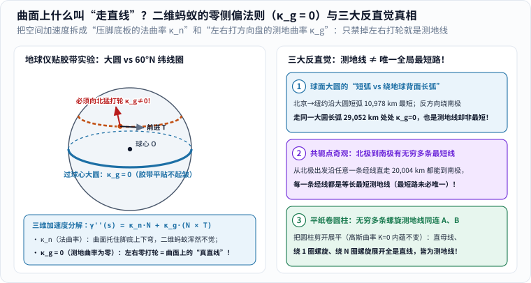
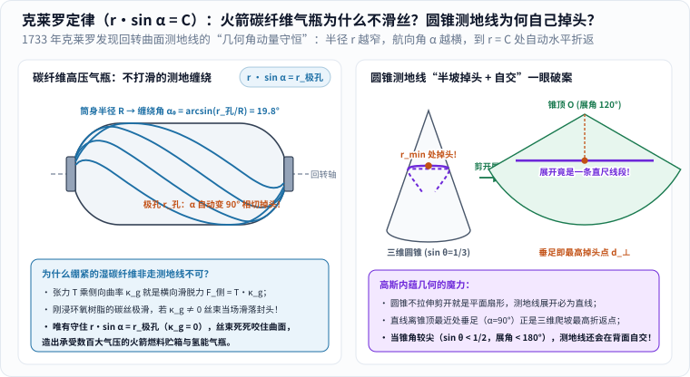
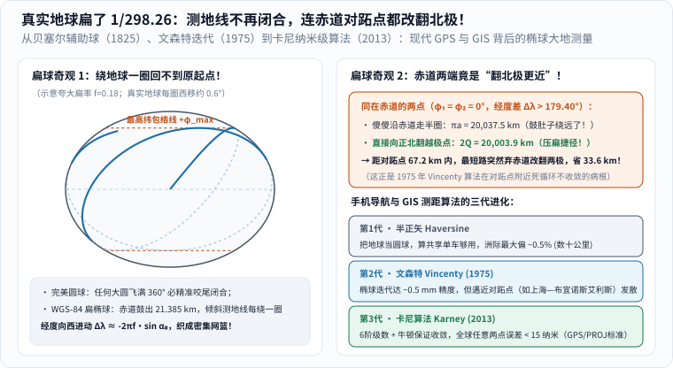

如果你坐过从中国飞往北美东海岸的洲际航班，盯一眼椅背屏幕上的实时航迹图，八成会犯嘀咕；再往深里追问几句，更会撞上一连串违反平面直觉的怪事：

1. **同在北纬 $$40^\circ$$，北京飞纽约为什么放着太平洋不走，偏要一头扎进北冰洋？** 北京首都机场（$$40.08^\circ\text{N}$$）与纽约肯尼迪机场（$$40.64^\circ\text{N}$$）纬度相差还不到 $$0.6^\circ$$。摊开客厅墙上的世界地图拿直尺一比，往正东飞越日本、夏威夷和旧金山明明是一条“水平直线”；可真实航班从北京起飞后，机头却指向**北偏东 $$7.9^\circ$$（几乎朝正北飞！）**，一路穿过蒙古、西伯利亚直扑北冰洋深处（最高冲到 $$83.9^\circ\text{N}$$，离北极点仅约 $$675\text{ km}$$），再从加拿大头顶朝正南俯冲进纽约。更离谱的是，这一趟看似绕了大远路的极地弧线，居然比沿北纬 $$40^\circ$$ 跨太平洋**足足少飞了 $$3{,}395\text{ km}$$，省下近 $$4$$ 个小时**！
2. **课本常说“测地线就是曲面上的最短路”，可为什么绕南极飞 $$29{,}052\text{ km}$$ 也是测地线？** 如果一架飞机从北京朝南偏西 $$172.1^\circ$$ 起飞，掠过印度洋、绕过南极洲外围再飞抵纽约，全程高达 $$29{,}052\text{ km}$$——比极地航线远了近两倍。可微分几何学家却铁口直断：这条绕了大半个地球的超长路线，同样是一条分毫不差的**测地线（Geodesic）**！在看不见三维外部空间的二维小蚂蚁眼里，到底什么才叫“在弯曲表面上走直线”？
3. **火箭碳纤维高压气瓶为什么差几度就会“滑丝报废”？圆锥上的直线为什么会自己掉头？** 给承受数百个大气压的航天复合材料贮箱缠绕碳纤维时，刚浸过液态环氧树脂的纤维丝滑得像抹了油；为什么机械臂只要严格踩准一条叫“克莱罗定律”的测地线，丝束就能死死咬住光滑圆顶封头并在极孔处自动水平折返？同样的一条测地线画在圆锥面上，为什么没人拦它，它爬到半坡就会**自己掉头下山，甚至绕到圆锥背面撞上自己的尾巴**？
4. **地球仅仅扁了约 $$1/298.26$$，凭什么让赤道两端的城市“弃赤道、改翻北极更近”？** 真实地球不是完美圆球，赤道半径只比极半径鼓出了 $$21.385\text{ km}$$（约 $$0.335\%$$）。就这么一丁点肉眼难辨的扁率，不仅让地球上几乎所有倾斜测地线**绕一圈都回不到原起点**，甚至让同处赤道两端的两个近对跖点出现惊天反转——沿着赤道走反而是绕远，直接朝正北翻越北极点反而近了 **$$33.6\text{ km}$$**！这也曾让统治测绘界数十年的经典算法当场死循环。

今天，我们就从家里随手能做的一卷纸胶带实验出发，顺着**“零侧偏曲率 $$\kappa_g = 0$$ $$\to$$ 球面大圆与恒向线算账 $$\to$$ 克莱罗守恒律与圆锥展开 $$\to$$ WGS-84 扁椭球纳米级算法 $$\to$$ 航空急流、穹顶建筑、三维热流与弯曲时空”**五级台阶，把连接地图学、微分几何、航天制造与广义相对论的核心概念——**测地线**彻底读懂。

---

## 一、曲面上什么叫“走直线”？一卷窄胶带与二维蚂蚁的“零打方向盘”法则

### 1. 在篮球或地球仪上贴窄胶带：为什么赤道服服帖帖，北纬 60° 却一边起皱？

“测地线”（Geodesic）这个词源于希腊语 *geodaisia*（原意“丈量分割大地”）。早在 1697 年，约翰·伯努利向全欧洲数学家抛出一个难题：在任意凹凸不平的光滑曲面上，连接两点的最短曲线满足什么方程？1728 年（1732 年正式发表于圣彼得堡科学院院刊 `E009` [1]），21 岁的欧拉给出了任意曲面上最短曲线的微分方程——这也是我们在[变分法为什么要改整条曲线]()里见过的变分思想在曲面几何中的奠基之作。

不用任何高深公式，你现在找一只篮球（或地球仪）和一卷**没有弹性的窄纸胶带（美纹纸胶带）**，花十秒钟就能亲手摸到测地线的灵魂：

- **第一贴（沿赤道或任意过球心的大圆贴）**：把胶带一端按在赤道上，顺着胶带自然伸展的方向往前平推按实。你会发现胶带左右两条边缘受力完全均匀，平平整整地咬合在球面上，绕满一圈精准回到起点。
- **第二贴（强行沿着北纬 $$60^\circ$$ 纬线圈贴）**：试着让胶带死死跟着北纬 $$60^\circ$$ 那圈小圆走。没贴出三厘米你就会发现不对劲——**胶带靠北极的内侧边缘疯狂拱起褶皱，靠赤道的外侧边缘却绷得快要撕裂**！除非你拿剪刀把胶带剪开一截一截硬拐，否则平直的纸胶带根本不肯待在北纬 $$60^\circ$$ 线上！

为什么同样是在弯弯的球面上绕圈，纸胶带认准赤道是“直的”，却一口咬定北纬 $$60^\circ$$ 是“歪的”？

### 2. 把三维拐弯拆成两半：压脚底板的“法曲率” vs 左右打轮的“测地曲率”

想象你是一只贴在地球仪表面爬行的二维小蚂蚁（或者一辆底盘紧贴起伏山路行驶的小汽车），你既看不见高高在上的三维太空，也没法钻进地心，只能感知自己脚下那片局部切平面。

在三维欧氏空间里，只要一条弧长参数曲线 $$\boldsymbol{\gamma}(s)$$（满足单位速率 $$\lVert\boldsymbol{\gamma}'(s)\rVert = 1$$，$$s$$ 为走过的路程，单位 $$\text{m}$$）不是笔直的欧氏直线，它的空间加速度（即曲率向量）$$\boldsymbol{\gamma}''(s) = \dfrac{\mathrm{d}\mathbf{T}}{\mathrm{d}s}$$ 就不为零。但对于被限制在光滑曲面 $$S$$ 上运动的小车来说，这两个方向的“弯”性质截然不同——微分几何用一套正交标架（达布标架，Darboux frame [2]）把空间曲率向量干净利落地一劈为二：

$$\boldsymbol{\gamma}''(s) = \underbrace{\kappa_n\,\mathbf{N}}_{\text{上下起伏：曲面硬托脚底}} + \underbrace{\kappa_g\,(\mathbf{N} \times \mathbf{T})}_{\text{左右打轮：在曲面内侧偏}}$$

把这个公式里的每一项拆开看，物理图景清晰得像开车一样：

- **$$\mathbf{T} = \boldsymbol{\gamma}'(s)$$（单位切向量）**：车头正前方；
- **$$\mathbf{N}$$（曲面单位法向量）**：垂直于脚下地面、直指天空（球面上指向球外）的方向；
- **$$\mathbf{N} \times \mathbf{T}$$（切平面内的侧向单位向量）**：既贴着地面、又垂直于车头正前方的“正左方”；
- **第一项 $$\kappa_n$$（法曲率，Normal Curvature，单位 $$\text{m}^{-1}$$）**：为了不飞离地面也不钻进地底，路面起伏迫使车身上下俯仰的弯曲率。就像你握死方向盘翻越一座笔直的拱桥，车身虽然在三维空间里上下弯了一道弧，但你**方向盘一毫米都没往左右拧过**——二维蚂蚁根本无法控制、甚至无需关心这一项；
- **第二项 $$\kappa_g$$（测地曲率，Geodesic Curvature，单位 $$\text{m}^{-1}$$）**：车头在脚下切平面内**向左或向右偏转的曲率**！只要 $$\kappa_g \neq 0$$，就意味着司机正在往左或往右拧方向盘，纸胶带左右两侧的路程就会一长一短而起皱。

于是，微分几何给出了**测地线最本质、最普适的定义** [2]：

> **曲面上处处满足测地曲率 $$\kappa_g(s) \equiv 0$$（等价于空间加速度 $$\boldsymbol{\gamma}''(s)$$ 处处垂直于曲面切平面，即平行移动切向量 $$\nabla_{\mathbf{T}}\mathbf{T} = \mathbf{0}$$）的曲线，就叫测地线。** 一句话翻译成大白话：**双手焊死方向盘、一步也不往左右偏，硬着头皮往前开出来的轨迹，就是测地线！**

1827 年高斯在[绝妙定理（Theorema Egregium）]()相关的曲面内蕴几何研究中证明了一个惊人事实 [2]：**$$\kappa_g$$ 是一个纯粹的“内蕴量”（Intrinsic quantity）**——只要把曲面不拉伸、不撕裂地弯曲变形（等距变换，比如把一张平纸卷成圆柱或折成波浪瓦），上面任何曲线的 $$\kappa_g$$ 数值一丝一毫都不会变！平纸上的欧氏直线 $$\kappa_g = 0$$，卷到圆柱或圆锥上依然满足 $$\kappa_g = 0$$。

现在我们立刻能算出：**为什么球面上的北纬 $$60^\circ$$ 纬线圈不是测地线？**
设地球是半径为 $$R$$ 的圆球，北纬 $$\varphi$$ 纬线圈在三维空间里是一个半径仅为 $$r = R\cos\varphi$$ 的水平小圆，它的圆心不在地球球心 $$O$$，而在北极—南极地轴上的点 $$O'$$。飞机沿纬线圈匀速飞行时，空间向心加速度大小为 $$\dfrac{1}{R\cos\varphi}$$，直指轴心 $$O'$$。把这个指向地轴的向量投影到球面切平面上（与切平面夹角恰为 $$\varphi$$），立刻得到它在球面内的侧向分量 [2]：

$$\kappa_g(\varphi) = \frac{\sin\varphi}{R\cos\varphi} = \frac{\tan\varphi}{R}$$

看清这个简洁得吓人的结果：
- 只有在**赤道（$$\varphi = 0^\circ$$）**——或者任何把赤道歪过来、**平面严格切过地球球心 $$O$$ 的“大圆”（Great Circle）**上，圆心就在球心 $$O$$，向心加速度 $$100\%$$ 顺着球面法线指向地心，切平面投影 $$\kappa_g = 0$$！所以**球面上的全部测地线，不多不少正是所有过球心的大圆弧**。
- 一旦你偏要在**北纬 $$60^\circ$$** 纬线圈上往正东飞，$$\kappa_g = \dfrac{\tan 60^\circ}{R} = \dfrac{\sqrt{3}}{R} \neq 0$$！为了不被惯性甩回低纬度，飞行员必须**全程微微把方向盘往北（左）掰着不放**——你以为自己在走直线，其实一直在绕着北极点画急弯！

### 3. 破除最常见的课本误区：测地线 ≠ 唯一全局最短路！（三个必看反例）

很多科普文章图省事，直接把测地线定义为“曲面上两点间的最短路径”。**这句话只说对了一半，而且漏掉的那一半恰恰藏着最精彩的几何洞见！**

*图 1：先看左栏地球仪——蓝色大圆平面切过球心 $$O$$，曲率向量完全指向地心，侧向测地曲率 $$\kappa_g = 0$$，窄胶带平贴不起皱；而橙色北纬 $$60^\circ$$ 纬线圈圆心在地轴上，必须持续向北施加侧偏加速度（$$\kappa_g = \tan 60^\circ / R$$）才能维持，因此不是测地线。再看右栏三个反例卡片——它们分别展示了“是测地线却非全局最短”“最短测地线有无穷多条”以及“同连两点有无穷多条不同长度的测地线”。*

严格的数学结论应当分两半表述 [2]：
1. **局部最短性（一定成立）**：测地线在**足够短的局部片段上**，必定是连接两端点的唯一最短路径；反过来，光滑无边曲面上任意一条全局最短光滑路径，必定是一条测地线（否则在 $$\kappa_g \neq 0$$ 的弯曲处“抄个内弯近道”就能把路程缩短）。
2. **全局未必最短、也未必唯一（三大经典反例）**：一旦测地线拉长到越过曲面的“割迹”（Cut locus）或“共轭点”（Conjugate point），以下三种情况随时会发生：
   - **反例 ①：球面大圆的“优弧（长弧）”**。过北京与纽约的大圆把地球切成一圈 $$40{,}030\text{ km}$$ 的闭环：往北越过北冰洋的那段劣弧长 $$10{,}978\text{ km}$$（全局最短）；但如果你从北京背道而驰朝南偏西 $$172.1^\circ$$ 出发，沿**同一个大圆**掠过印度洋、绕过南极洲外围再去纽约，全程 $$29{,}052\text{ km}$$，路上每一步方向盘同样纹丝不动（处处 $$\kappa_g = 0$$）！它是根正苗红的测地线，却绝不是最短路。
   - **反例 ②：南北极共轭点的无穷多条等长最短路**。从北极点去南极点，无论你选东经 $$0^\circ$$、东经 $$116^\circ$$ 还是西经 $$74^\circ$$ 经线，无穷多条经线半圆长度全都是 $$20{,}004\text{ km}$$，每一条都是最短测地线——全局最短路未必唯一！
   - **反例 ③：圆柱面上的无穷多条螺旋线**。把一张平纸卷成半径为 $$R$$ 的竖直圆柱，连接同一母线上下两点 $$A$$ 和 $$B$$（高度差 $$H$$）：直接竖直爬上去（长度 $$H$$）是测地线；绕圆柱 $$1$$ 圈螺旋爬上去（展开成直角三角形斜边，长度 $$\sqrt{H^2 + (2\pi R)^2}$$）处处 $$\kappa_g = 0$$，也是测地线；绕 $$k$$ 圈螺旋上去（长度 $$\sqrt{H^2 + (2\pi k R)^2}$$，$$k=2,3,\dots$$）全都是测地线！

牢牢记住这组区分：**“零打方向盘（$$\kappa_g = 0$$，局部最短）”才是测地线的身份证；“全局最短”只是它在短途或特定拓扑下顺带赢得的奖杯。**

---

## 二、大圆航线 vs 恒向线：北京飞纽约为什么非要钻进北冰洋？

### 1. 算清北京首都（PEK）到纽约肯尼迪（JFK）的真实航程账

搞懂了球面测地线就是过球心的**大圆航线（Great-Circle Route，又称 Orthodrome）**，我们现在拿真实机场坐标，亲手算一算开头那个让人困惑的航班之谜 [3]。

取地球平均球半径 $$R = 6371.0\text{ km}$$，两座机场的经纬度为：
- **北京首都国际机场（PEK）**：$$\varphi_1 = 40.080^\circ\text{N},\ \lambda_1 = 116.585^\circ\text{E}$$；
- **纽约肯尼迪国际机场（JFK）**：$$\varphi_2 = 40.641^\circ\text{N},\ \lambda_2 = 73.778^\circ\text{W}$$（向东跨越太平洋的经度差为 $$\Delta\lambda = 360^\circ - 116.585^\circ - 73.778^\circ = 169.637^\circ$$，将近半个地球！）。

怎样用经纬度算出球面两点的大圆距离 $$d = R\Delta\sigma$$（其中 $$\Delta\sigma$$ 是两点对地心张开的球心角，单位弧度）？
古典球面三角学有一条现成的**球面余弦定理**：

$$\cos\Delta\sigma = \sin\varphi_1\sin\varphi_2 + \cos\varphi_1\cos\varphi_2\cos\Delta\lambda$$

但如果你写过地图或导航代码就会知道，**工程上绝不能直接用 `acos(...)` 硬算上面这条式子**！原因在于数值灾难：当手机定位要算街角两辆相距仅 $$3\text{ m}$$ 的共享单车时，球心角 $$\Delta\sigma \approx 4.7 \times 10^{-7}\text{ rad}$$，此时 $$\cos\Delta\sigma \approx 0.99999999999989$$，双精度浮点数前面十几个 `9` 在加减法里发生“大数吃小数（相消误差）”，算出来的距离直接跳变失真！

19 世纪航海天文历书与现代计算机科学共同采用的救星，是把余弦恒等变形为正弦平方的**半正矢公式（Haversine Formula）**——定义半正矢函数 $$\operatorname{hav}(\theta) \equiv \sin^2\left(\dfrac{\theta}{2}\right) = \dfrac{1 - \cos\theta}{2}$$，球面余弦定理立刻化为对微小距离极其稳健的形式：

$$\operatorname{hav}(\Delta\sigma) = \sin^2\left(\frac{\varphi_2 - \varphi_1}{2}\right) + \cos\varphi_1\cos\varphi_2\sin^2\left(\frac{\Delta\lambda}{2}\right)$$

$$\Delta\sigma = 2\arcsin\left(\sqrt{\operatorname{hav}(\Delta\sigma)}\right), \qquad d_{\text{大圆}} = R\,\Delta\sigma$$

同时，由球面正弦—余弦律可给出从起点出发时的**初始真航向角 $$\alpha_1$$**（以正北为 $$0^\circ$$，顺时针向东度量 [3]）：

$$\alpha_1 = \operatorname{atan2}\bigl(\sin\Delta\lambda\cos\varphi_2,\ \cos\varphi_1\sin\varphi_2 - \sin\varphi_1\cos\varphi_2\cos\Delta\lambda\bigr)$$

把北京 `PEK` 与纽约 `JFK` 的坐标代入，两组对比数字立刻水落石出：

1. **走球面测地线（北冰洋大圆航线）**：
   - 球心张角 $$\Delta\sigma = 98.73^\circ$$（$$1.7232\text{ rad}$$），**大圆总航程 $$d_{\text{大圆}} = 10{,}978\text{ km}$$**；按客机巡航地速 $$900\text{ km/h}$$ 计，理论飞行时间 **$$12.2\text{ 小时}$$**。
   - **起飞航向 $$\alpha_1 = 7.94^\circ$$（北偏东不到 $$8^\circ$$！）**——所以飞机从北京跑道拉起后，真不是往东飞太平洋，而是直奔西伯利亚和北冰洋而去！
   - 航线最高点冲上**北纬 $$83.93^\circ\text{N}$$** 的北冰洋冰盖上空（离北极点仅约 $$675\text{ km}$$），随后越过极区一路向南俯冲，抵达纽约时的降落航向变为 **$$172.00^\circ$$（南偏东 $$8.00^\circ$$，几乎朝正南着陆）**！
2. **如果听信平面世界地图，锁死罗盘往正东飞跨太平洋（恒向线 Rhumb Line / Loxodrome）**：
   - 两地几乎同在北纬 $$40^\circ$$，罗盘航向恒定锁在 $$\alpha \approx 89.75^\circ$$（近乎正东），一路贴着 $$40^\circ\text{N}$$ 纬线圈横穿日本海、北太平洋、美国加州与大陆腹地。
   - 由于北纬 $$40^\circ$$ 纬线圈半径只有 $$R\cos 40.36^\circ \approx 4855\text{ km}$$，跨越 $$169.637^\circ$$ 经度的真实路程高达 **$$d_{\text{恒向}} = 14{,}373\text{ km}$$**（需飞 **$$16.0\text{ 小时}$$**）！
   - **结论惊人**：墙上地图里看着“笔直水平”的跨太平洋路线，在真地球上竟是一道绕了大弯的圆弧，凭空多飞了 **$$3{,}395\text{ km}$$（远了 $$30.9\%$$）**！

### 2. 一眼破除地图幻觉：三维地球仪与平面航图的同速竞速

为什么平面地图会把真正的最短直线扭成一道夸张的大拱桥？我们在[墨卡托怎样把地球摊平]()里讲过，任何圆柱类平面世界地图为了把收拢成一点的北极强行扯成与赤道等宽的顶边，都把高纬度横向比例尺剧烈撑大了（在北纬 $$84^\circ$$ 处横向拉伸将近 $$10$$ 倍！）。下面这幅按真实球面坐标与 $$900\text{ km/h}$$ 等速比例生成的双视角图，让你一眼看穿这场视觉骗局：

*图 2：从左到右对照阅读（可，刷新页面可重播一次按距离严格计时的起飞竞速：蓝线 $$3.20\text{ s}$$ 抵达，橙线 $$4.19\text{ s}$$ 抵达；开启系统“减少动态效果”或动画结束后均完整保留双线与标注）。先看左图北极俯视三维地球仪——北京与纽约隔着北极点几乎面对面站着！蓝色大圆直接切过北纬 $$83.9^\circ$$ 北冰洋，在真球面上近乎一条笔直弦线（$$10{,}978\text{ km}$$）；反观橙色 $$40^\circ\text{N}$$ 纬线，必须绕着北极外围画出一个接近半圆的大肚子（$$14{,}373\text{ km}$$）。再看右图摊平的经纬网平面图——就因为北冰洋被横向扯宽，真捷径蓝线在平面图上被迫拱成高桥，而绕远路的橙色虚线反倒伪装成了“直尺连线”。*

### 3. 既然恒向线绕这么远，为什么大航海时代的水手却视它为救命稻草？

看到这里你可能会替古人着急：既然大圆航线能省几千公里，16 世纪的远洋帆船干嘛不全程走大圆？

答案藏在**罗盘与方向盘的代价**里 [3]：
- **大圆航线虽然“对脚下曲面不打方向盘（$$\kappa_g = 0$$）”，但它与经线的夹角（罗盘真航向 $$\alpha$$）除了赤道和正南北经线外，每飞一公里都在变！** 就像北京飞纽约，航向必须从起飞时的 $$7.9^\circ$$ 连续平滑地转到北冰洋顶点的 $$90^\circ$$（正东），再一路转到纽约上空的 $$172.0^\circ$$！在没有惯性导航仪（INS）和卫星定位的年代，水手靠一块磁罗盘掌舵，总不能每隔五分钟停下来查表重算一次球面三角吧？
- **恒向线（Loxodrome）恰恰相反：它牺牲了最短路程（$$\kappa_g \neq 0$$），换来了“与所有经线夹角 $$\alpha$$ 绝对恒定”！** 水手只要盯死罗盘指针不动就能一路开到目的地。1569 年墨卡托发明的正轴等角圆柱投影，正是特意通过把纬度纵向拉伸为等量纬度 $$\psi = \ln\tan\left(\dfrac{\pi}{4} + \dfrac{\varphi}{2}\right)$$，使一切恒向线在海图上变成直尺一连即得的直线 [3]。聪明的老船长们于是采用**“大圆分段折线法”**：先在球面仪上找出大圆路径，每隔几百海里取一个航路点移到墨卡托海图上，每两点之间走一小段恒向直线——既省了大把航程，又让舵手能稳稳掌舵！

---

## 三、克莱罗定律：为什么大圆航向一直变，火箭碳纤维气瓶却靠它“死死不滑丝”？

### 1. 1733 年克莱罗发现的“几何角动量守恒”：$$r \cdot \sin\alpha = C$$

刚才我们看到，北京飞纽约的大圆航线越往北飞，航向角 $$\alpha$$ 就越往东歪，直到北纬 $$83.93^\circ$$ 时刚好变成正东（$$\alpha = 90^\circ$$）并开始掉头向南。这个航向角的变化有没有一条一步到位的铁律？

1733 年，刚从拉普拉斯前辈年代走出来的法国天才数学家克莱罗（Alexis Claude Clairaut，年仅 20 岁，不久后还将亲赴北极圈拉普兰实测子午线弧长证明地球是扁球）发现：不光是圆球，在**任何绕对称轴旋转出来的光滑回转曲面**（圆球、扁椭球、花瓶、冷却塔、火箭整流罩、圆锥）上，任意一条测地线都严格遵守一条美妙得如同物理学角动量守恒的定律——**克莱罗关系（Clairaut's Relation）** [2]：

$$r \cdot \sin\alpha = C \quad (\text{沿整条测地线严格为常数！})$$

这里符号简单至极：
- **$$r$$**：测地线上当前点到回转对称轴的垂直距离（即当地纬圈半径，单位 $$\text{m}$$；对球面就是 $$r = R\cos\varphi$$）；
- **$$\alpha$$**：当前测地线切向与当地经线（子午线）的夹角（即航向角，正北/正南沿母线为 $$0^\circ$$ 或 $$180^\circ$$，正东/正西沿纬圈为 $$\pm 90^\circ$$）；
- **$$C$$**：由出发点位置与初始瞄准角一锤定音锁死的**克莱罗常数**（$$\lvert C\rvert \le r$$）。

你拿这条公式回头验算北京飞纽约，三秒钟就能算出北冰洋最高点：
- 在北京出发时，$$r_1 = R\cos 40.080^\circ$$，$$\alpha_1 = 7.94^\circ$$，锁死常数 $$\dfrac{C}{R} = \cos 40.080^\circ \cdot \sin 7.94^\circ = 0.7651 \times 0.1381 = 0.1057$$；
- 飞机越往北极飞，纬圈半径 $$r = R\cos\varphi$$ 越缩越小；为了守住乘积 $$r\sin\alpha = C$$ 不变，$$\sin\alpha$$ 必须反比例增大——航向被迫越来越横！
- 飞机最北能飞到哪儿？因为正弦函数天花板是 $$\lvert\sin\alpha\rvert \le 1$$，一旦纬圈半径缩到 $$r_{\min} = C$$（即 $$\cos\varphi_{\max} = 0.1057 \implies \varphi_{\max} = \arccos(0.1057) = 83.93^\circ\text{N}$$），此时 $$\sin\alpha = 1$$（$$\alpha = 90^\circ$$，正东平飞）！再往北哪怕多跨一步，就会要求 $$\sin\alpha > 1$$，在几何上绝无可能——于是测地线在 $$r = C$$ 处与纬线圈温柔相切，自动掉头南下！

### 2. NASA 火箭贮箱与氢能高压气瓶：湿滑碳纤维怎样靠 $$\kappa_g = 0$$ 锁住封头？

千万别以为克莱罗定律只是纸面上的数学玩具——现代航天火箭的复合材料高压气瓶（COPV）、固体火箭发动机壳体，乃至新能源汽车的 $$70\text{ MPa}$$（$$700$$ 个大气压）车载储氢气瓶，全都靠它保命！

1962 年，NASA 兰利研究中心发布经典技术报告 `NASA TN D-1692`（*A Theory and Applications of Filamentary Structures* [4]），系统奠定了旋转壳体**测地线纤维缠绕（Geodesic Filament Winding）**的工程理论。道理一戳就破：

当数控缠绕机把浸满液态未固化环氧树脂的碳纤维丝束，以恒定张力 $$T$$ 紧紧缠在芯模表面时，微元受力平衡把丝束对芯模的作用力拆成两项：
1. **垂直压紧芯模表面的法向压力**：$$f_n = T\kappa_n$$（帮丝束贴紧罐体）；
2. **顺着芯模表面往旁边滑脱的侧向力**：

$$f_{\text{侧滑}} = T\,\kappa_g$$

刚浸过树脂的湿碳纤维摩擦系数极低（往往只有 $$\mu \approx 0.1$$）。如果在两端圆拱形的封头（Dome）上乱选缠绕轨迹导致 $$\kappa_g \neq 0$$，绷紧的碳纤维丝束就会像套在鸡蛋尖上的橡皮筋一样，“哧溜”一声横向滑脱崩散！

怎样让侧滑力彻底归零（$$f_{\text{侧滑}} = 0$$）？**唯一精确解就是让每一根碳纤维都走封头曲面上的测地线（$$\kappa_g = 0$$）！**
设圆筒段半径为 $$R$$，两端金属极孔接头（Boss）半径为 $$r_{\text{孔}}$$。工程师只需令克莱罗常数恰好等于极孔半径 $$C = r_{\text{孔}}$$ [4]：
- 在圆柱筒身段（$$r = R$$），机械臂按螺旋角 $$\alpha_0 = \arcsin\left(\dfrac{r_{\text{孔}}}{R}\right)$$ 匀速进给；
- 一旦丝束爬上两端变窄的封头（$$r$$ 从 $$R$$ 一路缩小到 $$r_{\text{孔}}$$），顺着测地线自然延伸，缠绕角 $$\alpha = \arcsin\left(\dfrac{r_{\text{孔}}}{r}\right)$$ 自动一路变大；
- 抵达金属极孔边缘 $$r = r_{\text{孔}}$$ 的那一刻，$$\sin\alpha = 1 \implies \alpha = 90^\circ$$！丝束分毫不差地**与极孔金属颈相切绕过半圈**，平顺折返缠回另一端，全程没有一丝一毫横向滑脱力！

*图 3：从左到右阅读——左栏展示航天复合材料高压气瓶的测地缠绕：筒身以 $$\alpha_0 = \arcsin(r_{\text{孔}}/R)$$ 进丝，顺着 $$r\sin\alpha = r_{\text{孔}}$$ 爬上两端封头，丝束不仅全程零侧滑（$$\kappa_g = 0$$），而且在两端极孔处恰好变为 $$\alpha = 90^\circ$$ 相切掉头。右栏展示半顶角满足 $$\sin\theta = 1/3$$ 的圆锥测地线奇观：三维圆锥上一条测地线爬升到 $$r_{\min}$$ 处自动水平掉头并在背面自交；只要沿母线剪开摊平成 $$120^\circ$$ 平面扇形，整条神秘曲线瞬间原形毕露——它不过是一条普通的欧氏直尺线段！*

### 3. 圆锥上的魔术：为什么测地线爬到半山腰会自动掉头，甚至自己撞自己？

看图 3 右栏，克莱罗定律还能变出一个让初学者目瞪口呆的几何魔术：在一座尖尖的冰激凌圆锥面上，一只小蚂蚁从山脚斜着往上走测地线（完全不打方向盘），它明明没有撞上任何障碍物，为什么爬到半山腰 $$r_{\min}$$ 处会**自动掉头往山下走**，而且绕过圆锥背面时还会**一头撞上自己上山时留下的脚印（自交）**？

用代数看，圆锥越靠近锥顶半径 $$r$$ 越小，只要初始瞄准角 $$\alpha_1 \neq 0^\circ$$（没有正对锥顶），克莱罗常数 $$C = r_1\sin\alpha_1 > 0$$ 就筑起了一道无形的“禁入屏障”——蚂蚁最多爬到 $$r_{\min} = C$$ 就必须以 $$\alpha = 90^\circ$$ 折返下山，永远碰不到锥顶！

而用高斯的**内蕴展开法**看，谜底更是爽快得让人拍案叫绝：
圆锥面没有内蕴高斯曲率（除顶点外处处 $$K = 0$$）。设圆锥半顶角为 $$\theta$$（斜母线长为 $$s$$ 时底圆半径 $$r = s\sin\theta$$，底周长 $$2\pi s\sin\theta$$），拿剪刀沿一条母线剪开摊平到桌面上，它既不皱也不裂，刚好展开成一个圆心角为

$$\Phi = \frac{2\pi s\sin\theta}{s} = 360^\circ \cdot \sin\theta$$

的**平面扇形**！例如图 3 中取 $$\sin\theta = \dfrac{1}{3}$$（$$\theta \approx 19.47^\circ$$），展开后就是一个 $$120^\circ$$ 的绿色扇形：
- **为什么半坡掉头？** 因为测地线展开到平面扇形上**就是一条笔直的欧氏线段**！这条直线不经过扇形圆心 $$O$$（锥顶），从圆心 $$O$$ 向直线作垂线，垂足处离锥顶最近（$$d_\perp = s_1\sin\alpha_1$$，夹角 $$90^\circ$$）——垂足之前离 $$O$$ 越来越近（上山），越过垂足之后自然离 $$O$$ 越来越远（下山）！
- **为什么会自己撞自己？** 当圆锥比较尖、满足 $$\sin\theta < \dfrac{1}{2}$$（即半顶角 $$\theta < 30^\circ$$，展开扇形角 $$\Phi < 180^\circ$$）时，一条直线横穿 $$120^\circ$$ 扇形的两条剪开边，粘回圆锥时这两条边其实是**同一条母线**——直线在母线两侧的一高一低之外，早在扇形内部就已经跨越了超过一圈的圆锥方位角，于是在圆锥背面结结实实地自交成了一个漂亮的绳结！在自交点两侧，通往对面就有两条长度相等的最短路径，测地线越过自交点后立刻失去了全局最短性。

---

## 四、真实地球扁了三百分之一：不闭合的轨道、赤道翻北极奇观与纳米级算法

### 1. 赤道比两极鼓出 21.385 公里：测地线从此“咬不住自己的尾巴”

把地球当成半径 $$6371\text{ km}$$ 的完美圆球，拿来理解洲际航线和算个大概里程完全够用；但如果你要给跨海大桥打桩、划定国际海洋专属经济区边界、制导洲际航天器，或者在手机地图里做到车道级导航，**“圆球地球”当天就会闯大祸**——它的洲际测距误差最高可达 **$$0.5\%$$（几十公里）**！

因为地球每天自转一周，离心效应把赤道甩鼓、两极压扁。现代全球卫星导航系统（GPS、北斗等）统一采用 **WGS-84 参考椭球（Reference Ellipsoid）**来刻画地球海平面基准形状 [6, 7]：
- **赤道长半轴**：$$a = 6378.137\text{ km}$$；
- **极短半轴**：$$b \approx 6356.752314\text{ km}$$；
- **扁率（Flattening）**：$$f = \dfrac{a - b}{a} = \dfrac{1}{298.257223563} \approx 0.00335281$$（赤道半径比极半径多鼓出 **$$21.385\text{ km}$$**）。

千万别小看这约三百分之一的扁率！从牛顿、欧拉到 1825 年德国天文学家贝塞尔（Friedrich Wilhelm Bessel）引入精妙的“辅助球面映射”与椭圆积分展开 [5]，数学家惊讶地发现：**仅仅因为地球扁了 $$1/298.26$$，球面上“所有大圆飞满 $$360^\circ$$ 必精准咬住自己尾巴闭合”的完美秩序瞬间崩塌了！**

在 WGS-84 扁椭球上，除了赤道和经线圈这两族特殊对称线外，**几乎所有斜着出发的测地线都永远不再闭合** [7]：
- 因为它是回转椭球，克莱罗定律依然成立（写成归化纬度 $$\beta$$ 为 $$a\cos\beta\sin\alpha = a\cos\beta_{\max}$$），所以测地线仍然老老实实地被夹在南北纬 $$\pm\varphi_{\max}$$ 两条纬线包络线之间上下振荡；
- 但由于赤道微微鼓起，测地线每完成一次“北顶 $$\to$$ 南底 $$\to$$ 北顶”的完整纬度周期，它在经度上并不会刚好转满 $$360^\circ$$，而是**差了一截，向西滞后进动约 $$\Delta\lambda \approx -2\pi f \sin\alpha_0$$（在地球上每绕一圈经度向西漂移最多约 $$1.2^\circ$$，近赤道平射时达 $$134\text{ km}$$）**！一圈又一圈飞下去，这根测地线就像竹篾编篮子一样，把南北纬 $$\pm\varphi_{\max}$$ 之间的整个球带密密麻麻涂满——如果你观察过国际空间站（ISS）在地面控制大厅大屏幕上的星下点轨迹，那种一圈比一圈往西错开的波浪网，跟扁椭球测地线进动如出一辙！

### 2. 赤道近对跖点大反转：同在赤道两端，为什么“弃赤道、翻北极”反而近 33.6 公里？

扁椭球还藏着第二个足以颠覆所有人直觉的彩蛋——**赤道近对跖点“弃赤道翻极点”奇观** [7, 8]！

我们来算一道小学生都能核对的加减法。假设有两个人站在 **WGS-84 椭球的赤道正对面**（对跖点：$$\varphi_1 = 0^\circ,\ \lambda_1 = 0^\circ$$ 与 $$\varphi_2 = 0^\circ,\ \lambda_2 = 180^\circ$$）：

1. **方案 A（顺着赤道走半圈）**：赤道正是地球鼓得最胖的大肚子，半径为长半轴 $$a = 6378.137\text{ km}$$，走半圈圆周的路程是：

$$d_{\text{赤道半圈}} = \pi a = 3.14159265 \times 6378.137\text{ km} = 20{,}037.508\text{ km}$$

2. **方案 B（完全抛弃赤道，直接朝正北翻越被压扁的北极点，再沿对面经线南下）**：由于两极压扁了 $$21.385\text{ km}$$，从赤道到北极点的子午线象限弧长 $$Q \approx 10{,}001.966\text{ km}$$，翻越北极走满半个经线圈的路程是：

$$d_{\text{翻越北极}} = 2Q = 20{,}003.931\text{ km}$$

两相对比，眼珠子都要掉下来：**明明两个人都站在赤道上，沿着赤道走虽然也是测地线（$$\kappa_g = 0$$），却比直接翻越北极点足足远了 $$33.577\text{ km}$$！**

更绝的是过渡区间的突变 [7]：当赤道上两座城市的经度差 $$\Delta\lambda$$ 从 $$0^\circ$$ 慢慢增大时，起初沿赤道直走确实是最短路；可一旦经度差跨过临界阈值

$$\Delta\lambda_{\text{临界}} = (1 - f)\times 180^\circ \approx 179.3965^\circ \quad (\text{距正对面仅差约 } 67.2\text{ km})$$

赤道测地线当场撞上它的**共轭点（Conjugate point）**而丧失全局最短资格！从这一刻起，连接两座赤道城市的真正最短测地线会突然“叛逃”离开赤道，对称地向高纬度拱起（一北一南成对出现），随着 $$\Delta\lambda \to 180^\circ$$ 一路抬升直到直穿南北极点！

*图 4：先看左栏（为让肉眼看清进动间距，示意图将扁率夸大至 $$f = 0.18$$ 并在图内标明，真实地球扁率为 $$1/298.26$$）——蓝色倾斜测地线在南北最高纬包络线 $$\pm\varphi_{\max}$$ 之间来回摆动，每绕一圈经度向西漂移一截，永不闭合。再看右栏上半部分——赤道半圈 $$20{,}037.5\text{ km}$$ 与翻越极点 $$20{,}003.9\text{ km}$$ 差出 $$33.6\text{ km}$$，揭开近对跖点最短路突变的几何根源；右栏下半部分总结了从 Haversine、Vincenty（1975）到 Karney（2013）三代工业级测距算法的演进。*

### 3. 从文森特（1975）的死循环痛点，到卡尼（2013）的 15 纳米终极算法

正是上面这个“赤道近对跖点翻极点”的几何分岔，曾在全球 GIS 与航空导航软件里埋下一颗著名的定时炸弹：

- **第一代（球面 Haversine）**：计算极快，算几公里内的外卖骑手和共享单车绰绰有余，但跨洲测距有数十公里系统偏差。
- **第二代（1975 年文森特算法 Vincenty's Formulae [6]）**：美国大地测量学家 Thaddeus Vincenty 发表了只用几十行代码就能在椭球面上迭代到 **$$0.5\text{ mm}$$** 精度的经典公式，迅速写进了全球几乎所有测绘教科书与早期 GIS 库。但因为它在普通计算器年代使用了固定点简单迭代，一旦输入一对**近对跖点坐标**（例如从中国上海飞往阿根廷布宜诺斯艾利斯一带，或刚才说的赤道近对跖点），两条方向迥异的测地线在共轭点附近激烈打架，Vincenty 的循环迭代就会**剧烈震荡、拒绝收敛甚至陷入死循环**！
- **第三代（2013 年卡尼算法 Karney's Algorithm [7, 8]）**：物理学家兼大地测量学家 Charles F. F. Karney 在《大地测量学杂志》（*Journal of Geodesy*）发表里程碑论文 *Algorithms for geodesics* [7]，将椭圆积分级数推展到扁率 $$f$$ 的六阶，并把逆解问题（已知两点经纬度求最短距离与航向）严格转化为具有单调根保证的**阻尼牛顿法（Newton's method）**，专门攻克了近对跖点初值解析难题。结果令人叹服：
  1. **全球 $$100\%$$ 无死角保证快速收敛**（哪怕精确对跖点或赤道分岔区也只需 2–4 步牛顿迭代）；
  2. 双精度浮点下全球两万公里任意两点测距误差 **小于 $$15\text{ 纳米}$$（$$1.5 \times 10^{-8}\text{ m}$$，比一颗流感病毒直径还小得多！）**；
  3. 如今，Karney 开源的 `GeographicLib` [8] 已被正式纳入国际坐标转换引擎 `PROJ`、`PostGIS`、`SciPy` 以及各国航空与海事电子海图内核，成为人类丈量地球表面的终极工业标准。

---

## 五、不止画航线：测地线在航空急流、穹顶建筑、三维图形学与广义相对论中的四大实战

如果把视野从地图测距再往外推一步，你会发现“$$\kappa_g = 0$$（零侧偏局部最优）”这套思想早已渗透进现代工程与基础物理的骨髓里：

*图 5：按四个象限对照阅读测地线跨学科实战——左上（航空气象）：几何最短的大圆航线遇上 $$250\text{ km/h}$$ 西风急流，演变为东行借风偏南、西行贴北躲风的“最短时间变分航迹”；右上（建筑结构）：富勒大圆三角穹顶与直木条零侧弯自由曲面网壳；左下（三维图形学）：2013 年热流法（Geodesics in Heat）用一次微热扩散解出百万网格全身测地距离；右下（广义相对论与 GPS）：苹果落地、行星公转与星光偏折统统归结为四维弯曲时空测地线。*

### 1. 洲际航班的隐藏算盘：为什么东京飞洛杉矶故意不走大圆，返程却死贴大圆？

细心的航空迷常会抓到一个“打脸现场”：既然北太平洋的大圆航线应该往上拱过阿留申群岛，为什么打开航班追踪软件看**东京飞往洛杉矶（向东飞）**的航班，很多时候却故意往南偏离大圆几百公里，大摇大摆地走太平洋中纬度？而反过来**洛杉矶飞回东京（向西飞）**，却又老老实实贴着北边阿留申群岛的大圆弧走？

这不是飞行员忘了几何学，而是航空公司签派员在解一道比欧拉测地线更精明的变分题——**1931 年泽梅洛导航问题（Zermelo's Navigation Problem：有风流场中的最短时间路径）** [3, 9]！

在北半球中纬度 $$9\text{–}12\text{ km}$$ 的万米巡航高空，常年横亘着几条自西向东狂飙的“空中高速河”——**高空西风急流（Jet Stream）**，核心风速经常高达 **$$150\text{–}300\text{ km/h}$$**（冬季北太平洋急流甚至突破 $$350\text{ km/h}$$）[9]：
- **向东顺风飞（如东京 $$\to$$ 洛杉矶、纽约 $$\to$$ 伦敦北大西洋每日动态航路 `NAT-OTS`）**：签派系统故意让飞机往南绕远 $$500\text{–}800\text{ km}$$ 钻进急流中心，白捡 $$250\text{ km/h}$$ 的顺风推力，对地速度飙破 $$1150\text{ km/h}$$！地面路程虽然长了 $$6\%$$，飞行时间却缩短了近 $$1$$ 小时，少烧好几吨航空煤油。
- **向西顶风飞（如洛杉矶 $$\to$$ 东京）**：如果还傻走南线迎头撞上 $$250\text{ km/h}$$ 逆风，地速掉到 $$650\text{ km/h}$$ 会把油箱烧干！于是西行航班死死贴住高纬度阿留申大圆弧（甚至绕到急流北侧），用几何最短路避开逆风带。
- 此外，双发客机飞越北冰洋或大洋深处时，还必须套上一层安全紧箍咒——**ETOPS（双发延程运行标准，如 ETOPS-180 或 ETOPS-330）** [3]：航线上任意一点距离最近可用备降机场（如安克雷奇、雷克雅未克、鹅湾）的单发飞行时间不得超过规定分钟数，因此真实极地航线是在“大圆捷径 + 高空风场 + 空域许可 + ETOPS 备降圆”多重约束下实时算出的最优曲线。

### 2. 建筑与结构奇观：富勒测地穹顶与“直木板不拧劲”的自由曲面网壳

在土木与建筑界，测地线直接撑起了两代轻量化大跨度奇迹：

1. **富勒测地线穹顶（Geodesic Dome）**：1954 年，美国发明家巴克敏斯特·富勒（R. Buckminster Fuller）获批著名专利 `US2682235A`（*Building Construction* [10]）。他把正二十面体的三角形面不断细分并向外投影到球面上，让成百上千根轻质短直杆沿着**纵横交错的大圆测地线网格**连接成球壳（如 1967 年蒙特利尔世博会生物圈穹顶、高山气象雷达罩）。因为球面大圆曲率均匀且三角形天然刚性，局部狂风或暴雪荷载会顺着大圆肋瞬间分散为全壳均匀的拉压轴力——它是人类已知“单位自重能罩住最大无柱空间”的结构体系之一，且直径越大，相对自重反而越轻！
2. **现代自由曲面“测地木网壳（Geodesic Gridshell）”**：你手里拿一把扁平薄木尺（比如宽 $$5\text{ cm}$$、厚仅 $$3\text{ mm}$$），顺着扁平面上下压弯它（改变法曲率 $$\kappa_n$$）轻而易举；但如果你想沿着窄边把它往左右掰弯（强加测地曲率 $$\kappa_g \neq 0$$），手指掰疼了也纹丝不动！建筑几何学家利用这个特性发现：**在任意起伏优美的双曲率自由屋顶曲面上，只要沿着测地线网（$$\kappa_g = 0$$）铺设廉价的笔直平板木条或扁钢带**，直板就能顺服地贴合复杂曲面，全程零侧向弯曲、零扭转内应力，省去了昂贵的数控三维热弯模具！

### 3. 三维游戏、工业设计与机器人：用一根“热针”毫秒级算出百万网格测地线

在电影特效、3D 游戏角色骨骼蒙皮、口腔数字化牙冠裁剪，以及火星车起伏地形路径规划中，计算机面对的不是光滑球面公式，而是由**几百万个小三角形拼成的三维网格（如扫描人体或斯坦福兔子）**。怎样在几毫秒内算出角色指尖沿着皮肤表面到全身每一个顶点的贴面测地距离（而不是穿胸而过的欧氏直线距离）？

传统波前推进算法在大网格上算得满头大汗。2013 年，卡内基梅隆大学的 Keenan Crane 等人发表惊艳图形学界的算法 **《热流中的测地线》（*Geodesics in Heat* [11]）**，用基础物理里的热传导偏微分方程降维打击了纯几何搜索：
1. **第一步（戳热针微扩散）**：想象金属兔子全身冰凉，你在起点 $$A$$ 用滚烫的针尖轻轻点一下，让热量在极短时间步 $$\Delta t$$ 内沿曲面扩散（只需解一次极快的稀疏线性热方程 $$(\mathrm{I} - \Delta t\,\Delta)u = \delta_A$$）。根据数学家 Varadhan 的热核渐近定理，**热量最先抵达远处的波前，必定严格沿着曲面最短测地线传播**！
2. **第二步（归一化温度梯度）**：此时温度场 $$u$$ 虽然随距离指数衰减，但它下降最陡的反方向 $$X = -\nabla u / \lVert\nabla u\rVert$$ 已经精准给出了全身上下的**测地线单位切向量场**！
3. **第三步（泊松积分还原距离）**：既然距离函数 $$\phi$$ 的梯度模长恒为 $$1$$（$$\nabla\phi = X$$），再解一次标准泊松方程 $$\Delta\phi = \nabla\cdot X$$，整只百万面片模型上每一点的精确测地距离瞬间全部跳出，预分解后每次查询比传统方法快出十倍到数十倍！

### 4. 广义相对论与口袋里的 GPS：引力不是绳子，万物都在走四维时空测地线

最后，把维度从二维地面升到我们身处的**四维弯曲时空**，测地线迎来了它在自然科学史上最壮丽的加冕——我们在[连光都会被太阳掰弯吗？读懂爱因斯坦光线弯曲的百年验证]()中专门讲过这一幕：

在牛顿眼里，地球绕太阳转是因为太阳伸出一根看不见的万有引力绳索在往里拽地球；而在 1915 年爱因斯坦建立的广义相对论里，**根本没有“引力拉力”这回事**——太阳巨大的质量与能量压弯了它周围的四维时空度规 $$g_{\mu\nu}$$，而地球、脱手下落的苹果、失重飘浮的空间站，乃至日全食期间擦过太阳边缘偏折 $$1.75$$ 角秒的星光，全都只是在弯曲的四维时空里**“双手不碰方向盘、零侧偏”地走着四维时空测地线**：

$$\frac{\mathrm{d}^2 x^\mu}{\mathrm{d}\tau^2} + \Gamma^\mu_{\alpha\beta}\frac{\mathrm{d}x^\alpha}{\mathrm{d}\tau}\frac{\mathrm{d}x^\beta}{\mathrm{d}\tau} = 0$$

对照我们在第一节写的曲面公式，这里的克里斯托费尔符号项 $$\Gamma^\mu_{\alpha\beta}\dfrac{\mathrm{d}x^\alpha}{\mathrm{d}\tau}\dfrac{\mathrm{d}x^\beta}{\mathrm{d}\tau}$$ 正是时空本身的弯曲起伏，整条方程说的依然是那句老话：**四维协变加速度为零——万物皆走测地线！**

最奇妙的交汇就在你此刻握着的智能手机里：当你点开打车或地图导航时，天上两万公里高空的北斗与 GPS 卫星先要按**广义相对论四维时空测地线**修正每天快出约 $$38$$ 微秒的相对论原子钟差（否则地面定位一天就会漂歪 $$11\text{ km}$$！），算出你的精确经纬度；紧接着，手机里的地图引擎再调用 **WGS-84 三维扁椭球测地线算法**，在眨眼间为你算出精确到米与毫米的地球表面距离。

---

## 六、一张表收尾：五种最容易混淆的“航线与曲面线”全对比

把全文出现过的五种核心路线摆在同一张桌面上，以后不管是看国际航班图、读地图学还是看航天纪录片，再也不会串台：

| 路线／概念名称 | 核心几何定义 | 测地曲率 $$\kappa_g$$ | 在平面墨卡托图上长啥样？ | 真实工程优缺点与代表场景 |
| :--- | :--- | :--- | :--- | :--- |
| **球面大圆劣弧** （Great-Circle Minor Arc） | 过球心平面截球所得圆周中较短的一段（$$<\pi R$$） | **处处 $$\kappa_g = 0$$** | 向高纬拱起的大弧线（赤道与经线除外） | 球面**全局最短路**（北京$$\to$$纽约 $$10{,}978\text{ km}$$），但罗盘航向全程连续变化 |
| **球面大圆优弧** （Great-Circle Major Arc） | 同一大圆绕地球背面的较长一段（$$>\pi R$$） | **处处 $$\kappa_g = 0$$** | 绕另一半球反向弯曲的长曲线 | **是测地线却绝非全局最短**（北京绕南极去纽约 $$29{,}052\text{ km}$$），证明局部直$$\neq$$全局短 |
| **恒向线／等角航线** （Rhumb Line / Loxodrome） | 与所有经线保持恒定罗盘夹角 $$\alpha$$ 的曲线 | **$$\kappa_g \neq 0$$**（除赤道与经线） | **笔直的欧氏直线**（直尺一连即得） | 罗盘掌舵极省心，但高纬绕远严重（北京$$\to$$纽约沿 $$40^\circ\text{N}$$ 达 $$14{,}373\text{ km}$$），斜穿经线会螺旋趋近极点 |
| **WGS-84 椭球测地线** （Ellipsoidal Geodesic） | 真实扁地球（$$f \approx 1/298.26$$）上零侧偏曲线，满足克莱罗律 | **处处 $$\kappa_g = 0$$** | 近似大圆拱线，近对跖点会突变翻越极区 | 现代 GPS/GIS/海界法定基准（Karney 算法精度 $$<15\text{ nm}$$）；一般**绕地球一圈不闭合** |
| **急流最短时间航迹** （Minimum-Time Track） | 在高空风场 $$\mathbf{W}(\varphi,\lambda)$$ 中飞行耗时 $$\int \mathrm{d}t$$ 最小的变分轨迹 | **$$\kappa_g \neq 0$$**（向顺风核心借力偏折） | 东行常偏南贴急流，西行常偏北贴大圆 | 民航跨洋签派实战标准（如北大西洋 `NAT-OTS`）：多飞几百公里地面路程，反而省时省油 |

### 动手试一试：亲手验算任意两座城市的纳米级椭球测地线

如果你想亲自试试北京到纽约、上海到布宜诺斯艾利斯，或者刚算过的“赤道近对跖点（如 `0°N 0°E` 到 `0°N 179.5°E`）突然弃赤道翻北极”的奇观，可以直接打开本文第四节介绍的 Charles Karney 官方维护的开源 `GeographicLib` 在线解算器（需联网访问外站，无需任何注册；本文正文已完整给出全部计算结果，不依赖外站即可独立读懂）：

- **GeographicLib 官方在线椭球测地线计算器（`GeodSolve`）**：<https://geographiclib.sourceforge.io/cgi-bin/GeodSolve> —— 勾选 *Inverse*（已知两点经纬度反算距离与航向），输入 `40.080 116.585 40.641 -73.778` 即可直接看到 WGS-84 椭球下的起飞航向、降落航向与精确到微米级的测地线长度；再试着输入赤道两点 `0 0 0 179.5`，亲眼见证初始航向角从 `90°`（正东赤道）猛然跳变成约 `31°`（斜向高纬翻越极区）的分岔瞬间！

---

## 参考资料与核查说明

1. **Leonhard Euler (1728/1732)**, *De linea brevissima in superficie quacunque duo quaelibet puncta iungente*（《论任意曲面上连接任意两点的最短线》），*Commentarii academiae scientiarum Petropolitanae* **3** (1732), pp. 110–124（Eneström 编号 `E009`），Euler Archive 官方收录页与原文扫描：<https://scholarlycommons.pacific.edu/euler-works/9/> —— 支撑第一节曲面最短路径微分方程的历史起源（1728 年提交圣彼得堡科学院、1732 年正式刊印）。
2. **University of Alberta, Department of Mathematical and Statistical Sciences**, *Math 348 Differential Geometry — Lecture 16: Geodesics*（Xinwei Yu 讲义），公开 PDF：<https://www.math.ualberta.ca/~xinweiyu/348.A1.17f/L16_Geodesics_20171102.pdf> —— 支撑第一节达布标架曲率分解 $$\boldsymbol{\gamma}'' = \kappa_n\mathbf{N} + \kappa_g(\mathbf{N}\times\mathbf{T})$$、球面纬线圈测地曲率 $$\kappa_g = \tan\varphi / R$$、局部最短性与反例，以及第三节回转曲面克莱罗关系 $$r\sin\alpha = C$$ 与圆锥测地线推导。
3. **Federal Aviation Administration (FAA)**, *Pilot's Handbook of Aeronautical Knowledge (PHAK, FAA-H-8083-25C)*, Chapter 16: *Navigation*，美国联邦航空管理局官方公开 PDF：<https://www.faa.gov/sites/faa.gov/files/18_phak_ch16.pdf> —— 支撑第二节航空大圆航线（Great Circle）与恒向线（Rhumb Line）的航向对比、分段折线领航以及第五节现代航路运行规范。
4. **Hans U. Schuerch, Odus R. Burggraf & A. C. Kyser (1962)**, *A Theory and Applications of Filamentary Structures*, NASA Technical Note `TN D-1692`，美国宇航局技术报告服务器（NTRS）官方 PDF：<https://ntrs.nasa.gov/api/citations/19630001183/downloads/19630001183.pdf> —— 支撑第三节复合材料旋转压力容器封头遵循克莱罗关系 $$r\sin\alpha = r_{\text{boss}}$$ 实现无侧滑测地线纤维缠绕的力学原理。
5. **Friedrich Wilhelm Bessel (1825 / 2010 英译校订版)**, *The calculation of longitude and latitude from geodesic measurements*（原载 *Astronomische Nachrichten* **4**(86), 241–254；Charles F. F. Karney & R. E. Deakin 英译勘误版），arXiv 公开全文：<https://arxiv.org/pdf/0908.1824> —— 支撑第四节旋转椭球面测地线的辅助球面映射、椭圆积分展开与不闭合进动性质。
6. **Thaddeus Vincenty (1975)**, *Direct and inverse solutions of geodesics on the ellipsoid with application of nested equations*, *Survey Review* **23**(176), pp. 88–93，美国国家大地测量局（NOAA/NGS）存档 PDF：<https://www.ngs.noaa.gov/PUBS_LIB/inverse.pdf> —— 支撑第四节 WGS-84 椭球参数下毫米级经典迭代公式及其在近对跖点处收敛困难的技术背景。
7. **Charles F. F. Karney (2013)**, *Algorithms for geodesics*, *Journal of Geodesy* **87**(1), pp. 43–55，预印本与全文 PDF：<https://arxiv.org/abs/1109.4448> —— 支撑第四节 WGS-84 扁椭球赤道近对跖点临界角 $$\Delta\lambda > (1-f)\pi$$ 弃赤道翻极点分岔、测地线包络与西向进动，以及全球任意两点误差小于 $$15\text{ nm}$$ 且保证收敛的六阶级数与牛顿迭代算法。
8. **Charles F. F. Karney**, *Geodesics on an ellipsoid of revolution — GeographicLib Documentation*，官方文档：<https://geographiclib.sourceforge.io/C++/doc/geodesic.html> —— 支撑第四节子午线象限长 $$Q$$、赤道半周与经线半周 $$33.577\text{ km}$$ 差值校核及第六节在线计算工具说明。
9. **National Oceanic and Atmospheric Administration (NOAA)**, *JetStream — An Online School for Weather: The Jet Stream*，美国国家海洋和大气管理局官方科普页：<https://www.noaa.gov/jetstream/global/jet-stream> —— 支撑第五节中纬度高空西风急流的高度、风速量级及其对跨洋东西向航班时间与燃油的影响。
10. **Richard Buckminster Fuller (1954)**, *Building Construction*, United States Patent `US2682235A`（1951 年申请，1954 年 6 月 29 日授权），Google Patents 官方档案：<https://patents.google.com/patent/US2682235A/en> —— 支撑第五节正二十面体球面大圆网格测地线穹顶（Geodesic Dome）的结构原理与专利史实。
11. **Keenan Crane, Clarisse Weischedel & Max Wardetzky (2013)**, *Geodesics in Heat: A New Approach to Computing Distance Based on Heat Flow*, *ACM Transactions on Graphics (TOG)* **32**(5), Article 152，公开预印本：<https://arxiv.org/abs/1204.6216> —— 支撑第五节三维离散三角网格上利用短时热扩散与泊松方程高速求解全局测地距离的原理。
