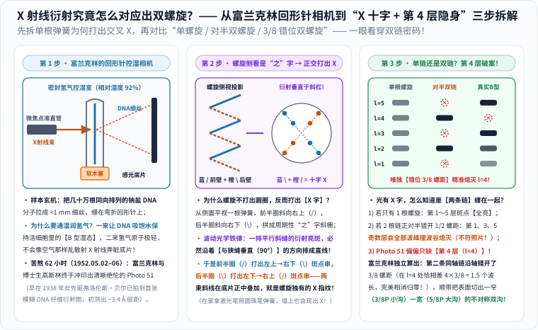
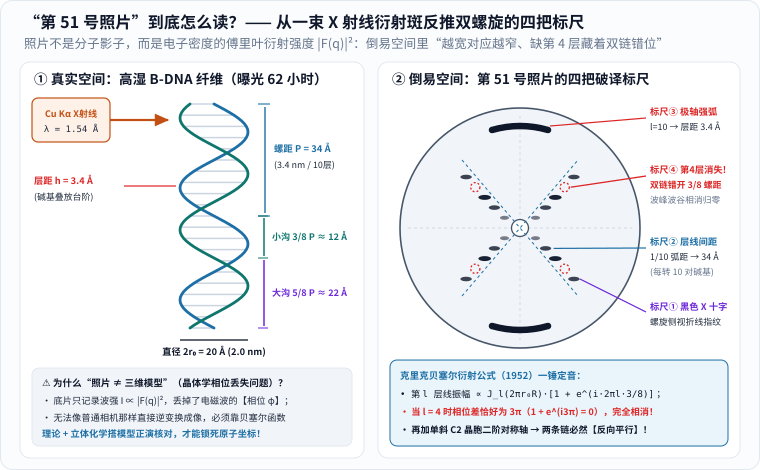
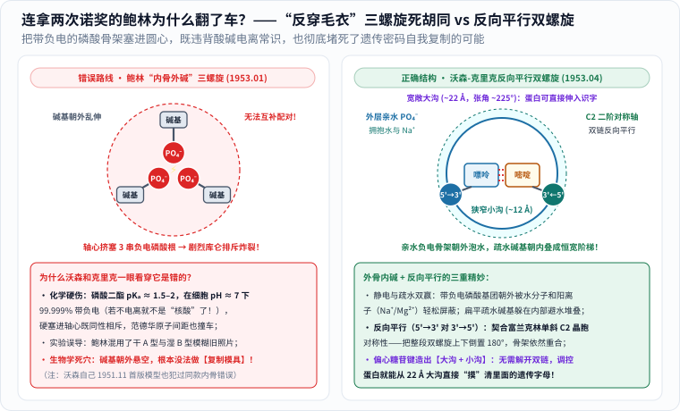
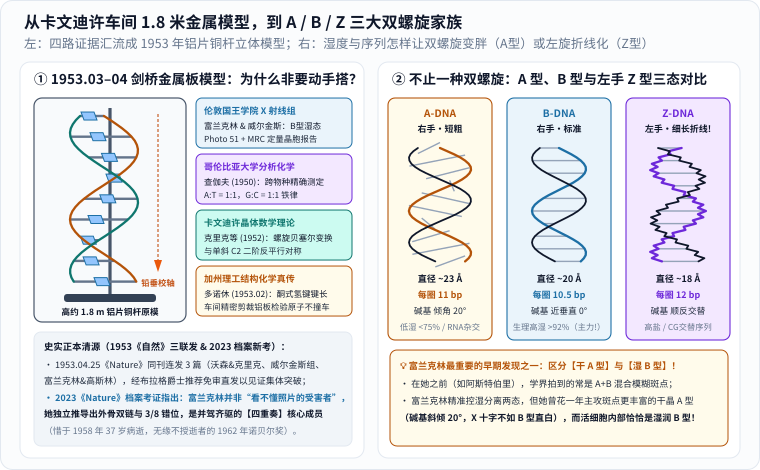

今天哪怕是一个刚上初中的孩子，闭着眼睛也能在草稿纸上画出生命的标志——**两条反向缠绕的旋转扶手，中间横架着一排排像楼梯踏板一样的碱基对**。

但如果我们把日历拨回 **1951 年至 1953 年**的英国伦敦与剑桥，设身处地站到当年的实验台前，你会立刻撞上一连串让人头皮发麻的死结：

- **第一重盲区（连影子都看不见）**：DNA 双螺旋的直径只有 $$2\text{ nm}$$（$$20\text{ \AA}$$），而人类肉眼可见的紫光到红光波长足足有 $$400\text{–}700\text{ nm}$$——可见光的“尺子刻度”比 DNA 粗了两三百倍，哪怕拿全世界最顶级的光学显微镜去照，光波也会直接绕过去，连一团模糊的黑影都留不下；
- **第二重盲区（衍射斑不是分子照片）**：改用波长更短的 X 射线（$$0.154\text{ nm}$$）去照拉直的 DNA 细丝，底片上倒是出现了奇特的**黑色“X”形斑点阵**（著名的“第 51 号照片”）。可为什么螺旋体打出来的不是螺旋线，而是一个大大的 **X**？更诡异的是，为什么从中心往外数，第 1、2、3、5 层都有黑斑，唯独**第 4 层干干净净像被橡皮擦掉了**？
- **第三重盲区（大师翻车与教科书画错）**：当时全世界公认最懂生物大分子螺旋的化学泰斗、后来独得两次诺贝尔奖的莱纳斯·鲍林（Linus Pauling），在 1953 年初信心满满端出了一个**“骨架塞中间、碱基朝外伸”的三螺旋模型**；而剑桥的年轻搭档起初照着权威有机化学教科书拼碱基，怎么拼两根扶手都忽宽忽窄、歪七扭八——谁能想到，竟是**教科书把一颗氢原子的位置画反了**？
- **第四重历史迷雾**：拍出关键照片、算清骨架朝外与湿度相变的伦敦国王学院女科学家**罗莎琳德·富兰克林（Rosalind Franklin，1920—1958）**，37 岁便因卵巢癌英年早逝，四年后三位男科学家捧起 1962 年诺贝尔奖。过去半个世纪里，有人把她写成“拍了神图却自己看不懂的悲情配角”，真相真是这样吗？

破译 DNA 双螺旋从来不是某天夜里灵光一闪的童话，而是一场横跨**X 射线晶体学、傅里叶波动数学、酸碱物理化学与机械车间立体拼装**的硬核推理秀。顺着当年科学家的破案脚印一步步重算一遍，你会发现每一个数字、每一处凹槽背后，都藏着令人拍案叫绝的物理必然 [1–5]。

> **延伸前置阅读**：如果你想知道这根直径 $$2\text{ nm}$$、全长 $$2\text{ m}$$ 的双螺旋长线后来是怎么在直径仅 $$6\text{–}10\text{ }\mu\text{m}$$ 的细胞核里缠上组蛋白线轴、折成染色体的，可以先读姊妹篇[《DNA 里面有多小的世界？从两米分子长线到染色体的折叠奇迹》]()；本文则专门回到更底层的源头——**人类当年究竟是怎么把这根双螺旋的原子图纸一寸寸“算”出来的**。

---

## 一、看不见分子怎么“拍照”？—— 从回形针上的 62 小时曝光，到 X 射线衍射对应双螺旋的三步拆解

既然可见光波长太粗（$$400\text{–}700\text{ nm}$$），物理学家自然想到了脾气更硬的“纳米级探针”——**铜靶 $$K_\alpha$$ 特征 X 射线**，它的波长只有：

$$
\lambda = 1.54\text{ \AA} = 0.154\text{ nm}
$$

这个尺度恰好跟分子里的碳碳化学键（约 $$1.5\text{ \AA}$$）平起平坐！但麻烦接踵而至：**自然界根本不存在一面能把 X 射线折射聚焦的“X 光玻璃透镜”**。也就是说，我们没法造出一台“X 射线光学显微镜”直接给单根 DNA 拍证件照，只能退而求其次——让成千上万根排整齐的 DNA 分子一起散射 X 射线，去读底片上的**干涉衍射条纹** [3, 4]。

### 1. 一枚弯折的回形针、一团湿氢气，与苦熬 62 小时的“第 51 号照片”

用 X 射线给 DNA 拍衍射图，并不是富兰克林首创，但前人全都栽在了一个看似不起眼的细节上：**水**。

早在 **1938 年**，英国利兹大学年仅 25 岁的女晶体学家**弗洛伦斯·贝尔（Florence Bell，1913—2000）**就在威廉·阿斯特伯里（William Astbury）实验室拍出了人类历史上第一张 DNA 纤维 X 射线衍射图，并敏锐测出扁平碱基像一摞硬币（“Pile of Pennies”）那样每隔约 $$3.4\text{ \AA}$$ 叠放一层 [5, 11]。可惜当年提取的 DNA 纯度不高，而且纤维一风干脱水，内部两种截然不同的构象混成一锅粥，拍出来的斑点就像高度近视眼看到的雾团。

到了 **1951—1952 年**，受过顶级物理化学训练的罗莎琳德·富兰克林加入伦敦国王学院，带着博士生雷蒙德·高斯林（Raymond Gosling）对实验装置做了一番教科书级的精密改造 [2, 3, 12]：

*图 1：X 射线衍射究竟怎么对应到双螺旋？（[单独打开高清图](/assets/images/dna-double-helix/helix-to-x-cross-stepwise.svg)）建议按从左到右三步跟读：**第 1 步（左栏）**看实验源头——富兰克林将直径不足 $$1\text{ mm}$$ 的高纯度小牛胸腺钠盐 DNA 纤维绷在弯折回形针上，插进软木塞，密闭通入相对湿度 $$92\%$$ 的氢气，既让 DNA 吸饱水保持活细胞里的“湿态 B 型”，又靠轻质氢气消除空气对 X 射线的杂散背景雾；**第 2 步（中栏）**看核心几何——侧看一根螺旋弹簧，前半圈斜向右上（`/`）、后半圈斜向右下（`\`），根据波动光学“衍射方向垂直于狭缝走向”铁律，两排斜杠各自打出与自身垂直的斑点串，在底片正中叠加成交叉的黑色 **X**；**第 3 步（右栏）**看单双链破案——单螺旋第 1～5 层全亮，对半错位（$$1/2$$ 螺距）的双螺旋奇数层全灭，唯独**轴向错开 $$3/8$$ 螺距的双螺旋**会让第 4 层（$$l=4$$）恰好相差 $$1.5$$ 个波长而精准隐身！*

你看图 1 左栏那套看似土气、实则巧夺天工的装置 [2, 12]：
1. **弯折回形针绷紧微米级纤维**：他们用瑞士化学家西格纳（Rudolf Signer）馈赠的高分子量纯小牛胸腺 DNA，拉出一束粗细不到 $$1\text{ mm}$$（接近蜘蛛丝）、内部几十万根分子顺着竖直方向整齐列队的细丝，小心翼翼架在一枚掰弯的普通办公回形针两端，底座插在软木塞上；
2. **为什么要通“相对湿度 $$92\%$$ 的氢气”？**这是整场实验最神来之笔的两手绝活：第一，通过饱和盐溶液精确把腔体相对湿度锁死在 $$92\%$$，DNA 细丝吸饱水分子后会拉长约 $$25\%$$，百分之百切换成纯净单一的**“湿态（B 型）”**（正是活细胞水溶液里的天然状态！）；第二，普通空气里的氮气、氧气原子核较重、电子多，会把细微的 X 射线散射得满底片乌漆嘛黑，换成宇宙中最轻的**氢气（$$\text{H}_2$$，每个分子仅 2 个电子）**充盈微相机，底片背景瞬间干净如洗！
3. **整整 62 小时的屏息等待**：**1952 年 5 月 2 日傍晚至 5 月 6 日清晨**，在微焦点 X 射线管连续照射 **62 个小时**（样本距底片仅 $$15\text{ mm}$$）后，按流水编号排到第 51 张的底片显影出炉——这就是后来改写生物学史的 **“第 51 号照片（Photograph 51）”** [2, 3]。

### 2. 为什么弹簧状的螺旋，在底片上打出来的偏偏是个大写的“X”？

第一次看到“第 51 号照片”的人，十有八九会冒出同一个疑惑：**分子明明是圆溜溜往上绕的螺旋，为什么底片上既不是圆圈、也不是波浪线，偏偏是一个棱角分明的黑色十字“X”？**

别急着搬高等数学，我们先拿日常最熟悉的**圆珠笔小弹簧**做个一秒钟就能懂的思维实验（图 1 中栏）[4]：

- 请把一根竖直摆放的圆柱螺旋弹簧举到眼前，**从正侧面平视它**（就像平行 X 射线束迎面撞上竖直绷紧的 DNA 细丝一样）；
- 在二维侧视投影里，圆弧不见了，整根弹簧变成了一条上下往复的**“之”字形折线（Zig-Zag）**：靠近你这一侧的前半圈全部朝右上方倾斜（像一排平行的斜杠 `/`），远离你那一侧的后半圈全部朝右下方倾斜（像另一排平行的反斜杠 `\`）！
- 现在回忆一下高中物理最基本的**单缝/光栅衍射规律**：当一束波穿过一排平行排列的斜缝时，衍射干涉出来的亮斑往哪儿排？**永远沿着“与狭缝本身垂直（$$90^\circ$$）”的方向排成一条直线！**（缝横着开，衍射斑就竖着排；缝斜着 `/` 开，衍射斑就一定垂直于它、沿着左上到右下 `\` 排！）
- 把前后两半圈合起来看：前半圈的一排 `/` 斜杠，在底片上打出了一条从左上斜向右下（`\`）的斑点串；后半圈的一排 `\` 反斜杠，同时在底片上打出了一条从左下斜向右上（`/`）的斑点串——**两条正交斜线在中心原点一交叉，不就是一个标准得不能再标准的黑色“X”字吗！**

> **在家就能复刻的厨房光学实验**：你甚至不需要 X 射线机！找一支激光笔，关掉房间大灯，让绿色或红色激光束垂直照过圆珠笔里拆出来的细金属弹簧，盯住两米外的白墙——墙上立刻就会浮现出一模一样的**交叉“X”形衍射亮斑串** [4]！

就在富兰克林拍下照片的同一年（1952 年），剑桥卡文迪许实验室的弗朗西斯·克里克（Francis Crick）与威廉·科克伦（William Cochran）、弗拉基米尔·范德（Vladimir Vand）独立推导出了严格的**螺旋傅里叶衍射公式（CCV 理论）** [6]：半径为 $$r_0$$、螺距为 $$P$$ 的连续螺旋线，在倒易空间高度 $$q_z = l / P$$（第 $$l$$ 条水平“层线”，$$l = 0, \pm 1, \pm 2, \dots$$）上的衍射波振幅，精确正比于**第 $$l$$ 阶第一类贝塞尔函数（Bessel Function）**：

$$
F_l(R) \propto J_l(2\pi r_0 R) \, e^{i l \psi}
$$

贝塞尔函数有个极漂亮的数学脾气：当阶数 $$l = 1, 2, 3, 4, 5\dots$$ 往上走时，$$\lvert J_l(u)\rvert$$ 第一次冒出波峰的位置（$$u_{\max} \approx 1.84,\ 3.05,\ 4.20,\ 5.32,\ 6.42\dots$$）会老老实实按近乎等步长往两侧外推——也就是说，层数 $$l$$ 越高，最亮的衍射斑离竖直中轴线（子午线）就越远，**严格沿着斜向直线铺开成“X”形十字架** [4, 6]！

### 3. 四把破译标尺与“消失的第 4 层”：为什么不是单螺旋，偏偏是错开 $$3/8$$ 螺距的双螺旋？

读懂了“X 代表螺旋”，接下来才是晶体学家真正显神通的时刻。科学网杨正瓴老师在系列笔记里反复提醒过一句大实话：**“衍射照片 $$\neq$$ 三维分子模型！”** [11, 12]

为什么不能把第 51 号照片塞进电脑、一键反算出三维图像？因为 X 射线底片只能记录电磁波撞击银盐颗粒的**强度（亮度）** $$I(\mathbf{q}) \propto \lvert F(\mathbf{q}) \rvert^2$$，却把电磁波最核心的**相位角 $$\varphi(\mathbf{q})$$** 彻底弄丢了——这就是困扰晶体学百年的**“相位丢失问题（Phase Problem）”**。打个比方，这就像你站在音乐厅门外，手里只有一张写满“每个音高各响了多少分贝”的音量清单，却不知道这些音符谁先响、谁后响，想倒推出整首交响乐，必须一边拿几何标尺量倒易空间，一边在真实空间搭模型正演核对 [4, 6]！

让我们把第 51 号照片摆上测量台（图 2），看看富兰克林、威尔金斯与克里克当年从这张直径几厘米的圆片上，硬生生卡尺量出了哪**四把决定性的纳米标尺** [1, 3, 4]：

*图 2：“第 51 号照片”的四把定量破译标尺（[单独打开高清图](/assets/images/dna-double-helix/photo51-fourier-diffraction.svg)）。左图为真实空间高湿 B-DNA 纤维的几何尺寸，右图为由贝塞尔函数 $$J_l(2\pi r_0 R)$$ 与双链干涉因子 $$4\cos^2(3\pi l / 8)$$ 严格计算生成的倒易空间衍射图。牢记倒易空间的“跷跷板口诀”——**真实空间越宽大，底片上斑点间距越密集；真实空间越精细，底片上斑点飞得越远**。*

1. **标尺① 十字倾角 $$\to$$ 螺旋直径 $$2r_0 = 20\text{ \AA}$$（$$2.0\text{ nm}$$）**：量出黑色 X 两臂的夹角（约离竖直轴 $$\pm 40^\circ$$），结合第一层斑点的水平偏距 $$u_{\max,1} = 2\pi r_0 R_1 \approx 1.84$$，立刻锁死圆柱螺旋半径 $$r_0 \approx 10\text{ \AA}$$，即整根分子粗约 **$$20\text{ \AA}$$**；
2. **标尺② 相邻水平层线间距 $$\Delta q_z \to$$ 完整绕一圈的螺距 $$P = 34\text{ \AA}$$（$$3.4\text{ nm}$$）**：倒易空间里每一层斑点（$$l=1,2,3\dots$$）的竖直间隔相等，直接换算出螺旋每转满 $$360^\circ$$ 沿竖直轴爬升 **$$34\text{ \AA}$$**；
3. **标尺③ 上下极轴（$$l = \pm 10$$）两道浓黑强圆弧 $$\to$$ 碱基踏板层距 $$h = 3.4\text{ \AA}$$，每圈正好 $$10$$ 层！** 顺着中心往正上方和正下方数到**整整第 10 层（$$l = 10$$）**的位置，各趴着一道浓黑得发亮的粗圆弧！层线距离正好是第 1 层的 $$10$$ 倍，换回真实空间就是 $$34\text{ \AA} \div 10 = 3.4\text{ \AA}$$（$$0.34\text{ nm}$$）——这正是扁平芳香环碱基像一摞硬币叠在一起的范德华层间距！一除便知：**纤维态 B-DNA 每绕一圈，刚好塞进 $$34 \div 3.4 = 10$$ 层碱基踏板**（后来测得自由水溶液里略微松开一点点，约为 $$10.5$$ 对/圈）[1, 4]。
4. **标尺④ 最神的破案铁证——为什么偏偏“第 4 层（$$l=4$$）空空如也”？**

请再盯紧图 1 右栏和图 2 右图的红色虚线小圆圈：**顺着 X 斜臂数，第 1 层亮、第 2 层亮、第 3 层亮……本该出现在第 4 层（$$l=4$$）的黑斑居然凭空蒸发了，跨过去到了第 5 层又重新变亮！**

这可不是底片没涂匀药水，而是两条螺旋链联手上演的**波峰撞波谷（相消干涉）** [3, 4]！我们来算一笔初中三角函数就能看懂的账：

- 假如 DNA **只有 1 根单螺旋**：没有任何同伴跟它打架抵消，第 $$1, 2, 3, 4, 5$$ 层斑点应该随着贝塞尔函数平缓衰减、**统统发亮**——这直接宣判“单链螺旋”出局；
- 假如 DNA 是 **2 根同轴双螺旋，且上下正对半（错开半个螺距 $$\Delta z = \frac{1}{2}P = 17\text{ \AA}$$）**：两根链在第 $$l$$ 层上的相位差就是 $$2\pi l \cdot \frac{1}{2} = l\pi$$。每逢奇数层（$$l = 1, 3, 5\dots$$），$$1 + e^{i l\pi} = 1 - 1 = 0$$，**第 1、3、5 层会全部熄灭**——可第 51 号照片上第 1、3、5 层明明亮得很！所以两条链绝不是对称平分的；
- 那要错开多少，才能让第 1、2、3、5 层全活下来，**唯独精准干掉第 4 层（$$l = 4$$）**？设第二条同轴螺旋相对于第一条沿竖直轴平移了 $$\Delta z = \alpha P$$，两条链散射波叠加后的强度调制因子是：

$$
M(l) = \left\lvert 1 + e^{i \, 2\pi l \alpha} \right\rvert^2 = 4\cos^2(\pi l \alpha)
$$

令 $$l = 4$$ 时 $$M(4) = 0$$，即 $$4\pi\alpha = \frac{\pi}{2}, \frac{3\pi}{2}\dots$$：
- 若取 $$\alpha = \frac{1}{8}$$（两条链紧紧贴在 $$4.25\text{ \AA}$$ 内），两条带负电的磷酸糖骨架会撞得粉碎，空间上根本塞不下；
- 唯一合理的物理正解是 **$$\alpha = \frac{3}{8}$$**！我们来代进去验算每一层的亮度因子 $$M(l) = 4\cos^2\!\left(\frac{3\pi l}{8}\right)$$：
  - $$l = 1$$：$$4\cos^2(67.5^\circ) \approx 0.59$$（**亮**）；
  - $$l = 2$$：$$4\cos^2(135^\circ) = 2.00$$（**很亮**）；
  - $$l = 3$$：$$4\cos^2(202.5^\circ) \approx 3.41$$（**极亮**）；
  - **$$l = 4$$：相位差恰好是 $$4 \times \frac{3}{8} = 1.5$$ 个完整波长（$$540^\circ = 3\pi$$），波峰严丝合缝扣进波谷，$$4\cos^2(270^\circ) = 0$$（彻底隐身归零！）**
  - $$l = 5$$：$$4\cos^2(337.5^\circ) \approx 3.41$$（**重新极亮！**）

更妙的是，这个由“第 4 层消失”倒逼出来的 **$$\frac{3}{8}$$ 螺距错位（$$\Delta z = \frac{3}{8}\times 34\text{ \AA} = 12.75\text{ \AA}$$）**，顺手还揭开了双螺旋表面最迷人的地貌特征：既然一个完整螺距 $$34\text{ \AA}$$ 被两条链切成了不均等的两截，一截占 $$\frac{3}{8}$$（约 **$$12\text{ \AA}$$**），另一截就必然占剩下的 $$\frac{5}{8}$$（约 **$$22\text{ \AA}$$**）——这就是遍布整根 DNA 双螺旋表面、一窄一宽交替盘旋的**“小沟（Minor Groove）”与“大沟（Major Groove）”** [3, 4]！

---

## 二、罗莎琳德·富兰克林：不止一张“第 51 号照片”，更是两座诺贝尔奖基石背后的硬核女科学家

聊到这里，我们必须停下脚步，好好认识一下站在那台回形针微相机背后的女科学家——**罗莎琳德·富兰克林（Rosalind Elsie Franklin，1920—1958）** [2, 8]。

在很长一段时间里，大众科普把她的故事简化成了两个走极端的漫画：要么照搬詹姆斯·沃森 1968 年畅销回忆录《双螺旋》里带偏见的刻板笔触，把她写成脾气倔强、死守数据却不会搭模型的“罗西（Rosy）”；要么在后来的翻案热潮里矫枉过正，把她塑造成“拍出了神图却看不懂里头的螺旋，成果被男人偷走”的无助受害者。

**这两种说法，其实都低估了富兰克林真正的科学分量。** **2023 年 4 月**（双螺旋发表 70 周年之际），科学史家马修·科布（Matthew Cobb）与纳撒尼尔·康福特（Nathaniel Comfort）在剑桥丘吉尔学院档案馆翻出了两份尘封整整 70 年的一手史料（1953 年《时代》周刊记者琼·布鲁斯的未刊采访原稿与富兰克林同事保琳·考恩的亲笔信），并在《自然》（*Nature*）发表重磅考证文章，为这段公案给出了最公允的定论：**富兰克林绝不是看不懂数据的局外受害者，而是与沃森、克里克、威尔金斯平起平坐破译双螺旋的“四重奏（Quartet）”核心成员之一** [8]！

### 1. 从防毒面具的煤炭纳米孔，到一举劈开“干 A 型”与“湿 B 型”迷雾

1920 年出生于伦敦知识分子家庭的富兰克林，从小就对逻辑与精确测量着迷。1938 年她考入剑桥大学纽纳姆学院攻读自然科学（顺便说一句荒诞的时代背景：直到 1948 年之前，剑桥大学甚至拒绝给女性颁发正式学位证书，女毕业生只能拿到一纸“名义头衔”！）。

二战期间，22 岁的富兰克林投入英国煤炭利用研究协会（BCURA），研究一个关乎无数士兵性命的难题：**为什么有的木炭能做防毒面具滤毒罐，有的煤却连最小的气体分子都钻不进去？** 她用氦气、甲醇、苯等不同尺寸的分子去测煤炭密度，发现煤炭内部布满了分子级微孔“分子筛”，随温度升高像温控阀门一样收缩。1947 年她远赴巴黎国家中央化学实验室深造，练就了一手当时全世界罕逢敌手的**非晶与乱层物质 X 射线衍射绝活**，准确区分出哪些碳加热能变石墨、哪些只能做玻璃碳——哪怕她一生连碰都没碰过 DNA，单凭这批煤炭与碳纤维奠基论文，她也早已是材料物理化学界的响当当人物 [2, 8]！

1951 年初，富兰克林受聘回到伦敦国王学院，原本以为自己将独立主持 DNA X 射线课题，而实验室元老莫里斯·威尔金斯（Maurice Wilkins）度假归来却误以为她是派来给自己打下手的助手——管理层的沟通乌龙让两人从第一天起就关系紧绷、各干各的 [2, 8]。

但富兰克林一上手，就立下了在她之前无人做到的**头号大功**：

- 当时所有实验室拍 DNA 都是一团浆糊，唯独富兰克林凭巴黎练出的精密控湿功底发现：当相对湿度低于 $$75\%$$ 时，DNA 处于短粗紧缩、晶斑锐利的**晶态“A 型（A-DNA）”**；一旦相对湿度升到 $$92\%$$ 以上，DNA 纤维骤然吸水上延，切换成斑点呈清晰 X 字的**湿态“B 型（B-DNA）”** [3, 8]；
- 在她之前，包括阿斯特伯里和鲍林在内的所有人都在用**“A 型与 B 型的混合糊片”**硬猜结构——就像把一张猫脸和一张狗脸重曝在同一张底片上再去画像，怎么画都是怪物！富兰克林一把将两者干净分离，双螺旋的大门才算真正打开了第一道锁。

### 2. 她的笔记本里到底算到了哪一步？为什么差了最后半步？

那么，富兰克林自己到底看懂“第 51 号照片”没有？翻开她 1952—1953 年初的实验笔记、MRC（英国医学研究委员会）工作报告和她在同年 3 月独立撰写的《自然》手稿草稿，白纸黑字写得清清楚楚 [3, 8]：

1. **她率先铁口直断“磷酸骨架必须在外面、碱基必须在里面”**：早在 1951 年 11 月的国王学院报告会上，富兰克林就根据磷酸基团极强的亲水性（每摩尔核苷酸能紧紧吸住至少 8 个水分子）算明——只有带电亲水的磷酸糖链包在圆柱最外层，DNA 才能一遇水就顺滑膨胀成 B 型；当时坐在台下听讲、连笔记都没记全的年轻沃森，回去还犯糊涂搭了个“磷酸塞里面”的错模型，被富兰克林当场过来一眼指出了硬伤！
2. **她算出了单斜 $$C2$$ 空间群——直接锁定“两条链反向平行”的钥匙**：富兰克林对晶斑更丰富的干态 A-DNA 做了严苛的帕特森函数（Patterson function）分析，测出晶胞属于**单斜 $$C2$$ 空间群（Monoclinic $$C2$$）**，晶胞参数 $$a = 22.0\text{ \AA},\ b = 39.8\text{ \AA},\ c = 28.1\text{ \AA},\ \beta = 97^\circ$$，且密度测量表明每圈对应 **2 条链**而非 3 条链。当克里克在 **1952 年 12 月那份公开的 MRC 机构年度汇报**（由委员会委员马克斯·佩鲁茨合规转交，并非秘密盗窃）里读到“单斜 $$C2$$”这四个字时，正在写血红蛋白博士论文（偏偏也是 $$C2$$ 空间群！）的克里克脑中轰然炸响：**$$C2$$ 意味着存在一根垂直于螺旋主轴的 $$180^\circ$$ 二阶旋转对称轴——也就是说，两条糖-磷酸链必须一条头朝上（$$5'\!\to\!3'$$）、另一条头朝下（$$3'\!\to\!5'$$），反向平行！** [8]
3. **她独立推导出 B 型就是双链同轴螺旋，且轴向错开 $$\frac{3}{8}$$ 螺距**：1953 年 2 月，富兰克林重新掉头攻坚 B-DNA 第 51 号照片，不仅算清了直径 $$20\text{ \AA}$$、螺距 $$34\text{ \AA}$$、每转 $$10$$ 个残基，还独立利用第 4 层线消失推算出**双链错位 $$\frac{3}{8}$$ 螺距**！她在 **1953 年 3 月 17 日**定稿的手稿（当时她还完全不知道剑桥那边已经搭出了模型！）里明确写道：钠盐胸腺核酸结构很可能由两条同轴螺旋链组成，磷酸基团暴露在外部圆柱面上 [3, 8]。

既然她已经走到了离终点不到十米的地方，为什么没能第一个撞线？原因纯粹在于**研究方法论的选择差异**：富兰克林信奉严谨的“自下而上归纳法”——她看到 A-DNA 某些衍射图不对称，担心过早假定螺旋模型会掉进主观臆断的陷阱（毕竟连鲍林都刚摔了个大跟头），坚持要把帕特森电子密度图一寸寸算到底，并且还没有把查伽夫的 $$1:1$$ 化学比例与碱基氢键配对联系起来；而剑桥的沃森和克里克走的是鲍林式的“自上而下立体化学建模法”——只要大框架对上号，立刻剪硬纸板、拧铜铁丝去试错 [8]。

> **关于数据流转的伦理反思**：尽管 2023 年《自然》考证澄清 MRC 报告并非机密文件，威尔金斯在富兰克林即将调往伯贝克学院交接工作时向沃森展示第 51 号照片也属于两所合作实验室之间的交流设想，但科布与康福特同样坦率指出：**在未事先征得富兰克林本人明确知情同意的情况下向竞争团队展示她的未发表照片，并且沃森和克里克在 1953 年原论文末尾仅用一句轻描淡写的“受她们未发表实验结果与想法的启发（stimulated by a knowledge of the general nature of the unpublished experimental results and ideas）”一笔带过，按今天的学术规范来看，显然亏欠了她应有的充分致谢**（1954 年两人在《皇家学会会刊》长文里才正式补写明：“若无富兰克林的数据，我们几乎不可能建立这一结构”）[8]。

### 3. 37 岁的生命绝唱：离开国王学院后，她又独立奠基了另一座诺贝尔奖！

如果富兰克林的故事只停留在 1953 年春天，那还远远不是她人生最耀眼的高光。

1953 年 3 月，富兰克林转赴伦敦大学**伯贝克学院（Birkbeck College）**组建自己的病毒晶体学团队。摆脱了国王学院压抑的内耗后，她在短短 **5 年（1953—1958）**里爆发出惊人的创造力 [2, 8]：

- 她主攻困扰学界多年的**烟草花叶病毒（TMV）**，拍出了比当年 DNA 还要复杂得多的超高分辨率病毒 X 射线衍射图，一举推翻了大师鲍林和沃森的猜测，证明 TMV 并不是实心棒，而是一根长达 $$300\text{ nm}$$ 的**中空螺旋管**，单链 RNA 并不浮在表面，而是深深嵌在螺旋排列的 2,130 个蛋白质亚基凹槽内部！
- 紧接着，她又与年轻合作者**阿龙·克卢格（Aaron Klug）**率先开展了对人类致死致残元凶——**脊髓灰质炎病毒（小儿麻痹症病毒）**等球形二十面体病毒的晶体衍射解析。
- 1956 年秋，富兰克林被查出罹患卵巢癌。在经历三次大手术与化疗的剧痛间隙，她依然在实验室发了 **17 篇高水平论文**，甚至在生命最后几个月顶着病体为 1958 年布鲁塞尔世博会亲手搭建了一座高达五英尺的巨型病毒螺旋模型。**1958 年 4 月 16 日**，就在这座模型公开展出的前一天，富兰克林在伦敦悄然辞世，年仅 **37 岁** [2]。

按照诺贝尔奖自 1901 年起的硬性章程（后于 1974 年进一步明文锁死），**诺贝尔奖绝不追授已故人士**。**1962 年**，沃森、克里克与威尔金斯三人共同获得诺贝尔生理学或医学奖；而整整二十年后的 **1982 年**，富兰克林在伯贝克学院最亲密的学生兼战友**阿龙·克卢格**，正是沿着两人共同开创的病毒核酸-蛋白复合体结构研究独得**诺贝尔化学奖**——克卢格站在斯德哥尔摩领奖台上动情地说，倘若富兰克林还活着，她完全有资格站在他身旁 [2, 8]。短短 37 年人生，亲手托起**两座诺贝尔奖**的科学地基，这才是罗莎琳德·富兰克林真正的传奇！

---

## 三、连拿两次诺奖的鲍林为什么会翻车？——“反穿毛衣”三螺旋的酸碱死穴，与反向平行大小沟的精妙

回到 **1953 年 1 月**的剑桥。当时最让沃森和克里克坐立不安的，是大洋彼岸加州理工学院的化学之神**莱纳斯·鲍林（Linus Pauling）**。就在两年前（1951 年），鲍林刚刚凭一己之力用纸折出了蛋白质的 **$$\alpha$$-螺旋（Alpha Helix）**，威震天下。1953 年 1 月底，鲍林寄给在剑桥访学的儿子彼得·鲍林一份即将发表在《美国国家科学院院刊》（*PNAS*）上的重磅预印本——宣称自己已经解出了 DNA 的结构：**一个“三条磷酸糖骨架挤在中心轴、碱基全部朝外伸”的三螺旋模型** [7]！

沃森一把抓过手稿，手心冒汗地读完，结果不仅没绝望，反而和克里克双双松了一大口气：**这位全世界最伟大的结构化学家，居然犯了一个连大一普通化学都不该犯的低级错误——他把 DNA 这件“毛衣”里外反穿了！**

*图 3：顺着螺旋中心轴从上往下俯视（轴向横截面对比，[单独打开高清图](/assets/images/dna-double-helix/pauling-triple-vs-bdna.svg)）。**左图**是鲍林 1953 年初提出的三螺旋模型：三条带负电的磷酸二酯骨架（$$\text{PO}_4^-$$）被硬塞进半径不足 $$3\text{ \AA}$$ 的中心轴，不仅范德华原子体积严重撞车，同种负电荷更是产生剧烈的库仑排斥；**右图**是真实的反向平行 B-DNA 双螺旋：亲水带负电的磷酸根舒舒服服泡在外围水分子与 $$\text{Na}^+/\text{Mg}^{2+}$$ 离子云里，疏水扁平的嘌呤与嘧啶躲进疏水内芯叠成恒宽阶梯，而偏心的糖苷键夹角（约 $$135^\circ$$ 对 $$225^\circ$$）自然切出了一窄一宽的大小双沟。*

看着图 3 左右两张俯视截面图，哪怕不做复杂计算，你也能一眼揪出鲍林三螺旋的**三大致命伤** [7]：

1. **酸碱电离常识硬伤（为什么叫“脱氧核糖核酸”？）**：为了把三串紧挨着的磷酸基团塞进圆心还不炸开，鲍林不得不假设磷酸基团全都不带电（挂着氢原子 $$-\text{PO}_4\text{H}$$），靠氢键互相拉住。可只要查一下酸碱电离常数就知道（如果忘了 $$\text{p}K_a$$ 和 $$\text{pH}$$ 的关系，可以顺手翻看本博[《为什么柠檬酸掉牙、碱水却滑溜溜？彻底读懂酸碱性质的底层原因》]()），DNA 磷酸二酯基团的 $$\text{p}K_a \approx 1.5\text{–}2.0$$，是货真价实的中强酸！在活细胞生理环境 $$\text{pH} \approx 7.0$$ 下，根据亨德森-哈塞尔巴尔赫方程：

$$
\frac{[\text{R-PO}_4^-]}{[\text{R-PO}_4\text{H}]} = 10^{\,\text{pH} - \text{p}K_a} \approx 10^{\,7.0 - 1.5} = 10^{5.5} \approx 3.16 \times 10^5
$$

也就是说，每 **31 万个**磷酸基团里，有 **315,999 个**早已脱掉质子、带着沉甸甸的**负电荷（$$-\text{PO}_4^-$$）**！难怪剑桥同事听完打趣说：“要是磷酸根真像鲍林画的那样一个氢都不电离，那 DNA 根本连‘酸（Nucleic **Acid**）’都算不上了！”把三串裸露的负电荷硬捆在圆心，同性相斥的库仑力瞬间就会把整根分子炸散架！（顺便说一句公道话：沃森自己 1951 年底第一次试搭模型时，也曾把磷酸塞进圆心，被赶来听讲的富兰克林当场浇了一盆冷水纠偏 [8]。）

2. **实验底片误导**：当时美国国务院怀疑反战的鲍林“亲共”，扣押了他的护照，导致他没能去伦敦亲眼看到国王学院清晰分离的湿态 B 型照片，只能拿阿斯特伯里十多年前那张**干 A 型 + 湿 B 型混拍的老糊片**硬算密度，误以为晶胞里塞得下三条链 [7]。
3. **生物学功能死胡同**：如果四个字母（$$\text{A, T, G, C}$$）全都朝外胡乱支棱在半空（图 3 左），谁也不挨着谁，细胞分裂时拿什么当模具去精准复印下一份遗传密码？

反过来，再看图 3 右边**“外骨内碱 + 反向平行”**的正确排布，简直每一处都透着大自然鬼斧神工的化学智慧：

- **亲水归外、疏水归内**：带负电的磷酸骨架朝外敞开，被周围极性水分子与阳离子（$$\text{Na}^+$$、$$\text{Mg}^{2+}$$ 或细胞核里的碱性组蛋白）温柔包裹中和；而疏水扁平的含氮碱基躲进中心圆筒，上一层和下一层相距 $$3.4\text{ \AA}$$ 紧密叠放，靠**芳香环 $$\pi\text{–}\pi$$ 堆积力与疏水效应**把双螺旋牢牢锚定（注意一个常见误区：真正让双螺旋在水中稳如泰山的主力其实是纵向的**碱基堆积疏水力**，横向的**氢键**则主要负责“挑对搭档”的特异性识别！）；
- **偏心糖苷键雕出 22 埃“识字天窗”**：连接脱氧核糖 $$\text{C1'}$$ 碳原子的两根糖苷键并不是穿过圆心 $$180^\circ$$ 对顶张开的，而是偏向一侧（夹角约 $$135^\circ$$ 对 $$225^\circ$$），刚好配合轴向 $$\frac{3}{8}P$$ 错位，在圆柱表面切出约 $$12\text{ \AA}$$ 的窄小沟和约 **$$22\text{ \AA}$$ 的宽大沟**——细胞里的基因调控蛋白（转录因子）根本不需要费劲撬开整条双螺旋，只要把手指伸进 $$22\text{ \AA}$$ 宽的大沟里“摸一摸”暴露出来的氢键供受体花纹，就能当场读出里面写的是 $$\text{A-T}$$ 还是 $$\text{G-C}$$！

---

## 四、一颗搬家的氢原子与桌上的硬纸板：多诺休“酮式纠错”怎样在 1953 年 2 月 28 日拼通查伽夫之谜

鲍林虽然翻了车，但留给沃森和克里克的抢跑时间窗口只有短短**六个星期**——因为一旦鲍林读到伦敦的新论文或发现自己的酸碱笔误，随时可能卷土重来。

此时，骨架在外、双链反向平行（$$C2$$ 对称）、直径 $$20\text{ \AA}$$、螺距 $$34\text{ \AA}$$、层距 $$3.4\text{ \AA}$$ 全都齐了，唯独最核心的一块拼图死活卡壳：**藏在圆筒肚子里的四种碱基——双环大个子腺嘌呤（$$\text{A}$$）、鸟嘌呤（$$\text{G}$$）和单环小个子胸腺嘧啶（$$\text{T}$$）、胞嘧啶（$$\text{C}$$）——到底是怎么手拉手连起来的？**

### 1. 哥伦比亚大学送来的天书：为什么永远 $$\text{A}=\text{T}$$、$$\text{G}=\text{C}$$？

早在 **1950 年**，奥地利裔美籍生物化学家**埃尔温·查伽夫（Erwin Chargaff）**就已经用纸层析加紫外分光光度法，把牛、人、酵母、结核杆菌等几十种生物的 DNA 拆开挨个称了摩尔百分比 [9]。在那之前，学界普遍迷信单调无聊的“四核苷酸假说”（以为 DNA 只是 `ATGC-ATGC-ATGC` 死板重复的垫脚木头，根本装不下遗传信息）。查伽夫一举轰碎了这个旧教条，同时扔出了一个让所有人抓耳挠腮的怪现象：

| 物种来源 | 腺嘌呤 $$\text{A}$$（双环） | 胸腺嘧啶 $$\text{T}$$（单环） | 鸟嘌呤 $$\text{G}$$（双环） | 胞嘧啶 $$\text{C}$$（单环） | $$(\text{A}+\text{T})/(\text{G}+\text{C})$$ 比值 | $$\text{A}/\text{T}$$ 与 $$\text{G}/\text{C}$$ |
| :--- | :---: | :---: | :---: | :---: | :---: | :---: |
| **人类（胸腺/精子均值）** | $$30.9\%$$ | $$29.4\%$$ | $$19.9\%$$ | $$19.8\%$$ | $$1.52$$ | **$$1.05$$ / $$1.00$$** |
| **小牛胸腺** | $$28.2\%$$ | $$27.8\%$$ | $$21.5\%$$ | $$22.5\%$$ | $$1.27$$ | **$$1.01$$ / $$0.96$$** |
| **结核分枝杆菌** | $$15.1\%$$ | $$14.6\%$$ | $$34.9\%$$ | $$35.4\%$$ | $$0.42$$ | **$$1.03$$ / $$0.99$$** |

你看这张表有多神奇 [9]：不同物种的 $$(\text{A}+\text{T})/(\text{G}+\text{C})$$ 差了足足三倍多（人类偏爱 $$\text{A, T}$$，结核杆菌偏爱 $$\text{G, C}$$），证明字母排列千变万化；**但不管换哪种生物，大个子 $$\text{A}$$ 的数量永远跟小个子 $$\text{T}$$ 相等，大个子 $$\text{G}$$ 的数量永远跟小个子 $$\text{C}$$ 相等！**

1952 年夏天查伽夫访问剑桥时，亲口把这个规律告诉了沃森和克里克，可当时两人还没反应过来其中的几何含义。到了 **1953 年 2 月中旬**，心急如焚的沃森从书架上翻出英国核苷酸权威戴维森（J. N. Davidson）撰写的《核酸生物化学》教科书，照着书上的分子式剪出硬纸板在办公桌上乱拼——他起初执迷于**“同类配同类”（$$\text{A}$$ 配 $$\text{A}$$、$$\text{T}$$ 配 $$\text{T}$$）**：

- 不仅完全解释不了查伽夫的 $$\text{A}=\text{T}$$、$$\text{G}=\text{C}$$；
- 而且两个双环嘌呤（$$\text{A-A}$$）拼在一起跨度太大，把外面的糖-磷酸扶手撑出个大鼓包；两个单环嘧啶（$$\text{T-T}$$）拼在一起跨度又太窄，扶手猛地往里塌腰——整根双螺旋拧得像根凹凸不平的苦瓜，根本塞不进富兰克林测出的匀称 $$20\text{ \AA}$$ 圆柱筒！

### 2. 1953 年 2 月 27 日办公室神助攻：“你的教科书把氢原子画错家了！”

就在沃森死胡同越钻越深的时候，命运安排了科学史上最戏剧性的**“同屋室友”**。

当时跟沃森、克里克挤在同一间卡文迪许办公室里的访问学者，名叫**杰里·多诺休（Jerry Donohue，1920—1985）**——他恰好来自鲍林的加州理工实验室，是全世界屈指可数真正用单晶 X 射线测过有机小分子精确氢键与互变异构体的活字典 [7]！

**1953 年 2 月 27 日下午**，多诺休瞥了一眼沃森桌上画的鸟嘌呤（$$\text{G}$$）和胸腺嘧啶（$$\text{T}$$）结构式，随口问了一句：“你干嘛把氢原子挂在氧原子上画成**烯醇式（Enol，$$-\text{C}-\text{OH}$$）**？”沃森理直气壮地指着权威教科书说：“所有有机化学书上都是这么印的呀！”

多诺休当场摇了摇头，说出了价值连城的一句话：**“教科书全都是瞎猜的！在真实水环境和晶体里，鸟嘌呤和胸腺嘧啶绝大部分（超过 $$99.99\%$$）都处于更稳定的酮式（Keto，$$=\text{C}=\text{O}$$），那颗氢原子根本不在氧上，而是老老实实待在旁边的环氮原子（$$\text{N1}$$ 或 $$\text{N3}$$）上！”** [7]

*图 4：一颗氢原子搬家救活双螺旋（[单独打开高清图，刷新页面可重播硬纸板滑入动画](/assets/images/dna-double-helix/donohue-tautomer-isosteric-pairing.svg)；开启系统“减少动态效果”时自动停留在完全扣合终态）。**先看左上（①）**：旧教科书误画成占比不足 $$0.01\%$$ 的烯醇式（$$-\text{OH}$$），多诺休指出真实生理态是占比超 $$99.99\%$$ 的酮式（$$=\text{O}$$ 作氢键受体、$$\text{N}-\text{H}$$ 作氢键供体）；**再看右上（②）**：查伽夫 1950 年实测人源 DNA 比例（$$\text{A }30.9\%\approx\text{T }29.4\%$$，$$\text{G }19.9\%\approx\text{C }19.8\%$$）；**最后看下方（③）**：当单环嘧啶硬纸板滑向双环嘌呤扣紧氢键时，不管是 2 条氢键的 $$\text{A}=\text{T}$$ 还是 3 条氢键的 $$\text{G}\equiv\text{C}$$，两侧脱氧核糖 $$\text{C1'}\cdots\text{C1'}$$ 的轨道跨度都分毫不差锁死在 **$$10.85\text{ \AA}$$**！*

### 3. 2 月 28 日星期六清晨：几块硬纸板滑到一起的“同构奇迹”

由于车间周末来不及赶制新的金属片，第二天一早（**1953 年 2 月 28 日，星期六**），第一个冲进办公室的沃森拿起剪刀和硬纸板，按多诺休指点的**正确酮式构型**重新剪出了 $$\text{A, T, G, C}$$ 四块小纸板，在办公桌上推来推去 [1, 7]。

突然间，奇迹在桌面上发生了（图 4 下栏 ③）：

1. **氢键供体与受体严丝合缝咬合**：当他不再硬凑“大配大”，而是把双环的**腺嘌呤（$$\text{A}$$）**推向单环的**胸腺嘧啶（$$\text{T}$$）**时，正好面对面扣上 **2 条平直的氢键**（$$\text{N6}-\text{H}\cdots\text{O4}$$ 与 $$\text{N1}\cdots\text{H}-\text{N3}$$）；再把双环的**鸟嘌呤（$$\text{G}$$）**推向单环的**胞嘧啶（$$\text{C}$$）**，更是咔哒一声扣上了 **3 条结结实实的氢键**（$$\text{O6}\cdots\text{H}-\text{N4}$$、$$\text{N1}-\text{H}\cdots\text{N3}$$ 与 $$\text{N2}-\text{H}\cdots\text{O2}$$——多出这一条氢键，正是富含 $$\text{G-C}$$ 的嗜热菌 DNA 更耐高温煮沸不散架的分子根源！）；
2. **$$10.85\text{ \AA}$$ 完全等宽同构（Isosteric Geometry）**：最让沃森呼吸急促的一幕来了——他把拼好的 $$\text{A}=\text{T}$$ 纸板叠在拼好的 $$\text{G}\equiv\text{C}$$ 纸板正上方，低头一比：**连接两侧脱氧核糖扶手的两个 $$\text{C1'}$$ 碳原子，不仅跨度一模一样（都是 $$10.85\text{ \AA}$$），就连两根糖苷键伸出去的角度（与 $$\text{C1'}\cdots\text{C1'}$$ 连线同侧各成约 $$51^\circ$$）都像同一个模子刻出来的！**
3. **翻转 $$180^\circ$$ 依然全等，单链密码彻底获得自由！** 克里克随后走进办公室，一听完立刻补充了更深一层的对称推论：把 $$\text{A-T}$$ 翻个身变成 $$\text{T-A}$$，或者把 $$\text{G-C}$$ 翻个身变成 $$\text{C-G}$$，两端 $$\text{C1'}$$ 铰链的位置依然纹丝不动（完美契合富兰克林测出的 $$C2$$ 反向平行二阶对称轴）！这意味着：**外侧两根糖-磷酸扶手完全不需要变形，其中一条链上可以按任意顺序自由书写 `A-T-G-G-C-A-T...` 编码天文数字般的生命信息，而对面那条链会自动按 $$\text{A}\leftrightarrow\text{T}$$、$$\text{G}\leftrightarrow\text{C}$$ 百分百锁死，顺便不费吹灰之力解释了困扰世界三年的查伽夫 $$1:1$$ 定则！**

那天中午，兴奋得忘乎所以的克里克冲进剑桥著名的老鹰酒吧（The Eagle Pub），对着正在吃午饭的食客高声宣布：“我们已经发现了生命的秘密！”（顺便提一个有趣的冷知识：多诺休那天救活双螺旋的“酮-烯醇互变异构”，偶尔在细胞复制瞬间也会极罕见地闪现回 $$<0.01\%$$ 的烯醇式或亚胺式，一旦没被聚合酶及时揪出来，就会把 $$\text{T}$$ 错配成 $$\text{G}$$——这正是我们每个新生儿体内天然自发点突变的重要物理源头之一！详见本博[《错字率压到百亿分之一，为什么每个新生儿还是自带 60 个新突变？》]()。）

---

## 五、卡文迪许车间的 1.8 米金属模型、《自然》免审三联发，与 A / B / Z 双螺旋三态家族

纸板拼通了平面配对，是不是就能立刻动笔发论文了？**绝对不行！** 在三维立体空间里，每往上爬升 $$3.4\text{ \AA}$$ 还要顺时针旋转 $$36^\circ$$，脱氧核糖五元环怎么折褶（Sugar Pucker）？磷酸二酯键的六个可旋转二面角会不会让相邻两层的氧原子和碳原子撞在一起（范德华位阻排斥）？光靠二维草图根本算不准 [1, 10, 11]。

### 1. 车间钳工剪出的铝片铜杆巨塔，与 1953 年 4 月 25 日《自然》历史性三联发

整个 **1953 年 3 月**，卡文迪许实验室机械车间的精密技师成了幕后功臣。他们按照多诺休提供的精确共价键长（如 $$\text{C}-\text{N} \approx 1.33\text{–}1.38\text{ \AA}$$、$$\text{P}-\text{O} \approx 1.60\text{ \AA}$$）与键角，用剪床裁出一块块亮闪闪的轻质铝板代表嘌呤和嘧啶，焊上黄铜细杆与铁夹代表脱氧核糖和磷酸基团。

沃森和克里克踩着凳子，手里攥着**铅垂线（校准竖直螺旋轴）**和**量角尺**，在两根铁架台之间一节一节拧紧螺丝，搭起了一座高达约 **$$1.8\text{ m}$$（6 英尺）**的立体金属双螺旋原模（今天伦敦科学博物馆展出的镇馆之宝，正是嵌入了当年流传下来的原始黄铜碱基片复原而成的历史见证 [8, 10]）！

*图 5：从 1953 年剑桥金属立体模型到三大双螺旋构象家族（[单独打开高清图](/assets/images/dna-double-helix/metal-model-and-abz-family.svg)）。**左栏（①）**展示四路独立科学证据（国王学院 X 射线衍射、哥伦比亚大学查伽夫化学计量、卡文迪许贝塞尔数学理论与加州理工多诺休酮式键长）如何汇流进这座高约 $$1.8\text{ m}$$ 的铝片铜杆模型；**右栏（②）**对比细胞与实验室里的三种经典双螺旋构象——脱水短粗的右手 **A-DNA**、生理主力右手 **B-DNA** 与高盐交替序列下的左手折线 **Z-DNA**。*

当威尔金斯与富兰克林先后从伦敦赶到剑桥、亲眼站在这座 $$1.8\text{ m}$$ 高的金属模型面前时，所有悬念彻底烟消云散：模型的每一处螺距、直径、$$3/8$$ 错位大小沟和 $$C2$$ 反平行对称性，全都跟国王学院两支团队辛苦测出的 X 射线实验数据严丝合缝！

紧接着，科学出版史上一段常被津津乐道的轶事登场了 [8, 11]：
- **1953 年 4 月 25 日**出版的英国《自然》（*Nature*，第 171 卷）杂志，破天荒以**背靠背三联发（Trilogy）**的形式，一口气并列刊登了三篇论文：
  1. 第 1 篇（第 737–738 页，全篇仅约 **900 个英文单词**，配图由克里克的画家妻子奥黛尔·克里克 Odile Crick 手绘）：沃森与克里克提出双螺旋立体化学模型 [1]；
  2. 第 2 篇（第 738–740 页）：威尔金斯、斯托克斯（Alex Stokes）与威尔逊（Herbert Wilson）给出不同物种与活体精子头部的螺旋衍射证据；
  3. 第 3 篇（第 740–741 页）：**富兰克林与高斯林正式公开发表那张传世的“第 51 号照片”**，给出双链外骨同轴螺旋与第 4 层线干涉的定量证明 [3]！
- 更有趣的是，据《自然》前总编约翰·马多克斯（John Maddox）2003 年撰文披露：**这三篇改写人类文明的论文，当年根本没有经过常规匿名同行评审（Peer Review）！** 因为卡文迪许实验室主任、1915 年诺贝尔物理学奖得主（恰恰就是 X 射线晶体学鼻祖！）**劳伦斯·布拉格爵士（Sir Lawrence Bragg）**亲自写了推荐信担保，当时的《自然》联合主编杰克·布里姆布尔（Jack Brimble）读完深信不疑，当即拍板免审闪电付印——原因也很实在：要是把稿子寄给当时全世界最懂这行的头号大同行（比如鲍林！）去审，审稿人一眼看到真相，公平竞争的界限就没法守住了 [8, 11]！

### 2. 不止一种双螺旋：为什么会有 A 型、B 型，甚至“左撇子” Z 型？

借着图 5 右栏，我们再把富兰克林当年立下大功的构象相变往现代延伸一步：**千万别以为细胞里的 DNA 是一根冻僵的死铁棍，它会随着水分、盐浓度和序列像体操运动员一样变换身姿** [11]！

| 构象家族 | 旋向（左右手） | 螺旋直径 | 每圈碱基对 | 相邻层距 $$h$$ | 碱基对相对主轴倾角 | 典型出现场景与生物学角色 |
| :--- | :---: | :---: | :---: | :---: | :---: | :--- |
| **B-DNA（生理主力）** | **右手螺旋** | $$\approx 20\text{ \AA}$$ | $$10\text{–}10.5\text{ bp}$$ | $$3.4\text{ \AA}$$ | 近乎垂直（$$\approx -1^\circ\text{–}6^\circ$$） | 相对湿度 $$>92\%$$ 及**活细胞水溶液常态**；大沟宽阔（$$22\text{ \AA}$$），便于蛋白识字 |
| **A-DNA（脱水短粗）** | **右手螺旋** | $$\approx 23\text{ \AA}$$ | $$11\text{ bp}$$ | $$2.6\text{ \AA}$$ | 明显倾斜（**$$\approx 20^\circ$$**） | 低湿度（$$<75\%$$）、**双链 RNA**、DNA-RNA 转录杂交链及细菌休眠芽孢保护态 |
| **Z-DNA（左手折线）** | **左手螺旋！** | $$\approx 18\text{ \AA}$$ | $$12\text{ bp}$$ | $$3.7\text{ \AA}$$ | 顺/反构象交替翻转 | 1979 年亚历山大·里奇（Alexander Rich）单晶解出；常见于 `CGCGCG` 交替序列与转录负超螺旋区，骨架呈锯齿折线（Zig-Zag） |

> **左右手一秒钟辨认口诀**：伸出你的**右手**，大拇指竖直朝上顺着螺旋轴前进，其余四指弯曲环绕的方向就是旋向——如果顺着四指方向螺旋线正在**往上爬**，它就是右手螺旋（**A-DNA** 和 **B-DNA**，跟地球上几乎所有五金螺丝钉同向！）；如果得换**左手**才能对上号，它就是罕见的左手螺旋（**Z-DNA**）。另外，为什么 RNA 双链死活变不成 B 型、永远固定在短粗的 **A 型**？因为核糖 $$2'$$ 号碳上比脱氧核糖多挂了一个羟基（$$-2'\text{-OH}$$），这个大基团卡住了糖环折褶（强制锁死在 $$\text{C3'-endo}$$），直接把整根双链推成了倾斜短粗的 A 型！（顺便一提：这颗多出来的 $$-2'\text{-OH}$$ 还是个“分子自爆按钮”，让 RNA 极易水解，而脱掉氧原子的 DNA 半衰期暴涨上万倍，才能在万年冻土古骨里留存至今——详见[《龟裂古骨与百万年冻土凭什么锁住生命密码？》]()。）

---

## 六、科学史上最举重若轻的一句话：拉链一开一分为二，与 1958 年同位素称重封神实验

在一座真正伟大的科学发现面前，**“结构长什么样”立刻就会回答“它究竟怎么干活”**。

翻开沃森与克里克 1953 年 4 月 25 日那篇短短 900 词的《自然》论文，在倒数第三段，克里克写下了整部科学史上最著名、也最“凡尔赛（举重若轻）”的一句话 [1]：

> *“It has not escaped our notice that the specific pairing we have postulated immediately suggests a possible copying mechanism for the genetic material.”*  
> **（“我们并非没有注意到，我们所假设的特定碱基配对，立即揭示了遗传物质的一种可能复制机制。”）**

为什么说“结构一露脸，复制机制就不言自明了”？看一眼图 6 左栏就全明白了：既然两条链是严格按 $$\text{A}\leftrightarrow\text{T}$$、$$\text{G}\leftrightarrow\text{C}$$ 互补咬合的，只要像**拉开外套拉链**一样把中间温和的氢键解开，分开的左手旧链自动就是印出右手新链的阴模，分开的右手旧链自动就是印出左手新链的阳模——一分为二，两份子代双螺旋连半个字母都不会印错（紧接着一个月后的 **1953 年 5 月 30 日**，两人就在第二篇《自然》论文里把这个复制蓝图完整写了出来）！

*图 6：从理论猜想到“生物学史上最美丽的实验”（[单独打开高清图](/assets/images/dna-double-helix/unzipping-semiconservative.svg)）。**左栏（①）**展示半保留复制原理：氢键拉链解开后，两条亲代重链各自充当天然模具，配对合成出两条序列分毫不差的子代双螺旋（每根子代 DNA 都由“1 根旧链 + 1 根新链”组成）；**右栏（②）**展示 1958 年梅塞尔森与斯塔尔用重氮 $$^{15}\text{N}$$ / 轻氮 $$^{14}\text{N}$$ 配合氯化铯（$$\text{CsCl}$$）超速密度梯度离心给 DNA“精确称重”的三代条带铁证。*

不过，严苛的怀疑论者当时很快提出了挑战：**你怎么知道细胞真是这么“一旧配一新（半保留复制，Semiconservative）”干的？** 万一细胞压根不拆开旧拉链，而是直接照着整根旧双螺旋原封不动复印出一根全新的双螺旋（**全保留复制，Conservative**）呢？又或者把旧双螺旋剪成一截截碎段、新旧混搭拼起来（**弥散复制，Dispersive**）呢？

答案在五年后的 **1958 年**，由两位二十多岁的美国青年学者——**马修·梅塞尔森（Matthew Meselson）**和**富兰克林·斯塔尔（Franklin Stahl）**用一场被公认为**“生物学史上最美丽的实验”**一锤定音 [10]（如果你好奇同位素为什么化学脾气一模一样、唯独体重重了一丁点，可以参看本博[《双胞胎原子为什么能给万物测年龄？从同位素神探家族讲到碳十四》]()）：

1. **先喂“重氮饭”，再秒换“轻氮饭”**：他们先把大肠杆菌放在只含重氮同位素 **$$^{15}\text{N}$$** 的培养液里养了十几代，让所有细菌 DNA 的含氮碱基全都沉甸甸（密度高达 $$1.724\text{ g/cm}^3$$）；随后在 $$t = 0$$ 时刻突然把细菌挪进只含普通轻氮 **$$^{14}\text{N}$$** 的培养液，每隔 **20 分钟**（大肠杆菌刚好分裂一代的时间）取出一管细菌提取 DNA；
2. **每分钟 4 万转超速离心“按密度分层”**：重氮 DNA 和轻氮 DNA 的密度只差了不到 **$$1\%$$**（$$1.724$$ 对 $$1.710\text{ g/cm}^3$$），普通天平根本没法分家。两人把 DNA 混进浓**氯化铯（$$\text{CsCl}$$）**溶液，塞进超速离心机在超过 **$$140{,}000\,g$$** 的离心力下连甩几十个小时——$$\text{CsCl}$$ 自动形成从上往下越来越密的平滑密度梯，不同体重的 DNA 分子会稳稳悬浮在跟自己密度完全相等的那一层！
3. **两代条带，当场判死另外两种假说**（跟读图 6 右栏三支离心管）：
   - **第 1 代（复制 1 次，20 分钟）**：离心管里原有的 $$1.724$$ 重带彻底消失，也完全没有出现 $$1.710$$ 轻带，**$$100\%$$ 的 DNA 全都整整齐齐聚在正中间的 $$1.717\text{ g/cm}^3$$ 杂合带**！单凭这一管，**“全保留复制”当场出局**（否则应该看到一重一轻两条带）；
   - **第 2 代（复制 2 次，40 分钟）**：正中间的杂合带分出一半，**精准裂成 $$1:1$$ 等量的两条带——上面一条纯轻带（$$1.710\text{ g/cm}^3$$），中间一条一旧一新杂合带（$$1.717\text{ g/cm}^3$$）**！单凭这一管，**“弥散碎拼复制”也当场出局**（否则所有链都会越掺越匀，只剩一条往上升的单一中庸带）！

至此，从 1952 年伦敦地下室回形针上苦熬 62 小时的 X 射线底片，到 1953 年春天剑桥桌上滑到一起的四块酮式硬纸板与 1.8 米金属模型，再到 1958 年超速离心管里那两道清晰如刀刻的紫外吸收条带——**人类终于彻底读懂了地球四十亿年生命代代相传的底层物理蓝图。**

> **跨越七十余年的历史尾声**：当初解开双螺旋核心谜题的那群人里，富兰克林定格在 1958 年的 37 岁春天；克里克与威尔金斯在 **2004 年**先后谢世；而在 **2025 年 11 月 6 日**，当年那个在星期六清晨拿着剪刀裁硬纸板的 25 岁毛头小伙詹姆斯·沃森，也在走过 97 年跌宕争议的人生后画上了句号。人会老去，但那对错开 $$3/8$$ 螺距、跨度恒定 $$10.85\text{ \AA}$$ 的双螺旋阶梯，此时此刻仍在你我全身数十万亿个细胞里安静而精准地旋转着。

---

## 七、一表收束：DNA 双螺旋破译全链条关键数字与证据对照单

最后，把整场破译大戏里环环相扣的“实验线索 $$\to$$ 物理/数学推理 $$\to$$ 三维结构结论”浓缩成一张速查对照单，合上屏幕前顺着扫一遍，整套逻辑便再也忘不掉：

| 破案关卡 | 实验观测 / 关键纠错 | 背后的物理、化学或数学铁律 | 锁死的双螺旋核心参数 |
| :--- | :--- | :--- | :--- |
| **1. 为什么用 X 射线？** | 可见光（$$400\text{–}700\text{ nm}$$）远粗于分子 | 铜靶 $$K_\alpha$$ 波长 $$\lambda = 1.54\text{ \AA}$$ 与化学键同级；无透镜失相位，测 $$\lvert F(\mathbf{q})\rvert^2$$ | 必须靠纤维衍射 + 立体化学正演建模互校 |
| **2. 为什么通 $$92\%$$ 湿氢气？** | 富兰克林 & 高斯林回形针微相机曝光 62 h | 高湿纯化单一 **B 型湿态**（防 A/B 混杂）；$$\text{H}_2$$ 极少电子消除空气杂散雾 | 获得清晰无比的 **第 51 号照片（Photo 51）** |
| **3. 为什么是黑色“X”？** | 底片中心交叉排开的层线斑点串 | 螺旋侧视呈 `/` 与 `\` 折线栅，正交衍射（贝塞尔函数 $$J_l(2\pi r_0 R)$$ 峰值外移） | **圆柱螺旋结构**，直径 $$2r_0 = 20\text{ \AA}$$，螺距 $$P = 34\text{ \AA}$$ |
| **4. 每圈几层踏板？** | 上下子午线 $$l = \pm 10$$ 处两道浓黑强弧 | 倒易空间 $$10$$ 倍层距对应真实空间 $$\frac{1}{10}$$ 周期 | 碱基叠放层距 **$$h = 3.4\text{ \AA}$$**，纤维态每圈 **$$10$$ 对碱基** |
| **5. 为什么第 4 层消失？** | $$l = 1,2,3,5$$ 均亮，唯独 **$$l = 4$$ 熄灭** | 双链调制因子 $$4\cos^2(\pi l \alpha)$$ 在 $$\alpha = 3/8,\ l=4$$ 时相差 $$1.5\lambda$$ 完全相消 | **两条同轴链错位 $$\frac{3}{8}P$$** $$\to$$ 切出 **$$12\text{ \AA}$$ 小沟与 $$22\text{ \AA}$$ 大沟** |
| **6. 骨架在里还是在外？** | 鲍林内骨三螺旋翻车；富兰克林吸水实验 | 磷酸二酯 $$\text{p}K_a \approx 1.5$$，在 $$\text{pH }7$$ 下 $$>99.999\%$$ 带负电且强亲水 | **负电亲水磷酸糖骨架朝外，疏水碱基朝内堆叠** |
| **7. 两条链同向还是反向？** | 富兰克林测出单斜 **$$C2$$ 空间群** | 垂直于主轴的 $$180^\circ$$ 二阶旋转对称轴要求上下倒置重合 | 两条链必然 **反向平行（$$5'\!\to\!3'$$ 对 $$3'\!\to\!5'$$）** |
| **8. 碱基怎么手拉手？** | 查伽夫 $$\text{A}=\text{T},\ \text{G}=\text{C}$$ + 多诺休**酮式纠错** | 换回 $$>99.99\%$$ 真实酮式（$$\text{C}=\text{O}$$），双环嘌呤配单环嘧啶完全等宽同构 | **$$\text{A}=\text{T}$$（2 氢键）、$$\text{G}\equiv\text{C}$$（3 氢键）**，$$\text{C1'}\cdots\text{C1'} \equiv 10.85\text{ \AA}$$ |
| **9. 生命密码怎么复印？** | 1958 梅塞尔森-斯塔尔 $$^{15}\text{N}/^{14}\text{N}$$ 离心 | 第 1 代单一居中杂合带（排除全保留），第 2 代 $$1:1$$ 轻与杂合带（排除弥散） | **半保留复制**（拉链解开，每条旧链各作新链模具） |

---

## 参考资料与核查来源

本文史实细节、晶体学参数与实验数据均核查自 1952—1958 年原始论文、高校结构生物学教材及 2023 年《自然》档案考证，同时致谢科学网杨正瓴老师双螺旋系列博文提供的写作启发：

1. **Watson, J. D., & Crick, F. H. C. (1953).** *Molecular Structure of Nucleic Acids: A Structure for Deoxyribose Nucleic Acid.* **Nature**, 171(4356), 737–738.（双螺旋立体模型原始论文官方页面：[Nature 171, 737–738 (1953)](https://www.nature.com/articles/171737a0)，核查 $$20\text{ \AA}$$ 直径、$$34\text{ \AA}$$ 螺距、$$3.4\text{ \AA}$$ 层距、多诺休酮式致谢与末尾复制猜想原句。）
2. **King's College London Archives & Sutton, B.** *The story behind Photograph 51.*（伦敦国王学院官方档案与结构生物学家 Brian Sutton 教授专文：[King's College London — Photograph 51](https://www.kcl.ac.uk/the-story-behind-photograph-51)，核查 1952 年 5 月 2–6 日 62 小时曝光、回形针与软木塞固定 `<1 mm` DNA 细丝、$$92\%$$ 湿度氢气微相机细节，以及富兰克林煤炭微孔与伯贝克学院 TMV/脊髓灰质炎病毒生涯。）
3. **Franklin, R. E., & Gosling, R. G. (1953).** *Molecular Configuration in Sodium Thymonucleate.* **Nature**, 171(4356), 740–741.（与沃森-克里克同期同刊发表的“第 51 号照片”原始实验论文：[Nature 171, 740–741 (1953)](https://www.nature.com/articles/171740a0)，核查外置磷酸基团、B 型螺旋贝塞尔函数层线分析与 $$\frac{3}{8}$$ 螺距轴向错位。）
4. **Chemistry LibreTexts (Rioux, F.).** *5.04: Simulating DNA's Diffraction Pattern.*（大学物理化学公开讲义：[LibreTexts — Simulating DNA's Diffraction Pattern](https://chem.libretexts.org/Bookshelves/Physical_and_Theoretical_Chemistry_Textbook_Maps/Quantum_Tutorials_%28Rioux%29/05%3A_Diffraction_Phenomena/5.04%3A_Simulating_DNA%27s_Diffraction_Pattern)，核查弹簧侧视“之”字正交 X 衍射、倒易空间四项几何测量及单链/对半双链/$$3/8$$ 错位双链第 4 层线相消定量对比。）
5. **Astbury, W. T., & Bell, F. O. (1938).** *X-Ray Study of Thymonucleic Acid.* **Nature**, 141, 747–748.（女晶体学先驱弗洛伦斯·贝尔拍下人类首张 DNA 纤维衍射照片并测出约 $$3.4\text{ \AA}$$ “一摞硬币”层间距的原始文献。）
6. **Cochran, W., Crick, F. H. C., & Vand, V. (1952).** *The Structure of Synthetic Polypeptides. I. The Transform of Atoms on a Helix.* **Acta Crystallographica**, 5(5), 581–586.（螺旋傅里叶变换与贝塞尔函数 $$J_l(2\pi r_0 R)$$ 衍射强度公式的理论奠基论文。）
7. **Oregon State University Libraries Special Collections.** *Linus Pauling and the Race for DNA: A Documentary History — Triple Helix & Keto-Enol Tautomerism.*（俄勒冈州立大学鲍林手稿档案馆：[Pauling's Triple Helix](https://scarc.library.oregonstate.edu/coll/pauling/dna/narrative/page19.html) 与 [Jerry Donohue & Base Pairing](https://scarc.library.oregonstate.edu/coll/pauling/dna/narrative/page26.html)，核查 1953 年 1 月鲍林三螺旋负电磷酸排斥硬伤、1953 年 2 月 27 日多诺休酮-烯醇互变异构纠错及 2 月 28 日硬纸板同构配对始末。）
8. **Cobb, M., & Comfort, N. (2023).** *What Rosalind Franklin truly contributed to the discovery of DNA's structure.* **Nature**, 616, 657–660.（双螺旋发表 70 周年《自然》官方档案新考：[Nature 616, 657–660 (2023)](https://www.nature.com/articles/d41586-023-01313-5)，核查剑桥丘吉尔学院新发现 1953 年档案、MRC 公开年度报告与 $$C2$$ 空间群流转经过，以及富兰克林作为“平等四重奏成员”的史学定论。）
9. **Chargaff, E. (1950).** *Chemical specificity of nucleic acids and mechanism of their enzymatic degradation.* **Experientia**, 6(6), 201–209.（查伽夫跨物种碱基摩尔组成原始数据，核查人源 DNA $$\text{A}=30.9\%,\ \text{T}=29.4\%,\ \text{G}=19.9\%,\ \text{C}=19.8\%$$ 及 $$1:1$$ 互补比例。）
10. **Meselson, M., & Stahl, F. W. (1958).** *The Replication of DNA in Escherichia coli.* **Proceedings of the National Academy of Sciences (PNAS)**, 44(7), 671–682.（重氮 $$^{15}\text{N}$$ / 轻氮 $$^{14}\text{N}$$ 氯化铯超速密度梯度离心验证半保留复制的经典论文。）
11. **杨正瓴（科学网博客，2025 年 11–12 月 DNA 系列笔记）：** [《DNA 双螺旋结构的金属模型照片（1953）》](https://blog.sciencenet.cn/blog-107667-1512789.html) 与 [《1953 年 DNA 双螺旋结构发现与发表经过》](https://blog.sciencenet.cn/blog-107667-1512344.html)（启发本文关于 1953 年卡文迪许金属立体模型照片细节、“衍射图 $$\neq$$ 三维结构”、A/B/Z 构象对比及劳伦斯·布拉格爵士推荐《自然》免审三联发的通俗梳理）。
12. **杨正瓴（科学网博客，2025 年 11 月）：** [《罗莎琳德·富兰克林与高斯林的“第 51 号照片”（1952）》](https://blog.sciencenet.cn/blog-107667-1512019.html) 与 [《弗洛伦斯·贝尔 1938 年的 DNA X 射线衍射照片》](https://blog.sciencenet.cn/blog-107667-1512190.html)（启发本文关于回形针控湿微相机装置、X 射线衍射对应双螺旋几何机制及两位早期女晶体学家科研贡献的展开）。
