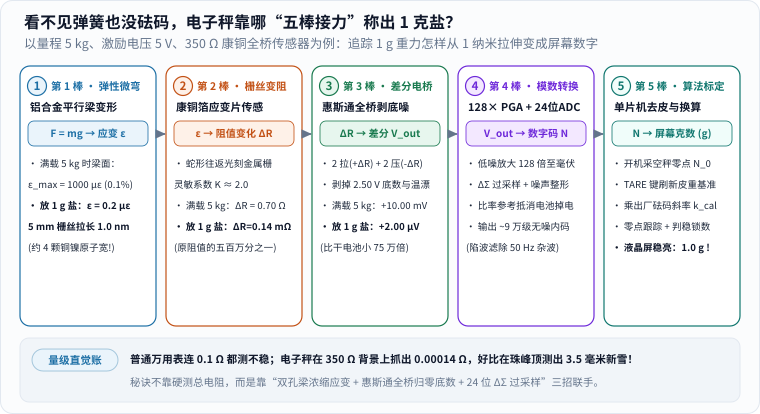
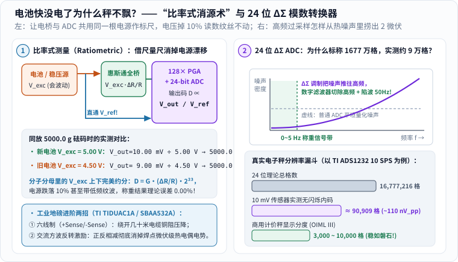
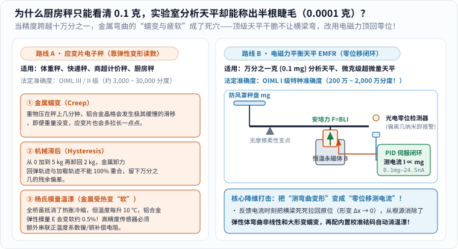
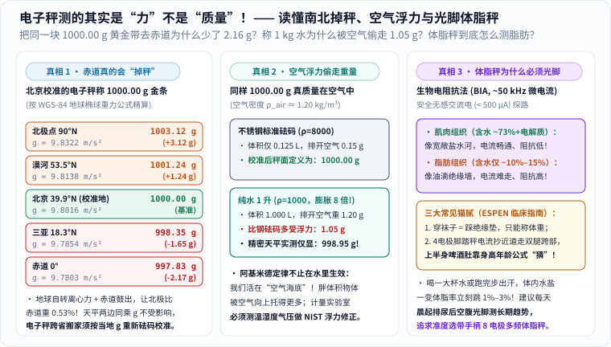

如果你把家里那台二十多块钱的厨房电子秤翻过来打量几眼，再对比菜市场老式弹簧秤或药铺里的铜盘杆秤，很容易冒出一连串越想越不对劲的疑问：

1. **它根本“不往下沉”，凭什么知道有多重？** 老式弹簧秤挂上五斤肉，弹簧得拉长好几厘米带动指针转半圈；可一台厚仅 $$1.5$$ 厘米的电子秤，放上一只 $$5\text{ kg}$$ 的大西瓜，托盘连肉眼可见的晃动都没有；更神的是，往上面轻轻撒 $$1\text{ g}$$ 食盐——要是换作手冲咖啡或珠宝用的便携精密小秤（分度值 $$0.01\text{ g}$$），哪怕放上**半粒大米（约 $$10\text{ mg}$$）**——液晶屏上的数字都会应声跳动！一块硬邦邦的金属到底靠什么感知这半粒米？
2. **苹果歪放在托盘角落，为什么不会“撬出双倍重量”？** 学过初中物理都知道阿基米德杠杆定律（力矩 $$M = F \cdot L$$）：力臂越长，撬劲越大。单传感器电子秤只在正中间装了一根铝合金梁，为什么你把苹果放在托盘正中央，和故意推到最边缘角落，测出来的读数居然分毫不差？
3. **两节干电池快没电时电压掉了 $$20\%$$，为什么 $$500\text{ g}$$ 的水杯不会缩水成 $$400\text{ g}$$？** 既然电子秤最终靠电信号测重，供电电压一路往下滑，凭什么读数还能稳如泰山？反过来，如果你做烘焙时拿着面粉筛**极慢地一星半点往空秤上抖面粉**，为什么前两克常常像掉进黑洞一样，屏幕一直赖在 `0.0 g` 不动？
4. **为什么同一块金条从北京带到三亚会“掉秤”，光脚踩体脂秤洗完澡就“变瘦”？** 为什么实验室里精确到 $$0.1\text{ mg}$$（万分之一克）的分析天平要彻底抛弃普通电子秤的传感器？一升纯水和一千克不锈钢砝码在真空里明明一样重，搬到空气里的精密天平上为什么会差出整整 $$1.05\text{ g}$$？每天早上光脚站上去的体脂秤，真能隔着脚底板看穿你肚子上有多少脂肪吗？

今天，我们就拿一把无形的螺丝刀撬开电子秤的外壳，顺着**“金属原子间距拉长 $$1$$ 纳米 $$\to$$ 十万分之一级电阻微变 $$\to$$ 四臂电桥剥离底数 $$\to$$ 24 位过采样芯片抓微伏 $$\to$$ 重力、浮力与人体阻抗标定”**这条五棒接力链，把身边最熟悉的称重黑科技彻底讲透。

---

## 一、总览：从放下一克盐到屏幕亮数，电子秤内部跑完了哪五棒接力？

### 1. 先算一笔反直觉的微观账：1 克盐只能把金属栅丝拉长 1 纳米

很多人以为电子秤里藏着某种压电陶瓷或者微型弹簧，其实绝大部分家用体重秤、厨房秤、快递秤乃至公路地磅的核心，都是一块经过精密铣削的**实心金属弹性体（铝合金或合金钢梁）**，再贴上四片指甲盖大小的**金属箔电阻应变片（Foil Strain Gauge）** [1, 2]。

为什么肉眼看不见秤盘下沉？因为设计师故意把这块金属梁做得极硬——硬到就算压满最大量程，它也绝对不能踏出胡克定律的纯弹性区半步！我们直接拿一台最常见的 **$$5\text{ kg}$$ 量程、$$1\text{ g}$$ 分度厨房电子秤**（采用标准 $$350\,\Omega$$ 康铜应变片、灵敏系数 $$K = 2.0$$、满量程设计微应变 $$\varepsilon_{\max} = 1000\,\mu\varepsilon = 0.001$$、电桥激励电压 $$V_{\text{exc}} = 5.00\text{ V}$$ [2, 3, 4]）算一笔真实工程账：

- **压满 $$5000\text{ g}$$（满载）时**：铝合金梁表面弯曲产生的相对拉伸率（应变 $$\varepsilon = \Delta L / L$$）只有千分之一（$$0.1\%$$），整只秤盘下沉不到 $$0.2\text{ mm}$$；贴在梁上长 $$5\text{ mm}$$ 的金属敏感栅丝被拉长 $$5\,\mu\text{m}$$，电阻从 $$350.00\,\Omega$$ 变成 $$350.70\,\Omega$$（变化 $$\Delta R = 0.70\,\Omega$$），电桥满载差分输出电压只有 **$$10.00\text{ mV}$$**（即传感器铭牌上常印的灵敏度指标 **$$2.0\text{ mV/V}$$** [4]）。
- **只撒上 $$1\text{ g}$$ 食盐（满量程的五千分之一）时**：
  1. **长度变化**：应变只有 $$\varepsilon = 0.20\,\mu\varepsilon = 2 \times 10^{-7}$$——那段 $$5\text{ mm}$$ 长的金属箔栅丝，总共只被拉长了 **$$1.0\text{ nm}$$（一纳米）**！要知道铜和镍原子的直径大约是 $$0.25\text{ nm}$$，也就是说，$$1\text{ g}$$ 盐压上去，整条敏感栅丝一共只被拽开了**大约 $$4$$ 颗金属原子的宽度**！
  2. **电阻变化**：$$350\,\Omega$$ 的应变片阻值仅仅增加了 **$$\Delta R = 0.00014\,\Omega$$（$$0.14\text{ m}\Omega$$）**，相当于原电阻的**五百万分之一**！打个比方，这好比珠穆朗玛峰（$$8848.86\text{ m}$$）山顶刚飘落了一层 **$$1.8\text{–}3.5\text{ mm}$$ 厚的薄雪**，而你要在山脚下一眼测出珠峰总高度变了多少。普通电工手里的数字万用表连 $$0.1\,\Omega$$ 的表笔接触电阻都测不稳，直接拿去测应变片，屏幕上根本不会动哪怕最后一位字！
  3. **电压变化**：电桥送出的差分信号只有 **$$2.00\,\mu\text{V}$$（两微伏）**，比一节 $$1.5\text{ V}$$ 干电池小整整 **$$75$$ 万倍**！如果换成能量出**半粒大米（$$0.01\text{ g}$$，约 $$10\text{ mg}$$）**的 $$100\text{ g}$$ 口袋珠宝秤，单格跳字对应的栅丝拉伸更是跌进皮米级（原子核间距尺度），电信号低至**几百纳伏（$$\text{nV}$$）**！

### 2. 五级物理—数字信号链：力学、材料、电桥、芯片与算法的精密合谋

既然单个物理量的变化微弱得近乎绝望，几十块钱的电子秤凭什么能把它抓得稳稳当当？答案是它把难题拆成了环环相扣的**五棒接力赛** [3, 4]：

*怎么看这张图：请从左往右顺着“第 1 棒”读到“第 5 棒”，每一棒的彩色公式框标出了该级的物理转换律，下方黑体行追踪了“放上 $$1\text{ g}$$ 食盐”在每一级的真实物理量级。电子秤之所以不靠天价万用表硬测总电阻，核心秘诀就在底栏总结的三招联手——先用开孔金属梁把微应变集中到四个薄颈，再用四臂差分电桥把 $$2.50\text{ V}$$ 的庞大共模底数扣成零，最后交给 $$128$$ 倍低噪放大与 $$24$$ 位 $$\Delta\Sigma$$ 模数转换器在极窄低频带宽里提纯数字。*

接下来，我们就沿着这五棒接力逐级拆解，看看每一步背后藏着怎样漂亮的物理与工程巧思。

---

## 二、第一与第二棒：苹果歪放托盘边角为什么不偏数？康铜丝拉长为什么会变电阻？

### 1. 1669 年的罗贝瓦尔平行四边形奇迹与“双孔平行梁”传感器

如果让你自己动手做一台应变片电子秤，最直觉的做法是找一根长条铝合金尺子：左边用螺丝死死拧在底座上，右边悬空托起秤盘（单悬臂梁），在根部贴一片应变片测弯曲。

可是一试就会砸锅！悬臂梁根部的弯矩等于力乘以力臂（$$M = F \cdot x$$）。同一个 $$200\text{ g}$$ 的苹果，放在离固定端 $$5\text{ cm}$$ 处和放在 $$15\text{ cm}$$ 处，根部弯矩差了整整 **$$3$$ 倍**！难道每次称东西都得拿尺子先找准托盘圆心吗？

早在 **1669 年**，法国数学家**吉尔·佩索纳·德·罗贝瓦尔（Gilles Personne de Roberval）**向法兰西科学院展示了一台让当时学者惊呼“违背杠杆定律”的怪天平 [5]：他用上下两根完全平行的横杆，通过四个铰链把左右两根竖直立柱连成一个**可变形平行四边形机构**。无论你把砝码挪到托盘最内侧还是最外侧，左右竖杆始终严格保持竖直平移，天平居然丝毫不偏！

秘密全在那上下两根平行横杆里：当重物偏离托盘中心一段距离 $$e$$ 时，多出来的**偏心倾覆力矩 $$M_{\text{ecc}} = F \cdot e$$** 并没有混进竖直升降力里，而是被上下两根距离为 $$h$$ 的平行横杆联手转化成了**大小相等、方向相反的水平拉压力**：

$$
N_{\text{水平}} = \pm \frac{F \cdot e}{h}
$$

比如重物往右偏，上横杆就水平受拉、下横杆水平受压，把偏心力矩稳稳锁死在水平轴力里；而真正驱动机构上下变形的**竖直剪切力 $$V$$ 永远严格等于总重力 $$F$$**，与偏心距 $$e$$ 无关 [5, 6]！

现代电子秤工程师没有真的去装四个容易磨损卡滞的机械铰链，而是想出了一招神来之笔——直接拿一整块航空级铝合金（如 2024-T4 或 7075 铝合金），在中间用数控铣床掏出一个**像双筒望远镜一样的“哑铃双圆孔”（Binocular / Dual-Beam Single-Point Load Cell）** [6, 7]：

- 上下只留下**四个弧形极薄颈部**（左上 `T1`、左下 `C1`、右上 `C2`、右下 `T2`，厚度往往不到 $$1\text{ mm}$$），完美充当了四个**无摩擦弹性铰链**；
- 当重物压下时，整根铝合金块不能像普通尺子那样单向弯头，而是被迫走出一条优美的**水平“S 形”双反弯曲线**：左侧固定端和右侧承重端始终保持水平平行，左上颈 `T1` 和右下颈 `T2` 被拉长（$$+\varepsilon$$），左下颈 `C1` 和右上颈 `C2` 被压扁（$$-\varepsilon$$） [6, 7]；
- 哪怕苹果歪放在托盘角落产生附加偏心力矩，多出来的水平轴向拉压也会在对称贴片的加减配对中自动抵消！在正规传感器工厂里，出厂前还会做一道独门手艺——**“四角偏载修锉”（Corner-Load Trimming）**：把标准砝码依次压在秤盘左上、左下、右上、右下四个角，如果哪个角读数偏大万分之几，工人就用精密小锉刀或激光微调对应薄颈边缘几微米的金属厚度，直到整块托盘随便放哪儿都严丝合缝地通过国际法制计量组织 **OIML R 76** 的偏载测试 [7, 8]！

### 2. 1936 年加州理工与麻省理工的殊途同归：金属箔应变片与公式 $$K = 1 + 2\nu + \pi_e$$

有了能把重力忠实变成微应变的双孔平行梁，下一步怎么把金属表面的纳米级拉长翻译成电信号？这要归功于 20 世纪 30 年代两位美国工程师戏剧性的独立发明 [1]：

- **1936 年 9 月**，加州理工学院（Caltech）研究高速冲击试验的年轻助教**爱德华·西蒙斯（Edward E. Simmons Jr.）**发现，与其用笨重的机械千分表测钢杆冲击变形，不如把极细的绝缘康铜电阻丝用胶水直接粘在试件表面，让细丝跟着钢杆同步拉伸，测量电阻跳变即可算出高速冲击力（该成果于 1938 年由导师 Clark 与 Dätwyler 公开发表）[1]；
- 几乎同一时期（**1938 年 4 月**），麻省理工学院（MIT）研究水塔抗震模型的地震工程教授**亚瑟·鲁格（Arthur C. Ruge）**拆下电位器里的细金属丝，粘在纸片与模型水塔外壁上，独立造出了高稳定性的粘贴式电阻丝应变片。两人后来没有陷入专利恶斗，而是联手创立公司，把应变片型号命名为纪念双方姓氏的 **“SR-4”**（Simmons-Ruge, 4 位共同推动者）[1]；到了 20 世纪 50 年代，借着印刷电路板（PCB）光刻蚀刻技术的东风，厚仅 **$$3\text{–}5\,\mu\text{m}$$** 的**光刻金属箔应变片（Foil Strain Gauge）**正式诞生，沿用至今 [2]。

为什么金属丝一拉长，电阻就会变大？我们从中学最熟悉的均匀导体电阻定律出发，只需两步微分就能看清全部底牌：

$$
R = \rho \frac{L}{A}
$$

其中 $$\rho$$ 是材料电阻率，$$L$$ 是栅丝总长度，$$A = \frac{\pi}{4} D^2$$ 是横截面积。当应变片随铝合金梁一起沿轴向被拉长微小比例 $$\varepsilon = \frac{\Delta L}{L}$$ 时，有**三件事同时发生** [2, 3]：

1. **路变长了（$$+\varepsilon$$）**：栅丝长度从 $$L$$ 变成 $$L(1 + \varepsilon)$$，电子要跑更远的路，电阻按比例增加 $$+\varepsilon$$；
2. **路变窄了（$$+2\nu\varepsilon$$）**：拉橡皮筋或拉面条时，拉得越长腰身就越细！在弹性力学里，横向缩窄率与纵向伸长率之比叫**泊松比（Poisson's Ratio，$$\nu$$）**，即直径相对变化 $$\frac{\Delta D}{D} = -\nu\varepsilon$$。由于截面积 $$A$$ 与直径平方 $$D^2$$ 成正比，面积相对缩小 $$\frac{\Delta A}{A} \approx -2\nu\varepsilon$$，放在分母里反而让电阻再涨一截 $$+2\nu\varepsilon$$；
3. **原子晶格间距变了（压阻项）**：金属晶格被拉开后，自由电子散射概率改变，电阻率 $$\rho$$ 自身也会发生微小变化 $$\frac{\Delta \rho}{\rho}$$。

把三项合起来对 $$R = \rho L / A$$ 取对数微分（$$\frac{\Delta R}{R} = \frac{\Delta L}{L} - \frac{\Delta A}{A} + \frac{\Delta \rho}{\rho}$$），立刻得到应变片最核心的**灵敏系数（Gauge Factor，$$K$$）公式** [2, 3]：

$$
\frac{\Delta R}{R} = \left(1 + 2\nu + \frac{\Delta \rho / \rho}{\varepsilon}\right)\varepsilon = K\varepsilon
$$

电子秤应变片最钟爱的合金是**康铜（Constantan，约 $$55\%$$ 铜 + $$45\%$$ 镍）**或改性镍铬合金（Karma）[2]。金属的泊松比通常在 $$\nu \approx 0.30$$ 左右，因此单靠“变长 + 变细”两项纯几何变形就贡献了 $$1 + 2 \times 0.30 = 1.60$$；再加上康铜晶格的压阻贡献约 $$0.40\text{–}0.45$$，合起来恰好得到几乎不随应变大小漂移的黄金常数：**$$K \approx 2.0\text{–}2.1$$** [2, 3]！

为了在指甲盖大小的聚酰亚胺绝缘薄膜上凑够 $$350\,\Omega$$ 甚至 $$1000\,\Omega$$ 的高电阻（电阻越高，同样 $$5\text{ V}$$ 供电下耗电越省、发热越小 [2]），光刻机会把康铜箔蚀刻成几十道来回折返的**“蛇形栅丝”**；而且你会发现蛇形拐弯处的铜箔特意画得**又宽又肥**——这样横向变形时拐角电阻几乎不变，绝大部分电阻都集中在细长的纵向直丝上，避免横向杂散应变捣乱！

> **追问一句：既然半导体硅应变片的灵敏系数 $$K$$ 高达 $$100\text{–}150$$（比康铜高五六十倍！），为什么精密电子秤反而不用它？**
> 因为天下没有免费的午餐：半导体压阻效应对温度极度敏感，零点温漂和灵敏度温漂比康铜大一两个数量级，而且非线性严重 [2]。精密衡器宁可要一个“脾气温顺、严格守线性、温度自补偿好”的 $$K = 2.0$$ 康铜箔，把放大任务交给后面擅长的低噪声电子芯片！

---

## 三、第三棒：在 350 欧姆大海里捞出 0.00014 欧姆——四臂全桥怎样一箭三雕？

### 1. 从克里斯蒂（1833）到惠斯通（1843）：用“两路分压相减”把庞大底数清零

现在我们手里有了阻值 $$R = 350\,\Omega$$、放 $$1\text{ g}$$ 盐只变大 $$\Delta R = 0.00014\,\Omega$$ 的应变片。如果直接给它通恒流源测两端总电压，就等于逼着芯片在 **$$2.500000\text{ V}$$** 的巨大背景直流电压上分辨 **$$2.500001\text{ V}$$**——稍微一点电源纹波或室温起伏，微弱信号就被彻底淹死了。

怎么把那讨厌的 $$350\,\Omega$$ 庞大底数一刀切掉，只留下纯粹的 $$\Delta R$$？1833 年英国皇家军事学院数学家**塞缪尔·亨特·克里斯蒂（Samuel Hunter Christie）**发明了一种菱形四电阻比较电路，1843 年经英国物理学家**查尔斯·惠斯通爵士（Sir Charles Wheatstone）**推广并给出完整数学分析后名扬天下——这就是整个传感器工业的基石：**惠斯通电桥（Wheatstone Bridge）** [3, 9]。

它的想法简单得像两把并排站立的尺子：把激励电压 $$V_{\text{exc}}$$ 同时加在左右两条并联支路上，每条支路各串联两只电阻分压，然后只测量**左支路中点 $$V_+$$ 与右支路中点 $$V_-$$ 之间的差值 $$V_{\text{out}} = V_+ - V_-$$** [3]：

- 空载时，四只应变片阻值全都等于 $$R = 350\,\Omega$$，左中点分得一半电压 $$2.500000\text{ V}$$，右中点也分得一半电压 $$2.500000\text{ V}$$，**两者相减严格等于 $$0.000000\text{ V}$$**！那个庞大的 $$2.5\text{ V}$$ 底数瞬间灰飞烟灭！
- 更绝的是，如果我们只贴 **1 片活动应变片**配 3 只固定电阻（俗称**四分之一桥，Quarter Bridge**），按分压公式算出来会留下三个大麻烦 [3]：

$$
V_{\text{out, 1/4桥}} = V_{\text{exc}}\left(\frac{R + \Delta R}{2R + \Delta R} - \frac{R}{2R}\right) = V_{\text{exc}}\frac{\Delta R}{4R + 2\Delta R}
$$

  你看：不仅信号缩水成了四分之一，分母里还赖着一个 $$+2\Delta R$$ 造成**非线性失真**；最致命的是，夏天屋里升温 $$10\,^\circ\text{C}$$，唯一那片应变片热胀冷缩引起的阻值漂移 $$\Delta R_T$$ 会原封不动混进分子里，电子秤放在桌上自己就能跑出几十克假读数！

而前面设计的双孔平行梁刚好有**两处受拉薄颈（`T1, T2` 阻值变为 $$R + \Delta R$$）**和**两处受压薄颈（`C1, C2` 阻值变为 $$R - \Delta R$$）**！把两片受拉片交叉放在电桥对角臂（左上、右下），两片受压片交叉放在另一对角臂（左下、右上），组成**四臂全活动惠斯通全桥（Full Bridge）** [3, 6]，奇迹瞬间发生了：

$$
V_{\text{out, 全桥}} = V_{\text{exc}}\left[\frac{R + \Delta R}{(R + \Delta R) + (R - \Delta R)} - \frac{R - \Delta R}{(R - \Delta R) + (R + \Delta R)}\right] = V_{\text{exc}}\left(\frac{R + \Delta R}{2R} - \frac{R - \Delta R}{2R}\right) = V_{\text{exc}}\frac{\Delta R}{R}
$$

仔细端详这个连半个近似号都没用的精确恒等式，你会忍不住为它的对称美拍案叫绝——**一箭三雕** [3]：

1. **信号暴涨 $$4$$ 倍**：左中点被“上减下增”往高处抬，右中点被“上增下减”往低处拽，差分输出达到四分之一桥的整整 $$4$$ 倍（$$V_{\text{exc}} K \varepsilon$$，满载 $$5\text{ V} \times 2.0 \times 0.001 = 10.00\text{ mV}$$）；
2. **天生百分之百线性**：每条支路都是一拉一压串联，$$(R + \Delta R) + (R - \Delta R) = 2R$$，讨厌的 $$\Delta R$$ 在分母里自己把自己抵消得干干净净，输出电压与应变严格成正比！
3. **共模温度漂移自动归零**：四片应变片贴在同一小块导热极快的铝合金梁上，室温升高时，四片电阻同步漂移相同的 $$+\Delta R_T$$；再代入分压分子，$$(R + \Delta R_T + \Delta R) - (R + \Delta R_T - \Delta R) = 2\Delta R$$，热阻漂移在分子里直接相减清零！（至于铝合金本身升温变软、杨氏模量 $$E$$ 约以 $$-0.03\%/^\circ\text{C}$$ 下降引起的微小满度温漂，商业传感器还会在电源激励线上串联一小段正温度系数的纯镍/铜补偿电阻，温度一高补偿电阻变大、自动微降桥压或配合桥内补偿片反向修正，把温漂死死摁住 [2, 6]。）

*怎么看这张图（含一次自动播放的微变形示意动画，可并刷新重播；开启系统“减少动态效果”时直接展示稳态结果）：左半图把 $$5\text{ kg}$$ 砝码故意压在托盘最右角，双孔平行梁走出 S 形弯曲（为方便肉眼看清，图中将真实的 $$0.2\text{ mm}$$ 微变形放大了约 $$60$$ 倍），上下横梁吃掉偏心力矩，四个薄颈精准产生两拉（橙色 `T1, T2`）两压（蓝色 `C1, C2`）；右半图把这四片应变片交叉接入全桥，左中点升至 $$2.505\text{ V}$$、右中点降至 $$2.495\text{ V}$$，稳稳挤出纯净线性的 $$+10.00\text{ mV}$$ 差分信号。*

---

## 四、第四与第五棒：电池掉电不跑偏、几微伏不淹死在噪声里——比率式 24 位 ΔΣ ADC 与去皮算法

### 1. 比率式测量（Ratiometric）：为什么两节旧电池掉电 20%，称出来的克数纹丝不动？

看到全桥公式 $$V_{\text{out}} = V_{\text{exc}}\frac{\Delta R}{R}$$，细心的读者马上会抓到一个大漏洞：**输出电压 $$V_{\text{out}}$$ 明明跟激励电压 $$V_{\text{exc}}$$ 成正比啊！** 家用厨房秤和体重秤大多靠两节七号干电池或一颗纽扣电池供电，新电池电压有 $$3.2\text{ V}$$，用大半年掉到 $$2.6\text{ V}$$，难道不需要加一颗昂贵的超精密恒压源芯片吗？

答案是：**完全不需要恒压源！** 电子秤电路用了一招四两拨千斤的绝活——**比率式测量（Ratiometric Measurement）** [3, 10]。

在[《计算机是如何工作的》]()里我们讲过，把现实世界的连续电压翻译成二进制整数的芯片叫**模数转换器（ADC）**。任何一颗 ADC 在报数字时，本质上都是在做一道除法题：**“输入信号 $$V_{\text{in}}$$ 占参考基准电压 $$V_{\text{ref}}$$ 的几分之几？”** 如果经过片内 $$G$$ 倍可编程增益放大器（PGA，常用 $$G = 64$$ 或 $$128$$）后送入满码为 $$D_{\max}$$ 的 ADC，它输出的数字码 $$D$$ 就是 [3, 10]：

$$
D = D_{\max} \cdot \frac{G \cdot V_{\text{out}}}{V_{\text{ref}}}
$$

现在，工程师故意不给 ADC 单独配高精度基准源，而是把**喂给惠斯通电桥的那同一路电源电压 $$V_{\text{exc}}$$，原封不动拉一根线直通 ADC 的参考基准脚（令 $$V_{\text{ref}} = V_{\text{exc}}$$）**！把 $$V_{\text{out}} = V_{\text{exc}}\frac{\Delta R}{R}$$ 代进去一看 [3]：

$$
D = D_{\max} \cdot \frac{G \cdot \left(V_{\text{exc}} \dfrac{\Delta R}{R}\right)}{V_{\text{exc}}} = D_{\max} \cdot G \cdot \frac{\Delta R}{R}
$$

**$$V_{\text{exc}}$$ 在分子和分母里当场约分消失了！** 哪怕电池掉电 $$20\%$$ 让电桥输出从 $$10.00\text{ mV}$$ 缩水到 $$8.00\text{ mV}$$，ADC 手里的“参考尺子” $$V_{\text{ref}}$$ 也同步缩短了 $$20\%$$（从 $$5.0\text{ V}$$ 缩到 $$4.0\text{ V}$$），一除下来，输出的数字码 $$D$$ 连最后一位都不带变的！

在几百米电缆的港口汽车衡或化工料罐秤上，这招还会升级为**六线制开尔文远程检测（6-Wire Sensing）** [3]：因为几十米铜电缆自身的电阻会在路上吃掉一部分压降，让电桥实际拿到的电压低于机房发出的电压；于是在四根常规电源/信号线之外，再贴着电桥顶端引回两根几乎不走电流的 **`+Sense / -Sense` 采样线**直连 ADC 参考端，把长电缆随日晒雨淋变化的线阻压降也一并踢出局！而在超精密实验室衡器参考设计（如德州仪器 `TIDUAC1A`）里，工程师甚至会让激励电源正负交替翻转（**交流电桥激励 AC Excitation**），把电路板不同金属焊点温差产生的几百纳伏**塞贝克热电偶寄生电势（Seebeck Effect）**一正一负彻底对消 [4]！

### 2. 24 位 ΔΣ 模数转换器与“无噪分辨率”真相：$$2^{24}=1677$$ 万码为什么不等于 1677 万格？

解决了电压漂移，接下来是整个电子秤芯片最硬核的功夫：怎么用几块钱成本量准 $$2.00\,\mu\text{V}$$？

拆开市面上从二十元厨房秤（常见国产 `HX711` 芯片）到工业仪表（如 TI `ADS1232`、ADI `AD7190`），里面清一色坐镇着一颗**内置 $$128$$ 倍低噪声仪表放大器（PGA）的 24 位 $$\Delta\Sigma$$（Delta-Sigma，增量累加）模数转换器** [4, 10]。

如果用普通逐次逼近型（SAR）ADC 硬切电压，微伏级信号早就被热噪声和量化台阶吞没了。$$\Delta\Sigma$$ 转换器借用了与我们在[《读懂石英钟与电脑时钟》]()里见过的“高频打拍子换精度”异曲同工的思路：既然称苹果是个慢动作（每秒读 $$10$$ 次结果，即 $$10\text{ SPS}$$ 就够快了），那就用**几百千赫兹的高速时钟疯狂过采样（Oversampling）**，再通过积分反馈环路把讨厌的量化噪声统统**“赶”到高频区去（噪声整形，Noise Shaping）**；最后在芯片内部挂一道陡峭的数字 Sinc 低通滤波器，不仅咔嚓一刀切掉全部高频噪声，还顺手在 **$$50\text{ Hz}$$ 和 $$60\text{ Hz}$$** 处挖出深深的陷波坑，把屋里电灯、冰箱电源线辐射过来的工频电磁杂波滤得干干净净 [4, 10]！

不过，很多商家宣传时会拿“24 位芯片 = $$2^{24} = 16{,}777{,}216$$ 级分辨率”来忽悠消费者，好像一台几十块钱的秤能分出一千六百万格似的。真实的集成电路物理账要诚实得多——以工业经典的 `ADS1232` 称重参考设计（$$V_{\text{ref}} = 5\text{ V}$$，增益 $$G = 128$$，采样率 $$10\text{ SPS}$$）为例 [10]：

1. **量程利用率只有约八分之一**：增益 $$128$$ 倍时，ADC 允许输入的最大正负差分范围是 $$\pm \frac{0.5 \times 5\text{ V}}{128} \approx \pm 19.53\text{ mV}$$（总跨度 $$39.06\text{ mV}$$，或全满幅 $$\pm V_{\text{ref}}/128 = \pm 39.06\text{ mV}$$ 共 $$78.125\text{ mV}$$），而一只单向受压的 $$2\text{ mV/V}$$ 传感器满载只输出 `0 ~ +10.00 mV`，只用掉了整把数字尺子的一小截；
2. **热噪声才是真正的天花板**：任何非绝对零度的电阻与晶体管内部都有电子热运动（约翰逊—奈奎斯特热噪声）与低频闪烁噪声（$$1/f$$ 噪声）。在 $$10\text{ SPS}$$ 极窄滤波下，顶级称重 ADC 折算到输入端的本底噪声有效值约为 $$17\text{ nV}_{\text{rms}}$$，对应数字绝对不乱跳的**峰峰值噪声约为 $$110\text{ nV}_{\text{pp}}$$** [10]；
3. **算出真实的“无噪内码数”**：拿满载信号 $$10\text{ mV}$$ 除以峰峰值噪声 $$110\text{ nV}_{\text{pp}}$$，得到屏幕末位纹丝不动的**无噪分度上限（Noise-Free Counts）约为 $$90{,}909$$ 码**（约合 $$16.5$$ 位无噪分辨率；入门级廉价芯片约在 $$2\text{ 万–}4\text{ 万}$$ 无噪码左右）[10]！

按照国际衡器规范，为了让电子秤显示的数字既不来回乱蹦、又没有四舍五入卡顿，芯片内部的无噪内码数通常要比屏幕显示格数高出 **$$10$$ 倍左右**。因此，$$9$$ 万级无噪内码正好稳稳托起 **$$3{,}000\text{–}10{,}000$$ 个检定分度（$$e$$）**——比如 $$5000\text{ g} \div 1\text{ g} = 5000$$ 格厨房秤，或者 $$30\text{ kg} \div 5\text{ g} = 6000$$ 格超市计价秤（OIML $$\text{III}$$ 级中准确度衡器）[8, 10]！

*怎么看这张图：左半图展示了电子秤不怕旧电池掉电的比率式接法——供电 $$V_{\text{exc}}$$ 一路喂给惠斯通电桥，另一路直通 ADC 参考端 $$V_{\text{ref}}$$，除法运算把电源波动当场约掉；右半图展示了 $$\Delta\Sigma$$ 芯片怎样用高频调制把灰色虚线的平坦量化噪声推向高频紫线，再由绿色数字低通滤窗保留近直流重力信号、剔除 $$50\text{ Hz}$$ 电网工频干扰，在 $$10\text{ mV}$$ 满幅内切出约 $$9$$ 万级无噪内码。*

### 3. 去皮键（`TARE`）、开机归零与“偷瞄归零”的烘焙蠕变陷阱

拿到干净稳定的数字内码 $$N$$ 之后，最后一棒交给秤里的微控制器（MCU）做一道简单却藏着小心机的线性换算：

$$
m_{\text{显示}} = k_{\text{cal}} \cdot (N - N_0)
$$

- **出厂标定斜率 $$k_{\text{cal}}$$**：每块铝合金梁的铣削壁厚和应变片贴片胶层厚度都有千分之几的个体差异，所以电子秤出厂前必须压一次标准砝码（比如 $$5000.0\text{ g}$$），让单片机算出专属比例系数 $$k_{\text{cal}}$$ 烧进掉电不丢的 EEPROM 闪存里；
- **开机归零与去皮键（`TARE`）**：为什么电子秤必须先平放开机、等出现 `0.0 g` 再放东西？因为托盘自身的重量加上金属残余应力，空载内码 $$N_0$$ 根本不是零。开机那一秒，单片机会连续采十几个点确认稳定后，把当前读数记为基准 $$N_0$$；当你放上一只大瓷碗再按一下 **`TARE`（去皮）**，单片机并没有对传感器施什么魔法，只是简单地执行了一句 **`N_0 = 当前碗加秤盘的总内码`**，把坐标原点挪到了瓷碗口上！（需要注意：瓷碗已经占掉了传感器的物理弯曲量程，在 $$5\text{ kg}$$ 秤上放 $$2\text{ kg}$$ 重铁锅去皮后，最多只能再称 $$3\text{ kg}$$ 食材，超重照样报 `EEEE` 过载保护！）
- **为什么极慢撒面粉会被电子秤“吞掉”前两克？** 这是做手冲咖啡和烘焙的人最常踩的坑！因为室温缓慢变化或金属微弱蠕变会让空秤零点一分钟漂移零点几格；为了不让顾客看到空着的秤自己跳成 `0.2 g`，几乎所有电子秤都在固件里按 OIML R 76 规范写了一条**“自动零点跟踪”（Zero-Tracking）规则** [8]：**当读数处在 `0.0 g` 附近、且每秒变化速度慢于半个分度（例如每秒不到 $$0.5\text{ g}$$）时，单片机就认定这是“温度零点漂移”，悄悄把基准 $$N_0$$ 跟着往上挪，强行锁死在 `0.0 g`！** 结果你拿着盐勺一粒一粒慢吞吞往空盘里抖酵母粉，前 $$1.5\text{ g}$$ 全被芯片当成温漂给“吞”进零点里了！破解办法非常简单：**先在秤上放一只小勺不按去皮（让读数离开 `0.0 g` 零点跟踪区），或者把碗端起来加完微量调料再放回去称差值**，电子秤立刻老老实实一分不差！

---

## 五、精密天平的分水岭：为什么十万分之一克实验室天平要抛弃应变片，改用“电磁力平衡”？

### 1. 应变片的三大材料天花板：蠕变（Creep）、滞后与弹性模量极限

既然惠斯通全桥配 24 位 ADC 这么能干，为什么制药厂、化学实验室和国家计量院里那些精确到 **$$0.1\text{ mg}$$（万分之一克）甚至 $$1\,\mu\text{g}$$（百万分之一克，约一根睫毛重量的五十分之一）**的分析天平，打开底座却根本找不到应变片？

因为应变片电子秤的本质是**“开环弹性变形法”——必须先让金属梁实实在在弯下去，才能测出重量**。一旦你试图把精度推进到十万分之一（$$100{,}000\ e$$）以上，金属多晶材料与高分子胶水就会露出三道迈不过去的物理软肋 [2, 6, 8]：

1. **蠕变（Creep）**：把 $$1\text{ kg}$$ 砝码静静放在铝合金梁上不动，前几秒是纯弹性弯曲，但接下来几分钟里，金属晶粒边界的位错会极其缓慢地滑移，应变片基底与环氧胶层也会发生黏弹性松弛，导致读数在几分钟内自己往上涨或往下掉万分之二三；
2. **机械滞后（Hysteresis）**：从 $$0 \to 500\text{ g} \to 1000\text{ g}$$ 往上加码测出的 $$500\text{ g}$$ 读数，和从 $$1000\text{ g}$$ 卸回 $$500\text{ g}$$ 测出的读数，中间永远夹着一条微米级的晶格内摩擦闭合环，没法完全重合；
3. **弹性模量极限**：无论温度补偿电阻配得多准，金属原子键刚度随温度、加工老化产生的百万分之几起伏，直接锁死了开环变形法的上限（OIML R 76 中普通应变片传感器绝大多数止步于 $$\text{III}$$ 级 $$\le 10{,}000\ e$$，极少数顶级合金传感器勉强摸到几万分度）[8]。

### 2. 电磁力平衡传感器（EMFR）：用洛伦兹力 $$F = B L I$$ 把托盘“寸步不让”地托回原位

要想突破百万分度、迈入 **OIML $$\text{I}$$ 级特种准确度（检定分度数 $$\ge 50{,}000\ e$$，高端型号达 $$200\text{ 万–}2000\text{ 万}$$ 格）** [8]，物理学家彻底换了一套哲学——从“量金属弯了多少”改成**“寸步不让的零位移闭环对抗”**，这就是**电磁力平衡传感器（Electromagnetic Force Restoration，简称 EMFR）** [11]！

它的工作过程就像一位眼神极尖、手劲极稳的隐形大力士在托盘底下实时顶牛 [11]：

1. **整块电火花线切割柔性铰链（Monolithic Flexure Block）**：工匠不再用螺丝拼装杠杆，而是拿一整块特种铝合金，用电火花线切割出几十道薄如蝉翼（约 $$50\,\mu\text{m}$$）的无摩擦柔性传力簧片，把秤盘压力按精确杠杆比传递到后端横臂；
2. **光电狭缝纳米位置眼**：横臂末端装有一片遮光狭缝片，夹在红外发光管与差分光电二极管正中间。哪怕秤盘上落下一粒灰尘让杠杆下沉了几纳米，上下光电管接收到的光强立刻失衡，瞬间报警：“秤盘往下掉啦！”
3. **永磁铁音圈与洛伦兹力实时顶回**：PID 伺服控制器在毫秒内加大悬挂在强永磁铁（磁感应强度 $$B$$）气隙中的精密线圈（总导线长 $$L$$）的电流 $$I$$，利用磁场对通电导线的**安培—洛伦兹力**产生一股向上的电磁托举力，直到把光电狭缝**分毫不差地顶回最初的零位原点** [11]！

当杠杆稳稳停回原位时，竖直方向力矩严格平衡（设机械杠杆放大比为 $$\eta$$）：

$$
m g = \eta \cdot B L I \quad \Longrightarrow \quad m = \left(\frac{\eta B L}{g}\right) I
$$

看明白这招为什么能碾压应变片了吗？**因为在最终读数的那一刻，托盘和所有金属柔性铰链全都回到了最初的“零变形位置”！** 既然形变量 $$\Delta x = 0$$，金属簧片变硬还是变软、有没有滞后和蠕变，统统在平衡方程里清零退场！称重难题被干净利落地转化成了人类电学里最拿手的**超精密恒磁电流测量**（配合内置电动加载的参考校准砝码一键自校，轻松称准 $$0.1\text{ mg}$$ 乃至 $$1\,\mu\text{g}$$）[8, 11]！

这也是为什么实验室分析天平四周总罩着一圈透明的**三门玻璃防风罩**：到了 $$0.1\text{ mg}$$ 级别，你站在天平前轻轻叹一口气，或者放进去一只刚从烘箱拿出来、比室温高 $$5\,^\circ\text{C}$$ 的烧杯（杯壁加热周围空气向上升起热对流烟羽，顺手给烧杯一个向上的气动升力！），都会让天平末尾两三位数字狂跳不止！

*怎么看这张图：左半图是家用与商用主力“金属应变片传感器”，靠梁体实打实弯曲产生信号，性价比极高但受金属蠕变与模量温漂限制，主打千分之一到万分之一精度；右半图是实验室“电磁力平衡（EMFR）天平”，光电传感器盯死纳米级位移，驱动磁隙线圈电流 $$I$$ 用向上洛伦兹力 $$F = B L I$$ 把杠杆实时顶回原位，靠“零位移闭环”绕开弹性疲劳，直达百万分之一克级精度。*

---

## 六、电子秤测的到底是“质量”还是“重力”？赤道掉秤、空气浮力与光脚体脂秤真相

### 1. 电子秤其实是个“测力计”：同一块 1000.00 克金条，从北京拿到三亚为什么“瘦”了 1.63 克？

聊到这里，一个直击灵魂的物理问题浮出水面了：不论是双孔应变梁还是电磁力天平，它们抵抗和测量的明明都是地球往下拽物体的力（单位是牛顿 $$\text{N}$$），为什么屏幕上敢理直气壮地印着质量单位**克（$$\text{g}$$）或千克（$$\text{kg}$$）**？

老式药铺的**双盘等臂天平**（左边放药材，右边放铜砝码）才是真正直接比质量的仪器——就算把它搬上月球（重力只有地球六分之一），左右两边重力同步缩小六倍，天平依然平衡！**而一切单盘电子秤，骨子里全都是“测力计”** [8, 12]：它们实测的是托盘受到的**竖直向下净压力 $$F_N$$**，再除以出厂校准地点的重力加速度 $$g_{\text{cal}}$$ 来反推质量！

我们在[《没法把地球搬上电子秤，人类是怎么测出它有 60 万亿亿吨重的？》]()里讲过，地球并不是一颗静止的正圆球，而是一颗每 $$23$$ 小时 $$56$$ 分自转一圈、赤道被甩鼓出约 $$21.4\text{ km}$$ 的**扁球体**！站在赤道上，一方面你离地心更远（万有引力变弱），另一方面地球自转还要分走最大的一笔向心加速度（$$\omega^2 R$$）；而在南北两极，自转离心项为零且离地心最近。按照国际大地测量与地球物理联合会采用的 **WGS-84 索米利亚纳（Somigliana）海平面正常重力公式**（纬度为 $$\varphi$$）[12]：

$$
g(\varphi) = 9.7803267714\,\frac{1 + 0.00193185138639\sin^2\varphi}{\sqrt{1 - 0.00669437999013\sin^2\varphi}}\;\text{m/s}^2
$$

从赤道（$$g \approx 9.78033\text{ m/s}^2$$）到北极（$$g \approx 9.83219\text{ m/s}^2$$），海平面重力加速度足足相差 **$$0.53\%$$**（此外海拔每升高 $$1000\text{ m}$$，重力还会再减小约 $$0.031\%$$）[12]！

这意味着什么？假设你在**北京（北纬 $$39.9^\circ$$，$$g_{\text{北京}} \approx 9.80143\text{ m/s}^2$$）**用标准砝码校准好一台 $$0.01\text{ g}$$ 精度的珠宝电子秤，称一块纯金条正好显示 **`1000.00 g`**。现在，你把这台电子秤连同金条一起塞进行李箱（途中**不重新校准**），飞往不同纬度打开直接称 [12]：

- 飞到**黑龙江漠河（$$53.5^\circ\text{N}$$，$$g \approx 9.81369\text{ m/s}^2$$）**：屏幕会跳出 **`1001.25 g`**（凭空“长胖” $$1.25\text{ g}$$）；若带到**北极点（$$90^\circ\text{N}$$）**，更是变成 **`1003.14 g`**！
- 飞到**上海（$$31.2^\circ\text{N}$$，$$g \approx 9.79416\text{ m/s}^2$$）**：读数掉到 **`999.26 g`**（少了 $$0.74\text{ g}$$）；
- 飞到**海南三亚（$$18.25^\circ\text{N}$$，$$g \approx 9.78548\text{ m/s}^2$$）**：读数只剩 **`998.37 g`**——按今天每克六七百元的金价算，什么都没干，账面上先“蒸发”了一千多块钱的黄金！要是带到**赤道基多（$$0^\circ$$）**，海平面上只剩 **`997.85 g`**，从北极到赤道来回能差出整整 **$$5.29\text{ g}$$**！

正因如此，国家计量法规与 OIML R 76 对商用贸易电子秤抓得极严：凡是高分度计价秤或珠宝天平，要么在出厂菜单里内置全国各省市的**重力加速度分区修正码（Gravity Zone）**，要么必须在安装使用现场用当地法定计量检定机构的无磁不锈钢标准砝码重新标定斜率 [8]！

### 2. 被忽视的 1.05 克空气浮力：为什么“一千克水”和“一千克不锈钢砝码”在空气里不一样重？

除了纬度重力差，电子秤脚底下还藏着一个连很多理工科学生都会漏算的隐形推手——**阿基米德空气浮力**！

我们并没有生活在真空罩里，而是泡在密度约为 $$\rho_{\text{空气}} \approx 1.2\text{ kg/m}^3$$ 的大气海洋底部。任何放在秤盘上的物体，都会排开等体积的空气，受到向上的浮力 $$\rho_{\text{空气}} V_{\text{物}} g$$。根据美国国家标准与技术研究院 **NIST SOP 2（空气浮力修正标准操作规程）** [13]，全球砝码与电子秤统一按密度 $$\rho_c = 8000\text{ kg/m}^3$$ 的**不锈钢基准约定质量（Conventional Mass）**来校准。当用这台校准好的天平去称密度为 $$\rho_{\text{物}}$$、真空真实质量为 $$m_{\text{真}}$$ 的物体时，电子秤显示的表观读数 $$m_{\text{读}}$$ 满足 [13]：

$$
m_{\text{读}} \approx m_{\text{真}}\left(1 - \frac{\rho_{\text{空气}}}{\rho_{\text{物}}} + \frac{\rho_{\text{空气}}}{\rho_c}\right)
$$

来代一组让你吃惊的日常数字：

- 一只真空真实质量 $$1000.00\text{ g}$$ 的**不锈钢标准砝码**（$$\rho_c = 8000\text{ kg/m}^3$$），体积只有 $$125\text{ cm}^3$$，排开空气受到 $$0.15\text{ g}$$ 浮力——校准时天平已经把这 $$0.15\text{ g}$$ 补进斜率里了，所以读数精准显示 **`1000.00 g`**；
- 现在换上一大杯真空真实质量同样是 **$$1000.00\text{ g}$$ 的纯水**（$$\rho_{\text{水}} \approx 998\text{ kg/m}^3$$）：体积暴涨了 $$8$$ 倍，达到 $$1002\text{ cm}^3$$，排开的空气足足托起了 **$$1.20\text{ g}$$** 的向上浮力！扣掉砝码校准自带的 $$0.15\text{ g}$$ 基准补偿后，这 $$1000.00\text{ g}$$ 纯水在精密电子天平上只会显示 **`998.95 g`**——平白无故比真实质量**轻了 $$1.05\text{ g}$$（千分之一点零五）** [13]！如果称的是密度更轻的棉花或泡沫塑料，空气浮力吃掉的克数还要翻好几倍！所以在分析化学实验室里配制十万分之一精度的标准溶液时，实验员必须抄下当天的气压计、温度计和湿度计读数，按 NIST 公式把这 $$0.1\%$$ 的空气浮力老老实实加回来 [13]。

### 3. 家用体脂秤为什么要光脚踩金属片？生物电阻抗（BIA）测的其实是“全身含水导电通道”

最后，我们顺手揭开卫生间里那台**智能体脂秤**的底牌：为什么穿着袜子站上去只能出体重，光着脚踩住表面四块金属片（或隐形导电镀膜），手机 App 就能一口气报出体脂率、肌肉量、水分率甚至内脏脂肪等级？难道电流真能“看”见脂肪细胞？

拆开一台家用体脂秤，你会发现它是**“两套独立仪器拼在一块钢化玻璃上”**的混血儿：

1. **玻璃底下四角：四只半桥应变片传感器测总体重 $$W$$**。因为家用体重秤要做到紧贴地面超薄，没法在正中间立一根厚实的双孔平行梁，于是设计师在四个橡胶支脚里各塞一片微型“E 字形”双应变片（一拉一压半桥），把四个角的两拉两压在电路板上交叉拼成一座大惠斯通全桥——不管你重心偏左脚还是偏右脚，四角竖直分力之和永远等于你的总体重 $$W$$！
2. **玻璃表面：四电极生物电阻抗分析（Bioelectrical Impedance Analysis，简称 BIA）测人体导电率** [14, 15]。表面对称排布着四块不锈钢片（无金属片纯白玻璃款则是镀了四块透明氧化铟锡 **ITO 导电膜**）。为什么要**四块**而不是左右脚各一块？这跟前面的六线制传感器是一个道理（四端开尔文测阻法）：前脚掌两块外电极负责向体内注入一股人体毫无知觉的**极微弱高频交流电（常用频率 $$50\text{ kHz}$$，电流仅 $$50\text{–}800\,\mu\text{A}$$，不到人体感知阈值的几分之一）**，后脚跟两块内电极只用高输入阻抗电压表测电压降 $$V$$，从而把脚底死皮厚薄造成的**皮肤接触电阻**干净排除，算出身体内部的纯阻抗 $$Z = V / I$$ [14, 15]！

电流钻进脚底后怎么区分肥瘦？全靠**含水量差异** [14]：人体的骨骼肌和血液含有高达 **$$73\%\text{–}75\%$$** 富含钠钾离子的水分，是极好的低阻导电高速公路；而肥硕的**白色脂肪组织含水量只有 $$10\%\text{–}15\%$$**，几乎是电流绕着走的绝缘路障！把人体导电通道近似看作长与身高 $$H$$ 成正比的均匀导体柱（电阻 $$Z = \rho \frac{H}{A} = \rho \frac{H^2}{V_{\text{水}}}$$），就能由**阻抗指数 $$H^2 / Z$$** 估算出全身总水分（TBW），再按生理学水合常数（去脂体重约含水 $$73.2\%$$）反推出去脂体重（FFM），最后用刚称出的总体重减去去脂体重，结合你在 App 里填的**身高、年龄、性别**代入统计回归方程算出体脂率 [14, 15]！

看懂了这个原理，体脂秤上那些让人哭笑不得的“玄学跳变”就瞬间全破案了 [14, 15]：

- **盲区一：四电极脚踏秤的“下半身捷径效应”**。电流总是挑最近最好走的路跑——从左脚钻进去、顺着左腿爬到骨盆跨过裆部、再顺着右腿从右脚溜出来！**你的胸腔、肚子和双臂根本没怎么通上电**，上半身肥瘦全靠大数据公式“猜”。只有带双手握柄的**八电极多频段体脂仪**（同时发 $$5\text{ kHz}$$ 低频电流绕细胞外液走、$$250\text{ kHz}$$ 高频电流穿透细胞膜电容测细胞内外总液 [15]），才能真正分段量遍四肢与躯干。
- **盲区二：“喝杯水变胖、洗个澡燃脂”的水合假象**。一口气喝下 $$500\text{ mL}$$ 温水马上上秤，水还在胃里没来得及进入四肢血管降低阻抗 $$Z$$，总体重 $$W$$ 却实打实多了 $$0.5\text{ kg}$$，算法一减，当场判你“纯长了一斤肥肉”！反过来，刚跑完步出汗、或者刚洗完热水澡光脚上秤，下肢毛细血管扩张、脚底温湿导电性暴增，阻抗 $$Z$$ 骤降几十欧姆，体脂秤立马热情洋溢地恭喜你“二十分钟狂掉 $$2\%$$ 体脂”！因此临床营养学会（ESPEN）严格规定：想用体脂秤看长期趋势，**必须固定在每天清晨起床排尿后、空腹、未运动、脚底擦干的同一状态下测量**，看周月均值而非单次数字 [14]。
- **安全红线提醒**：尽管 $$50\text{ kHz}$$、微安级电流对普通人完全无感，但为了严防高频微电流干扰起搏传感电路，临床指南与器械说明书均明确要求：**体内植入心脏起搏器（Pacemaker）或植入式心律转复除颤器（ICD）的人群严禁使用开启生物电阻抗功能的体脂秤** [14]！

*怎么看这张图：左半图用 WGS-84 重力公式精确算出了“在北京校准为 $$1000.00\text{ g}$$ 的纯金条”带往北极、漠河、上海、三亚与赤道时的真实未重校读数（极赤差达 $$5.29\text{ g}$$），下方紫色卡片标出了 $$1\text{ L}$$ 纯水因排开空气比不锈钢砝码多受浮力而少显 $$1.05\text{ g}$$ 的计量效应；右半图拆解了家用四电极体脂秤“四角半桥测体重 + 脚底四电极 $$50\text{ kHz}$$ 微电流测下肢含水通道”的真实路径与三大常见误差源。*

### 4. 顺手解个日常疑惑：为什么看到的家用电子秤几乎清一色是玻璃面板？别的材料不行吗？

刚才拆体脂秤时，你大概也会犯嘀咕：**为什么商场和网店里的家用体重秤、体脂秤甚至不少厨房秤，面板几乎千篇一律都是玻璃做的？换成摔不碎的塑料、结实的不锈钢或者温润的木板不行吗？**

其实别的材料不是绝对不能做，但在“**超薄四角传力 + 体脂测电绝缘 + 浴室防潮低成本**”这几条硬指标同时卡下来时，**$$5\text{–}6\text{ mm}$$ 厚的钠钙钢化玻璃（Tempered Soda-Lime Glass）**几乎是材料学里的“天选打工王” [16]：

1. **它和铝合金一样“硬挺”，绝不塌腰蹭地（刚度决定精度）**：
   家用体重秤为了塞进沙发底，整机厚度只有不到 $$2\text{ cm}$$，底部只在**四个角**装了传感器，中间 $$30\text{ cm}$$ 跨度完全悬空！如果直接拿一块 $$5\text{ mm}$$ 厚的 **ABS 或 PP 工程塑料板**当秤面，塑料的杨氏模量只有 $$2.0\text{–}2.5\text{ GPa}$$，一个 $$80\text{ kg}$$ 的成年人双脚踩在中间，塑料板会像吊床一样往下猛塌好几毫米——不仅肚子直接触地顶死，还会把四角传感器往里斜着拽（产生巨大的水平侧向寄生力矩，称重瞬间失准），踩久了塑料还会发生永久**黏弹性蠕变下凹**！
   而钠钙玻璃的杨氏模量高达 **$$71.7\text{ GPa}$$**——跟航空铝合金（约 $$69\text{ GPa}$$）几乎平起平坐，比工程塑料硬挺 **$$30$$ 倍**以上，且室温下是**零蠕变的纯弹性体** [16]！更妙的是，普通玻璃经 $$620\,^\circ\text{C}$$ 以上加热急冷钢化后，表面锁入一层强大的预压应力，抗弯断裂模量从约 $$41\text{ MPa}$$ 暴涨 $$4$$ 倍至 **$$166\text{ MPa}$$** [16]，薄薄 $$6\text{ mm}$$ 平板就能稳稳扛住 $$180\text{ kg}$$ 体重而纹丝不塌，把竖直重力干脆利落地分给四个角！
2. **体脂秤的死穴：整块金属板会直接把微电流“当场短路”！**
   为什么体脂秤绝对不能用一整块不锈钢或铝合金当面板？因为体脂秤要在左脚前掌、左脚后跟、右脚前掌、右脚后跟四个独立电极之间打通 $$50\text{ kHz}$$ 微弱电流 [14]；要是面板换成导电的金属，**四个电极在脚底下就直接连成一整片零电阻短路了**，电流根本不会往你腿里走半步！而玻璃天生是**高电阻率绝缘体** [16]，表面又达到纳米级镜面平整度，正好借用手机屏幕成熟的磁控溅射工艺镀上四块隐形的 **ITO 透明导电膜**，底下丝印白漆还能透出隐藏式 LED 数字，颜值与绝缘一步到位。
3. **不吸水、不生锈、刀刮不花，还便宜得惊人**：
   卫生间天天水汽弥漫，厨房常有热汤、酱油和食醋。实木或竹板吸潮后自身重量会涨好几克、还会翘曲变形；冷轧铁板踩掉漆就生锈；塑料用抹布擦半年全是毛细划痕。而浮法钢化玻璃莫氏硬度约 $$5.5\text{–}6$$（努氏硬度 $$470\text{–}605\text{ kg/mm}^2$$ [16]）、滴水不沾、一擦即净，背靠建筑与光伏玻璃的庞大产线，一块 $$30\text{ cm}$$ 见方的彩印钢化玻璃出厂成本只要**几块钱人民币**——比同样厚度的阳极氧化铝合金板便宜好几倍！

**那别的材料到底行不行？当然行——只要换个场景，别的材料反而立刻反超玻璃：**

- **304 不锈钢面板（抗砸耐摔王）**：手冲咖啡秤、烘焙厨房秤、海鲜肉铺计价秤和实验室天平秤盘几乎偏爱**不锈钢**！因为钢化玻璃唯独怕**尖角硬磕**（砂锅底或冰冻排骨砸中玻璃边角容易整块爆成蜂窝碎粒），而单点传感器厨房秤的力全靠正中间一根铝合金梁承担，上面扣一层 $$0.6\text{–}0.8\text{ mm}$$ 冲压不锈钢托盘既摔不碎、耐高温锅底，又方便洗刷血水油污。
- **ABS 工程塑料 + 底部加强筋（温暖亲肤王）**：**婴儿体重秤**几乎清一色用厚实带密集背面加强筋的 ABS 塑料弧形托盘——光溜溜的小宝宝躺上去绝不能被冰凉坚硬的玻璃冻哭，也彻底杜绝碎裂风险；便携式行李吊秤同样全用高韧性 ABS 外壳。
- **加厚花纹碳钢 / 槽钢（重载抗造王）**：快递驿站台秤、仓库叉车秤（$$300\text{ kg}\text{–}5\text{ t}$$）和公路地磅（$$100\text{ t}$$），铁桶与卡车轮子碾上去，玻璃一秒就碎，必须上厚重的碳钢桥面板。

最后，我们把日常生活中最常打交道的四类电子衡器浓缩成一张速查对比表，下次不管买秤、用秤还是做实验，一眼就能看透门道：

| 衡器类型 | 典型量程与最小分度 | 核心传感结构 | 关键芯片与精度等级 | 使用与避坑要点 |
| :--- | :--- | :--- | :--- | :--- |
| **家用厨房秤 / 口袋珠宝秤** | $$5\text{ kg} / 0.1\text{–}1\text{ g}$$；或 $$100\text{ g} / 0.01\text{ g}$$ | 中置单点双孔平行梁 + $$4$$ 片康铜全桥 | 比率式 $$24$$ 位 $$\Delta\Sigma$$ ADC（约 $$2\text{ 万–}9\text{ 万}$$ 无噪码） | 避免从 `0.0 g` 极慢撒粉触发自动零点跟踪；跨南北大纬度用 $$0.01\text{ g}$$ 秤需重校砝码 |
| **超市计价秤 / 工业平台秤** | $$15\text{–}300\text{ kg} / 2\text{–}50\text{ g}$$ | 大尺寸双孔单点梁或四角剪切梁（配六线制 Sense） | 工业级低噪 $$\Delta\Sigma$$ ADC；OIML $$\text{III}$$ 级（$$3000\text{–}10000\ e$$） | 须具备法定计量检定铅封与重力分区标定，四角偏载出厂修锉达标 |
| **家用智能体脂秤** | $$150\text{–}180\text{ kg} / 50\text{–}100\text{ g}$$ | 玻璃底四角“E 形”半桥合全桥 + 表面 ITO/钢片电极 | 称重 ADC + $$50\text{ kHz}$$ 微安级交流恒流源测阻抗 | 仅清晨空腹排尿后趋势可信；四电极主要测下肢；**心脏起搏器佩戴者禁用** |
| **实验室分析天平 / 微量天平** | $$100\text{–}220\text{ g} / 0.1\text{ mg}$$ 至 $$1\,\mu\text{g}$$ | 电火花一体切割柔性杠杆 + 光电零位 + 电磁力平衡（EMFR） | 闭环 PID 精密恒流测量 + 内置自校砝码；OIML $$\text{I}$$ 级（$$\ge 50000\ e$$） | 必关三门防风罩、待热样品冷却至室温；高精实验需按气压做空气浮力修正 |

原来，那块安静趴在厨房角落、薄得不起眼的小小电子秤，每一次在你撒下一撮盐而跳动数字的瞬间，都在无声地重演着三百五十年前罗贝瓦尔的平行四边形几何巧思、一百八十年前惠斯通电桥的对称抵消美学、八十多年前加州理工与麻省理工那根细电阻丝的灵光一闪，以及现代微电子芯片在几微伏热噪声汪洋里淘出真金的数字滤波魔法。

---

## 七、参考资料与延伸阅读

1. **Caltech Archives / Engineering & Science**, *Simmons and the Strain Gauge*（1954）：<https://calteches.library.caltech.edu/3534/>（核查 1936 年加州理工学院 Edward E. Simmons Jr. 与 1938 年麻省理工学院 Arthur C. Ruge 各自独立发明粘贴式金属电阻应变片及 SR-4 命名史实）。
2. **HBM (Hottinger Baldwin Messtechnik)**, *Strain Gauges for Transducer Manufacturers*（技术手册 `S01266`）：<https://www.hbm.com/fileadmin/mediapool/hbmdoc/technical/S01266.pdf>（核查康铜与改性镍铬光刻金属箔应变片结构、$$120\,\Omega / 350\,\Omega / 1000\,\Omega$$ 标称阻值、灵敏系数 $$K \approx 2.0$$ 及弹性模量与零点温度补偿工艺）。
3. **Texas Instruments**, *A Basic Guide to Bridge Measurements*（应用笔记 `SBAA532A`，2021）：<https://www.ti.com/lit/an/sbaa532a/sbaa532a.pdf>（核查四分之一桥、半桥与四臂全活动惠斯通电桥精确分压公式、非线性误差消除、温度自抵消、比率式 ADC 参考连接及四线/六线制开尔文采样原理）。
4. **Texas Instruments**, *Precision Weigh-Scale Reference Design with AC Bridge Excitation*（参考设计指南 `TIDUAC1A`）：<https://www.ti.com/lit/ug/tiduac1a/tiduac1a.pdf>（核查 $$2\text{ mV/V}$$ 称重传感器在 $$5\text{ V}$$ 激励下 $$0\text{–}10\text{ mV}$$ 输出量级、$$24$$ 位 $$\Delta\Sigma$$ ADC 前端及交流桥路激励消除焊点塞贝克热电势技术）。
5. **University of Wisconsin–Madison, Leonard R. Ingersoll Physics Museum**, *Roberval's Balance*：<https://www.physics.wisc.edu/ingersollmuseum/exhibits/mechanics/robervalsbalance/>（核查 1669 年罗贝瓦尔平行四边形天平将偏心力矩转化为上下横杆水平拉压力而不影响竖直平衡的力学机制）。
6. **A&D Company**, *Load Cell Introduction — Structure and Operating Principle*：<https://www.aandd.jp/products/weighing/loadcell/introduction/pdf/2-4.pdf>（核查罗贝瓦尔双孔平行梁单点称重传感器四个薄颈应变集中区 `T1, C1, T2, C2` 与四角偏载不敏感特性）。
7. **Marchidan, D., Sullivan, T. & Palladino, J.**, *Load Cell Design Using COMSOL Multiphysics*（COMSOL Conference Paper）：<https://www.comsol.com/paper/download/150701/palladino_paper.pdf>（核查铝合金双孔梁有限元受载 S 形反弯应变场分布与四角全桥粘贴位置）。
8. **OIML (International Organization of Legal Metrology)**, *OIML R 76-1: Non-automatic weighing instruments — Part 1: Metrological and technical requirements – Tests*（2006）：<https://www.oiml.org/en/files/pdf_r/r076-1-e06.pdf>（核查衡器准确度等级 $$\text{I} / \text{II} / \text{III} / \text{IIII}$$ 检定分度数划分、四角偏载试验要求及自动零点跟踪速率限值）。
9. **National High Magnetic Field Laboratory (MagLab)**, *Wheatstone Bridge – 1843*：<https://nationalmaglab.org/magnet-academy/history-of-electricity-magnetism/museum/wheatstone-bridge-1843/>（核查 1833 年 Samuel Hunter Christie 原始发明与 1843 年 Charles Wheatstone 分析推广电桥的历史脉络）。
10. **Texas Instruments**, *Bridge Measurement Systems*（精密模数转换技术专题 `SLYP163`）：<https://www.ti.com/lit/ml/slyp163/slyp163.pdf>（核查 `ADS1232REF` 电子秤设计在 $$G = 128$$、$$10\text{ SPS}$$ 下 $$17\text{ nV}_{\text{rms}} / 110\text{ nV}_{\text{pp}}$$ 噪声水平及 $$10\text{ mV}$$ 跨度内约 $$9\text{ 万}$$ 级无噪分度上限计算）。
11. **Wipotec GmbH**, *The Principle of Electro-Magnetic Force Restoration (EMFR)*：<https://www.wipotec.com/en/weighing-principle>（核查电磁力平衡传感器光电零位检测、PID 伺服线圈电流与永磁气隙洛伦兹力 $$F = B L I$$ 闭环平衡机制）。
12. **U.S. Geological Survey (USGS)**, *Gravity Station Data Format and Anomaly Computations*（Open-File Report `2006-1204`）：<https://pubs.usgs.gov/of/2006/1204/Gravity/computations.pdf>（核查 WGS-84 索米利亚纳正常重力公式系数及随地理纬度与海拔的重力变化定量计算）。
13. **National Institute of Standards and Technology (NIST)**, *Recommended Standard Operating Procedure for Applying Air Buoyancy Corrections*（`NISTIR 6969 / SOP 2`，2019）：<https://www.nist.gov/system/files/documents/2019/05/13/sop-2-applying-air-buoyancy-20190506.pdf>（核查 $$\rho_c = 8000\text{ kg/m}^3$$ 约定质量定义、$$\rho_{\text{air}} = 1.2\text{ kg/m}^3$$ 标准空气密度下纯水相对不锈钢砝码的 $$1.05\text{ g/kg}$$ 空气浮力修正公式）。
14. **Kyle, U. G. et al. (ESPEN Working Group)**, *Bioelectrical impedance analysis—part I: review of principles and methods*, *Clinical Nutrition*, 23(5), 1226–1243（2004）：<https://www.espen.org/documents/BIA1.pdf>（核查 $$50\text{ kHz}$$ 四电极生物电阻抗法原理、$$H^2 / Z$$ 全身总水分估算模型、标准空腹水合测量条件及植入式心脏起搏器禁忌）。
15. **Moonen, H. P. F. X. & Van Zanten, A. R. H.**, *Bioelectric impedance analysis for body composition measurement and other potential clinical applications in critical illness*, *Current Opinion in Critical Care*, 27(4), 344–353（2021）：<https://pmc.ncbi.nlm.nih.gov/articles/PMC8270506/>（核查单频与多频段 BIA 中低频细胞外液绕流、高频跨细胞膜电容导通及脚踏四电极与手足八电极分段阻抗差异）。
16. **National Glass Association (NGA)**, *Physical and Mechanical Properties of Typical Soda Lime Float Glass*（Glass Technical Paper `FM05-12`，2023）：<https://www.glass.org/sites/default/files/2023-07/FM05-12_2023_Physical_Mechanical_Properties_Typical_Soda_Lime_Float_Glass.pdf>（核查钠钙玻璃杨氏模量 $$71.7\text{ GPa}$$、全钢化玻璃抗弯断裂模量均值 $$166\text{ MPa}$$ 对比退火玻璃 $$41\text{ MPa}$$、努氏硬度 $$470\text{–}605\text{ kg/mm}^2$$ 及高电阻率纯弹性无蠕变特性）。
