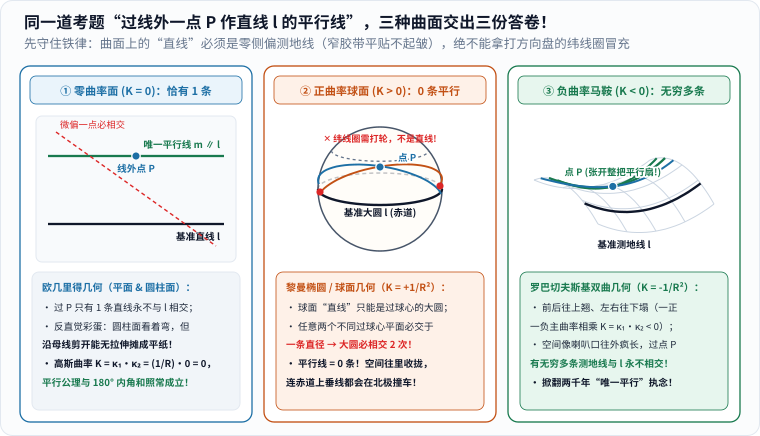
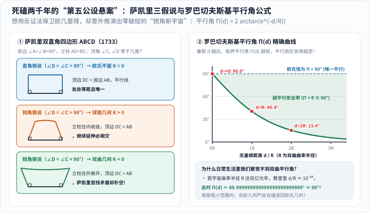
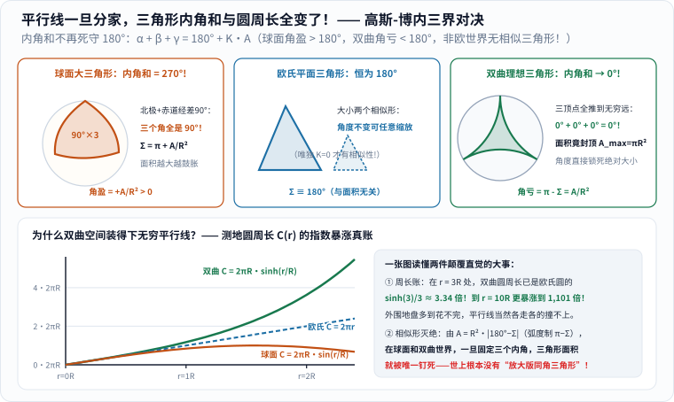

从初中几何第一课起，我们就把两句话刻进了DNA里：

1. **过直线外一点，有且只有一条直线与已知直线平行**；
2. **任意三角形的三个内角加起来，永远不多不少等于 $$180^\circ$$**。

这两句话听起来像“$$1+1=2$$”一样不容置疑。你在课桌上拿直尺画一千次、一万次，只要稍微把尺子歪上 $$0.01^\circ$$，两条线往远方延伸就一定会撞在一起；把任意纸片三角形的三个角撕下来拼在一起，也永远严丝合缝拼成一个平角。

可偏偏就是这条“看起来最像废话”的平行线规矩，让古希腊、阿拉伯和欧洲最顶尖的数学家死磕了整整**两千一百多年**。有人为了证明它耗尽一生，临终前以为自己大功告成，其实在最后一步悄悄犯了错；有父亲写信苦苦哀求儿子千万别碰平行线，说它“会夺走你的健康、内心的安宁和一生的幸福” [[6]](#ref-6)[[10]](#ref-10)；直到 19 世纪 20 年代，几位年轻人和一位隐忍不发的数学王子终于捅破窗户纸——

**把“唯一平行线”删掉甚至反过来写，不仅一丁点逻辑矛盾都没有，反而推开了两座比欧几里得平面更宏大、更真实的几何新宇宙！**

想要不靠死背公理、一眼看懂**非欧几何（Non-Euclidean geometry）**到底在讲什么，最直观的望远镜，就是拿一卷窄胶带，亲自到不同的**曲面**上去画一回“平行线”。

---

## 一、先破两个视觉骗局：在曲面上画“平行线”，为什么纬线圈不算数、卷弯的纸筒反而是平的？

一旦把战场从平展展的黑板搬到曲面上，90% 的初学者都会在第一分钟掉进两个视觉陷阱：

- **陷阱一**：“地球仪上的赤道和北纬 $$30^\circ$$ 纬线圈一圈圈套着，永远不相交，球面上不也有平行线吗？”
- **陷阱二**：“把一张 A4 纸卷成可乐罐那样的圆柱筒，表面明明是弯的，它上面肯定是非欧几何吧？”

很遗憾，**这两个直觉全错了**！不先把这两个障眼法拆穿，非欧几何的大门就永远是糊涂账。

_先守住底线规则：曲面上的“直线”必须是零侧偏测地线（窄胶带平贴不起皱），绝不能拿打方向盘硬拐出来的圆圈冒充。看三张卡片的对照结果：① 左卡零曲率面（平面与可展平的圆柱面 $$K=0$$）过线外一点 $$P$$ 恰有 **1 条**平行线；② 中卡正曲率球面（$$K>0$$）上所有“直线”都是过球心的大圆，任意两条不同大圆必交于一对对径点，平行线变成 **0 条**（灰虚线纬线圈因需持续打舵被红叉淘汰）；③ 右卡负曲率马鞍面（$$K<0$$）空间往外敞开，过 $$P$$ 竟能张开整把无穷多条永不相交的“平行扇”。[单独打开大图](/assets/images/non-euclidean-geometry/three-surfaces-parallel-test.svg)。_

### 1. 第一条铁律：什么才配叫曲面上的“直线”？拿窄胶带贴一下就知道

在平面上，“直线”有两个等价身份：**两点之间最短的路**，以及**一只小蚂蚁蒙着眼睛、左右轮完全同速、一点方向盘都不打往前走出的轨迹**。

搬到曲面上后，这第二种身份——**测地曲率 $$\kappa_g = 0$$（零侧向拐弯）**——就是检验“真假直线”的照妖镜（我们在[《北京飞纽约为什么要绕道北冰洋：彻底读懂测地线原理与应用》]()里曾做过这个实验）：

你拿一卷没有弹性的窄美纹纸胶带，紧贴着地球仪表面往前顺着铺，要求**左右两边都不许起褶皱、不许鼓包**。

- 沿着**赤道**贴一圈？胶带平平整整，左右等长——赤道是货真价实的球面“直线”（大圆）；
- 沿着**北纬 $$40^\circ$$ 纬线圈**贴一圈？没贴出三厘米，胶带靠北极的内侧就会皱成一团麻花！想让一辆玩具小车沿着北纬 $$40^\circ$$ 走，司机必须**全程死死往北打方向盘**；一旦松手让方向盘回正，小车立刻顺着惯性斜切向赤道！

所以，**除赤道外的纬线圈根本不是球面上的“直线”，它们只是球面上的“圆弧”**！拿圆弧和直线不相交来冒充平行线，就像在黑板上画一个圆套在直线旁边说“圆和直线平行”一样犯规。在球面上，唯一有资格被称为“直线”的，只有**平面切过球心截出来的大圆（Great Circle）** [[2]](#ref-2)[[3]](#ref-3)。

### 2. 第二个反直觉彩蛋：卷成筒的圆柱面，骨子里竟然是纯粹的欧氏平面！

再看第二个陷阱：把一张画好了一组平行线和一个 $$180^\circ$$ 三角形的白纸，轻轻卷成一个圆柱筒（不拉伸、不撕裂、不揉皱）。

对于生活在纸面二维世界里的“扁平蚂蚁”来说，它的世界变弯了吗？**一丁点都没变！**

1827 年，**卡尔·弗里德里希·高斯（Carl Friedrich Gauss）**在曲面论巅峰之作中证明了震撼数学界的**绝妙定理（Theorema Egregium）**（详见本博客[《高斯到底发明了什么？从 1 加到 100 开始》]()）：决定一个曲面内部几何法则的，不是它在三维空间里看起来弯不弯，而是表面两个互相垂直方向的主曲率 $$\kappa_1$$ 与 $$\kappa_2$$ 的**乘积**——**高斯曲率（Gaussian Curvature）** [[3]](#ref-3)：

$$
K = \kappa_1 \cdot \kappa_2
$$

给圆柱面算一算账，真相瞬间大白：圆柱沿着圆周方向弯成了半径 $$R$$ 的圆（$$\kappa_1 = 1/R$$），但沿着上下直母线方向笔直得毫无弯曲（$$\kappa_2 = 0$$）。两者一乘：

$$
K_{\text{圆柱}} = \frac{1}{R} \times 0 = 0
$$

只要 $$K = 0$$，这个曲面剪开一刀就能完好无损地摊平成欧几里得平面！生活在圆柱面上的蚂蚁量出来的三角形内角和依然精确等于 $$180^\circ$$（只要三角形不绕柱子自交），过母线外一点与母线永不相交的测地线也只有唯一 **1 条**（因为斜着出发的螺旋测地线会一圈圈缠绕柱身，必定与母线相交无数次）。

### 3. 同一道考题，三种内蕴曲率交出三份截然不同的答卷

一旦排除掉“假直线”和“假弯曲”，真正按高斯曲率 $$K$$ 的正负把二维世界分成三大阵营，再考同一道题——**“在曲面上给定一条测地线 $$l$$ 和线外一点 $$P$$，过 $$P$$ 能画几条测地线与 $$l$$ 永不相交？”**——奇迹出现了 [[2]](#ref-2)[[3]](#ref-3)：

1. **零曲率世界（$$K = 0$$，欧几里得几何，如平面）：恰有 1 条！**
   过 $$P$$ 只有唯一一个角度能让直线 $$m$$ 与 $$l$$ 保持等距；哪怕偏转亿分之一度，往一侧延伸也迟早相交。
2. **正曲率世界（$$K = +1/R^2 > 0$$，球面 / 黎曼椭圆几何，如球面）：0 条！**
   球面在所有方向都往同一个方向弯（$$\kappa_1 = \kappa_2 = +1/R$$），空间往里“收拢”。基准直线 $$l$$ 是一个过球心 $$O$$ 的平面截出的大圆；过线外一点 $$P$$ 任画一条球面直线 $$m$$，它也是另一个过球心 $$O$$ 的平面截出的大圆。三维空间里**任意两个过同一点 $$O$$ 的不同平面，必定相交于一条穿过球心的直径**——这条直径捅破球面两端，意味着**球面上任意两条不同的“直线”必定相交两次（一对对径点）**！（如果像黎曼和克莱因那样把球面上一对正对面的对径点视为同一个点，制成单椭圆平面，那么任意两条直线就恰相交 **1 次**，恢复“两点确定唯一一条直线”的公理，但平行线依然是 **0 条** [[2]](#ref-2)[[7]](#ref-7)。）哪怕你在赤道上相隔一千公里、同时朝着正北方向平行出发，这两条经线大圆也会越走越近，最后在北极点撞个满怀！
3. **负曲率世界（$$K = -1/R^2 < 0$$，罗巴切夫斯基双曲几何，如马鞍面局部）：无穷多条！**
   看马鞍面或品客薯片的中心：前后方向往上翘（$$\kappa_1 > 0$$），左右方向往下塌（$$\kappa_2 < 0$$），一正一负相乘得 $$K = \kappa_1 \kappa_2 < 0$$！这种曲面往外走时空间像荷叶边一样剧烈敞开。从线外一点 $$P$$ 出发，不仅有一条垂直于公垂线的测地线与 $$l$$ 永不相交，稍微往上偏一点、往下偏一点，**整整一把张开角度的“直线扇”全都来不及追上 $$l$$，浩浩荡荡各自奔向远方永不相交**！

---

## 二、死磕两千年的“第五公设悬案”：从萨凯里双直角四边形到罗巴切夫斯基平行角公式

你可能会好奇：今天我们用曲率一看就懂的事，为什么古人和近代数学家会被卡住两千多年？因为当年大家手里并没有“弯曲空间”的概念，所有人都是在纯逻辑推理的纸面上，跟**欧几里得（Euclid）**留下的一个小疙瘩较劲。

### 1. 《几何原本》里那个格格不入的“第五公设”

公元前 300 年左右，欧几里得在《几何原本》第一卷开头立下了 5 条不证自明的“公设（Postulates）”作为整座几何大厦的地基 [[1]](#ref-1)。前四条干净利落得像呼吸一样自然：

1. 任意两点可以连一条线段；
2. 有限线段可以向两端无限延长；
3. 以任意点为圆心、任意长为半径可以画圆；
4. **凡直角都彼此相等**。

唯独到了**第五公设**，画风突然变成了一段拗口得像绕口令的复杂定理 [[1]](#ref-1)：

> **欧几里得第五公设（原话大意）**：若一条直线与两条直线相交，使得同旁内角之和**小于两个直角（$$< 180^\circ$$）**，则这两条直线无限延长后，必在同旁内角之和小于两直角的那一侧相交。（1795 年苏格兰数学家约翰·普莱费尔 John Playfair 将其改写为我们今天课本上等价且简洁的**普莱费尔公理**：过直线外一点，至多能作一条直线与已知直线不相交 [[1]](#ref-1)[[3]](#ref-3)。）

欧几里得本人显然也觉得第五公设不够“一眼自明”——在《几何原本》第一卷前 **28 个命题**里，他宁可绕远路也绝不动用第五公设，直到第 29 命题证明“平行线同位角相等”实在绕不过去了，才第一次请出它 [[1]](#ref-1)[[2]](#ref-2)。此后两千年里，从托勒密、普罗克洛斯、海什木（Ibn al-Haytham）、奥马尔·海亚姆，到瓦利斯、兰伯特和勒让德，无数大师前赴后继想用前四条公设把第五公设“证出来”——结果无一例外，全都在半路上不知不觉偷塞了一条和第五公设等价的隐含假设 [[3]](#ref-3)！

_左栏拆解 1733 年萨凯里的反证法实验：立起底角全为 $$90^\circ$$、两腰等长的四边形 $$ABCD$$，根据对称性顶角 $$\angle C = \angle D$$ 只剩“等于、大于、小于 $$90^\circ$$”三种假说；右栏按精确公式 $$\Pi(d)=2\arctan(e^{-d/R})$$ 绘出罗巴切夫斯基平行角随无量纲垂距 $$d/R$$ 的衰减曲线——距离越远，临界平行角越锐，绿底“超平行安全带”张得越宽；而当 $$d/R \to 0$$ 时 $$\Pi(d)\to 90^\circ$$，自动退回我们熟悉的欧氏几何。[单独打开大图](/assets/images/non-euclidean-geometry/euclid-fifth-saccheri-lobachevsky.svg)。_

### 2. 萨凯里（1733）：明明亲手推开了新世界的大门，却在最后一秒把它关上

两千年攻关史里最富戏剧性的一幕，发生在 1733 年。意大利耶稣会神父兼数学家**乔瓦尼·萨凯里（Giovanni Girolamo Saccheri）**在临终那年出版了一部奇书：《洗清欧几里得的一切瑕玷》（*Euclides ab omni naevo vindicatus*） [[4]](#ref-4)。

萨凯里玩了一招极其漂亮的**反证法**：如果我不承认第五公设，故意假设它不成立，能不能一路推理出荒唐的自相矛盾（$$1=2$$ 那种逻辑爆炸），从而反过来证明第五公设非对不可？

如上图左栏所示，他在底边 $$AB$$ 两端立起两条等长的垂线 $$AD = BC$$（$$\angle A = \angle B = 90^\circ$$），再把顶端 $$D$$ 和 $$C$$ 连起来——这个图形今天叫做**萨凯里四边形（Saccheri quadrilateral）** [[3]](#ref-3)[[4]](#ref-4)。单靠前四条公设和折叠对称性，就能严格证明两个顶角必然相等（$$\angle C = \angle D$$）。那么这两个顶角到底是几度？逻辑上只有三种可能：

1. **直角假说（$$\angle C = \angle D = 90^\circ$$）**：四边形是长方形，顶边与底边处处等距——完全等价于欧氏几何；
2. **钝角假说（$$\angle C = \angle D > 90^\circ$$）**：立柱往里收拢，顶边 $$DC < AB$$——萨凯里利用“直线可以无限延长且长度无穷（阿基米德性质）”很快排除了它（因为在球面上大圆虽然满足钝角假说，但总长只有有限的 $$2\pi R$$） [[4]](#ref-4)；
3. **锐角假说（$$\angle C = \angle D < 90^\circ$$）**：立柱往外敞开，顶边 $$DC > AB$$！

接下来，萨凯里在“锐角假说”下一口气严密推导出了几十条不可思议的定理：三角形内角和小于 $$180^\circ$$、过线外一点有两条渐近线向基准线无限靠拢却永不相交、两条既不相交也不渐近的直线拥有唯一公垂线……**他实际上已经独自把双曲几何的大半本教科书都写出来了，而且每一步都严丝合缝，找不到半点逻辑破绽！** [[4]](#ref-4)

眼看反证法就要失败，虔诚保卫欧几里得的萨凯里慌了。在全书最后，他面对“两条渐近线在无穷远处共享一条公垂线”的推论，强行拍桌子宣布：“这违背了直线的本性（repugnant to the nature of the straight line）！”便匆匆宣布锐角假说不成立 [[4]](#ref-4)。他做梦也没想到，被他当成“怪物”一脚踢开的锐角世界，根本没有任何矛盾——那是一座真正的几何新大陆！

### 3. 三星同辉与罗巴切夫斯基的“平行角公式”

真正敢站出来宣布“锐角假说本身就是一种完全合法的新几何”的，是 19 世纪初三位不同国度的先驱：

- **高斯（Gauss）**：早在 1810 年代就私下看透了非欧几何（连“非欧几何”这个名字都是他起的），甚至算出了三角形面积与角亏成正比；但正如他在 1829 年给贝塞尔的信中所坦白的，他**“害怕世俗庸人（Boeotians）的聒噪”**——当时康德哲学把欧氏空间奉为人类先验理性的绝对真理，高斯不想卷入口水战，把全部手稿锁进了抽屉 [[3]](#ref-3)。
- **亚诺什·鲍耶（János Bolyai，匈牙利）**：父亲法尔卡什·鲍耶（高斯的大学挚友）自己研究平行公理撞得头破血流，曾写信痛心疾首地警告儿子千万别碰这潭死水 [[6]](#ref-6)[[10]](#ref-10)。可年轻的亚诺什非但不听，反而在 **1823 年 11 月**给父亲写出那句流芳百世的豪言：**“我已经从虚无中创造出了一个崭新的奇异世界（Out of nothing I have created a strange new universe）！”** 并在 1832 年将成果作为父亲著作的 26 页附录（*Appendix*）正式发表 [[6]](#ref-6)。
- **尼古拉·罗巴切夫斯基（Nikolai Lobachevsky，俄国喀山大学）**：最早迈出公开发表的一步——**1826 年 2 月**在喀山大学做公开报告，**1829 年**在《喀山信使》正式发表史上第一篇非欧几何论文《论几何学原理》，又在 **1840 年**用德文出版《平行线理论的几何研究》，因此双曲几何也被尊称为**罗巴切夫斯基几何** [[5]](#ref-5)。

罗巴切夫斯基是怎么给“无穷多条平行线”立规矩的？他没有停留在定性描述，而是给出了一个精确到骨子里的**平行角公式（Angle of Parallelism）** [[5]](#ref-5)：

从线外一点 $$P$$ 向基准直线 $$l$$ 作垂线 $$PQ$$，设垂足距离为 $$d$$。过 $$P$$ 作一条射线，与垂线 $$PQ$$ 成夹角 $$\theta$$：

- 在欧氏平面里，只要 $$\theta < 90^\circ$$，射线不管多接近 $$90^\circ$$ 都必与 $$l$$ 相交；只有 $$\theta = 90^\circ$$ 才平行。
- 在曲率半径为 $$R$$（高斯曲率 $$K = -1/R^2$$）的双曲平面里，相交与不相交的分界角**不再是 $$90^\circ$$，而是一个严格小于 $$90^\circ$$ 的锐角 $$\Pi(d)$$** [[5]](#ref-5)：

$$
\Pi(d) = 2\arctan\!\left(e^{-d/R}\right)
$$

让我们代几个具体数字（对照上图右栏曲线），立刻就能体会这个公式有多美妙：

1. **当距离为 1 个曲率半径（$$d = R$$）时**：$$e^{-1} \approx 0.36788$$，算出临界平行角 $$\Pi(R) = 2\arctan(e^{-1}) \approx \mathbf{40.4^\circ}$$！也就是说，只有夹角 $$0^\circ \le \theta < 40.4^\circ$$ 的射线才会撞上底线 $$l$$；一旦夹角落在 $$40.4^\circ \le \theta \le 139.6^\circ$$ 之间（足足张开 **$$99.2^\circ$$ 宽**的扇面！），整把扇子里的无穷多条直线全都永远撞不上 $$l$$！
2. **当距离拉远到 $$d = 2R$$ 时**：$$\Pi(2R) = 2\arctan(e^{-2}) \approx \mathbf{15.4^\circ}$$——离基准线越远，想射中它需要的瞄准窗口越窄，平行扇张得几乎贴平了垂线！
3. **为什么我们在教室里拿尺子量不出这个锐角？** 假设我们生活的宇宙真有一点点负曲率，曲率半径 $$R$$ 至少是百亿光年量级（$$\sim 10^{26}\ \mathrm{m}$$）。你在 $$1\ \mathrm{m}$$ 长的课桌上做实验，无量纲比值 $$d/R \approx 10^{-26}$$，代入公式按泰勒展开 $$\Pi(d) \approx \frac{\pi}{2} - \frac{d}{R}$$，算出来的平行角是：

$$
\Pi(1\ \mathrm{m}) \approx 89.9999999999999999999999994^\circ
$$

跟 $$90^\circ$$ 只差小数点后第 25 位！**欧几里得几何根本没有被推翻——它是任何弯曲几何在局部极小范围（$$d \ll R$$）内最完美的切平面近似！**

---

## 三、把无穷大双曲宇宙装进一只圆盘：为什么平行线还分“渐近”和“超平行”，为什么三维空间装不下它？

读到这里，一个最让人抓耳挠腮的疑问一定会冒出来：

> “正曲率的完整世界很好想象，不就是一个圆溜溜的球面吗？那负曲率（$$K = -1/R^2$$）的**完整双曲平面**到底长什么样？马鞍面往四周走一会儿曲率就变淡了，有没有一个处处曲率恒等于 $$-1/R^2$$ 的真表面让我摸一摸？”

更要命的是，在罗巴切夫斯基和鲍耶去世后的十几年里，数学界其实还悬着一颗定时炸弹：**万一再往下推第 10,000 条定理时，双曲几何突然冒出逻辑矛盾怎么办？**

### 1. 贝特拉米伪球面（1868）与希尔伯特定理（1901）：三维空间里的“边界墙”

1868 年，意大利数学家**欧金尼奥·贝特拉米（Eugenio Beltrami）**用一记神来之笔彻底拆掉了这颗炸弹 [[8]](#ref-8)。他在普通三维欧氏空间里找到了一件真实的旋转曲面——把“曳物线（Tractrix）”绕着它的渐近轴转一圈，得到一只像长号喇叭口一样的曲面，叫做**伪球面（Pseudosphere）**（见下图右栏） [[8]](#ref-8)：

$$
r(t) = R\sin t, \qquad z(t) = R\left(\ln\cot\frac{t}{2} - \cos t\right)
$$

算一下这只喇叭表面任意一点的主曲率：沿着母线往外撇（正曲率），绕着喇叭筒往里箍（负曲率），一乘起来，**整只喇叭表面每一点的高斯曲率居然分毫不差恒等于常数 $$-1/R^2$$**！

贝特拉米由此完成了数学史上里程碑式的**相对相容性（Relative Consistency）证明** [[3]](#ref-3)[[8]](#ref-8)：既然双曲几何的每一条公理和定理，都可以逐字翻译成三维欧氏空间里伪球面或圆盘模型上的欧氏几何命题，那么——**只要欧氏几何本身没有逻辑矛盾，双曲几何就绝对不可能产生逻辑矛盾！** 两千年的悬案，就此一锤定音。

_左栏为精确计算的庞加莱保角圆盘模型（取 $$P=(0, 0.42)$$，双曲垂距 $$d\approx 0.90R$$，平行角 $$\Pi(d)\approx 44.4^\circ$$）：所有双曲“直线”均为直径或与边界圆 $$\lvert z\rvert=1$$ 严格成 $$90^\circ$$ 正交的圆弧。绿实弧为仅有的 **2 条渐近平行线**，在无穷远地平线 $$A_\infty, B_\infty$$ 刚好追上基准线 $$l$$；蓝实弧为**无穷多条超平行线**，连在无穷远边界上都与 $$l$$ 隔开一段弧，并拥有唯一公垂线；红虚弧为有限远处刺穿 $$l$$ 的相交线。右栏展示 1868 年贝特拉米伪球面为何在喇叭口 $$r=R$$ 处撞上奇异锋利赤道棱。动画仅播放一次后定格于完整平行扇束，支持 `prefers-reduced-motion` 无障碍静态阅读。[单独打开大图（刷新可重播）](/assets/images/non-euclidean-geometry/poincare-disk-parallel-fan-anim.svg)。_

但细看上图右栏那只喇叭底部，你会发现一个奇怪的瑕疵：往上走，喇叭尖端无限延伸；可往下走到半径 $$r = R$$（$$t = \pi/2$$）的地方，喇叭口突然卡死在一圈锋利的**奇异赤道棱（Singular Rim）**上，再也没法光滑地往下延展了！

难道是贝特拉米手艺不够好，没找对曲面吗？1901 年，德国数学大师**大卫·希尔伯特（David Hilbert）**严格证明了著名的**希尔伯特定理** [[9]](#ref-9)[[10]](#ref-10)：

> **在普通三维欧氏空间 $$\mathbb{R}^3$$ 中，根本不存在任何完备、处处光滑（$$C^2$$ 二阶连续可微）且高斯曲率恒为负常数的等距曲面！**

原因其实特别好懂：负曲率要求曲面周长随着半径按指数规律疯狂暴涨，而普通三维欧氏空间的体积增长太慢，光滑硬塞进去到一定半径必然“卡壳起棱”！要想不丢半块地盘、把**整张无穷大的双曲平面**完整画出来，我们就必须像画世界地图（墨卡托投影）那样允许一点“比例尺缩放”——这就请出了数学家与艺术家（比如埃舍尔著名的《圆极限》木刻版画）最钟爱的神器：**庞加莱保角圆盘（Poincaré Conformal Disk Model）** [[2]](#ref-2)[[3]](#ref-3)。

### 2. 庞加莱圆盘怎么读？一把越靠边缩得越小的尺子，分清“两种平行线”

1882 年由**亨利·庞加莱（Henri Poincaré）**发扬光大的圆盘模型（贝特拉米亦早在 1868 年给出其等距原型），规则简单得令人拍案叫绝 [[3]](#ref-3)[[8]](#ref-8)：

把整个无穷大的双曲宇宙装进单位开圆盘 $$\mathbb{D} = \{z \in \mathbb{C} : \lvert z\rvert < 1\}$$ 里（注意：**外圈边界圆 $$\lvert z\rvert = 1$$ 不属于空间内部，它代表无穷远地平线！**），并规定圆盘里任意位置 $$z$$ 处的微小真实路程 $$\mathrm{d}s$$ 为：

$$
\mathrm{d}s = \frac{2\,\lvert\mathrm{d}z\rvert}{1 - \lvert z\rvert^2}
$$

怎么读这个分母 $$1 - \lvert z\rvert^2$$？想象你是一个生活在圆盘里的小人，越往边界 $$\lvert z\rvert \to 1$$ 走，分母越接近 $$0$$，意味着每迈出看似短短一毫米的欧氏步伐，对应的双曲真实路程 $$\mathrm{d}s$$ 就被放大十倍、百倍、千万倍（换句话说，在我们局外人眼里，小人和他手里的尺子越靠近圆盘边缘就缩得越迷你，他走一辈子也永远摸不到边界圆 $$\lvert z\rvert = 1$$！）。

更神奇的是这个模型是**保角（Conformal）**的——**圆盘里两条曲线相交的夹角，跟双曲世界里的真实夹角一模一样，半度都不变形**！而在这种“边缘尺子收缩”的地图上，两点之间最短的双曲“直线”（测地线）只有两类精确轨迹 [[2]](#ref-2)：

1. **过圆盘中心的欧氏直径**（如上图左栏黑色的基准直线 $$l$$）；
2. **两端与边界圆 $$\lvert z\rvert = 1$$ 严格成 $$90^\circ$$ 直角相交的欧氏圆弧**！

现在盯住上图左栏的点 $$P$$，双曲几何里最精妙的秘密——**平行线其实分两大家族**——在圆盘上一眼看穿：

- **第一类：恰有 2 条“渐近平行线 / 极限平行线”（Limiting / Asymptotic Parallels，图中绿实弧）**
  左右各 1 条，与垂线 $$PQ$$ 的夹角刚好卡在临界值 $$\theta = \Pi(d)$$。它们顺着往左或往右走时，与基准线 $$l$$ 的距离越来越近（趋向于 $$0$$），最后在无穷远地平线边界上的理想点 $$A_\infty$$ 或 $$B_\infty$$ 处“在无穷远处相会”，但在圆盘内部有限距离上永不相交！
- **第二类：无穷多条“超平行线”（Ultraparallels / Divergent Parallels，图中蓝实弧）**
  只要夹角落在 $$\Pi(d) < \theta < 180^\circ - \Pi(d)$$ 之间，这些圆弧不仅在圆盘内部不碰 $$l$$，**就连到了无穷远地平线边界 $$\lvert z\rvert = 1$$ 上，它们的端点也和 $$A_\infty, B_\infty$$ 隔开一大截圆弧！** 每一条超平行线与基准线 $$l$$ 之间，都有且只有**唯一一条最短的公垂线**；从这条公垂线往左右两边走，两条线像喇叭口一样越分越开！

回看欧几里得平面：其实就是把 $$44.4^\circ$$ 的临界角往上抬高到了 $$90^\circ$$，让左边的绿弧、右边的绿弧和中间整把蓝色超平行扇，“啪”地合拢压扁成了唯一一条 $$90^\circ$$ 的欧氏平行线！

---

## 四、平行线一旦分家，几何大厦连锁大地震：三角形内角和、团灭的相似形与指数暴涨的圆周长

千万别以为非欧几何只是改了一条平行线条数。在公理体系里牵一发而动全身，平行线一旦松绑，我们在中学背熟的三条“铁律”当场集体翻车。

_上排三卡片对比三类几何的测地三角形：① 球面八分之一球壳大三角形拥有 **3 个 $$90^\circ$$ 直角**，内角和达 $$270^\circ$$；② 欧氏平面无论放大缩小内角和恒为 $$180^\circ$$；③ 双曲圆盘里三个顶点全推到无穷远边界的“理想三角形”三个内角全为 $$0^\circ$$，内角和为 $$0^\circ$$，却围出有限封顶的最大面积 $$\pi R^2$$！下排按精确解析式对比三界圆周长 $$C(r)$$，揭示双曲空间能塞下无穷平行线的物理底牌——外围周长按 $$\sinh(r/R)$$ 指数爆炸。[单独打开大图](/assets/images/non-euclidean-geometry/triangle-angles-and-circle-growth.svg)。_

### 1. 第一震：三角形内角和不再等于 $$180^\circ$$，而且面积直接写在角度差里！

为什么欧氏平面三角形内角和等于 $$180^\circ$$？翻开初一课本的证明：过顶点作底边的**唯一平行线**，把左边底角和右边底角用内错角搬上来，刚好拼成平角 $$180^\circ$$。一旦平行线不是唯一一条，内错角不再相等，$$180^\circ$$ 当场失守！

高斯和法国数学家博内（Pierre Ossian Bonnet）总结出了贯穿整个微分几何的黄金定律——常曲率 $$K$$ 曲面上任意测地三角形（三内角弧度制为 $$\alpha, \beta, \gamma$$，面积为 $$A$$）满足**高斯-博内公式** [[2]](#ref-2)[[3]](#ref-3)：

$$
\alpha + \beta + \gamma - \pi = K \cdot A
$$

看清等号右边那个 $$K \cdot A$$，三界奇观尽收眼底：

- **球面（$$K = +1/R^2 > 0$$）：内角和恒大于 $$180^\circ$$，越大越胖！**
  在地球上从北极点出发，沿 $$0^\circ$$ 经线走到赤道左转 $$90^\circ$$，沿赤道走四分之一圈到东经 $$90^\circ$$ 再北转 $$90^\circ$$ 回到北极——这个占全球面积 $$1/8$$ 的球面大三角形，三个内角全是 $$90^\circ$$，**内角和等于 $$90^\circ + 90^\circ + 90^\circ = 270^\circ$$**！多出来的 $$\alpha+\beta+\gamma-\pi$$ 叫做**角盈（Angular Excess）**。
- **欧氏平面（$$K = 0$$）：$$K \cdot A = 0$$，无论三角形多大，内角和死锁在 $$\pi$$（$$180^\circ$$）！**
- **双曲平面（$$K = -1/R^2 < 0$$）：内角和恒小于 $$180^\circ$$，越大越瘦！**
  面积公式反过来写就是：

$$
A = R^2 \bigl(\pi - \alpha - \beta - \gamma\bigr)
$$

  天哪！在双曲世界里，**三角形越往大里画，三个角反而被拉得越尖、内角和越小**！最极端的情况如上图右上角所示：把三个顶点全都推到无穷远边界圆上，造出一个边长无穷大的**理想三角形（Ideal Triangle）**，它的三个内角全缩成了 $$0^\circ$$（$$\alpha = \beta = \gamma = 0$$）！可它的面积是多少？代入上式：

$$
A_{\max} = R^2(\pi - 0 - 0 - 0) = \pi R^2
$$

  **边长无穷大的三角形，面积竟然是有限的 $$\pi R^2$$！** 在曲率半径 $$R$$ 的双曲世界里，哪怕你拥有全宇宙的油漆，也绝不可能画出一个面积超过 $$\pi R^2$$ 的三角形 [[10]](#ref-10)！

### 2. 第二震：非欧世界里，“相似三角形”彻底灭绝了！

再盯住刚才那行面积公式 $$A = \lvert K\rvert^{-1}\,\lvert \alpha + \beta + \gamma - \pi\rvert$$ 看三秒钟，你会发现一件更颠覆常识的事 [[2]](#ref-2)：

在欧氏平面里，你可以画一个边长 $$1\ \mathrm{cm}$$ 的正三角形（三个角全 $$60^\circ$$），也可以在操场上画一个边长 $$100\ \mathrm{m}$$ 的正三角形（三个角还是全 $$60^\circ$$）——形状不变、尺寸任意缩放，这叫**相似形（Similar Figures）**，也是建筑图纸按 $$1:100$$ 缩印不走样的数学根基。

可在球面或双曲平面（$$K \neq 0$$）里，**只要你报出三角形的三个内角，它的面积 $$A$$ 和三条边长就被唯一钉死了！**

- 想在双曲平面画一个三个角全是 $$45^\circ$$ 的正三角形？它的面积只能等于 $$R^2(\pi - 3\pi/4) = \frac{\pi}{4}R^2$$，多一平方毫米、少一平方毫米都不可能！
- 如果你强行把它的三条边长都放大两倍，面积变大，三个内角就必须跌破 $$45^\circ$$ 变得更尖！

换句话说，**“存在不全等的相似三角形”这件事本身，就和欧几里得第五公设完全等价**（1663 年英国数学家约翰·瓦利斯 John Wallis 正是试图拿“相似形存在”当公理去证第五公设） [[3]](#ref-3)！弯曲空间自带一把绝对尺度 $$R$$，小蚂蚁不用抬头看宇宙，只要在地上画个等边三角形量一量内角是 $$59^\circ$$ 还是 $$50^\circ$$，就能直接算出自己脚下这个图形距离曲率半径 $$R$$ 有多大！

### 3. 第三震：圆周长的指数暴涨——双曲世界装得下无穷平行线的终极底牌

为什么双曲空间过一点能容下无穷多条直线互不相撞？算一算半径为 $$r$$ 的测地圆周长 $$C(r)$$ 就彻底通透了（对照上图下排曲线） [[2]](#ref-2)：

$$
C_{\text{球面}}(r) = 2\pi R\sin\!\left(\frac{r}{R}\right), \qquad C_{\text{欧氏}}(r) = 2\pi r, \qquad C_{\text{双曲}}(r) = 2\pi R\sinh\!\left(\frac{r}{R}\right)
$$

其中双曲正弦函数 $$\sinh(u) = \frac{e^u - e^{-u}}{2}$$ 往外走时按**指数级爆炸**：

- 在 $$r = 1R$$ 处，双曲圆周长是欧氏圆的 $$\sinh(1)/1 \approx \mathbf{1.18\text{ 倍}}$$；
- 在 $$r = 3R$$ 处，涨到欧氏圆的 $$\sinh(3)/3 \approx \mathbf{3.34\text{ 倍}}$$；
- 走到 $$r = 10R$$ 处，欧氏圆周长只是老老实实的 $$20\pi R \approx 62.8R$$，而双曲圆周长已经飙到了 $$2\pi R\sinh(10) \approx \mathbf{69,198\,R}$$——足足是欧氏平面的 **$$1,101\text{ 倍}$$**！

欧氏平面的圆周长只按一次方 $$r$$ 慢吞吞增长，两条稍微带点夹角的射线往外走，外围新增的地盘分不过来，很快就会挤撞在一起；而双曲平面往外走时，外围空间像爆炸一样呈 $$e^{r/R}$$ 指数扩容，**地盘多到根本用不完**——两条射线稍微分开一点，它们脚下新长出来的空间比它们靠近的趋势快得多，当然各走各的阳关道，生生世世撞不上了！

---

## 五、非欧几何就在你身边：从卷边生菜、薯片薄壳到 AI 词向量与 138 亿光年宇宙

很多人以为非欧几何只是数学系黑板上的智力体操。恰恰相反，只要大自然、工程师或计算机科学家遇到**“边缘比中心长得快”“薄壳双向抗压”**或者**“指数级分叉树”**，负曲率双曲几何就会立刻登场！

_按四个象限对照非欧几何的现实威力：① 左上看生菜叶、珊瑚礁与 1997 年泰米娜毛线钩针如何绕开光滑限制在三维空间长出负曲率荷叶边；② 右上看品客薯片与百米电厂冷却塔如何借负曲率双曲结构实现薄壳抗风与直钢筋编曲塔；③ 左下看现代 AI 怎样用庞加莱双曲圆盘把 200 维词向量压缩到 5 维且精度反超；④ 右下看普朗克卫星如何用 138 亿光年尺度的宇宙大三角形检验我们真实宇宙的空间曲率。[单独打开大图](/assets/images/non-euclidean-geometry/non-euclidean-four-frontiers.svg)。_

### 1. 菜市场与手工课：为什么生菜叶和木耳全是波浪荷叶边？毛线钩针怎样“绕过”希尔伯特定理？

去厨房拿起一片生菜叶、羽衣甘蓝、木耳，或者去水族馆看脑珊瑚和海蛞蝓的裙边——为什么它们的边缘全都扭成一浪接一浪的波浪褶皱，压都压不平？

答案就是刚才那条周长公式 $$C(r) = 2\pi R\sinh(r/R)$$！植物叶片边缘的细胞分裂速度远快于中心叶脉，导致离中心越远，边缘周长呈指数暴涨。平展的欧氏平面（$$2\pi r$$）根本塞不下这么多周长，叶片只能自发往上下两个方向交替拱起褶皱，长成一张天然的**负曲率双曲叶片**（顺便最大限度增加了吸收阳光和营养的表面积）！

等等——前面不是刚讲过**希尔伯特定理**说三维空间装不下完整的双曲平面吗？1997 年，康奈尔大学拉脱维亚裔数学家**戴娜·泰米娜（Daina Taimiņa）**想出了一个惊艳数学界的妙招 [[10]](#ref-10)：拿起毛线和钩针，第一圈钩 $$N$$ 针，往后**每钩 $$N$$ 针就加 $$1$$ 针**（让每圈针数严格按 $$(1 + 1/N)^k$$ 指数增长）！

钩出来的毛线片自动卷曲成漂亮的珊瑚状荷叶边，人类史上第一次能把一大片柔韧结实的双曲平面捧在手心里折叠做几何证明（把折痕拉直就是测地线，画出的理想三角形全等一目了然） [[10]](#ref-10)！为什么它没违反希尔伯特定理？因为希尔伯特与蒂拉·米尔诺（Tilla Milnor, 1972）禁止的是**$$C^2$$ 二阶光滑**嵌入，而毛线织物和生菜叶放弃了高阶光滑度，用一层套一层的波浪褶皱（对应奎珀 Kuiper 1955 年证明的 $$C^1$$ 柔性等距嵌入）巧妙骗过了三维空间的边界墙 [[10]](#ref-10)！

### 2. 食品工业与土木奇迹：摔不碎的品客薯片，与全靠笔直钢筋编出来的“小蛮腰”冷却塔

你有没有想过，为什么普通袋装圆片薯片一捏就碎成渣，而装在圆筒里的**品客薯片（Pringles）**既能整整齐齐叠成一摞，咬之前还特别抗压？

因为品客薯片的模具采用的是标准负曲率**双曲抛物面（Hyperbolic Paraboloid）**：

$$
z = \frac{x^2}{a^2} - \frac{y^2}{b^2}
$$

平薯片（$$K=0$$）内部存在着贯穿全片的零曲率直线，稍微一压就沿着一条折痕“咔嚓”断成两半；而双曲抛物面（$$K < 0$$）在一个方向像拱桥一样受压、在垂直方向像悬索桥一样受拉，没有现成的薄弱折弯线，外力瞬间向四面八方分散——这也是悉尼歌剧院屋顶与现代大跨度机场航站楼酷爱马鞍形双曲薄壳的力学秘诀。

再看发电厂那座高达上百米、腰部优雅内收的巨型冷却塔，采用的是另一种负曲率曲面——**单叶双曲面（Hyperboloid of One Sheet）**：

$$
\frac{x^2 + y^2}{a^2} - \frac{z^2}{c^2} = 1
$$

除了双向反弯让混凝土壁薄至十几厘米就能硬扛十二级台风外，它还藏着一个令施工队热泪盈眶的几何神技：**单叶双曲面是“双重直纹面（Doubly Ruled Surface）”**！整座明明弯曲收腰的百米高塔，施工时**一根钢筋都不用掰弯**——直接拿笔直的钢筋（直母线）一顺一逆斜向交叉编织，浇上混凝土，自然就围出了完美的负曲率小蛮腰！

### 3. 人工智能：为什么大模型与知识图谱都在偷偷用“庞加莱双曲词向量”？

非欧几何在 21 世纪最火的新战场，竟然是**人工智能与深度学习**！

想象你要让 AI 理解人类词汇的层级树（比如 WordNet 词典：“实体 → 生物 → 动物 → 哺乳动物 → 犬科 → 柴犬”），或者生物演化树、大型社交网络。一棵分叉因子为 $$b \ge 2$$ 的树，往下走第 $$\ell$$ 层，节点总数按 $$b^\ell$$ **指数级爆炸**。

过去几十年，机器学习习惯把每个词表示成普通**欧氏空间 $$\mathbb{R}^n$$** 里的向量。麻烦来了：$$n$$ 维欧氏球半径为 $$r$$ 时，体积只按多项式 $$r^n$$ 增长；把指数暴涨的亿万树叶子硬塞进多项式体积的欧氏球里，叶子节点立刻挤成一锅粥，算出来的语义距离全乱套！

2017 年，Facebook AI 研究院的 **Maximilian Nickel 与 Douwe Kiela** 在 NeurIPS 发表名作《Poincaré Embeddings for Learning Hierarchical Representations》，干脆把词向量搬进了前面刚讲过的**庞加莱双曲圆盘 / 双曲球** [[11]](#ref-11)：

双曲空间里两点 $$u, v$$（$$\lVert u\rVert < 1, \lVert v\rVert < 1$$）的距离公式为：

$$
d_{\mathbb{D}}(u, v) = \operatorname{arcosh}\!\left(1 + 2\,\frac{\lVert u - v\rVert^2}{\bigl(1 - \lVert u\rVert^2\bigr)\bigl(1 - \lVert v\rVert^2\bigr)}\right)
$$

树根（“实体”）放在圆心附近，越具体的子概念越往圆盘边缘铺——因为双曲圆周长和球面积本身就按 $$\sinh(r)$$ **指数暴涨**，跟树的分叉速度天生绝配！实验结果震惊业界：在 WordNet 名词层级重构任务中，**仅仅使用 5 维庞加莱双曲词向量，重构平均排名（Mean Rank 4.9）和平均精度（MAP 0.823）就大幅碾压了高达 200 维的传统欧氏词向量（Mean Rank 115.5，MAP 0.293）** [[11]](#ref-11)！

### 4. 广义相对论与宇宙学：我们头顶的真实宇宙，到底是平的还是弯的？

最后回到最宏大的终极问题：**既然数学上欧氏、球面、双曲三套几何全都自洽合法，那我们活生生居住的这个物理宇宙，到底选了哪一套？**

1854 年，高斯最得意的学生**伯恩哈德·黎曼（Bernhard Riemann）**在哥廷根大学发表了震古烁今的就职演说《论作为几何学基础的假设》（*Über die Hypothesen, welche der Geometrie zu Grunde liegen*） [[7]](#ref-7)。黎曼把高斯二维曲面内蕴几何一口气推广到了**任意高维流形**，并且打破了“常曲率”的限制——空间曲率完全可以随着位置一点一变！坐在台下年近八旬、一辈子极少夸人的高斯听完演说后激动不已，盛赞黎曼的思想深刻绝伦 [[7]](#ref-7)。

仅仅 61 年后的 1915 年，**阿尔伯特·爱因斯坦（Albert Einstein）**正是拿起黎曼几何这把现成的数学宝剑，写下了**广义相对论**（详见本博客[《连光都会被太阳掰弯吗？读懂爱因斯坦光线弯曲的百年验证》]()与[《彭赛列和射影几何》]()）：物质与能量告诉时空如何弯曲，弯曲的时空测地线告诉物质与光线如何运动。在太阳和黑洞周围，空间实打实地弯曲偏折星光；连你手机里的北斗与 GPS 导航，每天都在实时扣除相对论弯曲时空的微秒级钟差。

那么把尺度放大到整个 **138 亿光年**的可观测宇宙，大尺度三维空间总体是正曲率（闭合三维球）、零曲率（平坦欧氏）还是负曲率（开放双曲）？

宇宙学家真的去量了一个**横跨 138 亿光年的“宇宙大三角形”**！他们以宇宙大爆炸后 38 万年留下的**宇宙微波背景辐射（CMB）**声学振荡冷暖斑块作为已知真实物理长度的“底边标尺”，以两侧跨越百亿光年飞进地球望远镜的两束光线作为“两条腰”，测量斑块在天球上的张角 $$\theta_*$$：

- 若宇宙是正曲率（$$K > 0$$），光线向内汇聚，斑块看起来偏大（内角和 $$> 180^\circ$$）；
- 若宇宙是负曲率（$$K < 0$$），光线向外发散，斑块看起来偏小（内角和 $$< 180^\circ$$）。

欧洲空间局**普朗克（Planck）卫星**结合重子声学振荡（BAO）的最终全任务精密测量给出了令人屏息的答案 [[12]](#ref-12)：宇宙空间曲率密度参数为

$$
\Omega_K = 0.0007 \pm 0.0019
$$

在千分之二的极高精度之内，**我们宇宙的宏观三维空间惊人地接近平坦（$$K \approx 0$$，这也成为支持宇宙极早期经历过指数级“暴胀 Inflation”把任何初始曲率熨平的核心证据之一），而在恒星、星系与黑洞周围的局部四维时空里，又处处跳动着黎曼非欧几何的曲率涟漪** [[12]](#ref-12)！

---

## 六、一张总表收官：三大常曲率几何全景对照

最后，把这趟跨越两千三百年的“曲面平行线之旅”浓缩成一张速查表，以后不管遇到哪一种几何，只要先问一句“平行线有几条”，所有性质立刻顺藤摸瓜：

| 对比维度 | 欧几里得几何（平坦） | 黎曼椭圆 / 球面几何（正曲率） | 罗巴切夫斯基双曲几何（负曲率） |
| :--- | :--- | :--- | :--- |
| **高斯曲率 $$K$$** | $$K = 0$$ | $$K = +1/R^2 > 0$$ | $$K = -1/R^2 < 0$$ |
| **生活中的直观样板** | 平展桌面、**卷成筒的圆柱侧面** | 地球仪表面（测地线为过球心大圆） | 马鞍面中心、品客薯片、卷边生菜叶 |
| **过线外一点的平行线条数** | **恰有 $$1$$ 条** | **$$0$$ 条**（任意两不同大圆必相交） | **无穷多条**（2 条渐近平行 + 无穷多条超平行） |
| **平行角 $$\Pi(d)$$** | 恒等于 $$90^\circ$$ | 不存在不相交方向 | $$\Pi(d) = 2\arctan(e^{-d/R}) < 90^\circ$$ |
| **三角形内角和 $$\Sigma$$** | 恒等于 $$180^\circ$$ | **$$> 180^\circ$$**（$$\Sigma = \pi + A/R^2$$） | **$$< 180^\circ$$**（$$\Sigma = \pi - A/R^2$$） |
| **三角形最大可能面积** | 无上限（$$\infty$$） | 有限（如球面半球壳 $$2\pi R^2$$） | **有限封顶 $$\pi R^2$$**（理想三角形） |
| **非全等的相似三角形** | **存在**（角度与尺寸解耦） | **不存在**（三个角直接锁死大小） | **不存在**（三个角直接锁死大小） |
| **半径 $$r$$ 的圆周长 $$C(r)$$** | 线性增长 $$2\pi r$$ | 收敛回缩 $$2\pi R\sin(r/R)$$ | **指数爆炸 $$2\pi R\sinh(r/R)$$** |

两千多年前，人类以为“过线外一点只有一条平行线”是束缚宇宙的唯一铁笼；两千多年后我们才恍然大悟——敢于对最习以为常的“常识”多问一句“如果不这样呢”，本身就是人类理性最壮丽的平行远航。

---

## 参考资料与核查来源

1. **David E. Joyce (Clark University)**, *Euclid's Elements, Book I, Postulate 5 & Playfair's Axiom*：[https://mathcs.clarku.edu/~djoyce/java/elements/bookI/post5.html](https://mathcs.clarku.edu/~djoyce/java/elements/bookI/post5.html)（核查欧几里得《几何原本》第一卷第五公设原文、前 28 命题规避使用第五公设的证明结构及 1795 年普莱费尔等价公理表述；需联网浏览）。
2. **David E. Joyce (Clark University)**, *Euclid's Elements, Book I, Proposition 29 — Guide to Hyperbolic and Elliptic Geometry*：[https://mathcs.clarku.edu/~djoyce/java/elements/bookI/propI29.html](https://mathcs.clarku.edu/~djoyce/java/elements/bookI/propI29.html)（核查第 29 命题首次调用第五公设、双曲与椭圆几何中的平行性质、圆盘测地线正交圆弧及三角形内角和对比）。
3. **J. J. O'Connor & E. F. Robertson (MacTutor History of Mathematics, University of St Andrews)**, *Non-Euclidean geometry*：[https://mathshistory.st-andrews.ac.uk/HistTopics/Non-Euclidean_geometry/](https://mathshistory.st-andrews.ac.uk/HistTopics/Non-Euclidean_geometry/)（核查两千年平行公设试证史、瓦利斯相似形假设、高斯未发表信件“害怕世俗庸人聒噪”及黎曼与克莱因的几何统一脉络）。
4. **MacTutor History of Mathematics (University of St Andrews)**, *Giovanni Girolamo Saccheri*：[https://mathshistory.st-andrews.ac.uk/Biographies/Saccheri/](https://mathshistory.st-andrews.ac.uk/Biographies/Saccheri/)（核查 1733 年《洗清欧几里得的一切瑕玷》中萨凯里双直角四边形直角、钝角、锐角三假说及结尾主观拒斥锐角假说的史实）。
5. **MacTutor History of Mathematics (University of St Andrews)**, *Nikolai Ivanovich Lobachevsky*：[https://mathshistory.st-andrews.ac.uk/Biographies/Lobachevsky/](https://mathshistory.st-andrews.ac.uk/Biographies/Lobachevsky/)（核查罗巴切夫斯基 1826 年喀山报告、1829 年《论几何学原理》发表、1840 年德文专著及平行角公式 $$\Pi(d)=2\arctan(e^{-d/R})$$）。
6. **MacTutor History of Mathematics (University of St Andrews)**, *János Bolyai*：[https://mathshistory.st-andrews.ac.uk/Biographies/Bolyai/](https://mathshistory.st-andrews.ac.uk/Biographies/Bolyai/)（核查法尔卡什·鲍耶劝阻信、亚诺什·鲍耶 1823 年 11 月“从虚无中创造新世界”通信与 1832 年《附录》正式出版时间）。
7. **MacTutor History of Mathematics (University of St Andrews)**, *Georg Friedrich Bernhard Riemann*：[https://mathshistory.st-andrews.ac.uk/Biographies/Riemann/](https://mathshistory.st-andrews.ac.uk/Biographies/Riemann/)（核查黎曼 1854 年哥廷根就职演说《论作为几何学基础的假设》将曲率推广至高维可变曲率流形及高斯的高度评价）。
8. **MacTutor History of Mathematics (University of St Andrews)**, *Eugenio Beltrami*：[https://mathshistory.st-andrews.ac.uk/Biographies/Beltrami/](https://mathshistory.st-andrews.ac.uk/Biographies/Beltrami/)（核查贝特拉米 1868 年《非欧几何解释论》利用伪球面与圆盘模型证明双曲几何与欧氏几何的相对相容性）。
9. **MacTutor History of Mathematics (University of St Andrews)**, *David Hilbert*：[https://mathshistory.st-andrews.ac.uk/Biographies/Hilbert/](https://mathshistory.st-andrews.ac.uk/Biographies/Hilbert/)（核查希尔伯特几何公理化工作及 1901 年关于三维欧氏空间不存在完备光滑常负曲率等距曲面的定理背景）。
10. **David W. Henderson & Daina Taimiņa (Cornell University)**, *Crocheting the Hyperbolic Plane*（刊于 *The Mathematical Intelligencer*, Vol. 23, No. 2, pp. 17–28, 2001）：[https://pi.math.cornell.edu/~dtaimina/crochet/hplane.htm](https://pi.math.cornell.edu/~dtaimina/crochet/hplane.htm)（核查 1997 年钩针双曲平面按固定比例加针构造、希尔伯特 1901 / 奎珀 1955 / 米尔诺 1972 光滑度边界区分，以及理想三角形全等与最大面积 $$\pi R^2$$）。
11. **Maximilian Nickel & Douwe Kiela**, *Poincaré Embeddings for Learning Hierarchical Representations*, NeurIPS 2017 (arXiv:1705.08039)：[https://arxiv.org/abs/1705.08039](https://arxiv.org/abs/1705.08039)（核查庞加莱球双曲距离公式及 WordNet 名词层级重构实验：5 维双曲嵌入 Mean Rank 4.9 / MAP 0.823 对比 200 维欧氏嵌入 Mean Rank 115.5 / MAP 0.293）。
12. **Planck Collaboration (N. Aghanim et al.)**, *Planck 2018 results. VI. Cosmological parameters*, *Astronomy & Astrophysics* 641, A6, 2020 (arXiv:1807.06209)：[https://arxiv.org/abs/1807.06209](https://arxiv.org/abs/1807.06209)（核查宇宙微波背景辐射声学尺度 $$100\theta_* = 1.0411 \pm 0.0003$$ 及结合 BAO 对可观测宇宙大尺度空间曲率参数 $$\Omega_K = 0.0007 \pm 0.0019$$ 的约束）。
