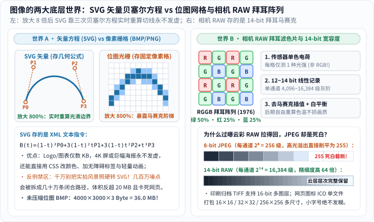
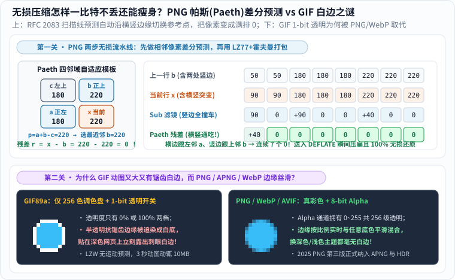
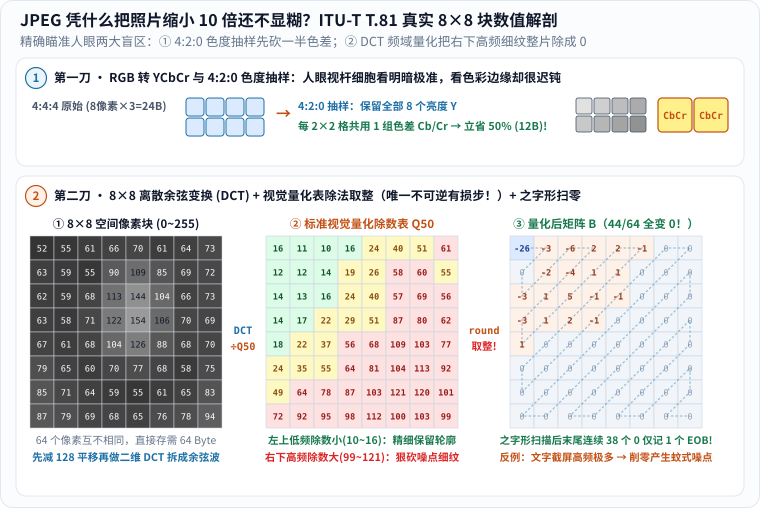
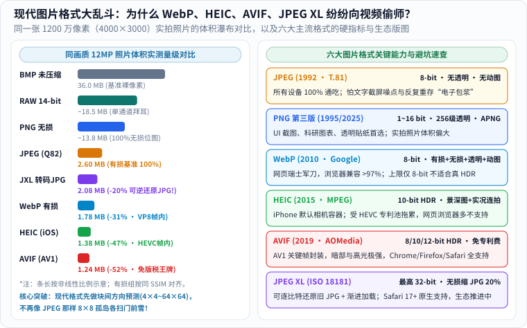

打开电脑桌面或手机相册，你几乎每天都在跟一串眼花缭乱的后缀名打交道：`.svg`、`.png`、`.jpg`、`.gif`、`.webp`、`.heic`、`.avif`、`.raw`、`.tiff`、`.ico`，再往旁边一滑，还有 `.mp4`、`.mkv`、`.mov`、`.webm`。

明明屏幕上看起来都是“一张画”，它们的脾气却怪得惊人——

- 一个网站 Logo 存成 `.svg` 只有区区 **3 KB**，哪怕放大到整栋摩天大楼外墙上依然刀锋般锐利；可一旦存成 `.jpg`，不仅边缘长出一圈脏兮兮的麻点，体积反而涨到了几十 KB。
- 手机随手拍一张 **1200 万像素**（$$4000 \times 3000$$）的晚霞，如果按最老实的像素表格原样记账（`.bmp`），得占掉整整 **36 MB**；存成 `.png` 立刻缩到约 **14 MB** 且一比特都不丢；存成 `.jpg` 瞬间跌到 **2.6 MB**；而苹果相册默认的 `.heic` 或新一代 `.avif` 甚至只要 **1.2 MB** 左右，肉眼却几乎看不出差别！
- 更诡异的是：一张表情包在群里被转发、截图、重存十来遍后，为什么会泛绿发糊、长满俗称**“电子包浆”**的方块纹？为什么把带透明底的图标存成 `.gif` 会镶上一圈丑陋的锯齿白边？为什么同样叫 `.mp4` 的两个视频文件，一个双击秒开，另一个却只有声音、屏幕漆黑一片？

所有这些日常疑惑，背后其实只藏着三把数学与工程钥匙：**怎么用公式代替格子（矢量 vs 位图）**、**怎么不丢信息地榨干重复规律（无损压缩）**，以及**怎么利用人类眼睛和大脑的生理盲区“合法偷工减料”（有损压缩与跨帧预测）**。顺着这三把钥匙往下拆，从静态图片一直走到高清视频，整座多媒体格式森林会瞬间变得清清楚楚。

---

## 一、两条彻底分叉的起跑线：画公式的矢量图 vs 填格子的位图

在讨论任何压缩算法之前，计算机存一张图首先面临一个根本性的哲学抉择：**我是把这张图的“作画步骤公式”记下来，还是把成千上万个小方格的颜色挨个抄下来？**

### 1. 先算一笔吓人的“裸像素账单”：BMP 为什么大得离谱？

正如我们在[《龟背大屁股老彩电凭什么压扁成毫米薄屏》]()里看到的，现代屏幕本质上是一块密密麻麻的发光方格阵列。假设我们要记录一张分辨率为宽 $$W$$、高 $$H$$ 的彩色照片，每个像素由红（$$R$$）、绿（$$G$$）、蓝（$$B$$）三个通道拼成（通道数 $$C = 3$$），每个通道用 $$b = 8\text{ bit}$$（即 $$1\text{ Byte}$$，取值 $$0 \sim 255$$ 共 $$2^8 = 256$$ 级亮度）表示，那么不做任何压缩时的原始体积就是：

$$
\text{Bytes}_{\text{raw} } = W \times H \times C \times \frac{b}{8}
$$

拿今天手机最普通的 **1200 万像素**（$$W = 4000,\; H = 3000$$）一算：

$$
4000 \times 3000 \times 3 \times 1\text{ Byte} = 36{,}000{,}000\text{ Byte} = 36.0\text{ MB}
$$

Windows 早年经典的 **`.bmp`（Bitmap 位图）** 干的就是这种最实在的“笨活”：除了开头几十字节的文件头写明宽高之外，后面整整齐齐排着三千六百万个字节。它的好处是 CPU 几乎不用动脑子解码、读出来就能直接往显存里贴；代价则是硬盘和网速根本吃不消——拍 100 张照片就要吞掉 **3.6 GB**！

### 2. SVG 矢量图：不记像素格，只记三次贝塞尔曲线方程

如果我们画的不是千变万化的云彩和毛发，而是一枚品牌 Logo、一张流程图或一行字体呢？这时候挨个格子记颜色就太冤了。

[W3C SVG 2 规范](https://www.w3.org/TR/SVG2/)定义的 **`.svg`（Scalable Vector Graphics，可缩放矢量图形）** 走了另一条路：它压根不是二进制像素表，而是一份可以用记事本直接打开阅读的 **XML 纯文本几何说明书**。比如要画一条优雅的弧线，SVG 只记录四个控制点 $$\mathbf{P}_0, \mathbf{P}_1, \mathbf{P}_2, \mathbf{P}_3$$ 的坐标，交由浏览器在打开瞬间按**三次贝塞尔曲线（Cubic Bézier Curve）**参数方程实时算出轨迹：

$$
\mathbf{B}(t) = (1-t)^3 \mathbf{P}_0 + 3(1-t)^2 t \mathbf{P}_1 + 3(1-t) t^2 \mathbf{P}_2 + t^3 \mathbf{P}_3, \qquad t \in [0, 1]
$$

其中参数 $$t$$ 从 $$0$$ 连续滑到 $$1$$，曲线从起点 $$\mathbf{P}_0$$ 出发、受控制柄 $$\mathbf{P}_1, \mathbf{P}_2$$ 牵引弯曲，最后精准落在终点 $$\mathbf{P}_3$$ 上。

*图 1：先看左半幅——SVG 只存 $$\mathbf{P}_0 \sim \mathbf{P}_3$$ 四个控制点坐标与三次贝塞尔方程，放大 800% 时渲染引擎会在新分辨率下重新对 $$t \in [0,1]$$ 采样求切线，因此永远光滑锐利；而位图（BMP/PNG/JPEG）一旦放大超过原始像素数，只能把方格硬撑大，立刻暴露出马赛克阶梯。再看右半幅——摄影师钟爱的相机 RAW 格式甚至还不是一张 RGB 图像，而是传感器隔着 RGGB 拜耳滤色片记下的 14-bit 单通道原始电荷表。可放大百倍亲自验证它会不会糊。*

理解了“存公式”这三个字，SVG 的神通与禁区就全都一目了然了：

- **三大王牌优势**：① **无限放大绝不发虚**，同一份 `.svg` 在智能手表和 8K 大屏上都按当前物理像素现算现画；② **可编程与无障碍**，它本身是网页 DOM 树的一部分，可以直接用 CSS 切换深浅色主题、用屏幕阅读器读取 `<title>` 与 `<desc>`、添加轻量动画；③ **几何图形体积小到极致**，本博客所有分步科学配图全都是 `.svg`，平均每张只有十几 KB。
- **反例禁区（千万别踩）**：**绝对不要把手机实拍照片硬转成 SVG！** 真实风景照里几百万颗树叶与噪点根本没有简单的几何边界，自动矢量化软件会被迫生成几十万条细碎闭合路径，算出来的文件动辄 **20 MB 以上**，打开瞬间就能把浏览器主线程彻底卡死。同属矢量阵营的还有印刷排版界的 **PDF / EPS**（底层基于 PostScript 页面描述语言），同样遵循“几何用矢量、实拍嵌位图”的分工铁律。

---

## 二、还没进压缩机之前的特种底片：RAW、TIFF 与 ICO

在进入 PNG 和 JPEG 的压缩大战前，摄影棚、印刷厂和操作系统里还活跃着三位性格鲜明的“特种兵”——它们回答的是**“为什么专业摄影师死活不肯只拍直出 JPEG”**。

### 1. 相机 RAW（`.cr3` / `.nef` / `.arw` / `.dng`）：它甚至还不是一张彩色图！

很多人以为佳能 `.cr3`、尼康 `.nef`、索尼 `.arw` 或 Adobe 通用 `.dng` 只是“没压缩的超级照片”。其实更准确地说，**RAW 根本还不是一张拥有红绿蓝三通道的彩色图片，而是光电传感器的“原始实验记录本”**。

半导体硅光电二极管本身是个“色盲”——它只能数砸进来的光子有多少，分不清光子是红是绿。1976 年，柯达工程师布莱斯·拜耳（Bryce Bayer，美国专利 `US 3,971,065`）发明了著名的 **[拜耳滤色阵列（Bayer Filter Mosaic）](https://en.wikipedia.org/wiki/Bayer_filter)**：在每 $$2 \times 2$$ 个感光像素头顶盖上一块微型彩色玻璃马赛克——**1 格红（R）、1 格蓝（B），外加整整 2 格绿（G）**，构成 `RGGB` 棋盘格（见图 1 右上）。

为什么绿色独占 **50%**，红蓝各只占 **25%**？因为人类视网膜在白天主要靠中波（M）和长波（L）视锥细胞感知明暗细节，敏感峰值恰好处在约 $$555\text{ nm}$$ 的黄绿光波段！多铺一倍绿格，就能最大限度保住人眼最挑剔的亮度锐度。

当你按下快门时，相机内部其实发生了两条截然不同的分支：

1. **如果你选直出 JPEG**：机内芯片瞬间替你做完**去马赛克插值（Demosaicing，靠周围邻居猜出每格缺失的另外两种颜色）**、乘上当时的**白平衡系数**、套上**非线性伽马对比度曲线**、磨平噪点，最后**砍掉多余位数只留 $$8\text{ bit}$$（$$256$$ 级）**并做有损压缩——所有没选中的光影信息当场销毁。
2. **如果你存下 RAW**：相机把每个格子读到的 **$$12 \sim 14\text{ bit}$$** 原始线性电压原封不动写进存储卡。从 $$8\text{ bit}$$ 到 $$14\text{ bit}$$ 看似只多了 $$6$$ 个二进制位，但单通道灰阶数量从 $$2^8 = 256$$ 级暴涨到了：

$$
2^{14} = 16{,}384\text{ 级} \quad\Longrightarrow\quad \text{去马赛克合成三通道后理论色彩组合达 } (2^{14})^3 = 2^{42} \approx 4.40 \times 10^{12}\text{ 种！}
$$

这就是为什么逆光拍晚霞时，JPEG 里的亮云一旦超过上限就被永久削平成 `255, 255, 255` 的“死白窟窿”，后期怎么拉曝光滑块都只能拉成一片死灰；而在 $$14\text{ bit}$$ RAW 里，高光区还安安静静躺着几千级细腻梯度，轻轻一拉就能把火烧云的纹理完整救回来，连拍错的色温（白平衡）都能零损重算！

### 2. TIFF 与 ICO：印刷归档保险箱 vs 多尺寸套娃图标

- **`.tiff` / `.tif`（Tagged Image File Format）**：出版印刷、天文摄影与医学影像的“重型保险箱”。它支持 $$8 / 16 / 32\text{ bit}$$ 位深、`CMYK` 四色印刷分色通道、多图层与无损 LZW/ZIP 压缩。缺点是体积庞大，除 Safari 外绝大多数现代浏览器都不直接渲染它。
- **`.ico`（Windows / 网页 Favicon 图标容器）**：你有没有想过，为什么把一张 $$512 \times 512$$ 的高清大奖章直接缩小到浏览器标签页 $$16 \times 16$$ 像素时，线条会糊成一团灰泥？`.ico` 的聪明之处在于它是一个**“多尺寸套娃包”**——同一个 `.ico` 文件内部可以同时装进人工精修过的 $$16 \times 16$$、$$32 \times 32$$、$$48 \times 48$$ 和 $$256 \times 256$$ 多张独立 PNG/BMP 子图，任务栏多大就抽哪一张，小字号下笔画照样根根分明。

---

## 三、一比特都不准丢，凭什么还能缩小三倍？无损压缩的 PNG 与 GIF 恩怨

如果既不能画成 SVG 公式（比如软件界面截图、带复杂光影的透明贴纸、科研数据热力图），又绝对不允许丢失任何一个像素的精确数值，我们该怎么给 $$36\text{ MB}$$ 的裸像素瘦身？这就轮到**无损压缩（Lossless Compression）**登场了。

### 1. 一场专利官司逼出来的互联网英雄：从 GIF89a 到 PNG

1987 年 6 月，美国在线服务商 CompuServe 的史蒂夫·威尔海特（Steve Wilhite）团队发布了 **[GIF87a](https://en.wikipedia.org/wiki/GIF)**，并在 1989 年升级为支持帧延迟与透明背景色的 **GIF89a**。靠着当时先进的 **LZW（Lempel–Ziv–Welch）字典无损压缩**，GIF 在拨号上网年代迅速火遍全球。

然而 1994 年底，平地一声惊雷：握有 LZW 底层算法专利的 Unisys 公司突然宣布对商业软件收取专利授权费！整个早期互联网社区炸开了锅，开源开发者们在几天之内紧急集结，决定设计一种**彻底免除任何专利枷锁、功能全面碾压 GIF** 的新格式——连名字都带着幽默的反叛：**PNG**，官方全称是 *Portable Network Graphics*（便携式网络图形），民间递归外号干脆叫 **“PNG's Not GIF”**！1995 年初草案成型，1997 年正式发布为 [IETF RFC 2083](https://datatracker.ietf.org/doc/html/rfc2083)，并在 2025 年 6 月演进至 [W3C PNG 第三版正式推荐标准](https://www.w3.org/TR/png-3/)。

### 2. 手算一遍 PNG 的绝活：帕斯（Paeth）四邻域差分预测 + DEFLATE

一幅每格颜色都不太一样的图像，怎么才能一比特不丢地压小？PNG 用了一套极其漂亮的**“两步走”无损流水线**（[RFC 2083 第 5–6 节](https://datatracker.ietf.org/doc/html/rfc2083)）：

- **第一步：扫描线预测滤波（Filtering）——先别急着压缩，先把“像素本身”变成“和邻居的差值”！**
  在一张网页截图或自然图像里，相邻两个像素往往非常接近（要么横着同色，要么竖着同色，要么平滑渐变）。PNG 允许每一行像素在 `None`（不处理）、`Sub`（减左邻 $$a$$）、`Up`（减上邻 $$b$$）、`Average`（减左上均值）以及艾伦·帕斯（Alan W. Paeth）设计的 **`Paeth` 四邻域自适应预测器**中任选最省空间的一种。
  对于当前像素 $$x$$，记它正左方像素为 $$a$$、正上方为 $$b$$、左上方为 $$c$$，Paeth 先算一个平面线性外推值 $$p$$，再测算 $$a, b, c$$ 谁离 $$p$$ 最近：

$$
p = a + b - c, \qquad d_a = \lvert p - a \rvert,\quad d_b = \lvert p - b \rvert,\quad d_c = \lvert p - c \rvert
$$

  然后挑距离最小的那位邻居作为预测值 $$\hat{x} = \operatorname{Paeth}(a,b,c)$$，最后只记录残差 $$r = x - \hat{x}$$！
- **第二步：DEFLATE 熵编码（`LZ77` 滑动窗口字典 + `Huffman` 变长编码）**——当一整行杂乱无章的灰阶数值被第一步变成了满排的 `0`、`+1`、`-1` 后，`LZ77` 就能用“往前数几个字节、连续复制多少个 0”一网打尽，`Huffman` 再给高频出现的 `0` 分配最短的比特码字。解压时只需按同样顺序把预测值加回去，**每一个比特都分毫不差**！

*图 2：先看上半幅——假设上一行 $$b$$ 为 `[50, 50, 180, 180, 180, 220, 220, 220]`，当前行 $$x$$ 为 `[90, 90, 180, 180, 180, 220, 220, 220]`（同时包含横向亮阶跳变与两道竖向窗口边框）。如果只用减左邻的 `Sub` 滤镜，每次跨过竖边都会撞出 `+90`、`+40` 尖峰；而 `Paeth` 模板遇到横边自动跟紧左邻 $$a$$，遇到竖边（如 $$c=180, b=220, a=180 \Rightarrow p=220$$）自动切换到上邻 $$b=220$$，一口气吐出 `[+40, 0, 0, 0, 0, 0, 0, 0]` 连续 7 个 `0`！再看下半幅——GIF89a 只有 1-bit 透明开关，半透明抗锯齿边缘被迫染上白底，在深色背景下露出刺眼白边；PNG/WebP/AVIF 靠 8-bit（256 级）Alpha 通道实现完美融合。可查看逐格数值。*

### 3. 为什么 GIF 动图又大又有白边，今天却还没消失？

看懂了图 2 下半幅，困扰无数设计师的**“GIF 锯齿白边之谜”**就迎刃而解了：

1. **色彩枷锁（8-bit 调色盘）**：GIF 每一帧最多只能从 $$1677$$ 万种真彩色里挑出 **$$2^8 = 256$$ 种颜色**放进调色板。拍真人表情包时，肤色和天空渐变装不下，只能靠散点抖动（Dithering）硬凑，画面立刻浮出一层粗糙麻点。
2. **一刀切透明（1-bit Binary Transparency）**：GIF 没有“半透明”概念！它只能在 $$256$$ 个色格里指定某 1 号色为“全透明（$$\alpha = 0$$）”，其余全都是“100% 不透明（$$\alpha = 255$$）”。当你把一枚圆形徽章导出为 GIF 时，边缘原本用来消除锯齿的半透明像素被迫先跟白色画布混成浅灰白，一旦贴到深色网页或微信深色模式里，那一圈假白底就原形毕露！而 PNG 拥有独立的 **$$8\text{ bit}$$ Alpha 通道**（$$\alpha \in \{0, 1, \dots, 255\}$$ 共 $$256$$ 级透明度），浏览器渲染时按合成公式实时混合前景 $$C_{\text{fg} }$$ 与任意背景 $$C_{\text{bg} }$$：

$$
C_{\text{out} } = \frac{\alpha}{255}\, C_{\text{fg} } + \left(1 - \frac{\alpha}{255}\right) C_{\text{bg} }
$$

   不管底下衬的是纯黑、纯白还是彩色照片，边缘永远丝滑如初。
3. **“假 GIF”真相**：GIF 的 LZW 几乎不懂跨帧运动搬运，一段 3 秒钟的影视动图存成真 `.gif` 往往飙到 **8～15 MB**。今天你在社交平台、Discord 或资讯流里看到的丝滑“GIF 动图”，**九成以上其实根本不是 `.gif`，而是平台在后台悄悄转成的无声循环 `.mp4`、`.webm` 或动态 `.webp` / `.apng`**（[2025 年 W3C PNG 第三版](https://www.w3.org/TR/png-3/)已正式将动态 `APNG` 与高动态范围 `HDR` 收编进主标准）！

---

## 四、把照片砍掉 90% 体积肉眼却看不出来：JPEG 怎样精准欺骗人眼？

PNG 虽然完美无损，但遇到实拍照片就犯了难：真实相机噪点让相邻像素残差不再是整整齐齐的 `0`，$$1200$$ 万像素存成 PNG 依然高达 **13～16 MB**。

1992 年 9 月，联合图像专家组正式发布 **[ITU-T T.81 标准](https://en.wikipedia.org/wiki/JPEG)**（1994 年成为 `ISO/IEC 10918-1`），也就是统治地球三十余年的 **JPEG（`.jpg` / `.jpeg`）**。它的核心哲学极其大胆：**既然照片最终是给人眼看的，只要人眼视神经察觉不到的信息，我全都可以大刀阔斧地扔掉！**

JPEG 精准瞄准了人类视觉系统的**两大生理盲区**，设计出五步流水线：

### 1. 第一刀（砍掉 50% 原始色度）：`RGB → YCbCr` 与 `4:2:0` 色度抽样

人眼视网膜上大约分布着 **9000 万～1.2 亿个视杆细胞**（只管明暗轮廓、不管颜色），却只有约 **600 万个视锥细胞**（负责红绿蓝色彩）。这意味着：**人眼对“哪里亮哪里暗”敏锐得像侦探，对“色彩边界差了一两个像素”却糊涂得像近视眼！**

假如直接在 `RGB` 里压缩，红绿蓝三个通道里全都混着明暗信息，谁也不敢乱砍。于是 JPEG 第一步先把 `RGB` 线性变换成电视工业同款的 **`Y'CbCr` 色彩空间**（JFIF 标准转换式）：

$$
\begin{aligned}
Y' &= 0.299\,R + 0.587\,G + 0.114\,B \\
C_B &= 128 - 0.168736\,R - 0.331264\,G + 0.5\,B \\
C_R &= 128 + 0.5\,R - 0.418688\,G - 0.081312\,B
\end{aligned}
$$

你看第一行 $$Y'$$（亮度 Luma）的权重——绿色独占 **$$0.587$$**、红色占 **$$0.299$$**、蓝色仅占 **$$0.114$$**，再次印证了人眼对绿光最敏感、对蓝光最迟钝！剥离出独立的色差通道 $$C_B$$（蓝差）与 $$C_R$$（红差）后，最常用的 **`4:2:0` 色度抽样（Chroma Subsampling）** 直接出手：**亮度 $$Y'$$ 像素一颗不少全留；每 $$2 \times 2 = 4$$ 个相邻像素，强行共用 1 个 $$C_B$$ 和 1 个 $$C_R$$！**

算一下账：原本 $$4$$ 个像素需要 $$4 \times 3 = 12$$ 个字节；`4:2:0` 之后只需 $$4\text{（亮度）} + 1\text{（蓝差）} + 1\text{（红差）} = 6$$ 个字节——**还没开始任何复杂数学变换，文件体积已经原地砍掉整整一半（50%）！**

### 2. 第二刀（把高频细纹整片除成 0）：8×8 离散余弦变换（DCT）与视觉量化表

接下来是纳西尔·艾哈迈德（Nasir Ahmed）1972 年提出、与我们在[《傅里叶怎样把温度拆成波》]()里讲过的思想一脉相承的神来之笔：**把图像切成一个个 $$8 \times 8$$（64 像素）的小方块，减去 $$128$$ 让数值居中在 $$[-128, 127]$$，然后做二维离散余弦变换（2D Type-II DCT）**！

$$
G_{u,v} = \frac{1}{4}\,\alpha(u)\,\alpha(v) \sum_{x=0}^{7} \sum_{y=0}^{7} g_{x,y} \cos\!\left[\frac{(2x+1)u\pi}{16}\right] \cos\!\left[\frac{(2y+1)v\pi}{16}\right], \qquad u,v \in \{0,\dots,7\}
$$

其中 $$\alpha(0) = 1/\sqrt{2}$$，其余 $$\alpha(k) = 1$$；$$g_{x,y}$$ 是平移后的空间像素值，而算出来的 $$8 \times 8$$ 矩阵 $$G_{u,v}$$ 不再代表“哪个位置有多亮”，而是代表**“拼出这块小图需要多少份平缓余弦波（左上角低频）和多少份密集细碎余弦波（右下角高频）”**！其中最左上角的 $$G_{0,0}$$ 叫 **DC 直流系数**（管整块平均明暗），其余 63 格叫 **AC 交流系数**。

请注意：**到 DCT 为止，数学上仍然是完全可逆的（除了极小浮点舍入）！** 真正让 JPEG 变成“有损压缩”的唯一一步，叫做**量化（Quantization）**——拿一张根据大量人眼心理物理学实验标定出的 $$8 \times 8$$ **量化除数表 $$Q_{u,v}$$**，逐格相除并**强行四舍五入取整**：

$$
B_{u,v} = \operatorname{round}\!\left(\frac{G_{u,v} }{Q_{u,v} }\right)
$$

*图 3：按 `ITU-T T.81` 标准对经典 $$8 \times 8$$ 像素块（左矩阵，`52`～`154`）做真实数值计算：经二维 DCT 后左上角直流项 $$G_{0,0} = -415.38$$；接着除以中间的标准 50% 质量量化表 `Q50`——左上角低频除数极小（`10`～`16`），右下角高频除数极大（`99`～`121`）。四舍五入取整得到右矩阵 $$B$$ 后，64 个数字里有 **44 个当场变成 `0`**！再顺着蓝色虚线做“之字形（Zig-Zag）扫描”，末尾连续 **38 个 `0`** 只需写一个 `EOB`（块结束符）就全部收工。可核对每格数字。*

当你打开这张 `.jpg` 时，解码器只能拿取整后的 $$B_{u,v}$$ 乘回 $$Q_{u,v}$$：比如原本 $$G_{0,0} = -415.38$$，除以 $$Q_{0,0}=16$$ 四舍五入得 $$-26$$，乘回来变成 $$-26 \times 16 = -416$$（微差 $$0.62$$ 人眼根本看不出）；而右下角原本几十个细碎高频系数一旦被 `99`、`121` 除成了 `0`，乘回来依然是 `0`——**那些细微纹理就永远消失在空气里了，但换来了 10 倍以上的恐怖瘦身！**

### 3. 顺手解开两个经典翻车现场：“文字蚊式噪点”与“电子包浆”

明白了 `4:2:0` 和 `8×8 DCT 量化`，你立刻就能看穿 JPEG 的两大死穴：

1. **为什么聊天截图、白底黑字表格存成 JPEG 会糊出一圈“蚊子群”？**
   纯白底色（`255`）一步跳到纯黑笔画（`0`）是一道刀劈般的阶跃悬崖。学过傅里叶级数就知道，**拼出直角悬崖需要无穷多项极高频余弦波**！JPEG 一刀把右下角高频系数削成 `0`，剩下的低频余弦波在白底上刹不住车，就会在文字四周荡出一圈圈明暗交替的吉布斯振铃涟漪——远看就像围着字母飞舞的一群小蚊子（**Mosquito Noise 蚊式噪点**），再加上 `4:2:0` 把彩色小字的色度糊成 $$2 \times 2$$ 大格子，红底蓝字更是惨不忍睹！**所以：凡是含锐利文字、代码、线条UI的截图，一律存 PNG 或无损 WebP，绝不用 JPEG！**
2. **为什么一张表情包被转发十几次会结出厚厚的“电子包浆”？**
   每次有人把图截下来、加一行字、再被社交平台按不同缩放比例和更低的压缩质量重存一次 JPEG，新的 $$8 \times 8$$ 网格往往跟上一次的 $$8 \times 8$$ 网格**错开了几个像素**！上一轮留下的方块边界和振铃伪影，被下一轮当成“真实画面细节”再次切块、量化、削零，再叠加早年部分粗糙转码器在 `RGB ⇄ YCbCr` 整数取整时的微小偏绿误差，十代下来就酿成了泛绿、起格、糊成马赛克的“赛博文物”（**Digital Generation Loss 代际损失**）。

---

## 五、现代图片格式大乱斗：为什么 WebP、HEIC、AVIF、JPEG XL 全去向视频偷师？

1992 年的 JPEG 有一个无法弥补的时代局限：**它切出来的每一个 $$8 \times 8$$ 方块（除了左上角 DC 均值外）几乎是“各扫门前雪”的孤岛**——哪怕左边那块已经画了一根斜向 45° 延伸的屋檐，右边紧挨着的那块还得傻乎乎重新花比特把这根屋檐再描述一遍！

进入 2010 年代，工程师们猛然醒悟：**视频编码器每天都在研究怎么把每一帧关键帧（Keyframe）压到极致，为什么不直接把最新一代视频编码器的“单帧关键帧技术”掏出来当静态图片用？** 于是，四大现代图片格式横空出世：

*图 4：左半幅对比同一张 1200 万像素（$$4000 \times 3000$$）照片在八种格式下的典型文件大小阶梯（因跨越近 30 倍量级，条长作非线性示意；有损格式按相同视觉结构相似度 SSIM 对齐）；右半幅汇总六大图片格式的位深、HDR、透明动图、专利风险与浏览器支持现况。可对照查看。*

### 1. WebP（2010 · Google）：网页前端的“全能瑞士军刀”

网页总流量的 **60% 以上**都被图片吃掉了。2010 年，Google 收购 On2 公司后，把 **VP8 视频编码器**的帧内预测掏出来装进 `RIFF` 容器，造出了 **[WebP](https://developers.google.com/speed/webp/docs/compression)**：

- **帧内方向预测（Intra Prediction）**：在切块做 DCT 之前，WebP 先看一眼左边一行 $$L$$ 和上边一行 $$A$$ 已经解出来的像素，沿着横向（`H_PRED`）、竖向（`V_PRED`）、均值（`DC_PRED`）或斜向把纹理顺势延展过来，只对“猜错的那一点点残差”做变换，并用压缩率比霍夫曼高 **5%～10%** 的**布尔算术编码**打包。
- **一统江湖的便利**：它历史性地把**有损压缩、无损压缩、8-bit 半透明 Alpha 通道、真彩色动图**全塞进了同一个 `.webp` 后缀里（甚至支持“RGB 有损 + Alpha 透明通道无损”混搭！），同画质比 JPEG 小约 **25%～34%**，如今全球主流浏览器支持率已超过 **97%**。唯一短板是最高只支持 **8-bit 色深**，面对新一代广色域 HDR 屏幕力不从心。

### 2. HEIF / HEIC（2015 · MPEG / 苹果 iOS 主力）：它不是一张图，而是一座相册容器！

自从 2017 年 iOS 11 起，无数 iPhone 用户把手机照片拷到老旧 Windows 电脑上时都被 `.heic` 折磨过。其实，标准名 **[HEIF（High Efficiency Image File Format，`ISO/IEC 23008-12`）](https://en.wikipedia.org/wiki/High_Efficiency_Image_File_Format)** 本身是一个基于 `ISOBMFF` 的**多媒体容器**；当里面装的是 **`H.265 / HEVC` 视频关键帧**时，后缀就叫 **`.heic`**。

苹果之所以顶着兼容性骂名也要切到 `.heic`，是因为它实在太强了：

- **体积立砍近半 + 真 10-bit HDR**：`HEVC` 支持从 $$8 \times 8$$ 一直自适应放大到 $$64 \times 64$$ 的编码树单元（CTU）和 **35 种帧内角度预测**，同画质体积几乎只有 JPEG 的**一半**，还能存下 $$2^{10}=1024$$ 级灰阶的杜比视界 / HDR 高光增益图（Gain Map）；
- **一盒多装**：同一个 `.heic` 文件里可以同时塞进**主照片、人像模式激光雷达景深图（Depth Map）、连拍序列、无损裁剪旋转指令**（你在手机相册里点“复原”能一秒找回裁掉的边角，正是因为原图根本没重编码！）。
- **致命阿喀琉斯之踵**：`H.265 / HEVC` 背着极其昂贵且分裂的商业专利池授权费，导致 Chrome、Firefox 等免费浏览器长期拒绝在跨平台网页中直接内置 `.heic` 软解——**拍在手机里真香，发到网页上抓狂**。

### 3. AVIF（2019 · AOMedia 开放媒体联盟）：免专利费的次世代画质王牌

既然 `HEIC` 被专利费卡住了咽喉，Google、苹果、微软、Mozilla、Netflix、亚马逊等巨头干脆联手组建 **AOMedia（开放媒体联盟）**，用完全免版税（Royalty-Free）的下一代视频标准 **AV1** 加上同样的 `HEIF/ISOBMFF` 外壳，在 2019 年推出了 **[AVIF（`.avif`）](https://aomediacodec.github.io/av1-avif/)**！

- **省流怪兽**：在相同视觉质量下，AVIF 平均比 JPEG **小 50% 左右**，尤其擅长对付渐变蓝天（原生支持 **8 / 10 / 12-bit** 位深与 `BT.2020` 广色域，彻底消灭 8-bit 断层条纹）以及胶片颗粒合成（Film Grain Synthesis）。
- **全浏览器打通**：Chrome 85+、Firefox 93+、Edge 与 Safari 16.4+ 现已**全部原生支持 AVIF**！如今现代大型网站的黄金配方就是用 HTML `<picture>` 标签摆出三道防线：优先喂 `.avif`，老设备回退 `.webp`，古董软件兜底 `.jpg`。
- **小代价**：极高压缩比下偶有轻微涂抹感，且编码速度比 JPEG/WebP 慢不少，适合服务端离线压好再分发。

### 4. JPEG XL（`ISO/IEC 18181`，`.jxl`）：能把旧 `.jpg`“无损缩水再原样吐回来”的奇才

如果你手里有几百万张祖传老 `.jpg` 照片，既舍不得重压一次损失画质，又嫌占网盘空间怎么办？**[JPEG XL](https://jpeg.org/jpegxl/)** 祭出了一个独步天下的绝技：**无损 JPEG 重压缩（Lossless JPEG Transcoding）**！

它不把 `.jpg` 解回像素重做有损量化，而是直接把 `.jpg` 里现成的 $$8 \times 8$$ DCT 量化系数取出来，换上现代上下文自适应算术编码重新打包——文件体积直接**再省约 20%**，需要时还能**逐比特一模一样地还原回原来的 `.jpg`（连 SHA-256 哈希值都分毫不差）**！此外它还支持最高 **32-bit 浮点位深**、**4099 个通道**与极佳的渐进式加载。目前 Apple Safari 17+ / iOS 17+ / macOS Sonoma+ 与专业修图软件已原生支持 `.jxl`，而 Chromium 社区在经历 2022 年移除实验代码后，也正在推进基于内存安全语言 Rust（`jxl-rs`）的重新集成评估。

---

## 六、顺势打通视频格式：为什么视频不是“每秒播 60 张照片”那么简单？

读到这里，只要再往前迈半步，整个视频格式世界的大门就会轰然洞开——因为你刚刚认识的 `WebP`、`HEIC`、`AVIF`，本来就是从视频编码器里抽出来的“第一帧”！

### 1. 先破除最大误区：`.mp4` 和 `.mkv` 根本不是压缩算法，而是“便当盒”！

生活里最常听见的一句抱怨是：*“奇怪，这两个文件明明都是 `.mp4`，为什么 A 视频手机电脑都能播，B 视频打开却只有声音、画面全黑？”*

正如 IETF 在 2024 年 10 月发布的 **[RFC 9559（Matroska 媒体容器规范）](https://datatracker.ietf.org/doc/html/rfc9559)** 开篇第一页特意加粗澄清的那样：**视频文件的后缀名（封装容器 Container）绝不等于视频压缩标准（编码器 Codec）！**

最形象的比喻就是**“外卖便当盒”与“里面的菜”**：

- **封装容器（Container = 便当盒）**：负责把一条**视频画面轨**、一到多条**多语言音轨**（如普通话 `AAC`、粤语 `FLAC`、全景声 `AC-3`）、多条**字幕轨**（纯文本 `SRT` 或带华丽字体特效的 `ASS`）、章节书签以及控制进度条秒速跳转的**时间轴索引表**（MP4 里的 `moov` 原子盒、MKV 里的 `Cues`）整齐捆进同一个文件里。
  - **`.mp4`（`MPEG-4 Part 14 / ISOBMFF`）**：工业界通用性最强的标准盒，几乎所有硬件芯片、剪辑软件、社交平台都认它；
  - **`.mkv`（Matroska，俄语“套娃”）**：开源社区的“万能百宝箱”（`RFC 9559`），几乎什么编码、几十条音轨和特效外挂字幕都能往里塞，电影收藏党最爱，但部分老电视与剪辑软件不直接读取；
  - **`.webm`**：Google 基于 Matroska 精简出的纯免专利网页专用盒（专装 `VP8/VP9/AV1` 视频 + `Vorbis/Opus` 音频）；
  - **`.mov`**：苹果 QuickTime 容器，其实是 `.mp4` 标准盒的亲生前辈，影视后期机房主力；
  - **`.ts` 与 `HLS (.m3u8)` / `DASH (.mpd)`**：直播与在线长视频利器——把一部电影切成几秒钟一段的小碎块，哪怕中间丢了一包网络数据也只卡一眨眼，还能根据你的网速在 720p 与 4K 之间无缝切换！
- **秒换盒秘诀**：当你发现 `.mkv` 导不进剪辑软件时，根本不需要花半小时重新渲染画质！用一行命令 `ffmpeg -i input.mkv -c copy output.mp4`（`-c copy` 意为原样拷贝里面的菜、只换外面的便当盒），**几 GB 的电影只需 0.5 秒就能无损换盒完毕**！而“有声音却黑屏”，正是因为播放器认得外面的 `.mp4` 盒子、也解得出里面的 `AAC` 音频菜，唯独手机或老电脑缺少盒里那道新式视频菜（比如 `HEVC 10-bit` 或 `AV1`）的解码芯片！

### 2. 时间维度的 300 倍压缩奇迹：`I 帧`、`P 帧`、`B 帧` 与运动矢量

再算一笔更惊人的账（参考 [MDN 视频编码指南](https://developer.mozilla.org/en-US/docs/Web/Media/Guides/Formats/Video_codecs)）：假设你要录一段 **1080p（$$1920 \times 1080$$）、每秒 60 帧（$$60\text{ fps}$$）** 的高清游戏或球赛，如果不压缩直接存 `RGB` 24-bit 裸数据，每秒钟涌出的数据洪流是：

$$
R_{\text{raw} } = 1920 \times 1080 \times 3\text{ Byte} \times 60\text{ fps} = 373{,}248{,}000\text{ B/s} \approx 373.25\text{ MB/s} \approx 2986\text{ Mbps}
$$

按这个速度，**录 1 小时视频就要塞爆 `1.34 TB` 硬盘**，千兆光纤宽带连一路视频都跑不动！哪怕把每秒 60 帧分别压成 60 张独立的 JPEG（早年行车记录仪用的 `MJPEG`），每秒也得吃掉上百兆带宽——因为球场的绿茵草皮、演播室的背景墙、天空的山脉，**明明一秒钟都没动，你却像复读机一样把它们整整重存了 60 遍！**

现代视频编码器（`H.264` / `HEVC` / `AV1`）的破局绝招叫做 **[帧间运动估计与补偿（Motion Estimation & Compensation）](https://en.wikipedia.org/wiki/Video_compression_picture_types)**：把连续几十到几百帧编成一个**图像组 `GOP`（Group of Pictures）**，里面分三种角色协同作战：

*图 5：上半幅拆解“封装容器（外包装盒）”与“编码标准（盒内算法）”的正交关系；下半幅用四帧序列 `I₀ — B₁ — B₂ — P₃` 及单次无障碍短动画演示视频怎样省掉 99% 以上的重复像素：`I₀` 完整画好蓝天群山与橙色小车；`P₃` 与 `B₁, B₂` 里静止的蓝天群山全部标为“0 重传”，只发一根**运动矢量 $$\Delta x$$** 把小车宏块平移过来！注意橙色虚线框的扫描次序：播放顺序是 `I₀→B₁→B₂→P₃`，但解码器必须按 **`I₀ → P₃ → B₁ → B₂`** 先解出“未来帧” `P₃`，才能双向插值算出中间的 `B₁, B₂`。可（刷新页面可重播单次扫描动画；开启系统“减少动态效果”时自动静态展示完整路径）。*

看懂图 5 下半幅，视频世界里最核心的三个工程秘密就全通了：

1. **三类帧的分工与数学表达**：
   - **`I 帧`（Intra-coded Frame，关键帧）**：完完全全自给自足的一张完整压缩图（就是一张 `HEIC` 或 `AVIF`）。体积最大，但**拖动视频进度条时，播放器必须先跳到离目标最近的那一帧 `I 帧` 才能开始解码画面**！
   - **`P 帧`（Predicted Frame，前向预测帧）**：只参考前面已经解出来的帧 $$I_{\text{ref} }$$。编码器在上一帧附近搜索，发现这辆小车只是往右挪了 $$\Delta x$$ 像素、往下挪了 $$\Delta y$$ 像素，光照微变了一点点 $$\Delta R(x,y)$$，于是直接用公式重构：

$$
\hat{I}_t(x, y) = I_{\text{ref} }(x + \Delta x,\, y + \Delta y) + \Delta R(x, y)
$$

     只传一个两字节的**运动矢量 $$(\Delta x, \Delta y)$$** 外加极小的残差 $$\Delta R$$，体积瞬间降到 `I 帧` 的 **10%～20%**！
   - **`B 帧`（Bi-directional Frame，双向预测帧）**：同时向**过去帧**和**未来帧**借像素！为什么要向“未来”借？想象小车往前开走后，车屁股后面刚刚露出来的那块路牌——在过去的 `I₀` 里它还被车身挡得严严实实，但在未来的 `P₃` 里它已经完整露出来了！左右开弓让 `B 帧` 的体积压到了惊人的 **5% 左右**，代价是解码器必须先把排在后面的 `P₃` 解出来垫底，所以视频文件里的**解码时间戳（DTS：`I₀ → P₃ → B₁ → B₂`）与屏幕播放时间戳（PTS：`I₀ → B₁ → B₂ → P₃`）天生不一样**！
2. **为什么彩带礼花漫天飞舞时，直播画面会突然糊成马赛克？**
   电子竞技夺冠或跨年晚会喷出漫天金色彩带的一瞬间，满屏幕几千片碎纸屑各自翻滚旋转，上一帧的背景全被遮挡，运动搜索彻底找不到可复用的干净宏块！如果直播推流码率上限被卡死在 `8 Mbps`，编码器迫不得已只能大幅拉高量化除数 $$Q$$，整幅画面就会瞬间崩出肉眼可见的大号方块马赛克！
3. **四大视频编码代际怎么选？**
   - **`H.264 / AVC`（2003）**：兼容性绝对之王。哪怕是十年前的老电视、车载中控屏、嵌入式机顶盒都带硬解芯片，日常发视频最稳妥的底牌。
   - **`H.265 / HEVC`（2013）**：同画质比 `H.264` 省流约 **40%～50%**，手机拍 4K 60fps 杜比视界与超高清蓝光碟的主力，但跨平台网页端受专利授权掣肘。
   - **`AV1`（2018，AOMedia）**：免专利费的新一代流媒体王牌，比 `HEVC` 再省约 **20%～30%** 码率，已被 YouTube、Netflix、B 站大规模部署，近三年的新显卡（RTX 40 系+）、苹果 M3+ 及旗舰手机芯片均已配备硬件解码器。（其后还有更新的 `H.266 / VVC`，正处于硬件普及早期。）
   - **`Apple ProRes` / `Avid DNxHR`（专业剪辑中间编码）**：反其道而行之——**彻底不用 `P 帧` 和 `B 帧`，每一帧全都是独立的 `I 帧`！** 虽然文件大上十倍，但你在 Premiere 或 DaVinci Resolve 里按着鼠标疯狂来回倒放拖动时间轴时，电脑不用顺着整串 `GOP` 往前翻旧账，指哪打哪、丝滑跟手！

---

## 七、一表收官：全场景图片与视频格式实战选型速查表

下次保存图片或导出视频拿不准选哪个后缀时，直接按下面这张底层逻辑对照表对号入座即可：

| 你的实际使用场景 | 首选推荐格式 | 备选 / 兼容兜底 | 绝对避坑反例与底层原因 |
| :--- | :--- | :--- | :--- |
| **品牌 Logo、科学分步图、网页图标、数据图表** | **`SVG`** | 印刷排版用 `PDF`；浏览器小标签附一份多尺寸 `ICO` | **忌存 `JPEG`**：锐利边缘会产生高频截断“蚊式噪点”，且放大必糊。 |
| **软件 UI 截屏、代码文字图、科研热力图、半透明贴纸** | **`PNG`** 或 **无损 `WebP`** | 需要高压缩比透明图可用 `AVIF` / 有损RGB+透明 `WebP` | **忌存 `JPEG`（丢锐度无透明）与 `GIF`（仅 256 色且深色底露白边）**。 |
| **网站 / 电商 / 博客文章里的实拍风景与人物配图** | **`AVIF`** 优先，`WebP` 次之 | HTML `<picture>` 用 **`JPEG`（质量 `80~85`）** 兜底 | **忌把实拍照转 `SVG`（路径爆炸卡死）或存 `PNG`（体积暴涨 5 倍拖慢加载）**。 |
| **相机风光 / 婚礼 / 逆光人像前期拍摄与精修底片** | **相机 `RAW`（`12~14 bit`）** | 手机日常随手拍开 **`HEIC`**（iOS）；交付修图用 `16-bit TIFF` | **忌前期只留 `8-bit JPEG`**：过曝高光削平在 `255` 后神仙难救，色温改不动。 |
| **存量海量旧 `.jpg` 图库无损省网盘空间** | **`JPEG XL (.jxl)`** | 保留原 `.jpg`（绝不二次有损重编码！） | **忌反复打开 `.jpg` 再另存为 `.jpg`**：跨 `8×8` 块错位量化会叠加“电子包浆”。 |
| **原本想做“3 秒丝滑表情包 / 产品演示动图”** | **无声循环 `MP4 (H.264/AV1)`** 或 **动态 `WebP` / `APNG`** | 极简几色像素风小图标才用 `GIF` | **忌把高清实拍视频直转 `.gif`**：无运动矢量导致体积暴涨 10 倍且满屏色斑。 |
| **视频公开发布、发微信群、跨设备 100% 稳播** | **`.mp4` 容器 + `H.264 (AVC)` 视频 + `AAC` 音频** | 在线 4K HDR 大流量平台分发用 **`.mp4/.webm` + `AV1` / `HEVC`** | **忌把未转码的 `ProRes`（每分钟数 GB）直接发给普通观众**。 |
| **多音轨蓝光电影收藏 / 外挂特效字幕封装** | **`.mkv`（Matroska）** | 剪辑前期素材用 **`.mov` + `ProRes`（全 `I 帧` 顺滑倒放）** | 导不进剪辑软件时用 `ffmpeg -c copy` 0.5 秒无损换 `.mp4` 盒，别傻等重压！ |

从四个控制点画出的贝塞尔曲线，到模仿人类视网膜铺开的拜耳绿格、消除横竖边缘的帕斯预测、专挑高频视觉盲区下刀的余弦量化，再到拿着两字节运动矢量搬运整座背景山的 `I/P/B` 帧——每一个看似枯燥的文件后缀，其实都是几代数学家与工程师在**物理光影、人类感官与比特极限**之间雕琢出的精妙平衡术。

---

## 参考资料

1. **W3C SVG Working Group**：[*Scalable Vector Graphics (SVG) 2 Specification*](https://www.w3.org/TR/SVG2/) —— 定义基于 XML 的二维矢量图形、贝塞尔路径（`<path>`）、可缩放视口（`viewBox`）、样式及无障碍结构。
2. **Bryce E. Bayer (1976) / Wikipedia**：[*Bayer filter (Color imaging array, U.S. Patent 3,971,065)*](https://en.wikipedia.org/wiki/Bayer_filter) —— 阐明单芯片数码相机 `RGGB`（50% 绿、25% 红、25% 蓝）拜耳滤色片模仿人眼 M/L 视锥细胞亮度敏感度的物理原理与 RAW 去马赛克过程。
3. **T. Boutell et al., IETF RFC 2083 (1997)**：[*PNG (Portable Network Graphics) Specification Version 1.0*](https://datatracker.ietf.org/doc/html/rfc2083) —— 详述 PNG 数据块结构（`IHDR`/`PLTE`/`IDAT`/`IEND`）、五种扫描线差分预测器（含第 6.6 节 `Paeth` 预测算法）与 `DEFLATE` 无损压缩管线。
4. **W3C PNG Working Group (2025-06-24)**：[*Portable Network Graphics (PNG) Specification (Third Edition)*](https://www.w3.org/TR/png-3/) —— W3C 正式推荐标准，将静态 `image/png`、动态 `image/apng` 及 HDR 色彩空间元数据统一纳入官方规范。
5. **CompuServe / Wikipedia**：[*GIF (Graphics Interchange Format, GIF87a & GIF89a)*](https://en.wikipedia.org/wiki/GIF) —— 记录 1987/1989 年 GIF 标准演进、8-bit 256 色调色板、1-bit 二值透明限制与 1994 年 LZW 专利风波史实。
6. **ITU-T Rec. T.81 / ISO/IEC 10918-1 / Wikipedia**：[*JPEG — Digital compression and coding of continuous-tone still images*](https://en.wikipedia.org/wiki/JPEG) —— 详列 `Y'CbCr` 转换、`4:2:0` 色度抽样、$$8 \times 8$$ 二维离散余弦变换（DCT）、Annex K 标准 `Q50` 视觉量化矩阵数值示例及之字形霍夫曼熵编码。
7. **Google Developers**：[*WebP Compression Techniques*](https://developers.google.com/speed/webp/docs/compression) —— 官方解析有损 WebP（基于 VP8 帧内块方向预测与布尔算术编码）及无损 WebP（空间预测与去相关色彩变换）的压缩机制。
8. **MPEG ISO/IEC 23008-12 / Wikipedia**：[*High Efficiency Image File Format (HEIF / HEIC)*](https://en.wikipedia.org/wiki/High_Efficiency_Image_File_Format) —— 介绍基于 `ISOBMFF` 的 HEIF 多图容器规范、10-bit HDR、景深辅助图与无损派生编辑特性。
9. **Alliance for Open Media (AOMedia)**：[*AV1 Image File Format (AVIF) Specification*](https://aomediacodec.github.io/av1-avif/) —— 定义免版税 `av01` 图像项在 HEIF 容器中的封装规范、8/10/12-bit 广色域 HDR 及透明与景深辅助码流。
10. **JPEG Committee (ISO/IEC 18181)**：[*Overview of JPEG XL*](https://jpeg.org/jpegxl/) —— 官方说明 JPEG XL 对存量旧 JPEG 文件的可逆无损转码重压缩、渐进式响应式解码与最高 32-bit 通道特性。
11. **MDN Web Docs**：[*Image file type and format guide*](https://developer.mozilla.org/en-US/docs/Web/Media/Guides/Formats/Image_types)、[*Media container formats (file types)*](https://developer.mozilla.org/en-US/docs/Web/Media/Guides/Formats/Containers) 与 [*Web video codec guide*](https://developer.mozilla.org/en-US/docs/Web/Media/Guides/Formats/Video_codecs) —— 汇总现代浏览器对各类图像格式、音视频容器及编码器的支持矩阵与未压缩高清视频码率测算。
12. **S. Lhomme, M. Bunkus & D. Rice, IETF RFC 9559 (October 2024)**：[*Matroska Media Container Format Specification*](https://datatracker.ietf.org/doc/html/rfc9559) —— IETF 正式标准文档，明确界定多媒体封装容器（`.mkv` / EBML）与音视频编解码器之间的解耦架构。
13. **Wikipedia**：[*Video compression picture types (I, P, and B frames)*](https://en.wikipedia.org/wiki/Video_compression_picture_types) —— 阐述图像组（GOP）中帧内关键帧（`I`）、前向预测帧（`P`）与双向预测帧（`B`）的运动补偿与编解码时序关系。
