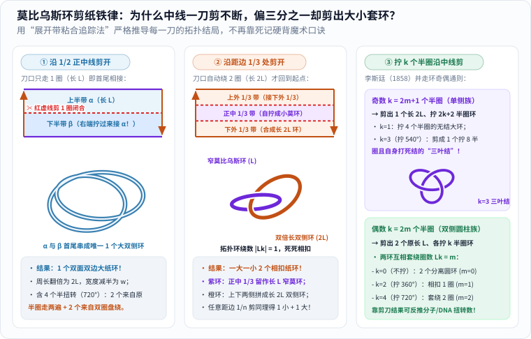
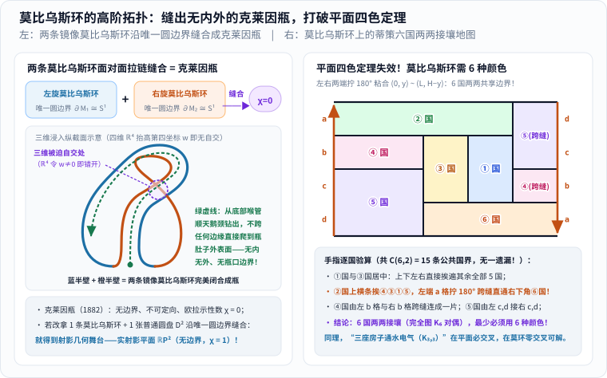
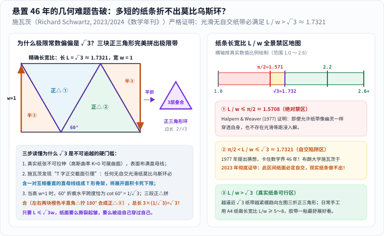
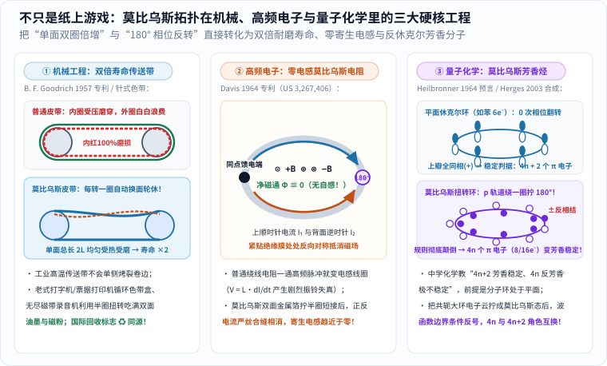

现在请先放下手机十秒钟，从手边草稿本或快递单上撕下一根细长纸条。

如果直接把纸条两头对齐粘成一个普通圆纸圈——这没什么稀奇：它有清清楚楚的“内圈”和“外圈”两个面，也有上下两条互不相干的圆边。一只小蚂蚁要是落在外圈，只要守规矩不翻越上下边缘，爬到天荒地老也休想踏进内圈半步。

但如果在涂胶水之前，你把右手捏着的那一端轻轻**拧转半圈（$$180^\circ$$）**再粘上去——奇迹就在手指松开的那一刻发生了：

你拿一支红笔按在纸带正中央一直往前画，手不抬起、笔尖也绝不越过纸边，转了一圈你会惊讶地发现：红线不知不觉钻到了出发点的“正背面”！继续往前再画第二圈，红线竟然分毫不差地回到了最初落笔的那一点——**整条纸带的正反两面彻底融成了一个面，上下两条边也莫名其妙接成了唯一一条边！**

这就是数学史上最出圈的魔术道具、也是现代拓扑学最经典的图腾——**莫比乌斯环（Möbius strip，又称莫比乌斯带）**。你在每个塑料瓶底看到的国际通用可回收标志 `♻`，在版画大师埃舍尔（M. C. Escher）笔下首尾相接爬行的红蚂蚁木刻，甚至不少科幻电影里穿越时空的时间闭环，原型全都是它。

然而，99% 的人对莫比乌斯环的印象只停留在“蚂蚁爬一圈到背面”的儿童手工课上，却不知道只要顺着这半圈扭转多追问四句，就会撞开一整座令人头皮发麻的数学与工程宝库：

1. **冠名悬案**：把纸条拧半圈这么简单的动作，古人难道两千年都没试过吗？为什么真正率先从数学上发现它、甚至连“拓扑学（Topology）”这个词都一手发明出来的学者，最后却丢掉了冠名权？
2. **剪刀魔术**：拿剪刀顺着莫比乌斯环正中央剪一圈，为什么它**根本不会一分为二**，剪出来的大纸环为什么偏偏拧了 **4 个半圈**而不是 2 个半圈？要是偏到距边缘 $$1/3$$ 处剪开，为什么又会变出**一胖一瘦死死套在一起的两个环**？
3. **规则崩塌**：在平面或地球仪上画地图，4 种颜色足够区分任何相邻国家（四色定理）；为什么一旦把地图画到莫比乌斯环上，竟然能画出 **6 个两两全都接壤的国家**？把两条莫比乌斯环面对面缝起来，又怎样变出连“里外”都消失的四维神兽**克莱因瓶**？
4. **46 年世纪难题**：越短越宽的纸条越难拧成莫比乌斯环——那么宽为 $$1$$ 的不伸缩纸条，长度 $$L$$ 至少要大于多少才能折出光滑无自交的莫比乌斯环？这道看似高中手工课就能试出来的几何题，为什么卡住了全世界顶尖几何学家整整 **46 年**，直到 **2023 年**才被彻底证完？

系好安全带，今天我们就带着一把剪刀、一支笔和一点点清爽透亮的数学，把这根拧了半圈的纸条从里到外拆个底朝天。

---

## 一、迟到两千年的半圈扭转：古罗马马赛克与哥廷根师兄弟的同月撞车

### 1. 古罗马神像与阿拉伯水车：工匠早就见过，却没人追问“为什么”

把一根带子拧半圈再接起来，在日常生活里实在太容易发生了——每次你系皮带、挂工牌绳或者给自行车装链条不小心装拧了，手里拿的其实就是一个莫比乌斯环。

考古学家和科学史家确实在古代文物里找到了它的身影（参见 [Wikipedia: Möbius strip — History](https://en.wikipedia.org/wiki/M%C3%B6bius_strip)）：

- **公元 3 世纪上半叶的古罗马马赛克**：在意大利森蒂努姆（Sentinum）出土、如今收藏于德国慕尼黑古代雕塑展览馆（Glyptothek）的一幅巨型地面马赛克镶嵌画上，掌管永恒时间的神祇艾翁（Aion）站在一圈绘满黄道十二宫的环形彩带中央——而那条代表时间周而复始的黄道圆环，恰恰在上方拧了一个标准的 $$180^\circ$$ 半扭转！
- **公元 1206 年的阿拉伯机械图谱**：中世纪最杰出的穆斯林工程师贾扎里（Ismail al-Jazari）在其名著《精巧机械装置知识之书》里绘制链式提水泵时，画师笔下的传动链带同样呈现出莫比乌斯环式的半圈翻转构型。

但正如我们在[彭赛列与射影几何]()以及[非欧几何]()里反复看到的那样：**“工匠眼睛里见过某个形状”与“数学家意识到它打破了空间公理”，中间往往隔着上千年的思想鸿沟。** 古典欧几里得几何只关心长度、角度和面积，从来没有人把“一个曲面到底有几个面、能不能定义统一的正反朝向”当成严格的数学定理来研究。

### 2. 1858 年夏秋之交：高斯门下两位弟子的神奇独立撞车

真正把这根纸条请进现代数学殿堂的，是 19 世纪德国两位同样曾在哥廷根天文台追随“数学王子”[卡尔·弗里德里希·高斯]()求学的师兄弟——而且两人几乎在同一年的前后脚独立捅破了窗户纸（史实脉络详见圣安德鲁斯大学 [MacTutor 数学史档案：Listing 传](https://mathshistory.st-andrews.ac.uk/Biographies/Listing/)与 [Möbius 传](https://mathshistory.st-andrews.ac.uk/Biographies/Mobius/)）：

1. **早两个月发现、早四年发表的“拓扑学命名人”李斯廷（Johann Benedict Listing, 1808–1882）**：
   李斯廷出身寒微（父亲是做刷子的手艺人），靠艺术基金会的资助才读完书，1830 年进入哥廷根大学后深得高斯赏识。受高斯关于空间纽结与位置几何（*Geometria situs*）谈话的启发，李斯廷在 **1836 年**写给中学恩师米勒（Müller）的长信里，嫌拉丁旧名太拗口，人类历史上第一次造出了希腊合成词 **“Topologie（拓扑学）”**，并在 **1847 年**正式出版专著《拓扑学初探》（*Vorstudien zur Topologie*，单行本印行于 1848 年）。
   **1858 年 7 月**，李斯廷在笔记中率先记录了半圈扭转纸带的单侧奇异性，不仅研究了拧 1 个半圈的纸带，还一路算出了拧任意多个半圈再剪开的“并走环（Paradromic rings）”通则，并于 **1861 年**（1862 年正式刊印于哥廷根科学院院刊专论《空间复形的普查》*Der Census räumlicher Complexe*）公开发表！顺便说一句，“微米（micron）”和地球物理学里的“大地水准面（geoid）”这两个词，竟然也都是这位奇才造出来的。
2. **安静打磨、最终赢得冠名的莫比乌斯（August Ferdinand Möbius, 1790–1868）**：
   比李斯廷年长 18 岁的莫比乌斯是马丁·路德母系后裔，早年在哥廷根跟高斯学过天文，后长期担任莱比锡大学天文学教授兼天文台台长，毕生绝大部分几何名篇（包括创立齐次坐标的《重心演算》）都发表在我们此前讲过的传奇期刊[《克列尔杂志》]()上。
   就在李斯廷写下笔记仅仅两个月后的 **1858 年 9 月**，68 岁的莫比乌斯为了应征巴黎科学院关于“多面体几何理论”的悬赏大奖，独立发现了单侧曲面与这根半扭转纸带！莫比乌斯在 **1865 年**发表的论文《论多面体体积的确定》（*Über die Bestimmung des Inhaltes eines Polyëders*）中率先从“无法给相邻三角面片赋予一致转向以定义体积正负”的深刻角度公开剖析了单侧不可定向性；而他提交给巴黎科学院的那份完整手稿，直到他 1868 年去世后才在遗物中被整理出来，收入 **1885–1887 年**出版的《莫比乌斯全集》。

为什么明明无论按发现月份（1858 年 7 月 vs 9 月）还是首次公开发表年份（1861/1862 年 vs 1865 年），李斯廷都略早一步，全世界却偏偏叫它“莫比乌斯环”？

一方面，李斯廷夫妇在哥廷根常年深陷债务官司，在德国学术圈人缘颇受牵连，论文写法又偏重繁复的空间复形计数；另一方面，莫比乌斯在 1865 年论文里把“单侧曲面”与**定向（Orientation）、多面体体积符号坍塌**绑在了一起，一针见血抓住了现代微分几何与代数拓扑的命门，巴黎科学院遗稿重见天日后更引起巨大轰动。历史就这样阴差阳错地把桂冠戴在了莫比乌斯头上——但今天当我们提起这根神奇纸条时，理应同时向这两位哥廷根师兄弟致敬。

---

## 二、正反面和上下边去哪儿了？从基本矩形粘合到法向量 $$720^\circ$$ 双圈归位

手工粘纸条只要三秒钟，但要想真正看懂后面所有剪纸魔术和四维空间缝合，我们必须学会拓扑学家最拿手的绝活——**不要在三维空间里死盯拧麻花的立体形状，而是把纸条摊平回一张长方形，只看左右两头是怎么配对粘合的！**

_左图把纸条摊平为基本矩形 $$[0, L] \times [-w, w]$$：普通圆柱环左右同向粘合（橙色箭头同朝上），上下蓝绿两边各自成环、顺时针表盘 $$\circlearrowright$$ 跨过接缝方向不变；莫比乌斯环右端翻转 $$180^\circ$$ 反向粘合（左朝上、右朝下），结果上边 $$P\to Q$$ 与下边 $$Q\to P$$ 首尾串成唯一一条长 $$2L$$ 的边，顺时针表盘 $$\circlearrowright$$ 跨过接缝直接上下颠倒变成逆时针 $$\circlearrowleft$$！右图为三维参数曲面 $$R=1, w=0.38$$ 在仰角 $$33^\circ$$ 下的正交投影及法向量绕行 $$4\pi$$（$$720^\circ$$）双圈归位单次动画（开启系统“减少动态效果”时直接展示完整双圈轨迹）。[单独打开大图（刷新可重播动画）](/assets/images/mobius-strip/gluing-and-normal-flip-anim.svg)。_

### 1. 第一步：追着四个角走一遍，看两条边怎样合成唯一一条 $$2L$$ 长边

看上图左侧的长方形纸条，设它的长度为 $$L$$，宽度为 $$2w$$（横坐标 $$x \in [0, L]$$，纵坐标 $$y \in [-w, +w]$$）：

- **普通圆柱纸圈（同向粘合）**：把左端 $$(0, y)$$ 与右端 $$(L, y)$$ 高度一一对齐粘起来，数学记作等价关系

$$
(0,\, y) \sim (L,\, y), \qquad y \in [-w,\, w].
$$

  此时上边缘 $$(0, +w)$$ 接 $$(L, +w)$$ 自成一圈（长 $$L$$），下边缘 $$(0, -w)$$ 接 $$(L, -w)$$ 另成一圈（长 $$L$$）——上下两条边老死不相往来。
- **莫比乌斯环（反向粘合）**：把右端上下颠倒 $$180^\circ$$，让高度 $$+y$$ 去粘对面的 $$-y$$！数学上只多了一个看似不起眼的**负号**：

$$
(0,\, y) \sim (L,\, -y), \qquad y \in [-w,\, w].
$$

现在请你伸出手指，顺着左图下方黄色卡片里的紫色边缘走一趟：

1. 从左上角 $$P = (0, +w)$$ 出发，沿着实线上边缘往右走完长度 $$L$$，到达右上角 $$Q = (L, +w)$$；
2. 注意粘合法则 $$(L, +w) \sim (0, -w)$$！右上角的 $$Q$$ 和左下角的 $$Q$$ 根本就是**粘死在一起的同一个点**！所以你的手指瞬间从左下角 $$(0, -w)$$ 冒了出来，连一毫米都没跳空；
3. 继续沿着虚线下边缘往右再走完长度 $$L$$，到达右下角 $$(L, -w)$$；
4. 再用一次粘合法则 $$(L, -w) \sim (0, +w)$$——右下角正好粘回最初出发的左上角 $$P$$！

破案了！看似有“上边”和“下边”两条边，其实只是**同一根总长度为 $$2L$$ 的闭合圆圈（拓扑上同胚于单个圆周 $$S^1$$）被你折成了前后两半段**！如果你捏着莫比乌斯环的边缘用彩笔涂一圈，必须整整涂完 $$2L$$ 的路程才能回到起点，而整张纸带的所有边缘已经被你涂完了。

### 2. 第二步：“单侧面”与“不可定向”是一回事吗？表盘镜像与法向量倒立

很多科普文章会把**“只有一个面（One-sided）”**和**“不可定向（Non-orientable）”**混为一谈，其实在严格数学里，它们一个是“纸带嵌在三维空间里的外在表现”，一个是“二维扁片虫活在曲面内部就能测出来的内蕴本质”！

先看左图里的**二维扁片虫视角（内蕴不可定向性）**：
假设有一只完全没有“上下高度”概念的二维小虫，怀里揣着一块写有顺时针箭头 $$\circlearrowright$$ 的透明小怀表（比如 12 点在头顶 $$+y$$，6 点在脚底 $$-y$$，指针从 12 点向右扫过 3 点再到 6 点）。
当它推着这块怀表向右跨过莫比乌斯粘合线 $$(L, y) \sim (0, -y)$$ 回到起点时，水平前进方向没变，但纵坐标 $$y$$ 变成了 $$-y$$——头顶的 12 点与脚底的 6 点瞬间上下对调！原本顺时针旋转的怀表 $$\circlearrowright$$，在它自己眼里活生生变成了一块**逆时针旋转的镜像怀表 $$\circlearrowleft$$**！
如果这只二维扁片虫是个左撇子（心脏长在左边），沿着莫比乌斯环散步一圈回家照镜子，它会惊恐地发现自己全身器官左右翻转，变成了**右撇子（心脏跑到了右边）**！这种“在曲面上存在一条闭合回路，走一圈回来局部左右旋向发生镜像反转”的性质，才是拓扑学上严格的**不可定向性（Non-orientability）**——哪怕没有外面的三维空间，曲面自己也无法全局统一规定什么叫“顺时针”！

再看右图里的**三维空间视角（参数方程与法向量 $$720^\circ$$ 双重覆盖）**：
把半径设为 $$R$$、半宽设为 $$w$$（$$w < R$$），三维空间中标准莫比乌斯环的精确参数方程写出来极其优雅（其中绕行角 $$u \in [0, 2\pi)$$，横截宽度参数 $$v \in [-w, w]$$，可对照 [Wolfram MathWorld: Möbius Strip](https://mathworld.wolfram.com/MoebiusStrip.html)）：

$$
\begin{aligned}
x(u, v) &= \left(R + v\cos\frac{u}{2}\right)\cos u, \\
y(u, v) &= \left(R + v\cos\frac{u}{2}\right)\sin u, \\
z(u, v) &= v\sin\frac{u}{2}.
\end{aligned}
$$

为什么公式里偏偏一边是 $$\cos u, \sin u$$，另一边却是半角 $$\frac{u}{2}$$？
因为当绕行角 $$u$$ 从 $$0$$ 转满一整圈到 $$2\pi$$ 时，大圆圆心 $$(\cos u, \sin u)$$ 已经回到了起点，但横截面倾角 $$\frac{u}{2}$$ 刚好只转了 $$\pi = 180^\circ$$（半圈）！我们来算一算中轴线 $$v = 0$$ 处垂直于纸面的**单位法向量 $$\mathbf{n}(u)$$**（也就是站在纸面上的小蚂蚁头顶天线的朝向）：

$$
\begin{aligned}
\frac{\partial \mathbf{r} }{\partial u}\Big\rvert_{v=0} &= (-R\sin u,\, R\cos u,\, 0), \\
\frac{\partial \mathbf{r} }{\partial v}\Big\rvert_{v=0} &= \left(\cos\frac{u}{2}\cos u,\, \cos\frac{u}{2}\sin u,\, \sin\frac{u}{2}\right).
\end{aligned}
$$

把这两个切向量做叉乘再归一化，就得到中轴线上任意位置 $$u$$ 的单位法向量：

$$
\mathbf{n}(u) = \left(-\sin\frac{u}{2}\cos u,\; -\sin\frac{u}{2}\sin u,\; \cos\frac{u}{2}\right).
$$

把 $$u = 0$$、$$u = 2\pi$$ 和 $$u = 4\pi$$ 代进去一看，真相水落石出：

- **起点 $$u = 0$$（右图蓝色箭头 ①）**：$$\mathbf{n}(0) = (0,\, 0,\, +1)$$，蚂蚁正立在纸面上方，头顶天线笔直朝上；
- **爬满第 1 圈 $$u = 2\pi$$（右图橙色箭头 ③）**：空间落脚点 $$\mathbf{r}(2\pi, 0) = (R, 0, 0) = \mathbf{r}(0, 0)$$ 分毫不差回到了原处，但法向量变成了 $$\mathbf{n}(2\pi) = (0,\, 0,\, -1) = -\mathbf{n}(0)$$！蚂蚁根本没翻越紫色边缘，却已经**头朝下倒挂在同一处纸带的背面**！
- **继续爬满第 2 圈 $$u = 4\pi$$（绿色双圈闭合轨迹）**：$$\mathbf{n}(4\pi) = (0,\, 0,\, +1) = +\mathbf{n}(0)$$，必须整整绕行 $$4\pi = 720^\circ$$，蚂蚁才能重新正立归位！（如果你读过量子力学，看到“转 $$360^\circ$$ 变负号、转 $$720^\circ$$ 才复原”，一定会会心一笑——电子等自旋 $$1/2$$ 费米子的旋量波函数，以及我们在[拓扑电子材料]()里讲过的贝里相位，在数学结构上正是这种双重覆盖拓扑的近亲！）

顺便补充一个极其重要的小细节：**左手拧半圈和右手拧半圈粘出来的莫比乌斯环，是一模一样的吗？**
如果只论抽象二维曲面内部性质，它们完全等价；但在我们生活的三维空间 $$\mathbb{R}^3$$ 里，莫比乌斯环具有**手性（Chirality）**——左旋莫比乌斯环与右旋莫比乌斯环就像你的左手手套和右手手套，在三维空间里无论怎么平移旋转，都绝不可能重合！

---

## 三、剪刀下的拓扑惊雷：为什么正中一刀剪不断，偏三分之一却变出子母连环？

理解了“摊平矩形看粘合”，接下来就到了全家老小最适合亲手做实验的高潮环节——拿出一把剪刀，把莫比乌斯环剪开！

在动剪刀之前，你不妨先让身边人猜一猜：把一根莫比乌斯环刺破正中央，顺着中线咔嚓咔嚓一路剪回刺破点，纸带会掉成两根分离的小莫比乌斯环吗？

90% 第一次猜的人都会笃定回答：“肯定一分为二变成两个环！”——然后在一刀落定拉开纸带的瞬间目瞪口呆：**手里根本没有掉成两个环，而是变成了一个足足有两倍长的大纸环！**

为什么会这样？千万别背魔术口诀，看下面这张“展开带粘合追踪图”，十秒钟就能用你自己的眼睛严格证明它！

_三栏依次拆解莫比乌斯剪纸铁律：① 左栏沿 $$1/2$$ 正中红虚线剪开，刀口走 $$1$$ 圈（长 $$L$$）即闭合，上半带 $$\alpha$$ 在右端经 $$180^\circ$$ 粘合直接连进下半带 $$\beta$$，合成 **1 个长 $$2L$$、含 4 个半扭转的双侧大环**；② 中栏沿距边缘 $$1/3$$ 处剪开，刀口被迫走满 $$2$$ 圈（长 $$2L$$），正中 $$1/3$$ 留作**长 $$L$$ 的窄莫比乌斯环（紫）**，两侧 $$1/3$$ 拼成**长 $$2L$$ 的双侧大环（橙）**，两者以环绕数 $$\lvert\mathrm{Lk}\rvert = 1$$ 死死相扣；③ 右栏给出拧 $$k$$ 个半圈沿中线剪开的李斯廷奇偶通则，其中 $$k=3$$ 时剪出的单个大环会自己打成解不开的**三叶结**！[单独打开大图](/assets/images/mobius-strip/scissors-cut-topology.svg)。_

### 1. 第一刀：沿 $$1/2$$ 正中线剪开——为什么是 1 个大环，而且偏偏拧了 4 个半圈？

看上图左栏上方的展开矩形：红虚线沿着正中央 $$y = 0$$ 从左端 $$(0, 0)$$ 一路向右剪到 $$(L, 0)$$。

- **为什么刀口只剪 1 圈（长度 $$L$$）就剪完了？** 因为粘合法则是 $$(L, y) \sim (0, -y)$$，代入正中央 $$y = 0$$ 得 $$(L, 0) \sim (0, 0)$$！剪刀走满 1 圈刚好严丝合缝撞回最开始扎破的那个洞。
- **为什么纸带没有断成两截？** 看红虚线切出来的上下两半条窄带——上半带叫 $$\alpha$$（$$y \in (0, w]$$），下半带叫 $$\beta$$（$$y \in [-w, 0)$$）。当 $$\alpha$$ 走到最右端 $$(L, +y)$$ 时，粘合胶水把它直接粘到了最左端的 $$(0, -y)$$——也就是下半带 $$\beta$$ 的开头！而当 $$\beta$$ 走到最右端 $$(L, -y)$$ 时，胶水又把它粘回了最左端 $$\alpha$$ 的开头 $$(0, +y)$$！
  换句话说：**$$\alpha$$ 和 $$\beta$$ 首尾串联成了唯一 1 个总长为 $$2L$$、宽度减半为 $$w$$ 的大纸环！** 而且因为经历过 **2 次** $$180^\circ$$ 翻转（$$(-1) \times (-1) = +1$$），这个新大环已经彻底脱离了莫比乌斯家族，变成了一个规规矩矩**有正反两面、有内外两条边的普通双侧环**！

这里藏着一个连不少数学系本科生第一次都会算错的陷阱：**原来的莫比乌斯环拧了 1 个半圈，现在周长翻倍走过它两遍，新大环难道不该拧 $$1 + 1 = 2$$ 个半圈（$$360^\circ$$）吗？为什么实际数出来却是整整 4 个半圈（$$720^\circ$$）？！**

答案藏在微分几何与分子生物学共用的黄金定理——**卡卢加雷亚努—怀特—富勒公式（Călugăreanu–White–Fuller theorem）**里（我们在[破译 DNA 双螺旋]()的超螺旋延伸里也提过它的血脉）：任何闭合双侧窄带的两条边缘之间的总扭转，等于**局部扭转数（Twist）加上中心轴在三维空间盘绕的拧数（Writhe）**！
当你把那个紧贴在一起盘了两圈（$$4\pi$$）的双圈窄环在三维空间里拉开成一个平坦大圆圈时：

1. 原本纸带自身的半圈扭转被走了两遍，贡献了 **2 个半扭转（$$360^\circ$$）**；
2. 把原本叠成两层的双圈弹簧拉开摊平成单圈大圆的过程（Writhe 释放转化为 Twist），又额外转化出了 **2 个同向半扭转（$$360^\circ$$）**！

两者相加，$$2 + 2 = 4$$ 个半扭转（整整 $$720^\circ$$）！你现在亲手剪一刀再把大环捋平数一数扭结，保准不多不少正好 4 个半圈，物理与拓扑从不撒谎。

### 2. 第二刀：沿距边缘 $$1/3$$ 处剪开——为什么一刀剪出“大小子母连环套”？

更绝的还在后头！再粘一根全新的莫比乌斯环，这次剪刀不要扎在正中间，而是扎在**距离纸带边缘 $$1/3$$ 宽度**的地方，始终保持离边缘 $$1/3$$ 往前剪。

你会发现第一件怪事：**剪满第 1 圈时，剪刀根本没碰到起点的破口，而是从破口旁边平行的另一个三分位擦肩而过！** 你必须硬着头皮继续剪完**第 2 圈**，咔嚓一声，剪刀才终于回到最初下刀的洞口！

手一松，哗啦一声——纸带竟然变成了**一胖一瘦、死死扣在一起扯都扯不开的两个环**！为什么？看上图中栏的展开带三等分图（把宽度 $$[-w, w]$$ 切成上外带、正中带、下外带各占 $$1/3$$）：

1. **为什么刀口要走 2 圈？** 你从分界线 $$y = +w/3$$ 下刀剪到右端 $$(L, +w/3)$$，经莫比乌斯翻转 $$(L, y) \sim (0, -y)$$ 后，刀尖从左端的**另一条分界线 $$y = -w/3$$** 钻了出来！所以必须接着把 $$y = -w/3$$ 这条红虚线也从左剪到右端 $$(L, -w/3) \sim (0, +w/3)$$，刀口走满 $$2L$$ 才闭合。
2. **正中那条紫色 $$1/3$$ 窄带去哪儿了？** 它的范围是 $$y \in [-w/3, +w/3]$$，左端 $$(0, y)$$ 依然按反号粘着右端 $$(L, -y)$$——它自己原封不动保留了半圈扭转，独立成了一个**原长 $$L$$、宽为原宽 $$1/3$$ 的迷你莫比乌斯环**！
3. **上下两条橙色外侧 $$1/3$$ 窄带去哪儿了？** 跟刚才正中剪开的 $$\alpha, \beta$$ 完全同理：上外带右端翻过来接下外带左端，下外带右端翻过来接上外带左端，两条合二为一拼成了一个**双倍长 $$2L$$、拧了 4 个半圈的双侧大环**！
4. **为什么一大一小两个环会套在一起？** 因为大环的前半圈骑在紫色中心莫比乌斯环的“一侧”，后半圈绕到了它的“另一侧”，算出来两者的**高斯环绕数（Linking number）严格等于 $$\lvert\mathrm{Lk}\rvert = 1$$**（构成拓扑学著名的霍普夫链环 Hopf link）——除非把纸撕断，否则神仙也分不开它们！

（举一反三：如果沿距边缘 $$1/n$$ 处下刀呢？无论 $$n = 4, 5, 100$$，只要 $$n \ge 3$$，剪刀都会自动绕 $$2$$ 圈，剪出来的永远是 **1 个宽 $$1 - 2/n$$ 的瘦莫比乌斯中心环 + 1 个宽 $$1/n$$、长 $$2L$$ 的双侧大外环**，照样一对子母扣！）

### 3. 第三刀：李斯廷“并走环”奇偶通则——拧 3 个半圈一刀剪出“死结三叶结”！

早在 1858 年，李斯廷就没有止步于拧 1 个半圈，而是把纸条拧了任意 $$k$$ 个半圈（$$k \times 180^\circ$$）粘合，然后顺着正中线一刀剪开，总结出了如上图右栏所示的奇偶大一统铁律：

| 粘合前扭转半圈数 $$k$$ | 原纸带面数与边数 | 沿正中线一刀剪开后的拓扑结果 |
| :--- | :--- | :--- |
| **偶数 $$k = 2m$$**（如 $$0, 2, 4$$） | **2 个面、2 条边**（可定向圆柱族） | 剪成 **2 个独立双侧环**（各长 $$L$$，各含 $$k$$ 个半扭转），两环互相套绕圈数 **$$\lvert\mathrm{Lk}\rvert = m$$**！（$$k=0$$ 分离；$$k=2$$ 相扣 1 圈；$$k=4$$ 套绕 2 圈） |
| **奇数 $$k = 2m+1$$**（如 $$1, 3, 5$$） | **1 个面、1 条边**（不可定向莫比乌斯族） | 剪成 **唯一 1 个双倍长 $$2L$$ 的双侧大环**，含 **$$2k + 2$$ 个半扭转**！且当 $$k \ge 3$$ 时，这根大环本身已**打成解不开的环面纽结 $$T(2, k)$$**！ |

强烈建议你今晚拿根长纸条跟孩子试一试 **$$k = 3$$（拧 $$540^\circ$$，即一圈半）** 的神迹：沿着正中线一刀剪完拉开，你手里拿着的那唯一一根长纸环（含 $$2\times 3 + 2 = 8$$ 个半扭转），竟然在半空中自动打成了一枚漂亮的**三叶结（Trefoil knot）**——不剪断纸带绝对解不成圆圈！而在生物化学实验室里，研究环状质粒 DNA 拓扑异构酶的科学家，正是靠这种扭转与链环/纽结之间的严格对应公式，来反推纳米级分子链在看不见的反应瞬间到底拧了几个半圈。

---

## 四、跳出三维的脑洞：缝出无内外的克莱因瓶，彻底击碎平面四色定理

莫比乌斯环不仅能往窄里“剪”，还能往大里“缝”，更能直接改写地图着色的最高法则。

_左图展示 1882 年克莱因的著名构造：拿一条左旋莫比乌斯环与一条右旋莫比乌斯环，把各自唯一的那条圆边界 $$S^1$$ 像拉拉链一样面对面缝死，就得到**既无边界又无内外之分的克莱因瓶**（图中三维纵截面紫色虚线圆圈处为三维空间被迫产生的自交，一旦进入四维空间 $$\mathbb{R}^4$$ 给瓶颈赋予非零第四坐标 $$w \neq 0$$ 即可零接触穿过）；右图用严格可验算的 $$4 \times 5$$ 矩形翻转网格画出了蒂策（Tietze）六国地图，①～⑥ 六个区域两两共享国界，证明平面四色定理在莫比乌斯环上彻底失效！[单独打开大图](/assets/images/mobius-strip/klein-bottle-and-map-coloring.svg)。_

### 1. 给唯一那条边打上补丁：实射影平面 $$\mathbb{RP}^2$$ 与四维神兽“克莱因瓶”

前面我们刚刚证过：莫比乌斯环虽然古怪，但它的全部外边缘其实只是**普普通通的一个圆圈 $$S^1$$**。拓扑学家看到一个洞口是圆圈 $$S^1$$，手就痒得停不下来——要是找别的曲面顺着这条圆边界像拉拉链一样把它彻底封死，会诞生什么怪物？

**第一种缝法：1 条莫比乌斯环 + 1 张普通圆纸片 $$D^2$$ = 实射影平面 $$\mathbb{RP}^2$$**
普通圆盘 $$D^2$$ 的边界也是一个圆圈 $$S^1$$。把圆盘边缘跟莫比乌斯环唯一的圆边缘一针一线缝合起来（注意在三维空间里这步无法不自交地完成，但在抽象拓扑或四维空间里畅通无阻），你就得到了我们在[彭赛列与射影几何]()里见过的终极舞台——**实射影平面 $$\mathbb{RP}^2$$**！它的欧拉示性数是 $$\chi(\mathbb{RP}^2) = 0 + 1 = 1$$，既没有边界，也不可定向。反过来讲：**从实射影平面上随便挖掉一个小圆洞，剩下的部分就是一根莫比乌斯环！**

**第二种缝法：左旋莫比乌斯环 + 右旋莫比乌斯环 = 克莱因瓶（Klein bottle）**
**1882 年**，德国几何大师菲利克斯·克莱因（Felix Klein）提出了一个更浪漫的组合（参见 [Wikipedia: Klein bottle](https://en.wikipedia.org/wiki/Klein_bottle)）：拿一左一右两条互为镜像的莫比乌斯环，把它们各自唯一的那条圆边界面对面拉上拉链！

这一下，原本仅存的那条边也彻底消失了（$$\partial K = \varnothing$$），欧拉示性数保持 $$\chi = 0 + 0 = 0$$，诞生了大名鼎鼎的**克莱因瓶**（顺便辟个流传甚广的有趣小谣：德语原文最初叫 *Kleinsche Fläche*“克莱因曲面”，只因 *Fläche*“曲面”与 *Flasche*“瓶子”拼写只差一个字母且长相酷似歪脖酒瓶，后来干脆将错就错成了全世界通行的“克莱因瓶”！）。

看上图左侧的克莱因瓶纵截面：一只绿蚂蚁从瓶底喉管钻进去，顺着弯过来的天鹅颈一路爬，不用翻越任何瓶口边缘，就直接爬到了瓶肚子外表面——**克莱因瓶根本没有“瓶里”和“瓶外”的区别，如果你往真正的克莱因瓶里倒水，倒进去的水已经在瓶子外面了！**

为什么淘宝上买到的玻璃克莱因瓶，瓶颈总得在侧面把瓶壁“刺穿一圈”（左图紫色圆圈处）？
这可不是吹玻璃师傅手艺不精，而是三维空间 $$\mathbb{R}^3$$ 维度不够用的铁律（若三维空间里的紧致无边曲面不自交，著名的**约当—布劳威尔分离定理 Jordan–Brouwer separation theorem** 规定它必然把空间严格分成“内部”和“外部”两块，从而必然可定向！）。怎么在四维空间 $$\mathbb{R}^4 = \{(x, y, z, w) \}$$ 里瞬间消除这圈自交？道理跟平面立交桥一模一样：

- 在二维纸面上画十字路口，两条马路必定相撞自交；只要借用第三维高度 $$z$$ 架一座高架桥，上层车流 $$z = +5\ \mathrm{m}$$、下层车流 $$z = 0\ \mathrm{m}$$，就互不触碰；
- 同理，在四维空间 $$(x, y, z, w)$$ 里，只要让克莱因瓶的瓶肚壁保持第四坐标 $$w = 0$$，而在天鹅颈穿过瓶壁的那一小段轻轻把第四坐标抬高到 **$$w = +1$$**（就像在时间维度或颜色维度上错开半步），瓶颈与瓶壁的三维投影虽然重合，四维距离却整整隔着 $$1$$ 个单位，**丝毫不沾、完美无自交**！

### 2. 平面四色定理当场翻车：用手指亲自验算“六国两两接壤地图”

1852 年提出的**四色定理**告诉我们：在平面或球面上画任何地图（每个国家连通，只交于一个点不算相邻），最多只需要 **4 种颜色**就能保证相邻国家不同色。有趣的是，早在 1840 年，莫比乌斯本人就曾给学生出过一道前奏脑筋急转弯：“老国王临终立遗嘱，让五个儿子把平面国土分成 5 块，要求每两块都共享一段国界，能办到吗？”——在平面上当然办不到（平面无法嵌入五顶点完全图 $$K_5$$）。

可是一旦把地图画到莫比乌斯环上，不仅老国王的五个儿子能两两接壤，甚至连**六个儿子都能做到每两国之间都有一段实打实的公共国界**！这一著名构造由奥地利数学家海因里希·蒂策（Heinrich Tietze）于 **1910 年**给出。

为了不让大家看眼花缭乱的立体缠绕图，我们在上图右卡片里专门给出了一张**横平竖直、小学生用手指就能逐格验算的 $$4 \times 5$$ 展开网格**（左右两条橙色竖边拧 $$180^\circ$$ 粘合，左边的 `a, b, c, d` 四格翻转后分别无缝对接右边的 `a, b, c, d` 四格）：

- **① 国（蓝）与 ③ 国（黄）** 稳坐正中央：往上看挨着 ② 国，往下看挨着 ⑥ 国，左右互相挨着，同时两侧直接贴着 ④ 国和 ⑤ 国——根本不用跨接缝，就已经和其余 5 国全部接壤！
- **② 国（绿）** 占了顶上一整条：下边直接挨着 ④、③、①，右边挨着 ⑤；那它跟远在右下角的 **⑥ 国（橙）** 怎么接壤呢？看左上角标着 `a` 的绿格子——跨过左端莫比乌斯粘合线拧 $$180^\circ$$，正好严丝合缝贴在右下角标着 `a` 的 ⑥ 国格子边上！
- **④ 国（粉）** 由左侧 `b` 格与右侧 `b` 格跨缝连成一整块国土，**⑤ 国（紫）** 由左侧 `c, d` 两行与右侧 `c, d` 两行跨缝连成一整块国土，检查一下就会发现：$$\binom{6}{2} = 15$$ 对国家组合，**每一对都共享至少一整格宽度的公共边界**！

既然 6 个国家两两相邻（对偶图恰好是六顶点完全图 $$K_6$$），任何两种颜色都不能重复，**最少必须动用 6 种颜色**！根据希伍德（Heawood）与林格尔—杨斯（Ringel–Youngs）的曲面着色公式，莫比乌斯环（及实射影平面 $$\mathbb{RP}^2$$）的色数上限也恰好是 **6**——不多不少，被这张蒂策地图顶到了天花板！（更有意思的是：前面由两条莫比乌斯环缝出来的克莱因瓶虽然更大，最高却同样只需要 **6 种颜色**，它是整个曲面着色公式里唯一一个不取上限 `7` 而只取 `6` 的特例——富兰克林定理！）

顺便再送一个聚会必杀技：小时候大家都玩过一道逼疯无数人的连线题——**“平地上有 A、B、C 三座房子和 水、电、气 三个总站，要求每座房子都连上水电气共 9 根管线，管线绝不准交叉”**（二分完全图 $$K_{3,3}$$）。在平面纸上谁画谁输，欧拉公式早判了它死刑；但如果你把这道题画在一根**莫比乌斯环**上，让最后那根在平面上走投无路的管线顺着半圈扭转“溜到背面绕一圈回来”，9 根管线**零交叉一次通关**！

---

## 五、卡住数学界 46 年的终极手工题：多短的纸条折不出莫比乌斯环？

前面聊的拓扑学都有一个“耍赖”的前提：把纸条当成可以任意拉长缩短的橡皮泥。

但在现实生活里，**纸不是橡皮泥！** 如果你裁一条长 $$20\ \mathrm{cm}$$、宽 $$2\ \mathrm{cm}$$（长宽比 $$L/w = 10$$）的纸条，闭着眼都能轻松粘出莫比乌斯环；可如果你拿一张正方形便签纸（长宽比 $$L/w = 1$$）硬要拧半圈把对边粘起来，纸面当场就会皱成一团麻花或者撕裂开！

于是，印第安纳大学的两位数学家本杰明·哈尔彭（Benjamin Halpern）与查尔斯·韦弗（Charles Weaver）在 **1977 年**正式向全世界的几何学家抛出了一个看似简单得不可思议的问题：

> **假设有一张绝对柔软、但既不准拉伸也不准撕裂起皱的理想光滑纸条，宽度为 $$w$$，长度为 $$L$$。要想在三维空间里把它弯成一根光滑且不自己穿过自己的莫比乌斯环，长宽比 $$L / w$$ 最小必须大于多少？**

_左图精确画出长 $$L = \sqrt{3} \approx 1.7321$$、宽 $$w = 1$$ 的极限矩形纸条：沿三条与底边成 $$60^\circ$$ 的紫色虚线折痕折叠，中间刚好切出两块边长为 $$2/\sqrt{3}$$ 的完整正三角形 ①、②，左右两端剩下的两块橙色半直角三角形经 $$180^\circ$$ 翻转粘合后拼成第 ③ 块全等正三角形，三层叠合成右侧那个边长 $$2/\sqrt{3}$$ 的平折正三角形莫比乌斯环；右图按真实数值比例标出 $$\pi/2$$ 与 $$\sqrt{3}$$ 两大生死分界线。[单独打开大图](/assets/images/mobius-strip/paper-aspect-ratio-sqrt3.svg)。_

### 1. 为什么真纸条这么难算？高斯“绝妙定理”给纸面戴上的紧箍咒

这道题之所以难倒英雄汉，全怪我们在[高斯文章]()和[非欧几何文章]()里讲过的**高斯绝妙定理（Theorema Egregium）**：

平坦纸张本身的高斯曲率处处为零（$$K \equiv 0$$）。只要不拉伸、不压缩、不起尖锐死折，无论你把纸条在空中拧得多么妖娆，它表面每一点的高斯曲率依然必须严格保持 **$$K = 0$$**（微分几何称为**光滑等距嵌入可展曲面 Smooth isometrically embedded developable surface**）！
而 $$K = 0$$ 意味着：弯折后的莫比乌斯环表面不能像乒乓球那样鼓包，也不能像马鞍那样双向反翘，**它全身上下必须由无数根笔直不弯的线段（直母线 Rulings）像竹简一样紧密编织而成**！

1977 年，哈尔彭与韦弗算出了第一道门槛，也留下了一道著名的猜想：

- 他们成功证明了：就算允许纸面像幽灵一样自己穿过自己（光滑等距**浸入**），长宽比也必须满足 **$$L / w > \frac{\pi}{2} \approx 1.5708$$**；
- 而对于现实中**绝对不允许自己穿过自己**（光滑等距**嵌入**）的真纸条，他们通过把长 $$L = \sqrt{3}$$、宽 $$1$$ 的纸条平折成一个三层叠合的正三角形（如上图左侧），猜想下确界必然是：

$$
\frac{L}{w} > \sqrt{3} \approx 1.73205\cdots
$$

看一眼上图左侧的几何算术，你立刻就能体会 $$\sqrt{3}$$ 这个数字有多么天衣无缝：
设纸条高度（宽度）$$w = 1$$。从左上角以与长边成 $$60^\circ$$ 的角度斜向下折第一道折痕，跨到下边缘时水平前进了多少？直角三角形里 $$\cot 60^\circ = \frac{1}{\sqrt{3} }$$，斜边折痕长恰好是 $$\frac{1}{\sin 60^\circ} = \frac{2}{\sqrt{3} }$$！
紧接着以 $$60^\circ$$ 斜向上折第二道、再斜向下折第三道：

- 中间切出来的蓝三角 ① 和绿三角 ②，三条边长全都是 $$\frac{2}{\sqrt{3} }$$，是两块分毫不差的**标准正三角形**；
- 最左边剩下的橙色直角三角形（底 $$\frac{1}{\sqrt{3} }$$、高 $$1$$）与最右边剩下的橙色直角三角形，顺着莫比乌斯环 $$180^\circ$$ 翻转粘合线一拼，斜边对斜边、直角边对直角边，合成了**第 ③ 块标准正三角形**！
- 总长度刚好是三段 $$\frac{1}{\sqrt{3} }$$ 相加：

$$
L_{\min} = 3 \times \frac{1}{\sqrt{3} } = \sqrt{3} \approx 1.7321!
$$

### 2. 46 年接力与 2023 年终极一击：“T 字正交骨架引理”一锤定音

“折痕极限能做到 $$\sqrt{3}$$”小学生都能折出来；但**“凭什么不存在某种极其狡猾的三维空间平滑扭曲姿势，让长宽比 $$1.72$$ 甚至 $$1.65$$ 的纸条也能不自交地粘成莫比乌斯环？”**——要堵死无穷维函数空间里的所有可能性，成了困扰几何分析学界近半个世纪的硬骨头！

整整 46 年间，无数数学家前赴后继试图逼近 $$\sqrt{3}$$，直到 **2023 年 8 月**，美国布朗大学数学家**理查德·埃文·施瓦茨（Richard Evan Schwartz）**贴出了轰动数学界的论文《最优纸莫比乌斯带》（*The Optimal Paper Moebius Band*，[arXiv:2308.12641](https://arxiv.org/abs/2308.12641)，2024 年 10 月定稿并被数学界最高殿堂期刊《数学年刊》*Annals of Mathematics* 正式接收发表），终于彻底终结了哈尔彭—韦弗猜想！

更富有戏剧性的是施瓦茨破题的经历：他从 2020 年起死磕这道题四年，最初甚至因为把纸莫比乌斯环剪开摊平的时候**画错了一步示意图**（误以为剪开后一定是平行四边形，漏算了一般梯形！），导致早期下界卡在 $$1.69$$ 附近上不去；发现失误重头再来后，他找到了全篇证明最闪耀的钥匙——**“T 字正交直母线引理（T-pattern lemma）”**：

1. 在任何光滑无自交的纸莫比乌斯环表面，连续追踪直母线构成的梯形分割区域，利用拓扑介值性质可以严格证明：纸带内部**必然存在一对在三维空间里互相垂直（夹角 $$90^\circ$$）且端点相接呈“T 字形”的直母线与边界弦**；
2. 一旦锁死这副三维空间里的刚性“T 字骨架”，再要求纸带其余部分绕回来粘合时既不能拉长也不能撞穿这副 T 字架，通过精妙的分块面积下界不等式一算，展开矩形的长度就死死卡在了 **$$L / w > \sqrt{3}$$** 之上！
3. 而且当一列光滑无自交纸莫比乌斯环的长宽比无限逼近 $$\sqrt{3}$$ 时，它们在三维空间里的形状必定收敛到左图那枚平折的**正三角形莫比乌斯环**！

一道拿张餐巾纸就能比划出来的生活小问题，背后竟然直通《数学年刊》级别的现代几何证明——这就是数学最迷人的地方。

---

## 六、不只是纸上魔术：双倍寿命皮带、零电感脉冲电阻与颠覆化学课本的芳香分子

读到这里你可能会问：莫比乌斯环除了给数学家拿大奖、给魔术师变戏法，在硬核工业与前沿科学里真有不可替代的用武之地吗？

不仅有，而且每一次出场都精准利用了它**“单面总长翻倍 $$2L$$”**或**“绕一圈相位反转 $$180^\circ$$”**的独门绝技！

_三栏拆解莫比乌斯拓扑在工程与自然科学里的三大实战机制：① 机械工程利用单面双圈轮换让皮带与打印色带磨损减半、寿命翻倍；② 高频电子工程利用正反电流紧贴对流实现净磁通 $$\Phi \equiv 0$$ 的无感电阻；③ 量子化学利用共轭 $$p$$ 轨道半圈扭转引入一次波函数节面反相，把休克尔 $$4n+2$$ 芳香规则彻底反转为 $$4n$$ 芳香稳定！[单独打开大图](/assets/images/mobius-strip/engineering-and-chemistry-mobius.svg)。_

### 1. 机械与存储工程：让皮带、色带与磁带寿命直接翻倍

在工厂流水线和矿山高温输送机上，普通环形橡胶皮带有一个天生的短板：紧贴滚轮的“内表面”日夜承受剧烈摩擦与烘烤，很快就磨穿龟裂，而朝外的另一面明明还完好如新，整根皮带却只能报废。

**1957 年**，美国百路驰轮胎橡胶公司（B. F. Goodrich Company）专门为**莫比乌斯传送带**申请并拿下了专利（US Patent 2,784,834 等）：安装皮带时故意拧半圈再扣合！这样皮带每转过一圈，原本贴着滚轮受苦的那一面就自动翻到外侧散热休息，全长 $$2L$$ 的唯一表面均匀分担磨损，也不用担心双面受热不均导致皮带卷边跑偏，使用寿命直接拉长近一倍！

老一代程序员、银行柜员和广播电台工程师更对它倍感亲切：银行柜台咔哒作响的**针式票据打印机循环色带盒**，打开外壳一定能看到一小段精巧的 $$180^\circ$$ 导轨把尼龙色带拧成莫比乌斯环，让撞针把正反两面的油墨吃干榨净；20 世纪中期连续循环播放背景音乐的**无尽磁带匣（Endless tape cartridge）**，同样靠莫比乌斯扭转在一盘单卷磁带上录下了双倍时长的轨道。

### 2. 高频电子工程：自己抵消自己磁场的“莫比乌斯无感电阻”

在雷达发射机、核物理高速脉冲采样和高频射频电路里，工程师最头疼的敌人叫**寄生电感（Parasitic inductance）**。普通的精密电阻是用电阻丝一圈圈绕在瓷管上的，平时测直流电阻准得很，可一旦通上纳秒级陡峭脉冲电流 $$\frac{\mathrm{d}I}{\mathrm{d}t}$$，绕线线圈瞬间变身电磁铁，感应电动势 $$V = L \frac{\mathrm{d}I}{\mathrm{d}t}$$ 会激起剧烈的电压尖峰和振铃失真。

**1964 年**，美国桑迪亚实验室工程师理查德·戴维斯（Richard L. Davis）发明了一款堪称艺术品的**莫比乌斯电阻（Möbius resistor，美国专利 US 3,267,406**，参见 [Wikipedia: Möbius resistor](https://en.wikipedia.org/wiki/M%C3%B6bius_resistor)）：

1. 取一条超薄绝缘电介质薄膜带，正反两面都贴满导电金属电阻箔；
2. 把整条夹心带拧转 $$180^\circ$$ 首尾焊合成莫比乌斯环，然后在正对面的同一个位置上下分别引出两个焊点；
3. 通电瞬间，电流从上焊点注入后兵分两路：顺时针流过正面箔片的电流 $$I_1$$，与逆时针流过背面箔片的电流 $$I_2$$，隔着薄如蝉翼的绝缘膜**在空间每一点都大小相等、方向严格相反**！

右手螺旋定则一比划：正面电流产生的磁场 $$+\mathbf{B}$$ 与背面电流产生的磁场 $$-\mathbf{B}$$ 当场严丝合缝同归于尽，净磁通量 $$\Phi \equiv 0$$！这枚小小的莫比乌斯贴片，就这样靠纯正的拓扑对称性造出了近乎零自感、零辐射的理想高频电阻。

### 3. 量子有机化学：把 $$4n + 2$$ 芳香规则颠倒成 $$4n$$ 的“莫比乌斯芳香烃”

如果你学过高中或大学有机化学，一定背过那条统治苯环家族的金科玉律——**休克尔规则（Hückel's rule，1931）**：平面单环共轭多烯只有拥有 **$$4n + 2$$** 个 $$\pi$$ 电子（如苯有 $$6$$ 个电子，$$n = 1$$）才格外稳定、具有芳香性；而如果拥有 **$$4n$$** 个 $$\pi$$ 电子（如环丁二烯 $$4$$ 个、平面环辛四烯 $$8$$ 个），则会沦为极不稳定的“反芳香性”分子！

但就在戴维斯发明莫比乌斯电阻的同一年（**1964 年**），瑞士苏黎世联邦理工学院理论化学家埃德加·海尔布隆纳（Edgar Heilbronner）用量子力学薛定谔方程算出了一个惊世骇俗的预言（参见 [Wikipedia: Möbius aromaticity](https://en.wikipedia.org/wiki/M%C3%B6bius_aromaticity)）：

- 休克尔 $$4n + 2$$ 规则之所以成立，是因为平面分子环上的碳原子 $$p$$ 轨道全部并排竖立（上瓣全为正号 $$+$$，下瓣全为负号 $$-$$），电子波函数绕环一圈满足**周期边界条件 $$\psi(\theta + 2\pi) = +\psi(\theta)$$**，最低能级独自占 1 个轨道（装 2 个电子），往上每层成对简并各装 4 个电子，凑满闭壳层正好是 $$2 + 4n$$！
- 如果我们合成出一个足够大的共轭碳环，让一圈 $$p$$ 轨道顺着环路慢慢旋转半圈（$$180^\circ$$）形成**莫比乌斯电子云拓扑**，那么最后首尾相接处就会出现一次 $$+$$ 瓣碰 $$-$$ 瓣的**反周期边界条件 $$\psi(\theta + 2\pi) = -\psi(\theta)$$**！
- 波函数边界条件多这一个负号，所有分子轨道能级瞬间成双成对简并，最低层直接就能稳稳装下 4 个电子——**芳香性判据彻底倒转为 $$4n$$ 个 $$\pi$$ 电子极其稳定，而 $$4n + 2$$ 反而变成不稳定！**

由于碳碳双键强行扭转极易断裂，化学家们苦苦追寻了将近四十年。直到 **2003 年**，德国基尔大学化学家赖纳·赫格斯（Rainer Herges）团队在《自然》（*Nature*）杂志宣布：通过巧妙嫁接刚性桥环骨架与共轭多烯链，人类终于在烧瓶里首次合成并分离出了第一例室温稳定存在的结晶态 **$$16\pi$$ 电子（$$4 \times 4$$）莫比乌斯芳香烃分子**！此后，分子莫比乌斯带、分子三叶结乃至光学超表面里的电磁莫比乌斯偏振环相继承出不穷（与我们在[拓扑电子材料]()里看到的动量空间拓扑遥相呼应）。

---

## 七、收尾：今晚就撕一张纸，带孩子玩三场五分钟实验

回望这根简简单单的纸条，你会发现人类认识它的每一步都闪着好奇心的火花：
1858 年两位高斯传人在书桌前把纸条拧了半圈，撞开了现代拓扑学“不可定向流形”的大门；剪刀咔嚓两下，展露出微分几何扭转数与环绕数的守恒铁律；把两条纸环拉链一缝，我们的思维就已经稳稳站在了四维空间 $$\mathbb{R}^4$$ 的高架桥上；而一句“纸条最短能有多短”，竟逼出了 2023 年《数学年刊》上的巅峰证明。

最棒的是，所有这些高深莫测的定理，今晚吃完晚饭你只需要**一张 A4 纸、一把儿童安全剪刀、一卷透明胶带和一支彩笔**，就能在餐桌上亲手复现：

1. **第一关（画线找面）**：裁两条宽 $$2.5\ \mathrm{cm}$$、长 $$28\ \mathrm{cm}$$（A4 长边）的纸条，一条平粘、一条拧半圈粘。让孩子拿水彩笔在两条纸环中间赛跑画线，亲眼见证哪一条不翻边就把正反面全涂满；
2. **第二关（两刀盲猜）**：先沿莫比乌斯环正中线剪一刀，数一数变出来的大环到底拧了几个半圈（验证 $$2 + 2 = 4$$！）；再粘一条新的，沿离边缘 $$1/3$$ 处剪开，看一大一小两个套环跳出来的瞬间孩子惊喜的尖叫；
3. **第三关（挑战 $$\sqrt{3}$$ 折纸极限）**：裁一条宽 $$5\ \mathrm{cm}$$、长 $$8.7\ \mathrm{cm}$$（$$8.7 / 5 = 1.74 \approx \sqrt{3}$$！）的短纸条，照着第五节左图的三道 $$60^\circ$$ 折痕亲手折出那枚三层叠合的**正三角形极限莫比乌斯环**，摸一摸这道难倒数学界 46 年的定理在指尖绷紧的触感！

---

## 参考资料与核查来源

1. **莫比乌斯与李斯廷的发现史及一次文献信息**：
   - O'Connor, J. J. & Robertson, E. F., [*Johann Benedict Listing*](https://mathshistory.st-andrews.ac.uk/Biographies/Listing/) 与 [*August Ferdinand Möbius*](https://mathshistory.st-andrews.ac.uk/Biographies/Mobius/), *MacTutor History of Mathematics Archive*, University of St Andrews（核查李斯廷 1836 年信件首创“Topologie”、1847 年《拓扑学初探》、1858 年独立发现及 1861/1862 年《空间复形的普查》发表脉络，以及莫比乌斯师从高斯、莱比锡天文台生涯、1840 年五王子分地问题、1858 年巴黎科学院应征手稿与 1885–1887 年全集出版史实）。
   - Wikipedia, [*Möbius strip*](https://en.wikipedia.org/wiki/M%C3%B6bius_strip)（核查公元 3 世纪森蒂努姆古罗马艾翁马赛克、1206 年贾扎里链泵图谱、1858 年 7 月与 9 月发现细节、蒂策六色区域与三通问题 $$K_{3,3}$$ 嵌入、工业皮带与回收标志等背景）。
2. **莫比乌斯环参数曲面、代数方程、剪纸拓扑与克莱因瓶缝合**：
   - Weisstein, E. W., [*Möbius Strip*](https://mathworld.wolfram.com/MoebiusStrip.html), *MathWorld — A Wolfram Web Resource*（核查三维参数方程、边界 $$0\to 4\pi$$ 积分、实射影平面圆盘缝合及李斯廷并走环剪切规律）。
   - Wikipedia, [*Klein bottle*](https://en.wikipedia.org/wiki/Klein_bottle)（核查 1882 年菲利克斯·克莱因构造、两条镜像莫比乌斯环沿单圆边界缝合、欧拉示性数 $$\chi = 0$$、四维空间 $$\mathbb{R}^4$$ 消除自交原理及六色富兰克林例外定理）。
3. **最优纸莫比乌斯带 $$\sqrt{3}$$ 猜想（1977–2023/2024）**：
   - Schwartz, Richard Evan (2023/2024), [*The Optimal Paper Moebius Band*](https://arxiv.org/abs/2308.12641), arXiv:2308.12641 [math.MG], accepted for publication in *Annals of Mathematics*（核查哈尔彭与韦弗 1977 年 $$\pi/2$$ 浸入下界与 $$\sqrt{3}$$ 嵌入猜想、T 字正交直母线骨架引理及平折正三角形收敛极限）。
4. **无感莫比乌斯电阻与莫比乌斯芳香烃化学合成**：
   - Wikipedia, [*Möbius resistor*](https://en.wikipedia.org/wiki/M%C3%B6bius_resistor)（核查 Richard L. Davis 1964 年无感电阻设计与美国专利 US 3,267,406 正反电流对消磁通机制）。
   - Wikipedia, [*Möbius aromaticity*](https://en.wikipedia.org/wiki/M%C3%B6bius_aromaticity)（核查 Edgar Heilbronner 1964 年 $$4n$$ 芳香性量子化学预言，以及 Rainer Herges 团队 2003 年在 *Nature* 发表的首例室温稳定结晶态莫比乌斯芳香烃合成）。
