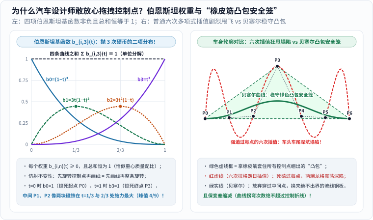
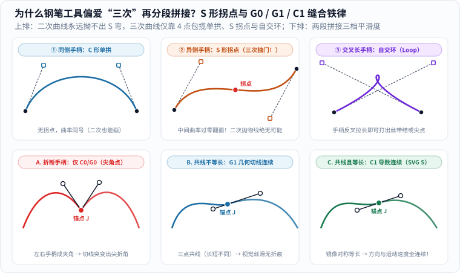
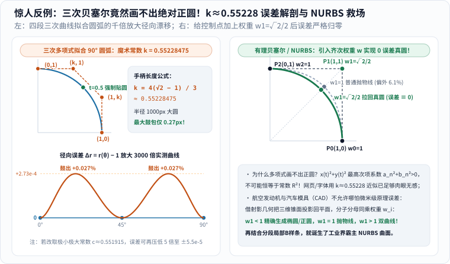
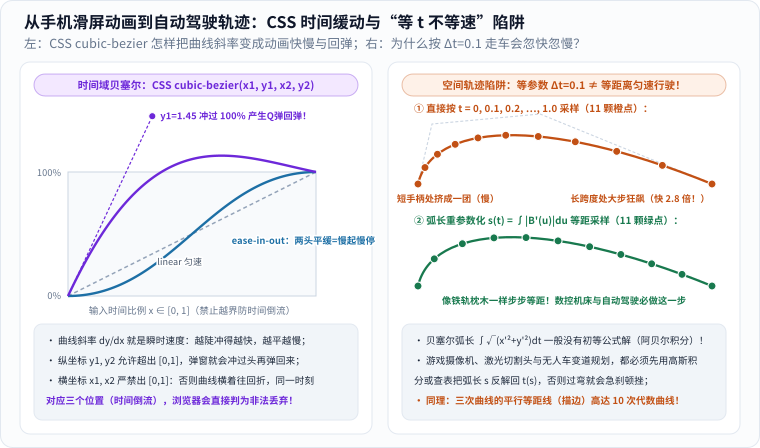

打开手机读到这一行字时，你不妨把页面放大到 500% 仔细盯一眼那个“圆”字或者英文字母“S”的边缘——无论怎么放大，笔画转弯处永远像刀裁出来一样光滑锐利，半点马赛克锯齿都没有。

在上一篇拆解[图片与视频格式底层密码]()的文章里，我们见过 SVG 矢量图代码里那一串神秘的 `M`、`Q`、`C`、`S` 指令；只要你用过 Photoshop、Illustrator、Figma 或 PPT 里的“钢笔工具”，也一定对锚点两边那两根像天线一样可以来回拖拽的“小手柄”既爱又恨。更神奇的是：你手指划过手机屏幕时菜单栏富有弹性的回弹动画、3D 角色挥剑的动作缓动、甚至数控铣床削出汽车流线型引擎盖与无人车变道规划，全都被同一套短短一行的公式统治着——**贝塞尔曲线（Bézier curve）**。

但只要稍微往深处追问三句，一连串反直觉的谜团就会冒出来：

1. **没有圆规、甚至不算正余弦，只拿一把直尺不断“按比例点点连线”，凭什么能无中生有折出光滑曲线？** 为什么最早在 1959 年发明这套神级算法的人，最后却把曲线的冠名权拱手让给了竞争对手车厂的工程师？
2. **既然两点确定直线、三点确定抛物线，为什么设计师画一条长长的车身曲线不干脆用“二十次多项式”一步到位，而偏偏死磕“四个点一段”的三次贝塞尔？** 为什么拖拽控制手柄时，曲线就像关在隐形笼子里一样绝不会失控乱飞？
3. **最颠覆常识的两记暴击**：号称“能描摹万物轮廓”的三次贝塞尔曲线，**在数学上竟然永远画不出一个真正的正圆**（你每天在网页 SVG 和字体里看到的圆，其实全都在偷偷“鼓包”！）而且如果你让一辆自动驾驶汽车顺着贝塞尔曲线按 $$t=0, 0.1, 0.2, \dots, 1.0$$ 均匀往前开，乘客当场就会被急刹和猛蹿晃到晕车！

今天，我们就从六十多年前巴黎塞纳河畔两家汽车厂的保密暗战讲起，亲手拿直尺把这条传奇曲线一步步“折”出来。

---

## 一、两家法国车厂的“木尺烦恼”与一场迟到二十年的署名反转

### 1. 电脑诞生前，造船匠和汽车设计师怎么画流线型？

在没有计算机辅助设计（CAD）的年代，想在两米宽的图纸上画一条光滑优美的船体龙骨或汽车翼子板，是一件极度折磨人的体力活。圆规只能画死板的正圆弧，三角板只能画直线；为了画出曲率连续渐变、迎风阻力最小的流线型，欧洲工匠发明了一种叫**样条尺（Spline）**的工具——拿一根富有弹性的细长云杉木条或竹片，用好几块沉甸甸的铅铁压砣（俗称“铅鸭子” Lead Ducks）在图纸上压住几个关键点，木条在弹性弯曲能最小化的物理定律下，自然就会绷出一条丝滑的曲线。

然而到了 20 世纪 50 年代末，法国汽车工业迎来了雪铁龙 DS 那样充满未来感的流线型曲面浪潮，“木尺 + 石膏油泥模型”的传统工艺撞上了死胡同：

- **图纸与模具永远对不齐**：设计师在木尺上改一毫米，工人就要重新刮削一比一油泥主模型，再用探针一点点量回冲压钢模，稍微受潮变形或者手抖，左右两扇车门装上去就会漏风；
- **数控机床听不懂“手感”**：当时刚问世的数控铣床（NC Machine）只认冷冰冰的数字坐标，根本听不懂什么叫“把这儿的弧度修得再性感一点”。汽车工业迫切需要一种**既能让人类设计师像掰木条一样凭直觉调形状，又能让计算机毫秒级算出任意一点精确三维坐标**的数学语言。

### 2. 雪铁龙的绝密抽屉（1959）vs 雷诺的公开破圈（1962–1968）

就在巴黎相距不到十公里的两家死对头车厂里，两位素未谋面的法国人几乎同时向这道难题发起了冲锋（史实脉络详见 [Paul de Casteljau 档案条目](https://en.wikipedia.org/wiki/Paul_de_Casteljau)、[Pierre Bézier 传记](https://en.wikipedia.org/wiki/Pierre_B%C3%A9zier) 与 Pomax 开源专著 [*A Primer on Bézier Curves* 第 1 章](https://pomax.github.io/bezierinfo/#introduction)）：

- **雪铁龙（Citroën）的年轻数学家保罗·德·卡斯特里奥（Paul de Casteljau，1930–2022）**：毕业于巴黎高等师范学院的纯数学科班高手。**1959 年**，年仅 29 岁的德卡斯特里奥另辟蹊径——他没有去硬解容易算炸的高次方程组，而是用俄国数学家谢尔盖·伯恩斯坦（Sergei Bernstein）1912 年为证明魏尔斯特拉斯逼近定理构造的**伯恩斯坦多项式**，发明了一套只靠“反复取线段比例点”就能稳定画出任意曲线和曲面的几何递推算法（内部技术报告 *Outillages méthodes calcul*，1959；续篇 *Courbes et surfaces à pôles*，1963）。遗憾的是，雪铁龙高层把这项技术当成绝密商业武器锁进了保险柜，**严禁他公开发表任何论文**，这一锁就是整整十几年！
- **雷诺（Renault）的机械工程大师皮埃尔·贝塞尔（Pierre Bézier，1910–1999）**：比德卡斯特里奥年长二十岁，在雷诺干了几十年工装模具与自动化产线。从 **1960 年前后**起，贝塞尔带领团队研发 **UNISURF** 计算机辅助曲面造型系统（1966 年起陆续申请专利并公开发表论文，1968 年正式亮相，1975 年在雷诺全系车型投产）。贝塞尔最天才的工程直觉在于交互设计：**不要强迫曲线穿过每一个控制点，而是让首尾两个点钉死曲线端点，把中间的控制点变成悬在曲线外面的“磁铁手柄”**——设计师只要拉长、旋转手柄，曲线切线就乖乖跟着走！

等到 1974 年计算机图形学先驱沃尔夫冈·伯姆（Wolfgang Böhm）终于在图书馆角落翻出德卡斯特里奥早年的雪铁龙内部油印讲义、向全世界公布真相时，“**贝塞尔曲线**”这个名字早已随着雷诺的慷慨开源传遍全球。数学界与图形学界给出了一个最体面也最公正的补偿：**曲线本身叫“贝塞尔曲线”，而计算机底层最核心、最稳健的那套几何作图与分割算法，永远命名为“德卡斯特里奥算法（de Casteljau's algorithm）”**。到了 1982 年，约翰·沃诺克（John Warnock）与查克·格什克（Chuck Geschke）创立 Adobe，把**三次贝塞尔曲线**选作 PostScript 页面描述语言的唯一曲线基元；紧接着苹果与微软用**二次贝塞尔曲线**打造了 TrueType 字体，万维网联盟（W3C）又将两者一并写进 SVG 与 CSS 标准——从此，两位法国汽车人的发明搬进了全人类每一块发光的屏幕里。

---

## 二、不碰圆规，只靠一把直尺怎么折出光滑曲线？跟走德卡斯特里奥递推法

很多初学者一翻开教科书，迎面撞上一排带组合数和三次方的代数公式就头皮发麻。其实德卡斯特里奥当年的原始想法连小学生都能听懂——**整套魔法从头到尾只做一件事：在线段上按比例找分点（线性插值，Lerp）**。

### 1. 第一层地基：两个点之间的“匀速滑块”（一次贝塞尔）

假设纸上有起点 $$\mathbf{P}_0$$ 和终点 $$\mathbf{P}_1$$，我们引入一个从 $$0$$ 走到 $$1$$ 的进度旋钮 $$t \in [0, 1]$$（你可以把 $$t$$ 想象成一段路程走完的百分比：$$t=0$$ 在起点，$$t=0.35$$ 走了 $$35\%$$，$$t=1$$ 抵达终点）。那么任意进度 $$t$$ 对应的点 $$\mathbf{B}(t)$$ 就是：

$$
\mathbf{B}(t) = (1 - t)\mathbf{P}_0 + t\mathbf{P}_1, \qquad t \in [0, 1]
$$

这只是最普通的线段。精彩戏法从加入**第 3 个点**的那一刻正式开始！

### 2. 第二层惊艳（二次贝塞尔）：三颗钉子“拉线艺术”折出精确抛物线

现在在纸上不共线地钉三颗图钉 $$\mathbf{P}_0, \mathbf{P}_1, \mathbf{P}_2$$，连成两根折线段 $$\mathbf{P}_0\mathbf{P}_1$$ 和 $$\mathbf{P}_1\mathbf{P}_2$$。选定一个固定比例（比如 $$t = 0.35$$），请严格跟着做两步直尺操作：

1. **第一轮（2 变 1）**：在第一根线段 $$\mathbf{P}_0\mathbf{P}_1$$ 上量出 $$35\%$$ 分点，记作 $$\mathbf{Q}_0(t)$$；同时在第二根线段 $$\mathbf{P}_1\mathbf{P}_2$$ 上也量出同样的 $$35\%$$ 分点，记作 $$\mathbf{Q}_1(t)$$。用直尺把 $$\mathbf{Q}_0$$ 和 $$\mathbf{Q}_1$$ 连成一根绿线：

$$
\begin{aligned}
\mathbf{Q}_0(t) &= (1-t)\mathbf{P}_0 + t\mathbf{P}_1, \\
\mathbf{Q}_1(t) &= (1-t)\mathbf{P}_1 + t\mathbf{P}_2
\end{aligned}
$$

2. **第二轮（1 变落点）**：就在刚刚画出的这根绿线 $$\mathbf{Q}_0\mathbf{Q}_1$$ 上，**再取一次同样的比例 $$35\%$$**，点下红点 $$\mathbf{B}(t)$$：

$$
\mathbf{B}(t) = (1-t)\mathbf{Q}_0(t) + t\mathbf{Q}_1(t)
$$

当你把 $$t$$ 从 $$0$$ 慢慢拧到 $$1$$，神奇的事情发生了——红点 $$\mathbf{B}(t)$$ 扫出的轨迹不再是折线，而是一条**分毫不差的精确抛物线弧（二次贝塞尔曲线）**！不仅如此，每一瞬间那根搭桥绿线 $$\mathbf{Q}_0(t)\mathbf{Q}_1(t)$$，**恰好就是曲线在 $$\mathbf{B}(t)$$ 处的严格几何切线**（小时候用木板钉两排钉子交叉缠毛线的“拉线画抛物线”，就是它的包络线版本！这也是所有 TrueType `.ttf` 字库画笔画轮廓的数学真身）。

### 3. 第三层封神（三次贝塞尔）：四个点三轮递推，外加“买一送一”切割术

如果摆上 **4 个控制点** $$\mathbf{P}_0, \mathbf{P}_1, \mathbf{P}_2, \mathbf{P}_3$$（共 3 根折线段），规则半个字都不用改，只需要多做一轮“连线取比例”——**3 根蓝线取 3 个蓝点 $$\mathbf{Q}_0, \mathbf{Q}_1, \mathbf{Q}_2$$ $$\to$$ 连成 2 根绿线取 2 个绿点 $$\mathbf{R}_0, \mathbf{R}_1$$ $$\to$$ 连成最后 1 根切线取落点 $$\mathbf{B}(t)$$**！先看下面这张按精确几何坐标计算的静态对比与渐进动画图：

_先看左卡二次贝塞尔：在 `P0P1` 与 `P1P2` 上同取 `t=0.35` 得到 `Q0`、`Q1`，再在绿线 `Q0Q1` 上取 `35%` 即落点 `B(0.35)`，且绿线本身就是该点切线。再看右卡三次贝塞尔：4 个控制点经蓝（3 点）→ 绿（2 点）→ 橙（1 点）三轮线性插值画出完整曲线，并附单次渐进描迹动画（开启系统“减少动态效果”时自动定格完整终态；[单独打开原图刷新可重播](/assets/images/bezier-curve/de-casteljau-construction-anim.svg)）。_

你千万别小看这个看起来“土办法”的三角形递推——它在工业软件里藏着一个价值连城的**“买一送一”精确分割定理（Subdivision Property）**：

假设你在 $$t = 0.4$$ 处做完了上面三轮取点，手里留下了各轮最左边的点 $$\bigl(\mathbf{P}_0, \mathbf{Q}_0, \mathbf{R}_0, \mathbf{B}(0.4)\bigr)$$ 和各轮最右边的点 $$\bigl(\mathbf{B}(0.4), \mathbf{R}_1, \mathbf{Q}_2, \mathbf{P}_3\bigr)$$。德卡斯特里奥证明：**根本不需要重新拟合，这两组现成的四个点，分毫不差就是原曲线在 $$t=0.4$$ 处一刀剪开后，左半段与右半段各自独立的三次贝塞尔控制点！**

显卡与激光打印机渲染曲线时正是靠这一招“二分法”：先把曲线一剪为二，检查左右两段控制折线是不是已经足够平直；如果还弯就继续对半剪，剪上五六刀后整条曲线就变成几十段肉眼完全分辨不出折角的极短直线段，全程只用加减法和乘以 $$0.5$$（二进制移位），数值稳如泰山！

---

## 三、拆开括号竟是“抛硬币概率”！伯恩斯坦基函数与绝不出界的“凸包安全笼”

如果我们把上面三次德卡斯特里奥递推式一层层代入并拆开括号，合并 $$\mathbf{P}_0, \mathbf{P}_1, \mathbf{P}_2, \mathbf{P}_3$$ 的同类项，就会迎面撞见一个让学过概率论的人拍案叫绝的熟面孔：

$$
\begin{aligned}
\mathbf{B}(t) &= (1-t)^3 \mathbf{P}_0 + 3t(1-t)^2 \mathbf{P}_1 \\
&\quad + 3t^2(1-t) \mathbf{P}_2 + t^3 \mathbf{P}_3, \quad t \in [0, 1]
\end{aligned}
$$

等等！系数 $$1,\ 3,\ 3,\ 1$$ 加上 $$t^i(1-t)^{3-i}$$，这不就是我们在[帕斯卡怎样把一场赌局变成概率论]()里算过的**抛硬币二项分布概率**吗？！

### 1. 一般公式：把每个控制点看成有重量的“磁铁小球”

推广到任意 $$n$$ 次贝塞尔曲线（共有 $$n+1$$ 个控制点 $$\mathbf{P}_0, \mathbf{P}_1, \dots, \mathbf{P}_n$$），它的显式代数表达式就是以 **$$n$$ 次伯恩斯坦基多项式（Bernstein basis polynomials）** $$b_{i,n}(t)$$ 为权重的加权平均：

$$
\begin{aligned}
\mathbf{B}(t) &= \sum_{i=0}^{n} b_{i,n}(t)\,\mathbf{P}_i, \\
b_{i,n}(t) &= \binom{n}{i} t^i (1-t)^{n-i}, \quad t \in [0, 1]
\end{aligned}
$$

这里每一个符号都有极其直观的物理含义：

- **$$t \in [0, 1]$$**：想象一枚“正面朝上概率为 $$t$$、反面朝上概率为 $$1-t$$”的特制硬币；
- **$$b_{i,n}(t)$$**：连续抛这枚硬币 $$n$$ 次，**恰好出现 $$i$$ 次正面**的概率！以三次贝塞尔（$$n=3$$）为例：
  - 当 $$t=0$$（正面概率为 $$0$$）时，$$b_{0,3}(0)=1$$，其余三项全为 $$0$$——曲线**百分之百死死钉在起点 $$\mathbf{P}_0$$**；
  - 当 $$t = \frac{1}{3}$$ 时，对 $$b_{1,3}(t) = 3t(1-t)^2$$ 求导令其为零，恰好达到它一生中的最大吸力峰值 **$$\frac{4}{9} \approx 44.4\%$$**；同理 $$b_{2,3}(t)$$ 在 $$t = \frac{2}{3}$$ 处达到峰值 **$$\frac{4}{9}$$**；
  - 当 $$t=1$$ 时，$$b_{3,3}(1)=1$$，曲线**稳稳收官于终点 $$\mathbf{P}_3$$**。

### 2. 三大黄金护身符：为什么普通高次插值会把引擎盖“捅出大坑”，贝塞尔却稳如磐石？

为什么德卡斯特里奥和贝塞尔放着现成的“过点多项式插值（拉格朗日插值）”不用，非要用伯恩斯坦基函数？因为“抛硬币概率”天生自带三条让工程师热泪盈眶的铁律：

1. **单位分解（Partition of Unity）与仿射不变性**：把抛 $$n$$ 次硬币出现 $$0, 1, \dots, n$$ 次正面的所有概率加起来，必然覆盖全部可能事件，所以对任意 $$t$$ 恒有：

$$
\sum_{i=0}^{n} b_{i,n}(t) = \bigl[t + (1-t)\bigr]^n = 1^n \equiv 1
$$

   这意味着 $$\mathbf{B}(t)$$ 本质上是 $$n+1$$ 个控制点的**质心（重心坐标）**！在电脑里把一个 SVG 图标平移、缩放、旋转甚至斜切时，根本不用重算曲线上的成千上万个像素点——**只需要对 4 个控制点做变换，再画出来的曲线和直接变换整条曲线严格重合**！（注意：普通多项式贝塞尔只满足仿射不变性，遇到近大远小的三维**透视投影**则会变形，这正是第五节我们要请出“有理贝塞尔”的伏笔。）

2. **凸包性质（Convex Hull Property）——绝不乱飞的“橡皮筋安全笼”**：在 $$t \in [0, 1]$$ 区间内，概率不可能为负数，即每一项 $$b_{i,n}(t) \ge 0$$ 且总和为 $$1$$。根据凸几何基本定理，非负且权重和为 $$1$$ 的组合点，**永远不可能逃出所有控制点用一根橡皮筋箍住的最小凸多边形（凸包）**！
   反观“强迫一条 $$n$$ 次多项式硬穿过每一个采样点”的拉格朗日插值：只要点稍微多几个（比如 7 个点确定一条六次多项式），两端就会爆发臭名昭著的**龙格现象（Runge's phenomenon）**——中间看着挺顺，车头和车尾却毫无征兆地猛蹿上天或深陷成大坑！更有甚者，贝塞尔曲线还满足更强的**变差缩减性质（Variation Diminishing Property）**：平面上任意一条直线穿过贝塞尔曲线的次数，绝不会超过它穿过控制折线的次数——**控制折线没打哆嗦，生出来的曲线就绝对不允许无中生有地自己打哆嗦**！

_先看左卡：四条基函数曲线在 `[0,1]` 内全部大于等于 `0`，任意竖线截得的四段高度相加恒等于顶部的 `1`（单位分解），`b1` 与 `b2` 分别在 `t=1/3` 与 `t=2/3` 取得峰值 `4/9`。再看右卡同一组 7 个拱形点：红色虚线（六次拉格朗日过点插值）为了硬穿每个点在两端剧烈塌陷，而绿色实线（贝塞尔曲线）乖乖躺在外圈橡皮筋围成的绿色凸包笼子里。[单独打开大图](/assets/images/bezier-curve/bernstein-convex-hull-vs-runge.svg)。_

3. **端点切线直觉公式（钢笔手柄的物理灵魂）**：对 $$n$$ 次贝塞尔曲线求一阶导数，利用组合恒等式化简后可严格证得：

$$
\mathbf{B}'(t) = n \sum_{i=0}^{n-1} b_{i,n-1}(t)\,(\mathbf{P}_{i+1} - \mathbf{P}_i)
$$

   代入 $$t=0$$ 和 $$t=1$$，所有中间项瞬间归零，只剩首尾两根控制边：

$$
\begin{aligned}
\mathbf{B}'(0) &= n(\mathbf{P}_1 - \mathbf{P}_0), \\
\mathbf{B}'(1) &= n(\mathbf{P}_n - \mathbf{P}_{n-1})
\end{aligned}
$$

   对设计师最熟悉的**三次贝塞尔（$$n=3$$）**来说，$$\mathbf{B}'(0) = 3(\mathbf{P}_1 - \mathbf{P}_0)$$！翻译成大白话就是：**曲线从起点 $$\mathbf{P}_0$$ 出发那一刹那的方向，百分之百正对着手柄 $$\mathbf{P}_1$$；手柄拉得越长，曲线冲出去的“初速度”就越猛、贴着切线走得越远！** 数学导数第一次变成了人类手指能直接捏住拖拽的实体操纵杆。

---

## 四、为什么设计软件偏爱“三次”再分段拼接？S 形拐点与钢笔工具的三档缝合术

既然贝塞尔曲线如此听话，两个自然的问题紧跟着就来了：**为什么不用更省算力的“二次（3 个点）”，也不用一步画完一整条龙的“二十次（21 个点）”，全世界的设计软件偏偏一致把“三次（4 个点）”捧上王座？**

### 1. 二次太“犟”掰不出 S 弯，二十次又会“牵一发而动全身”

让我们从低次往高次挨个排查：

- **一次（2 点）**只能画直梆梆的折线；
- **二次（3 点，$$\mathbf{P}_0, \mathbf{P}_1, \mathbf{P}_2$$）**是一段平面**抛物线弧**。抛物线有一个致命的几何死穴：**它的二阶导数 $$\mathbf{B}''(t) = 2(\mathbf{P}_2 - 2\mathbf{P}_1 + \mathbf{P}_0)$$ 是一个与 $$t$$ 无关的常向量！** 这意味着整条二次曲线的弯曲方向从头到尾只能往同一边拱（单拱 C 形），**永远不可能在半路翻身变向画出带有“拐点（Inflection point）”的 S 形波浪，也绝对画不出自交丝带环**，在三维空间里更只能死死困在三个点张成的同一个平面上，扭不出空间螺旋线。
- **三次（4 点，$$\mathbf{P}_0, \mathbf{P}_1, \mathbf{P}_2, \mathbf{P}_3$$）恰好跨过质变门槛**！只要把两个手柄 $$\mathbf{P}_1, \mathbf{P}_2$$ 放到基线同侧就是单拱 C 弯；放到基线异侧，二阶导数就能在中间穿过零点，**只用 4 个点就优雅扭出一条丝滑的 S 形拐点曲线**；把手柄交叉拉长，甚至能打出蝴蝶结一样的**自交环（Loop）或尖点（Cusp）**！在三维空间里，4 个不共面的点还能自由扭出非平面空间曲线（正因如此，二次曲线总能无损“升阶”写成一条完全重合的三次曲线——只需令新手柄为 $$\frac{1}{3}(\mathbf{P}_0+2\mathbf{P}_1)$$ 与 $$\frac{1}{3}(2\mathbf{P}_1+\mathbf{P}_2)$$，反过来绝大多数三次曲线却永远无法无损降回二次！）。
- **那为什么不用 20 次贝塞尔一条线画完整个汉字？** 答案是两个致命缺陷：① **丧失局部控制（Local Control）**：每一项伯恩斯坦基函数 $$b_{i,20}(t)$$ 在整个 $$(0, 1)$$ 开区间内全都大于零，你只想微调汉字右上角的一点笔锋，结果左下角的撇捺也跟着微微变形；② **操控迟钝 + 数值精度吃紧**：次数 $$n$$ 越高，中间单个控制点的权重峰值越矮（例如 $$n=20$$ 时中间点最大权重只剩约 $$17.6\%$$），你把控制点拽出屏幕老远，曲线才懒洋洋动一点点，而且 $$t^{20}$$ 与巨大的二项式系数 $$\binom{20}{10}=184756$$ 在浮点数里相乘还会放大舍入误差。

因此，工业界找到了最完美的黄金工程解：**用表达力刚刚够用的“三次贝塞尔”做标准积木块，再把几十块积木头尾相接拼成任意复杂的“分段三次贝塞尔样条（Piecewise Cubic Bézier Spline）”**——改哪一段只动哪一段的 4 个点，其余段落纹丝不动！

### 2. 两段曲线怎么拼才看不出接缝？钢笔工具里的 $$G^0 / G^1 / C^1 / C^2$$ 铁律

既然要分段拼接，假设第一段曲线 $$\mathbf{B}_1$$（控制点 $$\mathbf{P}_0, \mathbf{P}_1, \mathbf{P}_2, \mathbf{P}_3$$）与第二段曲线 $$\mathbf{B}_2$$（控制点 $$\mathbf{Q}_0, \mathbf{Q}_1, \mathbf{Q}_2, \mathbf{Q}_3$$）在公共锚点 $$\mathbf{J} = \mathbf{P}_3 = \mathbf{Q}_0$$ 处会师，怎么保证接头处不会鼓出一个难看的硬折角？对照下图下排三张卡片，你在 Illustrator 或 Figma 里按住 `Alt/Option` 切换的三种锚点模式，每一档都对应严格的微分几何连续性等级（[W3C SVG 2 Paths 规范 §9.5](https://www.w3.org/TR/SVG2/paths.html#PathDataCubicBezierCommands)）：

_上排展示 4 个控制点即可包揽 C 形单拱、三次独门的 S 形拐点以及交叉长手柄自交环；下排展示两段曲线在锚点 `J` 处的三档拼接——从折断手柄产生尖角（`G0`），到三点共线消除折痕（`G1`），再到等长镜像手柄实现导数速度全连续（`C1`）。[单独打开大图](/assets/images/bezier-curve/cubic-inflection-and-spline-joins.svg)。_

- **$$C^0 / G^0$$ 位置连续（尖角锚点 Corner Point）**：只保证 $$\mathbf{P}_3 = \mathbf{Q}_0 = \mathbf{J}$$ 不断开，但左进手柄 $$\mathbf{P}_2\mathbf{J}$$ 与右出手柄 $$\mathbf{J}\mathbf{Q}_1$$ 折成一个夹角——切线方向当场突变，专用来画爱心底部的尖尖、刀刃和衬线字体的锐利笔角。
- **$$G^1$$ 几何切线连续（平滑锚点 Smooth Point，共线不等长）**：强令 **`P2 — J — Q1` 三点严格共线**（且分居 `J` 两侧），允许两边手柄一长一短：$$\mathbf{Q}_1 - \mathbf{J} = \lambda (\mathbf{J} - \mathbf{P}_2)$$（$$\lambda > 0$$）。此时左右切线单位方向向量完全一致，静态画出来的线条在肉眼看来已经丝滑无痕！
- **$$C^1$$ 参数一阶导数连续（对称锚点 Symmetric Point，共线且等长）**：在三点共线基础上，再强令左右手柄长度严格相等（$$\lambda = 1$$，即 $$\mathbf{Q}_1 = 2\mathbf{J} - \mathbf{P}_2$$）。此时不仅方向一致，连跨过接头瞬间的参数运动速度 $$\mathbf{B}_1'(1) = \mathbf{B}_2'(0)$$ 都严丝合缝！SVG 代码里贴心设计的偷懒指令 **`S x2 y2, x y`**，正是让浏览器自动替你把上一段末尾手柄关于锚点镜像对称过来，省掉一半字节。
- **进阶彩蛋：为什么跑车引擎盖只靠 $$G^1/C^1$$ 还不够，非要追求 $$G^2 / C^2$$ 曲率连续？** 在阳光展厅里，如果车身两块曲面拼接处只有切线连续（$$G^1$$），而弯曲程度（曲率 $$\kappa$$，与二阶导数相关）发生跳变——比如一段直线段（$$\kappa = 0$$）直接硬接一段正圆弧（$$\kappa = 1/R$$）——烤漆表面反射的日光灯带（斑马纹高光）就会在接缝处突然“折断一截”，一眼显得廉价！苹果产品圆角矩形图标著名的**超椭圆连续曲率圆角（Squircle）**与豪华车 A 级曲面，全都是在接头处连二阶曲率变化都抹平的 $$G^2 / G^2+$$ 拼接。

> **顺手解开一个三十年的字体江湖公案**：为什么 Windows / Android 偏爱的 **TrueType（`.ttf`）** 用二次贝塞尔，而印刷界与 Adobe 偏爱的 **PostScript / OpenType CFF（`.otf`）** 用三次贝塞尔？([Microsoft OpenType `glyf` 规范](https://learn.microsoft.com/en-us/typography/opentype/spec/glyf))
> 原来在 1980 年代末苹果与微软联手打破 Adobe 字体专利封锁时，个人电脑算力极其孱弱：二次贝塞尔每次栅格化少算一轮乘法，而且 TrueType 发明了一个绝妙的省空间奇招——当连续两个曲线外控制点 $$\mathbf{P}_1, \mathbf{P}_2$$ 需要 $$C^1$$ 平滑拼接时，中间那个曲线上锚点必然恰好是 $$\frac{1}{2}(\mathbf{P}_1 + \mathbf{P}_2)$$ 的中点，于是**字库文件干脆省略不存这个中点**，渲染时由显卡即时算中点补上！代价则是画一个 S 形字母 `S`，三次贝塞尔最少 2 段（4–6 个点）就能搞定，二次贝塞尔却必须拆成更多段小抛物线来逼近。

---

## 五、反常识第一弹：无所不能的三次贝塞尔，竟然画不出一个真正的正圆！

讲到这里，三次贝塞尔几乎像神一样无所不能。但如果你去问一位 CAD 几何内核工程师：“能用三次贝塞尔画一个严格半径为 $$1$$ 的圆吗？”他会毫不犹豫地摇头：**别说三次，哪怕给你一万次普通多项式贝塞尔曲线，也永远画不出哪怕一小段真正的正圆弧！**

### 1. 三行代数铁证：为什么多项式天生与正圆“八字不合”？

证明简单得令人震惊。假设存在一条 $$n$$ 次多项式贝塞尔曲线 $$\mathbf{B}(t) = \bigl(x(t),\, y(t)\bigr)$$（不全为常数），能够精确落在圆心在原点、半径为 $$1$$ 的单位圆上，那么对所有 $$t \in [0, 1]$$ 必须恒满足：

$$
\bigl[x(t)\bigr]^2 + \bigl[y(t)\bigr]^2 \equiv 1
$$

设 $$x(t)$$ 和 $$y(t)$$ 中最高有效次数为 $$m \ge 1$$，其 $$t^m$$ 项的实系数分别为 $$a_m$$ 和 $$b_m$$（至少有一个不为 $$0$$）。那么把等式左边展开，最高次项 $$t^{2m}$$ 的系数必然是：

$$
a_m^2 + b_m^2
$$

在实数世界里，两个不全为零的实数平方相加**严格大于零（$$a_m^2 + b_m^2 > 0$$）**，永远不可能互相抵消成 $$0$$！左边是一个货真价实的 $$2m$$ 次非零多项式，右边却是常数 $$1$$——矛盾！因此，**任何非退化的实多项式参数曲线，都不可能精确贴合哪怕百万分之一度的一小段真圆弧**。

### 2. 全世界网页与字库通用的“欺骗眼睛魔术常数”：$$k \approx 0.55228475$$

既然画不出真圆，那当你在 Figma 里拖出一个圆、或者在网页里看圆角按钮与字母 `O` 时，软件在底层到底干了什么？答案是：**把圆切成四段 $$90^\circ$$ 象限弧，用四段三次贝塞尔曲线上演一场骗过人类视网膜的顶级高仿秀！**

让我们亲手把这个著名的“魔术常数 $$k$$”算出来（详细误差分析可参阅 [Spencer Mortensen: *Approximate a circle with cubic Bézier curves*](https://spencermortensen.com/articles/bezier-circle/)）：

取第一象限单位圆弧，起点固定在 $$\mathbf{P}_0 = (1, 0)$$，终点固定在 $$\mathbf{P}_3 = (0, 1)$$。为了让四段拼成完整圆时在四个顶点处切线严格垂直水平/竖直轴，由第三节切线公式可知，第一个手柄必须竖直向上 $$\mathbf{P}_1 = (1, k)$$，第二个手柄必须水平向右 $$\mathbf{P}_2 = (k, 1)$$。现在整条曲线只剩**唯一一个未知数：手柄长度 $$k$$**！

代入三次伯恩斯坦公式，在正中间 $$t = \frac{1}{2}$$ 处（对称轴 $$45^\circ$$ 方向）：

$$
x\!\left(\tfrac{1}{2}\right) = y\!\left(\tfrac{1}{2}\right) = \frac{1 + 3 + 3k + 0}{8} = \frac{4 + 3k}{8}
$$

我们强令曲线在 $$t = \frac{1}{2}$$ 这一点也必须精确踩在真圆 $$\left(\frac{\sqrt{2} }{2},\, \frac{\sqrt{2} }{2}\right)$$ 上：

$$
\begin{aligned}
\frac{4 + 3k}{8} &= \frac{\sqrt{2} }{2} \\
\Longrightarrow \quad k &= \frac{4}{3}(\sqrt{2} - 1) \approx 0.5522847498
\end{aligned}
$$

这就是写进全球无数图形库源码里的传奇常数 **`0.55228475`**！它仿得有多真？请看下图左侧把径向误差整整放大 **3000 倍**后的实测解剖：

_先看左卡：取手柄长 `k = 4(√2−1)/3 ≈ 0.55228475` 时，三次曲线在 `0°`、`45°`、`90°` 三处精准贴圆，其余角度全部微微往外鼓，最大径向相对误差仅 `+0.0273%`（画一个半径 `1000 px` 的巨圆最多只偏出 `0.27 px`！若改取极小极大常数 `c ≈ 0.551915`，允许 `45°` 处微微内缩来平摊误差，最大偏差还能再压低 5 倍至 `±0.0055%`）。再看右卡：给二次控制点 `P1(1,1)` 乘上权重 `w1 = √2/2` 并除以分母权重和，曲线瞬间变成误差恒等于 `0` 的真圆！[单独打开大图](/assets/images/bezier-curve/circle-paradox-and-rational-nurbs.svg)。_

### 3. 航空发动机与汽车模具不接受近似：射影几何与 NURBS 如何实现“零误差真圆”？

网页和字体差个 $$0.27$$ 像素肉眼根本看不见，但波音客机的涡轮叶片、高速轴承滚道和光刻机透镜模具，在数学原理上绝不允许“高仿近似”。怎么才能不破坏贝塞尔框架，却画出**误差严格等于 $$0$$** 的正圆、椭圆和双曲线？

数学家想起了我们在[彭赛列和射影几何]()里讲过的降维打击神技：**平面上高不可攀的所有圆锥曲线，放到三维空间里看，全都只是同一个圆锥面被平面切出来的投影！**

我们可以在三维齐次坐标空间里先画一条最普通的二次多项式贝塞尔抛物线，给每个控制点 $$\mathbf{P}_i$$ 额外配一个**权重旋钮 $$w_i$$**，最后再除以 $$z$$ 坐标（即权重总和）做一次中心透视投影拍回二维平面——这就诞生了**有理贝塞尔曲线（Rational Bézier Curve）**：

$$
\mathbf{B}(t) = \frac{\displaystyle\sum_{i=0}^{n} w_i\, b_{i,n}(t)\, \mathbf{P}_i}{\displaystyle\sum_{i=0}^{n} w_i\, b_{i,n}(t)}
$$

看！一旦有了分母，刚才“多项式最高次项无法抵消”的紧箍咒瞬间解除！取右卡里最简单的三个点 $$\mathbf{P}_0=(1,0),\, \mathbf{P}_1=(1,1),\, \mathbf{P}_2=(0,1)$$，固定首尾权重 $$w_0 = w_2 = 1$$，单独把中间角点权重设为 **$$w_1 = \frac{\sqrt{2} }{2}$$**（即 $$\cos 45^\circ$$），代入上式算出：

$$
\begin{aligned}
x(t) &= \frac{(1-t)^2 + \sqrt{2}\,t(1-t)}{(1-t)^2 + \sqrt{2}\,t(1-t) + t^2}, \\
y(t) &= \frac{\sqrt{2}\,t(1-t) + t^2}{(1-t)^2 + \sqrt{2}\,t(1-t) + t^2}
\end{aligned}
$$

你拿笔把两项分子的平方加起来展开：

$$
\begin{aligned}
&(1-t)^4 + 2\sqrt{2}\,t(1-t)^3 + 4t^2(1-t)^2 \\
&\quad + 2\sqrt{2}\,t^3(1-t) + t^4
\end{aligned}
$$

**一字不差恰好等于分母的完全平方**！也就是说，对每一个 $$t \in [0, 1]$$ 都有 $$x(t)^2 + y(t)^2 \equiv 1$$，**径向误差恒等于 $$0$$**！更妙的是：

- 当 $$0 < w_1 < 1$$ 时，曲线是精确的**椭圆弧**（特例 $$w_1 = \cos(\theta/2)$$ 即精确正圆弧）；
- 当 $$w_1 = 1$$ 时，分母退化为 $$1$$，变回普通**抛物线**；
- 当 $$w_1 > 1$$ 时，曲线被强力吸向 $$\mathbf{P}_1$$，变成精确的**双曲线弧**！

把这套带权重的“有理思想（Rational）”，与自带局部控制和 $$C^2$$ 高阶曲率连续性的“非均匀 B 样条（Non-Uniform B-Spline）”合二为一，就诞生了统治现代航空航天、造船、汽车工业 CAD（如 CATIA、Rhino、SolidWorks）与电影级三维建模的终极霸主——**NURBS（非均匀有理 B 样条）**。

---

## 六、反常识第二弹：CSS 动画为什么禁止时间越界？为什么按 Δt=0.1 开车会晕车？

贝塞尔曲线不仅能画看得见的**空间形状**，还能捏造看不见的**时间节奏**。但在时间和运动控制里，藏着最后两个每天让前端程序员、游戏开发和机器人工程师踩坑的经典陷阱。

### 1. 手机滑屏的丝滑与 Q 弹：`CSS cubic-bezier(x1, y1, x2, y2)` 为什么只锁横坐标？

写过网页样式的同学都见过 `transition-timing-function: cubic-bezier(0.42, 0, 0.58, 1)`（即经典的 `ease-in-out` 慢起慢停）。它玩的是一招绝妙的“偷梁换柱”：

这里画的根本不是按钮在屏幕上的运动路线，而是一张**“横轴 $$x$$ = 真实流逝时间百分比（$$0 \to 1$$），纵轴 $$y$$ = 动画完成进度百分比（$$0\% \to 100\%$$）”的函数图像**！起点永远锁死在 $$\mathbf{P}_0=(0,0)$$，终点永远锁死在 $$\mathbf{P}_3=(1,1)$$，你填入的四个数字正是中间两个控制点 $$\mathbf{P}_1=(x_1, y_1)$$ 和 $$\mathbf{P}_2=(x_2, y_2)$$（详见 [MDN `cubic-bezier()` 官方文档](https://developer.mozilla.org/en-US/docs/Web/CSS/Reference/Values/easing-function/cubic-bezier)）：

- **斜率 $$\frac{dy}{dx}$$ 就是瞬时动画速度**：曲线躺平的地方慢如蜗牛，曲线陡峭的地方疾如闪电；
- **纵坐标 $$y_1, y_2$$ 完全允许冲出 $$[0, 1]$$**！比如设成 `cubic-bezier(0.34, 1.45, 0.64, 1.15)`，由于 $$y_1 = 1.45 > 1$$，弹窗会先一路猛冲到目标位置 $$112\%$$ 的地方，再像拴了弹簧一样优雅回弹停在 $$100\%$$，不用写一行物理引擎就能做出丝滑的 Q 弹动效！
- **但横坐标 $$x_1, x_2$$ 一旦写出 $$[0, 1]$$ 之外（比如 `x1 = -0.3` 或 `1.4`），整个 CSS 属性当场报错作废！为什么？** 因为横轴是**单向流逝的时间**！一旦 $$x_1$$ 越出 $$[0, 1]$$，三次曲线就有可能在水平方向往回折返（形成“横躺的 S 形”），导致**同一个时刻 $$x = 0.5\text{ s}$$ 竖直往上画线竟然撞上三个不同的动画位置 $$y$$**——总不能让同一个按钮在同一毫秒分身出现在三个地方、演一出“时间倒流”吧！把 $$x_1, x_2$$ 锁死在 $$[0, 1]$$ 内，正是依靠前面讲的凸包与单调导数性质，保证 $$\frac{dx}{dt} \ge 0$$ 恒不倒流。

_先看左卡时间域：灰色虚线 `linear` 斜率恒定即匀速，蓝线 `ease-in-out` 两头平中间陡实现慢起慢停，紫线 `y1=1.45` 冲破 `100%` 天花板实现过冲回弹，而横轴 `x1, x2` 严禁越出 `[0,1]` 防止时间折叠。再看右卡空间域：同一条“左短手柄、右长手柄”的轨迹，直接按 `Δt=0.1` 取 11 个点（上排橙点）在左侧挤成一团、右侧狂飙 2.8 倍；经过弧长积分重参数化后（下排绿点）才真正实现如铁轨枕木般匀速等距行驶。[单独打开大图](/assets/images/bezier-curve/css-easing-and-arclength-trap.svg)。_

### 2. 自动驾驶与数控雕刻的大坑：为什么“等 $$\Delta t$$”绝不等于“等距离匀速”？

最后看上图右侧卡片——这是无数游戏摄像机跟拍、激光切割机和无人车轨迹规划新手栽过的头号大坑：

假设你给无人车规划了一条三次贝塞尔变道曲线 $$\mathbf{B}(t)$$，为了让车“匀速”开过去，你在代码里写了个循环，每隔 $$0.1$$ 秒把参数 $$t$$ 加上 $$0.05$$（$$t = 0, 0.05, 0.10, \dots, 1.0$$）。车一动起来，车里乘客瞬间东倒西歪——**在控制手柄短的地方车慢得像堵车，到了控制手柄长的地方突然一脚地板油狂飙出去近 3 倍速！**

原因就在于：**参数 $$t$$ 只是一个代数插值滑块，根本不是曲线的真实物理路程（弧长 $$s$$）！** 沿着曲线累计走过的真实物理距离 $$s(t)$$，必须对瞬时速率向量的模长做积分：

$$
\begin{aligned}
s(t) &= \int_0^t \lVert \mathbf{B}'(u) \rVert \, du \\
&= \int_0^t \sqrt{\bigl[x'(u)\bigr]^2 + \bigl[y'(u)\bigr]^2} \, du
\end{aligned}
$$

对于三次贝塞尔曲线，$$x'(u)$$ 和 $$y'(u)$$ 都是二次多项式，平方相加塞进根号里，就变成了一个**根号下四次多项式的积分**：

$$
\int \sqrt{A u^4 + B u^3 + C u^2 + D u + E}\,du
$$

在微积分里，这叫**椭圆积分 / 超椭圆积分**，早在 19 世纪阿贝尔与刘维尔就已经证明：**它一般根本不存在由加减乘除、根号、三角函数和对数拼出来的初等闭式反函数公式！**

那真实的自动驾驶控制器、3D 打印喷头和游戏引擎是怎么让物体真正匀速沿着贝塞尔曲线走的呢？答案是**弧长重参数化（Arc-length Reparameterization）**：

1. 先用高精度数值积分（如**高斯—勒让德求积 Gauss–Legendre quadrature**，仅取 5 个高斯点就能把单段三次曲线弧长算到小数点后五六位精度！）算出总长 $$L = s(1)$$，并建一张紧凑的“$$t_k \leftrightarrow s_k$$ 里程对照表”；
2. 运行时根据真实车速算出当前应该走到的目标里程 $$s_{\text{target} }$$，用二分查找加一次**牛顿迭代** $$t_{\text{new} } = t - \frac{s(t) - s_{\text{target} } }{\lVert \mathbf{B}'(t) \rVert}$$，在几微秒内反查出精确对应的参数 $$t^*$$，从而让每一个采样步长都像铁轨枕木一样分毫不差！

> **顺手再揭秘一个图形学冷知识：给一条三次贝塞尔曲线“加粗描边（Stroke / Offset Curve）”有多难？**
> 你以为把一条三次贝塞尔曲线往两侧平行外扩 $$5\text{ px}$$ 画一条等宽马路边线，得到的还是三次贝塞尔曲线吗？**又错了！** 因为外扩法向量 $$\mathbf{n}(t)$$ 的分母里同样带着根号 $$\sqrt{x'(t)^2 + y'(t)^2}$$，代数几何学家早已算清：一条 $$n$$ 次多项式贝塞尔曲线的严格平行等距线，在一般情况下是一条高达 **$$4n - 2$$ 次**的代数曲线——对于 $$n=3$$ 的三次贝塞尔，它的精确描边轮廓竟然是一条**十次（10th-degree）代数曲线**，有时还会在急转弯内侧自己打出燕尾状的自交死结（Cusp）！所以今天 Illustrator、Skia（Chrome 渲染引擎）和字体引擎在渲染粗描边时，全都要在底层先切碎曲线，再用自适应分段贝塞尔去做高精度逼近（详见 [Pomax *Primer* §Offsetting a curve](https://pomax.github.io/bezierinfo/#offsetting)）。

---

## 七、一张总表收官：四类常见曲线的底牌与分工

从 1959 年雪铁龙保密柜里的手稿，到今天你指尖滑动的每一帧画面，这门“只用直尺取比例”的艺术之所以统治数字世界六十余年，是因为它在**人类直觉（手柄切线 + 凸包笼子）**与**机器算力（纯加减乘递推 + 二分切割）**之间找到了最优雅的平衡点。最后用一张速查表帮你把家族成员一次认全：

| 曲线类型 | 典型代表与标准写法 | 核心本领与独门绝技 | 天生局限与常见使用场景 |
| :--- | :--- | :--- | :--- |
| **二次多项式贝塞尔** （$$n=2$$，3 个控制点） | SVG `Q` / `T` 指令、TrueType `.ttf` 字体 | 运算极省；连续手柄可隐去共线中点省一半存储 | 本质是平面抛物线弧，**无拐点（画不出单段 S 弯）**，也画不出真圆 |
| **三次多项式贝塞尔** （$$n=3$$，4 个控制点） | SVG `C` / `S`、PostScript `.otf`、Figma 钢笔、CSS `cubic-bezier` | **表达力与简洁度黄金甜点**：4 点包揽单拱、S 拐点、自交环与三维扭曲 | 画圆仅有约 $$0.027\%$$（或 $$0.0055\%$$）高仿近似；等 $$\Delta t$$ 不等弧长；平行描边升至 10 次 |
| **分段三次样条** （Piecewise Cubic Spline） | 矢量插画路径、自动驾驶与机械臂轨迹规划 | **局部控制**（改一段不动全局），配合 $$G^1/C^1/G^2$$ 接头无缝延伸 | 工业高光曲面需额外求解三对角方程组保证 $$C^2$$ 曲率连续 |
| **有理贝塞尔 / NURBS** （引入齐次权重 $$w_i$$） | CATIA、Rhino、SolidWorks、航空与汽车模具 CAD | 借射影几何投影，**零误差精确统一**直线、正圆、椭圆、抛物线、双曲线与自由曲面 | 公式含分母商法则求导较重，网页与日常平面设计无需杀鸡用牛刀 |

如果你想亲手拖一拖控制点、看看德卡斯特里奥三角形和十次平行描边曲线怎么实时跳动，强烈推荐在电脑浏览器打开图形学开源经典交互书 [**Pomax: *A Primer on Bézier Curves***](https://pomax.github.io/bezierinfo/)（开源免费，网页内交互画布需开启 JavaScript；即使不打开外站，对照本文上面五张实算图也已涵盖全部核心推导）。下次再用钢笔工具拉出那两根小天线时，你看到的就不再是两根莫名其妙的细线，而是伯恩斯坦抛出的三枚硬币、德卡斯特里奥折出的三层比例尺，以及六十多年前巴黎塞纳河畔那场改变数字世界的浪漫接力。

---

## 参考资料

1. **Pomax (Mike Kamermans)**, [*A Primer on Bézier Curves*](https://pomax.github.io/bezierinfo/)（在线开源交互专著，全面涵盖贝塞尔曲线历史、德卡斯特里奥算法与二分分割、伯恩斯坦基多项式与凸包/变差缩减性质、曲率与拐点分类、圆弧逼近、弧长高斯求积重参数化及平行等距曲线，需浏览器开启 JavaScript 运行交互演示）。
2. **W3C Recommendation / Candidate Recommendation**, [*Scalable Vector Graphics (SVG) 2 — Chapter 9: Paths*](https://www.w3.org/TR/SVG2/paths.html)（万维网联盟官方标准，定义 SVG `<path>` 中三次贝塞尔 `C`/`S` 与二次贝塞尔 `Q`/`T` 指令语法及镜像控制点 $$C^1$$ 拼接规则）。
3. **MDN Web Docs**, [`cubic-bezier()` CSS Easing Function Reference](https://developer.mozilla.org/en-US/docs/Web/CSS/Reference/Values/easing-function/cubic-bezier)（权威 Web 标准文档，明确规定时间轴控制点横坐标 $$x_1, x_2 \in [0, 1]$$ 的单值时间约束及纵坐标越界回弹机制）。
4. **Spencer Mortensen**, [*Approximate a circle with cubic Bézier curves*](https://spencermortensen.com/articles/bezier-circle/)（严格推导四段三次贝塞尔拟合单位圆的经典常数 $$k = \frac{4}{3}(\sqrt{2}-1) \approx 0.55228475$$ 最大径向误差 $$+2.725 \times 10^{-4}$$，以及极小极大优化常数 $$c \approx 0.55191502$$ 将最大径向偏差再降 5 倍至 $$\pm 5.51 \times 10^{-5}$$ 的完整过程）。
5. **Microsoft Typography Specification**, [*OpenType Specification — `glyf` (Glyf Data)*](https://learn.microsoft.com/en-us/typography/opentype/spec/glyf) 与 [*TrueType Fundamentals (Ch. 1)*](https://learn.microsoft.com/en-us/typography/opentype/spec/ttch01)（官方字库格式规范，详述 TrueType 二次贝塞尔轮廓表示及连续曲线外控制点隐含中点压缩机制）。
6. **Wikipedia Mathematical & Historical Entries**, [*Bézier curve*](https://en.wikipedia.org/wiki/B%C3%A9zier_curve)、[*De Casteljau's algorithm*](https://en.wikipedia.org/wiki/De_Casteljau%27s_algorithm)、[*Paul de Casteljau*](https://en.wikipedia.org/wiki/Paul_de_Casteljau) 与 [*Pierre Bézier*](https://en.wikipedia.org/wiki/Pierre_B%C3%A9zier)（核查 1912 年伯恩斯坦多项式、1959 年雪铁龙内部技术报告、1960–1975 年雷诺 UNISURF 研发投产时间线、有理贝塞尔齐次坐标圆锥曲线表示及平行等距曲线 $$4n-2$$ 代数次数结论）。
