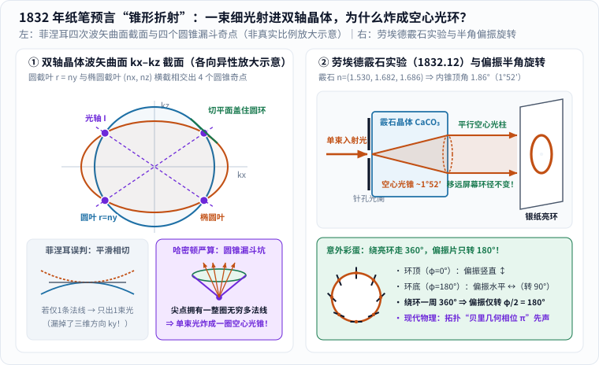
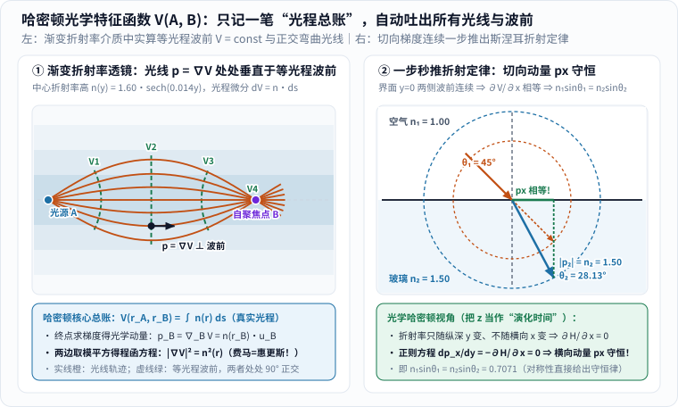
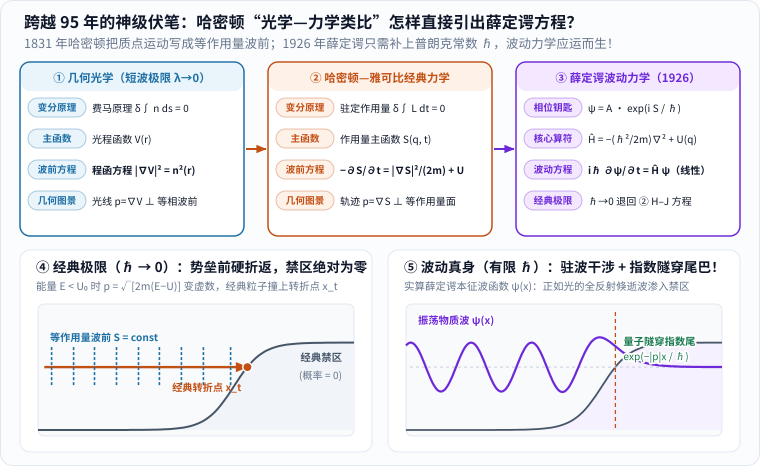
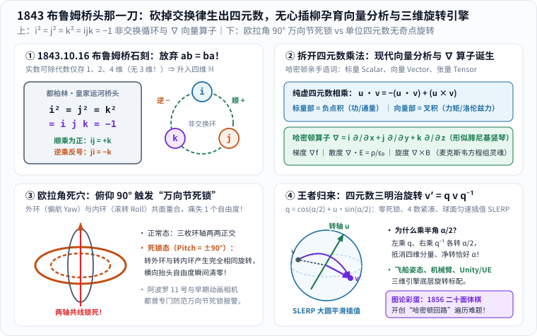

如果让你在物理学和数学的所有公式里挑一个“出场率最高的大写字母”，答案大概率不是牛顿的 $$F$$，也不是爱因斯坦的 $$E$$，而是**$$H$$**。

翻开大学物理课本：分析力学里统管全局的总能量函数叫**哈密顿量 $$H(q, p)$$**；量子力学薛定谔方程 $$i\hbar\frac{\partial \psi}{\partial t} = \hat{H}\psi$$ 正中央坐镇的算符叫**哈密顿算符 $$\hat{H}$$**；电磁学麦克斯韦方程组里无处不在的倒三角微分算子 $$\nabla$$ 叫**哈密顿算子**；翻开航天姿态控制与 Unity、Unreal 三维游戏引擎源码，避免相机转到 $$90^\circ$$ 卡死的旋转数据结构叫**哈密顿四元数 $$\mathbb{H}$$**；哪怕合上物理书翻开计算机算法教材，图论里著名的 NP 完全难题“不重复走遍所有顶点”，也叫**哈密顿回路** [[1]](#ref-1)[[2]](#ref-2)！

这些看似八竿子打不着的领地，全都指向同一位生活在 19 世纪爱尔兰都柏林的天才——**威廉·罗恩·哈密顿（Sir William Rowan Hamilton，1805—1865）**。

更传奇的是，这位重写了半部现代数学物理语言的宗师，最初的人生剧本本来是去学东方语言当外交官，年轻时还一心想当浪漫主义诗人；他在 21 岁本科尚未毕业时就被破格任命为皇家天文学家，却笨手笨脚不擅长熬夜调望远镜——可偏偏就是他，只靠一支笔和几页四次代数曲面方程，在人类历史上第一次**纯粹用数学推演预言了一种闻所未闻的光学奇观**：把一束极细的阳光射进一块透明晶体，它既不会走直线，也不会分成两束，而是会在石头肚子里硬生生炸开成一顶**空心圆锥**，穿出晶体后在银纸屏上印出一枚耀眼的**空心光环** [[3]](#ref-3)[[4]](#ref-4)！

一束好端端的光，凭什么会在透明石头里炸成空心圆环？一套原本用来算透镜光路的光学账本，怎么摇身一变接管了行星与单摆的力学，还在九十多年后成了量子力学破壳而出的引信？而在运河石桥上被他拔出小刀刻下的 $$i^2 = j^2 = k^2 = ijk = -1$$，到底砍掉了数学界延续千年的哪条铁律？今天，我们就顺着五座环环相扣的路标，走进哈密顿波澜壮阔的科学世界。

---

## 一、从败给心算神童到 21 岁皇家天文学家：一张草稿纸怎样算出“空心光环”？

### 1. 一场八岁心算败仗点亮的数学奇才，与诗人华兹华斯的苦劝

1805 年 8 月 4 日，哈密顿出生在爱尔兰都柏林。因为父亲常年奔波经商，小威廉刚满 3 岁就被送到特里姆（Trim）小镇，由担任当地教会学校校长的叔父詹姆斯·哈密顿抚养教育 [[1]](#ref-1)。

叔父是个狂热的语言教育家，很快发现这个侄子拥有恐怖的记忆力：5 岁能读拉丁语、希腊语和希伯来语；到了 12 岁上下，他已经涉猎了法语、意大利语、阿拉伯语、梵语、波斯语乃至马拉地语和马来语等十几种语言——父亲原本盘算着等他长大，送进东印度公司当一名通晓东方诸语的官员 [[1]](#ref-1)。

扭转他一生的转折点，发生在 **1813 年 9 月**。当时美国巡回展演的 9 岁“心算神童”泽拉·科尔本（Zerah Colburn）来到都柏林，大人们兴冲冲把 8 岁的语言神童哈密顿推上台，跟科尔本现场比试心算多位数乘法与开方。结果，小哈密顿输得心服口服 [[1]](#ref-1)。

这场败仗非但没有打击他，反而彻底点燃了他的好胜心——他更想知道科尔本脑子里那些速算窍门背后的**数学道理**。13 岁读克莱罗的法文《代数》，15 岁啃牛顿《原理》与[拉普拉斯的巨著《天体力学》]()；到了 **1822 年（年仅 17 岁）**，哈密顿竟然在拉普拉斯证明“力的平行四边形法则”的推导里揪出了一处隐蔽的逻辑漏洞！一位友人把他的批注拿给当时的爱尔兰皇家天文学家约翰·布林克利（John Brinkley）过目，布林克利读罢拍案惊叹 [[1]](#ref-1)：

> “这位年轻人——我不是说他**将来会成为**，而是说他**现在就已经是**当代第一流的数学家。”

1823 年哈密顿以榜首考入都柏林圣三一学院，创下校史罕见的古典文学与自然科学双料最高荣誉（Double Optime）。1825 年初恋凯瑟琳·迪斯尼（Catherine Disney）因家命被迫另嫁他人，痛彻心扉的哈密顿一度靠狂写诗歌排遣苦闷，并在 1827 年结识了英国浪漫主义大诗人威廉·华兹华斯（William Wordsworth）。两人彻夜漫步畅谈后，华兹华斯读完哈密顿的诗稿，诚恳而慈爱地写信劝他：你有真挚的诗心，但你真正无可替代的天赋在科学，千万别把全部精力分给写诗——在最高级的数学与自然哲学里，同样藏着壮丽的诗篇 [[1]](#ref-1)。

就在同一年（**1827 年 6 月**），爱尔兰皇家天文学家席位空缺，连后来担任英国皇家天文学家的乔治·艾里（George Airy）都参与了角逐。圣三一学院董事会最终做出了一个震动学界的决定：直接聘任**年仅 21 岁、连本科毕业证都还没领到的大学生哈密顿**出任安德鲁斯天文学教授兼爱尔兰皇家天文学家，入驻邓辛克天文台（Dunsink Observatory）[[1]](#ref-1)[[2]](#ref-2)！

### 2. 菲涅耳漏掉的四个“漏斗坑”：1832 年预言双轴晶体锥形折射

搬进天文台后，事实很快证明哈密顿确实不是个称职的夜间观测员——钻进冰冷的圆顶观测室常让他伤风感冒，他真正如鱼得水的战场，是书桌上的**理论几何光学** [[1]](#ref-1)。

大家都见过普通玻璃折射光线：一束光斜射进去，折成**一条**光线；如果换成冰洲石（方解石），一束光射进去会一分为二，透过石头看字会出现双影，这叫**双折射**。原因在于冰洲石是“单轴晶体”：沿着唯一那条特殊方向（光轴），两层光波传播速度相等，双折射消失，一束光进去还是一束光。

那么，如果换成内部结构更不对称、拥有三个不同主折射率 $$n_x < n_y < n_z$$ 的**双轴晶体**（比如斜方晶系的碳酸钙矿物**霰石 Aragonite**，主折射率约为 $$n_x = 1.5301,\ n_y = 1.6816,\ n_z = 1.6859$$）呢 [[3]](#ref-3)[[4]](#ref-4)？

法国波动光学巨匠奥古斯丁·菲涅耳（Augustin-Jean Fresnel）此前已经推导出双轴晶体的四次波矢曲面（Fresnel Wave Surface）：点光源发出的光在晶体内会同时向外胀开成内外两层曲面。在 $$k_x\text{–}k_z$$ 对称截面上，一层截面是半径为 $$n_y$$ 的**正圆**，另一层截面是半轴为 $$n_z$$ 和 $$n_x$$ 的**椭圆**；因为 $$n_x < n_y < n_z$$，正圆与椭圆必定在四个对称点处交叉穿过！

菲涅耳凭直觉以为，这四个交点处两层曲面的贴合方式跟冰洲石差不多，只是普通的平滑接触——顶多一束光走过去还是保持一束光。

**1832 年秋**，27 岁的哈密顿用他独创的光学特征函数，把第三维坐标 $$k_y$$ 也严丝合缝地算了进去，结果在草稿纸上撞见了一个连菲涅耳都漏掉的惊人几何真相 [[3]](#ref-3)：

_先看左图：在双轴晶体的 $$k_x\text{–}k_z$$ 截面上（为看清交叉结构，左图对折射率差做了放大示意），蓝色圆叶与橙色椭圆叶并非平滑相切，而是横截相交出 4 个紫色的**圆锥漏斗奇点**！一旦还原回三维空间，每个奇点处不再只有唯一一条法线，而是竖起了一整圈无穷多条法线，顶端还恰好能盖上一张相切的绿色圆环平面。再看右图：当单束细光对准光轴射入平行切磨的霰石晶体（$$n_x=1.5301, n_y=1.6816, n_z=1.6859$$），光束在晶体内张开成顶角约 $$1^\circ 52'$$ 的空心光锥，折射出晶体后化作直径恒定的平行空心光柱，在银纸屏上投出耀眼亮环，且沿环走满 $$360^\circ$$ 偏振方向恰好只转 $$180^\circ$$。_

把上图左下方那组对比看明白，你就抓住了整件事最妙的机关：

1. **为什么普通点只出一条光线？** 在波矢曲面光滑的地方，每一点只有**唯一一条法线方向**（代表能量真正传播的群速度／光线方向），所以一个波矢对应一条折射线。
2. **圆锥尖点处发生了什么？** 哈密顿严格算出，在那四个特殊交点附近，双层曲面在三维空间里对顶凹陷成了**圆锥漏斗坑（Conoidal Funnel Points）**！想想削尖的铅笔头或者漏斗尖底——在尖点处没有单一法线，而是绕着尖点**立起了一整圈圆锥形的法线族**；反过来，拿一块平面从外头盖在这处凹坑口上，切点也不是一个点，而是**一整圈封闭的圆环** [[3]](#ref-3)！
3. **算出精确顶角**：把双轴晶体的三个主折射率代入哈密顿给出的内锥形折射顶角公式：

$$
\tan A_{\text{内} } = n_y^2 \sqrt{\left(\frac{1}{n_x^2} - \frac{1}{n_y^2}\right)\left(\frac{1}{n_y^2} - \frac{1}{n_z^2}\right)}
$$

   我们拿霰石对黄光的真实主折射率 $$n_x = 1.5301,\ n_y = 1.6816,\ n_z = 1.6859$$ 现场按一下计算器：第一项括号约为 $$0.4271 - 0.3536 = 0.0735$$，第二项括号约为 $$0.3536 - 0.3518 = 0.00180$$，开根号乘上 $$n_y^2 \approx 2.8278$$，得到 $$\tan A_{\text{内} } \approx 0.03254$$，即内锥顶角 $$A_{\text{内} } \approx 1.86^\circ$$（约 **$$1^\circ 52'$$**，与哈密顿当年按鲁德贝里折射率表算出的约 $$1^\circ 50'$$ 分毫不差）[[3]](#ref-3)[[4]](#ref-4)！

### 3. 1832 年 12 月 14 日的那枚银纸亮环：“我相信它，是因为我证明了它”

**1832 年 10 月 22 日**，哈密顿在爱尔兰皇家科学院正式宣读《光线系统论第三补篇》，向全世界抛出了这个听起来像天方夜谭的预言，并拜托圣三一学院实验物理学教授**汉弗莱·劳埃德（Humphrey Lloyd）**动手检验 [[3]](#ref-3)[[4]](#ref-4)。

劳埃德一开始拿手头太薄的矿物薄片试了几次，只看到模糊光斑；直到从伦敦著名光学仪器商多伦德（Dollond）那里重金求来一块纯净度极高、平行切磨的厚霰石晶体，用针孔挡板把阳光收成极细的一束，微调晶体倾角对准光轴——**1832 年 12 月 14 日**，奇迹出现了 [[4]](#ref-4)：

当倾角刚刚卡进光轴的那一刹那，原本分立的两个小亮点突然像绽放的烟花一样拉长、弯曲、首尾相接，在贴着银纸的接收屏上合成了一枚**中心全黑、边缘璀璨的完整空心光环**！把接收屏往后挪远，在内锥形折射配置下，这枚光环的直径竟然**纹丝不涨**——因为光在穿出平行晶体表面时，已经从空心圆锥折成了笔直的**空心圆柱** [[3]](#ref-3)[[4]](#ref-4)！

劳埃德还顺手测出了哈密顿一并预言的偏振奇观：拿检偏器贴着亮环检查，环最顶端的偏振方向若是竖直的，转到环最底端（方位角转了 $$180^\circ$$），偏振方向刚好变成水平（只转了 $$90^\circ$$）；绕着光环走满一整圈 $$360^\circ$$，光波的偏振矢量竟然**只转了半圈 $$180^\circ$$**！直到一百五十多年后的 20 世纪末，迈克尔·贝里（Sir Michael Berry）等物理学家才恍然认出：哈密顿在 1832 年抓到的这个圆锥奇点，正是现代凝聚态物理（如石墨烯狄拉克锥）与量子光学中最经典的**“魔鬼点”（Diabolical Point）与拓扑几何相位 $$\pi$$** [[5]](#ref-5)！

这是科学史上第一次与牛顿引力之外的理论预言比肩的壮举（比勒维耶和亚当斯靠笔尖算出海王星还要早整整 14 年！）。威廉·惠威尔赞叹它“在科学史上几乎找不到第二个先例”，哈密顿本人也在 1835 年年仅 30 岁时受封爵士。面对旁人的惊叹，哈密顿留下过一句极具数学家风骨的感慨：如果只是亲眼看到这种怪现象而没有算过，我反倒不敢相信自己的眼睛；**我相信它，是因为我在数学上证明了它** [[1]](#ref-1)[[3]](#ref-3)。

---

## 二、把千百条光线装进“一个函数”：光学特征函数怎样统一费马与惠更斯？

哈密顿凭什么能看到连菲涅耳都没看见的圆锥漏斗？秘密不在于他算三角函数比别人手快，而在于他在 21 岁提交的成名作《光线系统论》（*Theory of Systems of Rays*，1827 年宣读、1828 年刊印）里，彻底换掉了光学的记账方式 [[2]](#ref-2)[[3]](#ref-3)。

### 1. 传统追光线的苦差事 vs 哈密顿的“光程总账函数 $$V$$”

在哈密顿之前，光学工程师设计一架多镜片天文望远镜，得像打台球一样：挑一条入射光线，在第一块球面玻璃上列一次斯涅耳折射定律 $$n_1\sin\theta_1 = n_2\sin\theta_2$$，算出一堆反三角函数，再追到第二面、第三面……稍微换个入射角，几页纸全得重算。

哈密顿问了一个极具颠覆性的问题：**既然所有真实光线都遵守[费马最短时间原理]()，我们干脆别管中间怎么折了，直接把起点 $$A$$ 到终点 $$B$$ 沿真实光路走过的“总光程”记成一个二元函数，会怎样？**

他把这个函数命名为**点特征函数（Characteristic Function）** $$V(\mathbf{r}_A, \mathbf{r}_B)$$ [[2]](#ref-2)[[3]](#ref-3)：

$$
V(\mathbf{r}_A, \mathbf{r}_B) = \int_A^B n(\mathbf{r})\,ds
$$

式子里的物理量非常直观：

- $$ds$$ 是光线走过的一小段几何弧长（单位 $$\mathrm{m}$$）；
- $$n(\mathbf{r}) = \frac{c}{v(\mathbf{r})}$$ 是位置 $$\mathbf{r}$$ 处的折射率（光在真空速度 $$c$$ 与介质速度 $$v$$ 之比，无量纲）；
- 因为走完一小段的时间是 $$dt = \frac{ds}{v} = \frac{n\,ds}{c}$$，所以积分 $$V = \int n\,ds = c \int dt$$ 就是**光在同样时间内本可以在真空中跑出的距离**（即**光程**，单位 $$\mathrm{m}$$）。

千万别小看这笔看似平平无奇的“光程总账”！哈密顿紧接着用[变分法]()做了一次漂亮的端点微扰：保持起点 $$\mathbf{r}_A$$ 不动，把终点 $$\mathbf{r}_B$$ 轻轻挪动一小步 $$d\mathbf{r}_B$$。由于中间那段真实光路已经让积分取到驻值（一阶变分为零！），光程的改变量 $$dV$$ **只取决于终点那一步投影在光线切线方向 $$\hat{\mathbf{u} }_B$$ 上的分量** [[3]](#ref-3)：

$$
dV = n(\mathbf{r}_B)\,\hat{\mathbf{u} }_B \cdot d\mathbf{r}_B - n(\mathbf{r}_A)\,\hat{\mathbf{u} }_A \cdot d\mathbf{r}_A
$$

读懂这行等式，奇迹瞬间发生——固定起点 $$\mathbf{r}_A$$（令 $$d\mathbf{r}_A = \mathbf{0}$$），对终点坐标求梯度，当场吐出了终点处光线的方向与折射率之积（哈密顿称之为“法慢度分量”，现代光学直接叫**光学动量 $$\mathbf{p}$$**）：

$$
\mathbf{p}_B = \nabla_B V = n(\mathbf{r}_B)\,\hat{\mathbf{u} }_B
$$

因为 $$\hat{\mathbf{u} }_B$$ 是长度为 $$1$$ 的单位方向向量，两边同时取模长平方，立刻得到几何光学的最高统帅——**程函方程（Eikonal Equation）**：

$$
\lvert \nabla V \rvert^2 = \left(\frac{\partial V}{\partial x}\right)^2 + \left(\frac{\partial V}{\partial y}\right)^2 + \left(\frac{\partial V}{\partial z}\right)^2 = n^2(\mathbf{r})
$$

_先看左图：在中心折射率高、上下两侧折射率低的双曲正割渐变折射率光纤（$$n(y)=1.60\operatorname{sech}(0.0135y)$$）中，四阶龙格—库塔法精确算出的橙色弯曲光线总会自动向中心高折射率轴弯折并在焦点 $$B$$ 重新汇聚；绿色虚线是等光程波前 $$V = \text{常数}$$，在任意交点处，光学动量 $$\mathbf{p} = \nabla V$$ 都与波前保持严格的 $$90^\circ$$ 正交。再看右图：当光线从空气（$$n_1=1.00,\ \theta_1=45^\circ$$）射入玻璃（$$n_2=1.50$$），界面横向平移不变保证切向梯度 $$p_x = \partial V/\partial x$$ 连续相等（绿色水平段相同），落在半径为 $$1.50$$ 的蓝色动量圆上直接锁死折射角 $$\theta_2 = 28.13^\circ$$。_

### 2. 一箭双雕：费马粒子说与惠更斯波动说握手言和，顺手秒推折射定律

看一眼左图里橙色光线与绿色虚线的垂直网格，争论了一百多年的两派光学图景在哈密顿笔下彻底融为一体：

- **顺着橙色实线看（光线视角）**：光线总是沿着梯度 $$\nabla V$$ 走，抢占时间驻值（费马原理）；
- **顺着绿色虚线看（波前视角）**：满足 $$V(\mathbf{r}) = \text{常数}$$ 的等值面，恰恰是光从起点 $$A$$ 出发在同一时刻抵达的**惠更斯等相位波前**！在微积分里，函数的梯度 $$\nabla V$$ 天生处处垂直于等值面 $$V = \text{常数}$$——这就用一行公式严格证明了**各向同性介质中光线必定处处垂直于波前**（而在第一节的双轴晶体里，正是因为波矢与光线分裂开来，才生出了锥形折射）！

更痛快的是右图展示的**斯涅耳折射定律一行推导**。假设水平分界面 $$y = 0$$ 上方是空气（$$n_1 = 1.00$$），下方是玻璃（$$n_2 = 1.50$$）。因为波前跨过界面不能撕裂断开，特征函数 $$V$$ 在界面两侧的值必须连续相等，于是它沿着水平切线方向 $$x$$ 的偏导数 $$p_x = \frac{\partial V}{\partial x}$$ 在界面上下必然一模一样！

既然光学动量 $$\mathbf{p} = n\hat{\mathbf{u} }$$ 与竖直法线的夹角是 $$\theta$$，它的水平分量就是 $$p_x = n\sin\theta$$。上下水平分量相等，当场写出：

$$
p_{x,1} = p_{x,2} \quad \Longrightarrow \quad n_1 \sin\theta_1 = n_2 \sin\theta_2
$$

拿右图的数字验算：入射角 $$\theta_1 = 45^\circ$$ 时，$$p_x = 1.00 \times \sin 45^\circ \approx 0.7071$$；钻进 $$n_2 = 1.50$$ 的玻璃后，$$1.50 \times \sin\theta_2 = 0.7071$$，立刻解出 $$\theta_2 = \arcsin(0.4714) \approx 28.13^\circ$$。今天无论是相机镜头消除球差与彗差，还是海底光纤、沙漠海市蜃楼里的渐变折射率弯光，底层算的都是哈密顿这本特征函数总账 [[3]](#ref-3)。

---

## 三、从光学逆向接管整个力学：勒让德变换、正则方程与刘维尔不可压缩相空间

如果哈密顿到此为止，他就已经是几何光学史上数一数二的宗师了。但哈密顿心里装着一个更宏大的野心：**光走的路遵守驻定光程 $$\delta \int n\,ds = 0$$，行星和钟摆走的路遵守莫佩尔蒂—拉格朗日的驻定作用量 $$\delta \int L\,dt = 0$$——这两套数学结构明明长得像亲兄弟，能不能把光学特征函数原封不动搬进牛顿力学里？**

1834 年与 1835 年，哈密顿在伦敦皇家学会《哲学汇刊》连发两篇划时代巨著《论动力学的一般方法》（*On a General Method in Dynamics*），正式创立了**哈密顿力学（Hamiltonian Mechanics）** [[2]](#ref-2)[[6]](#ref-6)。（在之前的文章《[为什么有了牛顿，还需要分析力学？]()》里我们初步认识过拉格朗日与哈密顿的脉络，今天我们专门拆开哈密顿手里最精妙的两件独门兵器：**勒让德变换**与**相空间不可压缩流**。）

### 1. 用一只弹簧算明白“勒让德变换”：怎样把二阶方程翻成对称一阶方程？

在拉格朗日力学里，描述一个系统靠的是广义坐标 $$q$$ 和广义速度 $$\dot{q}$$，拉格朗日量写为动能减势能 $$L(q, \dot{q}) = T - U$$，运动方程是 $$n$$ 个二阶微分方程 $$\frac{d}{dt}(\partial L/\partial \dot{q}) - \partial L/\partial q = 0$$。这里有个美中不足：速度 $$\dot{q} = \frac{dq}{dt}$$ 只是位置对时间的导数，是位置的“跟班”，两者地位并不平等。

哈密顿做了一次极其聪明的变量替换——**勒让德变换（Legendre Transform）**，把跟班“速度 $$\dot{q}$$”请下台，换上与位置 $$q$$ 平起平坐的独立主角——**正则动量（Canonical Momentum）$$p$$** [[6]](#ref-6)：

$$
p_i = \frac{\partial L}{\partial \dot{q}_i}, \qquad H(q, p, t) = \sum_{i=1}^{n} p_i \dot{q}_i - L(q, \dot{q}, t)
$$

光看抽象求和容易晕，我们直接抓一只**质量 $$m = 1\ \mathrm{kg}$$、弹簧劲度系数 $$k = 4\ \mathrm{N/m}$$ 的水平弹簧振子**，分三步亲手算一遍：

1. **写出拉格朗日量**：动能 $$T = \frac{1}{2}m\dot{q}^2 = \frac{1}{2}\dot{q}^2$$，弹性势能 $$U = \frac{1}{2}kq^2 = 2q^2$$，因此 $$L(q, \dot{q}) = \frac{1}{2}\dot{q}^2 - 2q^2$$。
2. **抽出正则动量并反解速度**：对 $$\dot{q}$$ 求偏导，得到 $$p = \frac{\partial L}{\partial \dot{q} } = m\dot{q} = \dot{q}$$（注意：在磁场带电粒子或旋转参考系里，正则动量 $$p$$ 还会自动把磁矢势 $$e\mathbf{A}$$ 或牵连角动量收进来，比牛顿机械动量广得多！）。反解出 $$\dot{q} = \frac{p}{m} = p$$。
3. **算出哈密顿量 $$H(q, p)$$ 并求偏导**：把 $$\dot{q} = p$$ 代入 $$H = p\dot{q} - L$$，消掉所有的 $$\dot{q}$$：

$$
H(q, p) = p(p) - \left(\frac{1}{2}p^2 - 2q^2\right) = \frac{1}{2}p^2 + 2q^2
$$

看！算出来的 $$H(q, p)$$ 恰好就是系统的**总机械能 $$T + U$$**！现在分别对 $$p$$ 和 $$q$$ 求一次偏导：$$\frac{\partial H}{\partial p} = p = \dot{q}$$，而 $$\frac{\partial H}{\partial q} = 4q = -(-4q) = -\dot{p}$$！

对任意保守或受迫力学系统，哈密顿证明这一正一负的偏导永远成立——这就是统领整个分析力学、天体力学与统计物理的**哈密顿正则方程（Hamilton's Canonical Equations）** [[6]](#ref-6)：

$$
\dot{q}_i = +\frac{\partial H}{\partial p_i}, \qquad \dot{p}_i = -\frac{\partial H}{\partial q_i} \qquad (i = 1, 2, \dots, n)
$$

### 2. 正则方程里那一正一负，凭什么锁死相空间面积？（刘维尔定理）

很多初学者第一次背正则方程时都会嘀咕：把 $$n$$ 个二阶方程拆成 $$2n$$ 个一阶方程，方程个数还翻倍了，除了看着对称工整，到底赚到了什么？

答案藏在由所有位置与动量共同张成的 $$2n$$ 维舞台——**相空间（Phase Space）**里！在地面牛顿空间里，同一个位置 $$q$$ 可以有千百种不同速度，轨迹常常乱麻似地交叉重叠；而在相空间 $$(q, p)$$ 里，**每一个点唯一锁定系统的完整瞬时状态，不同状态出发的演化流线永远不会相交**！

更震撼的是，如果我们不是只盯一颗小球，而是因为测量总有微小误差，在相空间里撒下一小团由成千上万个初始状态组成的“状态云”，随着非线性运动演化，这团云会被拉长、扭歪、拧成细丝——**可它的面积（高维叫相体积）会发生什么变化？**

_左图（支持单次流线展开动画，开启系统减少动态效果时直接显示完整三时刻快照）：在大摆角非线性单摆 $$H(q, p) = \frac{1}{2}p^2 + (1 - \cos q)$$ 的相空间中，靠近能量分界线 $$E=2$$ 的高处摆动更慢、低处更快，导致 $$t=0$$ 时的蓝色圆形状态团在 $$t=1.35$$ 被剪切成橙色斜椭圆，到 $$t=2.70$$ 更被拉扯成一弯绿色细新月；但对 240 边形边界做精确数值积分，三个时刻的面积恒为 $$0.3631$$，分毫不差！右图对比加入摩擦阻尼 $$\gamma=0.45$$ 后的非哈密顿系统，状态团沿着螺旋线迅速塌缩向原点，到 $$t=3.2$$ 时面积只剩初态的 $$24\%$$。_

为什么左图里绿色细弯月拧得那么夸张，面积却连小数点后第四位都不变？根本不用做复杂积分，直接算相空间速度场 $$\mathbf{v} = (\dot{q}, \dot{p})$$ 的**散度**（流体微元每秒的相对膨胀率），代入哈密顿正则方程那一正一负：

$$
\nabla_{q,p} \cdot \mathbf{v} = \frac{\partial \dot{q} }{\partial q} + \frac{\partial \dot{p} }{\partial p} = \frac{\partial}{\partial q}\!\left(+\frac{\partial H}{\partial p}\right) + \frac{\partial}{\partial p}\!\left(-\frac{\partial H}{\partial q}\right) = \frac{\partial^2 H}{\partial q\,\partial p} - \frac{\partial^2 H}{\partial p\,\partial q} = 0
$$

混合偏导数一正一负，**恒等于零**！法国数学家约瑟夫·刘维尔（Joseph Liouville）在 1838 年将这一性质总结为**刘维尔定理（Liouville's Theorem）**：任何哈密顿系统的相空间演化，都像一池**绝对不可压缩的理想水流**——你在横向拉伸几倍，动量方向就必然精确压缩几分之一 [[6]](#ref-6)！

这一正一负的反对称结构（现代数学称为**辛几何 Symplectic Geometry**），直接撑起了现代物理的两根擎天柱：

- **统计力学的合法性出生证**：玻尔兹曼与吉布斯研究一摩尔气体（$$10^{23}$$ 颗分子）时，之所以敢在 $$6N$$ 维相空间里定义守恒的概率密度 $$\rho(q, p, t)$$ 并推导出热力学熵，全靠刘维尔定理保证“等概率微观状态体积在运动中不会凭空发胖或缩水”；
- **太阳系亿万年模拟不炸锅的“保辛算法”**：如果拿普通欧拉差分法去算地球绕太阳一亿年，每一步微小的数值截断误差都会让相面积偷偷发散，算不了几千圈地球就会假性飞出太阳系或掉进太阳；而现代天体力学普遍采用的**辛积分器（Symplectic Integrator，如 Verlet 算法）**，正是把每一步离散更新都严格做成哈密顿正则变换，死死守住相面积守恒，算上十亿年总能量也只做有界微幅振荡，绝不长期漂移！

---

## 四、埋伏 95 年的量子力学引信：哈密顿—雅可比方程怎样引出薛定谔方程？

在 1834 年完成了从“几何光学”到“相空间力学”的迁徙之后，哈密顿又回头问了自己一句：既然光学里有等光程波前 $$V = \text{常数}$$ 满足程函方程 $$\lvert\nabla V\rvert^2 = n^2$$，那么力学里的作用量积分 $$S(q, t) = \int L\,dt$$，是不是也满足一条一模一样的**力学波前方程**？

### 1. 当时被嫌弃“杀鸡用牛刀”的哈密顿—雅可比波前图景

1834 年哈密顿推导出这条偏微分方程的雏形，三年后（1837 年）德国数学家卡尔·雅可比（正是我们在上一篇《[椭圆函数与椭圆曲线]()》里刚见过的那位双周期函数宗师！）将它推广精炼为分析力学的最高形式——**哈密顿—雅可比方程（Hamilton–Jacobi Equation）** [[6]](#ref-6)[[7]](#ref-7)：

$$
-\frac{\partial S}{\partial t} = H\!\left(\mathbf{q},\, \nabla S,\, t\right)
$$

对于在势能场 $$U(\mathbf{r})$$ 中运动的单颗质量为 $$m$$ 的粒子，因为动量 $$\mathbf{p} = \nabla S$$，代入 $$H = \frac{\lvert\mathbf{p}\rvert^2}{2m} + U(\mathbf{r})$$ 就写成：

$$
\frac{\partial S}{\partial t} + \frac{\lvert \nabla S \rvert^2}{2m} + U(\mathbf{r}) = 0
$$

假若总能量守恒为 $$E$$，令 $$S(\mathbf{r}, t) = W(\mathbf{r}) - Et$$，时间偏导 $$\frac{\partial S}{\partial t} = -E$$，空间部分立刻化为：

$$
\lvert \nabla W \rvert^2 = 2m\bigl(E - U(\mathbf{r})\bigr)
$$

你把这行式子，跟前面第二节的几何光学程函方程 $$\lvert \nabla V \rvert^2 = n^2(\mathbf{r})$$ 上下对齐看一眼——**除了把光学折射率 $$n(\mathbf{r})$$ 换成了力学有效折射率 $$\sqrt{2m(E - U(\mathbf{r}))}$$，连一个标点符号的脾气都分毫不差** [[7]](#ref-7)！

在哈密顿眼中，一颗飞行的石子并不是孤零零的一条细线：整个空间里正有一族**等作用量波前 $$S(\mathbf{r}, t) = \text{常数}$$** 像水波一样向前推进，而经典粒子的飞行轨迹，恰恰是处处垂直刺穿这些波前的“力学光线”！

在整个 19 世纪下半叶，不少务实的工程师和物理学家私下觉得哈密顿这套“把铁球当光波算”的类比未免太玄乎了：明明牛顿 $$F=ma$$ 是一条普通微分方程，改成哈密顿—雅可比非线性偏微分方程反倒更难解，至于什么“等作用量波前”，不过是数学家自娱自乐的漂亮修辞罢了——毕竟，铁球和电子怎么可能真的是波呢？

### 2. 1926 年苏黎世的惊雷：补上一个普朗克常数 $$\hbar$$，物质波破茧而出！

这枚被当作“修辞比喻”尘封在故纸堆里的锦囊，静静等了整整 **95 年**。

到了 1920 年代初，原子光谱的分立谱线与德布罗意（Louis de Broglie）1923 年提出的物质波假说（$$p = h/\lambda$$）把物理学逼到了墙角：既然电子既有粒子的轨迹，又在晶体衍射里表现出波的干涉，**管辖这朵“物质波”的波动方程到底长什么样？**

**1926 年初**，瑞士苏黎世大学教授**埃尔温·薛定谔（Erwin Schrödinger）**翻开了哈密顿百年前的光学—力学类比论文，在《量子化作为本征值问题》第二篇开篇满怀敬意地写道：哈密顿早就为我们铺好了整条跑道 [[7]](#ref-7)[[8]](#ref-8)！

薛定谔的推理简直像刀劈竹子一样清脆：

1. 在光学里，大家都知道“几何光学程函方程 $$\lvert\nabla V\rvert^2 = n^2$$”并不是终极真理——它只是真实的电磁波动方程在**波长 $$\lambda \to 0$$ 时的短波近似**！一旦狭缝宽度接近波长 $$\lambda$$，几何光线就失效了，必须回到复振幅波动 $$\Psi \propto e^{i k_0 V}$$ 的二阶线性波动方程才能算出衍射条纹。
2. 既然哈密顿—雅可比方程在数学上精确对应“几何光学”，那**整个经典牛顿力学，会不会也只是某个更底层“量子波动方程”在普朗克常数 $$\hbar \to 0$$ 时的几何光学近似** [[8]](#ref-8)？！

_上半部分三栏像“罗塞塔石碑”一样逐行对齐：① 几何光学、② 哈密顿—雅可比经典力学、③ 1926 年薛定谔波动力学的核心结构。下半部分用同一个光滑势垒 $$U(x)$$ 对比：④ 在经典极限 $$\hbar \to 0$$ 下，能量 $$E < U_0$$ 的粒子撞上转折点 $$x_t$$ 只能硬生生折返，右侧经典禁区概率绝对为零；⑤ 还原有限 $$\hbar$$ 的薛定谔本征波函数 $$\psi(x)$$ 后，左侧出现入射与反射叠加的驻波条纹，右侧禁区则像光的全内反射倏逝波一样渗出一条非零的指数衰减尾巴——**量子隧穿**由此诞生！。_

我们现场跟着薛定谔做一次只需高中导数基础的“反推魔术”！既然波的相位必须是无量纲纯数，而哈密顿主函数 $$S(x, t)$$ 的单位恰好跟约化普朗克常数 $$\hbar = \frac{h}{2\pi} \approx 1.055 \times 10^{-34}\ \mathrm{J\cdot s}$$ 完全一样（都是焦耳·秒！），那就把物质波写成复指数波：

$$
\psi(x, t) = A\,e^{i S(x, t) / \hbar}
$$

分别对时间 $$t$$ 求一阶偏导、对空间 $$x$$ 求二阶偏导：

$$
i\hbar \frac{\partial \psi}{\partial t} = -\frac{\partial S}{\partial t}\,\psi, \qquad -\frac{\hbar^2}{2m}\frac{\partial^2 \psi}{\partial x^2} = \left[\frac{1}{2m}\left(\frac{\partial S}{\partial x}\right)^2 - \frac{i\hbar}{2m}\frac{\partial^2 S}{\partial x^2}\right]\psi
$$

看右边方括号！在宏观世界里，一颗棒球的作用量 $$S$$ 大约是 $$1\ \mathrm{J\cdot s}$$，比 $$\hbar \sim 10^{-34}\ \mathrm{J\cdot s}$$ 大了整整 **34 个数量级**！当 $$\hbar \to 0$$ 时，后面那项带 $$i\hbar$$ 的曲率修正项彻底归零，如果要求波函数满足下面这条简洁的**线性波动方程**：

$$
i\hbar \frac{\partial \psi}{\partial t} = -\frac{\hbar^2}{2m}\nabla^2 \psi + U(\mathbf{r})\psi = \hat{H}\psi
$$

那么在 $$\hbar \to 0$$ 的宏观短波极限下，两边消去 $$\psi$$，就**一字不差地自动退回了哈密顿—雅可比方程** $$-\frac{\partial S}{\partial t} = \frac{\lvert\nabla S\rvert^2}{2m} + U(\mathbf{r})$$ [[7]](#ref-7)[[8]](#ref-8)！而一旦进到原子和原子核尺度（如[太阳中心靠质子量子穿墙点燃核聚变]()），那个不能忽略的 $$\hbar$$ 就会让势垒禁区里的虚动量 $$p = i\sqrt{2m(U - E)}$$ 变成实指数衰减尾巴 $$e^{-\lvert p\rvert x/\hbar}$$，上演神奇的**量子隧穿**！

正因为从经典相空间到量子希尔伯特空间，只需把哈密顿量 $$H(q, p)$$ 里的正则坐标与动量换成满足对易关系 $$[\hat{q}, \hat{p}] = i\hbar$$ 的算符（这套法则本身也来自泊松括号与哈密顿力学的对偶），物理学界一致把量子力学最核心的能量演化算符命名为**哈密顿算符 $$\hat{H}$$**。薛定谔在 1933 年诺贝尔物理学奖演讲中动情地回顾道：没有哈密顿百年前搭好的这座光学—力学彩虹桥，波动力学绝不可能以如此自然的方式降临人间 [[8]](#ref-8)。

---

## 五、布鲁姆桥头的那一刀：砍掉乘法交换律，四元数怎样孕育向量分析与三维旋转引擎？

如果说光学与哈密顿力学展现了哈密顿前半生“一帆风顺的优雅统一”，那么他后半生最著名的发明——**四元数（Quaternions）**，则是一场苦熬十余年、撞得头破血流后才劈开新大陆的孤勇突围 [[1]](#ref-1)[[9]](#ref-9)。

### 1. 早餐桌上连续十年的灵魂发问：“爸爸，你今天能把三元数相乘了吗？”

1833 年，哈密顿率先把复数 $$z = a + bi$$ 严格定义成实数有序偶 $$(a, b)$$，彻底消除了当时人们对“虚数 $$\sqrt{-1}$$ 玄学”的疑虑。复数之所以好用，是因为它在**二维平面**上同时做到了两件神仙事：既能做加减乘除（非零复数必有倒数），又能用乘法直接表示**二维旋转与缩放**，且模长满足乘积守恒 $$\lvert z_1 z_2 \rvert = \lvert z_1 \rvert \lvert z_2 \rvert$$。

既然人类生活在**三维空间**里，哈密顿自然想再往前迈一步：给 $$1$$ 和 $$i$$ 再添一个垂直于平面的新虚数单位 $$j$$（满足 $$i^2 = j^2 = -1$$），凑成“**三元数**” $$a + bi + cj$$，让它自由地加减乘除并旋转三维空间里的向量，岂不美哉？

谁也没想到，这一迈就掉进了深不见底的泥潭，整整卡了哈密顿**十年**！为什么三维死活乘不通？我们拿纸笔花三十秒试乘一下纯虚二项 $$(bi + cj)$$ 的平方或互乘，立刻就能撞见当年折磨哈密顿的那堵死墙：

假如 $$u = i + j$$，它的三维长度平方理应是 $$1^2 + 1^2 + 0^2 = 2$$；按模长守恒律，$$u^2$$ 的模长必须等于 $$2$$。展开它的平方：

$$
(i + j)^2 = i^2 + ij + ji + j^2 = -2 + (ij + ji)
$$

麻烦来了：如果照搬实数和复数天经地义的**乘法交换律 $$ij = ji$$**，那式子就变成 $$-2 + 2ij$$；可 $$ij$$ 到底等于什么？无论你设 $$ij$$ 等于某个实数，还是等于 $$i, j$$ 的线性组合，算出来的四项平方和都会多出消不掉的交叉项，导致**模长守恒彻底崩盘，甚至出现两个非零三元数相乘等于零（零因子）的灾难**！

1865 年 8 月 5 日（哈密顿逝世前不到一个月），他在写给儿子阿奇博尔德（Archibald）的回忆信里，深情记下了 1843 年 10 月上旬家中早餐桌上令人心酸又好笑的一幕 [[9]](#ref-9)：

> “每天早晨我下楼吃早饭时，你和当时还很小的弟弟威廉·埃德温总会仰起头问我：**‘爸爸，你今天能把三元数相乘了吗？’**（Well, Papa, can you multiply triplets?）而我总是不得不伤心地摇摇头回答：**‘还不行，我只能把它们相加和相减。’**”

（直到哈密顿去世 12 年后的 **1877 年**，德国数学家弗罗贝尼乌斯才用严格定理替哈密顿平反：**实数域上有限维结合可除代数，全世界只有 $$1$$ 维实数 $$\mathbb{R}$$、$$2$$ 维复数 $$\mathbb{C}$$ 和 $$4$$ 维四元数 $$\mathbb{H}$$ 这三种——$$3$$ 维可除代数在数学上根本不存在！** 哈密顿当年的失败，不是他不够聪明，而是他在正面硬刚一条宇宙铁律 [[10]](#ref-10)。）

### 2. 1843 年 10 月 16 日星期一：升入四维，拔刀刻桥！

破局的闪电，劈在 **1843 年 10 月 16 日星期一**下午 [[9]](#ref-9)。

那天哈密顿正陪着妻子海伦沿着都柏林皇家运河（Royal Canal）散步，前往爱尔兰皇家科学院主持理事会。妻子在一旁闲聊，哈密顿脑海深处的暗流却突然合拢了“电流回路”——他同时顿悟了两步惊世骇俗的跨越 [[9]](#ref-9)：

1. **第一刀：加一维！** 别再死磕三维了！三维空间本身需要 $$i, j, k$$ 三个虚单位分别掌管 $$x, y, z$$ 三根坐标轴，再加上实数轴标量 $$w$$，总数必须是**四元数** $$q = w + xi + yj + zk$$！
2. **第二刀：砍掉乘法交换律！** 要让前面那个讨厌的交叉项 $$ij + ji$$ 自动清零，根本不需要让 $$ij = 0$$，只需要石破天惊地令 **$$ji = -ij$$**（反交换！）——顺着 $$i \to j \to k$$ 乘为正（$$ij = k,\ jk = i,\ ki = j$$），倒着乘统统变负号（$$ji = -k,\ kj = -i,\ ik = -j$$）！

走到运河上的**布鲁姆桥（Broom Bridge / Brougham Bridge）**时，激动万分的哈密顿再也按捺不住冲动，掏出随身小刀，直接在桥栏石块上刻下了人类代数史上第一座非交换数系的基石公式 [[9]](#ref-9)：

$$
i^2 = j^2 = k^2 = ijk = -1
$$

验证一下这短短一行石刻有多神：在 $$ijk = -1$$ 右边同乘 $$k$$，因为 $$k^2 = -1$$，立刻得出 $$-ij = -k \implies ij = k$$；而在 $$ijk = -1$$ 左边同乘 $$i$$ 再利用循环，立刻推出 $$ji = -k$$！整张 16 格乘法表，竟被这一个连等式锁得滴水不漏（今天每年 10 月 16 日，世界各地的数学与物理学者仍会组织徒步重走皇家运河至布鲁姆桥的“Hamilton Walk”纪念这一天）[[1]](#ref-1)[[9]](#ref-9)！

_左上还原 1843 年 10 月 16 日布鲁姆桥石刻与 $$i, j, k$$“顺乘为正、逆乘为负”的非交换循环轮；右上展示两个纯虚四元数相乘怎样自动拆出今天的**标量点积**、**向量叉积**以及形似竖琴的**哈密顿算子 $$\nabla$$**；左下与右下对比三维姿态控制的核心痛点——欧拉角在俯仰 $$90^\circ$$ 时外环与内环共面锁死丢失自由度（万向节死锁），而单位四元数 $$\mathbf{v}' = q\mathbf{v}q^{-1}$$ 只需 4 个数即可在球面上沿大圆（SLERP）平滑无奇点旋转，右下角附 1856 年哈密顿发明的二十面体周游棋（哈密顿回路起源）。_

### 3. 无心插柳的两大遗产：从麦克斯韦方程组里的 $$\nabla$$，到拯救飞船与 3D 游戏的旋转引擎

为了推广四元数，哈密顿在后半生写下了七百多页的《四元数讲义》（1853），并亲手造出了今天每一本理工科教材都在用的核心词汇 [[1]](#ref-1)[[10]](#ref-10)：

- 把四元数的实数部分 $$w$$ 命名为**标量（Scalar，意为刻度尺上的数）**；
- 把带方向的虚部 $$xi + yj + zk$$ 命名为**向量／矢量（Vector，拉丁语意为“搬运者”）**；
- 把拉伸模长的比例因子命名为**张量（Tensor，拉丁语意为“拉伸”）**；
- 还在 1846—1853 年间引入了三维空间微分算子 **$$\nabla = i\partial_x + j\partial_y + k\partial_z$$**（即 $$i\,\partial/\partial x + j\,\partial/\partial y + k\,\partial/\partial z$$，因其形状酷似古腓尼基与希伯来竖琴 *Nabla*，后来被麦克斯韦和泰特昵称为 Nabla 算子，即中文常说的**哈密顿算子**）[[10]](#ref-10)！

更奇妙的是，如果你拿两个没有实部的“纯向量四元数” $$\mathbf{u} = u_x i + u_y j + u_z k$$ 和 $$\mathbf{v} = v_x i + v_y j + v_z k$$ 直接按 $$i,j,k$$ 规则相乘展开，合并同类项后，结果分毫不差地裂成两半：

$$
\mathbf{u}\mathbf{v} = -(\mathbf{u}\cdot\mathbf{v}) + (\mathbf{u}\times\mathbf{v})
$$

看！**标量部分刚好是负的现代向量点积 $$-\mathbf{u}\cdot\mathbf{v}$$，向量部分刚好是现代向量叉积 $$\mathbf{u}\times\mathbf{v}$$**！把 $$\mathbf{u}$$ 换成哈密顿算子 $$\nabla$$ 作用在向量场 $$\mathbf{F}$$ 上，$$\nabla\mathbf{F} = -(\nabla\cdot\mathbf{F}) + (\nabla\times\mathbf{F})$$，竟然一口气同时吐出了**散度（Divergence）**和**旋度（Curl）**！

1873 年麦克斯韦出版电磁学圣经《电磁通论》时，正是借用哈密顿的四元数与 $$\nabla$$ 算子来书写电磁场方程；1880 年代，美国物理学家吉布斯（J. W. Gibbs）和英国鬼才工程师亥维赛（Oliver Heaviside）嫌四元数把点积和叉积捆在一起带个负号不够直观，干脆把点积和叉积单独拎出来，改造成了今天全球通用的**现代三维向量分析**——那四行美轮美奂的麦克斯韦方程组（如 $$\nabla\cdot\mathbf{E}=\rho/\varepsilon_0$$ 与 $$\nabla\times\mathbf{B}$$），骨子里流淌的正是哈密顿算子的血液 [[10]](#ref-10)。

在向量分析大获全胜后的近一个世纪里，四元数本体曾一度被视为“过时的历史垫脚石”。谁能想到，到了 **20 世纪下半叶航天时代与计算机三维图形学崛起**，四元数上演了一出荡气回肠的“王者归来”！

原因就在上图左下角画出的[刚体姿态]()头号噩梦——**万向节死锁（Gimbal Lock）**：

- 如果用最符合人类直觉的**欧拉角**（偏航 Yaw → 俯仰 Pitch → 滚转 Roll 依次绕三根轴转），一旦飞机机头或游戏摄像机垂直向上拉起，使中间那层**俯仰角恰好等于 $$\pm 90^\circ$$**，最外层的偏航环就会和最内层的滚转环转到**同一个平面上，两根转轴彻底重合**！此时三个自由度瞬间瘫痪成两个，飞船陀螺平台会失控报警（1969 年阿波罗 11 号登月舱飞控计算机就专门为此设了著名的万向节死锁红线），3D 动画里的角色手臂也会在插值时突然诡异地甩圈抽搐！
- 而换用哈密顿的**单位四元数**，绕任意单位轴 $$\hat{\mathbf{u} }$$ 旋转角度 $$\alpha$$，只需要构造一个模长为 $$1$$ 的四元数：

$$
q = \cos\frac{\alpha}{2} + \hat{\mathbf{u} }\sin\frac{\alpha}{2}, \qquad \mathbf{v}' = q\,\mathbf{v}\,q^{-1}
$$

  为什么公式里偏偏是**半角 $$\frac{\alpha}{2}$$**？因为单靠左乘 $$q$$ 会把三维向量 $$\mathbf{v}$$ 一边绕 $$\hat{\mathbf{u} }$$ 转 $$\frac{\alpha}{2}$$，一边还歪进第四维实轴里转 $$\frac{\alpha}{2}$$；必须再右乘共轭逆元 $$q^{-1} = \cos\frac{\alpha}{2} - \hat{\mathbf{u} }\sin\frac{\alpha}{2}$$，把歪进第四维的分量刚好抵消拉回三维空间，而绕 $$\hat{\mathbf{u} }$$ 的旋转则同向叠加成 $$\frac{\alpha}{2} + \frac{\alpha}{2} = \alpha$$！

这套“三明治夹心公式”不仅**全局零死锁**、只占 **4 个浮点数**（比 $$3\times 3$$ 旋转矩阵的 9 个数省一半且极易归一化消除漂移），还能在四维超球面 $$S^3$$ 上沿着大圆弧做恒定角速度的平滑插值（**SLERP**）！今天你手机陀螺仪里的姿态解算、空间站交会对接飞控、机械臂轨迹规划，以及每一款 3D 游戏引擎里的 `Quaternion` 类，每秒钟都在替 1843 年布鲁姆桥头的那一刀默默鼓掌 [[10]](#ref-10)。

---

## 六、尾声：两枚顺手撒下的数学彩蛋，与未竟的巨人背影

除了光学、分析力学、量子前奏与四元数这四座丰碑，哈密顿那旺盛得用不完的创造力，还顺手在数学其他角落撒下了好几颗今天响当当的种子：

1. **行星速度矢端图（Hodograph，1846）**：牛顿证明平方反比引力下行星位置轨道是椭圆；哈密顿把行星每一刻的速度箭头平移到同一个原点，惊奇地发现不论椭圆轨道多扁，**速度箭头尖端画出的轨迹永远是一个完美的正圆**！
2. **凯莱—哈密顿定理（Cayley–Hamilton Theorem，1853）**：在线性代数与[五次方程伴随矩阵]()里大名鼎鼎的“每个方阵代入自己的特征多项式必得零矩阵 $$p(A) = \mathbf{0}$$”，最初正是哈密顿在 1853 年《四元数讲义》中针对三维线性算子与四元数率先证出的 [[2]](#ref-2)。
3. **二十面体周游世界棋与“哈密顿回路”（1856）**：晚年的哈密顿研究起正十二面体的非交换对称代数（Icosian Calculus），顺手设计了一款木制插钉桌游——在正十二面体的 20 个顶点上标满世界名城，要求玩家沿着棱线走遍全部 20 座城市恰好各一次并回到起点。一位玩具商花 **25 英镑**买下了版权。这款玩具在商业上没赚到大钱，却在百年后演变成了现代图论与[计算机 P vs NP 复杂性理论]()里最经典的模型之一：**哈密顿路径与哈密顿回路问题** [[2]](#ref-2)！

1865 年 9 月 2 日，刚刚收到自己当选美国国家科学院首批外籍院士（且名列榜首！）喜讯不久的哈密顿，在都柏林邓辛克天文台平静辞世，享年 60 岁，书桌上还摊着尚未最终编完的遗著《四元数纲要》[[1]](#ref-1)。

回望哈密顿的一生，最打动人的并不是他掌握十几门语言的早慧，而是他穿透表象直抵**结构同构**的深邃眼光：别人看见的是折射线，他看见了统摄全局的特征函数；别人看见的是铁球与光波互不相干，他看见了等作用量波前与光程的完美镜像；别人困死在三维交换乘法的围城里十年不出，他敢在运河桥头挥刀斩断交换律，为人类打开非交换代数的广阔天地。下次当你打开手机里的 3D 地图旋转视角，或是读到量子力学里那个庄严的 $$\hat{H}$$ 时，不妨想起 1832 年都柏林暗室里那枚不发散的银纸光环，和 1843 年秋日运河石桥上那一串改写物理学的刻痕。

---

## 参考资料与延伸阅读

1. J. J. O'Connor & E. F. Robertson, [*William Rowan Hamilton (1805–1865)*](https://mathshistory.st-andrews.ac.uk/Biographies/Hamilton/), MacTutor History of Mathematics Archive, University of St Andrews. —— 核查哈密顿早年语言学习、1813 年与科尔本心算比赛、1822 年发现拉普拉斯《天体力学》漏洞及布林克利评价、与华兹华斯交往、21 岁就任爱尔兰皇家天文学家及生卒年史实。
2. David R. Wilkins (ed.), [*Sir William Rowan Hamilton (1805–1865): Mathematical Papers and Historical Archive*](https://www.maths.tcd.ie/pub/HistMath/People/Hamilton/), School of Mathematics, Trinity College Dublin. —— 圣三一学院原始文献数字档案，核查哈密顿《光线系统论》（1828–1832）、动力学论文、速度矢端图（1846）、凯莱—哈密顿定理（1853）与二十面体代数（1856）一手文献目录。
3. David R. Wilkins, [*Discovery of Conical Refraction*](https://www.maths.tcd.ie/pub/HistMath/People/Hamilton/ConicalRefraction/)（含 W. R. Hamilton, *Third Supplement to an Essay on the Theory of Systems of Rays*, read Oct 22, 1832, *Trans. Roy. Irish Acad.* **17**, 1–144）, Trinity College Dublin. —— 核查光学点特征函数 $$V$$、双轴晶体菲涅耳四次波矢曲面的四个圆锥漏斗奇点、1832 年 10 月 22 日公开预言内／外锥形折射及空心圆柱出射光环的严格推导。
4. Humphrey Lloyd, [*Papers on Conical Refraction (1833)*](https://www.maths.tcd.ie/pub/HistMath/People/HLloyd/ConicalRefraction/)（*London and Edinburgh Philosophical Magazine*, 3rd ser., vol. **2**, 1833, pp. 112–120 & 207–210）, Trinity College Dublin Archive. —— 核查劳埃德于 1832 年 12 月 14 日起用多伦德提供的平行霰石（Aragonite）晶体观测到空心光环及半角偏振旋转规律的原始实验报告。
5. M. V. Berry & M. R. Jeffrey, [*Conical diffraction: Hamilton's diabolical point at the heart of crystal optics*](https://michaelberryphysics.files.wordpress.com/2013/07/berry405.pdf), *Progress in Optics* **50** (2007), 13–50. —— 核查霰石主折射率锥角计算公式、双轴晶体圆锥奇点作为现代物理“魔鬼点”（Diabolical Point）及绕环一周偏振旋转 $$180^\circ$$ 对应贝里几何相位 $$\pi$$ 的现代光学诠释。
6. David R. Wilkins, [*Hamilton's Contributions to Dynamics*](https://www.maths.tcd.ie/pub/HistMath/People/Hamilton/Dynamics.html)（含 W. R. Hamilton, *On a General Method in Dynamics*, *Phil. Trans. Roy. Soc. London* **124** (1834), 247–308 & **125** (1835), 95–144）. —— 核查从光学特征函数向动力学主函数 $$S$$ 的过渡、勒让德变换、哈密顿正则方程以及相空间刘维尔不可压缩流理论脉络。
7. Herbert Goldstein, Charles Poole & John Safko, *Classical Mechanics* (3rd ed., Addison-Wesley, 2002), Chapters 8–10 (*The Hamilton Equations of Motion*, *Canonical Transformations*, *Hamilton–Jacobi Theory and Action-Angle Variables*). —— 核查勒让德变换、辛结构、刘维尔定理证明及哈密顿—雅可比方程与几何光学程函方程的严格对应关系。
8. Erwin Schrödinger, [*The Fundamental Idea of Wave Mechanics (Nobel Lecture, December 12, 1933)*](https://www.nobelprize.org/prizes/physics/1933/schrodinger/lecture/), NobelPrize.org（及 1926 年 *Annalen der Physik* **79**, 489–527《量子化作为本征值问题（二）》）. —— 核查薛定谔如何直接从费马原理与哈密顿光学—力学类比出发，将经典哈密顿—雅可比方程视为物质波在 $$\hbar \to 0$$ 时的短波几何光学极限从而建立薛定谔方程。
9. W. R. Hamilton, [*Letters describing the Discovery of Quaternions (to Rev. Archibald H. Hamilton, Aug 5, 1865; and to Prof. P. G. Tait, Oct 15, 1858)*](https://www.maths.tcd.ie/pub/HistMath/People/Hamilton/Letters/BroomeBridge.html), Trinity College Dublin Archive. —— 核查早餐桌“爸爸你能把三元数相乘了吗”原话、1843 年 10 月 16 日星期一沿皇家运河散步经布鲁姆桥拔刀石刻 $$i^2=j^2=k^2=ijk=-1$$ 及同日科学院理事会记录的一手书信。
10. John Stillwell, *Mathematics and Its History* (3rd ed., Springer, 2010), Chapter 20 (*Hypercomplex Numbers*) & P. G. Tait / J. C. Maxwell historical notes on $$\nabla$$. —— 核查弗罗贝尼乌斯 1877 年实结合可除代数定理（仅 $$1, 2, 4$$ 维）、纯四元数乘法分解为负点积加叉积、标量／向量／张量与 $$\nabla$$ 算子命名史，以及单位四元数三维旋转避免欧拉角万向节死锁的几何原理。
