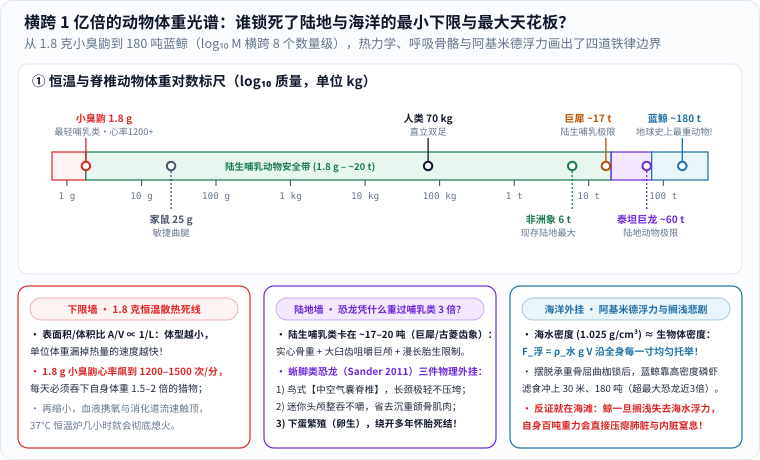
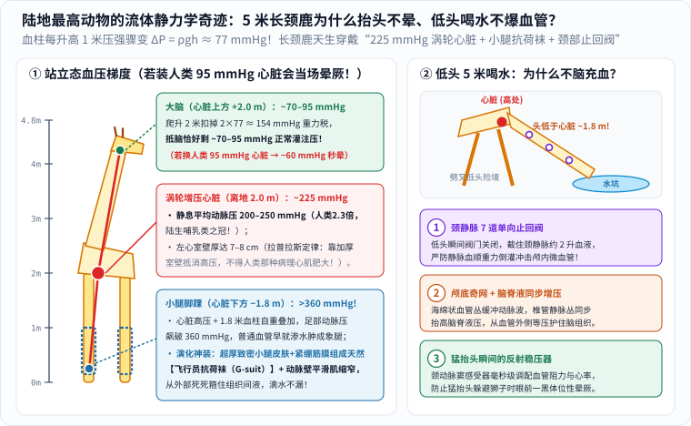

看怪兽电影和童话故事的时候，我们几乎很少怀疑“等比例放大”这件事：

- 蚂蚁在草叶上能轻松举起三五十倍于自身体重的米粒——那要是照着原样把它放大 **100 倍**，变成一辆公交车那么大，岂不是能一脚掀翻坦克？
- 奥特曼身高 **40 米**、金刚身高几十米，照着人类的身材比例放大十几二十倍，在银幕上跑跳搏斗虎虎生风；
- 森林里的红杉树干粗达四五米、活了两千多年，只要土壤肥沃、雨水充足、没人砍伐，它是不是能一直长到三百米、五百米，直接戳进云层里？

如果请一位物理学家坐进电影院，他大概率会在开场三分钟就叹一口气：**不用等主角出场，物理学里的重力、材料力学、热力学和流体静力学，就会在第一秒钟把这些巨怪全部判处“当场坍塌”**。

更让人着迷的是，生命并不是在物理定律之外搞特权，而是在物理铁律画出的窄窄缝隙里做极致工程优化：

1. **骨骼与姿态的力学账**：1638 年伽利略就看穿了“平方—立方律”的陷阱 [[1]](#ref-1)；真实动物为了不被自重压断腿骨，演化出了**“骨头超比例加粗（$$d \propto M^{3/8}$$）”**与**“腿越长越直”**的双重破局，但也付出了超过 300 千克就越来越难跳起来的代价 [[3]](#ref-3)[[4]](#ref-4)。
2. **横跨 1 亿倍的体重边界**：从 **1.8 克**的小臭鼩到 **180 吨**的蓝鲸，动物体重跨越了整整 **8 个数量级**。下限被散热面积锁死，陆地上限被骨骼与胎生锁死（蜥脚类恐龙靠鸟式气囊中空骨与产卵才冲上 60 吨），唯有海洋靠阿基米德浮力卸掉了重力枷锁 [[5]](#ref-5)[[6]](#ref-6)。
3. **奇妙的 $$3/4$$ 次方代谢与“十亿次心跳”**：生物的静息耗能既不按体重成正比，也不按表面积 $$M^{2/3}$$ 走，而是精准服从分形输运网络决定的 **$$B \propto M^{3/4}$$**——连带着让野生哺乳动物的“心率 $$\times$$ 自然寿命”定格在大约 **10 亿次心跳**附近 [[7]](#ref-7)[[8]](#ref-8)。
4. **动物与植物的跨界大一统**：5 米高的长颈鹿为了把血送上大脑，进化出了 **225 mmHg** 的涡轮增压心脏和天然“飞行员抗荷袜” [[9]](#ref-9)；而当我们把目光转向植物，参天大树不仅抗风防弯时算出了和动物一模一样的 **$$H \propto M^{1/4}$$** 幂律，更因为要把水拽上百米高空承受近 **19 个大气压的负压拉力**，最终被物理定律永远封顶在 **122–130 米** [[10]](#ref-10)[[11]](#ref-11)！

顺着下面五张分步图解，我们把这本贯穿动物界与植物界的“物理总账”一页页算清楚。

---

## 一、伽利略的“巨人骨折”判决书：为什么不能把生物直接放大？

### 1. 面积只按平方涨，体重却按立方炸：1638 年的平方—立方律

人类历史上第一个用数学严格证明“巨人不可能和普通人长一个比例”的人，正是现代物理学之父**伽利略·伽利莱（Galileo Galilei）**。1638 年，他在晚年巨著《关于两门新科学的对话》（*Two New Sciences*）第二天讨论材料强度时，写下了一条支配一切宏观物体的几何铁律——**平方—立方律（Square–Cube Law）** [[1]](#ref-1)。

我们先拿最简单的正方体做一次心算。假设把一只动物的身高、体长、骨骼粗细全都**等比例（几何相似）放大 $$\ell$$ 倍**，而且构成骨头与肌肉的生物材料本身不变（骨骼抗压强度上限不变）：

- **横截面积（决定骨骼能撑多重、肌肉能使多大劲、皮肤能散多少热）**：等于两个长度相乘，只能按**平方**增长：

$$
A \propto \ell^2
$$

- **体积与质量（在身体密度 $$\rho$$ 基本恒定时，决定地球重力往下拽得多狠）**：等于三个长度相乘，会按**立方**暴涨：

$$
M = \rho V \propto \ell^3
$$

现在，把重力负载 $$F = Mg$$ 除以承重骨骼的横截面积 $$A$$，看看每平方厘米骨头承受的**压应力（压强）$$\sigma$$** 发生了什么变化：

$$
\sigma = \frac{F}{A} = \frac{Mg}{A} \propto \frac{\ell^3}{\ell^2} = \ell
$$

看到了吗？**只要保持体型比例不变，身高每放大 $$\ell$$ 倍，骨头内部承受的压强就跟着硬生生翻 $$\ell$$ 倍！**

1928 年，英国演化生物学家**霍尔丹（J. B. S. Haldane）**在名篇《论大小合适》（*On Being the Right Size*）里，给英国童话《天路历程》里高约 **18 米**的“教皇巨人”算了一笔极其残酷的骨科账 [[2]](#ref-2)：

- 正常成年人身高约 **1.8 米**，人类大腿股骨的材料极限强度，大约能承受自身静态体重 **10 倍**左右的冲击力（平时跑步跳跃还要留出安全余量）；
- 把人等比例放大 **10 倍**变成 18 米巨人：他的体重变成了原来的 $$10^3 = 1{,}000$$ 倍（从 70 千克飙升到 **70 吨**！），但大腿骨的横截面积只变成了原来的 $$10^2 = 100$$ 倍；
- 结果，他站着不动时，大腿骨每平方厘米承受的压强就已经是正常人的 **$$1000 \div 100 = 10$$ 倍**——刚好踩死在人类骨骼断裂的极限红线上！只要他敢迈出第一步，单腿着地外加动态冲击，大腿骨就会当场咔嚓折断。

同理，为什么小蚂蚁能轻松举起 **30–50 倍**于体重的食物？根本不是蚂蚁拥有什么“超能力神力肌肉”，而是它太小了（体长只有人类的 $$\sim 1/500$$）：顺着平方—立方律反过来缩小，蚂蚁肌肉横截面积（$$\propto \ell^2$$）相对于它微不足道的体重（$$\propto \ell^3$$）富裕出了几百倍！反过来，如果真把蚂蚁等比例放大 **100 倍**，它的体重涨 **100 万倍**、腿截面只涨 **1 万倍**，外骨骼承受的压强暴增 **100 倍**，当场就会瘫成一摊碎壳——而且昆虫没有肺和运氧血管，全靠体表气门向内扩散氧气（详见[《拳头大的心脏凭什么一天泵血7吨》]()），放大 100 倍后氧气根本扩散不到体内深处，不等站起来就已经窒息了。

> **图 1 怎么读（先看左栏三组放大实验，再看右栏动物的两招破局）**：左栏按 $$1\times \to 2\times \to 10\times$$ 等比例放大计算截面（$$\ell^2$$）、体重（$$\ell^3$$）与股骨相对压强（$$\ell$$），底部红色应力条单次动画演示 10 倍放大直撞骨折红线（开启系统“减少动态效果”时直接静态展示完整终态）；右栏上方对比小鼠、假想等比象骨与真实大象股骨的粗细比例，下方对比猫鼠蹲伏曲腿、骏马微屈长腿与大象垂直象柱腿的关节力臂差异。👉 

### 2. 真实动物怎么破局？骨头“超比例变粗”外加“把腿站直”

既然等比例放大必死无疑，现实中 6 吨重的非洲象是怎么稳稳走路的？自然选择用了两套极其聪明的力学组合拳。

**第一招：放弃等比例，让骨头“超比例加粗”（异速生长 Allometry）**。
早在 1638 年伽利略就在书里画过一根小动物骨头和一根大动物骨头的对比图：大动物的骨头绝不是小骨头的放大版，而是明显**又粗又敦实** [[1]](#ref-1)。到了 1973 年，哈佛大学生物力学家**托马斯·麦克马洪（Thomas A. McMahon）**在《Science》发表经典论文，指出动物长骨和树干最怕的还不是纯垂直压碎，而是受压弯曲与**欧拉屈曲失稳（Euler buckling，就像你两手捏住一根细塑料尺两端往中间挤，尺子会突然向侧面弓出去折断）** [[3]](#ref-3)。

麦克马洪推导出，要想在抗屈曲和抗自重弯曲下保持相同的弹性安全裕度（**弹性相似律 Elastic Similarity**），骨骼或树干的长度 $$L$$ 与直径 $$d$$ 必须满足：

$$
L \propto d^{2/3} \quad \Longleftrightarrow \quad d \propto L^{3/2}
$$

由于身体质量正比于体积 $$M \propto L \cdot d^2$$，把 $$L \propto d^{2/3}$$ 代进去：

$$
M \propto d^{2/3} \cdot d^2 = d^{8/3}
$$

两边反解出长度 $$L$$ 和骨骼直径 $$d$$ 随体重 $$M$$ 变化的幂指数，就得到了生物力学里赫赫有名的麦克马洪标度律 [[3]](#ref-3)：

$$
L \propto M^{1/4} = M^{0.25}, \qquad d \propto M^{3/8} = M^{0.375}
$$

别小看 $$0.375$$ 和几何等比例指数 $$1/3 \approx 0.333$$ 之间那不起眼的 $$1/24$$ 差值！当体重从 30 克小鼠放大 **20 万倍**到 6 吨大象时，按弹性相似律，骨骼直径增长的倍数会比长度增长快得多——小老鼠的股骨像一根纤细的牙签，而大象的股骨长成了一根粗壮敦实的罗马石柱。

**第二招：300 千克以内，偷偷“把腿站直”省材料！**
1989 年，哈佛大学学者**安德鲁·毕维纳（Andrew A. Biewener）**在《Science》上揭开了另一个谜团：实测发现，从 **0.03 千克**的小鼠一路长到 **300 千克**的骏马，哺乳动物骨骼并没有像理论担心的那样无限变笨重，跑步时骨头承受的峰值应力安全系数全都稳稳维持在 **2 到 4 倍**之间——它们是怎么偷懒省骨头的 [[4]](#ref-4)？

答案藏在图 1 右下角的**关节弯曲角度**里！力学上定义**有效机械利益（Effective Mechanical Advantage, $$\mathrm{EMA} = r / R$$）**，其中 $$r$$ 是肌肉肌腱绕关节拉动的力臂，$$R$$ 是地面反作用力偏离关节中心的力臂：

- **猫鼠等小型兽（$$< 5\ \mathrm{kg}$$）**：天生保持“Z 字形蹲伏曲腿（crouched posture）”，地面反力力臂 $$R$$ 很大，$$\mathrm{EMA} \approx 0.1\text{–}0.2$$。虽然关节弯矩大，但小动物本来体重轻、骨头绰绰有余，曲腿反而让它们随时能像压缩弹簧一样瞬间蹬地蹿出、急停变向；
- **犬鹿马等中型兽（$$10\text{–}300\ \mathrm{kg}$$）**：随着体重上升，四肢关节越站越直，$$\mathrm{EMA}$$ 提高到 **0.5–0.7**，让地面反作用力的力线贴着骨头轴心穿过，大幅削减了最要命的弯曲力矩；
- **大象与巨犀等巨兽（$$> 1{,}000\ \mathrm{kg}$$）**：腿彻底拉直成了近乎 $$180^\circ$$ 垂直落地的“象柱腿（graviportal column）”，$$\mathrm{EMA} \approx 0.9$$！但硬币的背面也随之兑现——**当腿已经笔直到退无可退（约 300 千克以上），再增重就只能靠拼命加粗骨头，而且再也没法弯曲膝踝蓄力起跳**。这就是为什么成年大象是极少数终生无法“四脚同时离地跳跃”的陆生哺乳动物 [[4]](#ref-4)。

---

## 二、横跨 1 亿倍的动物体重光谱：谁锁死了最小与最大的极限？

把现存和化石里的恒温脊椎动物摆到同一把对数尺子上，你会看到一幅极为震撼的图景：从地中海沿岸平均体重仅 **1.8 克**的**小臭鼩（Etruscan shrew, *Suncus etruscus*）**，到南大洋里体重可达 **180 吨（$$1.8 \times 10^5\ \mathrm{kg}$$）**的**蓝鲸（*Balaenoptera musculus*）**，两者体重整整相差 **1 亿倍（$$10^8$$）** [[5]](#ref-5)[[6]](#ref-6)！

为什么没有 0.1 克的微型温血小狗？为什么陆地哺乳动物长不到蓝鲸那么大？为什么偏偏恐龙能在陆地上赢过哺乳动物三倍？这背后是一道下限墙与两道上限墙。

> **图 2 怎么读（上方看 8 个数量级的对数标尺，下方三栏对照三道物理封锁墙）**：注意横轴采用对数刻度 $$\log_{10} M$$，每向右走一大格代表体重翻 10 倍。绿色带是陆生哺乳动物的生存区间（1.8 克至约 20 吨），左侧红色区被散热速度封死，右侧紫色区是蜥脚类恐龙凭中空气囊骨与产卵开辟的陆地特区，最右蓝色区则是阿基米德浮力托举出的海洋巨兽领域。👉 

### 1. 下限墙（1.8 克）：恒温动物再小一点，就会活活冻饿而死

平方—立方律不仅管往上放大，同样死死卡住了恒温动物（哺乳类与鸟类，体核温度需维持在 $$37\text{–}41\ ^\circ\mathrm{C}$$）往下缩小的极限。

动物在身体内部产热，产热能力粗看跟细胞总量（体积 $$V \propto \ell^3$$）挂钩；而热量是从全身皮肤表面散失到冷空气里的，散热速度跟表面积（$$A \propto \ell^2$$）挂钩。把散热面积除以体积，得到**比表面积**：

$$
\frac{A}{V} \propto \frac{\ell^2}{\ell^3} = \frac{1}{\ell}
$$

**体型越袖珍，$$\frac{A}{V}$$ 就越大，身体就像一只四处漏风的薄纸杯，刚烧热一点点温度就瞬间漏光！**

现存体重最轻的哺乳动物**小臭鼩**（成年平均 **1.8 克**，仅重约半块方糖，不含尾体长约 4 厘米）与最轻的鸟类**吸蜜蜂鸟**（*Mellisuga helenae*，约 **1.6–2.0 克**），就双双贴死在这道 **2 克生死线**上 [[6]](#ref-6)：

- 为了弥补恐怖的散热漏口，小臭鼩静息心率高达惊人的 **1,200–1,500 次/分钟**（每秒钟心脏狂跳 **20–25 下**，几乎听成嗡嗡声），心脏重量占到全身的 **1.2%**（人类仅约 0.4%）；
- 它一昼夜必须不停歇地捕食昆虫，吃下相当于**自身体重 1.5 到 2 倍**的食物（换算成 70 千克成年人，相当于每天得硬塞下 **120 千克**牛排！），只要挨饿两三个小时就会因低血糖与失温毙命；
- 如果把哺乳动物再缩小到 0.5 克，哪怕全身塞满线粒体、血液黏度降到极限、心脏跳到肌肉纤维撕裂，供氧与消化吸收的速度也追不上热量散失的速度——这就是为什么比 2 克更小的动物（昆虫、蜘蛛、小蛙），清一色只能放弃恒温，改走**变温动物（冷血）**路线。

### 2. 陆地墙（20 吨 vs 60 吨）：为什么蜥脚类恐龙能赢过陆生哺乳类三倍？

往右看陆地巨兽的一端：现存最大的陆地动物是非洲草原象（约 **5–7 吨**，最高纪录约 10 吨）；翻遍整个新生代化石史，史上最大的陆生哺乳动物——渐新世的无角巨犀（*Paraceratherium*）与更新世的古菱齿象（*Palaeoloxodon namadicus*）——体重上限也都停留在 **15–20 吨**上下。

然而在中生代，以阿根廷龙（*Argentinosaurus*）、巴塔哥泰坦龙（*Patagotitan*）为代表的**蜥脚类恐龙（Sauropods）**，明明踩在同一个地球表面、受同一个重力加速度 $$g = 9.8\ \mathrm{m/s^2}$$ 拉扯，体重却飙到了 **50–70 吨**！它们凭什么绕过了哺乳动物的天花板？

2011 年，波恩大学古生物学家**马丁·桑德（P. Martin Sander）**团队在《Biological Reviews》发表长达 39 页的跨学科综述，算清了蜥脚类恐龙独有的“三大物理减负外挂” [[5]](#ref-5)：

1. **鸟式“中空气囊骨骼（Pneumaticity）”**：哺乳动物的脊椎是实心沉重的骨质与骨髓；而蜥脚类恐龙拥有和现代鸟类同源的**呼吸气囊系统**，气囊直接侵入颈椎和背椎内部，把巨大的脊椎掏成蜂窝状的薄壁桁架结构！这让十几米长的脖子整体表观密度低得惊人（部分颈段密度甚至仅约 $$0.3\text{–}0.5\ \mathrm{g/cm^3}$$），既省掉了好几吨死重，又实现了超高效的单向气流散热与供氧；
2. **“不咀嚼”换来的迷你轻头颅**：大象和巨犀坚持在嘴里把粗糙植物磨碎，必须顶着一颗装满巨大臼齿和厚重咬肌的百公斤级大脑袋，脖子根本不敢长长；蜥脚类恐龙干脆放弃口腔咀嚼，长一颗极小的轻巧脑袋，像剪草机一样整口吞下枝叶交给庞大的躯干肠道慢慢发酵，把悬臂梁末端的弯矩降到了最低；
3. **产卵繁殖（卵生）绕开胎生瓶颈**：根据繁殖标度律，哺乳动物体型越大，怀孕周期越长（大象怀胎已长达 **22 个月**，一胎只生一崽），一旦达到 20 吨级，母体怀胎数年的能量负担与种群恢复脆弱性就会崩溃；而 60 吨的恐龙每年可以成窝产下几十枚足球大小的恐龙蛋，彻底解开了生殖死结 [[5]](#ref-5)。

### 3. 海洋外挂（180 吨）：阿基米德浮力解放了蓝鲸，也写下了搁浅的悲剧

那为什么恐龙也打不过现代海洋里的**蓝鲸**（体长近 **30 米**，确证最高体重达 **170–190 吨**，一头蓝鲸顶得上 30 头非洲象）？

因为海水密度（$$\rho_{\text{海水}} \approx 1.025\ \mathrm{g/cm^3}$$）与脊椎动物身体的平均密度几乎严丝合缝地相等！根据**阿基米德浮力定律**：

$$
F_{\text{浮}} = \rho_{\text{海水}} g V \approx M_{\text{身体}} g
$$

海水不是像四条桌腿那样只在四个点上顶住身体，而是**沿着全身每一平方厘米皮肤均匀向上托举**，把重力引起的骨骼压应力与屈曲弯矩一次性清零！蓝鲸甚至不需要保留后肢，骨骼占体重比例反而比陆生小兽还轻，再配合高纬度海洋铺天盖地的磷虾群与“冲刺吞滤（lunge feeding）”觅食机制，直接冲上了地球生命史 40 亿年来的体重之巅。

最令人揪心的物理反证就在海滩上：**鲸一旦搁浅，为什么哪怕没有外伤也会很快死亡？** 因为离开海水的瞬间，100 多吨的重力重新全部砸回它自己身上，而它那套早就适应了失重般浮力环境的肋骨与肌肉根本撑不住胸腔——蓝鲸在陆地上不是渴死的，而是被自己的体重活活压瘪肺脏与内脏窒息而死的。

---

## 三、克莱伯 $$3/4$$ 次方代谢律：分形血管网与“十亿次心跳”之谜

### 1. 推翻 $$2/3$$ 表面积猜想：1932 年克莱伯发现的 $$0.75$$ 铁律

聊完骨架与体重边界，我们再算一笔更深层的物理账：**动物活着每秒钟要烧掉多少能量（基础代谢率 Basal Metabolic Rate, $$B$$）？**

19 世纪末，德国生理学家马克斯·鲁布纳（Max Rubner）测了从吉娃娃到大猎犬不同体型的狗，提出了一个很符合直觉的**“表面积散热律”**：既然恒温动物产热是为了补上皮肤散失的热量，而表面积 $$A \propto V^{2/3} \propto M^{2/3}$$，那代谢功率自然应该按体重的 **$$2/3$$ 次方（约 $$0.67$$）**增长。

然而到了 **1932 年**，瑞士裔生物学家**马克斯·克莱伯（Max Kleiber）**在加州大学戴维斯分校把测量范围一口气扩大到从小鼠、鸽子、猫、人一直到牛和大象，画在双对数坐标纸上时，震惊地发现数据点并没有落在斜率 $$0.67$$ 的虚线上，而是整整齐齐排成了一条斜率为 **$$3/4 = 0.75$$** 的直线 [[7]](#ref-7)！

对于哺乳动物（质量 $$M$$ 以千克为单位，静息代谢功率 $$B$$ 以瓦特 $$\mathrm{W}$$ 为单位），经验公式简洁得像天体物理定律一样：

$$
B \approx 3.4 \, M^{3/4}\ \mathrm{W}
$$

我们来代入两个熟悉的例子检验一下：

- **70 千克的成年人**：$$70^{3/4} = (\sqrt{\sqrt{70}})^3 \approx 24.2$$，乘以 $$3.4$$ 得出静息功率约 **$$82\ \mathrm{W}$$**（折合每天基础消耗约 **1,700 千卡**）——也就是说，你安静坐在椅子上看这篇文章时，身体的发热功率刚好相当于**一盏老式 80 瓦白炽灯泡**！
- **5,000 千克的非洲象 vs 0.025 千克的小鼠**：大象体重是小鼠的 **20 万倍**，但如果大象每克肉也像小鼠那样狂烧能量，大象全身立刻就会因为散不出热而“熟透”！得益于 $$M^{3/4}$$ 幂律，大象总功率只有约 $$2{,}000\ \mathrm{W}$$（仅小鼠的约 8,900 倍）。把总功率除以体重 $$M$$，**每克肉的比代谢率（Specific Metabolic Rate）**按负四分之一次方递减：

$$
\frac{B}{M} \propto \frac{M^{3/4}}{M} = M^{-1/4}
$$

大象每克细胞的耗能速率只有小鼠的 **$$200{,}000^{-1/4} \approx \frac{1}{21}$$**！体型越大，“规模经济”越省油。

> **图 3 怎么读（左看双对数实测斜率对比，右看分形血管树与生命心跳账）**：左图蓝色实线为克莱伯 $$B \propto M^{3/4}$$ 定律，橙色虚线为早年表面积 $$M^{2/3}$$ 猜想（在百吨鲸类处两者相差超过 2 倍！）；右图上方展示 West–Brown–Enquist 三维分形输运网，下方核算小鼠、大象与现代人类的“一生总心跳”。👉 

### 2. 为什么偏偏是 $$3/4$$？分形血管网与“十亿次心跳”生命时钟

如果真的是为了应对皮肤散热，为什么连不需要恒温的冷血鱼类、昆虫，甚至**没有心脏的大树**，整株代谢和水分输运速率在大尺度上也高度贴近 $$3/4$$ 次方？这个困扰生物学界 65 年的谜题，直到 **1997 年**才由物理学家**杰弗里·韦斯特（Geoffrey B. West）**与生态学家**詹姆斯·布朗（James H. Brown）**、**布莱恩·恩奎斯特（Brian J. Enquist）**在《Science》上给出了漂亮的物理推导（简称 **WBE 模型**） [[8]](#ref-8)。

他们指出，无论哺乳动物的心血管系统、呼吸支气管树，还是参天大树的木质部导管束，都受制于**同一组三条几何与流体力学公理**：

1. **空间填充（Space-filling）**：分支管网必须像树冠一样铺满整个三维身体体积，喂饱每一颗细胞；
2. **末端单元尺度不变（Size-invariant terminals）**：不管是一只小老鼠还是一头蓝鲸，它们身体最末端的红细胞、毛细血管直径（约 $$8\ \mu\mathrm{m}$$）和线粒体尺寸几乎**完全一样大**！
3. **输运能耗最小化（Energy minimization）**：心脏脉动泵血或植物输水时，分叉管道的半径比满足流体阻抗与反射最小化。

把这三条约束联立求解，三维体积里能容纳的“不变尺寸毛细血管总数”恰好不再正比于 $$M^1$$，而是多出了一个分形几何维度修正，严格导出 **$$N_{\text{毛细血管}} \propto B \propto M^{3/4}$$** [[8]](#ref-8)！（注：学界后续也指出，在极小或极大端局部类群里指数会在 $$0.67\text{–}0.80$$ 之间微幅摆动，但跨越多数量级的宏观主旋律依然牢牢锚定在 $$3/4$$ 附近。）

更妙的推论紧随其后——这套分形网络直接给所有哺乳动物拨快或拨慢了**生命的时钟**：

- 既然每克组织需要的供氧速率正比于 $$M^{-1/4}$$，而每次心跳泵出的血量占体重比例基本恒定（心脏质量 $$\propto M^1$$），那么**静息心率 $$f_H$$** 就必然遵循负四分之一次方：

$$
f_H \propto M^{-1/4}
$$

- 与此同时，细胞代谢越快，自由基氧化损伤与组织折旧越快，动物的**自然寿命上限 $$T_{\text{寿命}}$$** 恰好按正四分之一次方拉长：

$$
T_{\text{寿命}} \propto M^{+1/4}
$$

现在，把“每分钟跳多少下”乘以“一辈子活多少分钟”，算出**一生心跳总次数 $$N_{\text{一生}}$$**：

$$
N_{\text{一生}} = f_H \times T_{\text{寿命}} \propto M^{-1/4} \cdot M^{+1/4} = M^0 = \text{常数}
$$

质量 $$M$$ 竟然在相乘的一瞬间**彻底约掉了**！算算真实野生哺乳动物的数字：

- **小鼠（30 克）**：每分钟心跳约 **600 次**，寿命约 **2–2.5 年** $$\implies$$ 一生跳动约 **7–8 亿次**；
- **家猫（4 千克）**：每分钟心跳约 **130 次**，寿命约 **15 年** $$\implies$$ 一生跳动约 **10 亿次**；
- **非洲象（5 吨）**：每分钟心跳仅 **28 次**，寿命约 **65 年** $$\implies$$ 一生跳动约 **9.6 亿次**！

从两岁夭折的小老鼠，到活过甲子的大象，大自然仿佛发给每只野生哺乳动物一张差不多的**“10 亿次心跳额度卡”**——小动物快放人生，大动物慢放人生。唯独今天坐在屏幕前的**现代人类**是个骄傲的“物理外挂户”：按 70 千克体型，史前人类自然寿命原本也在三四十岁（约 12 亿次心跳）；但凭借高度演化的脑容量、社会协作以及近两百年的疫苗、抗生素与现代医学，我们硬是把平均寿命推到了 **78–80 岁**，一辈子能跳将近 **28–30 亿次**心！

---

## 四、把脖子伸向 5 米高空的代价：长颈鹿为什么不晕倒也不爆血管？

刚才算的是“多重”，现在我们来算**“多高”**。一旦动物不甘心贴地爬行，而是把脑袋高高举向半空，另一条冷酷的中学物理公式立刻找上门来——**液体静水压强定律**：

$$
\Delta P = \rho_{\text{血}} g \Delta h
$$

我们来亲手算一下“1 米高的血液柱”到底有多重：哺乳动物全血密度 $$\rho_{\text{血}} \approx 1{,}050\ \mathrm{kg/m^3}$$，重力加速度 $$g \approx 9.81\ \mathrm{m/s^2}$$，因此高度每变化 $$\Delta h = 1\ \mathrm{m}$$，血管内的静水压强就会增减：

$$
\Delta P = 1050 \times 9.81 \times 1 \approx 10{,}300\ \mathrm{Pa} = 10.3\ \mathrm{kPa}
$$

医学血压计习惯用“毫米汞柱（$$\mathrm{mmHg}$$，$$1\ \mathrm{mmHg} \approx 133.3\ \mathrm{Pa}$$）”作单位，换算过来就是：

$$
\text{每升高或降低 } 1\ \text{米，血压剧变 } \approx 77\ \mathrm{mmHg} \text{！}
$$

对于身高 1.75 米的人类，大脑只比心脏高出约 **0.35 米**，扣掉 $$0.35 \times 77 \approx 27\ \mathrm{mmHg}$$ 的重力税后，我们 **95 mmHg** 的平均动脉压送到大脑还剩近 **70 mmHg**，绰绰有余。

可陆地最高动物**成年长颈鹿**身高可达 **5.0–5.5 米**！它的心脏离地约 **2.0 米**，大脑更是高高悬在**心脏上方整整 2.0 米以上** [[9]](#ref-9)。如果给长颈鹿装一颗人类那样平均压 95 mmHg 的心脏会发生什么？血液往上爬 2 米要扣掉 $$2 \times 77 = 154\ \mathrm{mmHg}$$，还没爬到脖子一半就彻底停流，脑部压强跌成 **$$-59\ \mathrm{mmHg}$$**，长颈鹿连一秒钟都站不住就会晕死过去！

> **图 4 怎么读（左看站立态从头到脚 360 mmHg 的血压鸿沟，右看劈叉低头喝水时的三道防爆闸门）**：左图沿着 0 至 4.8 米高度标尺，算清心脏（225 mmHg）、大脑（扣减重力后 70–95 mmHg）与小腿脚踝（叠加重力后突破 360 mmHg）的真实静水压；右图展示长颈鹿俯身饮水、头部低于心脏约 1.8 米时如何防止脑血管崩裂。👉 

为了在重力场里硬扛这 5 米高的血柱，长颈鹿把自己进化成了一套行走的航空航天流体装备 [[9]](#ref-9)：

1. **225 mmHg 涡轮增压心脏**：成年长颈鹿在平静站立时，心脏水平的平均动脉压高达 **200–250 mmHg**（收缩压常达 **280 mmHg**，是人类的两倍半，冠绝全体哺乳动物！）。左心室肌肉壁厚达 **7–8 厘米**，这样根据拉普拉斯室壁应力定律，厚实的心肌壁能把极高的腔内压强分摊掉，外加特化的抗纤维化基因，让长颈鹿终生顶着人类重症高血压两倍的数值却不会心衰。
2. **小腿上的天然“战斗机抗荷袜（G-suit）”**：心脏上方的问题解决了，心脏下方 **1.8 米**的小腿脚踝却遭了殃！心脏泵出的 **225 mmHg** 叠加上 1.8 米血柱往下压的 **139 mmHg**，让长颈鹿脚踝动脉压飙破 **360 mmHg** [[9]](#ref-9)！换作人类血管，血浆早就从毛细血管壁渗进肉里，把双腿肿成水桶。长颈鹿的解法被 NASA 生理学家研究用于改良宇航员与飞行员抗荷服：**它的小腿长着极其厚实、几乎毫无弹性的紧绷皮肤与深筋膜**，就像穿了一双勒到极致的医用弹力袜，外加下肢小动脉平滑肌极度肥厚缩窄，用同样高昂的外部组织间液压把水分死死顶回血管里！
3. **劈叉低头 5 米喝水时的“七道止回阀”**：最惊险的一幕发生在水坑边——长颈鹿劈开前腿，把脑袋从离地 5 米猛降到水面，此时大脑瞬间从“高于心脏 2 米”变成**“低于心脏近 1.8 米”**！要是不设防，心脏高压加上倒灌重力，颅内微血管分分钟被冲爆。好在长颈鹿长达两米的颈静脉里串联着约 **7 道精巧的单向止回瓣膜**，低头一瞬间瓣膜全关，把颈静脉里约 **2 升**血液分段截住不许倒灌回脑；同时颅底的海绵状血管网——**奇网（Rete mirabile）**与椎管脑脊液同步升高外压，从血管外侧稳稳护住脑组织 [[9]](#ref-9)。

---

## 五、把物理定律拓展到植物：为什么参天巨树永远长不过 130 米？

读到这里你可能会问：动物有骨头、有心脏、要跑跳，受这些物理定律管束情有可原；那扎根泥土一动不动、没有心脏也没有骨骼的**植物**，总该自由生长了吧？

恰恰相反！动物界最高的长颈鹿不过 5.5 米，史前最高的蜥脚类恐龙抬头也不过十七八米；真正把生命体推向百米高空极限挑战地球重力的，反而是森林里的**参天巨树**——现存世界第一高树、美国加州红木国家公园的北美红杉**“亥伯龙神（Hyperion）”**，实测树高达到惊人的 **116.2 米**（约合 **38 层摩天大楼**，树干木材体积约 530 立方米，重达数百吨） [[11]](#ref-11)！

当我们用物理学放大镜审视一棵百米巨树时，两件不可思议的事情浮出水面：**第一，树干防折断的数学方程，竟然和动物骨头一模一样；第二，全世界不管是北美红杉、澳洲杏仁桉还是花旗松，最高纪录全都齐刷刷停在 100–120 米出头，从来没有一棵树突破过 130 米！**

> **图 5 怎么读（左看树干自重压弯红线与 1/4 幂律大一统，右看亥伯龙红杉 19 个大气压负压抽水天花板）**：左图红色虚线为格林希尔自重屈曲折断极限 $$H_{\text{crit}} \propto D^{2/3}$$，绿色实线为真实成熟乔木保留 3–4 倍抗风安全余量的生长曲线；右图沿着 116.2 米红杉纵剖面，对比 10.33 米大气正压极限与树顶 $$-1.85\ \mathrm{MPa}$$ 负压拽水机制，拆解锁死 122–130 米树高的三把水力枷锁。👉 

### 1. 第一道墙：格林希尔自重屈曲定律——大树与大象算出了同一个 $$1/4$$ 次方！

早在麦克马洪研究动物骨骼之前的近一个世纪——**1881 年**，英国剑桥大学数学家**阿尔弗雷德·格林希尔爵士（Sir Alfred George Greenhill）**就研究过一个问题：一根竖直立在地上的圆柱形木杆，如果不挂重物，光是它**自身的木材重量**，长到多高就会让它像煮软的面条一样自己弯折垮塌 [[10]](#ref-10)？

格林希尔把欧拉压杆稳定方程推广到连续分布自重悬臂梁，利用贝塞尔函数严格算出了树干**临界自重屈曲高度 $$H_{\text{crit}}$$** 与基部树干直径 $$D$$、木材弹性模量 $$E$$ 及木材密度 $$\rho$$ 的精确关系：

$$
H_{\text{crit}} = C \left( \frac{E}{\rho g} \right)^{1/3} D^{2/3}
$$

对于典型树种的活体木材，比例系数折算下来大约是 $$H_{\text{crit}} \approx 79 \, D^{2/3}$$（米）。当然，真实森林里还要刮狂风、压积雪，康奈尔大学植物生物力学家卡尔·尼克拉斯（Karl J. Niklas）统计了全球数以百计从几厘米小草到百米巨杉的数据，发现健康的成年树木普遍留出了 **3 到 4 倍的安全系数**，沿着下面这条绿色轨迹生长 [[10]](#ref-10)：

$$
H \propto D^{2/3}
$$

请屏住呼吸看一眼这个式子——树干质量 $$M \propto \rho D^2 H$$，把 $$H \propto D^{2/3}$$ 代进去：

$$
M \propto D^2 \cdot D^{2/3} = D^{8/3} \quad \Longrightarrow \quad H \propto M^{1/4}, \quad D \propto M^{3/8}
$$

**完全相同的 $$1/4$$ 与 $$3/8$$！** 草原上奔跑的大象，和加州海岸静立两千年的红杉，明明在生命之树上分家了十多亿年、连一个器官都不重样，却因为在同一个地球重力场里对抗欧拉弹性屈曲，各自独立“解”出了分毫不差的幂指数！

但这里立刻冒出了一个巨大的悬念：看图 5 左栏，巨型红杉与巨杉的树干胸径足有 **4 到 8 米粗**，代入格林希尔力学公式，它的木头柱子就算留足安全余量，力学上也完全撑得起 **180–200 米**的高度！那为什么全地球所有参天巨树，长到 **115 米**往上就集体像撞上了一层透明玻璃天花板一样再也蹿不高了？

### 2. 终极天花板（122–130 米）：用“19 个大气压负压”把水拽上 38 层楼！

真正卡死地球树高脖子的，不是树干结不结实，而是**怎么把水从地底抽上百米树顶**。

如果让你在地面放一台抽水泵往摩天大楼顶上抽水，只靠抽真空让大气压往上推，最高能推多高？我们在[《水凭什么先往高处爬再翻墙流走：彻底读懂虹吸现象》]()里算过：地面 1 个标准大气压（$$P_0 \approx 101.3\ \mathrm{kPa}$$）托起水柱的极限高度只有区区：

$$
h_{\text{正压极限}} = \frac{P_0}{\rho_{\text{水}} g} \approx \frac{101{,}325}{1000 \times 9.81} \approx 10.33\ \mathrm{m}
$$

哪怕把管顶抽成绝对真空，大气正压也只能把水推到 **10.33 米**（刚够三层楼高）！那 116.2 米高的亥伯龙红杉，是怎么把水送上 **11 倍**于大气压极限的云端的？

答案是植物界最震撼的物理绝活——**内聚力—张力机制（Cohesion–Tension Theory）：大树不是从底下往上“推”水，而是从树顶用恐怖的“负压（液体拉力）”硬生生把水往上“拽”！**

很多人以为液体只能受压、不能受拉；其实纯净且没有大气泡成核点的水，由于水分子之间紧密的氢键**内聚力**，在极细的木质部导管里就像**一根柔韧的钢丝绳**一样可以承受巨大的负压张力！当阳光照在百米树顶的针叶上，水分从叶肉细胞壁只有几纳米宽的微纤丝孔隙蒸发，极其微小的弯月面表面张力产生强大的吸力，拽着整条从树叶一直连到树根、全长上百米不断裂的连续水柱往上走（与春季正压膨压推花的对比，可参阅[《龙抬头春寒未退，光秃秃的枝条凭什么一夜爆满繁花》]()）。

**2004 年**，北亚利桑那大学生态学家**乔治·科赫（George W. Koch）**、红杉树冠探险家**斯蒂芬·西莱特（Stephen C. Sillett）**等四人团队，亲自攀爬上多棵高逾 **110 米**的加州原始北美红杉树冠顶端采样实测，在《Nature》发表里程碑论文《树高的极限》（*The limits to tree height*），彻底揭开了 **122–130 米终极上限**的物理底牌 [[11]](#ref-11)：

1. **逃不掉的重力静水税**：每把水往上拽高 1 米，光是克服地球重力就要白白扣掉 $$\rho_{\text{水}} g = 0.0098\ \mathrm{MPa/m}$$ 的水势！在 116 米树顶，哪怕一片叶子都不蒸发、零流动阻力，单靠重力就已经把木质部水柱拉到了 **$$-1.14\ \mathrm{MPa}$$**；叠加上水分穿过漫长管胞纹孔的黏滞摩擦阻力，正午树顶实测水势跌到了惊人的 **$$-1.8\ \text{至}\ -1.9\ \mathrm{MPa}$$**——相当于水柱正在承受**约 18 到 19 个标准大气压的负压拉伸**！
2. **第一把锁 · 气穴栓塞断流（Cavitation & Embolism）**：水绳绷得越紧越脆弱。一旦木质部负压逼近北美红杉的纹孔安全红线（约 **$$-1.9\ \text{至}\ -2.0\ \mathrm{MPa}$$**），管外微小的空气就会被硬拽穿纳米纹孔膜（air-seeding），瞬间在导管里炸开成水汽泡（**气穴现象**），发出超声波传感器都能听见的“啪啪”脆响！断掉的导管就像漏了气的吸管，瞬间丧失输水能力。
3. **第二把锁 · 细胞膨压归零，顶叶缩成“沙漠硬鳞片”**：植物嫩芽长出新叶，全靠细胞吸水产生正的**膨压（Turgor pressure）**像吹气球一样把细胞壁撑大。可百米树顶的水被拽得太紧，连细胞自己都抢不到水！科赫团队在 110 米树顶看到了奇异的一幕：**明明脚下是雨水丰沛的温带雨林，110 米树冠顶端却相当于一片“空中极旱沙漠”**——底部分枝的红杉叶子舒展扁平像羽毛，到了 110 米树顶，新叶根本撑不开，退化成了像柏树一样的短小硬鳞片 [[11]](#ref-11)！
4. **第三把锁 · 气孔被迫关门，光合作用“断粮”归零**：为了防止负压突破 $$-2.0\ \mathrm{MPa}$$ 拉断全身水脉，树顶叶片只能常年把气孔关得死死的。但我们在[《可视化理解光合作用》]()里讲过，**水汽出去的门，也正是二氧化碳（$$\mathrm{CO}_2$$）进来的唯一大门**！气孔一关，$$\mathrm{CO}_2$$ 进不来（实测树顶叶片碳同位素 $$\delta^{13}\mathrm{C}$$ 显著偏重，铁证长期缺碳），单位叶重的光合产糖效率跌到谷底。

科赫团队把**木质部栓塞红线、叶片膨压归零点、单位面积叶质量极限、以及光合碳收支归零点**这四条完全独立的实测随高度变化曲线往上方外推，四条线不约而同地交汇在了同一个狭窄区间 [[11]](#ref-11)：

$$
H_{\text{地球树木绝对上限}} \approx 122\text{–}130\ \mathrm{m}
$$

哪怕给它最肥沃的土壤、最充沛的雨水、零雷击零飓风，只要地球表面重力加速度还是 $$9.8\ \mathrm{m/s^2}$$、大气 $$\mathrm{CO}_2$$ 浓度与水的氢键性质不变，地球上的树就永远跨不过 **130 米**这道物理天堑。

---

## 六、一页总表：动植物体型背后的物理方程账本

最后，我们把今天从 1.8 克小臭鼩一路算到 180 吨蓝鲸与 116 米红杉的全部物理规律，收进一张随时可查的对照总表：

| 生命尺度问题 | 核心物理方程 / 标度指数 | 具体数量级与代表物种 | 演化破局方案与代价 |
| :--- | :--- | :--- | :--- |
| **等比例放大为何骨折？** | 面积 $$A \propto \ell^2$$，体重 $$M \propto \ell^3$$，骨应力 $$\sigma \propto \ell$$ | 人放大 $$10\times$$（18 m）：重 $$1000\times$$、截面 $$100\times$$、压强 $$10\times$$ | 放弃等比例放大；科幻 100 倍巨蚁必坍塌且缺氧 [[1]](#ref-1)[[2]](#ref-2) |
| **陆生巨兽骨骼与树干怎么长？** | 弹性相似律：$$L \propto M^{1/4}$$，直径 $$d \propto M^{3/8}$$ | 大象股骨与巨杉树干均按 $$M^{0.375}$$ 超比例加粗 | <300 kg 靠把腿站直省骨头；>300 kg 象柱腿失去跳跃力 [[3]](#ref-3)[[4]](#ref-4)[[10]](#ref-10) |
| **恒温动物最小能有多小？** | 比表面积 $$A/V \propto 1/\ell$$（越小漏热越快） | 小臭鼩 **1.8 g**、吸蜜蜂鸟 **~1.8 g** | 心率飙至 1200–1500 次/分，日食 1.5–2 倍体重，再小必失温 [[6]](#ref-6) |
| **陆地与海洋最重能有多重？** | 陆地自重约束 vs 海洋浮力 $$F_{\text{浮}} = \rho_{\text{水}} g V$$ | 陆生哺乳 ~20 t < 蜥脚恐龙 ~60 t < **蓝鲸 ~180 t** | 恐龙靠中空气囊骨+小头+产卵破局；鲸搁浅失浮力会被自重压窒息 [[5]](#ref-5) |
| **体型越大耗能与寿命怎么变？** | 克莱伯与 WBE 分形律：$$B \propto M^{3/4}$$，$$f_H \propto M^{-1/4}$$，$$T \propto M^{1/4}$$ | 野生哺乳类 $$f_H \cdot T \approx 8\text{–}12$$ 亿次心跳 | 三维分形管网+不变毛细血管；现代人类凭脑化与医学达 ~29 亿次 [[7]](#ref-7)[[8]](#ref-8) |
| **5 米长颈鹿如何供血防爆？** | 流体静水压 $$\Delta P = \rho_{\text{血}} g \Delta h \approx 77\ \mathrm{mmHg/m}$$ | 心脏 **~225 mmHg**，脑 ~80 mmHg，脚踝 **>360 mmHg** | 7 cm 厚壁左心室 + 小腿紧绷筋膜“抗荷袜” + 颈静脉单向止回阀 [[9]](#ref-9) |
| **参天大树为何卡死 130 米？** | 水重力梯度 $$0.0098\ \mathrm{MPa/m}$$ + 负压内聚力极限 | 亥伯龙红杉 **116.2 m**（树顶负压 $$-1.85\ \mathrm{MPa}$$） | 突破 10.3 m 正压极限靠负压拽水；受气穴栓塞+失膨压+闭气孔封顶 **122–130 m** [[11]](#ref-11) |

下次在动物园看到慢悠悠踱步的大象、劈叉喝水的长颈鹿，或者仰望一棵高耸入云的古树时，不妨在心里会心一笑：它们身上每一寸骨骼的粗细、每一次心跳的快慢、乃至树梢每一片针叶的大小，都是生命用亿万年演化在物理学考卷上写出的满分答卷。

---

## 参考资料与一手文献

1. **Galileo Galilei (1638)**. *Discorsi e dimostrazioni matematiche intorno a due nuove scienze* (*Dialogues Concerning Two New Sciences*, Day 2). Leiden: Louis Elsevier. —— 历史上首次严格阐述几何相似放大的“平方—立方律（$$A \propto \ell^2, V \propto \ell^3$$）”，并绘出大小动物骨骼必须异速加粗的经典对比图。[Wikipedia: Square–cube law 考据与原文摘录](https://en.wikipedia.org/wiki/Square%E2%80%93cube_law)
2. **J. B. S. Haldane (1926/1928)**. "On Being the Right Size." 收录于文集 *Possible Worlds and Other Papers*, Harper & Brothers. —— 经典定量推演 18 米巨人（线性放大 10 倍）体重增至 1,000 倍、股骨截面仅增 100 倍导致骨骼压应力达到 10 倍断裂阈值的名篇。
3. **Thomas A. McMahon (1973)**. "Size and shape in biology: elastic criteria impose limits on biological proportions, and consequently on metabolic rates." *Science*, 179(4079): 1201–1204. —— 提出抵抗欧拉屈曲与自重弯曲的“弹性相似律”，严格导出长度 $$L \propto d^{2/3} \propto M^{1/4}$$ 与直径 $$d \propto M^{3/8}$$。[DOI: 10.1126/science.179.4079.1201](https://doi.org/10.1126/science.179.4079.1201) ｜ [PubMed: 4689015](https://pubmed.ncbi.nlm.nih.gov/4689015/)
4. **Andrew A. Biewener (1989)**. "Scaling body support in mammals: limb posture and muscle mechanics." *Science*, 245(4913): 45–48. —— 实测 0.03 kg 至 300 kg 哺乳动物通过将肢体姿态从蹲伏曲腿（$$\mathrm{EMA} \approx 0.1$$）逐步拉直为柱状直腿（$$\mathrm{EMA} \approx 0.7\text{–}0.9$$），将骨骼峰值应力安全系数维持在 2–4 倍。[DOI: 10.1126/science.2740914](https://doi.org/10.1126/science.2740914) ｜ [PubMed: 2740914](https://pubmed.ncbi.nlm.nih.gov/2740914/)
5. **P. Martin Sander, Andreas Christian, Marcus Clauss et al. (2011)**. "Biology of the sauropod dinosaurs: the evolution of gigantism." *Biological Reviews*, 86(1): 117–155. —— 系统论证蜥脚类恐龙如何凭借鸟式气囊中空脊椎（pneumaticity）、不咀嚼的小型轻头颅与卵生繁殖突破陆生哺乳类约 20 吨上限、达到 50–70 吨级。[DOI: 10.1111/j.1469-185X.2010.00137.x](https://doi.org/10.1111/j.1469-185X.2010.00137.x) ｜ [PubMed: 21251189](https://pubmed.ncbi.nlm.nih.gov/21251189/)
6. **Klaus D. Jürgens (2002)**, "Etruscan shrew muscle: the consequences of being small," *Journal of Experimental Biology*, 205(15): 2161–2166. —— 详测现存最小哺乳动物小臭鼩（成年平均体重 1.8 g）高达 1,200–1,500 次/分钟的心率极限、比表面积散热压力与摄食代谢特征。[DOI: 10.1242/jeb.205.15.2161](https://doi.org/10.1242/jeb.205.15.2161)
7. **Max Kleiber (1932)**, "Body size and metabolism," *Hilgardia*, 6(11): 315–353；及 **Max Kleiber (1947)**, "Body size and metabolic rate," *Physiological Reviews*, 27(4): 511–541. —— 确立跨物种基础代谢率按体重 $$3/4$$ 次方标度（$$B \propto M^{0.75}$$）的克莱伯定律。[DOI: 10.1152/physrev.1947.27.4.511](https://doi.org/10.1152/physrev.1947.27.4.511)
8. **Geoffrey B. West, James H. Brown & Brian J. Enquist (1997)**. "A general model for the origin of allometric scaling laws in biology." *Science*, 276(5309): 122–126. —— 从三维空间填充、末端毛细血管/叶脉尺度不变与流体输运能耗最小化三条物理公理出发，导出动植物通用的 $$3/4$$ 次方代谢律与 $$1/4$$ 次方时间标度律。[DOI: 10.1126/science.276.5309.122](https://doi.org/10.1126/science.276.5309.122) ｜ [PubMed: 9082983](https://pubmed.ncbi.nlm.nih.gov/9082983/)
9. **Christian Aalkjær & Tobias Wang (2023)**, "The remarkable cardiovascular system of giraffes," *Annual Review of Physiology* / *Journal of Muscle Research and Cell Motility* 综述系列，及 **E. M. Pedersen et al. (2025)**, *Journal of Experimental Biology* (`DOI: 10.1242/jeb.251092`). —— 实测解析长颈鹿心脏 200–250 mmHg 高血压、厚壁左心室、下肢紧绷皮肤筋膜“抗荷袜（>350 mmHg 防护）”及俯身饮水颈静脉单向瓣膜机制。[DOI: 10.1242/jeb.251092](https://doi.org/10.1242/jeb.251092)
10. **A. G. Greenhill (1881)**, "Determination of the greatest height consistent with stability that a vertical pole or mast can be made, and of the greatest height to which a tree of given proportions can grow," *Proceedings of the Cambridge Philosophical Society*, 4: 65–73；及 **Karl J. Niklas & Hanns-Christof Spatz (2004)**, "Growth and hydraulic (not mechanical) constraints govern the scaling of tree height and mass," *PNAS*, 101(44): 15661–15663. —— 推导树干自重屈曲公式 $$H_{\text{crit}} \propto D^{2/3}$$（导出 $$H \propto M^{1/4}$$），并证明巨树上限由水力输运而非机械强度封顶。[DOI: 10.1073/pnas.0405857101](https://doi.org/10.1073/pnas.0405857101)
11. **George W. Koch, Stephen C. Sillett, Gregory M. Jennings & Stephen D. Davis (2004)**. "The limits to tree height." *Nature*, 428(6985): 851–854. —— 攀测 110 米以上北美红杉树冠水势（近 $$-1.9\ \mathrm{MPa}$$）、木质部气穴栓塞阈值、叶片膨压形态与碳同位素光合效率，定量证出地球现存环境下树木绝对高度上限为 **122–130 米**（现纪录保持者亥伯龙红杉约 116.2 米）。[DOI: 10.1038/nature02417](https://doi.org/10.1038/nature02417) ｜ [PubMed: 15103376](https://pubmed.ncbi.nlm.nih.gov/15103376/)
