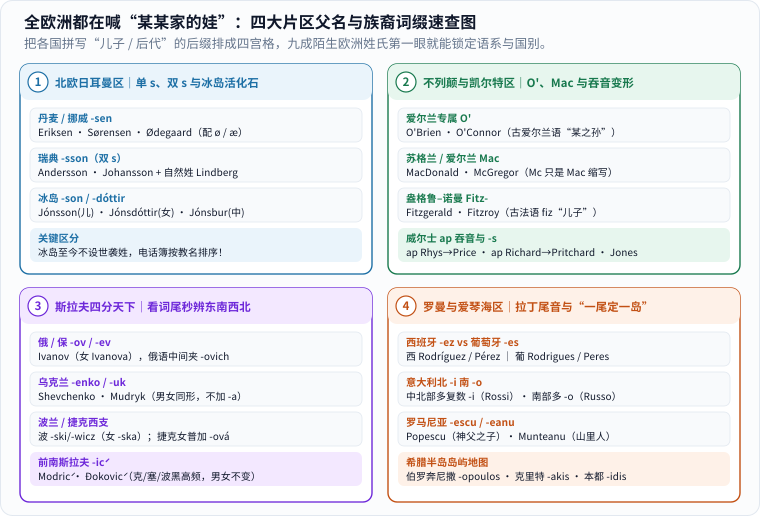
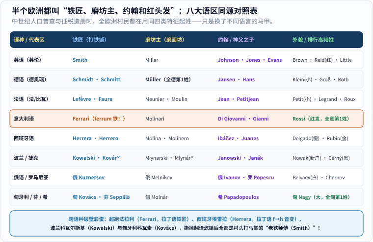
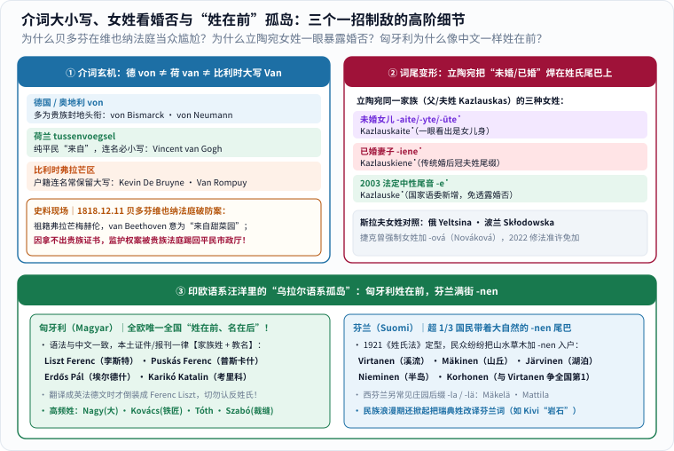
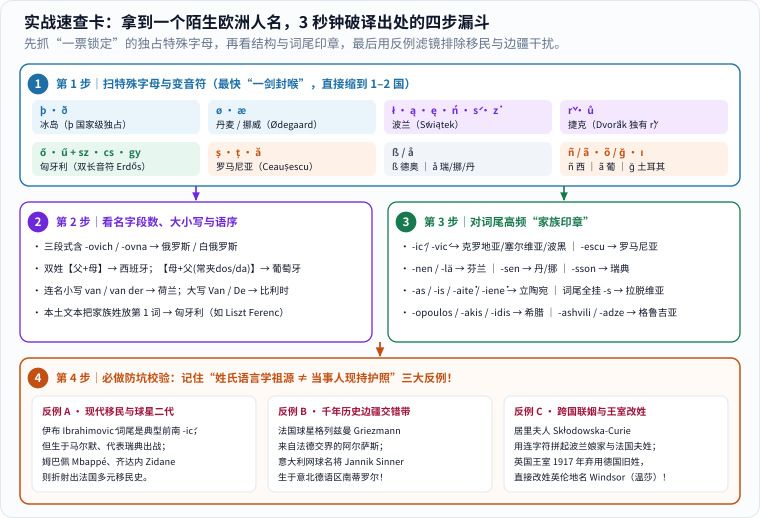

每次陪家人看世界杯、奥运会、[网球大满贯]()或者十月份的诺贝尔奖直播，电视屏幕下方总会滚过一长串让人眼花缭乱的拉丁字母：

- 看到 **Modrić（莫德里奇）**、**Đoković（德约科维奇）**，再对比 **Lewandowski（莱万多夫斯基）** 和 **Shevchenko（舍甫琴科）**，明明都是斯拉夫人，尾巴为什么长得截然不同？
- 看到 **Eriksen（埃里克森）** 和 **Andersson（安德松）**，只差一个字母 `s` 和 `e/o`，为什么前一个八成来自丹麦或挪威，后一个却几乎写满了“瑞典制造”？
- 看到 **Robin van Persie（范佩西）** 和 **Kevin De Bruyne（德布劳内）**，为什么荷兰人的 `van` 小写，比利时人的 `De` 却偏偏大写？那出生在德国波恩的乐圣 **Ludwig van Beethoven（贝多芬）**，为什么不叫德国贵族的 `von`，反而顶着荷兰式的 `van`？
- 更离谱的是：为什么匈牙利人在自己国内偏要像中国人一样**把姓写在最前面**，而冰岛一家四口出国旅游办入住，爸爸、妈妈、儿子、女儿四本护照最后一栏的“姓”竟然**四个全不一样** [[1]](#ref-1)[[2]](#ref-2)？

你的直觉完全没错——**欧洲人的名字里，真的藏着一套严丝合缝的“国家指纹密码”！**

这背后的历史原因其实特别朴素：从西罗马帝国崩溃直到公元 11 世纪前后，欧洲绝大多数平民百姓**根本没有世袭的“姓（Surname）”**，一辈子只有一个教名（比如村里有五个 John、八个 Hans）。后来城镇人口暴涨，教区神父要记洗礼册、国王要收人头税、拿破仑要建现代户籍与征兵花名册，官吏们被逼无奈，只能给全村同名的人强行贴上“第二张标签”，再一代代冻结成家族姓氏 [[6]](#ref-6)。

有趣就在于：**全欧洲几十种语言在给村民贴标签时，不约而同地都在回答同四个大白话问题——“你是谁家的娃？”“你干啥手艺吃饭？”“你住哪座山头？”“你头发啥颜色？”** 不同的语族、字母表和民法典给这四个问题套上了不同的语法外壳，于是就把籍贯秘密永远焊死在了名字里。

今天我们就顺着**五把破译钥匙**，把这套比侦探小说还好玩的欧洲姓名密码一层层拆开。

---

## 一、第一把钥匙：看各国怎么喊“某某家的娃”，一秒拆开二十几个国家

人类区分同名邻居最偷懒的办法，就是直接指着他爹喊：**“这是老约翰家的儿子！”** 在语言学上，这叫**父名姓氏（Patronymics）** [[1]](#ref-1)。奇妙的是，同样表达“某某之子 / 某某后代”，欧洲四大片区各自演化出了完全不撞衫的词缀印章：

_先按 ①→④ 四个象限扫一圈全局地图：① 左上角北欧区看清 `-sen`（丹麦/挪威）、双 `s` 的 `-sson`（瑞典）与至今不设世袭姓的冰岛 `-son / -dóttir`；② 右上角英伦凯尔特区分清爱尔兰专属的 `O'`、苏爱共用的 `Mac/Mc` 与威尔士吞音姓；③ 左下角斯拉夫区顺着 `-ov`、`-enko`、`-ski`、`-ić` 四种尾巴直接切开东欧与巴尔干；④ 右下角罗曼与希腊区不仅能认出国别，希腊姓氏尾巴甚至能直接定位到具体半岛和海岛。[单独打开高清原图](/assets/images/european-name-patterns/patronymic-atlas-europe.svg)。_

### 1. 北欧三兄弟的“单 s、双 s 与活化石”：为什么冰岛通讯录只能按名排？

打开北欧四国名单，满眼都是“某某森 / 某某松”，但只要盯住拼写细节，一秒就能分家：

- **丹麦与挪威：认准 `-sen` + 斜杠字母 `ø / æ`**。19 世纪至 20 世纪初两国陆续立法冻结世袭姓氏时，把“儿子”统一固定成了 **`-sen`**——比如足球明星 **Christian Eriksen**（埃里克之子）、哲学家 **Søren Kierkegaard**、挪威队长 **Martin Ødegaard**（如果连名带姓里跳出带斜杠的 `ø` 或连字 `æ`，哪怕不看词尾，也基本锁死丹麦或挪威；挪威数学奇才[阿贝尔 Niels Henrik Abel]() 的中名 Henrik 也是典型北欧拼法）。
- **瑞典：认准双写的 `-sson` + 大自然双拼词**。瑞典语里“某人的儿子”在属格 `-s` 后面再接 `-son`，于是留下了标志性的**双 `s` 尾巴 `-sson`**：`Andersson`、`Johansson`、`Karlsson`、`Larsson`，再配上头顶带两点或小圆圈的 `ä / ö / å`。不过到了 18–19 世纪，瑞典军队发现一个连队里居然有二十几个 `Andersson`，点名时一喊全答到！于是军官、牧师和市民掀起了一股用**两截大自然词汇拼新姓**的风潮：`Lind`（椴树）+ `berg`（山）= **Lindberg**，`Alm`（榆树）+ `kvist/qvist`（树枝）= **Almqvist**，还有 `Ström`（溪流）、`Blad`（树叶）、`Sjö`（湖泊）。一看到 `Lindström`、`Bergqvist` 这种清爽的山水草木两拼词，十有八九来自瑞典！
- **冰岛：全欧洲唯一的“维京活化石”**。冰岛人在 1996 年《个人姓名法》（*Lög um mannanöfn*, No. 45/1996）里明文规定：**除极少数历史遗留家族外，冰岛公民不设世袭家族姓氏，一律使用父名或母名** [[2]](#ref-2)！生了男孩就在父亲（或母亲）教名的属格后面加 **`-son`**（儿子），生了女孩就加 **`-dóttir`**（女儿）；2019 年冰岛议会通过《性别自主法》（Act No. 80/2019）后，还专门新增了一个性别中立后缀 **`-bur`**（孩子）[[2]](#ref-2)。正因如此，冰岛传奇女歌手 **Björk Guðmundsdóttir** 绝不会被人称呼为“Guðmundsdóttir 女士”（那只是说明她是 Guðmundur 的女儿），全国上下无论总统还是百姓一律互称教名，连冰岛全国电话簿都是按**第一个词（教名）**排字母顺序的 [[1]](#ref-1)！

### 2. 英伦与凯尔特辟谣：“Mc 是爱尔兰、Mac 是苏格兰”居然是流传最广的假规律？

英语世界里除了直白的 `Johnson`、`Thomson`、`Richardson`（以及由昵称变来的 `Dick → Dickson/Dixon`、`Harry → Harrison`），最扎眼的就是凯尔特与诺曼留下的四类前缀：

1. **`O'` 才是百分之百的爱尔兰血统印章**：比如 `O'Brien`、`O'Connor`、`O'Neill`。它来自古爱尔兰语 *Ó / Ua*，本义不是“儿子”，而是**“某某之孙 / 后裔”**。苏格兰本土姓氏里几乎没有 `O'`，见到这一撇，闭眼猜爱尔兰裔准没错。
2. **`Mac` 与 `Mc` 根本不分苏格兰和爱尔兰！** 网上常有人信誓旦旦地教你“Mac 是苏格兰人、Mc 是爱尔兰人”——这其实是彻头彻尾的谣言！盖尔语里的 `Mac` 意为“儿子”，而 **`Mc`（以及早年印刷体里的 `M'`）纯粹只是抄写员省墨水的缩写形式**，在苏格兰和爱尔兰两边都成片出现（比如爱尔兰名将 `MacMahon`，苏格兰也有大批 `McGregor`）。
3. **`Fitz-` 来自法国诺曼底贵族，甚至当过英国王室“私生子专用章”**：`Fitzgerald`、`Fitzpatrick` 里的 `Fitz-` 源自盎格鲁–诺曼古法语 *fiz*（拉丁语 *filius*，“儿子”）。到了都铎与斯图亚特王朝，英国国王还不时给王室非婚生子赐姓 **`Fitzroy`**——法语 *fils de Roi*，字面意思直接坦白：**“国王的儿子”**！
4. **威尔士的“吞音魔术”**：威尔士语里“儿子”叫 **`ap`**（元音前作 **`ab`**）。几百年快读连读下来，`ap` 干脆被吞进了后面的教名首字母里：`ap Rhys` 缩成了 **`Price`**，`ap Richard` 缩成了 **`Pritchard`**，`ab Owen` 缩成了 **`Bowen`**，`ab Evan` 缩成了 **`Bevan`**！再加上英格兰户籍官给威尔士人登记时顺手加上的属格 `-s`（`John's → Jones`、`William's → Williams`、`David's → Davies`、`Evan's → Evans`），造就了今天威尔士满大街的 `Jones` 和 `Price`。

### 3. 斯拉夫四分天下与希腊“一尾定一岛”：看尾巴能精准定位到哪座海岛！

把地图移向东欧和巴尔干，词尾更是堪比高精度 GPS：

- **俄罗斯与保加利亚（`-ov / -ev / -in`）**：原意是物主形容词“属于某某家的”，如 `Ivanov`（伊万家的）、`Petrov`、`Putin`。而且俄语全名必带中间一截**父称**：父亲若叫 `Nikolai`，儿子的中名就是 `Nikolayevich`，女儿则是 `Nikolayevna` [[1]](#ref-1)。
- **乌克兰（`-enko / -uk / -chuk`）**：一看到球星 `Shevchenko`（舍甫琴科，原义“皮匠之子”）、`Mudryk`、`Bondarchuk`（箍桶匠之子），哪怕它跟俄语写在同一张纸上，也能一眼认出是**乌克兰姓**——而且 `-enko` 最省心的一点是**男女完全同形**，绝不像俄语那样给女性强行补 `-a`！
- **波兰（`-ski / -cki / -dzki` 与 `-wicz`）**：`-ski` 本是庄园领地形容词后缀（相当于法语的 `de`、德语的 `von`），在中世纪原本是波兰贵族（*Szlachta*）的体面标志，后来平民争相效仿才普及成国姓，如 `Lewandowski`、` Kowalski`；另一支 `-wicz`（`Mickiewicz`）则是正宗“某之子”。
- **前南斯拉夫地区（`-ić / -vić`）**：只要词尾顶着带小锐音符的 **`-ić`**（如克罗地亚的 `Modrić`、塞尔维亚的 `Đoković`、斯洛文尼亚的 `Dončić`），几乎不用犹豫，直接锁定巴尔干半岛的南斯拉夫语支！
- **罗马尼亚（`-escu / -eanu`）**：夹在斯拉夫邻居中间的罗马尼亚语其实是正统**拉丁语后裔**，它的国姓尾巴 **`-escu`**（源自拉丁语附属后缀 *-iscus*）独步全欧：`Popescu`（神父 *popă* 家的娃）、`Ionescu`（约翰家的娃）；带 `-eanu` 的则指籍贯地貌，比如 `Munteanu`（山里来的人）。
- **希腊（一尾定一岛！）**：希腊姓氏不光能认出国籍，甚至能直接出卖祖籍在哪片海域 [[10]](#ref-10)：
  - **`-opoulos`（伯罗奔尼撒半岛）**：借自拉丁语 *pullus*（幼雏、后代），全希腊第一大姓 **`Papadopoulos`** 字面意思就是“东正教神父的孩子”（东正教允许修士在晋铎成为堂区神父**之前**结婚生子，因此希腊满地都是 `Papa-` 开头的神父后代姓氏！）[[10]](#ref-10)；
  - **`-akis`（克里特岛）**：意为“小某某”，如作家卡赞扎基斯 `Kazantzakis`、希腊总理家族 `Mitsotakis` [[10]](#ref-10)；
  - **`-idis / -iadis`（黑海本都与小亚细亚希腊人）**：传承自古希腊荷马史诗时代的经典父名后缀（如“赫拉克勒斯后裔” *Heraclides*），1923 年希土人口交换时随百余万小亚细亚东正教徒迁回希腊本土 [[10]](#ref-10)；
  - **`-atos`（爱奥尼亚海凯法利尼亚岛）**、**`-akos`（伯罗奔尼撒最南端马尼半岛）**、**`-oglou`（奥斯曼帝国统治印记，借自土耳其语 *oğlu*“儿子”）**[[10]](#ref-10)。

---

## 二、第二把钥匙：同样是“爸妈一起上户口”，为什么西班牙和葡萄牙偏要对着干？

如果说北欧和东欧比拼的是“词尾”，那么西南角的伊比利亚半岛（西班牙与葡萄牙）给全世界挖下的最大深坑，就是它们的**父母双姓制**——而且这两个紧挨着的邻居，排位顺序竟然**像照镜子一样完全相反** [[1]](#ref-1)！

_先看左栏冰岛一家四口的传姓路径（[单独打开原图](/assets/images/european-name-patterns/iceland-iberian-family-relay-anim.svg)，刷新可重播单次箭头推演动画；开启系统“减少动态效果”时直接静态呈现完整终态）：父亲 `Jón Einarsson` 与婚后不改姓的母亲 `Sigríður Pálsdóttir` 生下儿女后，孩子取父名属格 `Jóns-` 拼出 `Jónsson` 与 `Jónsdóttir`，导致全家四本护照最后一栏拼写各不相同。再看右栏伊比利亚双姓对比：西班牙传统把**父姓放前、母姓放后**（主姓在倒数第 2 词），葡萄牙却把**母姓放前、父姓压轴**（主姓在最后 1 词）！_

### 1. 西班牙传统“父前母后”：为什么全世界都把毕加索的母姓当成了他爸的姓？

在西班牙语世界，一个人一生下来天然拥有**两个姓（Apellidos）**：传统上由**父亲的第一个姓 + 母亲的第一个姓**组成（有时中间用连词 `y` 连接，以防第一个姓被误读成教名）[[1]](#ref-1)[[3]](#ref-3)。

拿红土之王**纳达尔**举例：他父亲叫 `Sebastián Nadal Homar`，母亲叫 `Ana María Parera Femenías`。两人各自交出自己的**第一个姓**，合起来就是儿子的法定全名：**`Rafael Nadal Parera`**。按英语习惯只盯最后一个词的老外，常常在机场或论文引用里闹笑话，管他叫“Parera 先生”——其实在西班牙，日常简称和传给下一代的主姓是排在中间（倒数第二位）的 **`Nadal`** [[1]](#ref-1)！

这就引出了艺术史上最有趣的一桩冷知识：立体派大师**毕加索**的法定姓名其实是 **`Pablo Ruiz Picasso`**——他父亲何塞·鲁伊斯（José Ruiz y Blasco）姓 **`Ruiz`**（在西班牙相当于满大街的“张王李刘”，原意“罗德里戈之子”），母亲玛丽亚·毕加索（María Picasso y López）才姓源自意大利热那亚的稀有姓氏 **`Picasso`**！年轻气盛的巴勃罗觉得 `Ruiz` 实在太烂大街，干脆在画布左下角一笔抹掉父姓，只签母亲的姓 `Picasso`，硬是让母姓成了传世符号。

顺便补充一个法律新变化：西班牙《民法典》第 109 条在 1999 年首次允许父母协商调换双姓顺序，而自 **2017 年 6 月 30 日**第 20/2011 号《民事登记法》第 49.2 条正式生效起，西班牙彻底废除了“协商不成时父姓自动排第一”的百年默认特权——只要头胎登记时敲定了顺序，后面出生的亲弟妹一律照此执行 [[3]](#ref-3)。

### 2. 葡萄牙与巴西“母前父后”大翻转：C 罗其实压根不姓“罗纳尔多”！

跨过一条边境线走进葡萄牙（以及说葡语的巴西），不仅表示“某之子”的后缀从西班牙语带 `z` 的 **`-ez`**（`Rodríguez`、`Pérez`、`Fernández`、`González`）齐刷刷变成了带 `s` 的 **`-es`**（`Rodrigues`、`Peres`、`Fernandes`、`Gonçalves`），连父母双姓的座位表也**彻底掉了个头** [[1]](#ref-1)：

- 葡萄牙传统顺序是：**`教名 + 母亲家族姓 +（常带 de / da / dos / e）+ 父亲家族主姓`**！也就是说，葡萄牙人的核心主姓恰恰压轴在**最后一个词** [[1]](#ref-1)。
- 看看足球巨星 **C 罗**的身份证全名：**`Cristiano Ronaldo dos Santos Aveiro`**。很多球迷以为他名“克里斯蒂亚诺”、姓“罗纳尔多”——其实 **`Cristiano Ronaldo` 两个词合起来全都是他的双教名**（父母当年因为喜欢美国演员出身的总统罗纳德·里根 Ronald Reagan，特意给小儿子起了第二教名 Ronaldo）！后面的 **`dos Santos`** 来自母亲，最后压轴的 **`Aveiro`** 才是他父亲传下来的正牌家族主姓！

---

## 三、第三把钥匙：撕掉外语滤镜，半个欧洲名流其实都叫“村口铁匠”和“磨坊主”

如果一个中世纪欧洲村民既没拿老爹的名字当姓，那税务官第二爱写的标签就是他的**饭碗（职业姓氏）**和**外貌绰号**。一旦把英语、德语、法语、意大利语、西班牙语、斯拉夫语和匈牙利语摆在同一张桌子上破译词根，你会忍不住笑出声——原来那些听起来高贵冷艳的豪门大姓，脱掉外语马甲全是老熟人！

_横向读这张八大语区同源表就能体会“换汤不换药”的快乐：第一列蓝/橙色全是村头打马掌的“铁匠”，第二列全是掌管全村面粉的“磨坊主”，第三列全是基督教世界最普及的教名“约翰”与神父后代，第四列则是高矮胖瘦与发色绰号。[单独打开高清原图](/assets/images/european-name-patterns/smith-miller-john-rosetta.svg)。_

### 1. 超跑法拉利、科瓦尔斯基与埃雷拉：失散千年的“欧洲老铁匠联盟”

为什么全欧洲几乎每个国家的头号大姓里都有“铁匠”？因为在农具、马蹄铁、门锁和刀剑全靠手工锻打的中世纪，**每一个村镇都必须养活至少一户铁匠铺**，而且铁匠手握硬核技术、地位稳定，最容易传宗接代：

- 在英语里他叫 **`Smith`**（英美澳第一大姓），过莱茵河到了德国就变成 **`Schmidt / Schmitt / Schmid`**；
- 进了拉丁语系的意大利，铁叫 *ferrum*（元素周期表里铁的化学符号 `Fe` 就是它！），打铁匠叫 *ferrarius*，到了中北部意大利语复数家族化之后，就变成了威震全球的超跑之王——**`Ferrari`（法拉利，在意大利全国姓氏榜稳居前三！）**；
- 最妙的是西班牙语：古拉丁语词首的辅音 `f-` 在演化成卡斯蒂利亚西班牙语时，发生过一场著名的 **`f → h` 音变**（比如拉丁语面粉 *farina* 变成西语 *harina*，做 *facere* 变成 *hacer*）。于是拉丁语的铁匠 *ferrarius* 到了西班牙，词首 `F` 摇身一变成了不发音的 `H`，写成 **`Herrera`（埃雷拉）** 或 **`Herrero`**！
- 往东走到斯拉夫和乌拉尔语区，锻打金属叫 *kovati*，于是波兰第二大姓 **`Kowalski`**、捷克姓 **`Kovář`**、借了斯拉夫词根的匈牙利第二大姓 **`Kovács`（科瓦奇）**，外加俄语里用本族词根 *kuznets* 造出的 **`Kuznetsov`（库兹涅佐夫）**、芬兰语里的 **`Seppälä / Seppänen`**，翻译成中文，全都是亲切无比的**“老铁师傅”**！

同理，村里第二富有的手艺人——掌管水车风车磨面粉的**磨坊主**，在英语里是 **`Miller`**，在德语里成了稳居**全德国第一大姓**的 **`Müller`（穆勒）**，在法语里是 **`Meunier`**，在意大利语里是 **`Molinari`**，在西班牙语里是 **`Molina`**，在俄语里是 **`Melnikov`**，在匈牙利语里则是 **`Molnár`**！

### 2. 意大利“北 i 南 o”与全意第一大姓“红头发”

看意大利人名时，还有一个百试百灵的南北分界线：

- **意大利中北部姓氏绝大多数以 `-i` 结尾**（拉丁语及意大利语阳性复数，意为“某某一家人”），而**全意大利第一大姓 `Rossi`（罗西）** 字面意思就是**“红头发那一家”**（在红发罕见的地中海人群里，一头红棕发就是最显眼的外貌绰号！到了意大利南部单数化地区则多写作 **`Russo`**）。
- **意大利南部（那不勒斯、西西里等）姓氏则大量保留单数 `-o` 或 `-a` 结尾**。那不勒斯周边极其高频的一个姓氏 **`Esposito`**（原义“被放置在外的弃婴”），以及米兰一带高频的 **`Colombo`**（鸽子），背后更藏着一段温情的社会史：文艺复兴至近代早期，米兰大医院以白鸽为院徽给收养的孤儿统一赐姓 `Colombo`，那不勒斯圣母领报善堂则给弃婴登记为 `Esposito`，后来繁衍成了堂堂正正的名门大族。

### 3. 顺手戳破一个流传两百年的爆笑谣言：荷兰人真的起名叫“赤身出生”去气拿破仑吗？

讲到姓氏起源，中文和英文互联网上流传着一个极具喜剧效果的段子：

> “1811 年法国皇帝拿破仑吞并荷兰，强令原本没有固定姓氏的荷兰人限期登记家族姓。许多荷兰老百姓以为法国人很快就会滚蛋，故意登记了 `Naaktgeboren`（光屁股出生）、`Poepjes`（小便便）之类的恶搞怪姓去羞辱法国登记官——结果拿破仑倒台后户籍没废除，子孙后代只好含泪顶着这些怪姓活到了今天！”

故事编得惟妙惟肖，但正如我们在[考证“公”与“私”甲骨文造字真相]()时见过的那样——**越像段子的历史传闻，越得翻开原始档案验明正身** [[6]](#ref-6)！

荷兰家族史中心（CBG，*Nederlandse Familienamenbank*）与历史学者调出 16–18 世纪荷兰教区受洗清册一查，当场戳破了这个段子 [[6]](#ref-6)：

1. 1811 年 8 月 18 日拿破仑颁布《帝国姓氏与户籍法令》确有其事，荷兰至今也确实有数百人姓 `Naaktgeboren` 和 `Poepjes` [[6]](#ref-6)；
2. 但早在拿破仑出生前两百多年的 **1545–1580 年间**，南荷兰巴伦德雷赫特（Barendrecht）的档案里就已经白纸黑字记着一位祖先 **`Lenaert Naeckgeboren`**（可能源于一句体现荷兰人务实性格的口头禅绰号，或受德语遗腹子 *Nachgeboren* 影响）[[6]](#ref-6)！
3. 而弗里斯兰省的 **`Poepjes`** 家族，可考始祖 **`Jan Poepjes`** 早在 **1695 年**就已出生——它要么来自弗里斯兰教名 *Poppe* 的爱称 *Poepje*，要么源自当年荷兰民间对德国威斯特法伦季节工的俗称 *poepe*，他的孙子只是在 1811 年把祖传了一百多年的老称号如实报上户口本而已，根本不是为了捉弄拿破仑临时瞎编的 [[6]](#ref-6)！

---

## 四、第四把钥匙：介词大小写、女姓看婚否与“姓在前”孤岛，内行才懂的三个绝杀细节

掌握了词根和父名后缀，你已经能猜中七八成欧洲名字了。想再进阶成“扫一眼大小写和语序就能断案”的高手，只需要记住下面这三个妙趣横生的隐藏机关：

_左上角对比德语贵族 `von`、荷兰平民小写 `van` 与比利时常见大写 `Van / De`，并还原 1818 年贝多芬在维也纳法庭的尴尬一幕；右上角拆解全欧洲唯一把女性“未婚 / 已婚 / 中性”写成三种词尾的立陶宛语；底部横栏则聚焦印欧语系汪洋里的两座乌拉尔语系孤岛——坚持“姓前名后”的匈牙利与满街 `-nen` 尾巴的芬兰。[单独打开高清原图](/assets/images/european-name-patterns/particles-gender-and-uralic-outliers.svg)。_

### 1. 德语 `von`、荷兰小写 `van` 与比利时大写 `Van`：1818 年让贝多芬当众破防的法庭悬案

很多人看到欧洲人名字中间夹着 `von`、`van`、`de`，统统以为是老牌贵族。其实这几个小词里藏着精准的国界与阶层密码：

- **德国与奥地利的 `von`**：绝大多数确实源于封建领地贵族头衔（如铁血宰相 `Otto von Bismarck`、数学家冯·诺伊曼在奥匈帝国获封后的 `von Neumann`）。
- **荷兰的 `van / van der / de`（中间词 *tussenvoegsel*）**：99% 都是**彻头彻尾的平民姓氏**！`van Dijk` 只是“住在堤坝边的人”，`van den Berg` 是“住在土山坡的人”，`de Jong` 是“年轻那位”。更绝的是正字法细节：根据荷兰官方拼写规范，只要前面连着教名或首字母缩写，**中间词一律小写**——比如画家 **`Vincent van Gogh`（梵高）**、球星 **`Robin van Persie`**；只有单独称呼“梵高先生”时才大写首字母 `meneer Van Gogh` [[5]](#ref-5)。
- **比利时弗拉芒区的“大写叛逆”**：同样说荷兰语的比利时北部弗拉芒人，严格照搬当年人口登记簿上的原始写法，连名带姓时**绝大多数把介词首字母大写** [[5]](#ref-5)！所以一看到中场大师 **`Kevin De Bruyne`（德布劳内）**、前欧洲理事会主席 **`Herman Van Rompuy`（范龙佩）** 这种夹在名字中间却大写 `De` 和 `Van` 的拼法，几乎一猜一个准：**比利时人**！

看懂了 `von` 与 `van` 的天壤之别，就能听懂音乐史上一段既心酸又震撼的真实庭审记录 [[4]](#ref-4)：

乐圣 **Ludwig van Beethoven（路德维希·范·贝多芬）** 虽然生在德国波恩，但他的祖父其实是 18 世纪从弗拉芒城市梅赫伦（今属比利时）迁来的低地平民，`van Beethoven` 本义只是朴实的**“来自甜菜园”**。贝多芬定居维也纳后，奥地利上流社会看到他名字里有个 `van`（书信里还常缩写成 `v.`），纷纷误以为他是外国贵族，连他跟弟媳约翰娜争夺侄子卡尔监护权的官司，都被直接送进了专审皇亲国戚的**下奥地利贵族法庭（*Landrecht*）** [[4]](#ref-4)。

直到 **1818 年 12 月 11 日**庭审当天，法庭较真要求贝多芬出示贵族敕书。一生孤傲的贝多芬拿不出半张羊皮纸，悲愤地指着自己的头脑和胸口喊出了那句名言：**“我的高贵在这里，也在这里！”（Mein Adel ist hier und hier!）**[[4]](#ref-4) 然而法律不讲浪漫——七天后，贵族法庭冷冰冰地裁定他属于平民阶层，把案卷一脚踢回了维也纳平民市政厅（*Magistrat*），让好面子的贝多芬大病一场 [[4]](#ref-4)。

### 2. 把“结没结婚”直接焊在姓氏尾巴上的立陶宛语，与捷克女网名将的 `-ová` 烦恼

在波罗的海东岸，保留了最古老印欧语格变化活化石的**立陶宛语**，干出了一件全欧洲独一无二的事——它不仅区分男女姓氏，传统上还直接把**“这位女士结没结婚”**刻在了姓氏后缀上 [[7]](#ref-7)！

拿立陶宛常见男姓 **`Kazlauskas`** 来说 [[7]](#ref-7)：
- 家里**未出嫁的女儿**，姓氏尾巴必须变成 **`-aitė`**（其他词干对应 `-ytė / -utė / -ūtė`），叫 **`Kazlauskaitė`**；
- 嫁进门的**已婚妻子**，尾巴则换成 **`-ienė`**，叫 **`Kazlauskienė`**；
- 到了现代职场，许多立陶宛女性抗议：“凭什么男同事一个 `-as / -is` 用一辈子，女同事递张名片就得强行汇报婚姻状况？”于是 **2003 年 6 月 26 日**，立陶宛国家语言委员会正式颁布第 N-2(87) 号决议，开放了不暴露婚否的第三种**中性短尾 `-ė`**——从此无论单身还是已婚，都可以潇洒地登记为 **`Kazlauskė`** [[7]](#ref-7)！

无独有偶，中欧的**捷克与斯洛伐克**传统上要求所有女性姓氏一律加 **`-ová`**（男姓 `Novák`，女儿和妻子必叫 `Nováková`，导致网球女子前十榜单里常年一水儿的 `Navrátilová`、`Kvitová`、` Krejčíková`、`Muchová`；甚至捷克报纸报道外国女性时都会习惯性写成 `Serena Williamsová`！）。直到 **2022 年**捷克修订《户籍登记法》（*Zákon o matrikách*）正式生效，捷克本国女性才终于获准无需任何涉外理由，自由选择保留不加 `-ová` 的原形姓氏 [[8]](#ref-8)。

### 3. 印欧汪洋里的两座“乌拉尔孤岛”：匈牙利像中文一样姓在前，芬兰满街都是小溪山丘

翻开欧洲语言地图，绝大多数国家（英语、德语、法语、俄语、希腊语……）其实都是一家人，统称**印欧语系**；唯独中欧的**匈牙利**与北欧东侧的**芬兰、爱沙尼亚**，是远古从乌拉尔山脉迁徙而来的**乌拉尔语系（芬兰–乌戈尔语族）**“外来户”！这就让它们的名字长出了截然不同的骨骼：

- **匈牙利（Magyar）：全欧洲唯一全国法定“姓在前、名在后”的国家** [[1]](#ref-1)！在布达佩斯的身份证、街牌和匈牙利语报纸上，钢琴之王李斯特永远写作 **`Liszt Ferenc`**（姓 `Liszt` 排第一，名 `Ferenc` 排第二，跟中文“李斯特·费伦茨”语序一模一样！），足球传奇普斯卡什写作 **`Puskás Ferenc`**，数学怪杰埃尔德什写作 **`Erdős Pál`**，mRNA 诺奖得主考里科写作 **`Karikó Katalin`** [[1]](#ref-1)。只有翻译成英法德文时，西方媒体才会把它们倒装过来——下次遇到匈牙利原文文献，千万别把第一个词当成教名！
- **芬兰（Suomi）：超过三分之一的国民拖着 `-nen` 的大自然小尾巴** [[9]](#ref-9)！芬兰直到 **1921 年颁布《姓氏法》（*Sukunimilaki*）** 才强制全民固定世袭姓氏；在此前的民族浪漫主义浪潮里，酷爱森林湖泊的芬兰老百姓纷纷把家门口的自然景物加上指小/归属后缀 **`-nen`** 报上了户口 [[9]](#ref-9)：
  - `virta`（溪流）→ **`Virtanen`（溪畔人家）**；
  - `mäki`（小山丘）→ **`Mäkinen`（山坡人家）**；
  - `järvi`（湖泊）→ **`Järvinen`（湖边人家）**；
  - `niemi`（半岛/岬角）→ **`Nieminen`**，再加上长期与 `Virtanen` 争夺芬兰第一大姓宝座的 **`Korhonen`**（全国各约两万三千余人），以及西芬兰常见的农场后缀 **`-la / -lä`**（如 `Mäkelä`、`Mattila`）和把早年瑞典姓翻译成纯芬兰词的单音节自然姓（如芬兰民族文学之父把瑞典姓 `Stenvall` 改成 **`Kivi`“岩石”**）[[9]](#ref-9)——看到 `-nen` 和双元音 `ää / yy / öö`，不用多想，100% 是芬兰人！

---

## 五、三秒实战速查卡：四步漏斗破译陌生名字，再避开“三大翻车陷阱”

现在把前面所有线索浓缩成一张能揣进口袋里的实战侦探卡。以后无论在球赛首发名单、学术论文作者栏还是电影片尾字幕里遇到一个陌生的欧洲名字，按下面这**四步漏斗**走一遍，基本能在三秒钟内八九不离十：

_按自上而下的 ①→④ 漏斗顺序实操：第 1 步先抓“一票封喉”的国家级独占字母；如果没有特殊变音符，进入第 2 步看名字段数、大小写和语序，第 3 步核对词尾高频印章；最后务必经过第 4 步橙色警示框的“三大反例校验”，分清“姓氏的语言学老家”与“当事人现持护照国籍”。[单独打开高清原图](/assets/images/european-name-patterns/three-second-surname-decoder.svg)。_

### 1. 第一秒先抓“一票封喉”的特殊字母与拼写反差

甚至不需要认识整个单词，只要名字里跳出下面这几个特殊符号，答案当场揭晓：

- **`þ`（Thorn）与 `ð`（Eth）** → **`þ` 在当代民族国家官方语言里由冰岛语独占**，`ð` 也仅见于冰岛语和法罗语；
- **`ř`（头顶小勾的 r）与 `ů`（头顶小圈的 u）** → **捷克语招牌**（比如作曲家德沃夏克 `Antonín Dvořák`，那个舌尖颤音加擦音的 `ř` 在国家级语言字母表里几乎只此一家！）；
- **`ł`（斜杠 l）与鼻元音 `ą / ę`、软音 `ń / ś / ć / ź / ż`** → **波兰语专属套装**（比如网球女单冠军斯瓦泰克 `Iga Świątek`）；
- **`ő` 与 `ű`（头顶两条斜长线的双锐音符！）** → **匈牙利语铁证**（别跟德语两点 `ö / ü` 搞混！更绝的是波兰语和匈牙利语的一对**镜像拼写反差**：波兰语用 `sz` 拼卷舌“诗”、单 `s` 拼平舌“斯”；匈牙利语偏偏反过来——**单 `s` 读“诗”（所以 `Puskás` 读普什卡什），`sz` 反而读最普通的平舌“斯”（所以李斯特 `Liszt` 才要加个 `z`）**！）；
- **`ș / ț`（底下带小逗号）+ `ă`** → **罗马尼亚语**；**`ğ` + 不带点的 `ı`** → **土耳其语**；**名词词尾不论本名啥样统统硬塞一个 `-s`**（比如篮球明星波尔津吉斯 `Kristaps Porziņģis`）→ **拉脱维亚语**！

### 2. 最后一道防翻车保险：为什么“姓氏祖源”不等于“现在的护照国籍”？

任何经验规律都有边界条件。用姓名推断欧洲人来历时，最准确的表述其实是**“推断他家族父系（或母系）姓氏的语言学起源地”**——因为最近两百年的人口迁徙、国界变迁与跨国婚姻，埋下了三颗最容易让新手翻车的彩蛋：

1. **现代移民与球星二代**：瑞典足球头号图腾**伊布拉希莫维奇（Zlatan Ibrahimović）** 顶着最标准的巴尔干南斯拉夫 `-ić` 后缀（父亲来自波黑、母亲来自克罗地亚），但他生于瑞典马尔默，拿的是纯正瑞典护照；同理，法国国家队里的 **Mbappé（姆巴佩）**、**Zidane（齐达内）**，英国政坛与文坛里的非英语姓氏，记录的都是近现代跨洲移民史。
2. **千年拉锯的历史边疆带（人不挪窝，国界自己搬了家！）**：看到法国球星 **`Antoine Griezmann`（格列兹曼）**、传奇教练 **`Arsène Wenger`（温格）** 顶着德语味十足的 `-mann` 和日耳曼姓氏别奇怪——他们的祖辈来自法德边境反复易手的**阿尔萨斯地区**；反过来，当今男子网坛领军人物**辛纳（`Jannik Sinner`）** 名字怎么看都像标准德国/奥地利人，可他却是土生土长的**意大利人**——因为他出生在意大利最北端阿尔卑斯山区的**南蒂罗尔（Alto Adige / Südtirol）**，那里一战前原属奥匈帝国，至今仍是意大利境内的法定德语母语区！
3. **跨国联姻双拼与王室主动改姓**：两获诺奖的**居里夫人（`Marie Skłodowska-Curie`）** 终身坚持在法国夫姓 `Curie` 前保留波兰娘家姓 `Skłodowska`（注意是女姓 `-ska`，她父亲姓 `Skłodowski`！）；而改姓改得最狠的莫过于**英国王室**——因为维多利亚女王嫁给了德国阿尔伯特亲王，英国王室原本姓地地道道的德国姓**“萨克森–科堡–哥达（Saxe-Coburg and Gotha）”**。直到 **1917 年 7 月 17 日**第一次世界大战英德激战正酣，伦敦遭德国“哥达式”轰炸机空袭，英王乔治五世为了平息民愤，干脆颁布王室诏书，一刀切掉德国祖姓，拿伦敦郊外的英格兰古堡给全家族改姓为听起来无比英伦的——**`Windsor`（温莎）**！

下次再看到一串陌生的欧洲人名时，不妨先找找它的特殊字母、摸摸它的尾巴、拆拆它祖上是不是村口打铁的同行——你会发现，短短十几个字母背后，竟然浓缩着半部鲜活好玩的欧洲千年迁徙史与民间生活史。

---

## 参考资料与核查来源

1. Richard Ishida & W3C Internationalization Working Group, *Personal names around the world*, World Wide Web Consortium (W3C). [https://www.w3.org/International/questions/qa-personal-names](https://www.w3.org/International/questions/qa-personal-names)（核查冰岛父名制与电话簿按教名排序、西葡双姓父系母系相反语序、俄语三段式阴阳性词尾及匈牙利“姓前名后”东方语序。）
2. Ministry of Justice of Iceland / Alþingi, *Personal Names Act, No. 45 of 17th May 1996 (Lög um mannanöfn nr. 45/1996)* 及 2019 年第 80/2019 号《性别自主法》修正案官方英译法规文本. [https://www.government.is/publications/legislation/act/?documentid=a925b138-f47b-11e7-9423-005056bc530c](https://www.government.is/publications/legislation/act/?documentid=a925b138-f47b-11e7-9423-005056bc530c)（核实冰岛法定父名/母名属格加 `-son` / `-dóttir` 及 2019 年新增中性尾缀 `-bur`、婚后保留原名与禁止新创家族世袭姓等条文。）
3. ABOGA2 Diccionario Jurídico, *Orden y cambio de apellidos (Código Civil art. 109 & Ley 20/2011 del Registro Civil art. 49.2, 53)*. [https://aboga2.eu/diccionario-juridico/orden-y-cambio-de-apellidos/](https://aboga2.eu/diccionario-juridico/orden-y-cambio-de-apellidos/)（核实西班牙双姓制度、1999 年修法允许协商及 2017 年 6 月 30 日正式废除“父姓自动优先”的法律沿革。）
4. Markus Vanhoefer, *Was heute geschah – 11. Dezember 1818: Beethoven muss zugeben, nicht adelig zu sein*, BR-KLASSIK (Bayerischer Rundfunk / 德国巴伐利亚广播古典频道). [https://www.br-klassik.de/themen/klassik-entdecken/was-heute-geschah-11121818-ludwig-van-beethoven-gibt-zu-nicht-adelig-zu-sein100.html](https://www.br-klassik.de/themen/klassik-entdecken/was-heute-geschah-11121818-ludwig-van-beethoven-gibt-zu-nicht-adelig-zu-sein100.html)（核实 1818 年 12 月 11 日贝多芬因弗拉芒语平民 `van` 在维也纳贵族法庭承认非贵族出身、案件被移交平民市政厅的史实。）
5. Genootschap Onze Taal（荷兰语言协会）, *Waar moeten de hoofdletters in tussenvoegsels (van / van der / de) — Nederland vs. België*. [https://onzetaal.nl/taalloket/hoofdletters-in-aanhef-brief-of-mail](https://onzetaal.nl/taalloket/hoofdletters-in-aanhef-brief-of-mail)（核实荷兰中间词连名小写 `Vincent van Gogh` 与比利时按户籍常保留大写 `Kevin De Bruyne`、`Van Rompuy` 的拼写规则差异。）
6. Eric van Dusseldorp（引据荷兰家族史中心 *CBG Nederlandse Familienamenbank* 档案统计）, *Bizarre familienamen: Napoleon plagen of toch niet?*, Historiek, 2024. [https://historiek.net/bizarre-familienamen-napoleon-plagen-of-toch-niet/162106/](https://historiek.net/bizarre-familienamen-napoleon-plagen-of-toch-niet/162106/)（核实 1811 年拿破仑户籍法令背景，并以 1545–1580 年 `Lenaert Naeckgeboren` 与 1695 年 `Jan Poepjes` 原始档案证伪“荷兰人起怪姓恶搞拿破仑”的流行传言。）
7. Valstybinė lietuvių kalbos komisija（立陶宛国家语言委员会）, *2003 m. birželio 26 d. nutarimas Nr. N-2(87) „Dėl moterų pavardžių darymo“*（《关于女性姓氏构词法的决议》，Infolex 法规库）. [https://www.infolex.lt/ta/80457](https://www.infolex.lt/ta/80457)（核实立陶宛未婚女姓 `-aitė / -ytė / -utė / -ūtė`、已婚女姓 `-ienė` 及 2003 年新增中性短尾 `-ė` 的法定构词规范。）
8. Mgr. Nikola Šedová, *Změna příjmení: už nemusíte být -ová*, Dostupný advokát. [https://dostupnyadvokat.cz/blog/zmena-prijmeni](https://dostupnyadvokat.cz/blog/zmena-prijmeni)（核实捷克 2022 年《户籍登记法》修订允许本国女性无条件免加女性姓氏词尾 `-ová` 的法律变化。）
9. Carina Chela & Fran Weaver（专访芬兰语言研究院姓氏学者 Sirkka Paikkala）, *Surname stories: Land of the –nens*, thisisFINLAND（芬兰外交部官方门户）. [https://finland.fi/life-society/surname-stories-land-of-the-nens/](https://finland.fi/life-society/surname-stories-land-of-the-nens/)（核实芬兰超三分之一国民姓氏带 `-nen`、`Korhonen` 与 `Virtanen` 人数对比、1921 年强制姓氏法背景及芬兰化改姓运动。）
10. *Greek Surnames: What the Endings Mean*, Let's Speak Greek. [https://speakgreek.co.uk/blog/greek-surnames-explained](https://speakgreek.co.uk/blog/greek-surnames-explained)（核查希腊伯罗奔尼撒 `-opoulos`、克里特岛 `-akis`、黑海本都 `-idis`、小亚细亚 `-oglou`、凯法利尼亚 `-atos` 及东正教已婚神父前缀 `Papa-` 的词源与地域分布。）
