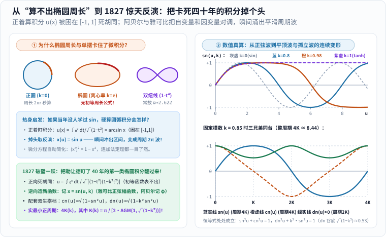
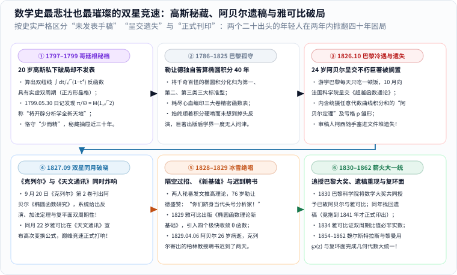
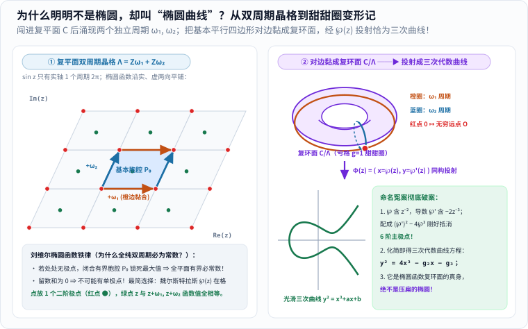
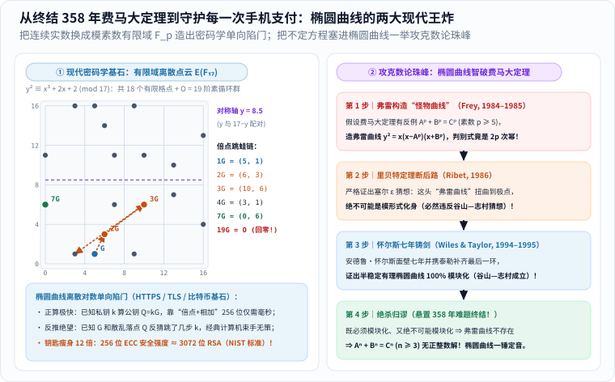

先考你一道看似小学生都能随口接上来的几何题：

半径为 $$r$$ 的正圆，面积是 $$\pi r^2$$，周长是 $$2\pi r$$；那把正圆压扁一点，变成半长轴为 $$a$$、半短轴为 $$b$$ 的**椭圆**，它的面积是多少？周长又是多少？

前半问极其痛快：椭圆只是把半径为 $$a$$ 的圆在竖直方向均匀压缩了 $$\frac{b}{a}$$ 倍，所以椭圆面积就是 $$\pi a^2 \cdot \frac{b}{a} = \pi ab$$，一秒钟口算完毕。

可一旦追问后半问——**椭圆的精确周长公式是什么？**——翻遍初中、高中乃至大学微积分课本，你都找不到一条干净的初等公式！有人试着猜 $$\pi(a+b)$$，算出来偏小；印度天才拉马努金曾凑出过精度惊人的近似式，但那终究只是近似。哪怕搬出多项式、根号、三角函数、指数函数和对数函数拼上三天三夜，也绝不可能把一般椭圆的周长写成有限长初等表达式 [[1]](#ref-1)[[2]](#ref-2)！

更让人一头雾水的“连环怪事”还在后头：当你顺着椭圆周长一路往下查，撞见现代数学与密码学里大名鼎鼎的**“椭圆曲线”（Elliptic Curve）**——比如 $$y^2 = x^3 - 7x + 10$$——画出来一看，它压根儿就不是压扁的圆圈，而是一条向右无限张开的“对称喇叭口”（有时左边还会多飘出一座封闭小岛）[[3]](#ref-3)！

这下谁都要犯嘀咕了：

1. **命名冤案**：一条长成喇叭口的三次曲线 $$y^2 = x^3 + ax + b$$，跟几何课上的椭圆八竿子打不着，凭什么叫“椭圆曲线”？
2. **双星破局**：椭圆周长引出的“椭圆积分”曾让欧拉、勒让德等几代大师苦算四十年难越雷池；为什么 **1827 年 9 月**，年仅 25 岁的挪威贫病青年**尼尔斯·亨利克·阿贝尔（Niels Henrik Abel）**与 22 岁的普鲁士神童**卡尔·古斯塔夫·雅可布·雅可比（Carl Gustav Jacob Jacobi）**仅仅做了一个“把自变量和因变量掉个头”的动作，就让整个分析学原地起飞 [[4]](#ref-4)[[5]](#ref-5)？
3. **甜甜圈与密码锁**：为什么闯进复平面后，这类函数会凭空长出**两个互相独立的周期**，把平面卷成一颗**甜甜圈（复环面）**？在曲线上拿直尺连一条线、找第三个交点再上下翻个身，怎么就变成了统治现代 HTTPS 加密、手机移动支付、比特币签名，甚至一剑斩落 **358 年费马大定理**的终极武器 [[3]](#ref-3)[[11]](#ref-11)？

今天，我们就顺着那条“算不出周长的椭圆弧”出发，把这桩横跨三百年数学史的头号传奇一次拆个底朝天。

---

## 一、从“椭圆周长算不出”到 1827 惊天掉头：为什么勒让德苦算四十年，却被两个二十岁青年一招掀翻？

### 1. 三道看似朴素的几何物理题，同时撞上同一堵铁墙

十八世纪微积分刚羽翼丰满时，意气风发的数学家们以为天下曲线弧长皆可积出，结果接连在三道看起来再老实不过的问题上撞得头破血流 [[1]](#ref-1)[[2]](#ref-2)：

- **第一道墙：椭圆弧长与周长**。取标准椭圆 $$\frac{x^2}{a^2} + \frac{y^2}{b^2} = 1\ (a > b > 0)$$，用参数方程 $$x = a\sin\theta,\ y = b\cos\theta$$ 代入微元弧长公式 $$ds = \sqrt{dx^2 + dy^2}$$，立刻得到四分之一椭圆周长为：

$$
\frac{L_{\text{椭圆} } }{4} = \int_0^{\pi/2} \sqrt{a^2\cos^2\theta + b^2\sin^2\theta}\,d\theta = a \int_0^{\pi/2} \sqrt{1 - k^2\sin^2\theta}\,d\theta
$$

  其中 $$k = \frac{\sqrt{a^2 - b^2} }{a} \in (0, 1)$$ 正是椭圆的**离心率**。根号底下藏着 $$\sin^2\theta$$，若是换元令 $$t = \sin\theta$$，式子就变成 $$\int_0^1 \frac{\sqrt{1 - k^2 t^2} }{\sqrt{1 - t^2} }\,dt$$，也就是 $$\int_0^1 \frac{1 - k^2 t^2}{\sqrt{(1 - t^2)(1 - k^2 t^2)} }\,dt$$——分母根号里赫然躺着一个无重根的**四次多项式** $$(1-t^2)(1-k^2 t^2)$$！无论你怎么分部积分、三角代换还是有理化，都消不掉这个四次根号（法国数学家刘维尔后来严格证明它绝无初等原函数）[[1]](#ref-1)[[2]](#ref-2)。

- **第二道墙：大摆角单摆的真实周期**。中学物理背得滚瓜烂熟的单摆周期公式 $$T_0 = 2\pi\sqrt{\frac{L}{g} }$$，其实偷偷用了小角度近似 $$\sin\theta \approx \theta$$！如果你把老式落地钟的钟摆拉高到 $$\theta_0 = 60^\circ$$ 松手，真实周期比 $$T_0$$ 慢了约 **$$7.3\%$$**；拉到 $$120^\circ$$ 松手，更是慢了整整 **$$37.3\%$$**！由机械能守恒严格推导，任意初始摆角 $$\theta_0$$ 的精确周期是 [[2]](#ref-2)[[6]](#ref-6)：

$$
T(\theta_0) = 4\sqrt{\frac{L}{g} }\int_0^{\pi/2} \frac{d\varphi}{\sqrt{1 - k^2\sin^2\varphi} } = 4\sqrt{\frac{L}{g} }\int_0^1 \frac{dt}{\sqrt{(1 - t^2)(1 - k^2 t^2)} }, \quad k = \sin\frac{\theta_0}{2}
$$

  看！分母根号底下又是同一个四次多项式 $$\sqrt{(1 - t^2)(1 - k^2 t^2)}$$！

- **第三道墙：伯努利双纽线（$$\infty$$ 字形曲线）的弧长**。我们在[《一家出了八位数学家，家里发生了什么》]()里见过的雅各布·伯努利，在 1694 年提出了极坐标方程为 $$r^2 = \cos 2\theta$$ 的“双纽线”（也就是今天无穷大符号 $$\infty$$ 的几何原型）[[7]](#ref-7)。从原点量到极径 $$r = x$$ 处的弧长，算出来竟是简洁到让人心痒难耐却偏偏积不出来的四次根式积分 [[7]](#ref-7)：

$$
u(x) = \int_0^x \frac{dt}{\sqrt{1 - t^4} }
$$

  就像单位圆半周长定义了圆周率 $$\pi = 2\int_0^1 \frac{dt}{\sqrt{1 - t^2} } \approx 3.14159265$$，双纽线半圈弧长也定义了一个专属的**双纽线常数** $$\varpi = 2\int_0^1 \frac{dt}{\sqrt{1 - t^4} } \approx 2.62205755$$ [[7]](#ref-7)。1718 年至 1750 年，意大利伯爵法尼亚诺（Giulio Fagnano）惊讶地发现：虽然单段双纽线弧长算不出初等值，但用尺规作图竟然能精确找到另一点，使弧长刚好**翻倍**！1751 年，欧拉读到法尼亚诺论文后拍案叫绝，顺手证明了震动学界的**椭圆积分代数加法定理** [[1]](#ref-1)。

因为这整族“有理函数搭配三次或四次无重根多项式平方根”的积分 $$\int R\bigl(t, \sqrt{P(t)}\bigr)\,dt$$ 最早脱胎于求椭圆弧长，数学家便统称它们为**椭圆积分（Elliptic Integrals）**[[2]](#ref-2)。自 1786 年起，法国数学大师**勒让德（Adrien-Marie Legendre）**单枪匹马在椭圆积分丛林里开荒整整 **40 年**，把天下所有椭圆积分干干净净化归为第一、第二、第三类三大标准型，还靠手工算出了厚达三大卷的精密函数表 [[1]](#ref-1)[[2]](#ref-2)。

然而，直到 73 岁的勒让德在 1825–1826 年捧出毕生心血《椭圆函数论》（注意：勒让德当年把“椭圆积分”本身叫作椭圆函数），整个欧洲数学界却一片死寂——积分还是那么拗口，定义域死死卡在 $$[-1, 1]$$ 里，为什么路越走越窄？

_先看左栏上下两张卡片对比“正着盯积分”与“掉头取反演”的天壤之别，再看右栏四阶龙格—库塔法实算出的精确波形：上框展示模数 $$k$$ 从 $$0$$ 增至 $$1$$ 时，$$\operatorname{sn}(u, k)$$ 如何从标准正弦波 $$\sin u$$ 一路长成平顶波，最终在 $$k \to 1$$ 时退化为单次跃迁孤立波 $$\tanh u$$；下框展示固定 $$k=0.85$$ 时 $$\operatorname{sn}(u)$$、$$\operatorname{cn}(u)$$、$$\operatorname{dn}(u)$$ 三兄弟在整周期 $$4K \approx 8.44$$ 内的精密配合。[单独打开大图](/assets/images/elliptic-curves/ellipse-arc-to-jacobi-inversion.svg)。_

### 2. 先拿圆弧做个思想实验：如果人类没学过正弦，硬盯反正弦会多绝望？

要一秒钟看懂阿贝尔和雅可比究竟干了什么惊天大事，咱们不妨做个有趣的“失忆思想实验” [[1]](#ref-1)：

假设外星文明从来没学过三角函数 $$\sin u$$ 和 $$\cos u$$，只知道拿微积分硬算单位圆弧长积分：

$$
u(x) = \int_0^x \frac{dt}{\sqrt{1 - t^2} }
$$

如果你像勒让德研究椭圆积分那样，死死把上限 $$x$$ 当自变量、把积分值 $$u(x)$$（也就是 $$\arcsin x$$）当主角来研究，你会痛苦到怀疑人生：

- 实数范围内，$$x$$ 一旦超出 $$[-1, 1]$$，根号 $$\sqrt{1 - x^2}$$ 就变成虚数，函数当场断片；
- 哪怕想让 $$x$$ 绕着 $$\pm 1$$ 折返，同一个 $$x$$ 也会对应无穷多个弧长 $$u$$（多值噩梦！）；
- 它的加法关系长成古怪的代数拼图：$$u(x) + u(y) = u\!\left(x\sqrt{1 - y^2} + y\sqrt{1 - x^2}\right)$$。

怎么一招破局？**把自变量和因变量掉个头！别问“给定坐标 $$x$$ 弧长 $$u$$ 是多少”，反过来问：“给定弧长 $$u$$，坐标 $$x(u)$$ 是多少？”**

这一掉头，乌云瞬间散尽：反函数 $$x = \sin u$$ 不仅在整个实轴 $$(-\infty, +\infty)$$ 上畅通无阻、处处单值光滑，而且天然自带周期性 $$\sin(u + 2\pi) = \sin u$$！更妙的是，原本晦涩的积分微分关系 $$\frac{du}{dx} = \frac{1}{\sqrt{1-x^2} }$$ 倒过来就成了 $$\left(\frac{dx}{du}\right)^2 = 1 - x^2$$，配上一位搭档 $$y(u) = \frac{dx}{du} = \cos u$$，连欧拉式拼图都瞬间退化成中学生都会背的和角公式 $$\sin(u+v) = \sin u\cos v + \cos u\sin v$$！

### 3. 把第一类椭圆积分翻过来：雅可比椭圆函数 `sn, cn, dn` 的诞生

勒让德苦苦盯了四十年的**第一类不完全椭圆积分**，正是圆弧积分多乘了一个尾巴 $$\sqrt{1 - k^2 t^2}$$ [[2]](#ref-2)[[6]](#ref-6)：

$$
u = F(x; k) = \int_0^x \frac{dt}{\sqrt{(1 - t^2)(1 - k^2 t^2)} } = \int_0^\varphi \frac{d\theta}{\sqrt{1 - k^2\sin^2\theta} }, \quad (x = \sin\varphi,\ 0 \le k \le 1)
$$

1827 年，阿贝尔与雅可比几乎同时喊出了那句捅破窗户纸的口号：**“把积分反过来（Invert the integral）！”**[[1]](#ref-1)[[4]](#ref-4)[[5]](#ref-5)

按照雅可比的命名（后由古德曼 Gudermann 与格莱舍 Glaisher 简化为今天通用的双字母缩写）[[6]](#ref-6)：把上限角度 $$\varphi$$ 视为弧长参数 $$u$$ 的反函数，称为**幅函数** $$\varphi = \operatorname{am}(u, k)$$；再取它的正弦、余弦以及椭圆特有的“第三幅值”，三位崭新的周期超越函数主角就此登台：

$$
\begin{aligned}
\operatorname{sn}(u, k) &= \sin\varphi = x \qquad\qquad\qquad\ \text{（正弦幅函数，阿贝尔记作 }\varphi(u)\text{）} \\
\operatorname{cn}(u, k) &= \cos\varphi = \sqrt{1 - \operatorname{sn}^2(u, k)} \quad\text{（余弦幅函数）} \\
\operatorname{dn}(u, k) &= \sqrt{1 - k^2\sin^2\varphi} = \sqrt{1 - k^2\operatorname{sn}^2(u, k)} \quad\text{（三角增量幅函数）}
\end{aligned}
$$

对照上图右栏的两组精确数值曲线，你会发现这套新函数简直是把三角函数和双曲函数装进了同一个可调旋钮 $$k$$（称为**椭圆模数**）里 [[6]](#ref-6)：

1. **完美对称的平方与导数律**：$$\operatorname{sn}^2 u + \operatorname{cn}^2 u = 1$$ 且 $$\operatorname{dn}^2 u + k^2\operatorname{sn}^2 u = 1$$；对 $$u$$ 求导更是像三人传球一样严丝合缝：

$$
\frac{d}{du}\operatorname{sn} u = \operatorname{cn} u\,\operatorname{dn} u, \qquad \frac{d}{du}\operatorname{cn} u = -\operatorname{sn} u\,\operatorname{dn} u, \qquad \frac{d}{du}\operatorname{dn} u = -k^2\operatorname{sn} u\,\operatorname{cn} u
$$

2. **有理分式加法定理**：欧拉当年费尽心力拼出的椭圆积分加法公式，翻成 $$\operatorname{sn}$$ 语言后，立刻变成正弦和角公式的精准升级版（分母只多了一项 $$-k^2\operatorname{sn}^2 u\operatorname{sn}^2 v$$）[[1]](#ref-1)[[6]](#ref-6)：

$$
\operatorname{sn}(u + v) = \frac{\operatorname{sn} u\,\operatorname{cn} v\,\operatorname{dn} v + \operatorname{sn} v\,\operatorname{cn} u\,\operatorname{dn} u}{1 - k^2\operatorname{sn}^2 u\,\operatorname{sn}^2 v}
$$

3. **实周期 $$4K(k)$$ 与两个极端变形**：令第一类**完全椭圆积分** $$K(k) = \int_0^{\pi/2} \frac{d\theta}{\sqrt{1 - k^2\sin^2\theta} }$$ 为“四分之一周期”（完美对应圆里的 $$\frac{\pi}{2}$$），则 $$\operatorname{sn}(u, k)$$ 和 $$\operatorname{cn}(u, k)$$ 的实最小正周期是 $$4K(k)$$，而始终大于零的 $$\operatorname{dn}(u, k)$$ 在 $$\bigl[\sqrt{1-k^2},\, 1\bigr]$$ 之间起伏，实周期是 $$2K(k)$$ [[6]](#ref-6)。拧动模数旋钮 $$k$$：
   - 当 $$k = 0$$ 时，$$K(0) = \frac{\pi}{2}$$，$$\operatorname{dn}(u, 0) \equiv 1$$，$$\operatorname{sn}(u, 0) = \sin u$$，$$\operatorname{cn}(u, 0) = \cos u$$——原封不动退回**中学三角函数**！
   - 当 $$k \to 1$$ 时，$$K(k) \to +\infty$$（单摆恰好竖直倒立在最高点平衡态），周期被拉到无穷长，$$\operatorname{sn}(u, 1) = \tanh u$$，$$\operatorname{cn}(u, 1) = \operatorname{dn}(u, 1) = \operatorname{sech} u$$——平滑退化为**双曲函数与孤立波（Soliton）**！今天浅水流体力学里的椭圆余弦波（Cnoidal wave）到海啸孤立波过渡、刚体无外力欧拉陀螺翻滚（网球拍定理！），精确解全都是 $$\operatorname{sn}, \operatorname{cn}, \operatorname{dn}$$ [[6]](#ref-6)！

---

## 二、阿贝尔与雅可比的 1827 双星竞速：抽屉里的高斯秘档、遗失巴黎的救命手稿，与迟到两天的聘书

把积分掉个头写出来只需三行字，但人类走到这三行字背后，却浓缩了十九世纪数学史最跌宕起伏的一场悲喜剧 [[4]](#ref-4)[[5]](#ref-5)。

_按第 ① 至第 ⑥ 幕顺序跟读这段真实历史：严格区分高斯的“未发表私人日记”、阿贝尔 1826 年呈交巴黎科学院却被遗失的“超越函数通论手稿”、以及 1827 年 9 月阿贝尔与雅可比同月正式刊印引爆的巅峰竞速。[单独打开大图](/assets/images/elliptic-curves/abel-jacobi-1827-race-timeline.svg)。_

### 1. 哥廷根抽屉里的三十年秘档：高斯早就看穿了一切，却一字未发

我们在[《高斯到底发明了什么：从 1 加到 100 开始》]()里讲过，“数学王子”高斯有个让后辈抓狂的怪癖——信奉“少而成熟（*Pauca sed matura*）”，不打磨到天衣无缝绝不发表。

后人整理高斯遗稿时倒吸了一口凉气：早在 **1797 年至 1799 年**（高斯才 20 到 22 岁！），他在研究正十七边形尺规作图之外，顺手把伯努利双纽线积分 $$u = \int_0^x \frac{dt}{\sqrt{1 - t^4} }$$ 掉头反演成了“双纽线正弦 $$\operatorname{sl} u$$ 与双纽线余弦 $$\operatorname{cl} u$$”，而且在私人笔记本里清清楚楚算出了它们在复平面上拥有正方形网格状的**实虚双周期** [[1]](#ref-1)[[7]](#ref-7)！

更神的是 **1799 年 5 月 30 日**，22 岁的高斯拿 $$1$$ 和 $$\sqrt{2}$$ 反复迭代算术平均 $$a_{n+1} = \frac{a_n + b_n}{2}$$ 与几何平均 $$b_{n+1} = \sqrt{a_n b_n}$$（算术—几何平均 AGM，仅迭代 4 步就能刷出 20 多位有效数字！），惊讶地发现极限 $$M(1, \sqrt{2})$$ 与圆周率除以双纽线常数 $$\frac{\pi}{\varpi}$$ 在小数点后第 11 位分毫不差 [[7]](#ref-7)！高斯激动地在数学日记第 98 条写下：

> “我们已将算术—几何平均与双纽线弧长联系至小数点后第 11 位；一旦证出此事，**必将在分析学中开辟一片全新的天地！**”[[7]](#ref-7)

并且一般地，第一类完全椭圆积分满足极速收敛公式 $$K(k) = \frac{\pi}{2\,\operatorname{AGM}\bigl(1, \sqrt{1 - k^2}\bigr)}$$！可惜高斯把这批足以提前改写数学史的手稿锁进抽屉整整三十年。因此，**真正独立破局、公开发表并把椭圆函数推向全世界的荣耀，毫无争议属于阿贝尔与雅可比** [[1]](#ref-1)[[5]](#ref-5)。

### 2. 一天只吃一顿饭的挪威寒门奇才，与被柯西弄丢的巴黎巨著

**尼尔斯·亨利克·阿贝尔（1802–1829）**出生在挪威贫困寒冷的乡村牧师家庭，18 岁丧父后靠中学恩师霍尔姆伯（Bernt Michael Holmboe）资助才得以读完大学 [[4]](#ref-4)。我们在[《前四次方程都有求根公式，为什么五次方程突然算不出了？》]()里讲过：阿贝尔曾以为自己找到了五次方程求根公式，丹麦数学家**德根（Carl Ferdinand Degen）**在审阅时不仅帮他指出漏洞，还送给了他一句改变一生的忠告——别在贫瘠的代数方程牛角尖里打转，去研究**椭圆超越函数**吧，那是一条“通往浩瀚分析学大洋的麦哲伦海峡”[[4]](#ref-4)！

1824 年，阿贝尔自费把五次方程不可根式求解的证明缩印成 6 页法文小册子省邮资；1825 年秋，他拿到挪威政府微薄的游学津贴南下欧洲：先在柏林结识了筑路工程师出身的伯乐克列尔，携手撑起刚创刊的[《克列尔杂志》]()，随后在 **1826 年 7 月**满怀憧憬抵达世界数学中心——巴黎 [[4]](#ref-4)。

然而巴黎迎接这位 24 岁外国穷青年的，却是彻骨的冷漠。阿贝尔盘缠耗尽，每天只能吃一顿饭，瘦骨嶙峋并染上了肺结核，但他仍拼命在 **1826 年 10 月 30 日**向法国科学院呈交了一篇足以彪炳千古的皇皇巨著——《论一类极广泛超越函数的一个普遍性质》[[4]](#ref-4)。在这篇论文里，阿贝尔不仅把欧拉的椭圆积分加法定理一举推广到**任意代数曲线上的积分和（即“阿贝尔定理”）**，还第一次提炼出了决定最少独立积分个数的整数 $$p$$——这正是后来黎曼曲面拓扑**亏格（Genus）**的最早源头 [[4]](#ref-4)！

法国科学院指派两位泰斗审稿：[柯西（Augustin-Louis Cauchy）]()和年迈的勒让德。谁也没想到，整天忙于撰写自己高产论文的柯西把阿贝尔的救命手稿带回家后，竟然看都没细看就塞进废纸堆里**彻底弄丢了** [[4]](#ref-4)！苦等数月音讯全无、身无分文的阿贝尔，只能在 1826 年底拖着病躯经柏林返回挪威，背着一身债务靠辅导中学生糊口，同时把椭圆积分反演与双周期性的核心成果整理成《椭圆函数研究》（*Recherches sur les fonctions elliptiques*），寄给了柏林唯一懂他的老友克列尔 [[4]](#ref-4)。

### 3. 1827 年 9 月同月破晓：双子星隔空飙车，与迟到两天的柏林聘书

就在阿贝尔在挪威贫病挣扎的同时，东普鲁士哥尼斯堡大学杀出了一匹锋芒毕露的黑马——**卡尔·古斯塔夫·雅可布·雅可比（1804–1851）**[[5]](#ref-5)。

与阿贝尔的家徒四壁相反，雅可比生于波茨坦富裕的犹太银行家家庭，自幼才思敏捷，20 岁拿下柏林大学博士学位，21 岁赴哥尼斯堡任教 [[5]](#ref-5)。1827 年夏，22 岁的雅可比在研究椭圆积分不同模数之间的代数高次变换（三次、五次及奇素数次变换）时取得惊人突破，于 **1827 年 8 月 5 日**直接提笔给巴黎 75 岁的老前辈勒让德写信汇报，并把两篇尚未附完整证明的拉丁文快报投给德国《天文通讯》（*Astronomische Nachrichten*）[[5]](#ref-5)。

命运的戏剧性在这一刻拉到了满格 [[4]](#ref-4)[[5]](#ref-5)：

- **1827 年 9 月 20 日**，《克列尔杂志》第 2 卷正式印出阿贝尔的《椭圆函数研究》（第一部分），人类历史上**第一次白纸黑字公开发表了椭圆积分反演、复变量延拓以及惊世骇俗的双周期性**！
- **同一个 1827 年 9 月**，《天文通讯》第 123 期印出了雅可比的两封变换定理快报！

两个素昧平生的年轻人，在同一座山峰的两侧同时撞开了云雾！随后展开的 **1827–1829 巅峰竞速**，堪称数学史上最荡气回肠的高手过招 [[4]](#ref-4)[[5]](#ref-5)：

- 雅可比读到阿贝尔《克列尔》论文后大为震动，立刻坦率承认阿贝尔反演思想的高明（后来公开称赞阿贝尔的巨作“远在我的赞美之上，也远在我自己的工作之上”），并迅速借用反函数 $$\operatorname{sn}, \operatorname{cn}, \operatorname{dn}$$ 严格补齐了自己一般变换定理的证明 [[1]](#ref-1)[[5]](#ref-5)；
- 远在挪威的阿贝尔在 1828 年初读到雅可比的快报，立刻暂时放下刚摸到门道的“代数方程可解性判据”（几乎与几年后的伽罗瓦殊途同归！），一口气连写数篇论文，证明雅可比的变换可以从自己更一般的框架自然推出 [[4]](#ref-4)；
- 收到两人雪片般寄来的论文，在巴黎孤守四十年的老宗师勒让德老泪纵横，分别回信盛赞：**“凭借这些工作，你们两位已跻身我们时代最顶尖的分析学家之列！”**[[4]](#ref-4)[[5]](#ref-5)
- **1829 年**，24 岁的雅可比正式出版传世专著《椭圆函数理论新基础》（*Fundamenta nova theoriae functionum ellipticarum*），不仅正式确立将**反函数**命名为“椭圆函数”，更天才地引入了级数按 $$q^{n^2}\ (\lvert q\rvert < 1)$$ 二次指数极速收敛的四个 **雅可比 $$\vartheta$$ 函数（Theta functions）**，让椭圆函数的数值计算快如闪电 [[5]](#ref-5)！

然而，就在雅可比捧出《新基础》的同一个春天，挪威传来了令全欧洲心碎的噩耗：

1828 年圣诞节，阿贝尔顶着严寒乘雪橇前往弗罗兰探望未婚妻，途中肺结核急剧恶化，卧床不起。担心巴黎那篇心血巨著永远石沉大海，他在 **1829 年 1 月**拼尽最后一丝力气，写下了一篇仅有短短两页、不带任何引言与寒暄的绝笔短文《一个定理》，把阿贝尔定理的核心留给世人 [[4]](#ref-4)。**1829 年 4 月 6 日上午 11 时**，年仅 26 岁零 8 个月的阿贝尔在冰雪中溘然长逝；仅仅两天后的 **4 月 8 日**，毫不知情的克列尔在柏林兴冲冲寄出快信，告诉他普鲁士教育部终于批下了柏林大学教授聘书 [[4]](#ref-4)。

阿贝尔去世后，义愤填膺的雅可比与勒让德联手向法国科学院施压追查那份遗失手稿，逼得柯西终于在 **1830 年**从故纸堆里翻出了原稿；同年，巴黎科学院将数学大奖（Grand Prix）共同授予已故的阿贝尔与在世的雅可比 [[4]](#ref-4)。（荒唐的是，这份手稿竟又拖到 **1841 年**才正式印出，印完后原稿再度离奇失踪，直到 **1952 年**才在意大利佛罗伦萨一家图书馆重见天日 [[4]](#ref-4)！）

---

## 三、闯进复平面后的“双周期奇迹”：为什么把平行四边形黏成甜甜圈，会变出三次曲线？

现在，让我们揭开开篇最大的那个悬念：**阿贝尔和雅可比反演出来的椭圆函数，到底是怎么把一颗“甜甜圈”变成三次曲线 $$y^2 = x^3 + ax + b$$ 的？**

### 1. 为什么正弦函数只有一个周期，椭圆函数却凭空冒出“第二个虚周期”？

在实数轴上画图，$$\operatorname{sn}(u, k)$$ 看起来不过是一条稍微压平了一点波峰的“大号正弦波”（实周期 $$4K$$），并没有显出神通。阿贝尔和雅可比最石破天惊的一步，是**把自变量 $$u$$ 放进复平面 $$\mathbb{C}$$，代进纯虚数 $$u = i v$$ 试试看！**[[1]](#ref-1)[[6]](#ref-6)

先看老朋友正弦函数 $$\sin z$$：由欧拉公式 $$\sin(iv) = \frac{e^{-v} - e^v}{2i} = i\sinh v$$，一旦顺着虚轴往上走（$$v \to +\infty$$），$$\sin(iv)$$ 就像脱缰野马一样按指数 $$e^v$$ 爆炸到无穷大，根本不回头！所以 $$\sin z$$ 只有实轴方向**唯一一个周期 $$2\pi$$**（单周期函数）。

可当你把纯虚数上限 $$x = iy$$（令 $$t = is$$）代进第一类椭圆积分时，神奇的负负得正发生了：

$$
u = \int_0^{iy} \frac{dt}{\sqrt{(1 - t^2)(1 - k^2 t^2)} } = i \int_0^y \frac{ds}{\sqrt{(1 + s^2)(1 + k^2 s^2)} }
$$

再做一个初等换元 $$s = \frac{\tau}{\sqrt{1 - \tau^2} }$$（即 $$\tau = \frac{s}{\sqrt{1 + s^2} } \in [0, 1)$$），微分 $$\frac{ds}{\sqrt{1 + s^2} } = \frac{d\tau}{1 - \tau^2}$$，而 $$\sqrt{1 + k^2 s^2} = \frac{\sqrt{1 - (1 - k^2)\tau^2} }{\sqrt{1 - \tau^2} }$$——上下两个 $$\sqrt{1 - \tau^2}$$ 削掉一个，式子竟然**原模原样变回了另一道第一类椭圆积分** [[6]](#ref-6)：

$$
u = i \int_0^{\tau} \frac{d\tau}{\sqrt{(1 - \tau^2)(1 - k'^2 \tau^2)} }, \qquad k' = \sqrt{1 - k^2}\ \text{（称为余模数）}
$$

这就是大名鼎鼎的**雅可比虚数变换**：$$\operatorname{sn}(iv, k) = i\,\frac{\operatorname{sn}(v, k')}{\operatorname{cn}(v, k')}$$ [[6]](#ref-6)！看懂这意味着什么了吗？沿着虚轴走，$$\operatorname{sn}$$ 根本不会像 $$\sinh v$$ 那样指数爆炸，而是以互补的四分之一周期 $$K' = K(k')$$ 为节拍，继续周而复始地振荡！具体说来，$$\operatorname{sn}(z, k)$$ 同时满足两条独立周期律：

$$
\operatorname{sn}(z + 4K,\, k) = \operatorname{sn}(z,\, k), \qquad \operatorname{sn}(z + 2iK',\, k) = \operatorname{sn}(z,\, k)
$$

**闯进复平面后，它竟然在横向（实轴 $$4K$$）和纵向（虚轴 $$2iK'$$）两个完全独立的方向上同时周期重复！** 1834 年，雅可比进一步严格证明：任何非常数的单值亚纯函数最多只能有两个独立周期 $$\omega_1, \omega_2$$，且它们的比值 $$\tau = \frac{\omega_2}{\omega_1}$$ 绝不可能是实数（$$\operatorname{Im}(\tau) \neq 0$$）[[5]](#ref-5)。今天现代复分析干脆直接用这个本质特征来下定义：

> **定义（椭圆函数）**：设 $$\omega_1, \omega_2 \in \mathbb{C}$$ 满足 $$\operatorname{Im}(\omega_2 / \omega_1) > 0$$，称离散点阵 $$\Lambda = \{m\omega_1 + n\omega_2 \mid m, n \in \mathbb{Z}\}$$ 为**周期格（Period Lattice）**。复平面 $$\mathbb{C}$$ 上满足 $$f(z + \omega_1) = f(z)$$ 且 $$f(z + \omega_2) = f(z)$$ 的亚纯函数（除孤立极点外处处全纯解析），就叫作**椭圆函数** [[1]](#ref-1)。

_先看左栏：两个不共线周期 $$\omega_1, \omega_2$$ 把复平面铺成无限平行四边形瓷砖，基本胞腔 $$P_0$$ 的上下橙边等价、左右蓝边等价，红点 $$\bullet$$ 为格点二阶极点；再看右栏上：把 $$P_0$$ 的两组对边分别黏合，恰好卷成亏格 $$g=1$$ 的复环面（甜甜圈）；最后顺紫箭头看右栏下：魏尔斯特拉斯映射 $$\Phi(z)=(\wp(z), \wp'(z))$$ 把整颗甜甜圈分毫不差投射成光滑三次代数曲线 $$y^2 = 4x^3 - g_2 x - g_3$$！[单独打开大图](/assets/images/elliptic-curves/double-period-lattice-to-torus.svg)。_

### 2. 刘维尔铁律与魏尔斯特拉斯的“六阶极点对消术”

看着上图左栏铺满复平面的平行四边形瓷砖，你可能会问：为什么每个格子里非要画讨厌的红色“极点（无穷大奇点）”？能不能造一个像 $$\sin z$$ 那样在有限复平面上**处处光滑无极点**的双周期函数？

答案是：**绝对造不出来——除非它是一个枯燥透顶的常数！**

1844 年，法国数学家**刘维尔（Joseph Liouville）**正是在听了雅可比关于双周期椭圆函数的报告后灵光一闪，证出了今天每本《复变函数》教材必学的**刘维尔定理**及椭圆函数三条铁律 [[1]](#ref-1)[[5]](#ref-5)：

1. **无极点必为常数**：假设椭圆函数 $$f(z)$$ 没有极点，那么它在有界闭平行四边形 $$\overline{P_0}$$ 上连续，模长 $$\lvert f(z)\rvert$$ 必有最大值 $$M$$；再靠双周期性平移铺满整个复平面，$$\lvert f(z)\rvert \le M$$ 在全平面成立——有界整函数只能是常数！
2. **不可能只有一阶单极点**：绕基本平行四边形边界 $$\partial P_0$$ 逆时针做一圈复围道积分 $$\oint_{\partial P_0} f(z)\,dz$$，由于上边与下边函数值完全相等但积分方向相反、左边与右边也完全抵消，总积分恒等于 $$0$$！由[柯西留数定理]()，胞腔内所有极点的留数之和必须为 $$0$$——如果只放 1 个一阶极点，它的留数没法跟别人抵消，当场矛盾！

所以想造出“最简单”的非常数椭圆函数，只有两条路可走 [[1]](#ref-1)：
- **雅可比路线**：每个基本胞腔里放 **2 个一阶简单极点**（留数一正一负刚好抵消，这就是 $$\operatorname{sn}, \operatorname{cn}, \operatorname{dn}$$）；
- **魏尔斯特拉斯路线**（就是我们在[《克列尔杂志的逆袭传奇》]()里那位教了 12 年中学体操和书法的传奇宗师！）：每个基本胞腔只在格点 $$\omega \in \Lambda$$ 处放 **1 个留数为 0 的二阶极点**！

1862 年前后，魏尔斯特拉斯在柏林大学讲义里写下了那个美如艺术品的**魏尔斯特拉斯 $$\wp$$ 函数**（读作“p 函数”）[[1]](#ref-1)：

$$
\wp(z) = \frac{1}{z^2} + \sum_{\omega \in \Lambda \setminus \{0\} } \left( \frac{1}{(z - \omega)^2} - \frac{1}{\omega^2} \right)
$$

（括号里减去 $$\frac{1}{\omega^2}$$ 是为了让二重无穷级数绝对一致收敛，且保证原点附近展开没有常数项。）现在请你跟着魏尔斯特拉斯做一步中学生都能看懂的**“极点消消乐”**[[1]](#ref-1)：

因为 $$\wp(-z) = \wp(z)$$ 是偶函数，它在原点 $$z = 0$$ 附近的洛朗级数只含偶次幂（记格点级数和 $$G_4 = \sum_{\omega \neq 0} \omega^{-4}$$，$$G_6 = \sum_{\omega \neq 0} \omega^{-6}$$）：

$$
\wp(z) = \frac{1}{z^2} + 3 G_4 z^2 + 5 G_6 z^4 + O(z^6)
$$

逐项求一次导数，$$\wp'(z)$$ 就成了含三阶极点的奇函数：

$$
\wp'(z) = -\frac{2}{z^3} + 6 G_4 z + 20 G_6 z^3 + O(z^5)
$$

注意看最高阶奇异项：$$\wp'(z)^2$$ 开头是 $$\frac{4}{z^6}$$，而 $$4\wp(z)^3$$ 开头**也是 $$\frac{4}{z^6}$$**！把两式相减，吓人的六阶极点 $$\frac{4}{z^6}$$ 当场灰飞烟灭：

$$
\begin{aligned}
\wp'(z)^2 &= \frac{4}{z^6} - \frac{24 G_4}{z^2} - 80 G_6 + O(z^2) \\
4\wp(z)^3 &= \frac{4}{z^6} + \frac{36 G_4}{z^2} + 60 G_6 + O(z^2) \\
\Longrightarrow\quad \wp'(z)^2 - 4\wp(z)^3 &= -\frac{60 G_4}{z^2} - 140 G_6 + O(z^2)
\end{aligned}
$$

右边还剩一个尾巴 $$-\frac{60 G_4}{z^2}$$ 怎么办？现成的 $$\wp(z)$$ 开头不就是 $$\frac{1}{z^2}$$ 吗！记两个只由晶格形状决定的常数 $$g_2 = 60 G_4$$、$$g_3 = 140 G_6$$，把 $$g_2\wp(z) + g_3$$ 挪过去一补：

$$
H(z) = \wp'(z)^2 - 4\wp(z)^3 + g_2\wp(z) + g_3 = O(z^2)
$$

奇迹诞生了！左边的组合函数 $$H(z)$$ 依然是双周期椭圆函数，但它在格点 $$z = 0$$ 处所有的负幂次极点被削得一干二净（连常数项都消成了 $$0$$，满足 $$H(0) = 0$$）！根据刚刚证过的刘维尔第一铁律——**没有极点的椭圆函数只能是常数，既然 $$H(0) = 0$$，它就必须在全复平面恒等于 $$0$$** [[1]](#ref-1)！于是，每一个周期格 $$\Lambda$$ 都满足恒等式：

$$
\wp'(z)^2 = 4\wp(z)^3 - g_2\wp(z) - g_3
$$

### 3. 百年命名冤案真相大白：甜甜圈 `\mathbb{C}/\Lambda` 的代数化身

现在请回到上图右栏，把整条因果链串起来：

1. 因为椭圆函数把相差周期 $$m\omega_1 + n\omega_2$$ 的复数一视同仁，所以它真正的舞台不是无限大的平面 $$\mathbb{C}$$，而是把基本平行四边形 $$P_0$$ 的上下对边黏合（先卷成圆筒）、再把左右对边**不拧转直接对齐黏合**而成的商空间 $$\mathbb{C}/\Lambda$$——拓扑上，这完完全全是一颗表面光滑、中间带一个洞（亏格 $$g = 1$$）的**二维环面（甜甜圈，Complex Torus）**[[1]](#ref-1)[[3]](#ref-3)！（对比我们上一篇[《彻底读懂莫比乌斯环》]()：拧转半圈黏合会变成不可定向的克莱因瓶，而不拧转正向黏合正是可定向的双侧环面！）
2. 令横坐标 $$x = \wp(z)$$，纵坐标 $$y = \wp'(z)$$（若对 $$x, y$$ 做一步简单的常数放缩 $$x \mapsto x/4^{1/3}$$，方程就化为教科书最常见的**短魏尔斯特拉斯标准型 $$y^2 = x^3 + ax + b$$**），再约定把甜甜圈原点 $$z = 0$$（极点处 $$x, y \to \infty$$）对应到我们在[《彭赛列和射影几何》]()里学过的唯一一个**射影无穷远点 $$\mathcal{O} = [0:1:0]$$** [[3]](#ref-3)。
3. 魏尔斯特拉斯与黎曼证明了：**映射 $$\Phi: z \mapsto (\wp(z), \wp'(z))$$ 把复环面 $$\mathbb{C}/\Lambda$$ 上的每一个点，不重不漏、一一对应地搬到了复射影三次曲线 $$E(\mathbb{C}): y^2 = 4x^3 - g_2 x - g_3$$（判别式 $$\Delta = g_2^3 - 27g_3^2 \neq 0$$）上！**[[1]](#ref-1)[[3]](#ref-3)

**真相终于水落石出**：$$y^2 = x^3 + ax + b$$ 之所以叫“椭圆曲线”，绝不是谁眼花把它看成了椭圆（二次曲线 $$Ax^2 + By^2 = 1$$ 的复射影图形其实是亏格 $$g = 0$$ 的球面！），而是因为**椭圆周长引出了椭圆积分，椭圆积分掉头反演出双周期椭圆函数，而双周期椭圆函数所栖居的亏格 $$g = 1$$ 复环面（甜甜圈），写成代数方程恰好就是这条光滑三次曲线** [[1]](#ref-1)[[3]](#ref-3)！（我们在实平面 $$\mathbb{R}^2$$ 里画出的那条“喇叭口”，只是这颗四维空间 `C²` 里的二维复甜甜圈被实数平面切出来的一道一维切片！）

---

## 四、曲线上的奇妙加法器：连一条直线再翻个身，凭什么变成完美阿贝尔群？

椭圆曲线最迷人的超能力，在于它不像普通曲线那样只是一盘散沙般的点集——**曲线上任意两个点 $$P$$ 和 $$Q$$，竟然可以拿一把直尺直接“相加”得出曲线上的第三个点 $$P + Q$$，而且加减法规则完美得像整数一样！**[[3]](#ref-3)

_先看左栏光滑椭圆曲线 $$E: y^2 = x^3 - 7x + 10$$（单次播放动画展示割线 $$P(-3,-2)$$ 连 $$Q(1,2)$$ 交于 $$R'(3,4)$$，再沿 $$x$$ 轴垂直翻折落到橙色终点 $$P+Q=(3,-4)$$；紫色虚线同时静态保留 $$Q$$ 处切线倍点得 $$2Q=(-1,-4)$$ 的全过程）；再看右栏上如何用复环面恒等式 $$z_P + z_Q + z_{R'} \equiv 0 \pmod{\Lambda}$$ 一秒看穿翻折原因与结合律，以及右栏下两个判别式 $$\Delta = 0$$ 导致群结构崩塌的退化反例。[单独打开大图](/assets/images/elliptic-curves/chord-and-tangent-group-law-anim.svg)（刷新页面可重播单次连线动画）。_

### 1. 手把手口算一次“弦切加法”：全部是小整数，5 秒就能验算！

很多科普书一讲椭圆曲线点加法就甩出一堆分数根号，把读者绕晕。其实只要挑一条合适的整数曲线——比如上图左栏的 **$$E: y^2 = x^3 - 7x + 10$$**（这里 $$a = -7,\ b = 10$$，判别式 $$\Delta = -16(4a^3 + 27b^2) = -16(-1372 + 2700) = -21248 \neq 0$$，曲线处处光滑）——所有坐标和斜率全都是清爽的小整数，咱们心算就能走完全程 [[3]](#ref-3)：

- **情形一：两个不同点相加 $$P + Q$$（割线法则）**
  取曲线上两点 $$P = (-3, -2)$$（验算：$$(-2)^2 = 4$$，$$(-3)^3 - 7(-3) + 10 = -27 + 21 + 10 = 4$$，在曲线上！）和 $$Q = (1, 2)$$（验算：$$2^2 = 4 = 1 - 7 + 10$$，也在曲线上！）。
  1. **第一步（连割线找第三交点 $$R'$$）**：过 $$P, Q$$ 作直线，斜率 $$s = \frac{y_Q - y_P}{x_Q - x_P} = \frac{2 - (-2)}{1 - (-3)} = \frac{4}{4} = 1$$，直线方程是极其简单的 $$y = x + 1$$。把它代入曲线方程 $$(x + 1)^2 = x^3 - 7x + 10$$，移项整理得三次方程：

$$
x^3 - s^2 x^2 - \dots = x^3 - x^2 - 9x + 9 = 0
$$

     重点来了！根本不用硬解三次方程——由韦达定理，三次方程三个根之和等于二次项系数的相反数 $$x_P + x_Q + x_{R'} = s^2$$！既然已知前两个交点横坐标是 $$-3$$ 和 $$1$$，第三个交点横坐标直接脱口而出：

$$
x_{R'} = s^2 - x_P - x_Q = 1^2 - (-3) - 1 = 3
$$

     代回直线得 $$y_{R'} = 3 + 1 = 4$$，即第三交点为 $$R' = (3, 4)$$（验算：$$4^2 = 16 = 27 - 21 + 10$$，分毫不差）！
  2. **第二步（沿 $$x$$ 轴上下翻折变号）**：因为方程左边是 $$y^2$$，整条椭圆曲线天然关于 $$x$$ 轴上下对称！把 $$R'(3, 4)$$ 沿 $$x$$ 轴镜面翻到下方，定义终点为和点：

$$
P + Q = R = (x_{R'},\, -y_{R'}) = (3, -4)
$$

- **情形二：同一个点自己加自己 $$Q + Q = 2Q$$（切线倍点法则）**
  如果让两个点慢慢靠拢重合（$$P \to Q(1, 2)$$），割线就顺理成章变成了点 $$Q$$ 处的**切线**！对 $$y^2 = x^3 - 7x + 10$$ 两边隐函数求导 $$2y\,dy = (3x^2 - 7)\,dx$$，算得 $$Q(1, 2)$$ 处的切线斜率为：

$$
s_{\text{切} } = \frac{3x_Q^2 + a}{2y_Q} = \frac{3(1)^2 - 7}{2 \times 2} = \frac{-4}{4} = -1
$$

  切线方程为 $$y = -x + 3$$。同样用韦达定理（此时 $$x_Q = 1$$ 是二重切根！），另一个交点 $$D'$$ 的横坐标立刻算出：

$$
x_{D'} = s_{\text{切} }^2 - 2x_Q = (-1)^2 - 2(1) = -1, \qquad y_{D'} = -(-1) + 3 = 4
$$

  再沿 $$x$$ 轴上下翻折，倍点结果秒出：**$$2Q = (-1, -4)$$**（验算：$$(-4)^2 = 16 = -1 + 7 + 10$$，严丝合缝）！

- **情形三：相反数与无穷远零元 $$\mathcal{O}$$**
  要是把上下对称的一对点 $$Q(1, 2)$$ 和 $$-Q(1, -2)$$ 连起来呢？这是一条竖直直线 $$x = 1$$，它在有限平面上找不到第三个交点，但在齐次射影方程 $$Z Y^2 = X^3 + a X Z^2 + b Z^3$$ 中恰好穿过无穷远直线 $$Z = 0$$ 上的唯一点 $$\mathcal{O} = [0:1:0]$$ [[3]](#ref-3)！因此 $$\mathcal{O}$$ 就扮演了加法里的**数字 $$0$$（单位元）**：

$$
P + \mathcal{O} = P, \qquad -(x, y) = (x, -y), \qquad P + (-P) = \mathcal{O}
$$

顺便看一眼刚才所有代数公式：$$x_3 = s^2 - x_1 - x_2$$、$$y_3 = s(x_1 - x_3) - y_1$$ 里**只用到了加、减、乘、除四则运算，连一个根号都没有**！这意味着只要起点 $$P, Q$$ 的坐标是有理数（分数），不管你弦切相加多少万次，生成的新点坐标 **100% 永远是有理数** [[3]](#ref-3)！1922 年，英国数学家莫德尔（Louis Mordell）证明了著名的**莫德尔定理**：有理椭圆曲线上的全体有理点群 $$E(\mathbb{Q})$$ 永远是**有限生成阿贝尔群**——哪怕曲线上有无穷多个有理数解，也一定能由寥寥几个“种子点”靠反复连线翻折全部生出来 [[3]](#ref-3)！

### 2. 为什么要多此一举上下翻折？结合律为什么在甜甜圈上一秒自证？

第一次学弦切加法的人，100% 都会冒出两个尖锐追问：
1. 既然连线已经找到了曲线上的第三个交点 $$R'$$，直接规定 $$P \oplus Q = R'$$ 不省事得多吗？干嘛非要多此一举沿 $$x$$ 轴翻折一下？
2. 就算翻折了，怎么证明任意三点满足**加法结合律 $$(P + Q) + S = P + (Q + S)$$**？

先答第一问：如果你偷懒不翻折、直接令 $$P * Q = R'$$，那么因为 $$P, Q, R'$$ 躺在同一条直线上，拿 $$R'$$ 再跟 $$Q$$ 连线，第三个交点必然退回 $$P$$，也就是 $$(P * Q) * Q = P$$；但 $$P * (Q * Q)$$ 却是 $$P$$ 与 $$Q$$ 切线交点的连线，两者天差地别——**不翻折连结合律的边都摸不着！**

更要命的是第二问：如果只靠初等代数把坐标公式硬代进 $$(P + Q) + S$$ 和 $$P + (Q + S)$$，分子分母会炸出足足几十项九次多项式，还得逐一排除重合、切线、竖直线等七八种退化分支，纯手算能把人逼疯！

可一旦切回第三章的**复环面（甜甜圈）视角 $$\Phi(z) = (\wp(z), \wp'(z))$$**，这道噩梦般的结合律证明居然**连一行高难计算都不用，一秒钟不证自明** [[1]](#ref-1)[[3]](#ref-3)：

设曲线上三点 $$P, Q, R'$$ 对应甜甜圈 $$\mathbb{C}/\Lambda$$ 上的三个复参数 $$z_P, z_Q, z_{R'}$$。它们共线于 $$y = sx + d$$，等价于它们是椭圆函数 $$g(z) = \wp'(z) - s\wp(z) - d$$ 在基本胞腔 $$P_0$$ 里的三个零点。而 $$g(z)$$ 只在格点 $$z = 0$$ 处有一个**三阶极点**；由复分析辐角原理推广积分 $$\frac{1}{2\pi i}\oint_{\partial P_0} z\frac{g'(z)}{g(z)}\,dz$$，一个椭圆函数在基本胞腔内**所有零点坐标之和减去所有极点坐标之和，必然落在周期格 $$\Lambda$$ 里** [[1]](#ref-1)！于是：

$$
(z_P + z_Q + z_{R'}) - (0 + 0 + 0) \in \Lambda \quad\Longleftrightarrow\quad z_P + z_Q + z_{R'} \equiv 0 \pmod{\Lambda}
$$

移项一看：**第三交点 $$R'$$ 在甜甜圈上对应的复数，原来是 $$z_{R'} \equiv -(z_P + z_Q) \pmod{\Lambda}$$，刚好差了一个负号！**

怎么在曲线上把这个负号拧正成真正的 $$z_P + z_Q$$？别忘了 $$\wp(-z) = \wp(z)$$（横坐标不变！），而导数 $$\wp'(-z) = -\wp'(z)$$（纵坐标变相反数！）——**把 $$R'(x, y)$$ 沿 $$x$$ 轴上下翻折成 $$(x, -y)$$，在甜甜圈上分毫不差就是把 $$-(z_P + z_Q)$$ 变号还原成了 $$z_P + z_Q$$！**

换句话说，几何上看起来匪夷所思的“连直线找第三交点再上下翻折”，脱掉马甲后，根本就是甜甜圈 $$\mathbb{C}/\Lambda$$ 上最普通的**复数加法 $$(z_1, z_2) \mapsto z_1 + z_2 \pmod{\Lambda}$$**！普通复数加法当然满足交换律和结合律 $$(z_1 + z_2) + z_3 = z_1 + (z_2 + z_3)$$，所以椭圆曲线弦切加法天然构成一个完美的交换群——而数学界把一切满足交换律的群统一命名为**阿贝尔群（Abelian Group）**，正是为了永远致敬英年早逝的阿贝尔（详见[《群论和集合，以及那些数学家》]()）[[4]](#ref-4)！

### 3. 判别式红线 `\Delta \neq 0`：一旦长出尖刺或十字路口，群结构当场报废

顺便看一眼上图右栏下方的红框：为什么定义椭圆曲线时，数学家总要板着脸加一句铁律——**判别式 $$\Delta = -16(4a^3 + 27b^2) \neq 0$$** [[3]](#ref-3)？

因为一旦 $$4a^3 + 27b^2 = 0$$，右侧三次多项式 $$x^3 + ax + b$$ 就会出现重根，相当于把甜甜圈的一段管子活活掐扁成了零粗细，曲线上长出**奇异点（Singular point）**：
- 若三重根重合（如 $$a = b = 0$$，即 $$y^2 = x^3$$），原点 $$(0, 0)$$ 长出一根锋利的**尖点（Cusp）**，切线坍缩；
- 若二重根重合（如 $$a = -3,\ b = 2$$，即 $$y^2 = x^3 - 3x + 2 = (x-1)^2(x+2)$$），点 $$(1, 0)$$ 变成自己穿过自己的**十字自交结点（Node）**，一个点冒出两条不同切线！

只要曲线过奇异点连一条直线，奇异点自己就吞掉了 $$2$$ 个交点名额，导致光滑部分再也凑不齐正常的弦切群运算（去掉奇异点后，尖点曲线退化为普通加法群 $$(\mathbb{C}, +)$$，结点曲线退化为乘法群 $$(\mathbb{C}^\times, \times)$$，全都丢掉了紧致复环面的双周期灵魂与密码学强度）[[3]](#ref-3)。所以**“光滑无奇点（$$\Delta \neq 0$$）”**是椭圆曲线不可触碰的生命线。

---

## 五、两百年前的纯数学玩具，怎样统治现代数字安全并终结费马大定理？

在阿贝尔和雅可比去世后的一百多年里，椭圆曲线一直被视为纯粹数学象牙塔顶端的明珠，没人觉得它跟普通人的衣食住行有什么关系。直到 **1985 年前后**，两记惊雷几乎同时炸响——它先是一头扎进密码学守住了全球互联网金库，紧接着又一剑封喉终结了困扰人类三個半世纪的数论第一悬案 [[3]](#ref-3)[[9]](#ref-9)[[11]](#ref-11)！

_左栏精确绘出模 $$17$$ 素有限域椭圆曲线 $$y^2 \equiv x^3 + 2x + 2 \pmod{17}$$ 的全部 $$18$$ 个有限格点（连同无穷远点 $$\mathcal{O}$$ 构成 $$19$$ 阶素循环群），橙色虚线追踪生成元 $$G=(5,1)$$ 倍点跳变链，直观展示“正算毫秒、反推绝望”的单向陷门；右栏按四步逻辑链还原弗雷、里贝特与怀尔斯如何借椭圆曲线模性定理绝杀费马大定理。[单独打开大图](/assets/images/elliptic-curves/ecc-finite-field-and-fermat.svg)。_

### 1. 把连续曲线剁成素数散点云：256 位短钥匙硬刚 3072 位 RSA 的密码学王牌

计算机不喜欢有舍入误差的实数浮点数，它最擅长在有限整数环里做精确模运算。**1985 年**，美国数学家尼尔·科布利茨（Neal Koblitz）与维克多·米勒（Victor S. Miller）各自独立提出了一个天才构想：**如果把椭圆曲线方程 $$y^2 = x^3 + ax + b$$ 搬到模大素数 $$p$$ 的有限域 $$\mathbb{F}_p = \{0, 1, 2, \dots, p-1\}$$ 上，会发生什么？**[[8]](#ref-8)[[9]](#ref-9)

咱们拿上图左栏的小素数玩具模型 **$$p = 17$$**，亲手算两步看看 $$E(\mathbb{F}_{17}): y^2 \equiv x^3 + 2x + 2 \pmod{17}$$（判别式 $$4\times 2^3 + 27\times 2^2 = 140 \equiv 4 \not\equiv 0 \pmod{17}$$）：

1. **曲线碎成对称满天星**：把 $$x = 0, 1, \dots, 16$$ 逐个代进去检验右边是不是模 $$17$$ 的完全平方数，一共能筛出整整齐齐 **$$18$$ 个有限整数格点**（因为 $$(-y)^2 \equiv (17 - y)^2 \pmod{17}$$，所有点关于水平线 $$y = 8.5$$ 上下完美镜面对称！），再加上无穷远零元 $$\mathcal{O}$$，总点数恰好是素数 **$$\#E(\mathbb{F}_{17}) = 19$$**！（这完全符合德国数学家哈塞 1933 年证明的**哈塞定理**：有限域椭圆曲线总点数必落在区间 $$p + 1 - 2\sqrt{p} \le \#E(\mathbb{F}_p) \le p + 1 + 2\sqrt{p}$$ 内 [[3]](#ref-3)。）
2. **一模一样的弦切公式（把除法换成模逆元）**：选定公开基点 $$G = (5, 1)$$（验算：$$1^2 = 1$$，$$5^3 + 2\times 5 + 2 = 137 = 8 \times 17 + 1 \equiv 1 \pmod{17}$$）。想算 $$2G = G + G$$？照抄第四章切线公式，只需把“除以 $$2y_G = 2$$”换成“乘以 $$2$$ 模 $$17$$ 的乘法逆元 $$9$$（因为 $$2 \times 9 = 18 \equiv 1 \pmod{17}$$）”：

$$
\begin{aligned}
s &\equiv (3 \times 5^2 + 2) \times 2^{-1} \equiv 77 \times 9 \equiv 9 \times 9 = 81 \equiv 13 \pmod{17} \\
x_{2G} &\equiv s^2 - 2x_G = 13^2 - 10 = 159 = 9 \times 17 + 6 \equiv 6 \pmod{17} \\
y_{2G} &\equiv s(x_G - x_{2G}) - y_G = 13 \times (5 - 6) - 1 = -14 \equiv 3 \pmod{17}
\end{aligned}
$$

   一步算得 **$$2G = (6, 3)$$**！继续往下加：$$3G = (10, 6)$$，$$4G = (3, 1)$$，……，$$7G = (0, 6)$$，……，一直跳满 $$19G = \mathcal{O}$$ 才回到零元！

仔细盯着上图左栏那串上蹿下跳的橙色虚线箭头，你就瞬间看懂了**椭圆曲线密码学（ECC）**赖以立身的**单向陷门（ECDLP，椭圆曲线离散对数难题）**[[8]](#ref-8)[[9]](#ref-9)[[10]](#ref-10)：

- **正着跳快如闪电**：在实际工程中，我们把 $$p$$ 换成 **256 位二进制大素数**（约 $$10^{77}$$，跟全宇宙可观测原子总数一个量级！）。你随机挑一个 256 位大整数 $$k$$ 当**私钥**，想算出**公钥** $$Q = \underbrace{G + G + \dots + G}_{k\text{ 个} } = kG$$，根本不用傻傻加 $$10^{77}$$ 次——靠二进制“倍点—相加（Double-and-Add）”法（依次算 $$G, 2G, 4G, 8G, \dots, 2^{255}G$$ 再按二进制位挑出来相加），最多只需 **$$256$$ 次倍点和 $$256$$ 次点加**，手机芯片不到 **$$1$$ 毫秒**就能算完！
- **反着猜难于登天**：黑客截获了公开基点 $$G$$ 和你算出来的落点 $$Q$$，想反推出你到底跳了多少步 $$k$$？因为在模 $$p$$ 折返折叠之后，点云彻底打碎了大小顺序，更致命的是——传统的 **RSA 大整数分解**和普通有限域离散对数都存在“数域筛法（Index Calculus）”这种亚指数级捷径，逼得 RSA 钥匙越做越臃肿；而在一般椭圆曲线群上，数学家至今没找到任何经典亚指数级捷径，最快的波拉德 $$\rho$$ 算法（Pollard's rho）也必须硬啃约 $$\sqrt{\pi n / 4} \approx 2^{128}$$ 次群运算 [[8]](#ref-8)[[10]](#ref-10)！

根据美国国家标准与技术研究院（NIST SP 800-57）的权威安全等效表 [[10]](#ref-10)：**一把短短 `256 bit` 的椭圆曲线密钥，抗经典暴力破解的安全强度就等同于足足 `3072 bit` 的 RSA 密钥（长度缩小了整整 12 倍，算力与流量开销大幅骤降）！** 今天你每次打开浏览器看到小绿锁（TLS 1.3 默认握手曲线 `X25519` 或 `P-256`）、用苹果手机隔空投送、刷微信支付宝与银联金融 IC 卡（中国国家商用密码标准 **SM2** 同样基于 256 位素域椭圆曲线！），乃至比特币和以太坊的链上数字签名（椭圆曲线 `secp256k1`：方程极简到只有 $$y^2 = x^3 + 7$$），底层跳动的全都是阿贝尔与雅可比留下的弦切加法器 [[10]](#ref-10)！

> **严谨边界提醒（量子计算前瞻）**：ECC 的“无捷径”指的是对**经典电子计算机**而言。如果未来拥有数千个高保真逻辑量子比特的容错量子计算机问世，彼得·秀尔（Peter Shor）提出的 **Shor 量子算法**同样能在多项式时间内同时攻破 RSA 和 ECC [[10]](#ref-10)。因此，NIST 已于 2024 年正式发布基于高维格密码（Lattice）的后量子密码标准（如 `ML-KEM` 与 `ML-DSA`），正在与现有 ECC 展开平滑混合过渡。

### 2. 把费马反例塞进“怪物椭圆曲线”：终结 358 年悬案与百万美元未解之谜

如果说守护全球互联网是椭圆曲线的“武功”，那么攻克我们在[《白天做法官、业余难倒数学家的费马》]()里讲过的**费马大定理**（当整数 $$n \ge 3$$ 时，$$x^n + y^n = z^n$$ 无正整数解），就是它在纯数学史上登峰造极的“文治”[[11]](#ref-11)！

三百多年间，无数数学家正面强攻 $$x^n + y^n = z^n$$ 折戟沉沙。直到 **1984 年秋**，德国数学家**格哈德·弗雷（Gerhard Frey）**在黑森林奥伯沃尔法赫数学研究所的黑板上（发展了法国数学家埃尔グ阿尔什 Yves Hellegouarch 早年的构造），写下了一个石破天惊的“借刀杀人计”[[11]](#ref-11)：

1. **造一头不该活在世上的怪物**：假设费马大定理是错的，真的存在一组互素非零整数和奇素数 $$p \ge 5$$ 满足 $$A^p + B^p = C^p$$。弗雷直接拿这三个假想反例当系数，拼出一条有理椭圆曲线（后称**弗雷曲线**）：

$$
E_{A, B, C}: \quad y^2 = x(x - A^p)(x + B^p)
$$

   一算它的最小判别式，整座会场鸦雀无声：$$\Delta \propto (ABC)^{2p}$$——判别式里的每一个素因子幂次竟然全是 $$2p$$ 的倍数！这让这条椭圆曲线的几何性状扭曲到了近乎荒诞的地步。
2. **里贝特斩断退路（1986）**：法国大师塞尔（Jean-Pierre Serre）敏锐指出，弗雷的想法只需补上一块名为“$$\varepsilon$$ 猜想”的跳板；**1986 年夏**，加州大学伯克利分校数学家**肯·里贝特（Ken Ribet）**成功证出该猜想（里贝特定理）：**如果弗雷曲线真的存在，它就绝不可能是“模块化的（Modular）”**——也就是说，它必然一头撞碎现代数论核心宏图“谷山—志村—韦伊猜想”（该猜想断言：每一条有理数域上的椭圆曲线，都是上半复平面高度对称的“模形式”的化身）[[11]](#ref-11)！
3. **怀尔斯七年铸剑（1994–1995）**：听闻里贝特定理的那天下午，从小迷恋费马大定理的普林斯顿大学教授**安德鲁·怀尔斯（Andrew Wiles）**意识到：自己不需要去死磕不定方程了，只要证明谷山—志村猜想，费马大定理就会自动获证！他在阁楼里潜心孤战七年，于 1993 年剑桥演讲轰动世界，随后在学生理查德·泰勒（Richard Taylor）协助下修补了欧拉系统的关键漏洞，终于在 **1994 年 9 月完稿、1995 年正式发表于《数学年刊》**，严格证明了所有半稳定有理椭圆曲线 100% 满足模性定理（2001 年更由布勒伊、康拉德、戴蒙德与泰勒推广到全部有理椭圆曲线）[[11]](#ref-11)！

“弗雷曲线必须模块化”遇上“弗雷曲线绝不可能模块化”——两强相撞，唯一的可能就是**假想反例 $$A^p + B^p = C^p$$ 从一开始就根本不存在**！悬置整整 **358 年**的费马大定理，就这样倒在了椭圆曲线的剑下 [[11]](#ref-11)。

故事甚至还没完！哪怕在今天，椭圆曲线手里还攥着克雷数学研究所（Clay Mathematics Institute）悬赏 **100 万美元**的七大“千禧年大奖难题”之一——**贝赫和斯维纳顿-戴尔猜想（Birch and Swinnerton-Dyer Conjecture，简称 BSD 猜想）**[[12]](#ref-12)：

20 世纪 60 年代初，英国剑桥大学两位数学家布赖恩·贝赫与彼得·斯维纳顿-戴尔借用早期的 EDSAC-2 电子计算机，统计了大批准椭圆曲线在模各个素数 $$p$$ 下的点数 $$N_p = \#E(\mathbb{F}_p)$$。他们震惊地发现：一条椭圆曲线在有理数域上到底有**有限个解**还是**无穷多个解**（严格说是莫德尔有理点群 $$E(\mathbb{Q}) \cong \mathbb{Z}^r \oplus E(\mathbb{Q})_{\text{tors} }$$ 的自由秩 $$r$$），竟然可以通过把所有有限域局部信息拼成的哈塞—韦伊 $$L$$ 函数 $$L(E, s)$$ 在复平面点 $$s = 1$$ 处的**零点阶数**精准预言出来 [[12]](#ref-12)！一旦谁能彻底证出 BSD 猜想，人类对于丢番图方程有理解的认知将再次迎来翻天覆地的跃迁。

---

## 六、回望与延伸：给好奇读者的互动实验室与参考资料

回望这趟跨越三百年的旅程，你会发现数学最动人的地方莫过于此：

最初只是工匠和天文学家想量一量**椭圆轨道的周长**、算一算**钟摆荡高时的快慢**；阿贝尔在巴黎饥寒交迫的阁楼里、雅可比在哥尼斯堡灯火通明的书房里，仅仅做了一个“把积分掉头反演、放进复平面”的纯粹好奇之举，就顺藤摸瓜摸出了双周期晶格、复环面甜甜圈与光滑三次曲线的惊世同构；而在他们身后一个半世纪，这套曾被视为“最无用纯数学”的弦切群律，既替人类摘下了费马大定理的皇冠，又默默钻进了地球上几十亿部手机芯片里，守护着每一次指尖轻触的信任。

如果你手痒想亲自在浏览器里拖一拖椭圆曲线参数 $$a, b$$、连一连弦切加法和有限域散点跳蛙（以下外部官方交互页面需联网并开启 JavaScript；不打开也完全不影响理解本文全部推导）：

- **LMFDB（L-函数与模形式国际数据库 — 有理椭圆曲线检索库）**：由全球数论学家联合维护的权威数据库 [lmfdb.org/EllipticCurve/Q/](https://www.lmfdb.org/EllipticCurve/Q/)，输入任意椭圆曲线（如 `y^2 = x^3 - 7x + 10`），即可一键查看它的实图像、判别式、莫德尔—韦伊生成元、秩 $$r$$ 以及对应的模形式与 $$L$$ 函数数据。
- **Andrea Corbellini 椭圆曲线交互可视化实验室**：开源密码学教学交互页 [andrea.corbellini.name/ecc/interactive/reals-add.html](https://andrea.corbellini.name/ecc/interactive/reals-add.html)，支持用鼠标直接拖动实平面与有限域 $$\mathbb{F}_p$$ 上的点 $$P, Q$$，实时观察割线、切线倍点与模素数折返散点。
- **NIST 数字图书馆 DLMF 第 22–23 章（雅可比与魏尔斯特拉斯椭圆函数权威手册）**：美国国家标准与技术研究院官方数学函数数字手册 [dlmf.nist.gov/22](https://dlmf.nist.gov/22) 与 [dlmf.nist.gov/23](https://dlmf.nist.gov/23)，收录了 $$\operatorname{sn}, \operatorname{cn}, \operatorname{dn}$$ 与 $$\wp(z)$$ 的全部精确恒等式、周期晶格图与三维复模曲面。

### 参考资料

1. Jeremy Gray, *Real and the Complex: A History of Analysis in the 19th Century*, Springer, 2015；亦可对照 Wikipedia 综述条目 [Elliptic function](https://en.wikipedia.org/wiki/Elliptic_function)。支持本文中椭圆积分反演思想史、刘维尔椭圆函数三定理、魏尔斯特拉斯 $$\wp(z)$$ 六阶极点抵消推导及复环面 $$\mathbb{C}/\Lambda$$ 与三次曲线同构关系。
2. NIST Digital Library of Mathematical Functions (DLMF), [Chapter 19: Elliptic Integrals](https://dlmf.nist.gov/19) 及 Wikipedia 条目 [Elliptic integral](https://en.wikipedia.org/wiki/Elliptic_integral)。支持椭圆弧长与第二类椭圆积分 $$E(k)$$、大摆角单摆精确周期与第一类完全椭圆积分 $$K(k)$$、勒让德三大标准型分类与算术—几何平均（AGM）计算公式。
3. Joseph H. Silverman & John T. Tate, *Rational Points on Elliptic Curves* (2nd ed.), Springer, 2015；对照 Wikipedia 条目 [Elliptic curve](https://en.wikipedia.org/wiki/Elliptic_curve)。支持短魏尔斯特拉斯标准型 $$y^2 = x^3 + ax + b$$、非奇异判别式 $$\Delta = -16(4a^3 + 27b^2) \neq 0$$、射影无穷远点 $$\mathcal{O} = [0:1:0]$$、弦切群律代数公式、莫德尔定理及哈塞有限域点数界。
4. J. J. O'Connor & E. F. Robertson, [Niels Henrik Abel (1802–1829)](https://mathshistory.st-andrews.ac.uk/Biographies/Abel/), *MacTutor History of Mathematics Archive*, University of St Andrews（引据 Øystein Ore, *Niels Henrik Abel, Mathematician Extraordinary*, 1974）。支持阿贝尔生平、德根关于椭圆超越函数的建议、1826 年 10 月巴黎科学院呈交《超越函数通论》被柯西遗失、1827 年 9 月《克列尔杂志》发表《椭圆函数研究》、1829 年 4 月 6 日病逝与 4 月 8 日柏林聘书迟到两天，以及 1830 年巴黎大奖、1841 年刊印与 1952 年佛罗伦萨重现史实。
5. J. J. O'Connor & E. F. Robertson, [Carl Gustav Jacob Jacobi (1804–1851)](https://mathshistory.st-andrews.ac.uk/Biographies/Jacobi/), *MacTutor History of Mathematics Archive*, University of St Andrews。支持雅可比生平、1827 年 8 月致勒让德信与 9 月《天文通讯》快报、勒让德对阿贝尔与雅可比竞速的通信赞誉、1829 年《椭圆函数理论新基础》（*Fundamenta nova*）引入 $$\vartheta$$ 函数，以及 1834 年单值亚纯函数双周期比值非实数定理。
6. NIST Digital Library of Mathematical Functions (DLMF), [Chapter 22: Jacobian Elliptic Functions](https://dlmf.nist.gov/22) 及 Wikipedia 条目 [Jacobi elliptic functions](https://en.wikipedia.org/wiki/Jacobi_elliptic_functions)。支持 $$\operatorname{sn}(u, k), \operatorname{cn}(u, k), \operatorname{dn}(u, k)$$ 定义、古德曼—格莱舍记号、导数耦合方程组、加法定理、雅可比虚数变换及 $$k \to 0$$ 与 $$k \to 1$$ 退化极限。
7. Carl Friedrich Gauss, *Mathematisches Tagebuch* (1796–1814), 第 98 条（1799 年 5 月 30 日）；参见 Wikipedia 条目 [Lemniscate elliptic functions](https://en.wikipedia.org/wiki/Lemniscate_elliptic_functions)。支持法尼亚诺双纽线倍弧定理、双纽线常数 $$\varpi \approx 2.62205755$$ 及高斯未发表日记中 $$\pi / \varpi = M(1, \sqrt{2})$$ 与双纽线函数双周期性史实。
8. Neal Koblitz, "Elliptic curve cryptosystems", *Mathematics of Computation*, 48(177): 203–209, 1987（1985 年独立提出）。支持有限域椭圆曲线群构造公钥密码体制与离散对数单向陷门原理。
9. Victor S. Miller, "Use of Elliptic Curves in Cryptography", *Advances in Cryptology — CRYPTO '85 Proceedings*, Lecture Notes in Computer Science, vol. 218, pp. 417–426, Springer, 1986。支持有限域椭圆曲线倍点运算与相较有限域指数系统的无指标微积分攻击优势分析。
10. National Institute of Standards and Technology (NIST), *Recommendation for Key Management: Part 1 – General*, [NIST Special Publication 800-57 Part 1 Rev. 5](https://csrc.nist.gov/pubs/sp/800/57/pt1/r5/final), 2020；及 NIST 后量子密码标准 FIPS 203 (`ML-KEM`) / FIPS 204 (`ML-DSA`), 2024。支持 256 位 ECC 密钥与 3072 位 RSA 密钥的 128 位经典安全强度等效关系，以及对容错量子计算机 Shor 算法的边界限定。
11. Andrew Wiles, "Modular elliptic curves and Fermat's Last Theorem", *Annals of Mathematics*, 141(3): 443–551, 1995；Richard Taylor & Andrew Wiles, "Ring-theoretic properties of certain Hecke algebras", *Annals of Mathematics*, 141(3): 553–572, 1995；Ken A. Ribet, "On modular representations of $$\operatorname{Gal}(\overline{\mathbb{Q} }/\mathbb{Q})$$ arising from modular forms", *Inventiones Mathematicae*, 100: 431–476, 1990。支持弗雷曲线构造、里贝特定理与怀尔斯半稳定椭圆曲线模性定理证明费马大定理的完整逻辑链。
12. Andrew Wiles, [The Birch and Swinnerton-Dyer Conjecture](https://www.claymath.org/wp-content/uploads/2022/06/birchswin.pdf), Official Problem Description, Clay Mathematics Institute Millennium Prize Problems, 2000。支持有理椭圆曲线秩 $$r$$ 与哈塞—韦伊 $$L$$ 函数 $$L(E, s)$$ 在 $$s = 1$$ 处零点阶数关系的千禧年问题表述。
