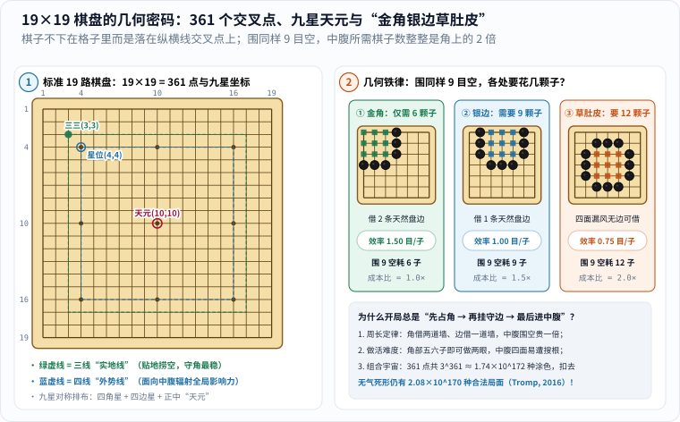
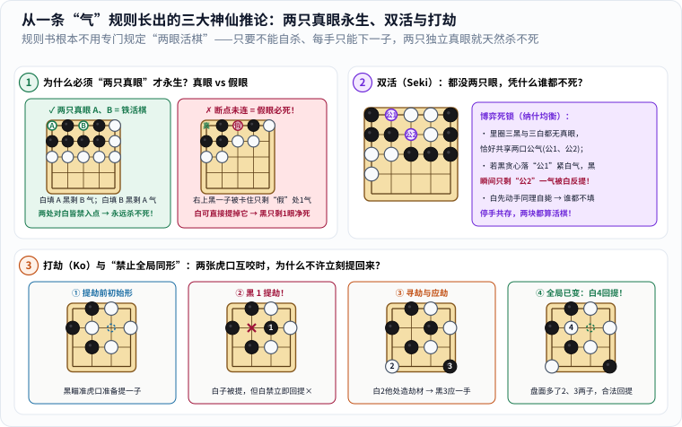
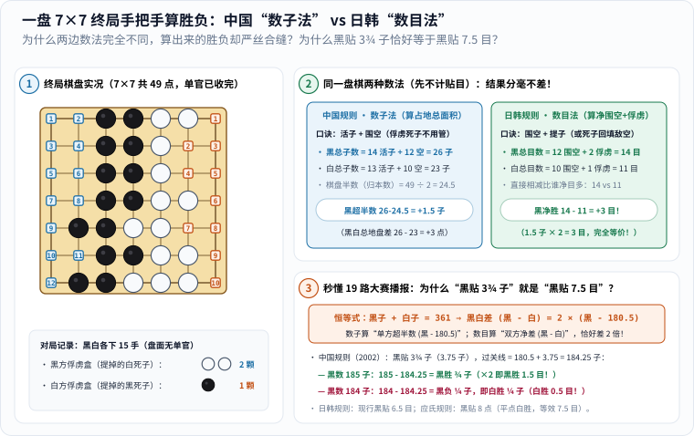
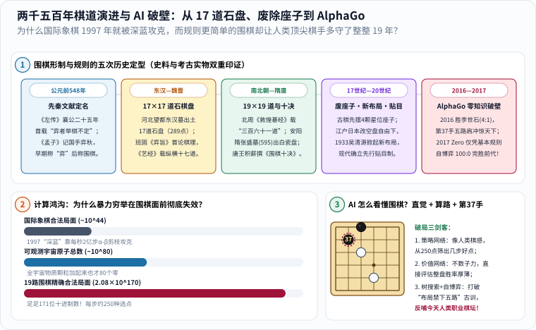

如果你把人类发明的几大棋类摆在同一张桌子上对比，围棋看起来简直“简陋”得不可思议：

1. **棋子毫无等级特权**：中国象棋分帅、仕、相、车、马、炮、兵七个兵种，还要画楚河汉界与九宫格；国际象棋不仅有六种走法各异的棋子，还有“王车易位”“吃过路兵”“兵底线升变”等专门条款。而围棋只有一模一样的黑子与白子，落到盘上之后**终局前一步都不许挪动**，计算机科学家约翰·特龙普（John Tromp）与数学家比尔·泰勒（Bill Taylor）甚至把整套围棋底层逻辑压缩成了短短 **10 条公理** [[1]](#ref-1)[[2]](#ref-2)。
2. **偏偏最简单的规则，炸出了最恐怖的组合宇宙**：2016 年 1 月，特龙普利用状态数高达 3630 亿的边界转移矩阵与中国剩余定理，精确算出了标准 $$19 \times 19$$ 围棋盘上所有合法局面的总数——那是一个足足 **171 位的精确十进制整数**（$$L_{19} \approx 2.08 \times 10^{170}$$），比可观测宇宙里全部原子的估算总数（$$\sim 10^{80}$$）还要多出整整 **90 个数量级** [[3]](#ref-3)！
3. **连老观众都常被赛后播报绕晕**：同一盘世界大赛终局，中国转播室说“中国规则黑贴 **$$3\frac{3}{4}$$ 子**，黑数出 **185 子**，黑胜 **$$\frac{3}{4}$$ 子**”；切到日韩解说席，却听见“黑贴 **7.5 目**（或现行日韩赛制 **6.5 目**），黑净胜 **1.5 目**”——一边数“子”，一边数“目”，怎么 $$\frac{3}{4}$$ 和 $$1.5$$ 说的是同一盘棋 [[4]](#ref-4)[[5]](#ref-5)[[6]](#ref-6)？

其实，很多人之所以觉得围棋“高深莫测、看半小时还不知道谁赢谁输”，只是因为没人把那**唯一一条底层“气”规则**到**两眼活棋、双活、打劫、数子数目**之间的因果链条拆开给你看。只要顺着下面五张分步图走一遍，哪怕你今天之前从没摸过一颗棋子，也能在二十分钟内彻底看懂围棋是怎么下的、怎么杀棋、怎么判输赢。

---

## 一、先认准脚下这张 $$19 \times 19$$ 网格：为什么“金角银边草肚皮”是一道周长数学题？

初学围棋的第一个动作，不是背定式，而是把棋子放对地方——和国际象棋、五子棋纸格不同，围棋棋子**不下在方格肚子里，而是稳稳落在纵横直线的交叉点上** [[1]](#ref-1)[[4]](#ref-4)。

_先看左图认清标准 $$19 \times 19$$ 棋盘的 $$361$$ 个交叉点、九颗星位与正中央“天元 $$(10,10)$$”，绿虚线是贴地捞空的“三线实地线”，蓝虚线是面向全局辐射的“四线外势线”；再看右图三块 $$7 \times 7$$ 局部算账：围出同样 $$3 \times 3 = 9$$ 个空交叉点，角部借两条天然盘边只需 $$6$$ 颗黑子（$$1.50$$ 目/子），边上借一条盘边需 $$9$$ 颗子（$$1.00$$ 目/子），中腹四面漏风足足要花 $$12$$ 颗子（$$0.75$$ 目/子）。[单独打开大图](/assets/images/weiqi-intro-rules/weiqi-board-geometry-and-zones.svg)。_

### 1. 361 个交叉点、九星天元与“黑子故意做大 0.3 毫米”的视觉彩蛋

标准围棋盘横竖各有 **19 条平行线**，一共交织出 $$19 \times 19 = 361$$ 个交叉点（初学者入门时，也常先在 $$9 \times 9 = 81$$ 点或 $$13 \times 13 = 169$$ 点的小棋盘上练手，规则一字不差，一局只需十分钟）[[2]](#ref-2)[[4]](#ref-4]。

如果你仔细端详上图的左半盘，会发现棋盘上有 **9 个加粗的小圆点**，合称**“九星”**：

- 四角各有一颗对称的**角星**，坐标在 $$(4,4)$$、$$(4,16)$$、$$(16,4)$$、$$(16,16)$$；
- 四条边中点内侧各有一颗**边星**，坐标在 $$(4,10)$$、$$(10,4)$$、$$(10,16)$$、$$(16,10)$$；
- 整张棋盘最正中央的第 10 行、第 10 列交叉点 $$(10,10)$$，有一个极富东方宇宙观的名字——**“天元”** [[4]](#ref-4)[[7]](#ref-7)。

从棋盘最外圈的边界线（一线）往里数，**第三条线（三线）**与**第四条线（四线）**是布局阶段争夺最激烈的黄金地带：棋子落在三线（比如角上的“三三”点 $$(3,3)$$），贴近盘边，极易守住实实在在的地盘，俗称**“三线捞实地”**；棋子落在四线（比如星位 $$(4,4)$$），居高临下朝中腹敞开，虽然脚底下留有被对手钻入三三的缝隙，却能向全场投射控制力，俗称**“四线取外势”**。

棋具本身还藏着两个冷知识：一副标准围棋通常配 **黑子 181 枚、白子 180 枚**，加起来正好对应 $$361$$ 个交叉点，因为对局永远由**黑方先行**（黑白双方一人一手轮流落子），多出来的那 1 枚恰好归先手方 [[4]](#ref-4)。更妙的是，无论中国云南的传统“云子”，还是日本用那智黑石与日向蛤壳打磨的蛤碁石，工匠都会故意把**黑子直径做成约 $$22.2\ \mathrm{mm}$$、白子做成约 $$21.9\ \mathrm{mm}$$**——因为人眼存在“光渗错觉（Irradiation Illusion）”，亮白色物体在视网膜上会显得比同尺寸黑色物体膨胀一圈；把黑子悄悄放大 $$0.3\ \mathrm{mm}$$，摆在棋盘上黑白两色看起来才完全一样大！

### 2. 算清一笔几何账：为什么围棋谚语说“金角银边草肚皮”？

围棋的终极目标不是“斩首敌方主帅”，而是**占地盘（围空）**：终局时谁用活棋围住的交叉点多，谁就是赢家 [[1]](#ref-1)[[4]](#ref-4)。既然整张棋盘每个交叉点都只值 1 分，为什么全世界所有高手开局前十几手几乎全都扎堆往四个角上抢，绝少一上来就往正中央“天元”拍子？

看看上图右半边的三组 $$7 \times 7$$ 棋盘，答案其实就是一道小学几何周长题——**棋盘的四条天然木头外框，是免费送给你的“铁墙”**：

- **① 金角（借两条盘边）**：要在左上角围出一块 $$3 \times 3 = 9$$ 个空交叉点的领地，上边和左边两条边界天然封口，你只需要沿着右壁摆 3 颗子、下壁摆 3 颗子，一共花 **$$6$$ 颗子**就能封严实（由于围棋斜角不算断气，拐角尖顶处连拐角子都省了），单子投资回报率高达 **$$9 \div 6 = 1.50\text{ 目/子}$$**；
- **② 银边（借一条盘边）**：同样围 $$3 \times 3 = 9$$ 空，挪到上边中部时只剩顶上一道天然墙，左、右、下三面都得自己砌墙，必须花 **$$3 + 3 + 3 = 9$$ 颗子**，效率降到 **$$9 \div 9 = 1.00\text{ 目/子}$$**；
- **③ 草肚皮（四面漏风的中腹）**：如果跑去棋盘肚子正中间硬围 $$3 \times 3 = 9$$ 空，上、下、左、右四面全无依靠，足足要花 **$$3 \times 4 = 12$$ 颗子**才能合拢，效率暴跌到 **$$9 \div 12 = 0.75\text{ 目/子}$$**——成本整整是角部的 **2 倍**！

一句流传千年的棋谚**“金角银边草肚皮”**，底色根本不是玄学经验，而是平面网格上的**等周效率不等式**。所以一盘正常围棋的节奏，天然呈现**“先占角 → 再挂角守边 → 最后向中腹经营消长”**的地理扩张次序。

### 3. 10 行公理与 $$2.08 \times 10^{170}$$ 个合法局面：为什么少了 98.8% 依然大得吓人？

既然棋盘上有 $$361$$ 个交叉点，每个点无非处于“空、黑子、白子”三种状态之一，粗算涂色总数就是：

$$3^{361} \approx 1.74089 \times 10^{172}$$

但请注意：**并不是随便往盘上撒一把黑白豆子都算合法棋局**——只要有一块棋子被对手堵得一口气都不剩，按规则它早该从棋盘上提走了，绝不可能留在静态盘面上 [[1]](#ref-1)[[3]](#ref-3)。

那么扣掉所有“存在零气死块”的非法摆法之后，真正符合围棋规则的合法盘面究竟还剩多少？这个问题困扰了数学界上百年，直到 2016 年 1 月 20 日，荷兰计算机科学家约翰·特龙普在服务器集群上跑完动态规划算法，给出了分毫不差的精确答案（整数数列纹章库 OEIS 收录编号 `A094777`）[[3]](#ref-3)：

- 在 $$1 \times 1$$ 棋盘上，由于放黑子或白子都会立刻变成 $$0$$ 气，合法盘面只有空盘 **$$L_1 = 1$$** 种；
- 在 $$2 \times 2$$ 棋盘上，$$3^4 = 81$$ 种涂色里有 **$$L_2 = 57$$** 种合法；在 $$3 \times 3$$ 棋盘上，有 **$$L_3 = 12{,}675$$** 种合法；
- 到了标准 **$$19 \times 19$$ 棋盘**，粗涂色里有将近 **$$98.8\%$$** 都因夹杂无气块而出局，留存下来的精确合法局面占比约为 **$$1.196\%$$**，即下面这个 **171 位整数** [[3]](#ref-3)：

$$L_{19} = 2081681993819799846994786333448627702865224538845305484256394568\dots4840935 \approx 2.08 \times 10^{170}$$

哪怕把全宇宙 $$10^{80}$$ 颗原子每一颗都改造成一台微型硬盘，每颗原子里还得再塞进 $$10^{90}$$ 张棋谱，才装得下这一张小小木盘里的合法天地。

---

## 二、整部围棋法典的地基只有一句话：什么是“气”、打吃提子与“禁入 vs 反杀”？

为什么围棋不需要规定“马走日、象飞田”？因为围棋里棋子的全部生死存亡，只由一个极简的拓扑概念决定——**“气（Liberty）”** [[1]](#ref-1)[[2]](#ref-2)[[4]](#ref-4)。

_按编号顺序读懂唯一核心法则：① 上排四块小盘认准“气”——只数上下左右**直线紧邻**的空交叉点（中腹单子 4 气、边子 3 气、角子 2 气；横竖紧挨的同色子连成一体共享 6 气，斜角相挨不算连接！）；② 左下角单次动画演示黑 6 落下堵死两颗白子的最后一口气（打吃 → 提子），两颗白子立即移出棋盘收入黑方俘虏盒（若开启系统“减少动态效果”则直接定格在提子完成态，刷新页面可重播）；③ 右下角对比“外气充足时禁止自杀的禁入点”与“先把对手提成 0 气的合法虎口反杀”。[单独打开大图](/assets/images/weiqi-intro-rules/liberties-capture-and-forbidden-anim.svg)。_

### 1. 数气与连接铁律：只认横竖直线，斜角相挨“貌合神离”

把一颗黑子放到空棋盘上，顺着从它脚下出发的**上、下、左、右四条实线**看过去，紧挨着它的**空交叉点**有几个，这颗子就拥有几口**“气”** [[4]](#ref-4)：

- 落在**中腹**的一颗孤子，上下左右畅通无阻，拥有 **4 口气**；
- 落在**盘边一线**的子，外侧没有网格线了，天生只剩 **3 口气**；
- 落在**棋盘四个顶角 $$(1,1)$$** 的子，天生只剩可怜的 **2 口气**（所以千万别轻易把孤子往一线的边角硬塞，那叫“自紧气”）。

当两颗或更多同色棋子在**横线或竖线上紧挨在一起**时，它们就融合成一个不可分割的生命共同体——叫做一块棋（**棋块 / String**）。同一块棋**同生共死、共享所有外气**：如上图顶排第 3 格所示，两颗横连的黑子合起来一共拥有 **6 口气**，必须把这 6 口气全部堵死才能吃掉它们。

反过来，初学者最容易踩的坑就是顶排第 4 格：**斜角尖顶相挨的两颗黑子（围棋术语叫“尖”或“象步”交错）之间并没有实线相连**！它们在规则上属于**两块完全独立的棋**，一旦被白子把中间交叉的两个空点双双占住（俗称**“断”**），两颗黑子就会彻底失联、各自独立算气。

### 2. 打吃（Atari）与提子：堵住最后一口气，整块请出棋盘

有了“气”，吃子规则一句话就能讲完：**轮到某一方落子后，只要对手某块棋的气变成了 $$0$$，就把这块无气之子全部从棋盘上拿走（称为“提子”或“吃子”），提掉的子原位重新变回空交叉点** [[1]](#ref-1)[[4]](#ref-4)。

对照上图左下角的动画区域，实战吃子总是经历清晰的三拍节奏：

1. **打吃（又叫“叫吃”，英语/日语通用术语 *Atari*）**：两颗横连白子原本有 6 口气，被周围五颗黑子封住 5 口后，右侧只剩下**最后 1 口救命气**。此时黑方已经发出了类似象棋“将军”的死亡警告（职业比赛不需口头提醒，但在教小朋友启蒙时通常会喊一声“打吃啦”）；
2. **逃跑或紧气**：如果此时轮到白方下，白子顺着最后那口气往右长出一子，就能瞬间连成三子块、重新扩充外气脱险；但如果白方脱先去别处下棋，下一手轮到**黑 6** 精准拍在那最后一口气上——
3. **提子入盒**：两颗白子瞬间沦为 **0 气**，黑方立即伸手把这两颗白死子抓离棋盘，放进自己的棋盖（俘虏盒）里，盘面上立刻腾出两个干净的空交叉点！

### 3. 新手最常卡壳的一问：禁入点不许下，凭什么有时又能往“虎口”里填？

紧接着问题就来了：如果棋盘上有一个空点，四面八方已经被白子围得铁桶一般（三面是白子叫“虎口”，四面都是白子叫“眼”或包围圈），黑子落进去的瞬间自己也是 0 气——**这个点到底能不能下？**

这就要请出中日韩及国际通行规则里极其精妙的**“两步结算先后顺序”** [[1]](#ref-1)[[4]](#ref-4)[[5]](#ref-5)。当黑方把一颗棋子放到交叉点 $$p$$ 时，裁判系统永远严格按先 A 后 B 的次序判定：

- **步骤 A（先清零敌军）**：先检查紧挨着 $$p$$ 的所有**白棋块**——有没有哪块白棋因为这颗黑子的落下，气数刚好变成了 $$0$$？如果有，**先把那些 $$0$$ 气白棋全部提走**！
- **步骤 B（再验自己死活）**：提完敌子之后，再检查刚刚落下的这颗黑子（连同它横竖接上的己方黑棋块）此刻有几口气。如果此刻黑棋块的气数 **$$> 0$$**，落子完全合法；如果此刻黑棋块的气数依然 **$$= 0$$**，就构成“白白送死却没杀死任何人”的**自杀（Suicide）**，在中、日、韩正式规则中一律判为**“禁入点（非法着法，严禁落子）”** [[4]](#ref-4)[[5]](#ref-5)！

看一眼上图右下角的左右对比，你立刻就能豁然开朗：

- **左格（非法禁入点）**：外面四颗白子外气充足（每颗都有两三口外气），黑棋往中间 `×` 处硬塞，步骤 A 提不掉任何白子，轮到步骤 B 检查自己却是 $$0$$ 气——这是纯自杀，规则禁止落子；
- **右格（合法反杀！）**：里面三颗白子已经被外圈黑子包饺子，只剩左上角 $$(0,0)$$ 那**最后 1 口气**。此时黑 1 往角上这个看似“0 气绝地”的点拍下去，步骤 A 触发：**三颗白子瞬间变 0 气被当场提光**！白子一拿走，黑 1 脚下立刻松绑腾出了 2 口崭新的气，步骤 B 完美过关！（顺带一提：新西兰规则与特龙普逻辑规则允许“两颗以上棋块集体自杀腾空”的极罕见特例，但在中日韩规则里一切自杀着法均属禁手 [[1]](#ref-1)[[6]](#ref-6)。）

---

## 三、规则书没写，却自动长出来的三大神仙推论：两只真眼、双活与打劫

围棋最令数学家着迷的地方就在这里：规则书根本不需要像说明书那样罗列“怎样算活棋”，仅仅凭刚才那条**“每手只下一子 + 禁入点不许自杀”**，盘面上就会自动涌现出三大经典结构——**两眼永生、双活死锁与打劫循环**。

_三大经典局部逐格拆解：① 左上对比“两只独立真眼 A、B（白填哪只都提不掉黑棋且自身 0 气，双双沦为白方禁入点，黑棋永生）”与“斜肩存在断点的假眼（白棋一打吃就逼黑棋自填眼位，只剩单眼必死）”；② 右上展示“双活（Seki）”——里圈三黑三白都无真眼，但共享公1、公2两口公气，谁先填公1就会自撞成 1 气被对方在公2反提，形成谁也不敢先动手的纳什均衡；③ 下排四步连环图演示“打劫（Ko）”——黑 1 提劫后若允许白立刻回提就会恢复第①步盘面陷入死循环，因此白必须先在别处下白 2“寻劫”，待黑 3 应劫改变全局盘面后，白 4 才能合法提回。[单独打开大图](/assets/images/weiqi-intro-rules/two-eyes-seki-and-ko-fight.svg)。_

### 1. 为什么“两只真眼”就能永生？真眼与假眼的一念之差

哪怕从没下过围棋的人，也听过一句俗话叫**“两眼活棋”**。为什么一块棋围出 1 个窟窿还会死，围出 **2 个彼此分开的空点（两只眼）**，对手哪怕在外面包上十层铁桶也永远杀不死它？

对照上图左上角左格，我们来替外圈白棋试着杀一次就明白了：

- 这块黑棋内部隔出了 **A** 和 **B** 两个互不相连的空交叉点，并且黑棋外面哪怕已经被白子把外气堵得一干二净，它依然还拥有 **A、B 这 2 口内气**；
- 轮到白棋进攻：如果白子想填进 **A 点**，按刚刚学过的两步结算，此时黑棋还留着 **B 点那 1 口气**，所以白棋提不掉黑棋！提不掉黑棋，白子自己在 A 点四面全是黑墙、$$0$$ 气——**A 点是白方的自杀禁入点**！
- 白棋改去填 **B 点**？同理，黑棋还留着 **A 点那 1 口气**，B 点同样是白方的自杀禁入点！
- 除非规则允许白棋“一回合同时扔下两颗子把 A、B 一起堵死”——可围棋铁律规定**每回合只能下一颗子**！于是 A、B 两点永远合法禁入，这块黑棋哪怕缩在小小角落里，也获得了数学意义上的**绝对永生**。

但实战中千万要提防右格的陷阱——**“假眼（False Eye）”**：如果围成眼位的四颗横竖黑子并没有连成铁板一块，而是斜肩膀处漏着断点被白子卡住，那么角上那颗孤零零的黑子随时处于被打吃的边缘（俗称“卡眼”）。一旦白棋叫吃那颗孤子，黑棋要么眼睁睁看着眼框被提穿，要么被迫自己往“假”字点粘连补断——自己把自己的眼填成了实心饼，最后只剩 1 只真眼，等到外气被白棋收干时，白棋最后一击落入仅剩的那只单眼，整条黑龙就会瞬间化作 $$0$$ 气被一锅端！

### 2. 双活（Seki）：大家都没有两只眼，凭什么谁也杀不死谁？

那么，“活棋必须有两只真眼”是绝对充要条件吗？**不是！** 围棋里还有一种极富戏剧张力的共生奇观——**双活（国际通用名 *Seki*）** [[4]](#ref-4)[[5]](#ref-5)。

请看上图右上角的 $$5 \times 5$$ 对杀局部：被外围包住的三颗黑子与三颗白子互相纠缠在一起，黑棋没有眼，白棋也没有眼；它们唯一的生命线，是夹在两块棋交界处的两个公共空交叉点——**“公1”与“公2”（合称公气）**。

现在，谁会蠢到先伸手去杀对方呢？

- 假如**黑方贪心**，抢先往 **“公1”** 拍下一子想紧白棋的气：这一落子，白棋确实只剩“公2”最后 1 口气了；可要命的是，黑棋把自己的子填进“公1”之后，**黑棋整块也瞬间只剩“公2”这最后 1 口气**！下一秒轮到白方，白子稳稳拍在“公2”，先把四颗黑子提了个精光！
- 反过来，假如**白方手痒**抢先去填“公1”，白棋也会把自己撞成 1 气，被黑方在“公2”一击反杀！

在[组合博弈论]()里，这就是最经典的**“谁先动手谁暴毙（Zugzwang / 负先手权）”死锁**：既然先动手等于自杀，理性的黑白双方就都会心照不宣地绕开“公1”和“公2”直达终局，裁判判定**黑白两块棋全部算活棋，谁也没死**！

### 3. 打劫（Ko）与“禁止全局同形”：一场横跨全盘的筹码谈判

如果说“双活”是双方都不敢动，那么**“打劫（Ko，源自佛教术语‘劫波 Kalpa’，意为漫长岁月）”**就是双方抢破头却被规则强行按住的拉锯战 [[2]](#ref-2)[[4]](#ref-4)。

看一眼上图底排第 ① 格：黑方三颗子张开一张虎口，白方三颗子也张开一张虎口，两张虎口面对面咬在一起。

- **第 ② 步（提劫）**：黑 1 落入白方虎口，把左边那颗只有 1 口气的白子干净利落地提掉！
- **如果没有附加规则会发生什么？** 刚刚提完的空位上，黑 1 自己也孤零零只剩 1 口气！要是允许白方下一手**立刻原位拍回去反提黑 1**，盘面就会 100% 退回第 ① 格的模样；接着黑再提、白再提……只要两人脾气够犟，这两颗子能一直互相提到地老天荒，比赛永远没法结束！

为了斩断这种死循环，围棋立下了第二条柱石法则——**禁止全局同形再现（中国规则第 6 条；日韩在单劫上表述为“热子禁提 / 打劫规则”）** [[1]](#ref-1)[[4]](#ref-4)[[5]](#ref-5)：

> **任何一手落子完成后，不得使整张棋盘的黑白分布状态与此前已经出现过的盘面完全相同！**

这一条禁令瞬间催生了围棋里最惊心动魄的战术流程——**寻劫、应劫、回提与消劫**：

1. **禁止立即回提**：黑 1 提劫后，那个空点对白方挂上了“本回合禁入锁”；
2. **第 ③ 步（寻劫造劫材）**：白方不能干瞪眼停手，于是跑到棋盘另一角落下**白 2**，威胁要吃掉黑方另一块价值 20 目的大棋（这步威胁就叫**“劫材”**）；
3. **权衡利弊（应劫 vs 消劫）**：此时压力抛回给黑方！如果黑方觉得左边这个劫不如角上那块大棋值钱，黑方就得乖乖在角上落下**黑 3** 防守（叫**“应劫”**）；反之，如果黑方觉得这个劫本身价值连城，黑方也可以无视白 2，直接在劫眼上粘连补牢（叫**“消劫”**），形成一次横跨半张棋盘的大转换！
4. **第 ④ 步（合法回提）**：一旦黑 3 选择应劫，请看整张棋盘——因为角上多出了白 2 和黑 3 两颗新棋子，此刻白 **4** 再回过头提掉黑 1，**全盘状态已经和第 ① 步截然不同**！回提完全合法，轮到黑方满盘去找下一枚劫材……（注：日本规则仅禁单劫立即回提，若罕见地同时撞上三个劫轮流互提，在日本规则下会判“三劫循环无胜负重赛”，而在严格执行“禁止全局同形”的中国规则与特龙普规则下，连三劫循环也会被同形禁令彻底堵死 [[1]](#ref-1)[[4]](#ref-4)[[6]](#ref-6)。）

---

## 四、终局怎么算输赢？用一盘 $$7 \times 7$$ 实战彻底打通“数子法”与“数目法”

懂得怎么吃子、做活和打劫之后，只剩最后一个让电视观众一头雾水的门槛：**一盘棋到底什么时候算下完？中国规则的“数子法”和日韩规则的“数目法”，为什么听着完全两码事，算出来的赢家却一模一样？**

_左图是一盘真实下完、单官全部收干的 $$7 \times 7$$ 终局（全盘共 $$49$$ 点，黑白各落 $$15$$ 手：盘面留存黑活子 $$14$$ 颗围住蓝框 $$12$$ 空、白活子 $$13$$ 颗围住橙框 $$10$$ 空，另在俘虏盒里存有黑提白死子 $$2$$ 颗、白提黑死子 $$1$$ 颗）；右上并排核算中国“数子法（活子+围空）”与日韩“数目法（围空+俘虏）”，严格验证“多 $$1.5$$ 子”与“净胜 $$3$$ 目”完全等价；右下给出 $$19 \times 19$$ 赛制下“黑贴 $$3\frac{3}{4}$$ 子 = 黑贴 $$7.5$$ 目”的恒等推导。[单独打开大图](/assets/images/weiqi-intro-rules/chinese-vs-japanese-scoring-7x7.svg)。_

### 1. 什么时候算终局？连续两次“虚着（Pass）”、收单官与死子清理

围棋里没有计时器到点吹哨，终局完全由棋盘上的利润耗尽自然触发 [[1]](#ref-1)[[4]](#ref-4)：

1. 当全盘大块死活全部落定、连双方交界处一分不值的公共空点（称为**“单官 / Dame”**）也都填满之后，再往盘上任何地方落子要么是送给对手当俘虏，要么是填自己的空；
2. 此时轮到的一方宣布**“虚着（停着 / Pass，放弃落子一次）”**；如果紧接着对手也宣布**“虚着”**——**双方连续两次放弃落子，对局正式结束**！
3. 随后双方共同确认盘面上那些已经被彻底封死、绝无可能做出两只眼或双活的残子（**死子**），直接把它们当作被俘棋子捡离棋盘，不必真花手数进去硬提（如果双方对某块棋到底是死是活意见不一，中国规则最干脆——实战继续下，谁说能杀谁动手杀给裁判看！）[[4]](#ref-4)[[6]](#ref-6)。

### 2. 同一盘 $$7 \times 7$$ 棋两种账本：为什么“超半数 $$+1.5$$ 子”严丝合缝等于“净胜 $$+3$$ 目”？

很多教材空讲概念越讲越糊涂，我们直接对照上图左边那盘已经收完单官的 **$$7 \times 7$$（共 $$49$$ 个交叉点）真实终局**，一粒一粒点清楚！

这盘小棋里，黑方和白方**各自恰好下了 $$15$$ 手棋**：

- 黑方下了 $$15$$ 颗子，中途被白方吃掉 $$1$$ 颗（躺在白方俘虏盒里），棋盘上活着留下 **$$14$$ 颗黑子**，严密围住了左上与左下标着蓝框 `1`～`12` 的 **$$12$$ 个空点**；
- 白方也下了 $$15$$ 颗子，中途被黑方吃掉 $$2$$ 颗（躺在黑方俘虏盒里），棋盘上活着留下 **$$13$$ 颗白子**，严密围住了右上与右下标着橙框 `1`～`10` 的 **$$10$$ 个空点**；
- 核对全盘总点数：$$14\text{（黑活子）} + 12\text{（黑空）} + 13\text{（白活子）} + 10\text{（白空）} = 49$$，49 个交叉点一个不多、一个不少！

现在分别请中国裁判和日韩裁判上来算账（暂不计先行贴目）：

- **账本 A：中国规则 · 数子法（核心哲学：“子空皆地”，活子本身也占了 1 块地盘！）** [[4]](#ref-4)
  - 俘虏盒里的死子看都不用看，直接扔回棋罐；只数棋盘上每方**“活子 + 围住的空点”**一共占了多少个交叉点：
  - 黑方总占地 $$S_B = 14 + 12 = 26\text{ 子}$$；白方总占地 $$S_W = 13 + 10 = 23\text{ 子}$$。
  - 更省事的是：既然 $$S_B + S_W = 49$$ 恒定不变，中国裁判**连白棋都不用数**！只把棋盘总点数劈成一半作为及格线（称为**“归本数”**：$$49 \div 2 = 24.5\text{ 子}$$），单数黑方就够了——黑方 $$26$$ 子比半数 $$24.5$$ 子多出了：

    $$S_B - 24.5 = 26 - 24.5 = +1.5\text{ 子（黑胜 1.5 子！）}$$

- **账本 B：日韩规则 · 数目法（核心哲学：“唯目是地”，只算净围空与提子战果！）** [[5]](#ref-5)
  - 棋盘上活着的棋子只是“篱笆墙”，本身不算分；只数篱笆里面围住的净空点（**“目”**），再加上你吃掉的对手俘虏（实战清点时，是把你手里的敌方死子一颗颗填进对方的空里抵消掉，数学上完全等价于给自己的目数做加法）：
  - 黑方总目数 $$T_B = 12\text{（围空）} + 2\text{（提白俘虏）} = 14\text{ 目}$$；
  - 白方总目数 $$T_W = 10\text{（围空）} + 1\text{（提黑俘虏）} = 11\text{ 目}$$；
  - 双方直接相减比净差：

    $$T_B - T_W = 14 - 11 = +3\text{ 目（黑净胜 3 目！）}$$

看到了吗？**$$1.5\text{ 子} \times 2 = 3\text{ 目}$$！** 这绝不是巧合，而是两条中学代数恒等式的必然结果：

1. 只要黑白双方落子总手数相等（记为 $$k$$ 手，单官收完），每方“盘面活子数 $$L$$ + 对手手里的己方死子数 $$C_{\text{被提}}$$”都等于 $$k$$，于是双方盘面活子之差 $$L_B - L_W$$ 恰好等于双方提子战果之差 $$C_{\text{黑提白}} - C_{\text{白提黑}}$$，所以**黑白总占地之差 $$S_B - S_W$$ 恒等于日韩净目数之差 $$T_B - T_W$$**（本例中 $$26 - 23 = 14 - 11 = +3$$）[[6]](#ref-6)；
2. 而中国数子法报的不是“黑减白（$$S_B - S_W$$）”，而是**“黑超全盘半数多少（$$S_B - \frac{M}{2}$$）”**！因为 $$S_B + S_W = M$$（全盘总点数），立刻有：

$$S_B - S_W = S_B - (M - S_B) = 2\left(S_B - \frac{M}{2}\right)$$

> **一句话记住终生受用的换算铁律：中国规则里的“1 子”，永远精确等于日韩规则里的“2 目”！** 就像[网球里独特的 15-30-40 计分制]()一样，看似怪异的分数刻度背后，藏着严丝合缝的数学换算尺。

### 3. 3 秒听懂 19 路大赛转播：“黑贴 $$3\frac{3}{4}$$ 子，185 子黑胜”与两处 1 目暗礁

把刚才的公式代回标准 **$$19 \times 19$$（$$M = 361$$）** 棋盘，所有世界大赛播报瞬间变得跟加减法一样透明：

- $$361$$ 个交叉点的对半归本数是 **$$180.5\text{ 子}$$**；
- 因为黑棋先下第一步占了巨大的先手便宜，现行《中国围棋竞赛规则（2002 年版）》规定黑方必须倒贴给白方 **$$3\frac{3}{4}$$ 子（即 $$3.75$$ 子**，按刚才的 2 倍换算律，$$3.75 \times 2 = \mathbf{7.5\text{ 目}}$$；注：1988 年旧版曾贴 $$2\frac{3}{4}$$ 子即 $$5.5$$ 目，随着现代布局研究发现黑先优势更大才上调）[[4]](#ref-4)[[6]](#ref-6)；
- 于是黑方的生死及格线定死在了：

  $$180.5 + 3.75 = \mathbf{184.25\text{ 子}}$$

  （特意带上 `.25` 小数，就是为了彻底杜绝和棋！）
- 终局裁判只数黑棋地盘：
  - **黑方数出 $$185$$ 子**：$$185 - 184.25 = +\frac{3}{4}\text{ 子}$$ —— 这就是常听到的**“黑胜 $$\frac{3}{4}$$ 子”**，乘以 2 就是**黑胜 $$1.5$$ 目**！
  - **黑方只数出 $$184$$ 子**：$$184 - 184.25 = -\frac{1}{4}\text{ 子}$$ —— 黑棋差了四分之一子没过线，即**“白胜 $$\frac{1}{4}$$ 子”**，乘以 2 就是最惊险的**白胜 $$0.5$$ 目（半目胜）**！
- 顺便对照其他主流赛制：**日本与韩国职业赛**现行主流为**黑贴 $$6.5$$ 目**（比中国规则少贴 1 目，因此执黑略微合算一丝）；四年一届、号称“围棋奥运会”的**应氏杯（应昌期计点制）**则规定**黑贴 $$8$$ 点，若双方平点则判白胜**——因为只能赢整数偶数点，贴 8 点平点白胜在胜负上**100% 等效于中国规则的黑贴 $$7.5$$ 目（$$3\frac{3}{4}$$ 子）** [[6]](#ref-6)！

严谨起见，还要点破一个职业高手都必须留心的细节：**数子法与数目法是 100% 永远同胜负吗？在 99% 的棋局里是的，但在两个极端边缘场景下会差出 1 目**：

1. **单官收完后在自己空里补一手防棋**：在日本数目法里，往自己空里多填一颗子，你的净围空就平白无故**少掉 1 目**（所以日本规则下棋手往往不愿轻易补棋，由此引发过著名的终局死活争议判例）；而在中国数子法里，单官收完后你往自己空里补一子，只是把“1 个空点”变成了“1 颗活子”，**“活子 + 空点”总数一分不少**，鼓励把隐患彻底补干净 [[4]](#ref-4)[[5]](#ref-5)[[6]](#ref-6)！
2. **双活（Seki）棋块附带的眼位**：《日本围棋规则（1989 年版）》第 8 条明确规定，处于双活状态的棋块周围附带的空点**一律不算目（记 $$0$$ 目）**；而中国数子法坚持“只要被你一方活子单独围住的空点都算地”，双活里的单方内眼照常计入子数 [[4]](#ref-4)[[5]](#ref-5)。

---

## 五、两千五百年风云录：从 17 道汉墓石盘、废除座子，到 AlphaGo 的“神之一手”

搞懂了棋盘上的精巧法则，回头再看围棋两千五百多年的真实演化史，你会发现一个反直觉的事实：**围棋并不是某位上古圣人拍脑袋一次性发明出来的“完美成品”，它经历过棋盘扩容、开局松绑、贴目公平化与硅基智能洗礼四次脱胎换骨**。

_按顺序浏览三块内容：① 上排时间轴串联公元前 548 年《左传》定名、东汉望都墓出土 $$17 \times 17$$ 石棋盘、北周《敦煌碁经》与隋代安阳张盛墓（595 年）$$19 \times 19$$ 白瓷盘、江户废除座子与 1933 年新布局及现代贴目制、直至 2016–2017 年 AlphaGo 家族破壁；② 左下用对数标尺直观对比国际象棋合法局面（$$\sim 10^{44}$$）、可观测宇宙原子数（$$\sim 10^{80}$$）与 19 路围棋精确合法局面（$$2.08 \times 10^{170}$$）；③ 右下拆解策略网络、价值网络与蒙特卡洛树搜索如何协同下出震惊棋坛的第 37 手“五路肩冲”。[单独打开大图](/assets/images/weiqi-intro-rules/weiqi-2500-years-to-alphago.svg)。_

### 1. 从《左传》到汉墓 17 道石盘：围棋并不是一开始就有 19 道

民间常传“尧造围棋，丹朱善之”（晋代张华《博物志》所载传说），若论确凿可考的信史文献，围棋（先秦时单称**“弈”**）最早登场于记录鲁襄公二十五年（**公元前 548 年**）史事的《左传》——太叔文子感叹卫献公反复无常时打了个比方：**“今宁子视君不如弈棋，其何以免乎？弈者举棋不定，不胜其耦。”** [[7]](#ref-7) 到了战国时期，围棋已经火到有了全国知名的职业国手，《孟子·告子上》里专门拿**“弈秋，通国之善弈者也”**教两个学生下棋来做专心致志的教学案例。

但两汉三国时期古人下的围棋，倘若穿越到今天，你会发现棋盘**小了一圈**！

- 1954 年，考古学家在**河北望都一号东汉墓**发掘出一具保存完好的东汉石刻围棋盘——盘面纵横清清楚楚刻着 **17 条线（$$17 \times 17 = 289$$ 个交叉点）** [[7]](#ref-7)！这件地下实物，与东汉末至曹魏学者邯郸淳在《艺经》里的记载严丝合缝：**“棋局纵横各十七道，合二百八十九道，白黑棋子各一百五十枚。”** 东汉史学家班固写下中国现存最早的围棋理论专篇《弈旨》，马融作《围棋赋》，演绎的都是这张 17 道棋盘上的风雷激荡。
- 直到南北朝时期，随着对局复杂度提升与天文历法象数观念（正如我们在[河图洛书黑白点阵考证]()里见过的古人数字审美）合流，**19 道棋盘**正式登上了历史主舞台：现藏大英博物馆的北周写本**《敦煌碁经》（编号 `S.5574`，成书于公元 6 世纪）**开篇明言**“碁局纵横十九道，三百六十一道，仿周天之度数”**；1959 年**河南安阳隋代张盛墓（隋开皇十五年，公元 595 年）**更出土了一件精美的白釉瓷围棋盘，纵横正是标准的 **19 道** [[7]](#ref-7)！

到了唐代，翰林院专设皇家国手官职**“棋待诏”**。唐玄宗时期的棋待诏**王积薪**总结出短短四十个字的**《围棋十决》**——“不得贪胜、入界宜缓、攻彼顾我、弃子争先、舍小就大、逢危须弃、慎勿轻速、动须相应、彼强自保、势孤取和” [[7]](#ref-7)——把现代运筹学里的机会成本、止损弃子与全局动态平衡，在 1200 多年前就锤炼成了千古绝唱。

### 2. 三次解放棋盘的思想革命：废除“座子制”、1933 新布局与贴目诞生

很多人不知道，从宋元一直到清代乾隆年间（包括中国古典围棋最高峰——黄龙士、范西屏与施襄夏在浙江平湖弈出的惊世名局**“当湖十局”**），中国古棋其实一直戴着一副规矩森严的“开局脚镣”——**座子制** [[7]](#ref-7)：

- 对局还没开始，双方必须先在棋盘四个角的对角星位上**预先摆好两黑两白共 4 颗固定棋子（座子）**，然后再从第 5 颗子开始轮流下；
- 座子的本意是防止一上来在角上走千篇一律的套路，直接把战斗推向近身肉搏，因此清代大国手的中盘杀力恐怖到极点；但也正因四角星位被提前焊死，**整片棋盘的自由布局可能性被锁上了一大半**。

围棋向现代竞技的跃迁，靠的是接下来三次大刀阔斧的松绑：

1. **江户日本废除座子（17 世纪）**：围棋传入日本后，德川幕府在江户时代扶植起本因坊、安井、井上、林“围棋四大家”与御城碁制度，彻底**废除了开局座子**，让第 1 手棋面对整张 $$361$$ 点空白画布自由挥洒 [[7]](#ref-7)；
2. **1933 年“新布局”风暴**：即便空盘下棋，旧派棋手仍奉“小目低位慢速守角”为金科玉律。1933 年秋，19 岁的旅日天才青年**吴清源**与好友**木谷实**联手掀起震动棋坛的“新布局革命”——开局直接拍上**三三、星位乃至正中央天元**（1933 年吴清源执黑对阵本因坊秀哉名人那盘世纪名局，前三手直接下出“三三·星·天元”），把围棋从局部边角拉进了全盘速度与立体外势的时代 [[7]](#ref-7)；
3. **20 世纪确立“贴目（Komi）”**：既然空盘自由落子，黑棋先手优势越来越明显（统计胜率显著高于 50%）。20 世纪中叶日本棋院率先在正式头衔战引入先手贴目（从早期 4.5 目、5.5 目一路演进到今天的 6.5 目与中国规则 7.5 目等效贴子），困扰围棋两千年的“先手天然占便宜”终于迎来了统计意义上的绝对公平 [[6]](#ref-6)[[7]](#ref-7)。

### 3. 第 37 手“五路肩冲”与零知识进化：为什么围棋多守了整整 19 年？

1997 年，IBM 超级计算机“深蓝（Deep Blue）”凭借每秒搜索 2 亿个局面的暴力 $$\alpha\text{-}\beta$$ 剪枝算法击败国际象棋世界冠军卡斯帕罗夫时，几乎所有人工智能学者都清楚：**同样这招在围棋面前连业余棋手都赢不了** [[8]](#ref-8)。

原因有两道死墙：

1. **搜索宽度与深度同时爆炸**：国际象棋平均每步约 $$35$$ 种合法走法、一局约 $$80$$ 步；而 19 路围棋平均每步有约 **$$250$$ 种合法落点**、一局常达 **$$150 \sim 250$$ 手**，往后硬算 6 步就已经突破 $$250^6 \approx 2.4 \times 10^{14}$$ 种分支；
2. **更致命的是“没法靠数子打分”**：国际象棋里“吃掉对方一个后值 9 分、车值 5 分”，电脑很容易写出静态评估函数；可围棋盘上每一颗子都长一个样，一颗孤子究竟是价值 30 目的战略天王山，还是一块即将阵亡的废棋，差之毫厘谬以千里 [[8]](#ref-8)！

直到 **2016 年 1 月**，DeepMind 团队大卫·席尔瓦（David Silver）等人在《Nature》发表里程碑论文，亮出了破局的**“双神经网络 + 蒙特卡洛树搜索（MCTS）”**架构——**AlphaGo** [[8]](#ref-8)：

- 用**策略网络（Policy Network）**模仿顶尖人类的“第一感”，一眼从 250 个空点里筛出最值得细算的寥寥几个候选点，砍掉搜索宽度；
- 用**价值网络（Value Network）**替代手工打分公式，直接盯着整张棋盘预测“当前局面黑棋最终赢棋的概率是多少”，砍掉搜索深度；
- 再用**蒙特卡洛树搜索**在两者之间反复推演验证。

2016 年 3 月 10 日，首尔四季酒店，AlphaGo 与韩国传奇九段李世石五番棋第 2 局行至**黑第 37 手**：面对右边四线白子，AlphaGo 没有下在人类棋谱沿袭了几百年的三线或四线，而是天外飞仙般轻轻搭在了高高在上的五线上——**“五路肩冲”**！人类古训向来告诫“三线实地、四线外势，五线太高纯属败着”，李世石盯着棋盘长考十余分钟甚至离席抽烟，全场解说最初一度怀疑电脑出了 Bug；直到几十手后那颗第 37 手像枢纽一样把全盘厚势连成汪洋大海，人类才震撼地意识到——原来 $$10^{170}$$ 的浩瀚海洋里，还有大片人类两千年未曾涉足的新大陆 [[8]](#ref-8)！（第 4 局中，绝境下的李世石也回敬了流芳百世的**白第 78 手“挖”**，成为迄今唯一在正式分先番棋中战胜过 AlphaGo 的人类棋手，总比分定格在 `4:1`。）

而真正的终极震撼发生在一年后的 **2017 年 10 月**：DeepMind 在《Nature》发布 **AlphaGo Zero** [[9]](#ref-9)——工程师**一盘人类历史棋谱都没喂给它**，没有任何“金角银边”“小目定式”的人工先验知识，只把我们今天文章前两节讲的那套**“数气提子 + 禁全局同形 + 终局数地”纯规则**写进模拟器，让它自己跟自己左右互搏（正如我们在[强化学习为什么能让大模型与科学发现突然开窍]()一文里剖析过的“零知识自我博弈闭环”）：

- 第 0 小时：它像刚摸棋盘的婴儿一样满盘乱填，甚至自己堵死自己的眼；
- 仅仅训练 **36 小时**，它不仅无师自通地独立重新发现了人类摸索两千年的征子、打劫、大雪崩定式，还淘汰了大量人类旧定式，超越了击败李世石的那版 AlphaGo；
- 训练 **72 小时（3 天）**后，AlphaGo Zero 与击败李世石的前辈正面对决 100 盘，打出了令人窒息的 **$$100 : 0$$** [[9]](#ref-9)！

今天，AI 并没有杀死围棋——恰恰相反，早期“点三三”、五路肩冲、胜率实时曲线已经成为全人类职业棋手与业余棋迷每天复盘切磋的共同语言。

---

## 六、今天想亲手下一盘？给零基础读者的“15 分钟破冰路线”

看完规则，最过瘾的永远是亲手提掉人生第一块棋。如果你或家里的孩子今天想零门槛试一盘，千万别一上来就铺开 $$19 \times 19$$ 大盘苦战两个小时，按下面三步走最快上瘾：

1. **第一盘先玩 5 分钟“$$9 \times 9$$ 先吃三子胜”**：找一张 $$9 \times 9$$ 小棋盘（没有现成棋盘的话，拿方格本横竖画 9 条线、用黑白纽扣或跳棋子就能玩），先不管围空数地，约定**谁先累计提掉对方 3 颗子谁当场获胜**——一盘下来，“数气、连接、打吃、虎口禁入”就会变成肌肉记忆；
2. **第二盘升级到“$$9 \times 9$$ 真刀真枪围地”**：81 个交叉点，对半归本数是 $$40.5$$ 子（先不贴目时谁占满 **41 子**谁赢；若计贴目则黑占 **45 子**赢），十分钟就能完整体验一次“占角 → 封锁 → 两眼做活 → 收单官 → 数子判胜负”的全流程；
3. **在线零安装互动演练（需联网及浏览器支持 JavaScript；不依赖外站亦可凭本文完整掌握规则）**：
   - 国际开源围棋平台 **Online-Go（OGS）交互式新手教程**：[Learn to Play Go — OGS](https://online-go.com/learn-to-play-go)（支持中文界面，鼠标点按交叉点即可一步步练习打吃、逃跑、真假眼与打劫，自带 $$9 \times 9$$ 入门陪练）；
   - 约翰·特龙普的极简数学规则与合法盘面精确计数原页：[Tromp–Taylor Concise Rules of Go](https://tromp.github.io/go.html) 与 [Number of Legal Go Positions](https://tromp.github.io/go/legal.html) [[1]](#ref-1)[[3]](#ref-3)。

两千五百年前，古人只用黑与白两种卵石和一条“有气则生、无气则亡”的朴素契约，就在十九道方寸木盘上搭起了一座比星辰大海还要辽阔的思维剧场。下次再路过公园石桌或刷到世界大赛直播时，不妨停下来数一数那块棋还剩几口气——那一刻，你已经走进了这座流传千年的黑白迷宫。

---

## 参考资料

1. John Tromp & Bill Taylor, *The Logical Rules of Go* (Tromp–Taylor concise 10-rule logical axiomatization of Go: grid connectivity, liberties, capture-before-self-check, positional superko, two-pass termination, and area scoring): [https://tromp.github.io/go.html](https://tromp.github.io/go.html)
2. Wikipedia contributors, *Rules of Go* (comprehensive overview of core play mechanics, orthogonal adjacency, liberties, Atari/capture, ko rule, seki, and international ruleset taxonomy): [https://en.wikipedia.org/wiki/Rules_of_Go](https://en.wikipedia.org/wiki/Rules_of_Go)
3. John Tromp, *Number of Legal Go Positions* (2016 exact computation via 363-billion-state border transfer matrix and Chinese Remainder Theorem; OEIS `A094777`, proving exact $$19 \times 19$$ legal position count $$L_{19} \approx 2.08168 \times 10^{170}$$ and small-board counts $$L_1=1, L_2=57, L_3=12{,}675$$): [https://tromp.github.io/go/legal.html](https://tromp.github.io/go/legal.html)
4. 中国围棋协会，《中国围棋竞赛规则》（英译档案对照版及 2002 年版贴 $$3\frac{3}{4}$$ 子条文：棋具 $$19 \times 19$$ 与黑白 $$181/180$$ 子规格、气与提子定义、禁止自杀与禁止全局同形再现、子空皆地数子法及 $$184.25$$ 子胜负线）：[https://www.cs.cmu.edu/~wjh/go/rules/Chinese.html](https://www.cs.cmu.edu/~wjh/go/rules/Chinese.html)
5. 日本棋院（Nihon Ki-in）& 关西棋院，*The Japanese Rules of Go (1989)*（官方数目法条文：禁着点与打劫禁立即回提、第 7 条死活与第 8 条双活棋块附带空点不计目、死子回填敌空计目流程）：[https://www.cs.cmu.edu/~wjh/go/rules/Japanese.html](https://www.cs.cmu.edu/~wjh/go/rules/Japanese.html)
6. British Go Association, *Comparison of Some Go Rules*（中国数子法、日韩数目法、应氏计点制与 AGA/BGA/新西兰规则对比，含单官收后自补一手与双活内眼的 1 目差异证明，以及 $$3\frac{3}{4}$$ 子、$$6.5$$ 目、应氏贴 $$8$$ 点换算）：[https://www.britgo.org/rules/compare.html](https://www.britgo.org/rules/compare.html)
7. Wikipedia contributors, *History of Go*（《左传·襄公二十五年》公元前 548 年首载、《孟子·告子上》弈秋、河北望都东汉墓 $$17 \times 17$$ 石棋盘与邯郸淳《艺经》、北周《敦煌碁经》`S.5574` 与 595 年安阳隋张盛墓 $$19 \times 19$$ 白瓷棋盘、唐王积薪《围棋十决》、江户废除座子与 1933 年吴清源/木谷实新布局）：[https://en.wikipedia.org/wiki/History_of_Go](https://en.wikipedia.org/wiki/History_of_Go)
8. Silver, D., Huang, A., Maddison, C. J., Guez, A., Sifre, L., van den Driessche, G., et al. (2016). Mastering the game of Go with deep neural networks and tree search. *Nature*, 529(7587), 484–489. DOI: [10.1038/nature16961](https://doi.org/10.1038/nature16961)（PubMed: [26819042](https://pubmed.ncbi.nlm.nih.gov/26819042/)，提出策略网络 + 价值网络 + MCTS 架构攻克围棋高维搜索难题）
9. Silver, D., Schrittwieser, J., Simonyan, K., Antonoglou, I., Huang, A., Guez, A., et al. (2017). Mastering the game of Go without human knowledge. *Nature*, 550(7676), 354–359. DOI: [10.1038/nature24270](https://doi.org/10.1038/nature24270)（PubMed: [29052630](https://pubmed.ncbi.nlm.nih.gov/29052630/)，AlphaGo Zero 脱离人类棋谱仅凭基本规则自博弈 72 小时以 $$100:0$$ 击败 AlphaGo Lee）
