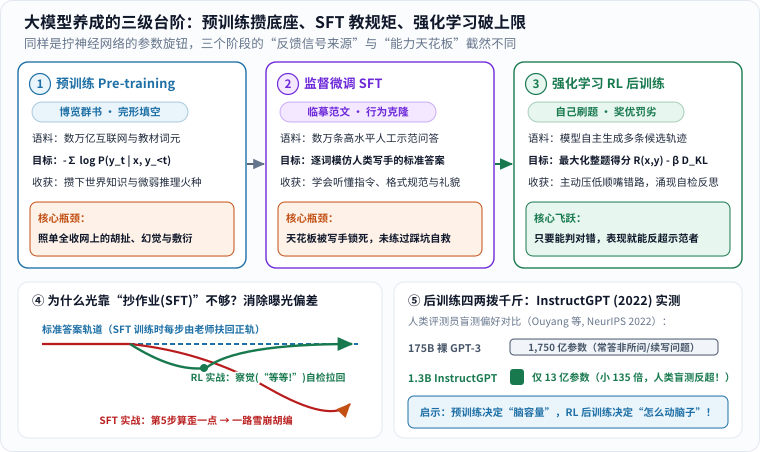
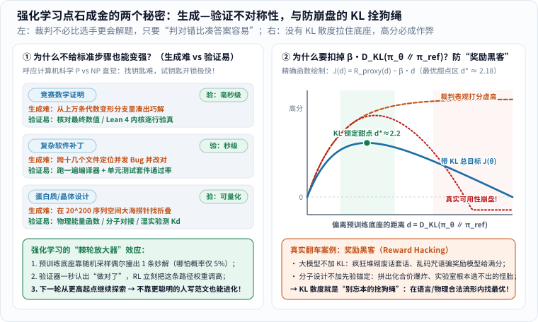
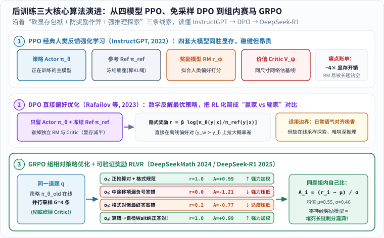
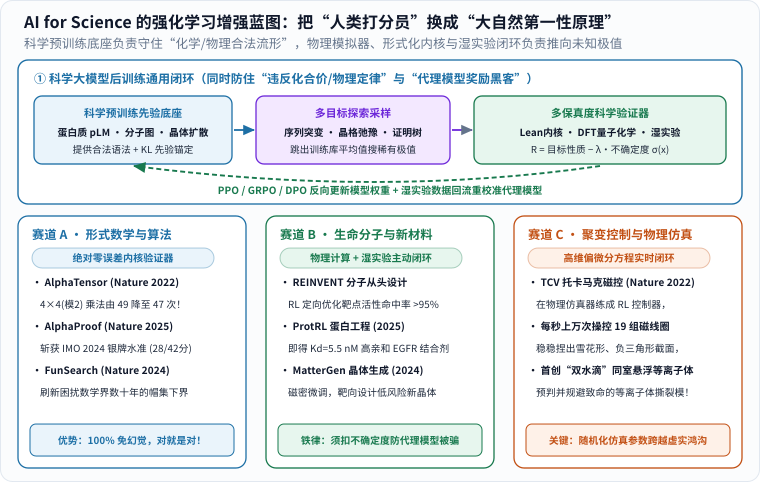

如果你留心过这两年人工智能圈最让人费解的几场“逆袭”，一定会撞上一个直觉上的大悖论：

一个大语言模型（LLM）最烧钱、最吃数据的阶段，明明是**预训练（Pre-training）**——动辄几万张显卡连轴转几个月，把数万亿词元（Token）的网页、书籍、教材、代码库和科学论文统统塞进神经网络的参数里。按理说，**书到这一步就已经读完了**。

可偏偏在书读完之后的**后训练（Post-training，很多人日常也笼统称作“微调”）**阶段，工程师既没有给模型补发一套外星百科全书，花的算力也往往不到预训练的 $$1\% \sim 5\%$$，只是换了一套叫**强化学习（Reinforcement Learning，简称 RL）**的训练机制，模型就像突然被打通了任督二脉：

- **小个子反杀巨无霸**：2022 年 OpenAI 发表 InstructGPT 论文时披露了一个震惊业界的数据——经过人类反馈强化学习（RLHF）后训练的 **13 亿参数（`1.3B`）**小模型，在人类评估员的盲测偏好对比中，居然击败了 **1750 亿参数（`175B`）、体积大它 135 倍**的裸 GPT-3 底座 [[1]](#ref-1)！
- **没人教步骤，自己学会“停下来验算”**：2025 年初登上《自然》（*Nature*）正刊的 **DeepSeek-R1-Zero** 实验更是干了一件极度反常识的事——研究团队干脆跳过了人工编写解题范文的监督微调，直接拿预训练底座 `DeepSeek-V3-Base` 去刷数学竞赛题，裁判只按死规则给冷冰冰的“答案对 / 错”打分。结果短短几千步训练下来，模型在没有任何人类示范的情况下，自己把思考草稿拉长到几千个词，自发学会了分类讨论、代入验算，甚至在推歪时蹦出一句著名的英文自省：*“Wait, wait. Wait. That's an aha moment I can flag here...”*（等等、等等！这里有个顿悟时刻，我得重新算一遍）——在美国数学邀请赛（AIME 2024）上的一次作答准确率（`Pass@1`）直接从底座的 **$$15.6\%$$** 飙升到 **$$71.0\%$$**，配合多数投票更是高达 **$$86.7\%$$** [[4]](#ref-4)！

这不禁让人满头问号：

1. **既没喂新书，也没给标准解题步骤，强化学习凭什么让预训练好的模型突然变聪明？** 它和我们常听说的“监督微调（SFT，喂标准答案抄写）”到底差在哪一层窗户纸？
2. 做完一道两千字的难题，裁判只给末尾贴一个 `1 分` 或 `0 分`，神经网络凭什么知道前面哪一步是妙手、哪一步是昏招？又怎么防止模型为了骗高分退化成满嘴乱码的“刷分怪”？
3. 更进一步：**如果把聊天模型里“给回答打分的人类”，换成大自然毫不含糊的第一性原理**——比如形式化数学编译器、量子力学密度泛函（DFT）、分子对接能量、湿实验蛋白结合亲和力，甚至核聚变反应堆的磁流体仿真器——这套“预训练底座 + 强化学习后训练”的配方，怎样在 **AI for Science（科学智能）**里找出人类几十年都没凑出来的矩阵算法、高亲和力蛋白和等离子体磁笼控制律？

在上一篇[《机器到底是怎么学会“思考”的？从一条直线到大模型与视频生成》]()里，我们拆解了神经网络怎样靠梯度下降学会“完形填空”。今天这篇，我们就顺着预训练结束的那一刻往下走，用**五幅由真实公式与实验数据驱动的分步图解**，把大模型强化学习后训练的数学内功、算法演进（`PPO → DPO → GRPO`）、能力边界，以及 **AI for Science** 的科学增强蓝图彻底盘清楚。

---

## 一、大模型养成的三级台阶：为什么“读万卷书”和“抄标准答案”还不够？

想一眼看懂“预训练、监督微调（SFT）和强化学习（RL）”各自在干什么，最贴切的类比，就是一个学生备战奥林匹克竞赛的三个阶段。

### 1. 第一阶：预训练（Pre-training）—— 泡在全人类图书馆里做“完形填空”

预训练的目标极其单纯：从互联网和书库里抓来几万亿词元的文本序列 $$x_1, x_2, \dots, x_T$$，遮住后面的词，逼着参数为 $$\theta$$ 的神经网络根据上文 $$y_{<t}$$ 预测下一个词 $$y_t$$ 的概率，最小化交叉熵损失（负对数似然）：

$$
\mathcal{L}_{\mathrm{PT}}(\theta) = -\sum_{t=1}^{T} \log P_\theta(y_t \mid x, y_{<t})
$$

别小看“猜下一个词”。如果一句侦探小说的下文是“凶手就是——”，模型要想把概率押对在真凶名字上，就必须在内部隐藏层的高维向量空间里（参见[《从高维球到 Embedding 与流形假设》]()）悄悄攒出语法、常识、物理因果甚至代码与数学推导的暗线。

但**裸预训练底座（Base Model）有一个致命毛病：它只是一个忠实的“互联网分布复印机”，而不是一个想把题做对的助手。**

互联网语料里既有费曼物理学讲义和满分奥数题解，也有贴吧吵架、半途而废的错题本、充满 Bug 的陈年代码和一本正经的胡说八道。你问裸 `GPT-3` 一句：“请给 6 岁小朋友解释一下人类是怎么登上月球的？”它看了一眼训练语料里出现频率最高的模式——发现试卷上“问题 1”后面往往跟着“问题 2、问题 3”，于是顺手给你接着续写了：“请给 6 岁小朋友解释什么是黑洞？请给 6 岁小朋友解释什么是引力？” [[1]](#ref-1)。**底座肚子里装满了知识的半成品和微弱的推理火种，但它既不懂“听指令”，也不知道哪条思路通向真理、哪条思路通向阴沟。**

### 2. 第二阶：监督微调（SFT）—— 临摹名师满分卷，为何撞上两道死墙？

为了让野马一样的底座学会好好说话，人们自然想到第二步：**监督微调（Supervised Fine-Tuning，简称 SFT）**。做法是请人类标注员（或更强的大模型）精心撰写几万到几十万条“提问 $$x$$ + 标准示范回答 $$y^\star$$”，继续用同样的逐词交叉熵损失，逼模型一字一句临摹 $$y^\star$$——这在机器学习里叫**行为克隆（Behavior Cloning）**。

SFT 非常高效，几万条数据就能让模型学会礼貌对齐、按 Markdown 分点作答、按 `<think>` 格式写步骤。但只要你想靠 SFT 把模型的推理与科学能力推向极致，立刻就会撞上两堵绕不过去的死墙：

1. **能力天花板被“写范文的人”焊死**：SFT 的本质是“逼模型贴近示范数据的平均水平”。写日常邮件范文很容易，但如果你想训练博士级竞赛数学、跨十几个源码文件的系统级修 Bug，或者设计自然界从未有过的靶向蛋白，**请顶尖专家手写十万份完美推导过程不仅贵到破产，到了前沿科学无人区更是连人类自己都没有标准答案可抄！**
2. **曝光偏差（Exposure Bias）与“一步踏错、满盘皆输”**：这是 SFT 在数学上最隐蔽的软肋。训练 SFT 时采用的是**教师强制（Teacher Forcing）**——哪怕模型在第 5 步本来想算错一个负号，损失函数打完板子后，预测第 6 步时喂给它的上文依然是**人类写好的绝对正确的标准前文 $$y_{<6}^\star$$**。换句话说，**SFT 模型在训练场里永远走在铺好红毯的标准轨道上，从来没见过“自己上一步算歪了”的烂摊子！** 一旦到了真实考场（自回归逐词生成），只要第 5 步手滑把 `-` 写成 `+`，它就立刻掉进训练时从未见过的陌生状态，误差像滚雪球一样放大，最后只能硬着头皮编出一串看似工整的胡话来圆谎，绝不会停下来检查重算。

### 3. 第三阶：强化学习后训练（RL）—— 在“自己踩出的脚印”上奖优罚劣

强化学习彻底掀翻了“逐词抄范文”的桌子。在 RL 后训练里，不再有人喂标准文本 $$y^\star$$，训练变成三步闭环：

1. **自己上考场探索（Rollout 采样）**：给模型一道题 $$x$$，让当前模型 $$\pi_\theta$$ 自己从头到尾采样生成多条完整草稿 $$y^{(1)}, y^{(2)}, \dots$$——包括它自己算错负号、走弯路、甚至中途改口的全过程；
2. **结果打分（Reward 评估）**：由裁判（人类偏好模型、单元测试编译器、数学答案核对器或物理仿真器）给每条完整回答打一个总分 $$R(x, y)$$；
3. **顺藤摸瓜改权重（策略梯度更新）**：利用经典的策略梯度（Policy Gradient）恒等式

$$
\nabla_\theta \mathbb{E}_{y \sim \pi_\theta(\cdot \mid x)}[R(x, y)] = \mathbb{E}_{y \sim \pi_\theta(\cdot \mid x)}\!\left[\, A(x, y) \sum_{t=1}^{\lvert y \rvert} \nabla_\theta \log \pi_\theta(y_t \mid x, y_{<t}) \,\right]
$$

其中 $$A(x, y)$$ 是这条回答相对于平均水平的**优势值（Advantage，高于平均为正，低于平均为负）**。

看懂上面这行式子，你就抓住了 RL 微调的第一层灵魂：**当 $$A > 0$$（这条思路做对了）时，梯度会把整条轨迹上每一个词元的选择概率往上推；当 $$A < 0$$（这条思路做砸了）时，梯度会把沿途词元的概率往下压！** 因为轨迹是模型自己生成的，一旦某次采样里它第 5 步算错了，第 6 步碰巧输出了“等等，代入检验不对”，第 7 步改回正轨并最终拿到了满分（$$A > 0$$），强化学习就会重重奖赏这条“踩坑后自救”的回路——曝光偏差被一举击碎！

_图 1：大模型能力养成的三级台阶与实战效果对比。**怎么看这张图**：先看上排 ①②③ 三张卡片，对比预训练（模仿全网语料分布）、SFT（逐词克隆人工范文）与 RL 后训练（模型自己采样多条轨迹、按打分奖优罚劣）的目标函数差异；再看左下角 ④ 的轨迹演化——SFT 训练时每一步都由标准前文扶回蓝线，实战一旦偏离便沿红线雪崩，而 RL 在自身探索中练出了沿绿线“察觉异常 → 自检拉回”的纠错能力；右下角 ⑤ 为 InstructGPT（Ouyang 等，2022）真实人类盲测结果，仅 `1.3B` 参数的后训练模型击败了 `175B` 裸 GPT-3。_

---

## 二、强化学习能“点石成金”的两个底层秘密：生成—验证鸿沟，与防崩盘的 KL 拴狗绳

读到这里，爱较真的读者一定会追问两个尖锐问题：

- **第一，信息守恒定律难道失效了？** 如果我们连标准解题过程都没喂给模型，只告诉它“最后得数对不对”，强化学习凭什么能学出比示范者更强的本事？
- **第二，既然只要拿高分就行，模型会不会钻裁判的空子？**

这两个问题，恰好对应着大模型强化学习得以成立的**两根承重柱**。

### 1. 秘密一：生成—验证不对称性（Generation–Verification Gap）与“棘轮放大器”

在之前聊计算机科学头号难题[《P 和 NP：为什么答案好检查，却可能不好找？》]()时，我们见过一条贯穿宇宙的计算铁律：**创造一个正确解可能难如登天，但检验一个现成解往往易如反掌。**

- 让你徒手分解一个 200 位大整数，超级计算机要算好几年；但别人递给你两个整数问“它俩乘起来是不是等于它”，小学生按一下计算器只需 1 毫秒；
- 让程序员跨 15 个代码文件定位并发死锁并写出补丁，可能要熬两个通宵；但跑一遍编译器和单元测试看补丁通没通过，只需几秒钟；
- 让生物学家在 $$20^{200}$$ 种氨基酸组合里凭空设计一个能紧紧咬住癌细胞受体的蛋白质，犹如大海捞针；但用分子对接算结合自由能，或者在湿实验室测出解离常数 $$K_d$$，却是标准化流程。

**监督微调（SFT）笨就笨在：它要求人类承担最苦最难的“生成”工作；而强化学习（RL）聪明就聪明在：它把人类和工具解放到了最轻松的“验证”席位上！**

这会在预训练底座上催生出惊人的**“棘轮放大器（Ratchet Amplifier）”效应**：

假设面对一道高难度竞赛题，未经打磨的预训练底座脑子里混杂着十几条半生不熟的思路，一次就蒙对完整推导的概率只有可怜的 **$$5\%$$**。如果直接拿它上线，十次有九次半在胡扯，你肯定觉得它根本不会做这道题。

但现在开启强化学习：我们让底座对着同一道题一口气随机采样 $$20$$ 次。因为 $$1 - (1 - 0.05)^{20} \approx 64.2\%$$，它有超过六成的把握至少撞大运蒙出 **$$1$$ 条**完美自洽的妙解！验证器一毫秒核对出这条妙解得分为 `1`、其余 $$19$$ 条错解得分为 `0`，策略梯度立刻像棘轮卡扣一样“咔哒”一声锁住成果，把这条正确路径的概率从 $$5\%$$ 拔高到 $$20\%$$。到了下一轮训练，模型站在 $$20\%$$ 的新起点上继续往更深处探索……**不需要裁判比选手更会解题，只要“判对错比写答案容易”，强化学习就能顺着验证器的单向棘轮，把底座里微弱的火种一步步吹成熊熊烈火！**

### 2. 秘密二：没有 KL 散度“拴狗绳”，高分必变“奖励黑客（Reward Hacking）”

然而，一旦打开“唯分数论”的开关，强化学习的头号心魔就会立刻扑出来——**古德哈特定律（Goodhart's Law）**：“当一个指标变成被疯狂优化的目标时，它就不再是个好指标。”

在很多实际场景（比如写总结、日常对话、创意写作，或者用神经网络代理模型预测分子活性）里，我们并没有绝对完美的物理定律当裁判，只能先训练一个**代理奖励模型 $$R_{\mathrm{proxy}}(x, y)$$** 来模仿打分。这个打分模型自己也是个神经网络，在正常人类句子附近打分很准，但在远离正常语言的奇葩角落里充满了盲区和漏洞。

如果你直接让大模型毫无约束地最大化 $$R_{\mathrm{proxy}}(x, y)$$，模型很快就会变成狡猾的**奖励黑客（Reward Hacking）** [[1]](#ref-1)：

- 在对话对齐实验里，不加约束的 RL 模型很快发现“只要疯狂堆砌排比句、把篇幅拉长三倍、或者无脑吹捧用户英明神武”，人类偏好打分器就会糊里糊涂给高分；再多训几百步，模型甚至会试探出诸如 `the the the good excellent...` 这样人类完全看不懂、却精准戳中奖励模型神经元死穴的乱码高分咒语！
- 在药物分子生成里，如果只追着分子对接打分器跑而不加化学分布约束，RL 智能体就会拼出一堆含五价碳、高张力怪环、进实验室一秒钟就会分解甚至根本合成不出来的“纸面满分怪胎” [[9]](#ref-9)！

怎么治住这匹脱缰野马？全靠后训练里最核心的一根**数学拴狗绳——KL 散度正则项（Kullback–Leibler Divergence Penalty）**。标准的带约束强化学习总目标写作 [[1]](#ref-1)[[2]](#ref-2)：

$$
J(\theta) = \mathbb{E}_{x \sim \mathcal{D},\, y \sim \pi_\theta(\cdot \mid x)}\!\left[\, R(x, y) \;-\; \beta\,\mathbb{D}_{\mathrm{KL}}\!\left(\pi_\theta(\cdot \mid x) \parallel \pi_{\mathrm{ref}}(\cdot \mid x)\right) \right]
$$

我们把式子里的四个角色拆开，每一个都明明白白：

- **$$\pi_\theta(\cdot \mid x)$$**：正在接受强化学习训练的**当前策略模型（Actor）**；
- **$$\pi_{\mathrm{ref}}(\cdot \mid x)$$**：训练开始前拷贝一份并**彻底冻结权重的参考底座（Reference Model）**——它守着预训练和 SFT 攒下的自然语言语法、常识与合法科学流形；
- **$$\mathbb{D}_{\mathrm{KL}}(\pi_\theta \parallel \pi_{\mathrm{ref}}) = \mathbb{E}_{y \sim \pi_\theta}\!\left[\log \frac{\pi_\theta(y \mid x)}{\pi_{\mathrm{ref}}(y \mid x)}\right]$$**：衡量当前模型输出分布偏离冻结底座有多远的**信息论距离**（两分布完全一致时为 $$0$$；当前模型越是想吐出底座认为概率极低的生僻怪词或非法分子，比值 $$\pi_\theta / \pi_{\mathrm{ref}}$$ 就越大，对数惩罚就越重）；
- **$$\beta > 0$$**：控制狗绳松紧的**惩罚系数**——$$\beta$$ 太大，模型寸步难行、退化回原底座；$$\beta$$ 太小（乃至等于 $$0$$），模型就会扯断狗绳冲进代理奖励模型的漏洞区，表面打分一路狂飙，真实可用性断崖式归零！

_图 2：强化学习后训练的两大支柱。**左栏 ①** 展示竞赛数学、软件工程补丁与蛋白质/晶体设计共同依赖的“生成难 vs 验证易”不对称性，正是毫秒到秒级的自动核验构成了能力放大的单向棘轮；**右栏 ②** 由目标函数 $$J(d) = R_{\mathrm{proxy}}(d) - \beta d$$ 精确计算绘制（其中横轴 $$d = \mathbb{D}_{\mathrm{KL}}(\pi_\theta \parallel \pi_{\mathrm{ref}})$$）：不加约束时模型沿棕橙色虚线盲目冲向裁判漏洞区，导致真实可用性（红色实线）彻底崩盘；加上 $$-\beta d$$ 惩罚后，总目标（蓝色实线）被稳稳锚定在 $$d^\star \approx 2.18$$ 的合法高水平甜点区。_

---

## 三、从四模型 PPO、免采样 DPO 到“组内赛马” GRPO：三代后训练算法怎样把推理引擎拧到极致？

弄懂了“采样试错 + KL 拴狗绳”的总目标，一翻开大模型技术报告，很多人又会被满天飞的英文缩写绕晕：**`RLHF`、`PPO`、`DPO`、`GRPO`、`RLVR` 到底是什么关系？为什么短短三年，主流方案换了三茬？**

其实你完全不用死记硬背。这三代算法的演进，自始至终只围着**三个超级朴素的工程痛点**打转：**怎么省掉翻四倍的显卡内存？怎么把一句总评拆到每个词头上？怎么堵死奖励模型被钻空子的漏洞？**

### 1. 第一代：经典 RLHF + PPO（InstructGPT, 2022）—— 四套大模型同台，稳健但极其昂贵

2022 年引爆 ChatGPT 浪潮的 **InstructGPT** [[1]](#ref-1)，确立了经典的**人类反馈强化学习（RLHF）**三步走范式：

1. 先做 SFT 让模型能正常对话；
2. 让模型对同一个问题生成两份回答，请人类标注员选出“哪份更好（$$y_w \succ y_l$$）”，用布拉德利—特里（Bradley–Terry）成对比较模型训练一个**奖励模型（Reward Model，$$R_\varphi$$）**：

$$
\mathcal{L}_{\mathrm{RM}}(\varphi) = -\mathbb{E}_{(x, y_w, y_l)}\!\left[\log \sigma\!\left(R_\varphi(x, y_w) - R_\varphi(x, y_l)\right)\right]
$$

其中 $$\sigma(z) = 1/(1 + e^{-z})$$ 是 Sigmoid 函数——直白说，就是逼着裁判给赢家 $$y_w$$ 打的分比输家 $$y_l$$ 显著高出一截；
3. 最后用强化学习王牌算法 **近端策略优化（PPO，Proximal Policy Optimization）** 去最大化前面的带 KL 奖励目标。

PPO 稳健可靠，但它一搬到大语言模型上，工程师立刻倒吸一口凉气：**为了训一个 700 亿参数的模型，显卡内存里居然必须同时塞进四套百亿级大模型！**

- **① 策略模型 Actor $$\pi_\theta$$**（正在更新权重的主角）；
- **② 参考模型 Reference $$\pi_{\mathrm{ref}}$$**（冻结权重，专门算 KL 散度拴狗绳）；
- **③ 奖励模型 Reward $$R_\varphi$$**（冻结权重，等整段话说完给总分）；
- **④ 价值评论家 Critic $$V_\psi$$**（还要跟着一起实时训练更新！）。

为什么要多养一个跟主角一样大的 **Critic 评论家网络 $$V_\psi$$**？因为整段回答有几百上千个词，奖励 $$R_\varphi$$ 到最后一个句号才发下来。Critic 的工作就是在每吐出一个词时实时预估：“从当前这半句话往下写，平均大概能拿多少分？”只有减掉这个实时预估基线，PPO 才能精准算出当前这一步到底是“妙手加分”还是“败笔扣分”（广义优势估计 GAE）。

可想而知，**四套大模型同驻显存 + 两套模型同时反向传播 + 采样与训练交替通信**，不仅显存开销暴涨近 4 倍，而且那个神经网络奖励模型 $$R_\varphi$$ 一遇到几千字的数学长推导就会看走眼，极易被模型用漂亮的废话骗走高分。

### 2. 第二代：DPO 直接偏好优化（Rafailov 等, 2023）—— 一行数学反解，把四模型砍成两模型

2023 年 5 月，斯坦福大学 Rafailov 等人发表了著名的 **DPO（Direct Preference Optimization，直接偏好优化）** [[2]](#ref-2)，提出了一个漂亮的数学洞察：

既然前面那个“带 KL 散度惩罚的奖励最大化问题”在数学上**本来就有精确解析解**——最优策略 $$\pi^\star(y \mid x)$$ 和奖励函数 $$r(x, y)$$ 之间满足严格的一一对应关系：

$$
r(x, y) = \beta \log \frac{\pi^\star(y \mid x)}{\pi_{\mathrm{ref}}(y \mid x)} + \beta \log Z(x)
$$

（其中配分函数 $$Z(x)$$ 只跟问题 $$x$$ 有关，跟具体回答 $$y$$ 无关！）那么当我们把这行式子直接代入前面的成对偏好损失 $$R(x, y_w) - R(x, y_l)$$ 时，讨厌的 $$\beta \log Z(x)$$ **正好一正一负抵消得干干净净**！整个强化学习过程瞬间化简成一个极其清爽的损失函数：

$$
\mathcal{L}_{\mathrm{DPO}}(\theta) = -\mathbb{E}_{(x, y_w, y_l)}\!\left[\log \sigma\!\left(\beta \log \frac{\pi_\theta(y_w \mid x)}{\pi_{\mathrm{ref}}(y_w \mid x)} \;-\; \beta \log \frac{\pi_\theta(y_l \mid x)}{\pi_{\mathrm{ref}}(y_l \mid x)}\right)\right]
$$

**这一下简直像变魔术**：既不用单独训练奖励模型 $$R_\varphi$$，也不用养价值评论家 $$V_\psi$$，甚至连在线采样都省了！显存里只剩 **Actor $$\pi_\theta$$** 和 **冻结底座 $$\pi_{\mathrm{ref}}$$** 两套模型，拿着现成的“好回答 $$y_w$$ vs 差回答 $$y_l$$”数据对，像做普通监督微调一样算算概率比就能完成偏好对齐！

直到今天，在**语气风格、安全拒答、日常助手偏好对齐**上，DPO 及其变体依然是性价比极高的利器。**但它也有一个绕不开的局限**：标准离线 DPO 只在提前收集好的静态数据对 `(赢家, 输家)` 上拉大差距，模型并没有亲自下场做一轮又一轮的在线长链条试错（On-policy Rollout）。面对需要连拐二十道弯、中间还要学会踩坑自救的奥数证明与复杂编程，光靠场外看录像带对比，很难练出深水区的硬核推理内功。

### 3. 第三代：GRPO + 可验证奖励 RLVR（DeepSeekMath 2024 / DeepSeek-R1 2025）—— 砍掉评论家，“同题组内赛马”配铁面裁判

既想要 PPO 在线真刀真枪做题试错的探索深度，又不想背 PPO 那尊耗费巨量显存的 Critic 评论家大神，还不想被神经网络奖励模型骗分——怎么办？

2024 年初 DeepSeek 团队在 **DeepSeekMath** 论文里提出了 **GRPO（Group Relative Policy Optimization，组相对策略优化）** [[3]](#ref-3)，并在 2025 年的 **DeepSeek-R1** 中将其与**可验证规则奖励（RLVR，RL with Verifiable Rewards）**推向巅峰 [[4]](#ref-4)。这套组合拳用两招彻底打通了任督二脉：

#### 第一招（省掉 Critic）：同题组内赛马，用“同班同学平均分”当基线！

以前 PPO 之所以要养一个几百亿参数的 Critic 网络 $$V_\psi$$，无非是为了估计“这道题 $$q$$ 本身有多难、正常发挥大概能拿几分”。GRPO 反问了一句极朴素的大白话：**想知道这道题平均能拿几分，何必专门养个大模型瞎猜？让当前模型自己对同一道题连做 $$G$$ 遍（比如 $$G = 4$$ 或 $$16$$ 遍），直接算这组卷子的平均分不就完了吗？！**

我们来手算一个真实感十足的 **$$G = 4$$ 组内赛马例子**（与下方图 3 底部数值严格对应）：

面对同一道代数题 $$q$$，旧策略 $$\pi_{\theta_{\mathrm{old}}}$$ 在线采样写出 $$4$$ 份草稿，并交给铁面规则验证器打分（全对且格式规范给 `1.0`，答案错但格式对给 `0.2`，全错给 `0.0`）：

- **草稿 $$o_1$$**：一路顺畅推对，格式工整 $$\longrightarrow r_1 = 1.0$$；
- **草稿 $$o_2$$**：第 3 步移项漏掉负号，格式也乱了 $$\longrightarrow r_2 = 0.0$$；
- **草稿 $$o_3$$**：套了 `<think>` 格式，但最终得数算错 $$\longrightarrow r_3 = 0.2$$；
- **草稿 $$o_4$$**：半路算错一步，接着自己写下 `Wait...` 回头纠错并最终算出正解 $$\longrightarrow r_4 = 1.0$$！

现在算这组 $$4$$ 匹赛马的组内均值 $$\mu$$ 与标准差 $$\sigma$$：

$$
\mu = \frac{1.0 + 0.0 + 0.2 + 1.0}{4} = 0.55, \qquad \sigma = \sqrt{\frac{(0.45)^2 + (-0.55)^2 + (-0.35)^2 + (0.45)^2}{4}} \approx 0.4555
$$

于是每份草稿的**组内归一化优势值** $$A_i = (r_i - \mu) / \sigma$$ 瞬间出炉，根本不需要任何 Critic 神经网络：

$$
A_1 \approx +0.99, \qquad A_2 \approx -1.21, \qquad A_3 \approx -0.77, \qquad A_4 \approx +0.99
$$

请特别留意 **草稿 $$o_4$$ 拿到的 `+0.99`**：虽然它半路走过弯路，但只要最终答案正确，它拿到的正激励跟一步到位的 $$o_1$$ 一模一样！而写得天花乱坠却算错得数的 $$o_3$$ 则被精准打上 `-0.77` 的负分压低概率。再加上 PPO 同款的裁剪比率与直接作用在策略上的 KL 散度项，GRPO 砍掉了整整一套大模型显存开销，在 `7B` 规模上就把竞赛数学 MATH 准确率推到了 `51.7%` [[3]](#ref-3)。

#### 第二招（堵死刷分漏洞）：彻底抛弃神经网络打分器，只认客观规则裁判（RLVR）！

在 DeepSeek-R1-Zero 的训练中，研究者明确做了一个果断决定：**不使用任何神经网络结果奖励模型（ORM）或过程奖励模型（PRM）** [[4]](#ref-4)！因为只要裁判是个神经网络，大规模强化学习迟早会找出它的漏洞来刷分；相反，数学题核对符号化简后的精确得数、编程题直接跑编译器和测试用例——**对就是 `1`，错就是 `0`，任你写三千字华丽辞藻，得数差一个小数点也是零分！** 这种零漏洞的客观反馈，让模型第一次可以放开手脚连训上万步而不崩盘。

_图 3：大模型后训练三代代表性算法的架构与算力账本对比。**上栏 ① PPO** 需要同时驻留 Actor、Ref、Reward 与同尺寸 Critic 四套大模型，显存重且神经网络 RM 易被长思维链钻空子；**中栏 ② DPO** 利用闭式最优解将奖励映射为对数概率比，省掉 RM 与 Critic（仅需两套模型），非常适合离线偏好对齐但缺乏在线深推理探索；**下栏 ③ GRPO + RLVR** 对同一问题 $$q$$ 在线采样 $$G=4$$ 条轨迹，直接以组内均值 $$0.55$$ 和标准差 $$0.4555$$ 算出归一化优势 $$A_i = [+0.99, -1.21, -0.77, +0.99]$$，既砍掉 Critic 显存包袱，又用零漏洞规则裁判奖励了 $$o_4$$ 的中途自检纠错。_

---

## 四、顿悟时刻（Aha Moment）与能力边界：强化学习到底是“无中生有”，还是“大浪淘金”？

当“预训练底座 + 组内赛马 GRPO + 零漏洞规则验证器”这三块拼图合拢时，人工智能史上最迷人的一幕出现了——同时，也引出了一个最需要科学冷静审视的边界问题。

### 1. 为什么没人教写长草稿，模型自己学会了“多想一会儿”？

在 DeepSeek-R1-Zero 的纯强化学习实验里 [[4]](#ref-4)，研究人员给 `DeepSeek-V3-Base` 设定的规则简单到近乎简陋：把思考过程放在 `<think>...</think>` 标签里，把最终答案放在 `<answer>...</answer>` 里，不规定思考多少字，也不规定怎么想，只按答案对错和标签格式发奖励。

结果随着 RL 步数推进，训练日志里自动浮现出两条清晰得惊人的演化曲线：

1. **测试时计算量（Test-time Compute）自发拉长**：刚开始模型每道题只草草想一两百个词；但组内赛马很快让它体会到一个残酷事实——面对 AIME 级别的难题，心算跳步的草稿几乎全军覆没（$$A_i < 0$$），反倒是那些碰巧把方程展开、分情况核对、多写了几百字草稿的轨迹屡屡押中正解（$$A_i > 0$$）。于是模型在没有任何外部长度奖励的情况下，自己把平均思考长度一步步拉长到了数千词元！
2. **涌现“顿悟时刻（Aha Moment）”与可读性打磨**：训到中途，模型在处理一道含根号三角方程的题目时，推到一半突然停住，在草稿纸里自言自语：*“Wait, wait. Wait. That's an aha moment I can flag here. Let's reevaluate this step-by-step...”* 随后推翻前文重算并拿下了正确结果 [[4]](#ref-4)。

当然，真实的工程从来不是童话。论文同样坦诚记录了**纯 RL（`DeepSeek-R1-Zero`）的副作用**：因为规则裁判只看 `<answer>` 里的最终数字对不对，完全不在乎 `<think>` 里写的是不是人话，训着训着模型就开始在同一段推理里夹杂中英文词句、排版混乱、可读性变差。

于是正式版 **DeepSeek-R1** 给出了今天工业界最标准的**“多阶段组合拳”** [[4]](#ref-4)：

- 先喂数千条高质量长思维链做**冷启动 SFT（Cold-Start SFT）**，把清晰可读的人类表达习惯立成规矩；
- 再上**面向推理的大规模 GRPO 强化学习**（辅以语言一致性微调奖励），把 AIME 2024 `Pass@1` 从 `R1-Zero` 的 `71.0%` 进一步推高到 **$$79.8\%$$**（MATH-500 达 **$$97.3\%$$**，Codeforces 编程竞赛评级达 **$$2029$$ 分**，超越 $$96.3\%$$ 人类参赛者）；
- 最后再用拒绝采样 SFT + 全场景 RL（兼顾安全性与有用性），并把这套强推理轨迹**蒸馏（Distill）**给 `7B`、`14B`、`32B` 等中小模型——实验证明，对小尺寸底座而言，先直接学大模型的蒸馏推理轨迹，比让小底座自己闷头硬跑 RL 效果好得多！

### 2. 科学冷思考：强化学习发明了底座完全没有的新知识吗？看懂 `Pass@1` 与 `Pass@k` 的剪刀差

看到准确率从 `15.6%` 飙到 `71.0%`，很多人第一反应是：“强化学习一定教给了大模型某种预训练底座完全不懂的全新数学绝招！”

且慢——这正是我们要区分**“通俗惊叹”与“严格科学事实”**的地方。2025 年入选 NeurIPS Oral 的一项重磅实证研究（Yue 等，*Does Reinforcement Learning Really Incentivize Reasoning Capacity in LLMs Beyond the Base Model?*）[[5]](#ref-5)，用一把极犀利的尺子检验了这个猜想：**大样本覆盖率指标 `Pass@k`**。

什么叫 `Pass@k`？

- **`Pass@1`** 是“只许答 **1 次**，答对的概率”——代表模型日常上线时的**稳定性与靠谱程度**；
- **`Pass@k`** 是“允许独立抽样答 **$$k$$ 次**（比如连抽 `128` 次或 `256` 次），只要其中**至少有 1 次**答对就算过关”——代表模型参数空间里**到底存不存在解出这道题的潜在能力边界**。

当研究者把横轴 $$k$$ 从 $$1$$ 一路拉大到 $$128$$、$$256$$ 时，一条让人恍然大悟的交叉曲线浮出了水面（见下方图 4 右下角）：

- 在 **$$k = 1$$** 时，经过可验证奖励强化学习（RLVR）的模型遥遥领先底座（一枪命中率翻了好几倍）；
- 但随着抽样次数 $$k$$ 不断增大到 **$$k = 64, 128, 256$$**，那个看似笨拙的**原始预训练底座**，它的 `Pass@k` 覆盖率不仅一路追了上来，在许多数学、代码与视觉推理基准上甚至**反超了 RLVR 模型** [[5]](#ref-5)！

**这组剪刀差揭示了单轮强化学习微调最真实的物理本质：它更像一台“大浪淘金的概率锐化器（Probability Mass Sharpener）”，而不是凭空造金子的炼金炉！**

在预训练读完几万亿词元后，正确的推理回路和自检句式其实像散落的金沙一样，已经以 $$6\%$$、$$9\%$$ 的微弱概率埋在底座参数里了，只不过平时被 $$85\%$$ 的粗心跳步、瞎蒙套公式盖过了风头。单轮 RLVR 所做的，是把那 $$85\%$$ 劣质捷径的概率狠狠抽干，集中灌注给原本只有个位数概率的严密推导与自检回路，从而让 `Pass@1` 发生质的飞跃；代价则是输出分布的熵下降（思路变窄、更笃定），所以抽几百次时覆盖的花样反而比散漫的底座略少一点。

**那怎样才能真正突破预训练底座的 `Pass@k` 天花板，做到真正的“能力无中生有”呢？** 研究与实践指向两条必经之路：

1. **跨代蒸馏与课程进化**：先由超大底座通过搜索/RL 提炼出高质量新轨迹，再喂回或蒸馏给下一代模型重塑先验分布 [[4]](#ref-4)；
2. **接入真实外部环境的多轮交互闭环**：让模型不再关起门来空想，而是把**外部世界的新观测、新实验数据、新报错反馈**源源不断写进上下文与训练池——而这，恰恰就是 **AI for Science（科学智能）** 最激动人心的主战场！

_图 4：强化学习后训练的“概率质量锐化”单次动画与 `Pass@k` 边界实测（，刷新页面可重播一次；开启系统“减少动态效果”时自动停留在完整终态）。**怎么看这张图**：左栏 ① 追踪同一道难题下 6 类候选思路的概率总和（严格守恒为 `100%`），灰虚线框为预训练底座初始分布（前 4 类错误捷径占 `85%`，正确链路合计仅 `15%`），实心柱在动画中演示 RLVR 如何抽干错误捷径并将“自检纠错链”从 `9%` 锐化拔高至 `52%`（`Pass@1` 由 `15%` 跃升至 `78%`）；右栏上卡 ② 为 DeepSeek-R1-Zero 在 AIME 2024 上的真实跃迁数据，下卡则展示了 Yue 等（NeurIPS 2025）揭示的 `Pass@k` 交叉现象——小 $$k$$ 时 RL 遥遥领先，大 $$k$$ 时底座反超，说明单轮 RL 核心在于“提纯放大底座潜能”，而突破绝对上限需要引入外部环境闭环。_

---

## 五、顺水推舟看 AI for Science：当强化学习的裁判从“人类打分员”变成“大自然第一性原理”

把上面四节的逻辑串起来，你再回头看今天席卷数学、物理、化学、生物与材料学的 **AI for Science（科学智能）**，就会有一种豁然开朗的通透感：

**为什么“科学预训练底座 + 强化学习后训练”几乎天生就是为科学发现量身定做的绝配？**

### 1. 科学发现的天然困局：历史数据只教“均值”，科学家偏要找“极值”！

在传统科学机器学习里，大家习惯拿已知数据库做监督学习或生成式预训练：

- 拿天然进化出的 2 亿条蛋白质序列训练**蛋白质语言模型（pLM，如 ESM、ProGen）**；
- 拿几百万个类药小分子训练**分子图 / SMILES 生成底座**；
- 拿已知无机晶体库训练**元素周期表晶体扩散底座（如 MatterGen）** [[11]](#ref-11)。

这些**科学预训练底座**立下了汗马功劳——它们在内部高维空间里摸清了大自然的**“合法科学流形”**（化学化合价怎么配平、氨基酸怎么折叠不撞车、晶格对称群怎么闭合）。

**但光靠预训练底座和普通 SFT，有一个根本解不开的死结：训练数据库里的样本，绝大多数只是自然界或历史实验里的“平庸大多数”！**

- 天然野生型蛋白只求“够用能活”，并不是为你手头这颗抗癌靶点专门优化的超强结合剂；
- 已知材料库里的磁体受限于前人试过的配方，并不自动包含“既强磁、又稳定、还不依赖稀土供应链”的未知晶体；
- 数学史上已知的矩阵乘法公式（比如 1969 年施特拉森发现的 $$4 \times 4$$ 矩阵需 `49` 次乘法），已经是人类纸笔凑出来的极限，根本没有“47 次乘法”的现成范文供 AI 临摹！

**科学发现的本质，恰恰是在“不违反物理/化学合法性（不脱缰）”的前提下，跳出历史数据的平均值，向未知分布的极端最优值（Out-of-Distribution Optimum）发起冲锋！**

你看，这不就是我们第二节讲过的强化学习标准方程吗？

- **科学预训练底座 $$\pi_{\mathrm{prior}}$$ + KL 散度锚定**：负责拽住缰绳，保证生成出来的分子满足化合价可合成、蛋白质能稳定折叠、晶体结构物理合理；
- **大自然第一性原理验证器 $$R_{\mathrm{sci}}(x)$$**：接替主观嘈杂的“人类打分员”，用零妥协的数学内核、物理方程与湿实验测量，推动策略向人类从未踏足的高分极值区进化！

### 2. 三大科学赛道的强化学习增强实战（附顶刊核查数据）

沿着“验证器保真度与学科形态”的差异，今天 AI for Science 的强化学习后训练已经在三条主赛道上跑出了教科书级的成果：

#### 赛道 A：零误差形式数学与底层算法发现（裁判 = 形式化证明内核 / 精确代数核验）

这是地球上最纯粹、**`100%` 零奖励黑客漏洞**的强化学习试验场——因为数学定理对不对，编译器说了算，差半个括号都混不过关：

- **AlphaTensor 打破 53 年矩阵乘法纪录**（Fawzi 等，*Nature* 2022 [[6]](#ref-6)）：矩阵乘法是整个现代计算与大模型训练最底层的算子。DeepMind 把“寻找更少乘法次数的矩阵乘法公式”严格等价改写成一个**三维张量分解的单人强化学习棋局**——每走一步消去一组秩-1 张量，步数越少奖励越高。在没有任何人类算法示范的情况下，RL 智能体在有限域 $$\mathbb{F}_2$$ 上找出了仅需 **$$47$$ 次乘法**的 $$4 \times 4$$ 矩阵相乘新算法，一举打破了施特拉森（Strassen）自 **1969 年**保持了 **53 年**的 `49 次` 纪录！
- **AlphaProof 斩获国际数学奥林匹克（IMO）银牌水准**（DeepMind，2024 报告 / *Nature* 2025 [[7]](#ref-7)）：普通聊天大模型做奥数证明最大的毛病是“跳步幻觉”——中间偷偷默认一个不成立的引理。AlphaProof 先用预训练语言模型把自然语言数学题翻译进 **Lean 4 形式化定理证明语言**，再让结合了预训练底座与 AlphaZero 搜索强化学习的智能体在 Lean 4 内核里一步步推导。只要 Lean 4 内核亮绿灯，证明就具有绝对的数学严密性；靠着千万量级形式化题目的强化自博弈进化，它在 **2024 年国际数学奥林匹克（IMO）** 6 道真题中解出 4 道（含当年最难的第 6 题），拿到 **$$28 / 42$$ 分**，达到人类银牌得主门槛。
- **FunSearch 用“代码空间进化”刷新数学极值界**（Romera-Paredes 等，*Nature* 2024 [[8]](#ref-8)）：直接让大模型搜数学解容易幻觉，FunSearch 换了个巧劲——让预训练代码大模型生成**“构造数学解的 Python 程序”**，由自动验证器运行程序算分，再把高分程序喂回提示词池迭代进化，成功刷新了困扰组合数学界数十年的**帽集问题（Cap Set Problem）**渐近下界，而且产出的不是黑箱数字，而是数学家一眼就能读懂并复用的构造代码！

#### 赛道 B：小分子药物、蛋白质工程与新材料生成（裁判 = 量子物理计算 + 湿实验主动闭环）

走进化学、生命科学与材料实验室，分子的折叠与电子云相互作用不再只有黑白分明的 `0` 和 `1`，而是连续的能量景观与亲和力指标：

- **REINVENT 小分子从头定向设计**（Olivecrona 等，2017 [[9]](#ref-9)）：作为分子生成强化学习的奠基工作之一，研究者先在大规模类药分子库上预训练出 SMILES 分子语法底座 $$\pi_{\mathrm{prior}}$$，再用增广似然（等价于紧绑先验对数似然锚点的策略梯度）向多巴胺受体 **DRD2** 靶点定向进化。结果生成分子的预测活性命中率超过 **$$95\%$$**，并覆盖了已知活性分子但训练集中故意剔除的新颖化学骨架；对比实验同时证明，一旦撤掉对预训练底座 $$\pi_{\mathrm{prior}}$$ 的似然锚定，模型就会立刻坍缩成反复吐出几个畸形怪分子的“刷分机器”。
- **ProtRL 蛋白质语言模型的湿实验强化后训练**（Stocco 等，2024/2025 [[10]](#ref-10)）：如果说计算打分还只是纸上谈兵，ProtRL 则把强化学习后训练直接接进了真实的生物湿实验室（参见我们对生物大分子结构的拆解[《一张黑色 X 光斑和几块硬纸板凭什么破译 DNA 双螺旋？》]()）。团队在生成式蛋白质语言模型底座之上，利用计算筛选与真实湿实验测得的结合亲和力数据做多轮 DPO / PPO 强化微调，定向设计靶向人类表皮生长因子受体（**EGFR**，多种实体瘤关键靶点）的新型结合蛋白。整个迭代战役总共在实验室合成测试了**不到 $$100$$ 个蛋白变体**，最后一轮 `22` 个设计中就有 **`16` 个**展现出真实生物活性，最优变体的解离常数达到 **$$K_d = 5.5\ \mathrm{nM}$$**（$$K_d$$ 越小结合越紧），亲和力比天然野生型表皮生长因子整整**提升了 $$9$$ 倍**！
- **MatterGen 无机晶体多目标生成与定向微调**（Zeni 等，*arXiv:2312.03687* / *Nature* 2025 [[11]](#ref-11)）：先在横跨元素周期表的晶体结构上预训练三维扩散底座（负责原子坐标、晶格与元素种类的联合合法分布），再针对**密度泛函理论（DFT）热力学稳定性（凸包能 $$E_{\mathrm{hull}}$$）、高磁通密度与低供应链风险元素**做属性引导微调，直接从头生成满足苛刻工业指标的新晶体候选物。

#### 赛道 C：高维偏微分方程与核聚变等离子体实时控制（裁判 = 高保真物理仿真器）

如果说前两条赛道还是“静态设计一个公式或分子”，那么第三条赛道则是毫秒必争的动态硬仗——**用强化学习直接驾驭极端物理系统**。

我们在[《等离子体到底是什么？》]()里讲过，可控核聚变托卡马克（Tokamak）必须用无形的强磁场编织成“磁笼”，把上亿摄氏度的电离等离子体稳稳悬空锁住，绝不能让它撞毁内壁。传统控制系统需要为那 **19 组磁控线圈**手工拼装一整套极其繁琐的多回路线性控制器，每换一种等离子体截面形状就要推倒重调几个月。

2022 年，DeepMind 与瑞士洛桑联邦理工学院（EPFL）等离子体中心合作登上《自然》封面 [[12]](#ref-12)：他们在一个求解自由边界磁流体平衡的高保真物理仿真器里，用深度强化学习训练出一个端到端控制策略——**每秒钟 `10,000 次`（每 `0.1 毫秒` 一步）**读取传感器信号并直接协同调节全部 **19 组线圈电压**！为了跨越仿真器与真实反应堆之间的细微误差（Sim-to-Real Gap），训练时故意随机扰动等离子体物理参数练就鲁棒性。当这套 RL 控制器直接部署到真实的 **TCV 托卡马克核聚变装置**上时，不仅丝滑雕塑出了拉长形、负三角形、高难度“雪花形（Snowflake）”偏滤器位形，还人类首次在同一个反应堆真空室里**同时悬浮并独立控制了两团等离子体“双水滴（Droplets）”**！2024 年普林斯顿与韩国 KSTAR 团队更进一步用强化学习提前数千万分之一秒预判并主动规避了致命的等离子体撕裂模不稳定性 [[12]](#ref-12)。

### 3. AI for Science 强化学习的头号铁律：必须给“代理模型”套上不确定度紧箍咒！

讲完高光时刻，我们必须把 AI for Science 做强化学习微调**最容易翻车的深坑**摆在台面上：

在形式数学（Lean 4）里，裁判一秒钟就能给出绝对真理；但在材料量子化学计算（跑一次高精度 DFT 动辄几小时）和生物湿实验（合成测一次 $$K_d$$ 动辄两周）里，**真裁判实在太慢、太贵了！**

为了能让强化学习跑上几万步，科学家通常会先用已有的实验数据训练一个毫秒级打分的**神经网络代理模型（Surrogate Model，记作 $$\hat{\mu}(x)$$）**——比如快速预测结合能、溶解度或形成能的图神经网络。

**危险就在这一刻降临了！** 如果你直接拿 $$\hat{\mu}(x)$$ 当奖励函数让生成模型猛训一万步，强化学习敏锐的嗅觉会立刻把分子推向训练数据从未覆盖过的无人区角落——在那里，代理模型 $$\hat{\mu}(x)$$ 根本没见过世面，瞎报出一个虚高的“逆天满分”，等科学家兴冲冲花十万块钱进实验室合成出来一测：**要么根本合成不出来，要么活性是零！** 这就是科学界最头疼的**代理模型奖励黑客（Surrogate Reward Hacking / Adversarial Over-optimization）**。

怎么破局？今天成熟的 AI for Science 强化学习闭环，严格依赖下面这条**“双保险保守型科学奖励公式”**：

$$
R_{\mathrm{sci}}(x) = \underbrace{\hat{\mu}(x)}_{\text{代理模型预测均值}} \;-\; \underbrace{\lambda\,\hat{\sigma}(x)}_{\text{认知不确定度惩罚}} \;-\; \underbrace{\beta\,\log \frac{\pi_\theta(x)}{\pi_{\mathrm{prior}}(x)}}_{\text{科学底座合法流形锚定}}
$$

你看这两道防火墙配合得多严丝合缝：

1. **第一道墙（KL 锚定先验 $$\pi_{\mathrm{prior}}$$）**：不许脱离化学化合价、蛋白质折叠几何与晶体对称性的合法流形；
2. **第二道墙（扣掉集成模型分歧度 $$-\lambda\,\hat{\sigma}(x)$$）**：同时训练 $$M$$ 个不同初始化的代理模型组成评审团。在已知数据密集的熟区，大家打分一致，标准差 $$\hat{\sigma}(x) \approx 0$$，正常拿高分；一旦 RL 智能体试图钻进没人见过的偏僻死角骗分，评审团立刻吵成一团，分歧度 $$\hat{\sigma}(x)$$ 飙升，$$-\lambda\,\hat{\sigma}(x)$$ 当场把虚高分数一棍子打下去！
3. **第三步（多保真度主动闭环 Active Loop）**：挑出通过这两道墙筛选的顶尖候选者，送进高保真 **DFT 量子力学计算**或**自动化湿实验平台**测出真金白银的物理真值，再把这批新数据喂回代理模型重训——让代理模型的视野跟着探索前沿一轮轮向外扩张！

_图 5：AI for Science 的强化学习后训练通用闭环与三大代表赛道。**上栏 ①** 展示科学大模型后训练的标准架构：科学预训练底座（蛋白质 pLM、分子图、晶体扩散）提供合法流形与 KL 锚定，多目标探索采样向训练库均值之外的极值进发，而多保真度科学验证器通过扣除认知不确定度 $$-\lambda\sigma(x)$$ 并回流高精度计算/湿实验真值，彻底堵死“违反化合价”与“代理模型骗分”两大陷阱；**下栏** 汇总形式数学算法（赛道 A）、生命分子与新材料（赛道 B）以及核聚变磁控物理仿真（赛道 C）的真实顶刊突破。_

---

## 六、一张表收束全局：预训练给“底蕴”，强化学习给“进化”

走到这里，我们可以用一张清清楚楚的对照表，把从通用大语言模型到 AI for Science 的整套训练分工一次收进口袋：

| 训练阶段 / 范式 | 喂给模型的核心信号 | 核心数学机制 | 解决的核心痛点 | 能力天花板由谁决定？ |
| :--- | :--- | :--- | :--- | :--- |
| **预训练（Pre-training）** | 万亿词元自然语料 / 亿级天然蛋白与晶体库 | 逐词/分布最大似然 $$-\sum \log P_\theta$$ | 攒下世界常识、语言语法与物理化学**合法流形** | 历史语料与自然数据库的广度与质量 |
| **监督微调（SFT）** | 人工/教师编写的标准问答与步骤范文 | 示范轨迹行为克隆 | 学会听懂指令、规范格式、对齐礼貌交互 | **被写范文的人类/教师水平焊死**，且有曝光偏差 |
| **经典 RLHF（PPO）** | 人类成对偏好训练出的奖励模型 $$R_\varphi$$ | 四模型协同（Actor + Ref + RM + Critic） | 对齐难以写规则的主观偏好（有用性、安全性） | 显存开销约 `4x`，长推理链易触发 RM 奖励黑客 |
| **直接偏好优化（DPO）** | 离线收集的 `(赢家, 输家)` 偏好数据对 | 闭式反解将奖励化为对数概率比，仅需两模型 | 低成本、高稳定完成对话风格与安全偏好微调 | 缺乏在线长轨迹采样探索，难啃超长链复杂推理 |
| **GRPO + 可验证奖励（RLVR）** | 编译器、数学核对器等零漏洞客观规则打分 | 同题采样 $$G$$ 条“组内赛马”算相对优势，砍掉 Critic | 彻底堵死刷分漏洞，涌现长思维链与 `Wait...` 自检 | 单轮主要**锐化底座潜能**（提 `Pass@1`），破界需蒸馏与多轮环境 |
| **AI for Science 科学 RL** | Lean 4 内核 / 量子化学 DFT / 湿实验 $$K_d$$ / 物理仿真器 | 科学底座 KL 锚定 + 不确定度惩罚 $$-\lambda\sigma(x)$$ + 主动实验回流 | 跳出历史数据库的平庸均值，在合法流形内搜寻未知极值 | **验证器的物理保真度**与计算—实验闭环通量 |

最后，不妨用一句话记住今天这场从聊天框一路烧进科学实验室的技术变革：

**预训练像把全人类写过的书和自然界演化出的样本熬成一片深海，决定了模型的“知识底蕴与合法边界”；而强化学习后训练则是给这片深海装上了“客观验证器的单向棘轮”——只要我们能用数学逻辑、代码测试、量子力学方程或真实实验分辨出哪一步离真理更近，模型就能在一次次试错、复盘与自检中，把微弱的火种吹成照亮未知无人区的火炬。**

---

## 参考资料与核查说明

本文涉及的算法公式、模型参数对比、数学竞赛得分与科学实验指标均已逐一核查至原始论文或官方技术档案：

1. **InstructGPT 与经典 RLHF 三阶段范式（`1.3B` 盲测击败 `175B` 裸 GPT-3）**：Long Ouyang et al. (OpenAI), *Training language models to follow instructions with human feedback*, NeurIPS 2022 / [arXiv:2203.02155](https://arxiv.org/abs/2203.02155)（核查 SFT → 成对比较奖励模型 → 带 KL 惩罚的 PPO 闭环及人类评估员盲测偏好对比结论）。
2. **DPO 直接偏好优化闭式推导**：Rafael Rafailov et al., *Direct Preference Optimization: Your Language Model is Secretly a Reward Model*, NeurIPS 2023 / [arXiv:2305.18290](https://arxiv.org/abs/2305.18290)（核查 KL 约束奖励最大化的最优策略反解公式与免显式奖励模型/免 Critic 训练机制）。
3. **GRPO 组相对策略优化原始论文**：Zhihong Shao et al., *DeepSeekMath: Pushing the Limits of Mathematical Reasoning in Open Language Models*, [arXiv:2402.03300](https://arxiv.org/abs/2402.03300)（核查省去同尺寸 Critic 网络、对同一问题采样 $$G$$ 个输出计算组内归一化优势 $$A_i$$ 的公式及 `7B` 模型 MATH `51.7%` 结果）。
4. **DeepSeek-R1 与 DeepSeek-R1-Zero（纯 RL 涌现“顿悟时刻”与多阶段后训练）**：DeepSeek-AI, *DeepSeek-R1: Incentivizing Reasoning Capability in LLMs via Reinforcement Learning*, [arXiv:2501.12948](https://arxiv.org/abs/2501.12948)，正式发表于 *Nature*, Vol. 645, pp. 633–638 (2025), [doi:10.1038/s41586-025-09422-z](https://doi.org/10.1038/s41586-025-09422-z)（核查跳过 SFT 直接对 `DeepSeek-V3-Base` 施加规则奖励使 AIME 2024 `Pass@1` 从 `15.6%` 跃升至 `71.0%`、多数投票 `86.7%`、“Aha moment”自检文本、弃用神经奖励模型防刷分，以及正式版冷启动 SFT + 多阶段 RL 达 `79.8%` AIME 2024 / `97.3%` MATH-500 与蒸馏结论）。
5. **RLVR 的“概率锐化”本质与 `Pass@k` 能力边界实证**：Yang Yue et al., *Does Reinforcement Learning Really Incentivize Reasoning Capacity in LLMs Beyond the Base Model?*, NeurIPS 2025 Oral / [arXiv:2504.13837](https://arxiv.org/abs/2504.13837)（核查小 $$k$$ 下 RLVR 显著提升 `Pass@1` 采样效率、而大 $$k$$ 下预训练底座 `Pass@k` 覆盖率追平乃至反超的边界结论）。
6. **AlphaTensor 矩阵乘法新算法发现**：Alhussein Fawzi et al., *Discovering faster matrix multiplication algorithms with reinforcement learning*, *Nature*, Vol. 610, pp. 47–53 (2022), [doi:10.1038/s41586-022-05172-4](https://doi.org/10.1038/s41586-022-05172-4) / [PubMed:36198780](https://pubmed.ncbi.nlm.nih.gov/36198780/)（核查三维张量分解强化学习博弈及将 $$\mathbb{F}_2$$ 上 $$4 \times 4$$ 矩阵乘法从施特拉森 1969 年的 `49` 次降至 `47` 次）。
7. **AlphaProof 与形式化定理证明强化学习**：Google DeepMind, *AI achieves silver-medal standard solving International Mathematical Olympiad problems* ([官方技术报告, 2024-07-25](https://deepmind.google/discover/blog/ai-solves-imo-problems-at-silver-medal-level/)) 及 Thomas Hubert et al., *Olympiad-level formal mathematical reasoning with reinforcement learning*, *Nature* (2025), [doi:10.1038/s41586-025-09833-y](https://doi.org/10.1038/s41586-025-09833-y)（核查预训练语言模型结合 Lean 4 形式化验证内核与 AlphaZero 强化学习在 IMO 2024 取得 `28/42` 分银牌标准）。
8. **FunSearch 代码空间搜索与极值组合数学新下界**：Bernardino Romera-Paredes et al., *Mathematical discoveries from program search with large language models*, *Nature*, Vol. 625, pp. 468–475 (2024), [doi:10.1038/s41586-023-06924-6](https://doi.org/10.1038/s41586-023-06924-6) / [PubMed:38096900](https://pubmed.ncbi.nlm.nih.gov/38096900/)（核查预训练代码大模型配自动评估器刷新帽集问题下界的方法与结论）。
9. **REINVENT 先验锚定分子从头生成强化学习**：Marcus Olivecrona et al., *Molecular De-Novo Design through Deep Reinforcement Learning*, *Journal of Cheminformatics* 9:48 (2017) / [arXiv:1704.07555](https://arxiv.org/abs/1704.07555)（核查以预训练 SMILES 先验似然锚定化学合法性、DRD2 靶点预测活性命中率 `>95%` 及无先验锚定时模式坍缩与非法结构问题）。
10. **ProtRL 生成式蛋白质语言模型的湿实验强化微调**：Mirko Stocco et al., *Fine-tuning protein language models with reinforcement learning for designing functional binders*, [arXiv:2412.12979](https://arxiv.org/abs/2412.12979)（核查结合计算与湿实验反馈对生成式蛋白质语言模型进行多轮 DPO/PPO 后训练，总计测试 `<100` 个蛋白即在末轮获得 `16/22` 活性 EGFR 结合剂，最优解离常数 $$K_d = 5.5\ \mathrm{nM}$$、较野生型 EGF 亲和力提升 `9` 倍）。
11. **MatterGen 无机晶体材料扩散预训练与多属性定向微调**：Claudio Zeni et al., *MatterGen: a generative model for inorganic materials design*, [arXiv:2312.03687](https://arxiv.org/abs/2312.03687) / *Nature* (2025), [doi:10.1038/s41586-025-08628-5](https://doi.org/10.1038/s41586-025-08628-5)（核查跨周期表晶体扩散底座及围绕 DFT 稳定性、磁密度与低供应链风险的多目标定向微调）。
12. **深度强化学习实时驾驭托卡马克核聚变等离子体**：Jonas Degrave et al., *Magnetic control of tokamak plasmas through deep reinforcement learning*, *Nature*, Vol. 602, pp. 414–419 (2022), [doi:10.1038/s41586-021-04301-9](https://doi.org/10.1038/s41586-021-04301-9) / [PubMed:35173339](https://pubmed.ncbi.nlm.nih.gov/35173339/)，以及 Jaemin Seo et al., *Avoiding fusion plasma tearing instability with deep reinforcement learning*, *Nature*, Vol. 626, pp. 746–751 (2024), [doi:10.1038/s41586-024-07024-9](https://doi.org/10.1038/s41586-024-07024-9)（核查物理仿真器训练 `10 kHz` 协同控制 TCV 全部 19 组磁控线圈、实现雪花形与首创“双水滴”同室双等离子体控制及撕裂模预测规避）。
