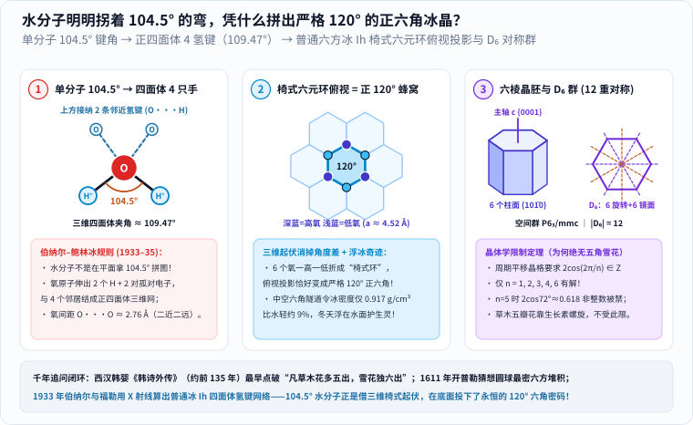
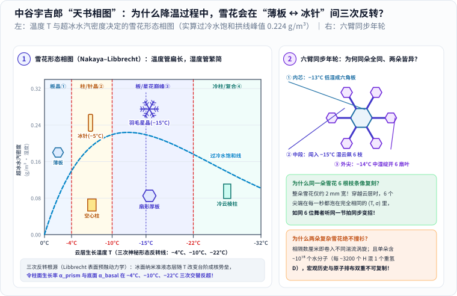
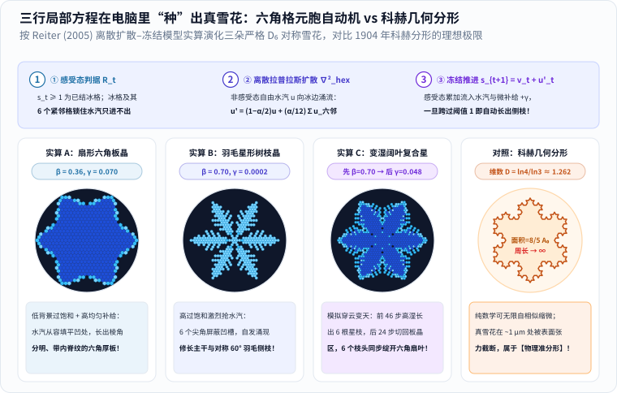
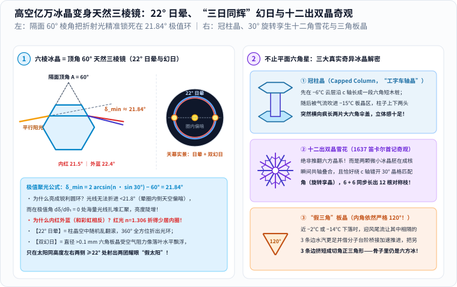

每年冬天第一场大雪落下的时候，如果你把刚飘到深色羽绒服袖口上的一小撮新雪凑近手机微距镜头，大概率会被眼前的景象震住——

没有任何微型圆规，也没有任何纳米刻刀，高空零下十几摄氏度的寒云里，水蒸气居然凭空凝结出了一枚枚棱角如刀切般笔直、六根主枝分毫不差、连侧边细小羽毛都彼此呼应的**六角冰晶**。

但只要稍微追问下去，一连串让人挠头的数学与物理悖论就会接踵而至：

- **第一个谜题（角度错位）**：中学化学课本写得清清楚楚，单个气态水分子（$$\mathrm{H_2O}$$）里，氧原子拉着两个氢原子的共价键夹角是 **$$104.5^\circ$$**——这明明离正五边形的内角（$$108^\circ$$）只有一步之遥！可水分子手拉手结成冰时，凭什么没拼出五角雪花，反而拼出了内角整整 **$$120^\circ$$** 的正六边形？
- **第二个谜题（平坦与分叉互搏）**：有的冰晶像打磨过的宝石一样，长成六条边笔直光滑的实心六角薄板或六棱柱；有的雪花却在同一套晶格上疯狂爆发出千百根 $$60^\circ$$ 羽毛状侧枝。**“把表面修平”**和**“把尖角扯碎”**明明是一对死敌，它们是怎样在同一片雪花上联手创作的？
- **第三个谜题（三次诡异反转）**：把水汽放进冷室慢慢降温，$$-2^\circ\mathrm{C}$$ 长六角薄板，降到 $$-5^\circ\mathrm{C}$$ 突然变成细长冰针，降到 $$-15^\circ\mathrm{C}$$ 又突然变回巨大的平面六角星花，低于 $$-22^\circ\mathrm{C}$$ 居然再一次变回棱柱！只变温度、不改化学成分，生长方向凭什么连续**三次掉头反转**？
- **第四个谜题（六臂同步与举世无双）**：既然人们常说“世界上没有两片完全相同的雪花”，那凭什么**同一片雪花的 6 根树枝**没有各自乱长，而是在相隔两毫米的六个方向上长出了几乎一模一样的分叉？

今天，我们就顺着人类两千年来一步步揭开雪花底牌的科学侦探线，从单个水分子的四面体氢键出发，把拉普拉斯扩散方程、中谷宇吉郎相图、三行代码“种雪花”的六角元胞自动机，一直算到天幕上的 **$$22^\circ$$ 日晕与“三日同辉”幻日**，一次读透藏在一片雪花里的数学与物理铁律。

---

## 一、跨越两千年的追问：水分子明明是 104.5°，凭什么“雪花独六出”？

### 1. 从《韩诗外传》“雪花独六出”到开普勒堆炮弹：没有X射线的年代，古人看穿了什么？

在人类科学史上，最早白纸黑字指出雪花“六重对称”奥秘的文献，诞生在距今两千一百多年前的中国西汉。

大约公元前 135 年，汉文帝与汉景帝时期的学者**韩婴**在《韩诗外传》中写下了一句极其敏锐的观察 [[1]](#ref-1)：

> **“凡草木花多五出，雪花独六出。”**

这句话厉害在哪里？它不仅准确报出了雪花的数字密码“六”，还一针见血地拿它跟植物界最常见的“五瓣花”（梅花、桃花、梨花、苹果花大多是五出）做了对比——暗示**生命生长的几何法则**与**矿物结晶的几何法则**，背后站着两套截然不同的数学统治者！此后从南北朝萧统到南宋朱熹（《朱子语类》尝试拿水数六或霰粒棱角作比附），“六出”干脆成了古典诗词里雪花的代名词。

而在欧洲，真正把“雪花为什么有六个角”变成现代晶体学第一声啼哭的，是我们在[《差了8角分掀翻两千年正圆执念——一文读透开普勒三大定律》]()里熟悉的那位天文学巨匠——**约翰内斯·开普勒（Johannes Kepler）**。

1610 年岁末，住在布拉格的开普勒正想给赞助人瓦克尔·冯·瓦肯费尔斯（Wackher von Wackenfels）挑选一份配得上哲学品味的新年礼物。走过查理大桥时，几片新雪恰好落在他的大衣翻领上——全是端端正正的六角星！开普勒灵光一闪，挥笔写下了一本仅 21 页的拉丁文奇书，于 **1611 年**正式出版：**《论六角雪花》（*Strena seu de Nive Sexangula*）** [[2]](#ref-2)。

在那个连“水由氢和氧组成”都无人知晓的年代，开普勒在书里做了一次极其大胆的几何推理：
1. 他先拿蜂巢、石榴籽和市场上堆放的铅弹做比较：如果在平面上用同样大小的硬圆球紧挨着围住中间一颗圆球，**恰好只能围一圈 6 颗**（正六边形密铺）；如果往三维空间一层层最紧密地堆叠炮弹，也会自然生出六方对称与面心立方骨架——这就是困扰数学界近四百年、直到 1998–2014 年才由托马斯·黑尔斯（Thomas Hales）借助计算机形式化彻底证完的**“开普勒球体最密堆积猜想”** [[2]](#ref-2)！
2. 不过，我们必须严格区分**“天才的几何直觉”**与**“真实的物理机制”**：开普勒自己也在书末坦白，光靠等大圆球紧密堆叠，虽然能解释六角底盘，却无法解释雪花为什么是扁平薄片、更解释不了六根枝条上为什么长满羽毛；他只能把这归结为大地水汽里的某种“塑形之力（facultas formatrix）”。此后 **1637 年笛卡尔**在《气象学》（*Les Météores*）中首次手绘出十二角雪花与带帽棱柱，**1665 年罗伯特·胡克**在《显微术》中用早期显微镜画下雪花侧枝，**1885 年 1 月 15 日**美国佛蒙特州农夫**威尔逊·本特利（Wilson "Snowflake" Bentley）**把显微镜接在大画幅暗箱相机上拍下人类第一张雪花显微照片（一生拍下超 5,000 片） [[3]](#ref-3)——可真正解开“$$104.5^\circ$$ 水分子如何拼出 $$120^\circ$$ 六边形”的底牌，人类一直等到了 **1933 年的量子化学与 X 射线衍射**。

_按 ①→②→③ 顺序跟读雪花六角对称的微观破案链：① 气态水分子虽是 $$104.5^\circ$$，但氧原子靠 2 个共价氢与 2 对孤对电子伸出“四只手”，与周围 4 个氧结成夹角约 $$109.47^\circ$$ 的三维正四面体；② 6 个氧原子一高一低折成三维“椅式六元环”，消去立体倾角后，在底面俯视投影恰好变成严格 $$120^\circ$$ 的正六角蜂窝（中空通道还让冰比水轻约 $$9\%$$）；③ 宏观晶胚由此继承 $$D_6$$ 二面体对称群（12 个对称变换），并由晶体学限制定理彻底封杀五角单晶。[单独打开大图](/assets/images/snowflake-ice-math-physics/water-tetrahedron-to-hexagonal-ice.svg)。_

### 2. 角度破案：$$104.5^\circ \to 109.47^\circ \to 120^\circ$$——三维椅式环怎样“折”出正六边形？

很多人之所以觉得“$$104.5^\circ$$ 拼不出 $$120^\circ$$”，是因为下意识把水分子当成了**铺在桌面上的平面积木**。一旦回到三维量子轨道，谜团当场迎刃而解！

1933 年，英国物理学家**约翰·德斯蒙德·伯纳尔（J. D. Bernal）**与**拉尔夫·福勒（R. H. Fowler）**结合 X 射线晶体衍射数据，在《化学物理杂志》上确立了常压普通冰——即**六方冰 $$\mathrm{I_h}$$**（空间群 $$P6_3/mmc$$，晶格常数 $$a \approx 4.52\ \text{\AA}$$，$$c \approx 7.36\ \text{\AA}$$）的微观模型 [[4]](#ref-4)；两年后（1935 年），诺奖化学家**莱纳斯·鲍林（Linus Pauling）**进一步算出氢原子无序排布带来的残余熵 $$S_0 = R\ln(3/2)$$ [[5]](#ref-5)。

跟着上图左、中两栏，我们只需算三步几何账：

1. **第一步（从 $$104.5^\circ$$ 到三维正四面体 $$109.47^\circ$$）**：在单个水分子中，氧原子最外层有 8 个价电子（$$sp^3$$ 杂化），其中两对电子与两个氢原子结成共价键（气态下孤对电子排斥稍强，把 $$\mathrm{H-O-H}$$ 键角挤成 $$104.5^\circ$$），另外**两对孤对电子**则朝背侧另外两个方向鼓出负电耳朵。当水降温结晶时，每个氧原子一方面伸出自己的 2 个带部分正电的氢去吸别人，另一方面用自己的 2 对孤对电子接纳邻居伸来的 2 个氢——**整整“四只手”向三维空间最均匀地张开**（固态冰中受周围氢键拉拽，键角进一步舒展逼近理想正四面体中心角）：

$$
\theta_{\text{tet} } = \arccos\left(-\frac{1}{3}\right) \approx 109.47^\circ
$$

   这就是著名的**伯纳尔—鲍林冰规则（Ice Rules）**：每颗氧原子与周围 4 颗氧原子距离约 $$l = 2.76\ \text{\AA}$$，每条 $$\mathrm{O\cdots O}$$ 连线上有且仅有一个氢原子，满足“二近二远” [[4]](#ref-4)[[5]](#ref-5)。
2. **第二步（为什么 $$109.47^\circ$$ 的三维六元环俯视是 $$120^\circ$$？）**：拿 6 根夹角 $$109.47^\circ$$ 的积木怎么围成一圈？在平面上围，内角和需要 $$720^\circ$$（每个角 $$120^\circ$$），肯定差了一截；但只要让这 6 颗氧原子**“一高一低、交替上下起伏”**，折成有机化学里环己烷同款的**三维椅式六元环（Chair-form Hexagonal Ring）**，奇迹就发生了！
   设椅式环上相邻两颗氧原子的高度差为 $$\Delta z$$，三维键长为 $$l$$，俯视投影在水平面 `(0001)` 上的正六边形边长为 $$r_{\perp}$$。利用正四面体几何关系 $$\Delta z = l/3$$，勾股定理立刻给出水平投影键长：

$$
r_{\perp} = \sqrt{l^2 - (\Delta z)^2} = l\sqrt{1 - \frac{1}{9} } = \frac{2\sqrt{2} }{3}\,l
$$

   让我们验算一下三维空间里相邻两条键 $$\vec{u}_1 = (-r_{\perp}\cos 30^\circ,\,-r_{\perp}\sin 30^\circ,\,\Delta z)$$ 与 $$\vec{u}_2 = (r_{\perp}\cos 30^\circ,\,-r_{\perp}\sin 30^\circ,\,\Delta z)$$ 的真实三维夹角余弦（注意它们在水平面上的夹角已经是严格的 **$$120^\circ$$**！）：

$$
\cos\theta_{3\mathrm{D} } = \frac{\vec{u}_1 \cdot \vec{u}_2}{l^2} = \frac{r_{\perp}^2 \cos 120^\circ + (\Delta z)^2}{l^2} = \frac{\frac{8}{9}\left(-\frac{1}{2}\right) + \frac{1}{9} }{1} = -\frac{1}{3} \implies \theta_{3\mathrm{D} } = 109.47^\circ\text{！}
$$

   代回实测氧间距 $$l = 2.76\ \text{\AA}$$，晶胞横向周期 $$a = 2 r_{\perp}\cos 30^\circ = \sqrt{\frac{8}{3} }\,l \approx 4.51\ \text{\AA}$$，与 X 射线实测值 **$$4.52\ \text{\AA}$$** 严丝合缝！**三维世界里的 $$109.47^\circ$$ 起伏折线，一旦沿主轴 $$c$$ 俯视投影，不多不少，正好是一张每个内角严格等于 $$120^\circ$$ 的正六角蜂窝网！**
3. **顺手附赠的生命奇迹（为什么冰会浮在水面上？）**：我们在[《为什么地球能孕育生命？》]()里提到过水的反常膨胀——看一眼上图中间那圈宽敞的中空六角隧道你就全明白了！液态水里氢键不断断裂重组，水分子可以挤进彼此空隙（$$4^\circ\mathrm{C}$$ 密度 $$1.000\ \mathrm{g/cm^3}$$）；一旦结成六方冰 $$\mathrm{I_h}$$，正四面体骨架强行把六角通道撑开，密度骤降到 **$$0.917\ \mathrm{g/cm^3}$$**（体积膨胀约 $$9\%$$）。正因为冰轻浮在湖面充当隔热棉被，地球江河湖海才没有从水底往上冻成死寂冰坨！

### 3. 为什么遍地五瓣桃花，却绝无“五角单晶雪花”？$$D_6$$ 群与晶体学限制定理

既然韩婴两千年前就问过“凡草木花多五出，雪花独六出”，我们可以从现代数学正面给出终极判决。

在[《群论和集合，以及那些数学家》]()中我们学过，衡量一个图形“有多对称”，要数所有让它与自身完全重合的刚体变换构成的**对称群**。一片理想平面雪花的对称群叫做**六阶二面体群 $$D_6$$**，一共包含 **$$\lvert D_6 \rvert = 12$$** 个对称操作：
- **6 个旋转操作**：绕中心转 $$0^\circ, 60^\circ, 120^\circ, 180^\circ, 240^\circ, 300^\circ$$；
- **6 个镜面反射操作**：沿穿过 3 对相对尖角的直线翻折，或沿穿过 3 对相对平边中点的直线翻折。

那为什么周期性单晶绝对长不出五重旋转对称（$$n = 5$$，旋转 $$72^\circ$$）？**晶体学限制定理（Crystallographic Restriction Theorem）**用三行线性代数就能把门彻底焊死：

假设三维空间里有一套具有平移周期性的无限晶格（比如所有氧原子平衡位置的格点集合 $$\Lambda$$）。如果整个晶格绕某根轴旋转 $$\theta = \frac{2\pi}{n}$$ 后依然与原晶格完全重合，那么在这套晶格的三个基向量张成的整数坐标下，这个旋转变换对应的 $$3\times 3$$ 矩阵 $$M$$ 只能包含**整数元素**，因此它的迹（对角线元素之和）必定是整数！而矩阵的迹在任何坐标系下都不变；切到旋转轴为 $$z$$ 轴的正交坐标系写出标准旋转矩阵，它的迹就是：

$$
\operatorname{tr}(M) = 1 + 2\cos\left(\frac{2\pi}{n}\right) \in \mathbb{Z} \implies 2\cos\left(\frac{2\pi}{n}\right) \in \{-2,\,-1,\,0,\,1,\,2\}
$$

把正整数 $$n$$ 挨个代进去验算：
- $$n = 1, 2, 3, 4, 6$$ 时，$$2\cos(2\pi/n)$$ 分别等于 $$2, -2, -1, 0, 1$$——**全是整数，合法放行！**
- 而当 **$$n = 5$$**（正五边形，$$72^\circ$$）时，$$2\cos 72^\circ = \frac{\sqrt{5}-1}{2} \approx 0.618$$ 是黄金分割无理数；当 **$$n = 8$$**（正八边形，$$45^\circ$$）时，$$2\cos 45^\circ = \sqrt{2} \approx 1.414$$ 也是无理数！

这意味着：**在周期性平移的普通晶体里，五重对称和八重对称从数学根基上就被开除了户籍**（注：1982 年丹·谢赫特曼发现并获 2011 年诺贝尔化学奖的“准晶 Quasicrystals”之所以能有五重/十重衍射斑，恰恰是因为它牺牲了周期平移性，改走彭罗斯非周期拼砖；而常压水冰是规规矩矩的周期性晶体 $$\mathrm{I_h}$$）。反观桃树、梅树开五瓣花，靠的是分生组织顶端生长素按黄金角 $$\approx 137.5^\circ$$ 螺旋排布（斐波那契叶序，5 是斐波那契数），根本不受晶格平移束缚——韩婴两千年前的一句感叹，竟然横跨了植物发育学与晶体群论两座大山！

---

## 二、每片雪花都在打一场拔河赛：“抹平棱面”与“尖端疯长”如何联手雕出六角星？

弄懂了底层晶格是 $$120^\circ$$ 蜂窝，其实只回答了一半问题：**厨房里的食盐晶格是正方体，长出来也就是一颗颗无聊的实心小方块；为什么冰晶有时候是实心六角薄板，有时候却能爆发出成百上千根羽毛一样的华丽树枝？**

加州理工学院物理学家、当代雪花物理权威**肯尼思·利布雷希特（Kenneth G. Libbrecht）**在其 2005 年经典综述《雪花晶体的物理学》中点破了天机 [[6]](#ref-6)：**每一朵雪花的诞生，都是“分子台阶晶面化（Faceting）”与“水汽扩散分枝失稳（Branching Instability）”两股相反物理力量贴身拔河的结果！**

_左右对照阅读雪花成形的核心拔河：① 左图是“守秩序派”——水分子落在光滑晶面上仅抓 1 根键极易弹走，落在分子台阶凹角处却能双面锁死迅速填平缺口，导致粗糙圆弧飞速长满消失，只留下 6 条刀切般笔直的慢速晶面；② 右图是“破秩序派”——按二维拉普拉斯方程 $$\nabla^2 c = 0$$ 实算等水汽浓度线，6 个尖角探入浓水汽区令等值线剧烈挤密（法向梯度翻倍），触发越凸越快的马林斯—塞克卡分枝失稳（含单次播放生长动画，开启系统减少动态效果则直接展示完整六枝形态）。[单独打开大图（刷新可重播单次生长动画）](/assets/images/snowflake-ice-math-physics/faceting-vs-mullins-sekerka-branching.svg)。_

### 1. 守秩序的力量：分子台阶成核势垒——为什么“长得最慢的面”反而留到最后？

云层里一颗直径几微米的过冷小水滴刚冻结成冰胚时，外形其实接近一颗**圆球**。是谁拿隐形刨刀把它刨成了棱角笔直的正六棱柱？

看上图左半部分。在分子尺度上，顺着蜂窝晶格切出的底面 `{0001}` 和六个侧面 `{10-10}` 是整整齐齐的**光滑分子平台（Terrace）**；而斜着切出的圆弧表面，则布满了锯齿状的**分子台阶与凹角（Step & Kink）**。

水蒸气分子以每秒数百米的热运动撞向冰面，法向生长速度遵守赫兹—克努森（Hertz–Knudsen）动力学公式 [[6]](#ref-6)：

$$
v_n = \alpha \, v_{\text{kin} } \, \sigma_{\text{surf} }
$$

其中 $$\sigma_{\text{surf} } = (c_{\text{surf} } - c_{\text{eq} }) / c_{\text{eq} }$$ 是冰面紧邻处的局部水汽过饱和度，$$v_{\text{kin} }$$ 是热运动速率因子，最关键的则是无量纲的**分子附着系数 $$\alpha \in (0, 1]$$**（撞上来的水分子有多大概率留下来不跑掉）：

- **在粗糙圆弧/台阶凹角处（$$\alpha \approx 1$$）**：掉进凹角的水分子当场就能跟侧面和底面同时抓牢 2–3 根氢键，几乎来一个粘一个，飞速向外推进；
- **在光滑平整的 `{0001}` 或 `{10-10}` 晶面上（$$\alpha \ll 1$$）**：一颗孤零零落到光滑冰面中央的水分子只能勉强抓 1 根氢键，微秒之内就会被热振动重新踢回空气！要想在光滑面上新铺一层冰，必须靠好几颗水分子碰巧撞在一起抱团跨过**二维成核势垒（2D Nucleation Barrier）**，才能生出新台阶。

这就导出了晶体生长里一条看似反直觉、实则铁板钉钉的黄金法则——**“谁长得快，谁就先把自己长没了！”**粗糙斜角拼命往外填，几秒钟就把缺口全部填满，最后暴露在最外面的，必然只剩下那 2 个上下底面和 6 个侧面——因为它们长得最慢，像六道堤坝一样把冰胚锁成了笔直的 **$$120^\circ$$ 正六棱柱**！

### 2. 破秩序的力量：拉普拉斯扩散、伯格效应与马林斯—塞克卡分枝失稳

既然冰晶天然爱修成平直六边形，为什么它又会突然“炸毛”长成树枝？罪魁祸首只有四个字：**空气挡路！**

如果把冰晶放在纯水蒸气真空罐里，水分子畅通无阻撞向冰面，根本长不出羽毛状雪花，只会结出敦实的六棱冰块 [[6]](#ref-6)。可在真实地球大气里，水蒸气分子占空气总分子数连 **$$1\%$$** 都不到——其余 $$99\%$$ 全是氮气和氧气！冰晶每吞掉附近一层水分子，远处的替补水分子就必须在氮氧分子阵里跌跌撞撞挤过来，服从我们在[《傅里叶怎样把温度拆成波？》]()里熟悉的**扩散方程**：

$$
\frac{\partial c}{\partial t} = D \nabla^2 c
$$

其中 $$c(\vec{r}, t)$$ 是水汽浓度，空气中水汽扩散系数 $$D \approx 2 \times 10^{-5}\ \mathrm{m^2/s}$$。因为冰固体的密度（$$\sim 9.17\times 10^5\ \mathrm{g/m^3}$$）比云中过饱和水汽密度（$$\sim 0.2\ \mathrm{g/m^3}$$）大了整整**几百万倍**，冰界面推进的速度远慢于水汽扩散重排的速度，因此冰晶外围的水汽场几乎时刻处于准稳态**拉普拉斯方程（$$\nabla^2 c \approx 0$$）**！

现在请看上图右半部分那组实算的彩色等水汽浓度线（物理上它跟“避雷针尖端电场线拥挤”完全遵循同一个方程！）：
1. **第一步（伯格效应 Berg Effect）**：正六边形的 6 个尖角比 6 条平边中心往外多探出了约 $$15.5\%$$（$$\sec 30^\circ \approx 1.1547$$），离远处充沛的水汽仓库更近。我们在二维极坐标下给半径 $$R_0$$ 的晶胚加一圈六重微凸起 $$r_b(\theta) = R_0(1 + \varepsilon\cos 6\theta)$$，拉普拉斯方程 $$\nabla^2 c = 0$$ 的外域调和解为 $$c(r,\theta) \propto \ln(r/R_0) - \varepsilon (R_0/r)^6 \cos 6\theta$$。求导一算界面法向浓度梯度 $$\lvert\nabla c\rvert$$：

$$
\frac{\lvert\nabla c\rvert_{\text{尖角} } }{\lvert\nabla c\rvert_{\text{凹槽} } } \approx \frac{1 + 5\varepsilon}{1 - 5\varepsilon}
$$

   看清楚前面那个系数 **$$5$$** 了吗（源于六重谐波 $$n - 1 = 6 - 1 = 5$$）！哪怕尖角仅仅往外多鼓出微不足道的 **$$\varepsilon = 8\%$$**，尖角处等浓度线的拥挤程度（即水汽供货通量 $$J = D\lvert\nabla c\rvert$$）就会达到平凹处的 **$$\frac{1+0.4}{1-0.4} \approx 2.33\text{ 倍}$$**！
2. **第二步（马林斯—塞克卡正反馈失稳）**：1963 年，美国材料物理学家**威廉·马林斯（W. W. Mullins）**与**罗伯特·塞克卡（R. F. Sekerka）**发表了著名的界面形态稳定性理论 [[7]](#ref-7)：**尖角抢到的水汽多 $$\to$$ 尖角长得更快 $$\to$$ 尖角往浓水汽区戳得更远 $$\to$$ 把两侧平边的水汽彻底“截胡屏蔽”（扩散阴影效应）**！很快，6 个尖角脱缰而出变成 6 根主树枝；而每根主树枝向前延伸时，侧面凸起又受底层晶格 `{10-10}` 取向牵引，不断沿 **$$60^\circ$$** 方向爆发出次级羽毛侧枝！

### 3. 为什么尖端不会削成“无限细的原子针”？吉布斯—汤姆孙曲率刹车

看到这里，爱较真的读者一定会追问：既然“越尖抢水汽越猛”，正反馈失控下去，树枝尖端岂不是会越削越细，最后削成只有几个原子宽的无限细针？

大自然在微米尺度上准备了一脚精准的物理刹车——**吉布斯—汤姆孙效应（Gibbs–Thomson Curvature Effect）** [[6]](#ref-6)[[7]](#ref-7)！

在弯曲的冰面上，最尖端突出去的水分子周围邻居变少、抓不住足够多的氢键，因此弯曲冰面的**平衡饱和水汽压 $$c_{\text{eq} }(\kappa)$$** 会随界面曲率 $$\kappa = 1/r_{\text{tip} }$$ 升高：

$$
c_{\text{eq} }(\kappa) = c_{\text{eq} }(0)\bigl(1 + d_0 \kappa\bigr)
$$

其中毛细长度 $$d_0 = \frac{\gamma_{\text{surf} } \Omega}{k_B T} \sim 1\ \mathrm{nm}$$（$$\gamma_{\text{surf} }$$ 为冰—气表面张力，$$\Omega$$ 为单分子体积）。一旦树枝尖端削得太尖（曲率半径 $$r_{\text{tip} }$$ 太小），尖端自己的蒸发压就会飙升到跟周围云层水汽一样高，再也吸不进水汽！**扩散失稳想把尖端削细，表面张力想把尖端抹钝**，两股力量在 **$$r_{\text{tip} } \sim 1\text{–}5\ \mu\mathrm{m}$$（微米级抛物线尖端）** 处握手言和——于是，雪花既拥有刀锋般分明的 $$60^\circ$$ 棱面，又拥有恰到好处的微米级羽毛枝尖！

---

## 三、一根兔毛破译“来自天空的信”：为什么降温时冰晶会在“薄板 ↔ 冰针”间三次反转？

弄清了“棱面 vs 分枝”的左右手互搏，接下来我们要直面雪花物理学史上最传奇、也最诡异的一张图。

### 1. 中谷宇吉郎的兔毛冷室与“天书相图”：温度管扁长，湿度管繁简

在 1930 年代以前，哪怕本特利拍下了五千多张绝美雪花照片，人类依然不知道**到底是什么样的云层条件造出了什么样的雪花**——因为没人能跟着一片雪花在几千米高空飞半个小时！

1932 年，日本物理学家**中谷宇吉郎（Ukichiro Nakaya）**来到大雪纷飞的北海道帝国大学。没有昂贵的粒子加速器，他就利用北海道天然的严寒建立低温实验室，在对流冷室里试遍了棉线、丝线、蛛丝和铜丝（不是挂不住水汽，就是结满杂乱冰霜），最终发现**脱脂兔毛**表面细微的鳞片结节是完美的冰晶成核底座！**1936 年 3 月 12 日**，中谷宇吉郎在人类历史上**第一次用人工可控的温度与湿度，在实验室里“种”出了真雪花** [[8]](#ref-8)！

经过上千次冷室培育，中谷宇吉郎绘出了震撼气象学界的**雪花形态相图（Nakaya Morphology Diagram）**，并留下了一句传世名言 [[8]](#ref-8)：

> **“雪花是从天空寄来的信（雪は天から送られた手紙である）。”**——每一朵雪花的几何形状，都用密码写满了高空云层的温度与湿度！

_左图按精确热力学公式绘出过冷水相对冰面的超额水汽密度拱线（在 $$-12.3^\circ\mathrm{C}$$ 附近达峰值 $$0.224\ \mathrm{g/m^3}$$），标出 $$0^\circ\mathrm{C} \to -32^\circ\mathrm{C}$$ 间令人称奇的三次板/柱形态大反转（$$-4^\circ\mathrm{C}$$、$$-10^\circ\mathrm{C}$$、$$-22^\circ\mathrm{C}$$）与 $$-15^\circ\mathrm{C}$$ 羽毛星晶巅峰带；右图展示单片 $$2\ \mathrm{mm}$$ 雪花穿越三团云层时如何六臂同步刻下“生长年轮”，以及两朵复杂雪花为何绝难撞衫。[单独打开大图](/assets/images/snowflake-ice-math-physics/nakaya-morphology-diagram-and-cloud-journey.svg)。_

跟着上图左栏的坐标轴，你只需记住两条口诀，以后下雪天低头看一眼袖口就能当场“破译天书”：

- **纵轴（过饱和度 / 超冰水汽密度 $$\Delta\rho_v$$）决定“简单还是繁复”**：
  - 湿度低（靠近底部横轴）$$\implies$$ 生长慢，晶面平滑化赢，全是老老实实的**实心六角薄板或实心六棱柱**；
  - 湿度高（越过蓝色虚线“过冷水饱和拱线”）$$\implies$$ 为什么蓝色虚线在 **$$-12^\circ\mathrm{C} \sim -15^\circ\mathrm{C}$$** 高高拱起？根据克劳修斯—克拉佩龙方程，在零下同一温度，过冷液态水滴表面的饱和水汽压高于冰面（贝吉龙效应 Bergeron Process），两者之差 $$\Delta\rho_{v,\text{w}-\text{i} }(T)$$ 恰好在 **$$-12.3^\circ\mathrm{C}$$ 附近达到全大气层最高峰 $$\approx 0.224\ \mathrm{g/m^3}$$（$$-15^\circ\mathrm{C}$$ 时仍高达 $$0.219\ \mathrm{g/m^3}$$）**！燃料最旺叠加棱边锐化，于是体积最大、分枝最繁复的**巨型羽毛状六角星晶**，几乎清一色诞生在 **$$-15^\circ\mathrm{C}$$ 左右**的浓密过冷水云团里！
- **横轴（云层温度 $$T$$）决定“扁平圆盘还是细长柱子”——而且连续反转三次！**
  1. **$$0^\circ\mathrm{C} \sim -4^\circ\mathrm{C}$$**：侧面 `{10-10}` 长得比上下底面 `{0001}` 快 $$\implies$$ 长成扁平**六角薄板**；
  2. **$$-4^\circ\mathrm{C} \sim -10^\circ\mathrm{C}$$（第 1 次反转！）**：突然掉头！上下底面沿主轴 $$c$$ 疯长，侧面几乎停工 $$\implies$$ 长成**空心六棱柱与细长冰针（$$-5^\circ\mathrm{C}$$ 附近最细长）**；
  3. **$$-10^\circ\mathrm{C} \sim -22^\circ\mathrm{C}$$（第 2 次反转！）**：再一次掉头！侧面速率重新碾压底面，且在 $$-15^\circ\mathrm{C}$$ 触发棱边锐化失稳（Edge-Sharpening Instability） $$\implies$$ 长成极薄、极宽的**扇形板与华丽六角星花**；
  4. **低于 $$-22^\circ\mathrm{C}$$（第 3 次反转！）**：第三次掉头！重新变回高寒卷云里的**实心/空心六棱柱、子弹玫瑰晶与复合柱板**！

### 2. 困扰物理学界半个世纪的悬案：为什么只降几度温，长向会掉头三次？

实话实说，这三次反转（$$-4^\circ\mathrm{C}$$、$$-10^\circ\mathrm{C}$$、$$-22^\circ\mathrm{C}$$）哪怕放到 21 世纪的凝聚态物理里，依然是一道极其迷人的硬骨头 [[6]](#ref-6)[[9]](#ref-9)！

为什么？因为水冰晶格从 $$0^\circ\mathrm{C}$$ 到 $$-40^\circ\mathrm{C}$$ 始终是同一个六方冰 $$\mathrm{I_h}$$，既没有发生体相变，也没有改变化学键！利布雷希特等学者通过高精度激光干涉生长实验证实 [[6]](#ref-6)[[9]](#ref-9)：根源藏在**冰表面仅几纳米厚的“表面预融准液态层（Quasi-Liquid Layer, QLL）”与台阶成核势垒的各向异性交叉**里——

哪怕在零下十几摄氏度，冰晶最外层的一两层水分子由于缺少外侧氢键束缚，并不是死板冻结的，而是处于半流动的“准液态预融”状态。但**底面 `{0001}`** 和**柱面 `{10-10}`** 分子排布不同，它们发生表面结构重排和预融软化的临界温度并不同步！结果随着温度 $$T$$ 一路下降，底面附着系数 $$\alpha_{\text{basal} }(T)$$ 与柱面附着系数 $$\alpha_{\text{prism} }(T)$$ 对应的二维成核势垒高低交替起伏，两条曲线在 $$-4^\circ\mathrm{C}$$、$$-10^\circ\mathrm{C}$$ 和 $$-22^\circ\mathrm{C}$$ 附近发生了**三次交叉反超**（目前宏观动力学测量已相当清晰，而原子级分子动力学如何精确复现全部三个交叉点，仍是表面物理活跃的研究前沿 [[9]](#ref-9)）。

### 3. 终极哲学之问：为什么同一朵雪花六臂如复刻，而世上难觅两朵真双胞胎？

现在，我们可以一锤定音地回答开头最让人着迷的那个问题了！请看上图右栏那朵带有三层“年轮”的雪花：

1. **为什么同一朵雪花的 6 根树枝长得像复印出来的？**
   答案既不是第 1 根树枝给第 4 根树枝打了电话，也不是什么神秘量子纠缠，而是**尺度与同步性**！一整朵雪花的直径通常只有 **$$1\text{–}4\ \mathrm{mm}$$**，远小于云层里温湿度起伏的湍流微尺度。当它在云海里上下翻飞时，在每一个毫秒，它的 6 个尖端都浸泡在**一模一样的温度 $$T(t)$$ 和湿度 $$\sigma(t)$$** 里！
   - 第 1 分钟在 $$-13^\circ\mathrm{C}$$ 低湿区：6 条边同步慢长成正六角内芯；
   - 第 5 分钟被上升气流抛进 $$-15^\circ\mathrm{C}$$ 浓湿云团：6 个尖角在同一刻收到“加速分枝”指令，同步飙出 6 根等长主干；
   - 第 12 分钟飘进 $$-14^\circ\mathrm{C}$$ 中湿区：6 根枝头又在同一刻收到“转回板晶”指令，同步绽开 6 片六角扇叶！
   **6 根树枝就像 6 位蒙着眼睛、却听着同一首交响乐节拍起舞的舞者——曲谱历史 $$(T(t),\,\sigma(t))$$ 完全相同，6 支舞自然高度一致**（细看真实显微照片，左右两臂偶尔还是会因为局部微气流或撞上过冷云滴而有一点点微小不对称）。
2. **那“世界上真没有两片完全相同的雪花”吗？这要分宏观光学和原子尺度两层说！**
   - **在原子尺度上，绝对没有！**一片直径 $$2\ \mathrm{mm}$$、重约 $$10^{-5}\ \mathrm{g}$$ 的典型星状雪花，大约含有 **$$3 \times 10^{17} \sim 10^{18}$$ 个水分子**。地球天然水里每约 **$$3{,}200$$ 个普通氢原子（$$\mathrm{^1H}$$）**就随机混着 **$$1$$ 个重氢氘原子（$$\mathrm{D}$$）**，每约 $$500$$ 个 $$\mathrm{^{16}O}$$ 里还混着 $$1$$ 个重氧 $$\mathrm{^{18}O}$$。光把这 $$10^{14}$$ 量级的重氢原子随机塞进 $$10^{18}$$ 个晶格位点，可能的组合数就高达 $$10^{(10^{14})}$$ 量级——把宇宙诞生 138 亿年来下过的所有雪花（约 $$10^{34}$$ 片）全算上，撞衫概率依然是严格的 **0**！
   - **在光学显微镜外观上，要看繁简！**如果是落入不同湍流涡旋、历时 45 分钟长出上百个分叉的**复杂树枝星晶**，哪怕初始相距只有 10 厘米，两条云中轨迹 $$(T_A(t),\sigma_A(t))$$ 与 $$(T_B(t),\sigma_B(t))$$ 也早已分道扬镳，长出来的花纹天差地别。不过在 **1988 年**，美国国家大气研究中心（NCAR）科学家**南希·奈特（Nancy Knight）**在威斯康星州高空卷云采集中，确实拍到过两颗并排粘在一起、长约 $$0.25\ \mathrm{mm}$$、外观极为相似的**简单空心六棱柱晶**；而利布雷希特也在实验室蓝宝石基板上给两颗紧挨着的晶种喂完全相同的温湿脉冲，人工种出过惊艳的**“实验室孪生雪花（Identical-Twin Designer Snowflakes）”** [[6]](#ref-6)！

---

## 四、三行局部方程在电脑里“种”出真雪花：元胞自动机 vs 科赫几何分形

既然物理学家已经摸透了“六角晶格 + 边界冻结锁水汽 + 空气拉普拉斯扩散”这套规则，数学家立刻摩拳擦掌：**能不能不靠手工画图，直接在电脑里写几行纯数学局部方程，让一颗种子自己“长”出一朵千姿百态的六角雪花？**

### 1. 科赫雪花（1904）的美丽误会：真雪花是严格的数学分形吗？

一提起“雪花的数学公式”，很多人第一反应是 1904 年瑞典数学家**海里格·冯·科赫（Helge von Koch）**构造的那条著名曲线——**科赫雪花（Koch Snowflake）** [[10]](#ref-10)。

它的造法极其优雅：拿一个边长为 $$L_0$$、面积为 $$A_0$$ 的正三角形（第 $$0$$ 步），把每条边三等分，将中间那一段向外折成等边三角形的两条腰（$$1$$ 段变 $$4$$ 段，每段长 $$1/3$$），无限重复下去：
- 第 $$k$$ 步总边数 $$N_k = 3 \cdot 4^k$$，总周长 $$L_k = 3 L_0 \left(\frac{4}{3}\right)^k \xrightarrow{k\to\infty} \infty$$（**周长发散到无穷大，处处连续却处处不可导！**）；
- 但它围住的总面积却是有限收敛的等比级数：

$$
A_\infty = A_0 \left(1 + \frac{3}{9} + \frac{3\cdot 4}{9^2} + \frac{3\cdot 4^2}{9^3} + \cdots\right) = A_0 \left(1 + \frac{1/3}{1 - 4/9}\right) = \frac{8}{5} A_0
$$

- 每把尺子缩小 $$3$$ 倍，折线段数就翻 $$4$$ 倍，因此它的豪斯多夫分形维数是：

$$
D_{\text{Koch} } = \frac{\ln 4}{\ln 3} \approx 1.2619
$$

然而，用科赫曲线解释真雪花有两个硬伤：① 科赫曲线是用手工几何替换规则“硬画”出来的，没有任何水汽扩散物理；② 数学分形要求放大一亿倍依然一模一样，而真雪花放大到 **$$1\ \mu\mathrm{m}$$（微米）** 就会撞上前面讲过的**吉布斯—汤姆孙表面张力刹车**，变成圆润光滑的冰尖！因此，真雪花在毫米到微米约 3 个数量级内展现出跨尺度结构，属于**物理截断的准分形（Quasi-fractal / Dendrite）**，而非无限自相似的纯几何分形。

### 2. 不用手工画一根树枝：Reiter 六角元胞自动机的三步“生长魔法”

那怎样用真正的物理扩散方程“种”雪花？除了小林亮（Ryo Kobayashi, 1993）著名的连续各向异性相场偏微分方程（引入 $$\cos 6\theta$$ 表面张力各向异性）外，美国拉斐特学院数学家**克利福德·赖特（Clifford A. Reiter）**在 **2005 年**提出了一个惊艳数学界的极简离散模型——**六角晶格雪花元胞自动机** [[11]](#ref-11)（随后扬科·格拉夫纳 Janko Gravner 与大卫·格里菲斯 David Griffeath 在 2008–2009 年进一步将其拓展为能复现全套三维板晶特征的精确物理元胞模型 [[12]](#ref-12)）。

_上图前三朵雪花绝非人工手绘，而是由本博客配图引擎按 Reiter (2005) 离散扩散—冻结方程在正六角晶格上真实逐步迭代算出的数值解（每一格均通过 Python 严格校验 $$D_6$$ 旋转与镜面全对称！）：实算 A（低过饱和 $$\beta=0.36$$、高补给 $$\gamma=0.070$$）自发填平凹陷长成带内脊纹的扇形六角厚板；实算 B（高过饱和 $$\beta=0.70$$）尖端抢水汽长出羽毛状六角星花；实算 C 先按高湿演化 46 步长出星枝，再切换中湿演化 24 步，6 个枝头同步绽开六角扇叶！最右列对照科赫几何分形。[单独打开大图](/assets/images/snowflake-ice-math-physics/reiter-cellular-automaton-snowflakes.svg)。_

最让人拍案叫绝的是，赖特模型在正六角蜂窝网格上**总共只需要三行初等算术**！设每个六边形格子 $$z$$ 在第 $$t$$ 步的水量为实数 $$s_t(z) \ge 0$$（规定 **$$s_t(z) \ge 1$$ 即代表该格已冻结成实心冰**；初始时刻只在正中心点一颗冰种 $$s_0(0) = 1$$，其余所有格子铺满背景水汽 $$s_0(z) = \beta \in (0, 1)$$）：

1. **第 1 行（挑出“感受态”边界 $$R_t$$）**：如果格子 $$z$$ 自己已经是冰（$$s_t(z) \ge 1$$），或者它的 **6 个紧邻六角格里至少有 1 个是冰**，就称 $$z$$ 处于**感受态（Receptive，$$z \in R_t$$）**——代表冰晶本体与紧贴冰面那圈“粘住水分子只进不出”的生长前沿！于是把全场水量一分为二：锁死不参与向外扩散的冰边质量 $$v_t(z)$$，以及外围自由飘荡的水汽 $$u_t(z)$$：

$$
v_t(z) = \begin{cases} s_t(z) + \gamma, & z \in R_t \\ 0, & z \notin R_t \end{cases}, \qquad u_t(z) = \begin{cases} 0, & z \in R_t \\ s_t(z), & z \notin R_t \end{cases}
$$

   （其中小常数 $$\gamma \ge 0$$ 代表从三维上下方微风源源不断补充进来的湿度微补给。）
2. **第 2 行（离散拉普拉斯水汽扩散）**：外围自由水汽 $$u_t$$ 在六角网格上做一步质量严格守恒的离散拉普拉斯扩散（六角格拉普拉斯算子 $$\nabla^2_{\text{hex} } u \propto -6 u(z) + \sum_{w \in N_6(z)} u(w)$$，扩散权重 $$\alpha \approx 1$$）：

$$
u'_t(z) = \left(1 - \frac{\alpha}{2}\right) u_t(z) + \frac{\alpha}{12} \sum_{w \in N_6(z)} u_t(w)
$$

   注意看系数的精妙之处：$$\left(1 - \frac{\alpha}{2}\right) + 6 \times \frac{\alpha}{12} = 1$$，**水汽在扩散过程中一滴都不会凭空多出来或少下去**！而对于紧贴冰面的感受态格子 $$z \in R_t$$，因为 $$u_t(z) = 0$$，它就像一口抽水井一样，单向吞进周围自由空气格分给它的 $$\frac{\alpha}{12}\sum u_t(w)$$！
3. **第 3 行（合体迈入下一步）**：

$$
s_{t+1}(z) = v_t(z) + u'_t(z)
$$

**全剧终！整套代码里没有任何一句 `if 角度 == 60度: 画树枝`！**

可一旦让 Python 把这三行式子跑上七八十步（见上图实算 A、B、C）：
- 当背景水汽较低（$$\beta = 0.36$$）、垂直微补给较足（$$\gamma = 0.070$$）时，凹槽来得及补满，方程自己长出了棱角笔直的**扇形六角板晶（实算 A）**；
- 当背景水汽浓厚（$$\beta = 0.70$$）时，6 个尖角的感受态格子同时挨着 3–4 个富水汽邻居，而平边只挨着 1–2 个——**伯格效应与马林斯—塞克卡失稳从三行加减乘除里自动涌现**，长出了修长优雅的**羽毛状星形树枝晶（实算 B）**；
- 如果我们在第 46 步把参数从高湿切换成板晶模式再跑 24 步，6 个树枝尖端当场**同步绽开六片正六角扇叶（实算 C）**，分毫不差复现了真雪花穿越两层云团的“天气日记”！

---

## 五、把冰晶放到整片天幕：22° 日晕、“三日同辉”幻日与十二出双晶奇观

读到这里，我们已经从 $$10^{-10}\ \mathrm{m}$$ 的氢键算到了 $$10^{-3}\ \mathrm{m}$$ 的单朵雪花。最后一步，让我们抬起头，看看当**几万亿颗直径几十微米的六角冰晶**铺满万米高空的卷层云（Cirrostratus）时，它们会在几百公里宽的天幕上画出怎样的几何神迹！

_左图按斯涅尔折射定律精确追踪平行阳光穿过正六边形冰晶隔面 $$A = 60^\circ$$ 夹角的对称最小偏向角光路（$$\delta_{\min} = 21.84^\circ$$，红光折得少居内圈 $$21.5^\circ$$、蓝紫光折得多居外圈 $$22.4^\circ$$），对比空中乱翻滚柱晶围成的 $$22^\circ$$ 日晕圆环与水平飘浮六角板晶打出的左右“双幻日”；右图拆解冠柱晶、$$30^\circ$$ 旋转孪生十二角雪花及内角仍严格为 $$120^\circ$$ 的空气动力切角三角板晶。[单独打开大图](/assets/images/snowflake-ice-math-physics/ice-crystal-halos-sundogs-and-twins.svg)。_

### 1. 为什么日晕和月晕永远锁死在 22° 左右，而且“内红外蓝”跟彩虹反着来？

很多人在晴朗微寒的白天或满月之夜，都见过太阳或月亮外围套着一圈巨大、规整的彩色光环——**日晕 / 月晕（$$22^\circ$$ Halo）**。你只要伸直手臂并拢五指，大拇指对准太阳遮住强光、小拇指张开到最大（一拃张角恰好约 $$20^\circ\text{–}22^\circ$$），小拇指尖几乎每次都精准戳在那道光环上！

为什么全世界的日晕半径永远锁死在 **$$22^\circ$$**，而不是 $$15^\circ$$ 或 $$30^\circ$$？跟着上图左栏做一道干净利落的几何光学计算：

高空温度低于 $$-25^\circ\mathrm{C}$$ 的卷层云里，飘满了简单的实心**正六棱柱冰晶**。光线穿过正六边形横截面主要有三条路：
1. 穿过**平行相对的两面**（夹角 $$0^\circ$$）：就像穿过普通平窗玻璃，出射光与原方向平行（偏向角 $$0^\circ$$），看不出特殊光环；
2. 穿过**紧挨着的两面**（外延夹角 $$120^\circ$$）：因为冰的折射率 $$n \approx 1.31$$，全反射临界角 $$\theta_c = \arcsin(1/1.31) \approx 49.8^\circ$$，入射到第二面时入射角全部大于 $$49.8^\circ$$，发生全反射出不来！
3. 穿过**相隔一面的两条侧面**（上图左栏虚线向上延长，正好交成顶角 **$$A = 60^\circ$$ 的天然等边三棱镜**！）：根据斯涅尔折射定律 $$\sin\theta_1 = n\sin\theta_2$$，当晶体内折射光路与底边平行对称（$$\theta_2 = A/2 = 30^\circ$$）时，总偏向角 $$\delta(\theta_1)$$ 取得极小值——**最小偏向角 $$\delta_{\min}$$**：

$$
\delta_{\min} = 2\arcsin\left(n \sin\frac{A}{2}\right) - A = 2\arcsin\bigl(1.310 \times \sin 30^\circ\bigr) - 60^\circ = 2\arcsin(0.655) - 60^\circ \approx 21.84^\circ \approx 22^\circ\text{！}
$$

这一个式子一口气解开了四个天象细节：
- **为什么会聚成一道亮圈，且圈内天空偏暗？**因为 $$\delta_{\min} = 21.84^\circ$$ 是绝对下限，**没有任何折射光能折进小于 $$21.8^\circ$$ 的内圈**，所以日晕圆环内侧看起来比外侧更暗；而在极小值点附近导数 $$\mathrm{d}\delta / \mathrm{d}\theta_1 = 0$$，稍微转一点角度的冰晶折射出来的光全扎堆挤在 $$22^\circ$$ 附近（焦散聚光效应），亮度陡增！
- **为什么日晕是“内红外蓝”，跟雨后彩虹（外红内紫）正好相反？**雨后主虹在水滴里经历了一次内反射，而日晕是纯三棱镜折射：冰对**红光**折射率较小（$$n_{\text{red} } \approx 1.306 \implies \delta_{\min} \approx 21.54^\circ$$），折得少所以贴在**内圈**；对**蓝紫光**折射率较大（$$n_{\text{blue} } \approx 1.317 \implies \delta_{\min} \approx 22.37^\circ$$），折得多散在外侧（且被内圈较偏角度的各色光叠加冲淡成偏白亮边，唯有内圈一抹暗红最鲜明）！顺便一提，如果光线穿过柱晶侧面与垂直底面（顶角 $$A = 90^\circ$$），代入同一个公式还能算出罕见的 **$$46^\circ$$ 外晕**：$$2\arcsin(1.31 \sin 45^\circ) - 90^\circ \approx 45.7^\circ$$！
- **“$$22^\circ$$ 完整圆环” vs “三日同辉（双幻日 Sundogs）”差在哪？**全看冰晶在空中**怎么翻跟头**！
  - 如果高空是细小的**六棱柱晶**，下落时朝各个方向随机乱翻滚，360 度全方位都有冰晶恰好对准最小偏向角，于是围成一整圈 **$$22^\circ$$ 日晕**；
  - 如果高空是直径大于 $$0.1\ \mathrm{mm}$$ 的扁平**六角板晶**，空气阻力（雷诺数流体力矩）会让它们像秋天的落叶一样**全部端端正正水平飘浮**（主轴 $$c$$ 竖直朝天）！这样一来，六条竖直侧面只能在水平方向左右折射阳光，把巨量光芒集中打在**与太阳同一高度、左右两侧各约 $$22^\circ$$**（太阳升高时略向外推宽）的两个耀眼彩斑上——这就是古书里常被惊呼为“三日并出”的**双幻日（Parhelia / Sundogs）**！

### 2. 打破“雪花只有平面六角星”的刻板印象：三大真实奇异冰晶

文章最后，我们再看一眼上图右栏那三位经常被误以为“违反物理定律”的冰晶奇侠 [[3]](#ref-3)[[6]](#ref-6)：

1. **立体的“工字哑铃”——冠柱晶（Capped Column）**：谁说雪花都是二维薄片？如果一颗冰晶先在 $$-6^\circ\mathrm{C}$$ 云层里长成一段六角短木桩，突然掉进下方 $$-15^\circ\mathrm{C}$$ 的板晶云层，这根六棱柱的上下两个端面就会像撑开两把六角透明小伞一样横向疯长，变成活脱脱一枚微型水晶线轴！
2. **惊艳的“十二角雪花”——$$30^\circ$$ 旋转孪晶（12-Branched Twin）**：早在 1637 年笛卡尔就曾亲眼见过并手绘过 **12 根树枝的雪花**！它推翻六方晶系了吗？完全没有！它是两枚极微小的六角晶胚在冻结成核瞬间共轴贴合，而且两套六方晶格恰好绕主轴 $$c$$ 错开了晶格能量匹配的特殊夹角 **$$\Delta\theta = 30^\circ$$**（形成晶体学上的**旋转孪晶 Rotational Twin**）。此后这两枚连体双胞胎一路经历完全相同的云层温湿历史，$$6 + 6 = 12$$ 根主枝长短一致、交错绽放！
3. **看似三角形的“切角三角板晶”（Triangular Plate）**：摄影师偶尔还会拍到看似等边三角形的扁平雪花。拿量角器一量它的切角就会发现——**所有内角依然是铁打不动的 $$120^\circ$$！**它其实是一块“三条相隔边长、三条相隔边短”的不等边等角六边形：当六角薄板在 $$-2^\circ\mathrm{C}$$ 或 $$-14^\circ\mathrm{C}$$ 下落微倾时，空气动力学尾流让迎风侧交替的三条边抢到稍多水汽，再借分子台阶跨角桥接效应锁死优势，把另外三条边挤成了短短的小切角——骨子里，它依然对六方冰 $$\mathrm{I_h}$$ 的 $$120^\circ$$ 祖训忠贞不渝（注：唯有在 $$-80^\circ\mathrm{C}$$ 以下极寒平流层或极地高层云中，水分子才可能短暂冻结成类似金刚石骨架的亚稳态**立方冰 $$\mathrm{I_c}$$** 或堆垛无序冰 $$\mathrm{I_{\text{sd} } }$$，偶尔折射出极为罕见的 $$28^\circ$$ 谢纳日晕 Scheiner's Halo）。

---

## 六、结语：一片两毫米的雪花，装着半部数学物理史

下次大雪天走过路灯下，不妨伸出手套，接住一片还没来得及融化的六角星花：

- 它的 **$$120^\circ$$ 骨架**，来自量子力学 $$sp^3$$ 轨道与三维正四面体氢键（$$109.47^\circ$$）在水平面上的椅式投影，外加群论 $$D_6$$ 与晶体学限制定理对五重周期晶格的铁腕封杀；
- 它的 **刀切棱边与羽毛细枝**，来自表面分子台阶成核势垒与空气拉普拉斯扩散场（$$\nabla^2 c = 0$$）尖端抢水汽失稳的贴身拔河，并在微米尺度被吉布斯—汤姆孙表面张力温柔勒住缰绳；
- 它的 **扁盘、冰针与六臂同步年轮**，镌刻着它从万米寒云一路跌落地面半小时里穿过的每一缕冷暖干湿——正如中谷宇吉郎所言，那是天空用热力学、偏微分方程和对称群亲笔写就、投递到你掌心的一封微雕密信。

---

## 参考资料

1. **韩婴（西汉，约公元前 135 年）**：《韩诗外传》（四部丛刊本，“凡草木花多五出，雪花独六出”）。中国古代最早将植物五重花瓣叶序与雪花六重晶体对称明确对照的文献记载；科技史考证参见 Joseph Needham（李约瑟）& Lu Gwei-Djen, *"The Earliest Snow Crystal Observations"*, *Weather* **16**(10): 319–327 (1961), [DOI: 10.1002/j.1477-8696.1961.tb02652.x](https://doi.org/10.1002/j.1477-8696.1961.tb02652.x)。
2. **Johannes Kepler (1611)**, *Strena seu de Nive Sexangula* (*The Six-Cornered Snowflake*, Frankfurt, Godfrey Tampach; English translation by Colin Hardie, Clarendon Press, Oxford, 1966). 近代晶体学奠基名篇，首次以平面六圆围绕与三维等径圆球最密堆积几何猜想探讨雪花的六重对称性；球体最密堆积猜想的形式化证明参见 Thomas Hales *et al.*, *Forum of Mathematics, Pi* **5**: e2 (2017), [DOI: 10.1017/fmp.2017.1](https://doi.org/10.1017/fmp.2017.1)。
3. **Wilson A. Bentley & W. J. Humphreys (1931)**, *Snow Crystals* (McGraw-Hill, New York; Dover reprint 1962), 以及 **René Descartes (1637)**, *Les Météores* (*Discours de la Méthode* 附录气象学篇). 支持早期天然冰晶显微摄影图谱、冠柱晶（Capped Columns）与 12 枝旋转孪晶雪花的历史观测记录。
4. **J. D. Bernal & R. H. Fowler (1933)**, *"A Theory of Water and Ionic Solution, with Particular Reference to Hydrogen and Hydroxyl Ions"*, *The Journal of Chemical Physics* **1**(8): 515–548, [DOI: 10.1063/1.1749327](https://doi.org/10.1063/1.1749327). 确立常压六方冰 $$\mathrm{I_h}$$（空间群 $$P6_3/mmc$$，$$a \approx 4.52\ \text{\AA}$$，$$c \approx 7.36\ \text{\AA}$$）的四面体氢键网络与伯纳尔—福勒冰规则。
5. **Linus Pauling (1935)**, *"The Structure and Entropy of Ice and of Other Crystals with Some Randomness of Atomic Arrangement"*, *Journal of the American Chemical Society* **57**(12): 2680–2684, [DOI: 10.1021/ja01315a102](https://doi.org/10.1021/ja01315a102). 支持冰晶格氢键质子“二近二远”无序排布及零温残余熵定量计算。
6. **Kenneth G. Libbrecht (2005)**, *"The physics of snow crystals"*, *Reports on Progress in Physics* **68**(4): 855–895, [DOI: 10.1088/0034-4885/68/4/R03](https://doi.org/10.1088/0034-4885/68/4/R03)，以及加州理工学院官方科普资源库 [SnowCrystals.com](https://www.snowcrystals.com/)（浏览高分辨率分类图谱与生长视频需联网支持）。支持雪花分子台阶晶面化与扩散失稳拔河机制、附着系数 $$\alpha(T)$$ 交叉、六臂同步与孪生雪花实验及切角三角板晶空气动力学解释。
7. **W. W. Mullins & R. F. Sekerka (1963)**, *"Morphological Stability of a Particle Growing by Diffusion or Heat Flow"*, *Journal of Applied Physics* **34**(2): 323–329, [DOI: 10.1063/1.1702607](https://doi.org/10.1063/1.1702607). 证明扩散场中生长界面凸起抢占更高法向浓度梯度触发正反馈分枝失稳，并与吉布斯—汤姆孙毛细曲率效应共同选定微米级尖端尺度。
8. **Ukichiro Nakaya（中谷宇吉郎, 1954）**, *Snow Crystals: Natural and Artificial* (Harvard University Press, Cambridge, MA, [DOI: 10.4159/harvard.9780674182769](https://doi.org/10.4159/harvard.9780674182769)). 记录 1936 年北海道大学首次兔毛人工培育雪花实验，确立温度—过饱和度“中谷形态相图（Nakaya Diagram）”及三次板/柱习性反转。
9. **Kenneth G. Libbrecht (2017)**, *"Physical Dynamics of Ice Crystal Growth"*, *Annual Review of Materials Research* **47**: 271–295, [DOI: 10.1146/annurev-matsci-070616-124135](https://doi.org/10.1146/annurev-matsci-070616-124135)；过冷水与冰面饱和水汽压热力学公式参见 D. M. Murphy & T. Koop, *Q. J. R. Meteorol. Soc.* **131**: 1539–1565 (2005), [DOI: 10.1256/qj.04.94](https://doi.org/10.1256/qj.04.94)。支持表面预融台阶成核动力学及过冷水相对冰面超额水汽密度峰值（$$\approx 0.224\ \mathrm{g/m^3}$$）计算。
10. **Helge von Koch (1904)**, *"Sur une courbe continue sans tangente, obtenue par une construction géométrique élémentaire"*, *Arkiv för Matematik, Astronomi och Fysik* **1**: 681–704. 原始构造处处连续无切线的科赫雪花分形曲线，支持周长发散、围合面积 $$\frac{8}{5}A_0$$ 与分形维数 $$\ln 4 / \ln 3 \approx 1.2619$$ 推导。
11. **Clifford A. Reiter (2005)**, *"A local cellular model for snow crystal growth"*, *Chaos, Solitons & Fractals* **23**(4): 1111–1119, [DOI: 10.1016/j.chaos.2004.06.071](https://doi.org/10.1016/j.chaos.2004.06.071). 提出本文第四节实算所采用的 $$(\alpha, \beta, \gamma)$$ 正六角晶格感受态扩散—冻结元胞自动机方程。
12. **Janko Gravner & David Griffeath (2008)**, *"Modeling snow crystal growth II: A mesoscopic lattice map with plausible dynamics"*, *Physica D* **237**(3): 385–404, [DOI: 10.1016/j.physd.2007.09.008](https://doi.org/10.1016/j.physd.2007.09.008)；大气冰晶折射日晕与幻日几何光学参见 **Robert Greenler (1980)**, *Rainbows, Halos, and Glories* (Cambridge University Press, ISBN 978-0521388658)。支持三维雪花元胞自动机拓展与 $$22^\circ$$ 日晕最小偏向角、色散次序及幻日取向力学分析。
