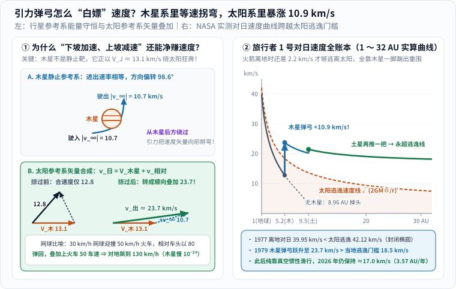
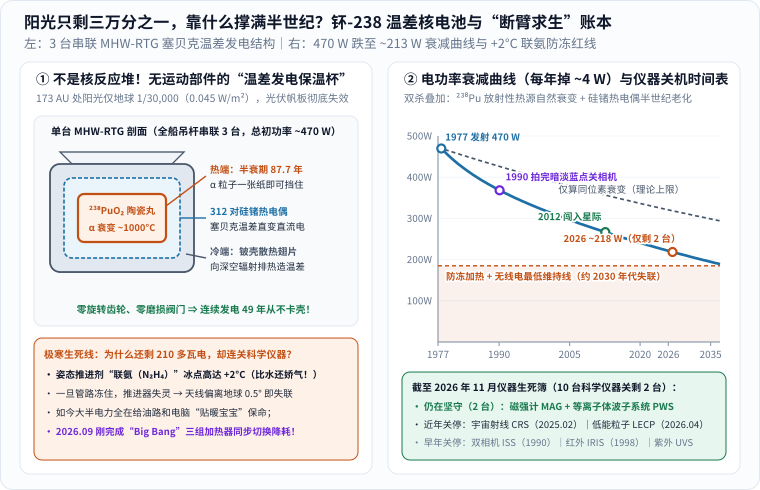
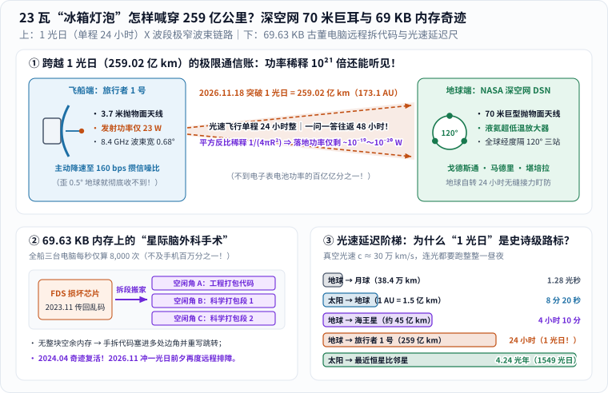
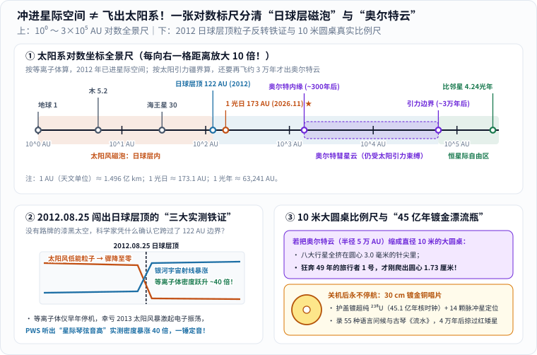

2026 年 11 月 18 日至 19 日，人类航天史刚刚迎来一个让人头皮发麻的刻度：

1977 年 9 月 5 日从佛罗里达卡纳维拉尔角升空的 **旅行者 1 号（Voyager 1）**，在漆黑冰冷的深空里孤独狂飙 **49 年 2 个月零 13 天** 后，与地球的直线距离正式跨过了 **“1 光日（Light-Day）”**——精确到个位数是 **$$25{,}902{,}068{,}356$$ 公里（约 $$259.02$$ 亿公里，合 $$173.1$$ 个日地距离 $$\mathrm{AU}$$）** [[1]](#ref-1)[[2]](#ref-2)！

“1 光日”是什么概念？在宇宙里没有比真空光速 $$c \approx 299{,}792.458\ \mathrm{km/s}$$ 更快的信使（参见[人类四百年追光测速史]()）：光从月球跑到地球只要 **$$1.28$$ 秒**，从太阳照到地球要 **$$8$$ 分 $$20$$ 秒**，跑到海王星大约要 **$$4$$ 小时 $$10$$ 分钟**；而此刻，旅行者 1 号发出一串无线电波，哪怕以每秒近 $$30$$ 万公里的极速狂奔，也要在虚空里整整跑满 **$$24$$ 小时（一昼夜）** 才能撞上地球的天线；地面工程师敲一行指令再等它应一声“收到”，一来一回就是 **$$48$$ 小时** [[2]](#ref-2)[[9]](#ref-9)！

只要顺着它的飞行账本往下翻两页，任何第一次看真实工程参数的人都会冒出一连串“这怎么可能”的问号：

1. **火箭根本不够劲**：翻开 NASA 国家空间科学数据中心（NSSDCA）的原始轨道档案 [[4]](#ref-4)，当年泰坦 3E-半人马座（Titan IIIE-Centaur）运载火箭把它推出去时，它的对日速度其实**差了一大截才够逃离太阳引力**——要是半路没人拉一把，它连土星轨道（$$9.54\ \mathrm{AU}$$）都摸不到，飞到 $$8.96\ \mathrm{AU}$$ 就会乖乖掉头跌回内太阳系！它凭什么没带几吨燃料，反而越飞越猛冲向星际？
2. **“引力弹弓”凭什么不违反能量守恒？** 中学物理明明讲过引力是保守力——骑车冲下坡攒多少速度，爬上对面的坡就会吐回多少速度。探测器冲向木星被吸快、离开木星又被拽慢，一来一回不该两清吗？凭什么能“白嫖”出每秒 $$10.9$$ 公里的净增速？那张 **175 年才发一班** 的天体船票又是怎么算出来的？
3. **没有阳光也没有核反应堆，靠什么活半个世纪？** 飞到 $$173\ \mathrm{AU}$$ 外，阳光微弱到只有地球上的 **三万分之一**，太阳能帆板连电子表都带不动。它身上挂的三只核电池既不搞核裂变链式反应，也没有任何旋转齿轮，凭什么连发 49 年电？既然今天还剩 **$$210$$ 多瓦** 电，为什么 NASA 却忍痛把 10 台科学仪器关得**只剩最后 2 台** [[5]](#ref-5)？
4. **23 瓦“冰箱灯泡”+ 69 KB 内存怎么联系地球？** 它的无线电发射功率只有 **$$23\ \mathrm{W}$$** [[3]](#ref-3)，还不如你床头的手机快充头；全船三台电脑内存加起来只有 **$$69.63\ \mathrm{KB}$$** [[5]](#ref-5)[[7]](#ref-7)，连今天微信里一张普通表情包都塞不下。地球凭什么能在 $$259$$ 亿公里外听见它的呼吸，甚至在芯片烧坏时隔空给它做“脑外科手术” [[10]](#ref-10)？
5. **到底飞出太阳系没有？** 2012 年全世界头条都在欢呼它“人类首次进入星际空间”，怎么到了 2026 年天文学家又说它“再飞 3 万年也还没出太阳系” [[1]](#ref-1)[[2]](#ref-2)？

这五个问题环环相扣，恰好拼成了人类深空探测史上最硬核、最浪漫的一部工程教科书。我们一关一关把底牌掀开。

---

## 一、火箭明明连土星都够不着，凭什么能冲出太阳系？——“引力弹弓”不是永动机，而是借走木星的公转速度

### 1. 残酷真相：1977 年火箭熄火那一刻，旅行者 1 号其实被困在封闭椭圆里

我们在[三大宇宙速度]()与[卫星轨道活力公式]()里算过：在距离太阳中心为 $$r$$ 的轨道上，天体的对日速度 $$v(r)$$ 由机械能守恒导出的**活力公式（Vis-Viva Equation）**严格锁定：

$$
v(r) = \sqrt{GM_\odot\left(\frac{2}{r} - \frac{1}{a}\right)}
$$

其中 $$G$$ 是万有引力常数，$$M_\odot$$ 是太阳质量，$$a$$ 是轨道半长轴。要想彻底挣脱太阳引力束缚、一去不回头（令 $$a \to \infty$$，离心率 $$e \ge 1$$），在距离太阳 $$r$$ 处必须跨过的**太阳逃逸速度门槛**是：

$$
v_{\text{esc},\odot}(r) = \sqrt{\frac{2GM_\odot}{r}} = \frac{42.12\ \mathrm{km/s}}{\sqrt{r / (1\ \mathrm{AU})}}
$$

也就是说，在地球轨道（$$r = 1\ \mathrm{AU} \approx 1.496 \times 10^8\ \mathrm{km}$$）直接硬闯出太阳系，飞船相对于太阳的速度必须达到 **$$42.12\ \mathrm{km/s}$$**！哪怕借上地球自身绕太阳公转的“顺风车”速度 $$v_\oplus \approx 29.785\ \mathrm{km/s}$$，地面火箭（哪怕用上四级接力的[多级火箭剥壳术]()）依然得把重达 $$815\ \mathrm{kg}$$（含推进剂湿重；纯干重约 $$721.9\ \mathrm{kg}$$）[[3]](#ref-3) 的旅行者 1 号推出极高的超额双曲线速度。

那么，1977 年 9 月当时美国推力顶尖的“泰坦 3E + 半人马座液氢上面级 + Star-37E 固体远地点发动机”拼尽全力烧完最后一滴燃料后，到底把它推到了多快？

直接查 NASA NSSDCA 保存的旅行者 1 号第一阶段（`1977-09-08` 至 `1979-03-05` 木星交会前）实测日心轨道根数 [[4]](#ref-4)：

- **近日点距离**：$$r_p = 1.00\ \mathrm{AU}$$（刚离开地球轨道）
- **远日点距离**：$$r_a = 8.96\ \mathrm{AU}$$
- **轨道半长轴**：$$a_1 = \frac{r_p + r_a}{2} = 4.98\ \mathrm{AU}$$
- **日心轨道离心率**：**$$e_1 = 0.79778 < 1$$（标准封闭椭圆！）**

把 $$r = 1.00\ \mathrm{AU}$$、$$a_1 = 4.98\ \mathrm{AU}$$ 代回上面的活力公式一算，真相让人大吃一惊：星箭分离爬出地球引力井后，旅行者 1 号的对日速度只有 **$$39.95\ \mathrm{km/s}$$**——距离太阳逃逸门槛 $$42.12\ \mathrm{km/s}$$ **足足差了 $$2.17\ \mathrm{km/s}$$**！

更要命的是，随着它一路往外爬坡，太阳引力在身后死死拽着它减速。等它在 1979 年初爬到木星轨道（$$r_J \approx 5.20\ \mathrm{AU}$$）时，对日速度已经被拽慢到了可怜的 **$$12.77\ \mathrm{km/s}$$**（远低于木星轨道处的太阳逃逸速度 $$18.47\ \mathrm{km/s}$$）。如果那天木星恰好不在那个位置，旅行者 1 号连 $$9.54\ \mathrm{AU}$$ 处的土星边都摸不着，爬到 $$8.96\ \mathrm{AU}$$ 就会耗尽径向动能，此生永远像一颗普通小行星那样绕着太阳转椭圆圈！

### 2. 迎面砸向火车头的网球：为什么保守引力场也能“白嫖”速度？

这就引出了全篇第一个核心难点：**引力明明是保守力，冲进木星引力井攒下的速度，爬出木星引力井时理应一分不少地吐回去——木星凭什么能给它净增 $$10.9\ \mathrm{km/s}$$ 的对日速度？**

答案只有一句话：**“进出等速”只在木星自己的静止参考系里成立；但木星本身并不是钉死在星空里的木桩——它正以 $$V_J \approx 13.06\ \mathrm{km/s}$$ 的高速绕着太阳狂奔！**

NASA 喷气推进实验室（JPL）在轨道力学导论里给过一个极其传神的日常比喻 [[6]](#ref-6)：

- **撞向静止水泥墙**：你站在站台上，把一颗网球以 $$30\ \mathrm{km/h}$$ 砸向静止的墙壁。假设完全弹性碰撞，网球原速弹回，落地速度还是 **$$30\ \mathrm{km/h}$$**——一分钱速率都没赚到，只改了方向。
- **迎面砸向疾驶的火车头**：现在一列重型货运火车正以 **$$50\ \mathrm{km/h}$$** 迎面驶来，你还是把网球以 $$30\ \mathrm{km/h}$$ 朝车头扔过去。
  1. **先坐进火车司机室看（行星参考系）**：在司机眼里，网球是以 $$30 + 50 = 80\ \mathrm{km/h}$$ 扑向车头的；弹性碰撞后，网球相对车头原速以 **$$80\ \mathrm{km/h}$$** 向前弹开——在火车系里，进出速率严丝合缝相等！
  2. **再回到地面站台看（太阳参考系）**：网球不仅相对车头向前飞 $$80\ \mathrm{km/h}$$，车头自己还在向前跑 $$50\ \mathrm{km/h}$$！两者同向叠加，网球对地速度瞬间飙升到 **$$80 + 50 = 130\ \mathrm{km/h}$$**——平白无故暴涨了 $$100\ \mathrm{km/h}$$（两倍火车车速）！

在太空中，探测器根本不需要真的“撞上”木星表面——只要从木星公转前进方向的**后方（尾部半球）**擦身掠过，木星强大的万有引力就会像一根无形的U形回旋弯管，把探测器的相对速度矢量 $$\vec{v}_\infty$$ 狠狠向前掰弯！

我们来复算 1979 年 3 月 5 日世界时 `12:05` 旅行者 1 号掠过木星时的真实账本 [[4]](#ref-4)：

1. **木星参考系（等速拐弯）**：飞船以双曲线超额速率 $$\lVert\vec{v}_{\infty,\text{in}}\rVert \approx 10.7\ \mathrm{km/s}$$ 从后侧切入，最近点掠过距离木星中心仅 **$$4.89\,R_J \approx 34.9$$ 万公里**（距木星云顶约 $$27.8$$ 万公里），木心双曲线离心率 $$e_J = 1.31898$$ [[4]](#ref-4)。根据开普勒双曲线散射公式，引力把相对速度方向足足掰弯了：

$$
\delta = 2\arcsin\!\left(\frac{1}{e_J}\right) = 2\arcsin\!\left(\frac{1}{1.31898}\right) \approx 98.54^\circ
$$

   离开木星引力圈时，相对木星的速率依然是 $$\lVert\vec{v}_{\infty,\text{out}}\rVert = \lVert\vec{v}_{\infty,\text{in}}\rVert \approx 10.7\ \mathrm{km/s}$$，机械能分毫不差。
2. **太阳参考系（矢量同向叠加）**：对日速度等于木星公转速度加上相对速度，即 $$\vec{v}_\odot = \vec{V}_J + \vec{v}_\infty$$。拐弯前，$$\vec{v}_{\infty,\text{in}}$$ 与木星公转方向 $$\vec{V}_J$$ 夹着约 $$116^\circ$$ 钝角，矢量合成后对日速度只有 **$$12.77\ \mathrm{km/s}$$**；被木星引力向前掰转 $$98.54^\circ$$ 后，$$\vec{v}_{\infty,\text{out}}$$ 几乎转到了与木星公转完全顺向（$$13.06 + 10.7 \approx 23.7\ \mathrm{km/s}$$）！实测对日速度一步跃升至 **$$23.74\ \mathrm{km/s}$$**，净赚 **$$+10.97\ \mathrm{km/s}$$**，一举越过当地 $$18.47\ \mathrm{km/s}$$ 的太阳逃逸红线，日心离心率从 $$0.798$$ 暴涨成开口双曲线 **$$e_2 = 2.30274 > 1$$** [[4]](#ref-4)！

那能量守恒到底破没破？当然没破！根据动量守恒，旅行者 1 号拿走的每一焦耳动能，都是从木星的公转轨道动能里实打实扣掉的。只不过木星质量高达 $$M_J \approx 1.90 \times 10^{27}\ \mathrm{kg}$$，是旅行者 1 号干重（$$721.9\ \mathrm{kg}$$）的 **$$2.6 \times 10^{24}$$ 倍**——它把这只铁蜻蜓踹飞之后，自己绕太阳公转的速度只慢了约 **$$4 \times 10^{-21}\ \mathrm{m/s}$$**：哪怕走完太阳系未来 50 亿年的寿命，木星因此落后的路程也还不到**一颗原子核直径的几分之一**！

_先看左栏上下对比：在木星静止参考系（左上）里，飞船进出速率严格相等（约 $$10.7\ \mathrm{km/s}$$），只因从木星后方掠过而被引力向前掰弯 $$98.5^\circ$$；一旦切回太阳参考系（左下）叠加木星公转速度 $$V_{\text{木}} \approx 13.1\ \mathrm{km/s}$$，原本钝角相抵的 $$12.8\ \mathrm{km/s}$$ 瞬间变成顺向相加的 $$23.7\ \mathrm{km/s}$$。再看右栏根据 NASA NSSDCA 轨道根数实算的 $$1\sim 32\ \mathrm{AU}$$ 速度账本：没有木星时灰色虚线在 $$8.96\ \mathrm{AU}$$ 归零掉头；借木星与土星两记引力弹弓后，绿色实线永久骑在橙色太阳逃逸速度线之上。[单独打开高清原图](/assets/images/voyager-1-interstellar/gravity-slingshot-vector-mechanics.svg)_

### 3. 早就没喷火了，为什么 49 年后还能以每秒 17 公里狂奔？

看懂了右栏那张速度图，顺手还能解开很多读者的另一个疑惑：**“旅行者 1 号飞了 49 年，难道屁股后面一直在点火喷气吗？燃料怎么烧得完？”**

恰恰相反——**旅行者 1 号身上压根没有持续巡航的主推进发动机！** 它带的那几十公斤联氨燃料，纯粹是用来偶尔喷一下毫牛级小气嘴、微调天线指向和轨道修正的。

在地球上汽车松油门会停，是因为柏油路摩擦和稠密空气阻力每时每刻都在吞噬动能；而行星际与星际空间是接近完美的超高真空（日球层外每立方厘米只有约 $$0.1$$ 个粒子，详见[等离子体到底是什么]()），几乎不存在任何空气阻力。唯一在背后轻轻拉扯它的只有太阳万有引力：离开土星（二次加速后约 $$21.5\ \mathrm{km/s}$$）越飞越远时，太阳引力确实让它从 $$21.5\ \mathrm{km/s}$$ 缓步回落，但因为它的总机械能早就是正数（$$E > 0$$），哪怕飞到无穷远处，它的速度也永远不会掉破双曲线剩余速度下限 $$v_\infty = \sqrt{v(r)^2 - v_{\text{esc},\odot}(r)^2} \approx 16.6\ \mathrm{km/s}$$。

今天在 $$173.1\ \mathrm{AU}$$（1 光日）处，当地太阳逃逸速度已经跌到了微不足道的 $$42.12/\sqrt{173.1} \approx 3.20\ \mathrm{km/s}$$，而旅行者 1 号正一滴油不烧、纯靠牛顿第一定律的惯性，稳稳保持着 **$$\approx 17.0\ \mathrm{km/s}$$（时速约 $$6.12$$ 万公里，每年向外飞出约 $$3.57\ \mathrm{AU}$$ / $$5.34$$ 亿公里）** [[1]](#ref-1)[[7]](#ref-7)——是人类迄今造出的飞行速度最快、飞得最远的星际造物！

---

## 二、175 年才发一班的“天体顺风车”：为什么 1 号晚发 16 天，还偏偏放弃了天王星？

### 1. 1965 年暑期实习生算出的天机：上次同侧连珠还是清朝嘉庆七年

既然木星和土星的引力弹弓这么好用，是不是随便哪一年发射都能连跳四级？

绝对不行。木星绕太阳一圈要 $$11.86$$ 年，土星要 $$29.46$$ 年，天王星要 $$84.02$$ 年，海王星要 $$164.79$$ 年。平时这四颗外太阳系巨行星天各一方，你在木星借完力甩出去的方向，土星可能远在太阳另一头！

1965 年夏天，20 世纪最传奇的一幕发生在加州理工学院喷气推进实验室（JPL）：当时还在读博士的暑期实习生 **加里·弗兰德罗（Gary Flandro）** 受命研究外行星探测轨道 [[6]](#ref-6)。他铺开星历图纸一算，心跳瞬间漏了一拍——在即将到来的 **1970 年代末至 1980 年代**，跑得最慢的天王星（$$T_U = 84.02$$ 年）和海王星（$$T_N = 164.79$$ 年）即将迎来会合，而木星和土星也恰好沿着同一侧逆时针弧线排成一串优雅的“接力走廊”！

算一算天王星与海王星的**会合周期（Synodic Period）**：

$$
T_{\text{syn}} = \frac{1}{\frac{1}{T_U} - \frac{1}{T_N}} = \frac{1}{\frac{1}{84.02} - \frac{1}{164.79}} \approx 171.4\ \text{年}
$$

再叠加上木星与土星的相位匹配，四颗巨行星同侧排成一条引力弹弓连跳走廊的窗口，**每隔约 175～176 年才会重现一次** [[6]](#ref-6)[[7]](#ref-7)！上一次出现同样的天体队列，还是 **1802—1803 年**——那一年美国总统还是托马斯·杰斐逊，中国还是清朝嘉庆七年，人类连蒸汽轮船都才刚试水，甚至连海王星这颗行星都还要再过四十多年（1846 年）才被发现；而如果错过 1977 年夏秋这短短几十天的发射窗口，全人类就得苦等到 **2152 年前后**！

正是这份“错过等两百年”的紧迫计算，直接催生了双子探测器——**旅行者 1 号与旅行者 2 号**的“外太阳系壮游计划（Grand Tour）”：原本从地球直飞海王星需要苦熬 **约 30 年**，借着三连引力弹弓接力，旅行者 2 号只用了 **12 年（1977—1989）** 就一口气刷完了木、土、天、海四颗巨行星 [[6]](#ref-6)！

### 2. 三个最容易搞反的历史细节：晚发超车、土卫六抉择与擦肩而过的冥王星

仔细看双子探测器的履历，你会发现三件特别反直觉的趣事 [[1]](#ref-1)[[4]](#ref-4)[[7]](#ref-7)：

- **第一，旅行者 2 号明明早出发 16 天，为什么反而叫“2 号”？**
  旅行者 2 号在 **1977 年 8 月 20 日** 率先点火升空，而旅行者 1 号直到 **1977 年 9 月 5 日** 才发射 [[1]](#ref-1)。之所以名字倒过来，是因为 NASA 按**抵达木星和土星的先后顺序**编号！旅行者 1 号打进了一条曲率更陡、耗时更短的快线轨道，升空才三个多月（**1977 年 12 月 15 日**），就在火星与木星之间的小行星带里一脚油门反超了早走的“二弟”，比 2 号提前 **4 个月** 抵达木星（1979 年 3 月 vs 7 月），提前 **9 个月** 抵达土星（1980 年 11 月 vs 1981 年 8 月）！
- **第二，既然赶上了 175 年一遇的四星连珠，为什么旅行者 1 号拍完土星就不去天王星和海王星了？**
  因为科学家抵挡不住另一颗神秘天体的诱惑——土星最大的卫星 **土卫六（Titan，泰坦）**！早在 1944 年地面光谱就暗示土卫六可能裹着太阳系卫星里独一无二的浓厚甲烷大气层，JPL 把“近距离穿透侦察土卫六”列为了头号必保目标 [[1]](#ref-1)。1980 年 11 月 12 日交会时，土卫六恰好处在倾斜轨道偏南的位置；为了以约 $$6{,}490\ \mathrm{km}$$ 的极近距离从土卫六南极下方贴身掠过（距土星中心仅 $$3.09\,R_S$$），土星与土卫六的联合引力不可避免地把旅行者 1 号的航迹**向黄道面正北方狠狠折弯了 $$35.76^\circ$$**（日心离心率升至 $$e_3 = 3.72472$$）[[4]](#ref-4)！
  这一折，彻底偏离了黄道面上的天王星和海王星——但也正因为 1 号圆满查清了土卫六高达 $$1.5$$ 倍地球气压的氮气-甲烷浓雾，9 个月后抵达土星的 **旅行者 2 号** 才无需重走险路，得以贴着黄道面一路连访天王星（1986）和海王星（1989）；而高仰角斜刺里冲出黄道面的 **旅行者 1 号**，则意外拿到了最快冲破太阳风边界的北向超车道！
- **第三，为什么两艘飞船都没顺路去看看冥王星？**
  理论上，1980 年旅行者 1 号在土星如果**放弃贴掠土卫六**、改从土星另一侧借力，确实存在一条飞往冥王星的路线，但鱼与熊掌不可兼得，项目组果断选了科学价值更确定的土卫六；至于旅行者 2 号，1989 年在海王星要想掰向冥王星所在的倾斜轨道，理论计算出的瞄准近点竟然**穿在海王星肚子里** [[7]](#ref-7)！直到 2015 年，专门直飞的“新视野号（New Horizons）”才替两位前辈补上了冥王星特写。

_先看左栏外太阳系同侧走廊（为兼顾 $$1\ \mathrm{AU}$$ 到 $$30.1\ \mathrm{AU}$$ 巨大跨度采用径向幂律压缩示意；支持 CSS 动画的浏览器会自动播放一次双子航迹延伸过程，同时保留浅色静态底线）：蓝色实线是晚发却超车的旅行者 1 号，在土星因贴掠土卫六向黄道北侧折转 $$35.8^\circ$$ 直奔星际；紫色虚线是旅行者 2 号，12 年连刷木、土、天、海四巨星。右栏梳理了晚发超车、土卫六取舍与未访冥王星的三重轨道约束。[单独打开图像（刷新可重播航迹动画）](/assets/images/voyager-1-interstellar/grand-tour-175yr-slingshot-anim.svg)_

---

## 三、阳光只剩三万分之一，靠什么撑满半世纪？——钚-238 温差核电池与“+2°C 断臂求生”

### 1. 平方反比铁律：在 1 光日之外，太阳能帆板连电子表都带不动

在内太阳系（水星、金星、地球、火星，最远勉强撑到木星的“朱诺号”），航天器最爱用巨大的太阳能光伏帆板。但太阳光强严格服从**距离平方反比定律**：

$$
I(r) = \frac{I_0}{\left(r / 1\ \mathrm{AU}\right)^2}
$$

地球轨道处太阳常数 $$I_0 \approx 1{,}361\ \mathrm{W/m^2}$$。到了木星（$$5.2\ \mathrm{AU}$$），阳光只剩地球上的 $$1/27$$（朱诺号不得不装上三片拖拉机那么大的巨型帆板才凑够几百瓦电）；到了土星（$$9.54\ \mathrm{AU}$$）只剩 $$1/91$$；而到了今天旅行者 1 号所在的 **1 光日（$$173.1\ \mathrm{AU}$$）** 处：

$$
\frac{I(173.1\ \mathrm{AU})}{I_0} = \frac{1}{173.1^2} \approx \frac{1}{29{,}964} \quad \Longrightarrow \quad I \approx 0.045\ \mathrm{W/m^2}
$$

阳光跌到了地球上的**三万分之一**！如果此时你站在旅行者 1 号的船头回头望向太阳，太阳早就不是一颗温暖的大火盘，而是一颗没有圆面、却亮得刺眼的寒星（视星等约 $$-15.5$$ 等，亮度大约相当于地球上满月的 15 倍，但照在身上连一丝暖意都没有）。别说给科学仪器供电，就算铺一整个篮球场那么大的太阳能板，在零下两百多摄氏度的深空里也压根发不出几瓦电！

### 2. 不是核反应堆！零运动部件的“温差发电保温杯”（MHW-RTG）

不能靠太阳，旅行者 1 号只能自己揣着火炉上路——在它远离磁强计的一根长吊杆上，串联挂着 **3 台多百瓦放射性同位素热电机（MHW-RTG）** [[3]](#ref-3)[[5]](#ref-5)。

一听“核电池”，很多人脑海里会浮现出核电站里轰鸣的控制棒、高压蒸汽管和旋转涡轮机。要是真把那套娇贵机械搬上太空，别说转 49 年，转三五年轴承润滑油和密封圈就老死卡壳了！MHW-RTG 的绝妙之处在于：**它既不是核裂变反应堆，全身上下更是连一颗旋转齿轮、一片阀门都没有** [[5]](#ref-5)[[8]](#ref-8)：

1. **热端火芯（二氧化钚-238 陶瓷丸）**：里面装的不是造原子弹用的钚-239（$$^{239}\mathrm{Pu}$$，靠中子诱发链式裂变），而是专门人工制备的同位素 **钚-238（$$^{238}\mathrm{Pu}$$）** 压制成的耐高温陶瓷球（$${}^{238}\mathrm{PuO}_2$$）[[8]](#ref-8)。它只发生极其温顺的自然 **$$\alpha$$ 衰变**（半衰期 $$T_{1/2} = 87.7$$ 年，原理参见[同位素测年家族]()）：射出的 $$\alpha$$ 粒子（氦原子核）穿透力极弱，一张薄纸或者薄金属壳就能彻底挡住，根本不需要笨重的铅屏蔽层，却能把释放的动能在陶瓷丸内部稳稳转化成 **约 $$1{,}000^\circ\mathrm{C}$$** 的红热高温！
2. **冷端排热（铍合金散热翅片）**：电池外壳装有八片铍金属散热鳍片，直接向接近 $$-200^\circ\mathrm{C}$$ 的漆黑深空辐射排热，维持极大的内外温差 $$\Delta T$$。
3. **直变直流电（312 对硅锗热电偶与塞贝克效应）**：在滚烫的火芯与冰冷的外壳之间，密密麻麻架着 **312 对硅锗（SiGe）半导体热电偶** [[5]](#ref-5)。早在 1821 年物理学家塞贝克就发现：把两种不同导体或掺杂半导体头尾相连，一头烤热、一头冰镇，热端的载流子就会自发向冷端扩散，无需任何机械运动，直接产生源源不断的直流电压！

正因为**零运动部件、零机械磨损**，这三只“大号核能保温杯”从 1977 年合上盖子那一刻起，硬生生在星际极寒里一言不发地连发了近五十年电！

当然，物理规律同样无情。一方面，钚-238 原子核每过 $$87.7$$ 年衰变掉一半，飞满 $$49.2$$ 年后热源只剩最初的 $$0.5^{49.2/87.7} \approx 67.8\%$$；另一方面，长期承受上千度高温的硅锗热电偶材料也会缓慢掺杂析出、转换效率逐年下降。双重衰减叠加下，三台 RTG 的总输出电功率从 1977 年发射时的 **$$470\ \mathrm{W}$$**（当时热功率约 $$7{,}200\ \mathrm{W}$$），一路跌到 1997 年的 **$$335\ \mathrm{W}$$** [[3]](#ref-3)，再以 **每年大约少掉 $$4\ \mathrm{W}$$** 的斜率 [[5]](#ref-5)[[7]](#ref-7)，滑到了 2026 年底的 **约 $$213\sim 218\ \mathrm{W}$$**。

### 3. 比冰水还娇气的“+2°C 生死线”：为什么还剩 210 多瓦电，却把 10 台仪器关剩最后 2 台？

算到这里，细心的读者马上会抓出一个漏洞：**“不对呀！210 多瓦电够同时带动好几台笔记本电脑了，旅行者 1 号上一台粒子探测器耗电才两三瓦到五六瓦，为什么 NASA 要含泪一台接一台全关掉？”**

因为飞船身上藏着一个比科学仪器贪吃得多、也致命得多的“电老虎”——**防冻电热毯（Heaters）**！

前面说过，旅行者 1 号必须随时微调姿态，让直径 $$3.7$$ 米的锅盖天线死死盯住地球。干这活的姿态推进器烧的是一种单组元液体燃料，叫 **无水联氨（Hydrazine，$$\mathrm{N_2H_4}$$）**。联氨在催化剂上一点就喷气，极其可靠，但它有一个要命的软肋：**联氨在常压下的凝固点高达 $$+2^\circ\mathrm{C}$$（$$35.6^\circ\mathrm{F}$$）**——比零度才结冰的自来水还要怕冷！

在没有阳光直射的星际深空，裸露金属管路的温度分分钟跌破 $$-80^\circ\mathrm{C}$$ 甚至更低。**一旦哪根毫米粗细的油管温度掉破 $$+2^\circ\mathrm{C}$$ 结了冰，姿态推进器瞬间瘫痪，飞船哪怕只偏转 $$0.5^\circ$$，地球就会彻底弄丢它！**

因此，今天那 $$210$$ 多瓦救命电里，绝大部分都必须优先供给油路加热器、主电脑保温层与无线电发射机。每年少掉 $$4\ \mathrm{W}$$ 电，工程师就得像极地科考队断粮求生一样，忍痛关掉一台加热器或科学仪器：

- **1990 年 2 月 14 日**：在距离地球约 $$60$$ 亿公里（$$40\ \mathrm{AU}$$）处，应卡尔·萨根（Carl Sagan）的再三恳求，旅行者 1 号最后一次扭头回望太阳系，拍下了地球在阳光散射带里只占 **$$0.12$$ 个像素** 的传世名作《暗淡蓝点（Pale Blue Dot）》[[1]](#ref-1)。快门落下的那一刻，工程师永久关闭了广角与窄角双相机（`ISS`），腾出电力和内存供它奔赴星际。
- **1998 年—2016 年**：红外干涉光谱仪（`IRIS`）与紫外光谱仪（`UVS`）先后谢幕 [[5]](#ref-5)。
- **2025 年 2 月 25 日与 2026 年 4 月 17 日**：为了保住油管不冻裂，NASA 被迫先后关停了立下赫赫战功的**宇宙射线子系统（`CRS`）**和**低能带电粒子仪（`LECP`）** [[5]](#ref-5)。
- **截至 2026 年 11 月**：全船原本搭载的 10 台科学仪器，**仍在通电工作的只剩最后 2 台**——**磁强计（`MAG`）**与**等离子体波子系统（`PWS`）** [[5]](#ref-5)！就在 **2026 年 9 月**，JPL 团队刚刚冒险执行了一次内部代号 **“Big Bang”** 的高难度操作：在同一条指令序列里同步切换三组加热器与低功耗模式，从牙缝里抠出宝贵的几瓦余电，只为让最后这两双“耳朵和触角”能一直撑进 2030 年代 [[9]](#ref-9)！

_先看左栏：上半部拆解单台 MHW-RTG 结构——中心 $${}^{238}\mathrm{PuO}_2$$ 陶瓷丸自然 $$\alpha$$ 衰变发热约 $$1{,}000^\circ\mathrm{C}$$，外层铍壳翅片向深空排热，中间 312 对硅锗热电偶靠塞贝克效应无磨损直变直流电；下半部橙框点明联氨燃料 $$+2^\circ\mathrm{C}$$ 结冰红线。再看右栏实算功率曲线：虚线是仅算同位素衰变的理论上限，蓝色实线是叠加硅锗热电偶老化后每年掉约 $$4\ \mathrm{W}$$ 的实测轨迹，2026 年底仅剩 MAG 与 PWS 两台仪器坚守。[单独打开高清原图](/assets/images/voyager-1-interstellar/rtg-plutonium-power-survival.svg)_

---

## 四、23 瓦“冰箱灯泡”如何喊穿 259 亿公里？——70 米深空巨耳与 69 KB 内存上的“脑外科手术”

### 1. 信号稀释十万亿亿倍（落地仅 $$10^{-20}\ \mathrm{W}$$），地球凭什么还听得见？

跨过动力与供电两道坎，第三个让人瞠目结舌的奇迹是**通信**：

旅行者 1 号上的 X 波段（频率 $$f \approx 8.4\ \mathrm{GHz}$$，波长 $$\lambda = c/f \approx 3.57\ \mathrm{cm}$$）行波管无线电发射机，满额发射功率只有 **$$23\ \mathrm{W}$$** [[3]](#ref-3)[[5]](#ref-5)——只相当于老式电冰箱门打开时亮起的那颗小灯泡！

如果这 $$23\ \mathrm{W}$$ 电波向四面八方均匀散开，跑完 **1 光日（$$R = 2.5902 \times 10^{13}\ \mathrm{m}$$）** 后，球面面积 $$4\pi R^2$$ 高达 $$8.43 \times 10^{27}\ \mathrm{m^2}$$——每平方米分到的功率会跌到 $$2.7 \times 10^{-27}\ \mathrm{W/m^2}$$，神仙也收不到。工程师之所以能创造跨越 $$259$$ 亿公里的通信神话，全靠三张王牌硬生生把信噪比抢了回来：

1. **飞船端：$$3.66$$ 米（常称 $$3.7$$ 米）抛物面天线聚成“无线电细针”** [[3]](#ref-3)[[5]](#ref-5)
   旅行者 1 号最显眼的标志，就是背上那口直径 $$D = 3.66\ \mathrm{m}$$ 的白色大锅。在波长 $$\lambda \approx 3.57\ \mathrm{cm}$$ 的 X 波段下，它的衍射半功率波束宽度只有：

$$
\theta \approx 1.22\,\frac{\lambda}{D} \approx 0.68^\circ
$$

   这口大锅把原本洒向全天空的 $$23\ \mathrm{W}$$ 能量，死死聚拢进一束张角不到 $$0.7^\circ$$ 的极窄锥束里，天线增益高达约 **$$48\ \mathrm{dBi}$$（把正对地球方向的等效辐射功率集中放大了约 $$6.3$$ 万倍）**！代价也同样残酷：只要飞船姿态歪出半度，地球立刻掉出波束中心。
2. **地球端：经度每隔 $$120^\circ$$ 布设三座 $$70$$ 米“深空巨耳”+ 液氦超低温冷放** [[3]](#ref-3)[[5]](#ref-5)
   为了接住飞来的外行星与星际微弱电波，NASA 深空通信网（Deep Space Network，DSN）在**美国加州戈德斯通（Goldstone）、西班牙马德里（Madrid）、澳大利亚堪培拉（Canberra）** 建了三座基地——全球经度恰好每隔约 **$$120^\circ$$** 一座！这样不管地球怎么自转，这颗蓝色星球每天 24 小时永远至少有一只大耳朵正对着旅行者 1 号。当年为了迎接天王星和海王星交会，NASA 专门把三大站的主力天线从 $$64$$ 米扩建到了 **$$70$$ 米直径** [[3]](#ref-3)（单面接收面积近 $$3{,}850\ \mathrm{m^2}$$），还可以在关键时刻把多面 $$34$$ 米天线组阵并联。
   按弗里斯传输方程（Friis Transmission Equation）实算，$$23\ \mathrm{W}$$ 信号跨越 $$259$$ 亿公里落进一口 $$70$$ 米大锅的总功率依然微弱得让人窒息：

$$
P_r = P_t G_t \frac{A_{\text{eff}}}{4\pi R^2} \sim 10^{-19} \sim 10^{-20}\ \mathrm{W}
$$

   也就是 **一亿亿分之一瓦的千分之一**（不到你手腕上电子石英表电池功率的百亿亿分之一）！要是用常温放大器去接，放大器自己铜线里电子热运动产生的“热噪声”就会瞬间把信号淹没。所以 DSN 把前端低噪声放大器（LNA / 脉泽放大器）泡在接近绝对零度（约 $$4\ \mathrm{K}$$，即 $$-269^\circ\mathrm{C}$$）的液氦杜瓦瓶里，让接收机安静到连几个微波光子的敲门声都听得清清楚楚！
3. **编码端：主动降速到每秒 160 比特（`160 bps`），拿时间攒能量** [[3]](#ref-3)[[5]](#ref-5)
   1979 年贴近木星传彩色照片时，旅行者 1 号的码率高达 `115,200 bps`；如今远在 1 光日外，它主动把常规巡航码率降到了每秒仅传 **160 个 `0` 或 `1`（`160 bps`）**（遇到突发诊断甚至可切到 `40 bps` 或 `10 bps`）。传得越慢，每一个比特在 $$70$$ 米天线上累积积分的时间就越长，再配合纠错编码，硬是从宇宙背景杂音里一字不差地捞出了星际数据！

### 2. 全船内存仅 69.63 KB：隔着几百亿公里给坏芯片“拆段搬代码”

更让人肃然起敬的是船上那颗“1970 年代老大脑”：

旅行者 1 号装有三台双机热备计算机——主控计算机子系统（`CCS`）、飞行数据子系统（`FDS`）和姿态与机动控制子系统（`AACS`）。三套系统（共六台主机）**全部内存加在一起只有约 `69.63 KB`**，每秒钟只能执行约 **`8,000` 条指令** [[5]](#ref-5)[[7]](#ref-7)！今天一部几千元智能手机的内存是它的 **20 万倍**，每秒运算次数是它的 **上百万倍**；它甚至不用磁盘或闪存，而是靠一盘八轨数字磁带机和抗辐射极强的镀线磁芯存储器（Plated-Wire Memory）记账——讽刺的是，恰恰因为 1970 年代电路线宽极粗，面对银河高能宇宙射线的轰击，这颗老古董反而比现代纳米级娇贵芯片耐揍得多！

即便如此，半个世纪的岁月还是让硬件迎来了惊魂时刻：

- **2023 年 11 月—2024 年 5 月的“星际脑外科手术”** [[10]](#ref-10)：2023 年 11 月 14 日，`FDS` 里一块存有打包程序的内存芯片突然永久损坏（疑似被高能宇宙射线击穿或自然老化），旅行者 1 号传回地球的数据瞬间变成了一串毫无意义的 `0-1` 交替死循环乱码！
  没有备件能快递过去，更绝望的是：**剩下的好芯片里，没有任何一块连续空闲区塞得下那段坏掉的代码！** JPL 老中青三代工程师翻出 40 多年前装在纸箱里泛黄的汇编源码手稿，像拼华容道一样，手工把那段关键代码**劈成好几个小段**，分别塞进 `FDS` 内存各个角落的几百字节缝隙里，再逐行重写所有跨段跳转指令地址，确保它们拼起来还能严丝合缝地跑通。2024 年 4 月 18 日代码发出，熬过四十多个小时的光速往返，4 月 20 日控制大厅终于再次跳出了久违的正常工程遥测包 [[10]](#ref-10)！
- **2026 年 11 月冲刺“1 光日”前夕的实时排障** [[9]](#ref-9)：就在跨过 1 光日门槛前四天（2026 年 11 月 14 日），`FDS` 遥测调制单元再度闹起小脾气——地球能清晰锁定它稳定的 X 波段载波（证明电力充沛、天线笔直对准地球、主控完好），但载波上暂时没挂上遥测数据包。在**单程整整 24 小时、一问一答苦等 48 小时**的极致光速延迟下，地面团队正一边从容排查这颗 `69 KB` 大脑，一边在 **2026 年 11 月 18—19 日** 迎来了它跨越 **1 光日（$$259.02$$ 亿公里）** 的历史性载波心跳 [[2]](#ref-2)[[9]](#ref-9)！

_先看上半幅跨越 1 光日的完整通信账：飞船端用 $$3.7$$ 米抛物面天线把 $$23\ \mathrm{W}$$ X 波段功率聚成 $$0.68^\circ$$ 窄束并以 $$160\ \mathrm{bps}$$ 慢速发报，信号以光速狂奔 24 小时（$$259.02$$ 亿公里）稀释至约 $$10^{-20}\ \mathrm{W}$$ 后，由全球经度隔 $$120^\circ$$ 的三座 NASA 深空网 $$70$$ 米天线配液氦超低温放大器接力捕获。左下复盘了 2024 年在 $$69.63\ \mathrm{KB}$$ 内存里拆分搬迁 FDS 损坏芯片代码的绝技；右下对比从地月 $$1.28$$ 光秒到 1 光日与比邻星 $$4.24$$ 光年的光速阶梯。[单独打开高清原图](/assets/images/voyager-1-interstellar/dsn-23watt-1lightday-link.svg)_

---

## 五、2012 年就进了星际空间，为什么再飞 3 万年还没出太阳系？——两把标尺的终极误会

每逢旅行者 1 号上热搜，评论区一定会吵成两派：一派翻出 2012 年的老新闻说“它早就飞出太阳系进星际空间啦”，另一派搬出天文学家的话反驳“它连太阳系的皮毛都没摸完，还得再飞三万年”。

其实两边都没撒谎——**他们手里拿的是完全不同的两把物理标尺** [[1]](#ref-1)[[2]](#ref-2)[[7]](#ref-7)！

### 1. 第一把尺（等离子体与磁场边界）：2012 年 8 月 25 日，它确实冲破了太阳吹出的“大磁泡”

太阳并不是静静发光的大火球，它每时每刻都在向四面八方喷射每秒 $$300\sim 800\ \mathrm{km}$$ 的高温电离粒子流——**太阳风（Solar Wind）**。这股太阳风像吹泡泡糖一样，在银河系原本弥漫的冷暗气体云（恒星际介质）里硬生生吹出了一个巨大的磁力保护泡，叫做 **日球层（Heliosphere）**：

- **2004 年 12 月（约 $$94\ \mathrm{AU}$$）**：旅行者 1 号跨过 **终端激波（Termination Shock）**——在这里太阳风迎头撞上星际介质阻力，速度从超音速骤降到亚音速 [[1]](#ref-1)。
- **2012 年 8 月 25 日（$$121.6\ \mathrm{AU}$$，约 $$182$$ 亿公里）**：旅行者 1 号正式刺穿磁泡最外层的薄膜——**日球层顶（Heliopause）**，一头扎进了银河系恒星之间的公共海域，也就是天体物理学严格定义的 **星际空间（Interstellar Space）** [[1]](#ref-1)[[7]](#ref-7)！

这里还藏着一段极精彩的科学破案故事：漆黑太空里又没有界碑，更糟的是旅行者 1 号专门直接测等离子体温度和密度的传感器（`PLS`）早在 1980 年飞越土星后就坏了，科学家凭什么敢拍板说它在 **2012 年 8 月 25 日** 出了磁泡？

靠的是**三重铁证同时反转**：

1. 船上粒子探测器记录到，源自太阳内部的低能带电粒子在 2012 年 8 月底短短几天内**断崖式归零**；
2. 原本被太阳磁泡挡在门外的**银河系高能宇宙射线通量同步暴涨**；
3. 最一锤定音的证据来自 2013 年春天：一年前太阳爆发的一场日冕物质抛射冲击波历经一年多追上旅行者 1 号，像敲音叉一样激起了周围自由电子的集体朗缪尔振荡！仍在工作的**等离子体波子系统（`PWS`）** 清晰录下了这阵“星际啸叫”——由于等离子体振荡频率 $$f_p \propto \sqrt{n_e}$$ 只取决于电子数密度 $$n_e$$，科学家一听音高（约 $$2.6\ \mathrm{kHz}$$，比日球层内高出六倍多），立刻算出周围冷等离子体密度**暴涨了约 $$40$$ 倍**（约 $$0.08\ \mathrm{cm^{-3}}$$），与银河星际介质理论值完美吻合！

所以，按**“太阳风与磁场统治区”**这把尺子算，旅行者 1 号早在 14 年前就已经是一位货真价实的星际使者了。

### 2. 第二把尺（太阳引力疆界）：10 米大圆桌上，狂奔 49 年的它才刚爬出圆心 1.73 厘米！

那为什么天文学家又异口同声地说它**“还没有离开太阳系（Solar System）”** [[1]](#ref-1)[[2]](#ref-2)？

因为在天文学定义里，**“太阳系”指的是所有受太阳万有引力主导束缚的天体家族总和**。而在海王星（$$30\ \mathrm{AU}$$）和日球层顶（$$122\ \mathrm{AU}$$）外面，还包裹着一层庞大到让人绝望的球状冰封彗星仓库——**奥尔特云（Oort Cloud）**！数以千亿计的长周期彗星核在那里乖乖绕着太阳缓慢公转，那里依然是太阳引力说了算的领土。

对照 NASA 官方给出的精确路标算一笔账 [[1]](#ref-1)：

- **奥尔特云内边缘**：距离太阳约 **$$1{,}000\sim 2{,}000\ \mathrm{AU}$$**。以旅行者 1 号如今每年 $$3.57\ \mathrm{AU}$$ 的速度，它至少还要**再飞约 300 年**，才能刚刚摸到奥尔特云的大门口！
- **奥尔特云外边缘（太阳引力真正疆界）**：一路延伸到距离太阳 **$$50{,}000\sim 100{,}000\ \mathrm{AU}$$**（约 $$0.8\sim 1.6$$ 光年，已经快摸到去往半人马座比邻星 $$4.24$$ 光年半路了）！旅行者 1 号要彻底钻出奥尔特云外缘，还需要漫长的 **约 30,000 年（三万年）** [[1]](#ref-1)！

因为跨度足足差了五个数量级，普通比例图根本画不下（只能用下图那样的**对数坐标尺**，每往右走一大格距离翻 10 倍）。为了让你在脑子里建立绝不失真的真实比例感，我们做一个精确缩尺计算：

> 假设把整座太阳系的引力疆界——半径 $$50{,}000\ \mathrm{AU}$$ 的奥尔特云——等比例缩小成一张**直径 $$10$$ 米（半径 $$500$$ 厘米 $$= 5{,}000$$ 毫米）的超大会议圆桌**：
> - 地球绕太阳转的 $$1\ \mathrm{AU}$$ 轨道半径只有 **$$0.1$$ 毫米**（一根头发丝粗细）；
> - 八大行星最外围的海王星轨道（$$30.1\ \mathrm{AU}$$），半径也只有 **$$3.0$$ 毫米**——整套八大行星家族全挤在圆桌正中央一颗米粒大的针尖里！
> - 而以每小时 $$6.1$$ 万公里狂奔了整整 49 年、刚刚冲破 **1 光日（$$173.1\ \mathrm{AU}$$）** 的旅行者 1 号，在这张直径 10 米的大圆桌上，**才刚刚从圆心往外爬出了 $$1.73$$ 厘米**——连大拇指甲盖那么远都才刚跨过去，离 5 米外的桌沿还有整整 $$498.27$$ 厘米！

一面是人类工程极限半个世纪的悲壮远征，一面是宇宙尺度不动声色的浩瀚——这两把尺子放在一起，恰恰是天文科普最让人震撼的地方。

_先看上半幅太阳系对数全景尺（注意横轴每向右一格真实距离放大 10 倍）：旅行者 1 号已在 2012 年跨过 $$122\ \mathrm{AU}$$ 日球层顶冲出太阳风磁泡（橙区转蓝区），并在 2026 年 11 月抵达 $$173.1\ \mathrm{AU}$$（1 光日 ★），但距离紫色虚线框标出的奥尔特云内缘（约 300 年后）与引力外边界（约 3 万年后）仍极其遥远。左下复盘 2012 年确认冲出日球层顶的三重粒子与等离子体波铁证；右下给出 10 米圆桌真实缩尺计算与 45 亿年镀金唱片。[单独打开高清原图](/assets/images/voyager-1-interstellar/heliopause-vs-oort-log-scale.svg)_

---

## 六、2030 年代彻底沉默之后，它的终点在哪里？——一枚能走 45 亿年的镀金漂流瓶

按照每年约 $$4\ \mathrm{W}$$ 的功率衰减速度推算，大约在 **2030 年代初至中期**，旅行者 1 号身上的钚-238 核电池终将跌破维持联氨油管防冻与无线电发报的最低生存线 [[1]](#ref-1)[[5]](#ref-5)。届时，地球上戈德斯通、马德里和堪培拉那三口 $$70$$ 米大锅，将最后一次听见那缕 $$23\ \mathrm{W}$$ 的微弱回音。

但请记住：**“失联”只代表它的嘴巴闭上了，绝不代表它的脚步停下了！**

早在 1979 年借走木星公转速度的那一刻，它就已经拿到了一张永久有效的银河系船票。关机断电后，它依然会以约 **$$16.6\ \mathrm{km/s}$$** 的剩余速度在漆黑星海里无声滑行：

- **约 300 年后**，它将一头扎进冰封的奥尔特彗星云 [[1]](#ref-1)；
- **约 30,000 年后**，它将彻底钻出奥尔特云外缘，真正告别太阳引力的领地 [[1]](#ref-1)；
- **约 40,000 年后**，它将从鹿豹座方向的红矮星 **AC+79 3888（Gliese 445）** 旁约 **$$1.6\sim 1.7$$ 光年** 处擦身掠过——那一刻，它离那颗陌生恒星的距离，将比离我们这颗太阳还要近得多 [[1]](#ref-1)；
- **此后的数亿乃至数十亿年里**，它将和太阳系其他千亿颗恒星一样，在近乎空无一物的星际空间里，每两亿多年绕着银河系中心旋转一圈。

而在它十边形铝制舱体的外侧，静静铆接着卡尔·萨根团队为地球文明准备的那只“终极漂流瓶”——直径 **$$30$$ 厘米的旅行者镀金铜质唱片（Voyager Golden Record）** [[3]](#ref-3)：

- **一套跨越亿万年的宇宙坐标与核时钟**：铝制护盖上不仅用二进制竖线刻着 **14 颗脉冲星（Pulsars）** 相对于太阳的方向与自转周期（任何懂天体物理的智慧生命都能据此反推出地球在银河系里的三维坐标），还专门电镀了一小块高纯度 **铀-238（$$^{238}\mathrm{U}$$，初始放射性活度仅约 $$0.26$$ 纳居里，半衰期长达 $$45.1$$ 亿年）** [[3]](#ref-3)——哪怕十亿年后有人在星海里捞起它，只要测一下这块镀层里有多少铀-238 衰变成了铅，就能算出这艘小飞船离开母星整整过了多少亿年！
- **一份来自直径 0.1 毫米尘埃的问候**：唱片沟槽里刻着 115 幅地球生命与科学图像、海浪与鲸歌、母亲亲吻婴儿的心电与脑电波、**55 种人类语言的问候**（包括普通话、粤语、闽南语和吴语），以及巴赫、贝多芬、莫扎特与管平湖先生抚奏的那曲七分钟古琴 **《流水》**。

也许 50 亿年后，当太阳膨胀成红巨星吞没地球轨道、人类曾经修筑的一切高塔与史书都化作星尘时，这架只揣着 `69 KB` 内存、靠 1965 年一位实习生画出的轨道和一盏 `23 瓦` 冰箱灯泡信号闯进深空的 `722 公斤` 小铁船，依然带着那曲《流水》，完好无损地航行在银河深处——默默证明在宇宙某个不起眼的角落里，曾有一群困在针尖大行星上的两足生物，读懂了牛顿和麦克斯韦的方程，并鼓起勇气向永恒扔出了一封信。

---

## 参考资料

1. NASA Science. *Voyager 1 — Mission Overview, Milestones & Timeline*（含 1977 年双子发射次序、1979 木星 / 1980 土星与土卫六飞越、2004 终端激波、2012 年 8 月 25 日 `122 AU` 日球层顶跨越、奥尔特云 `300 年 / 30,000 年` 尺度与 `40,000 年` 掠过 AC+79 3888 数据）：<https://science.nasa.gov/mission/voyager/voyager-1/>
2. NASA Science. *Voyager 1: What Is a Light-Day?*（核实旅行者 1 号于 2026 年 11 月 18 日突破距离地球 `1 光日 = 25,902,068,356 km` ≈ `259.02 亿公里` ≈ `173.1 AU`、单程光行时 24 小时 / 往返 48 小时，以及“已进入星际空间但尚未离开以奥尔特云为引力边界的太阳系”官方界定）：<https://science.nasa.gov/mission/voyager/voyager-1-what-is-a-light-day/>
3. NASA Space Science Data Coordinated Archive (NSSDCA). *Voyager 1 Spacecraft (`1977-084A`) & Telemetry Archive*（核实飞船干重 `721.9 kg`、发射湿重 `815 kg`、`3.66 m` 抛物面高增益天线、`23 W` X 波段发射机、`160 bps` 巡航码率、深空网 `64 m -> 70 m` 天线升级、初电功率 `470 W` 与 1997 年 `335 W` 实测值，以及 `30 cm` 镀金铜唱片与 `0.26 nCi` 超纯铀-238 核时钟参数）：<https://nssdc.gsfc.nasa.gov/nmc/spacecraft/display.action?id=1977-084A> 与 <https://nssdc.gsfc.nasa.gov/nmc/spacecraft/displayTelemetry.action?id=1977-084A>
4. NASA NSSDCA. *Voyager 1 Trajectory Details (`1977-084A`)*（核实三阶段精确轨道根数：发射后第一阶段为封闭日心椭圆 `rp = 1.00 AU, ra = 8.96 AU, e = 0.79778 < 1`；1979-03-05 木星近点 `4.89 RJ`、`e_J = 1.31898` 引力弹弓跃升为日心双曲线 `e = 2.30274 > 1`；1980-11-12 土星与土卫六飞越后轨道倾角北折至 `35.76°`、`e = 3.72472`）：<https://nssdc.gsfc.nasa.gov/nmc/spacecraft/displayTrajectory.action?id=1977-084A>
5. NASA Jet Propulsion Laboratory (JPL). *Voyager Spacecraft, RTG Power, Deep Space Network & Active Instruments Status*（核实 3 台串联 MHW-RTG 的 312 对硅锗热电偶结构、每年约 `4 W` 电功率衰减、3 台双冗余计算机参数、全球戈德斯通/马德里/堪培拉三站 DSN 布局，以及截至 2026 年 11 月旅行者 1 号在 2025 年 2 月关停 `CRS`、2026 年 4 月 17 日关停 `LECP` 后仅剩 `MAG` 与 `PWS` 两台科学仪器在轨运行）：<https://science.nasa.gov/mission/voyager/spacecraft/> 与 <https://science.nasa.gov/mission/voyager/fact-sheet/>
6. NASA Science. *Basics of Space Flight: Gravity Assist Primer & Planetary Grand Tour*（核实引力弹弓迎面火车与网球速度叠加模型、能量与动量守恒解释，以及 1965 年 JPL 实习生 Gary Flandro 发现 175 年一遇外太阳系四巨星同侧排列窗口并将海王星航程从约 30 年缩短至 12 年的史实）：<https://science.nasa.gov/learn/basics-of-space-flight/primer/>
7. NASA Science. *Voyager Frequently Asked Questions (FAQ)*（核实全船约 `69.63 KB` 总内存与每秒约 `8,000` 条指令算力、旅行者 2 号早发 16 天但被 1 号超车的原因、两船均未造访冥王星的轨道几何限制，以及巡航速度约 `17 km/s` / `3.57 AU/yr`）：<https://science.nasa.gov/mission/voyager/frequently-asked-questions/>
8. NASA RPS Program. *About Plutonium-238*（核实深空核电池所用二氧化钚-238 陶瓷燃料 `T_1/2 = 87.7 yr` 自然 $$\alpha$$ 衰变机制、一张纸可阻挡 $$\alpha$$ 粒子及与核裂变武器级钚-239 的本质区别）：<https://science.nasa.gov/planetary-science/programs/radioisotope-power-systems/about-plutonium-238/>
9. NASA Voyager Mission Blog. *Voyager 1 Conserves Power ("Big Bang" Heater Swap, Oct 2026) & Engineers Analyze Data Issue Ready to Confirm Light-Day (Nov 18, 2026)*（核实 2026 年 9 月同步切换三组加热器延寿操作、10 月联氨管路降温触发 48 小时故障保护恢复，以及 2026 年 11 月 14—19 日在单程 24 小时 / 往返 48 小时光速时延下排查 FDS 遥测调制单元并确认突破 1 光日里程碑）：<https://science.nasa.gov/blogs/voyager/2026/10/29/nasas-voyager-1-conserves-power-resolves-brief-communications-pause/> 与 <https://science.nasa.gov/blogs/voyager/2026/11/18/voyager-1-engineers-analyze-data-issue-ready-to-confirm-light-day/>
10. NASA Voyager Mission Blog. *NASA's Voyager 1 Resumes Sending Engineering Updates to Earth (April 22, 2024)*（核实 2023 年 11 月 FDS 内存芯片损坏传回乱码后，JPL 工程师将受损代码拆分存入多处零散空闲内存地址并跨 240 亿公里远程恢复通信的技术细节）：<https://science.nasa.gov/blogs/voyager/2024/04/22/nasas-voyager-1-resumes-sending-engineering-updates-to-earth/>
