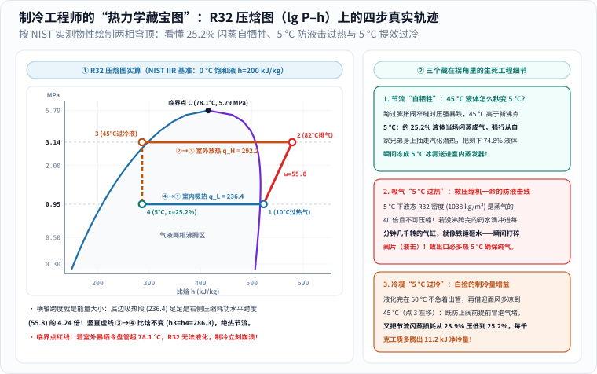
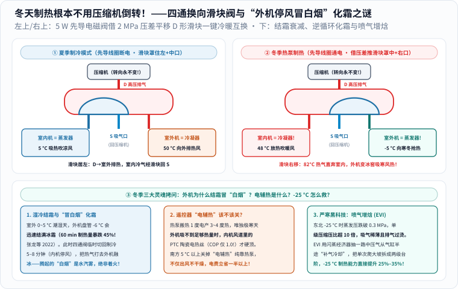
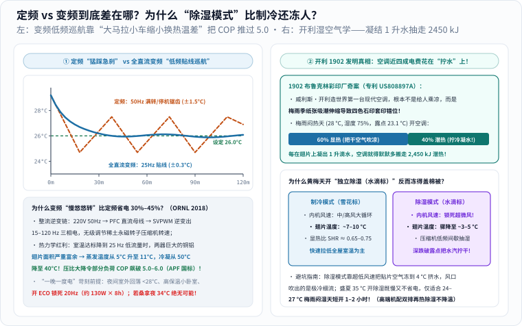
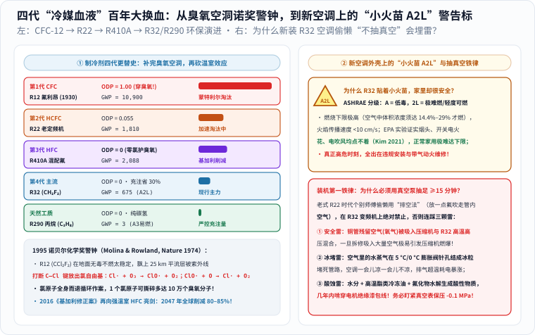

每年一到三伏天或三九寒冬，挂在墙角的空调几乎就是现代人的“续命神机”。可只要你站在窗边多想三秒钟，就会撞上一连串极其反直觉的物理怪事：

- **热量凭什么“逆着坡往上爬”？** 盛夏正午室外 `38 °C` 酷热难耐，屋里明明只有 `27 °C`。初中物理明明教过“热量永远自发从高温传向低温”——空调到底使了什么障眼法，把 `27 °C` 房间里的热量源源不断塞进 `38 °C` 的火炉里？
- **1 度电凭什么撬走 4 度热？** 一台 2000 瓦的电暖器耗 `1` 度电，顶破天只能造出 `1` 度电的热量；可一台一级能效空调耗 `1` 度电，却能从屋里搬走 **`3.8` 到 `5` 度电**的热量——难道它偷偷绕过了能量守恒定律？
- **冬天外机为什么突然停风、冒起一团“白烟”？** 空调压缩机内部有单向阀片和油泵，**绝对不能倒转**；它是怎么在夏天吹冷风、冬天吹热风之间一秒切换的？寒冬湿冷天，室外机为什么会突然自己停转，呼呼往外冒起一大团吓人的“白烟”？
- **为什么梅雨天开“水滴除湿”比制冷还冻得盖棉被？** 同样是挂机吹风，“雪花制冷”和“水滴除湿”在铜管里到底干了什么不一样的事？为什么世界第一台现代空调发明出来时，根本不是为了给人乘凉？
- **新空调外机上的“黄色小火苗 `A2L`”和“抽真空 15 分钟”到底防什么？** 为什么老式氟利昂会被写进诺贝尔化学奖的警钟里淘汰，而今天装一台新 R32 空调，但凡安装师傅偷懒省掉抽真空，就等于给机器埋下三颗定时炸弹？

别被“变频、新一级能效、全直流、喷气增焓、新冷媒”这些满天飞的宣传词绕晕。从热力学与流体工程的底层看，地球上所有分体式空调、冰箱、冷库乃至空气能热水器，全都在干同一件极优雅的事：

> **空调从来不“制造冷气”——物理学里压根不存在一种叫“冷”的物质，冷只是热被搬走后的空缺。空调真正的身份是一台“热泵（Heat Pump）”：它利用液态冷媒沸点随压强剧烈升降的脾气，把同一管药水在屋里变成“低于室温的海绵”吸干热量，再拿到屋外捏成“高于气温的海绵”把热挤进酷暑里 [[1]](#ref-1)。**

下面我们就顺着一根封闭铜管里的冷媒走一圈，把空调的四大器官、压焓藏宝图、冬夏换向机关、变频除湿策略以及百年冷媒大换血一次拆透。

---

## 一、破除最大直觉误区：空调根本不“造冷”，它是一块反复拧干、松开的“热力学海绵”

### 1. 热力学第二定律没破产：靠“改沸点”造出两段局部顺坡滑梯

先解开第一个死结：**屋里 `27 °C`、屋外 `38 °C`，热量怎么可能往更烫的屋外流？**

答案只有一句话：**热量自始至终半步都没有“逆流”过！**

想象你手里有一块刚浸过冰水的海绵，想把桌上洒掉的水吸走，再挤进窗外的水桶里：

1. 在屋里，你**松开手**，海绵变得蓬松干渴，桌上的水立刻自发吸进海绵里；
2. 走到窗外，你**狠狠攥紧拳头**，海绵里的水无处可藏，哗啦一下流进水桶；
3. 把拧干的海绵拿回屋里一松手，它又开始新一轮吸水。

空调铜管里奔流的**制冷剂（俗称“冷媒”或“雪种”，目前家用绝对主力是四代冷媒 `R32`，化学式二氟甲烷 $$\mathrm{CH_2F_2}$$）**，就是这块神奇的“热力学海绵”。我们在[咖啡机工作原理长文]()里刚刚见过饱和蒸汽压铁律——**任何液体的沸点都不是死数字，压强越低沸点越低，压强越高沸点越高**；而在[哈气暖手吹气冰凉长文]()里我们也算过，**液体汽化沸腾和气体液化凝结时吞吐的“相变潜热”，比单纯升温降温大出几十倍**！

查美国国家标准与技术研究院（NIST）实测流体热物性数据库 [[1]](#ref-1)，`R32` 在一个标准大气压（$$0.101\ \mathrm{MPa}$$）下的沸点低达 **`-51.7 °C`**——放在常温空气里瞬间就会像烧开水一样剧烈沸腾！空调工程师正是抓住了这个脾气，用**压缩机、冷凝器、电子膨胀阀、蒸发器**四个核心器官围成一圈全封闭铜管，硬生生在屋里屋外造出了**两段局部顺坡滑梯**：

_先看左侧四器官闭环（首次加载含一次冷媒流向脉冲动画；开启系统“减少动态效果”时直接呈现完整静态标注）：① 外机**压缩机**把低压冷媒气狠狠挤到 $$3.14\ \mathrm{MPa}$$（约 $$31.4$$ 个大气压），沸点瞬间被抬高到 **`50.0 °C`** [[1]](#ref-1)；② 进入外机**冷凝器**后，因为管内 `50 °C` **高于**室外酷暑 `38 °C`，热量完全顺着热力学第二定律往室外大气狂泻，冷媒液化成 `45 °C` 液体；③ 钻过穿墙窄缝般的**电子膨胀阀**，压强骤降回 $$0.95\ \mathrm{MPa}$$，沸点瞬间暴跌到 **`5.0 °C`** [[1]](#ref-1)；④ 流进室内挂机**蒸发器**后，因为管内 `5 °C` **低于**室温 `27 °C`，屋里的热气又乖乖顺坡钻进铜管把冷媒煮沸！再看右侧能量账本：电功只是“攥海绵的手劲”，真正搬走的是几倍大的相变潜热。[单独打开大图（刷新可重播单次流向动画）](/assets/images/air-conditioner-principles/vapor-compression-sponge-loop.svg)。_

看明白这招“偷天换日”有多绝了吗？

- **在室内挂机里**：`27 °C` 室温面对 `5 °C` 冰冷铜管，是**高温传向低温（顺流！）**；
- **在室外主机里**：`50 °C` 滚烫铜管面对 `38 °C` 酷暑空气，**依然是高温传向低温（还是顺流！）**。

热力学第二定律从头到尾稳坐钓鱼台，只是压缩机在中间垫了一脚机械功，把冷媒的沸点在 `5 °C` 与 `50 °C` 之间来回切换而已！

### 2. 1 度电凭什么搬走 4 度热？能效比 COP 与卡诺天花板

这就顺手解开了第二个疑惑：**为什么电暖器 1 度电最多换 1 度热，空调 1 度电却能搬走 4 度热？**

因为两者的工种根本不在一个维度上（关于热力学第一定律与状态参量的底层逻辑，可对照[踩刹车动能去哪了与状态参量长文]()）：

- **电暖器 / 电吹风是“造热苦力”**：它靠电流撞击电阻丝把高品位电能直接降级成焦耳热，输入电功 $$W$$，输出热量最多等于 $$W$$，效率天花板被能量守恒死死焊在 $$100\%$$。
- **空调 / 热泵是“快递小哥”**：你付给快递员 `1` 块钱跑腿费（输入压缩机电功 $$W$$），他开着小推车从屋里搬走了 `4.2` 块钱的货物（从室内吸走相变潜热 $$Q_L$$），最后连货带自己出的汗一共往室外卸下了 `5.2` 块钱的热量（向室外排热 $$Q_H$$）！

严格写下封闭循环的热力学第一定律能量守恒账单：

$$
Q_H = Q_L + W
$$

按 NIST 数据库 `R32` 标准空调工况（蒸发 `5 °C`、冷凝 `50 °C`、过热 `5 °C`、过冷 `5 °C`）实算每千克冷媒跑一圈的能量收支 [[1]](#ref-1)：

- 室内蒸发器吸走净冷量：$$q_L = 236.4\ \mathrm{kJ/kg}$$；
- 压缩机消耗轴功：$$w = 55.8\ \mathrm{kJ/kg}$$；
- 室外冷凝器排向热风的总热量：$$q_H = 236.4 + 55.8 = 292.2\ \mathrm{kJ/kg}$$——分毫不差严丝合缝守恒！

由于空调的能效常常远超 `100%`，工程师不用“效率 $$\eta$$”这个词（免得外行误以为造出了永动机），而是专门定义了**性能系数（Coefficient of Performance，简称 `COP`，单冷额定工况常称能效比 `EER`）**：

$$
\mathrm{COP}_{\mathrm{cool} } = \frac{Q_L}{W} = \frac{236.4}{55.8} \approx 4.24, \qquad \mathrm{COP}_{\mathrm{heat} } = \frac{Q_H}{W} = \frac{Q_L + W}{W} = \mathrm{COP}_{\mathrm{cool} } + 1 \approx 5.24
$$

扣除内外机风扇与变频电路损耗后，一台主流新一级能效空调实测整机额定 `COP` 依然高达 **`3.6–4.2`**（低频巡航时甚至超过 **`5.5`** [[7]](#ref-7)）！

那 `COP` 能不能无限做大，比如 `1` 度电搬走 `100` 度热？绝无可能！1824 年萨迪·卡诺早已用热力学第二定律给所有逆向热机划死了理论天花板——当室内绝对温度为 $$T_C$$、室外绝对温度为 $$T_H$$（单位开尔文 $$\mathrm{K} = {^\circ\mathrm{C} } + 273.15$$）时，宇宙间任何制冷机的理论最高 `COP` 绝不可能跨过**逆卡诺极限**：

$$
\mathrm{COP}_{\max,\mathrm{cool} } = \frac{T_C}{T_H - T_C}
$$

看一眼分母里的室内外温差 $$\Delta T = T_H - T_C$$，你就瞬间懂了**为什么空调每调高 `1 °C` 能实打实省电 `7%–10%`**：

- 把遥控器从 `24 °C` 调高到 `26 °C`–`27 °C`，一方面房间向室外漏热变慢，另一方面压缩机需要跨越的“温度台阶” $$T_H - T_C$$ 直接变矮了！台阶越矮，搬同一份热需要的电功 $$W$$ 就呈比例暴跌。

### 3. 三十秒读懂自家空调身份证：“1.5 匹”与“KFR-35GW”到底写的啥？

顺手破译两个买家电时最常让人犯迷糊的行话——**“几匹”**和机身侧面的神秘代码 **`KFR-35GW/Bp`**：

1. **为什么制冷量 `3500 W` 叫“1.5 匹”，压缩机耗电却只有 `900 W`？**
   “匹（HP，马力）”原本是蒸汽机时代的**电机输入功率**单位（$$1\ \text{公制马力} \approx 735.5\ \mathrm{W}$$）。上世纪日本早期定频空调压缩机输入 `1` 马力（连风扇约 `800 W` 电功率）时，乘上当时的能效比 `COP ≈ 3.0–3.2`，刚好能搬走约 **`2300–2500 W`** 的制冷量！久而久之，行业把**`2500 W` 制冷量俗称为 `1 匹`**，`3200–3500 W` 叫 **`1.5 匹`**（适合 `15–22 m²` 卧室），`5000 W` 叫 **`2 匹`**，`7200 W` 叫 **`3 匹`**（客厅柜机）。今天新一级能效 `1.5 匹` 空调制冷量依然是 `3500 W`，但额定耗电早已降到了 `800–900 W` 左右！
2. **国标型号字母拆解（以最常见的 `KFR-35GW/Bp` 为例）**：
   - **`K`** = 房间空气调节器（**K**ongtiao）；
   - **`F`** = 分体式结构（**F**enti，一内一外两台机器；窗机则是整体式 `KC`）；
   - **`R`** = 热泵型冷暖两用（**R**ebeng；如果没写 `R` 只写 `KF-35GW`，就是冬天不能制热的**单冷机**！）；
   - **`35`** = 额定制冷量 **`35 × 100 = 3500 W`**（若是 `26` 就是 `2600 W` 大一匹，`50` 就是 `5000 W` 两匹，`72` 就是 `7200 W` 三匹）；
   - **`G`** = 挂壁式室内机（**G**uaji；落地柜机则是 **`L`** 立柜式 `KFR-72LW`）；
   - **`W`** = 室外机（**W**aiji）；斜杠后面的 **`Bp`** = 变频（**B**ian**p**in）。

下次站在电器卖场里扫一眼铭牌，这台机器几匹、单冷还是冷暖、挂机还是柜机、定频还是变频，三秒钟就能一眼看穿！

---

## 二、钻进铜管看懂“压焓藏宝图”：25.2% 闪蒸自牺牲、防液击过热与白捡的过冷度

光知道“海绵吸水放水”还不够。要是你打开一位空调研发工程师的电脑，屏幕正中央永远摆着一张长相酷似歪斜钟罩的曲线图——**制冷剂压焓图（$$\lg P\text{-}h$$ 图）**。只要读懂这张图上的四个拐角，空调铜管里最惊心动魄的三个生死工程细节就会一目了然。

我们直接调用 NIST Chemistry WebBook 国际制冷学会基准（IIR Reference State，规定 `0 °C` 饱和液体比焓 $$h_l = 200.00\ \mathrm{kJ/kg}$$）的 `R32` 实测数据 [[1]](#ref-1)，把标准制冷循环一笔一画绘在真实坐标上：

_先看左侧真实计算压焓图（注意纵轴压强 $$P$$ 为对数坐标 $$\lg P$$，横轴比焓 $$h$$ 为每千克冷媒携带的总热含量）：蓝线以左是纯液相，紫线以右是纯气相，拱顶正中是气液共存的“两相沸腾湿区”，穹顶最高点 $$C$$ 是临界点（`78.15 °C, 5.785 MPa`）[[1]](#ref-1)。底部水平线段 ④→① 的长度（`236.4`）代表室内吸热量，右侧斜线段 ①→② 的水平投影（`55.8`）代表压缩机耗功——两者长度之比 `4.24` 就是肉眼可见的理论 `COP`！再看右侧三张工程卡片，读懂为什么拐角 ① 必须向右探出拱顶、拐角 ③ 必须向左探出拱顶。[单独打开大图](/assets/images/air-conditioner-principles/r32-pressure-enthalpy-dome-cycle.svg)。_

### 1. 节流阀里的“壮士断腕”：45 °C 温热液体怎么一眨眼冻成 5 °C 冰雾？

很多好奇的读者第一次看空调原理都会卡在这里：**从室外冷凝器流出来的冷媒液体明明还有 `45 °C`（比体温还热！），它只是钻过了一截细细的毛细管或电子膨胀阀针孔（图中 ③$$\to$$④），既没有风扇吹它、也没有冰块敷它，凭什么穿过针孔的下一毫秒就瞬间冻成了 `5 °C` 的冰水雾？**

这就是压焓图上竖直坠落线 **③$$\to$$④（等焓节流，$$h_4 = h_3 = 286.31\ \mathrm{kJ/kg}$$）** 上演的“壮士断腕”大戏：

1. 冷媒挤过微米级窄缝的时间不到几毫秒，根本来不及跟外界交换热量，因此流过去前后每千克冷媒携带的总能量（比焓 $$h$$）**严格不变**；
2. 可是窄缝出口的压强已经从 $$3.141\ \mathrm{MPa}$$ 断崖跌到了 $$0.951\ \mathrm{MPa}$$！在这个低压下，液态 `R32` 最高只允许活在 **`5.0 °C`**（对应饱和液体比焓只有 $$h_l = 208.80\ \mathrm{kJ/kg}$$）[[1]](#ref-1)；
3. `45 °C` 液体身上多出来的 $$286.31 - 208.80 = 77.51\ \mathrm{kJ/kg}$$ 热量往哪儿去？别无选择——**冷媒队伍里当场有一部分液体瞬间原地“闪蒸爆炸”变成气体（吸走高达 $$L_{\mathrm{vap} } = 307.31\ \mathrm{kJ/kg}$$ 的汽化潜热），强行从身边兄弟身上抽走热量，把剩下的液体活活冻回 `5.0 °C`！**

我们可以用小学除法精确算出有多少冷媒当了这个“自我牺牲的英雄”（热力学叫**节流干度 $$x_4$$**）：

$$
x_4 = \frac{h_3 - h_{l,5^\circ\mathrm{C} } }{h_{v,5^\circ\mathrm{C} } - h_{l,5^\circ\mathrm{C} } } = \frac{286.31 - 208.80}{516.11 - 208.80} = \frac{77.51}{307.31} \approx 25.2\%
$$

也就是说：**穿过膨胀阀的一瞬间，整整 `25.2%`（约四分之一）的液态冷媒当场汽化牺牲，把剩下 `74.8%` 的液态冷媒瞬间冰镇成 `5.0 °C` 冰雾送进室内挂机！** 接下来真正替你房间吸热吹冷风的，正是这剩下的 `74.8%` 液态冷媒。

### 2. 吸气口那救命的“5 °C 过热度”：为什么压缩机最怕喝到一口液态冷媒？

再看压焓图右下角的拐点 **①**：既然冷媒在 `5 °C` 就沸腾吸热完了，为什么不沿着饱和气线（紫线）直接吸进压缩机，非要在蒸发器尾巴上多烤热 `5 °C`，变成 **`10 °C` 的过热纯气体**才敢放进压缩机？

查一眼 NIST 物性表里的密度对比，你就吓出一身冷汗了 [[1]](#ref-1)：

- 在 `5.0 °C` 饱和状态下，气态 `R32` 密度只有 **$$25.89\ \mathrm{kg/m^3}$$**，像弹簧一样松软可压缩；
- 而同温度下液态 `R32` 的密度高达 **$$1037.7\ \mathrm{kg/m^3}$$**——比水还沉，整整是气态密度的 **`40.1` 倍**，而且**液体几乎不可压缩**！

家用空调的旋转式或涡旋式压缩机，内部气缸与月牙腔正以每分钟 **`3000–6000` 转**的高速精密咬合，间隙只有几十微米。如果室内冷媒没沸腾干净，哪怕混着一小股液态冷媒水珠冲进气缸，高速活塞迎头撞上不可压缩的液体，瞬间就会爆发如同铁锤砸水般的超高液压冲击——工程上叫**“液击（Liquid Slugging）”**，轻则冲碎排气舌簧阀片、稀释润滑冷冻油导致抱轴卡死，重则当场把压缩机顶盖打穿！

因此，现代变频空调的**电子膨胀阀（EEV，内部由步进电机驱动针阀，可在 `0–500` 步之间微米级调节开度）**每时每刻都在紧盯蒸发器出口温度传感器，死守 **`3–6 °C` 吸气过热度**这条生死红线，确保喂进压缩机的每一口都是 `100%` 纯净干爽的气体。

### 3. 冷凝器末尾的“5 °C 过冷度”与 78.15 °C 临界红线：为什么暴晒外机会集体“热罢工”？

反过来看左上角的拐点 **③**：冷媒在外机冷凝器里明明在 `50 °C` 就已经全部液化成水了（到达蓝色饱和液线 $$h_l = 297.49\ \mathrm{kJ/kg}$$），为什么外机风扇还要对着最后两排铜管继续猛吹，把它进一步吹凉 `5 °C` 变成 **`45 °C` 过冷液体**（$$h_3 = 286.31\ \mathrm{kJ/kg}$$）？

这“多吹凉 `5 °C`”藏着一箭双雕的甜头：

1. **防气塞卡死膨胀阀**：如果液体刚刚卡在沸点边缘进管路，沿途哪怕遇到一点摩擦降压就会提前冒出气泡，把细小的膨胀阀针孔堵成“气塞”；过冷 `5 °C` 让液体稳稳远离沸腾线。
2. **白捡近 `5%` 的免费制冷量**：如果不做过冷直接从 `50 °C` 饱和液（$$297.49\ \mathrm{kJ/kg}$$）节流，闪蒸自牺牲比例会高达 `28.9%`；仅仅靠室外风把液体多吹凉 `5 °C`，闪蒸损失就压低到了 `25.2%`，每千克冷媒凭空多赚回 **$$11.2\ \mathrm{kJ}$$** 室内净冷量——全是不费一分钱压缩机电功白捡的！

同时请注意压焓图穹顶最高处那颗刺眼的红点——**`R32` 临界点 $$C$$（临界温度 `78.15 °C`、临界压强 `5.785 MPa`）** [[1]](#ref-1)。物理学铁律规定：**一旦温度跨过临界温度，无论你把气体压缩到几百个大气压，气态和液态的界线都会彻底消失（进入超临界流体态），再也无法冷凝成液体！**

这就是为什么每年盛夏 `40 °C+` 极端高温周，那些被开发商塞进封闭百叶窗死角、“自己吹出的热风又被自己吸回去”的空调外机，进风温度会一路恶性循环飙过 `60–70 °C`，管内冷凝压力直逼 `4.5–5.5 MPa` 临界红线——冷媒液化不了，排气温度突破 `115 °C`，主板过热保护立刻切断压缩机！遇到大暑天空调突然“只吹自然风不制冷”，先别急着花几百块找人“加氟”，去摸一眼外机百叶窗是不是闷成蒸笼了，十有八九是外机散热窒息触发了高压热保护！

---

## 三、冬天制热根本不用压缩机倒转！四通换向阀、“冒白烟”化霜与电辅热真相

到了冬天，当你把遥控器从“雪花”按到“小太阳（制热）”时，室内挂机几分钟后就吹出了暖烘烘的 `45 °C` 热风，而窗外主机却吹出了冻骨头的冰风。既然压缩机绝对不能倒转，空调是怎么把室内外两台换热器的身份瞬间对调的？

### 1. 压缩机永远单向转：一颗 5 W 先导电磁阀怎样借 2 MPa 压差“乾坤大挪移”？

拆开任何一台冷暖型（带 `R` 标）空调外机的顶盖，你都会在压缩机旁边看到一根长着**四根粗铜管接口**、背上还驮着一个小巧电磁线圈的黄铜圆筒——它就是冷暖热泵的灵魂机关：**先导式四通换向阀（4-Way Reversing Valve）** [[5]](#ref-5)。

_对比上半部左右两图（压缩机转向始终不变，顶部 `D` 口永远喷出 `82 °C` 高压热气，底部中间 `S` 口永远吸回低压冷气）：① 左侧**夏季制冷**时，先导电磁线圈断电，主阀腔内碗状 `D` 形滑块靠左罩住“左口+中口 `S`”，压缩机吐出的滚烫热气被迫往右拐进**室外机**散热，**室内机**连回吸气口 `S` 专心吸热制冷；② 右侧**冬季制热**时，仅 `5 W` 功率的先导电磁阀通电打开微型泄压毛细孔 [[5]](#ref-5)，利用冷媒自身超过 `2 MPa` 的高低压差把 `D` 形滑块猛推向右罩住“中口 `S`+右口”——压缩机吐出的 `82 °C` 热气瞬间左转直奔**室内挂机**放热吹暖风，而**室外机**连上吸气口变成 `-5 °C` 的蒸发器，在寒风里硬生生向零度空气“偷热量”！再看下半部三大冬季灵魂拷问。[单独打开大图](/assets/images/air-conditioner-principles/four-way-reversing-valve-and-defrost.svg)。_

仔细品味一下兰柯（Ranco）与浙江三花等阀体专利（如 `US7108008B2` [[5]](#ref-5)）里这个四两拨千斤的机械巧思：

- 在 `3 MPa`（30 个大气压！）的高压铜管里硬推滑块换向，如果直接用电磁铁硬拽，需要碗口粗的巨型线圈和上百瓦电流；
- 工程师在主滑块左右两端各开了一间小小的活塞压力室，用一根发丝细的**先导毛细管**连通高低压。一颗功耗不到 **`5 W`** 的微型电磁针阀只要轻轻推开 `1` 毫米泄掉一侧气压，冷媒自己身上 **`2 MPa` 的恐怖压差**就会化作几百牛顿的推力，“咔哒”一声把尼龙/聚四氟乙烯 `D` 形滑块推到另一头（你冬天开关空调或化霜时听见外机传来那声清脆的“噗嗤——咔哒”叹气声，正是四通阀滑块在高压气流下横移换位的声音！）。

### 2. 外机突然停风冒起一团“白烟”是着火了吗？看懂结霜衰竭与逆循环化霜

每到南方湿冷的冬夜（气温 **`0 °C` 到 `5 °C`**、相对湿度 `>75%`，反倒比北方干冷的 `-10 °C` 更容易触发！），很多家庭都会被窗外吓一跳：空调吹着吹着暖风突然自己停了，紧接着窗外主机风扇也不转了，机身缝隙里却腾起一大团浓浓的**“白烟”**，底下还哗哗淌水——是不是外机电路短路烧着了？！

千万别慌，也千万别拔电源！那是你的空调正在救它自己的命——执行**逆循环化霜（Reverse-Cycle Defrosting）**。

为什么非化霜不可？冬天制热时，室外机扮演的是吸热蒸发器。为了从 `2 °C` 的湿冷空气里抢到热量，外机铜管盘管的温度必须压低到 **`-5 °C` 至 `-8 °C`**。潮湿空气一撞上零下几度的铝翅片，水蒸气连变成水珠都来不及，直接**凝华结成密密麻麻的白霜**！

张龙（Long Zhang）等学者 2022 年发表在《Micromachines》上的热泵结霜实测研究给出了触目惊心的衰减数据 [[6]](#ref-6)：

1. 霜层一旦填满翅片间隙（仅約 `1.5–2.0 mm` 宽），一方面像给外机裹了一层厚棉被（多孔冰霜导热率极低），另一方面把风扇进风通道堵死；
2. 仅仅连续结霜运行 **`60` 分钟**，空气源热泵的**制热量就会暴跌 `45.1%`，整机能效 `COP` 暴跌 `42.5%`** [[6]](#ref-6)！再不除霜，整台外机就会冻成一块大冰坨彻底瘫痪。

怎么以最快速度把外机上的厚冰壳剥掉？四通换向阀再次出马：

- 空调主板检测到外机盘管温度过低后，先**关停室内挂机风扇**（否则接下来几分钟往你脸上吹冰风谁受得了！），同时关停室外机风扇；
- 接着四通阀“噗嗤”一声**临时切回夏季制冷方向 `5–8` 分钟**！压缩机吐出的 `80 °C` 滚烫冷媒直接冲进室外机冰冷的铜管，从骨头缝里往外把整层冰霜瞬间融化剥落；
- 滚烫的铜管遇上融化的冰水，一部分水瞬间蒸发，升腾进零度左右的寒冷夜空里重新凝结成细密的小水滴雾气——**你看到的那团吓人“白烟”，百分之百是干净的水蒸气白雾，跟烧水壶嘴冒白气一个道理，绝不是着火冒黑烟！** 几分钟后冰霜化净，四通阀再次“噗嗤”切回制热，内机暖风满血复活。

### 3. 遥控器上的“电辅热”该不该关？东北 -25 °C 严寒凭什么靠“喷气增焓（EVI）”硬扛？

很多读者从来没注意过，冬天一按“制热”，遥控器角落里默认同步亮起了三个小字：**`电辅热`**。这玩意儿到底是个啥？

说穿了，就是在室内挂机出风口里塞了一根 **`800–1200 W` 的 PTC 陶瓷电热丝**——也就是往你家价值四千块的热泵空调肚子里，硬塞了一台几十块钱的吹风机电阻丝！

算清电费账你就知道什么时候该果断按掉它了：

- 在长江流域及以南绝大多数 **`5 °C` 以上**的冬天，空调热泵本体 `COP` 轻松维持在 **`3.2–4.0`**（花 `1` 度电搬来 `3.5` 度热）；而那根 PTC 电辅热的 `COP` **永远死锁在 `1.0` 以下**（花 `1` 度电只买 `1` 度热，贵出三倍多！）。室温明明够暖时还开着电辅热，不仅吹出来的风燥得嗓子疼，电表更是像电风扇一样狂转——**只要室外在 `5 °C` 以上、屋里暖和得过来，果断关掉遥控器上的“电辅热”，立省三到四成电费！**
- 只有当室外跌破 **`-5 °C` 甚至 `-15 °C`**、普通单级压缩热泵实在从冰天雪地里抠不出足够热量时，电辅热才作为保底救场。

那东北、内蒙 `-25 °C` 的极寒冬天，热泵是不是就彻底废了？传统单级压缩确实扛不住：`-25 °C` 下 `R32` 蒸发压力跌破 `0.33 MPa` [[1]](#ref-1)，吸气稀薄如高原缺氧，压缩比飙破 **`10` 倍**，单级硬压会让排气温度烧穿 `130 °C` 润滑油碳化红线！

现代超低温热泵（中央空调地暖机与高端挂机）使出的杀手锏叫**喷气增焓（EVI，Enhanced Vapor Injection）**：在节流路上加装一只经济器闪蒸罐，抽出一股中压冷媒蒸汽直接从双级压缩机气缸半途的“补气口”打进去——相当于给爬珠峰的压缩机在半山腰修了一座中转氧气站，既给气缸降温又补足冷媒质量流量，让 `-25 °C` 极寒下的纯热泵制热能力硬生生拔高 **`25%–35%`**，无需电热丝也能吹出滚烫暖风！

---

## 四、定频 vs 变频到底差在哪？为什么梅雨天开“独立除湿”反而冻得盖棉被？

### 1. 变频省电 30%–47% 的真正秘密：不是转得快，而是“大马拉小车”缩小换热温差！

买空调时店员总会拍着胸脯说：“买全直流变频，比老定频省电一大截！”可很多人心里其实犯嘀咕：**房间每小时漏进来的热量是固定的，不管定频停停转转，还是变频一直慢慢转，总共要搬走的热量不是一样多吗？凭什么变频就能省电三四成？**

问到点子上了！如果高低转速下每搬走 `1` 份热消耗的电功完全一样，变频确实一分钱电都省不了（顶多温度稳一点）。变频真正的省电魔法，藏在**低频巡航时暴涨的部分负荷 `COP`** 里！

美国能源部橡树岭国家实验室（ORNL）对多款定频与变频分体热泵进行的长期对比实验报告 [[7]](#ref-7) 给出了硬核实测结论：在真实季节运行中，变频空调制冷季节能 **`30%–47%`**，制热季节能 **`27%–51%`**！看下面这张曲线与湿空气学双联图，你就彻底看懂这 `40%` 的电是怎么省出来的了：

_先看左侧定频 vs 变频对比：定频压缩机被电网 `50 Hz` 工频锁死转速，只能“满负荷猛踩油门到 `24.7 °C` $$\to$$ 彻底熄火等室温回升到 `27.5 °C` $$\to$$ 再猛踩油门”，不仅忽冷忽热且每次重启都有浪涌损耗；而**全直流变频**先把 `220 V` 交流电整流成直流，再用逆变模块（Inverter）合成 `15–120 Hz` 任意频率的三相电驱动稀土永磁无刷压缩机。当室温抵达 `26.0 °C` 降到 `25 Hz` 慢转时，两器换热面积严重富裕，蒸发温度升到 `11 °C`、冷凝温度降到 `40 °C`，温度台阶骤缩让低频 `COP` 飙上 `5.0–6.0` [[7]](#ref-7), [[8]](#ref-8)！再看右侧：1902 年开利印刷厂控湿真相与“水滴除湿”冻人原委。[单独打开大图](/assets/images/air-conditioner-principles/inverter-eev-and-psychrometric-dehumidification.svg)。_

仔细拆解这个反直觉的**“大马拉小车热力学红利”** [[7]](#ref-7), [[8]](#ref-8)：

1. 空调内机和外机那两大排铜管铝翅片的面积，是按压缩机 `100%` 满负荷制冷（比如 `3500 W`）设计的。满负荷狂奔时，热流密度极大，为了让热量来得及穿墙过管，内机铜管必须冻到 `5 °C`（比 `27 °C` 室温低 `22 °C`），外机铜管必须烧到 `50 °C`（比 `35 °C` 室外高 `15 °C`），压缩机得苦哈哈地跨越 **`45 °C` 的大高差**（`5 °C → 50 °C`），此时 `COP` 只有 `3.5` 左右。
2. 可房间一旦凉下来进入保温巡航，只需要 **`800–1000 W`** 冷量就能抵消门窗漏热！此时变频压缩机降频到 **`20–25 Hz`** 慢悠悠踱步，流过铜管的冷媒只有满载时的四分之一，却依然独享整整两大排豪华翅片换热面积！
3. 换热面积一旦富裕出三四倍，根本不需要那么大的温差就能把热传过去——**内机蒸发温度自动抬升到 `11–13 °C`，外机冷凝温度自动回落到 `38–41 °C`**！屠呦呦式精准减负后，压缩机要爬的温度台阶从 `45 °C` 直接腰斩到了 **`28 °C` 左右**！代入前面的卡诺公式，部分负荷 `COP` 当场从 `3.5` 狂飙到 **`5.0–6.0` 以上** [[7]](#ref-7), [[8]](#ref-8)！（这也是为什么中国现行国标用计入大量低频工况的**全年能源消耗效率 `APF`** 取代了只看满载的旧国标 `EER`。）

顺便用这笔账一眼戳破经典的广告噱头——**“一晚一度电”是真的吗？**
物理上不撒谎，但前提极其苛刻：必须在**夜间室外气温已退烧到 `28–30 °C` 以下**、且是**保温良好的 `10–14 m²` 小卧室**，睡前已把屋子吹凉，然后开启 `ECO` 模式把压缩机最高频率强行锁死在 `18–20 Hz`（整机功率压到 `120–135 W`，连开 `8` 小时刚好约 `1.0–1.1 kWh`）。要是三伏天火炉城市半夜室外还 `33 °C`、或者挂在大客厅里开 `ECO`，那 `130 W` 的蚊子腿冷量连墙壁漏热都堵不住，半夜准保把你热醒！

### 2. 1902 年布鲁克林印刷厂奇案：世界第一台现代空调根本不是给人乘凉发明的！

再看右半张图，揭开科学史上一桩极有趣的冷知识：**今天每年卖出上亿台的现代空调，当年发明出来时，第一批用户压根不是怕热的富豪或百货商场，而是一摞摞印画报的纸张！**

翻开美国专利商标局保存的 **`US808897A` 号原始专利（《空气处理装置》*Apparatus for Treating Air*，1904 年 9 月 16 日提交、1906 年 1 月 2 日授权）** 与开利历史档案 [[2]](#ref-2)：

- **1902 年盛夏**，纽约布鲁克林的萨克特-威廉姆斯彩印厂（Sackett & Wilhelms Lithographing and Printing Company）老板快急疯了：当时的彩色杂志要分四次套印青、品红、黄、黑四块石印版；可纽约夏天的空气湿度一天一变，纸张主要由亲水植物纤维构成，潮天吸水膨胀几毫米、晴天失水缩回几毫米，印出来的彩色人物五官重影错位，废品堆积如山！
- 年仅 **25 岁**、刚从康奈尔大学毕业没多久的青年工程师**威利斯·开利（Willis Haviland Carrier）**在火车站台盯着大雾凝结灵光一闪，于 **1902 年 7 月 17 日**交出了人类第一套现代温湿度精密控制系统图纸：让空气穿过冰水喷淋盘管，**精准把空气冷却到目标“露点温度（Dew Point）”，把多余水汽强行挤成冷凝水排走**，从而死死锁住车间全年 `55%` 的恒定相对湿度 [[2]](#ref-2)！（顺带一提，“Air Conditioning / 空气调节”这个英文词是 1906 年 5 月美国纺织工程师斯图尔特·克拉默在北卡罗来纳棉纺厂控湿报告里率先造出来的；而 1911 年 12 月 8 日开利在美国机械工程师学会 ASME 发表的传世经典《理性湿空气学公式》*Rational Psychrometric Formulae*，至今仍是全球每一本暖通教科书的奠基圣经 [[2]](#ref-2)。）

哪怕在今天你家卧室里，开利 120 多年前算的那笔**“显热 vs 潜热”湿空气账**依然每分每秒都在扣你的电费！

上海交通大学王如竹团队发表在《Scientific Reports》上的空调温湿度解耦研究算得明明白白 [[8]](#ref-8)：

- 在我国南方闷热的梅雨或桑拿天（比如室温 `28 °C`、相对湿度 `75%`，查湿空气线图可知此时**露点温度高达 `23.1 °C`**），一旦室内空气流过挂机里 **`7–10 °C`** 的冰冷铝翅片，因为翅片远低于 `23.1 °C` 露点，空气根本兜不住水汽，大量水珠哗哗凝结在翅片上，顺着接水盘和穿墙排水管流到室外（这就是空调外墙那根滴水管水的全部来源——**100% 是从你屋里潮湿空气中“拧”出来的蒸馏冷凝水！**）；
- 别小看这滴滴答答的一小管水：常温下水蒸气凝结成液态水的相变潜热高达 **$$2450\ \mathrm{kJ/kg}$$**！也就是说，**空调每往窗外滴满一瓶 `1` 升装矿泉水瓶的冷凝水，就默默替你多搬走了 `2450 kJ` 的潜热——这笔能量如果不拿来拧水，足够把一间 `20 m²` 卧室的干空气从 `35 °C` 暴降 **`40 °C`** 直接冻成零下冰窖！**
- 因此在潮湿夏季，你家空调大约只有 **`60%` 的功力花在降低温度计读数上（显热比 $$\mathrm{SHR} \approx 0.60$$），剩下整整 `40%` 的电费全花在了给空气“拧干水汽”上** [[8]](#ref-8)！为什么同样 `27 °C`，干燥的秋高气爽舒爽宜人，梅雨天却黏腻窒息？因为皮肤汗液蒸发散热看的是空气湿度；空调一开，哪怕室温只降了 `2 °C`，只要湿度从 `80%` 抽干到 `50%`，人体立刻就觉得神清气爽！

### 3. 为什么遥控器切到“水滴除湿模式”，吹出来的风比制冷模式还要冰？

网上流传过无数条“省电偏方”说：“夏天别开制冷模式，改开水滴图标的**除湿模式（Dry）**，又凉快又省电！”结果照着做的人到了半夜全被冻醒找棉被，甚至冻得肩颈酸痛——这又是为什么？

对比一下空调主板在两种模式下的真实控制逻辑就破案了：

| 对比维度 | 制冷模式（雪花图标 Cool） | 独立除湿模式（水滴图标 Dry） |
| :--- | :--- | :--- |
| **首要控制目标** | 快速把室温降到设定温度并稳住 | 不惜代价把翅片冻到极低以拧干水汽 |
| **室内机风机转速** | **中高风 / 自动大风**（大风量快循环） | **强制锁死超低微风**（让空气慢速贴紧冰翅片） |
| **室内蒸发器翅片温度** | 约 **`7–11 °C`**（兼顾舒适与高能效） | 骤降至 **`3–5 °C`**（深跌破露点极限凝水，防结冰边缘） |
| **出风口体感与运行方式** | `14–17 °C` 柔和大风，达标后低频恒温 | **`10–12 °C` 刺骨小冷风**，压缩机低频间歇启停 |

真相大白了：普通家用挂机只有一排蒸发器，**除湿的唯一手段就是把翅片冻得更冰、把风速压得更慢**，让每一口流过的空气都在 `4 °C` 冰片上停留足够久，把水分彻底冻成水珠挂下来！代价就是流出来的风虽然小，温度却只有刺骨的 `10 °C` 出头，而且室温越抽越低，在 `24 °C` 春秋梅雨天开久了妥妥把房间抽成 `19 °C` 冷库！（只有搭载双排换热器、能把冷凝废热引一半回来给干冷风重新回温的高端**“再热除湿（Reheat Dehumidification）”**空调，才能做到“只降湿度不降室温”。）

所以记住两条黄金使用法则：

- **`30 °C` 以上的盛夏酷暑**：老老实实开**制冷模式（`26 °C` + 自动风）**！开除湿模式风量太小，屋子半天凉不透，低温低风还会拉低 `COP` 反而更费电；
- **`24–27 °C` 不太热但墙壁冒汗的梅雨天**：开**独立除湿模式 `1–2` 小时**把湿度抽下来就关掉或切回睡眠微风，干爽又不挨冻！

---

## 五、四代“冷媒血液”百年大换血：从诺贝尔奖臭氧警钟，到新机外壳上的“小火苗 A2L”与抽真空铁律

最后，让我们把目光投向铜管里流淌的那管“无色透明血液”——**制冷剂**。短短一百年间，空调冷媒已经经历了整整**四代全球大换血**；而每一次换血背后，都是一场波及全人类大气层的科学与工程博弈。

_先看左侧四代冷媒演进时间轴与两项生死环保指标（`ODP` 臭氧消耗潜能值、`GWP` 百年全球变暖潜能值 [[9]](#ref-9), [[10]](#ref-10)）：从 1930 年穿破臭氧层的第一代氟利昂 `R12`，到过渡二代 `R22`、不伤臭氧却有强温室效应的三代 `R410A`，再到今天兼顾零臭氧破坏与低温室效应的四代主力 `R32` 与天然碳氢 `R290`。再看右侧：为什么新空调贴着黄色“小火苗 `A2L`”在家里却极其安全 [[11]](#ref-11)，以及为什么装新机绝不允许用老式“排空法”替代抽真空！[单独打开大图](/assets/images/air-conditioner-principles/refrigerant-generations-ozone-and-a2l.svg)。_

### 1. 从救命神药到臭氧元凶：1 个氯原子怎样在平流层连环撕碎 10 万个臭氧分子？

在 1930 年以前，人类早期的制冰机和冷库里装的全是令人闻风丧胆的“致命毒药”：**氨气（$$\mathrm{NH_3}$$，剧毒刺鼻且可燃）、二氧化硫（$$\mathrm{SO_2}$$，剧毒腐蚀）、氯甲烷（$$\mathrm{CH_3Cl}$$，有毒易爆）**——1929 年美国克利夫兰医院甚至因为医用冷库氯甲烷泄漏引发过上百人遇难的惨剧。

1930 年春天，通用汽车与 Frigidaire 冰箱公司的化学家**托马斯·米奇利（Thomas Midgley Jr.）**、亨尼与麦克纳里团队仅用三天时间筛选元素周期表，合成出了二氯二氟甲烷 **`CFC-12`（$$\mathrm{CCl_2F_2}$$，即第一代“氟利昂 Freon-12”，美国专利 `US1930129A`，1930 年 4 月 5 日提交）** [[3]](#ref-3)。在发布会上，米奇利当众深深吸了一大口氟利昂气体，然后对着一支燃烧的蜡烛缓缓吹灭——借此证明这种新分子**既完全无毒，又绝对不燃，化学性质稳如泰山**！

谁也没想到，**恰恰是“化学性质太稳定”这一个优点，在半个世纪后差点捅穿地球生命的保护伞！**

1974 年，加州大学欧文分校的**马里奥·莫利纳（Mario J. Molina）**与**舍伍德·罗兰（F. Sherwood Rowland）**在《Nature》杂志发表了震动世界的论文（两人与保罗·克鲁岑共同荣获 **1995 年诺贝尔化学奖** [[4]](#ref-4)）：

1. 正因为 `CFC-12`（$$\mathrm{CCl_2F_2}$$）和二代过渡冷媒 `HCFC-22`（`R22`，$$\mathrm{CHClF_2}$$）在对流层里百毒不侵、不溶于雨水，每年从报废冰箱、空调和发胶罐里漏出的几十万吨气体，会在大气中安然存活 **`50` 到 `100` 年**，一路缓慢飘上距离地面 **`25` 公里高的平流层臭氧层**；
2. 在没有厚大气遮挡的高空平流层，太阳高能短波紫外线（$$\lambda < 230\ \mathrm{nm}$$）像激光剪刀一样咔嚓打断碳-氯共价键（$$\mathrm{C-Cl}$$），释放出极度活跃的**氯自由基 $$\mathrm{Cl\cdot}$$**：

$$
\mathrm{CCl_2F_2} \xrightarrow{h\nu\ (\mathrm{UV})} \mathrm{CClF_2\cdot} + \mathrm{Cl\cdot}
$$

3. 最可怕的不是氯原子吃掉一个臭氧，而是它开启了**“全身而退的催化链式屠杀”** [[4]](#ref-4)：

$$
\begin{aligned}
\mathrm{Cl\cdot} + \mathrm{O}_3 &\longrightarrow \mathrm{ClO\cdot} + \mathrm{O}_2 \\
\mathrm{ClO\cdot} + \mathrm{O} &\longrightarrow \mathrm{Cl\cdot} + \mathrm{O}_2
\end{aligned}
$$

把上下两式相加，净反应是 $$\mathrm{O}_3 + \mathrm{O} \to 2\mathrm{O}_2$$——臭氧分子被撕成了普通氧气，而那个凶手 **$$\mathrm{Cl\cdot}$$ 在第二步结尾完好无损地复活了**！据诺贝尔奖委员会核实，**仅仅 `1` 个氯自由基在最终被锁进氯化氢飘落之前，就能连环摧毁多达 `100,000`（十万）个臭氧分子** [[4]](#ref-4)！

1985 年英国科学家法曼（Farman）在南极上空实测拍到触目惊心的巨型臭氧空洞，短短两年后的 **1987 年**，全世界罕见地团结签署了人类环保史上最成功的国际条约——**《蒙特利尔议定书》**，彻底判处含氯 `CFCs` 死刑，并对二代含氢氯氟烃 `R22`（老式定频空调最常用的“雪种”，`ODP = 0.055` [[10]](#ref-10)）启动全球淘汰倒计时。

### 2. 堵住臭氧空洞，又撞上温室效应：从 R22、R410A 到基加利修正案下的 R32 与 R290

为了彻底保住臭氧层，第三代冷媒干脆把分子里的**氯原子（$$\mathrm{Cl}$$）全部踢光**，只留碳、氢、氟三种元素——这就是氢氟烃（`HFCs`），代表作是前些年变频空调普遍使用的 **`R410A`**（由 `50% R32 + 50% R125` 混配而成）。

没有了氯原子，`R410A` 的臭氧消耗潜能值 **`ODP = 0`（对臭氧层零伤害！）** [[10]](#ref-10)。可还没等工程师松一口气，气候学家算出了第二个噩耗：**碳-氟键（$$\mathrm{C-F}$$）对地面散发的红外热辐射吸收极强！** 查美国环保署（EPA SNAP）与联合国环境署官方数据 [[9]](#ref-9), [[10]](#ref-10)：

- 排放 `1` 千克二氧化碳的百年全球变暖潜能值定义为基准 **`GWP = 1`**；
- 而排放 `1` 千克 `R410A` 造成的温室效应，居然顶得上排放 **`2088` 千克（超过两吨！）二氧化碳**（`GWP = 2088`）！如果任由全球数十亿台空调填满高 `GWP` 氢氟烃，到本世纪末光冷媒泄漏就能把地球额外烤热 **`0.5 °C`** [[9]](#ref-9)！

于是 2016 年 10 月，全球 197 个缔约方在卢旺达首都达成《蒙特利尔议定书》**《基加利修正案》（Kigali Amendment）**，承诺到 2047 年将全球高温室效应 `HFCs` 削减 **`80%–85%`** [[9]](#ref-9)。今天你走进商场买到的几乎所有新款家用分体空调，都已经换装了第四代主流冷媒 **`R32`（纯二氟甲烷 $$\mathrm{CH_2F_2}$$）**，部分欧洲与中国新型小匹数空调甚至用上了终极天然工质 **`R290`（高纯度丙烷 $$\mathrm{C_3H_8}$$）**：

- **`R32` 的硬实力**：`ODP = 0`，`GWP = 675`（直接砍掉 `R410A` 三分之二以上的温室效应 [[10]](#ref-10)），而且单位容积潜热极大（我们在第二章算过 `5 °C` 汽化潜热高达 `307.3 kJ/kg`，比 `R410A` 高出近四成！），充注量还能再省 `20%–30%`，整机能效再涨 `3%–5%`！
- **`R290` 的终极环保与限制**：纯碳氢天然物质，`ODP = 0`，**`GWP = 3`（温室效应几乎为零！）** [[10]](#ref-10)；唯一软肋是丙烷属于 **`A3` 级易燃气体**，因此单台家用挂机的密封充注量被国际安全标准严格限制在约 `300 g` 以内。

### 3. 外机贴着“黄色小火苗 A2L”家里会炸吗？为什么装新空调绝不能省掉“抽真空 15 分钟”？

很多细心的读者买回新空调，看到外机和说明书上印着一枚醒目的**黄色三角形火焰图标（标着 `R32` / `A2L`）**，心里顿时咯噔一下：“空调里装可燃气体，夏天暴晒在卧室墙上会不会爆炸？！”

用权威实验数据给你吃一颗定心丸——**正常家用 `R32` 空调比你厨房里的天然气、甚至比桌上的高度白酒和摩丝发胶都要安全得多！**

根据美国采暖、制冷与空调工程师学会（ASHRAE 34）及 EPA SNAP 安全分级 [[10]](#ref-10)，冷媒安全性由“字母（毒性）+ 数字（可燃性）”组成：

- **`A`** 代表**低毒性**；
- **`1`** = 不可燃（如 `R410A`），**`2L`** = **极难燃 / 轻度可燃（Lower Flammability，末尾那个 `L` 专门代表火焰传播速度低于 `10 cm/s` 的极慢燃级别！）**，**`2`** = 可燃，**`3`** = 易燃（如 `R290` 丙烷）。

马里兰大学金（Kim）与桑德兰（Sunderland）团队 2021 年专门把 `R32` 等 `A2L` 制冷剂对准几十种家庭真实火源做过严苛引燃实验 [[11]](#ref-11)，结论非常明确：

1. **燃烧下限极高**：`R32` 在空气中体积浓度必须凑够 **`14.4%` 到 `29%`** 之间才有可能被点着！一台 `1.5` 匹挂机总共只充注约 `600–750 g` 的 `R32`，就算整管冷媒瞬间全部漏进一间 `15 m²`（容积约 `42 m³`）的卧室，平均体积浓度也只有区区 **`0.8%`**——连燃烧下限的十分之一都够不着！
2. **日常电火花根本点不着**：实验实证，**吸着的烟头、墙壁电源开关弹出的电火花、电吹风滚烫的发热丝、人体静电火花、烤面包机，统统无法点燃 `A2L` 制冷剂** [[11]](#ref-11)（因为它的最小点火能比甲烷高出几十倍，火焰传播速度不到 `6.7 cm/s`，人走两步的气流都能把火苗吹灭；只有 `>740 °C` 持续赤热电阻丝或明火喷枪对准高浓度泄漏口才可能引燃）。

那新闻里偶尔听到的“修空调外机爆燃事故”是怎么来的？**100% 全出在违规安装与野蛮维修上！**

这就引出了买新空调时最重要的一条现场监工铁律——**“三分产品、七分安装：装 `R32` / `R410A` 空调，必须用电动真空泵实打实抽真空至少 `15` 分钟！”**

为什么？因为内机和连接铜管刚拆封接好时，管子里装满了普通空气和水汽（外机出厂时冷媒锁在截止阀内）。在二十年前的老式 `R22` 定频机时代，不少图省事的师傅不背真空泵上楼，而是拧松螺母放一点点氟利昂把管内空气“顶”出去，俗称**“内气排空法”**。在今天的新空调上，这种偷懒手法被厂家红字严令禁止，否则一箭埋下**三颗雷**：

1. **安全红线（防混氧压缩爆燃）**：更危险的还发生在日后检修移机时——如果系统未规范抽真空或压缩机在阀门关闭、连接口敞开吸进大量空气的状态下通电运转，空气中的氧气与 `R32` 及雾化冷冻油在气缸内被剧烈绝热压缩到几兆帕、几百摄氏度，就会像柴油机压燃一样在壳体内部引发**混气爆燃**！同样，未彻底排净并抽空残余 `R32` 前，严禁直接动用氧焊明火烧铜管。
2. **性能红线（防 `0 °C` 冰堵）**：空气里残留的微量水蒸气混进冷媒后，一流到电子膨胀阀 `0 °C–5 °C` 的微米级针孔处，就会当场冻成一颗小冰晶把节流口死死堵住（**冰堵**）——表现症状极其诡异：空调刚开十分钟挺凉，突然就不制冷了；关机歇一会儿冰化了又凉十分钟，周而复始把压缩机活活憋烧！
3. **寿命红线（防酯类油水解产酸腐蚀）**：`R32` 与 `R410A` 压缩机内部使用的合成**多元醇酯类润滑油（POE 油）**极度亲水！一旦管内残留水汽，高温高压下水分子会让酯类油发生水解，并与微量氟化物反应生成**有机酸与氢氟酸**，像硫酸一样从内部慢慢啃穿压缩机电机铜绕组的绝缘漆包线，两三年后直接短路报废！

下次师傅上门装空调，你根本不用懂复杂术语，只需客气地盯住两件事：**第一，接上真空泵连续抽满 `15` 分钟以上（大匹数柜机 `20–30` 分钟），指针稳稳停在 `-0.1 MPa`（约 `-76 cmHg`）负压刻度底端；第二，关泵后再静置保压 `3–5` 分钟看指针回不回弹（验证喇叭口有没有拧漏气）**，最后再拧开内六角截止阀放冷媒——做足这两步，你家空调十年都不用花一分冤枉钱修铜管！

---

## 六、一张表带走：空调全工况物理参数与省电避坑总表

把整篇文章涉及的核心热力学数字、机械机关与日常使用铁律浓缩在一张速查表里：

| 核心问题 | 底层物理 / 工程机制 | 关键实测数字（以主流 R32 为例） | 居家省电与安全指南 |
| :--- | :--- | :--- | :--- |
| **热怎么往 `38 °C` 室外跑？** | 压缩抬升沸点放热，节流压低沸点吸热，全程局部顺流 | 室内 `0.95 MPa → 5 °C`；室外 `3.14 MPa → 50 °C` [[1]](#ref-1) | 室外机百叶窗严禁遮挡，防超 `78.15 °C` 临界点热保护跳停 |
| **1 度电怎么搬走 4 度热？** | 电能只当“攥海绵手劲”，搬走的是相变潜热 $$Q_H = Q_L + W$$ | 理论循环 `COP = 4.24`，低频部分负荷 `COP ≈ 5.0–6.0` [[1]](#ref-1), [[7]](#ref-7) | 温度每调高 `1 °C`，温差台阶缩小，实测省电约 **`7%–10%`** |
| **冬天怎么切换制热与化霜？** | 压缩机绝不倒转；`5 W` 先导四通阀借 `2 MPa` 压差推滑块换向 [[5]](#ref-5) | 结霜 `60 min` 制热量跌 `45.1%` [[6]](#ref-6)；逆循环化霜 `5–8 min` | 外机停风冒“白烟”是正常化霜水雾；南方 `>5 °C` 果断关掉“电辅热” |
| **除湿模式为什么比制冷还冷？** | 锁死超微风 + 翅片骤降至 `3–5 °C` 破露点拧水，每升水抽 `2450 kJ` 潜热 | 黄梅天约 `40%` 电费花在凝水除湿（`SHR ≈ 0.6`）[[2]](#ref-2), [[8]](#ref-8) | 酷暑 `>30 °C` 开**制冷模式**；仅 `24–27 °C` 梅雨闷天短开除湿 `1–2 h` |
| **小火苗 `A2L` 会不会爆？** | `A2L` 燃烧下限高达 `14.4%`，烟头/开关火花点不着 [[10]](#ref-10), [[11]](#ref-11) | `R32`: `ODP = 0, GWP = 675`（较 `R410A` 温室效应降 `68%`） | 家用极安全；新装机必须**抽真空 $$\ge 15\ \mathrm{min}$$ 保压 `-0.1 MPa`**，禁排空法！ |

下次盛夏午后，当你按下遥控器听到墙上挂机轻轻吐出一缕凉爽微风、窗外滴水管安静地滴下一颗晶莹水珠时，不妨在脑海里透视一眼那根繁忙的铜管：从 1902 年布鲁克林印刷厂的大雾灵感，到 1995 年诺贝尔奖守护的平流层臭氧伞，再到每秒数千转的永磁变频转子与 `25.2%` 壮士断腕的闪蒸冰雾——整部两百年热力学与现代流体工程的智慧，正静静流淌在你头顶那方寸之间。

---

## 参考资料

1. **NIST Chemistry WebBook (SRD 69)**, *Thermophysical Properties of Fluid Systems — Difluoromethane (R32, CAS Registry Number 75-10-5, IIR Reference State)*, National Institute of Standards and Technology, U.S. Department of Commerce. 提供了本文第 1、2 章全部精确物性计算依据：`R32` 常压沸点 `-51.7 °C`，临界点 `78.15 °C / 5.785 MPa`，`5.0 °C` 饱和压 `0.95145 MPa`（液/气密度 `1037.7 / 25.891 kg/m³`，比焓 `208.80 / 516.11 kJ/kg`）及 `50.0 °C / 45.0 °C` 冷凝过冷参数。[NIST WebBook 在线查询](https://webbook.nist.gov/cgi/cbook.cgi?ID=C75105&Mask=4)
2. **Willis H. Carrier**, *Apparatus for Treating Air*, U.S. Patent `US808897A` (filed Sept. 16, 1904; granted Jan. 2, 1906); 及 **Carrier Corporate Historical Archive**, *Willis Carrier & the Invention of Modern Air Conditioning (July 17, 1902 Sackett-Wilhelms Brooklyn plant & Dec. 8, 1911 ASME Rational Psychrometric Formulae)*. 支持第 4 章 1902 年彩印厂露点控湿起源、1906 年克拉默命名与 1911 年湿空气学公式史实。[Google Patents 原件](https://patents.google.com/patent/US808897A/en) · [Carrier 官方历史档案](https://www.carrier.com/carrier/en/worldwide/about/willis-carrier/)
3. **Thomas Midgley Jr., Albert L. Henne & Robert R. McNary** (Frigidaire Corp.), *Process of Preparing Aliphatic Fluoro Compounds (`CCl2F2` synthesis)*, U.S. Patent `US1930129A` (filed Apr. 5, 1930; granted Oct. 10, 1933) & `US2104882A` (*Heat Transferring Medium*). 支持第 5 章 1930 年第一代氟利昂 `CFC-12` 合成专利史实。[Google Patents 原件](https://patents.google.com/patent/US1930129A/en)
4. **The Royal Swedish Academy of Sciences**, *Press Release: The 1995 Nobel Prize in Chemistry — Paul J. Crutzen, Mario J. Molina and F. Sherwood Rowland* (Oct. 11, 1995; citing Molina & Rowland, *Nature* 249:810–812, 1974). 支持第 5 章 `CFCs` 平流层紫外光解、$$\mathrm{Cl\cdot} / \mathrm{ClO\cdot}$$ 催化链式破坏臭氧机制及 1987 年《蒙特利尔议定书》科学背景。[NobelPrize.org 官方公报](https://www.nobelprize.org/prizes/chemistry/1995/press-release/)
5. **Jack A. Moreno** (Ranco Inc. / Zhejiang Sanhua Co., Ltd.), *Four-Way Reversing Valve*, U.S. Patent `US7108008B2` (filed Apr. 27, 2004; granted Sept. 12, 2006). 支持第 3 章热泵空调先导电磁阀泄压驱动主阀 `D` 形滑块借高低压差切换制冷/制热流向的机械原理。[Google Patents 原件](https://patents.google.com/patent/US7108008B2/en)
6. **Long Zhang, Mengjie Song, Chaobin Dang et al.**, *Frosting Mechanism and Behaviors on Surfaces with Simple Geometries: A State-of-the-Art Literature Review*, *Micromachines* 13(11):1906 (2022). 支持第 3 章冬季空气源热泵室外换热器结霜阶段及连续结霜 `60 min` 导致制热量下降 `45.1%`、COP 下降 `42.5%` 的实测数据。[PMC 全文](https://pmc.ncbi.nlm.nih.gov/articles/PMC9698463/)
7. **Kyoungjin Lee, Piljae Im, Jeffrey D. Munk et al.** (Oak Ridge National Laboratory / U.S. Department of Energy), *Field Evaluation of Variable-Speed Heat Pumps (`OSTI 1432140`)*, *Advances in Civil Engineering* (2018); 及 **Alan Meier (LBNL/ORNL)**, *Variable-Speed Air Conditioners (`OSTI 5412847`)*. 支持第 4 章变频空调低频部分负荷运行较定频启停机节省制冷能耗 `30%–47%`、制热能耗 `27%–51%` 的实测证据。[DOE OSTI 报告页](https://www.osti.gov/biblio/1432140)
8. **R. Tu, R. Z. Wang, T. S. Ge & X. Zheng**, *Comfortable, high-efficiency heat pump with desiccant-coated evaporator and condenser*, *Scientific Reports* 7:40437 (2017). 支持第 4 章潮湿气候下显热/潜热负荷分配（约 `60%` 显热降温 + `40%` 潜热除湿）以及缩小蒸发/冷凝温差大幅提升热泵 `COP` 的定量分析。[PMC 全文](https://pmc.ncbi.nlm.nih.gov/articles/PMC5227918/)
9. **UNEP Ozone Secretariat**, *The Kigali Amendment (2016): The Amendment to the Montreal Protocol Agreed by the Twenty-Eighth Meeting of the Parties*, United Nations Environment Programme. 支持第 5 章 2047 年前削减全球 `HFCs` `80%–85%`、避免本世纪末最高 `0.5 °C` 全球变暖的国际公约目标。[UNEP 官方概览](https://ozone.unep.org/kigali-amendment-overview)
10. **U.S. Environmental Protection Agency (EPA SNAP)**, *Substitutes in Residential and Light Commercial Air Conditioning and Heat Pumps (`HFC-32`, `R-410A`, `HCFC-22`, `R-290` ODP, GWP & ASHRAE 34 Safety Classifications)*. 支持第 5 章四代制冷剂 `ODP`、`GWP` 与 `A1 / A2L / A3` 分级官方数据。[EPA SNAP 官方目录](https://www.epa.gov/snap/substitutes-residential-and-light-commercial-air-conditioning-and-heat-pumps)
11. **Dennis K. Kim & Peter B. Sunderland**, *Viability of Household Ignition Sources for A2L Refrigerants*, University of Maryland / U.S. EPA HERO ID `10535346` (2021). 支持第 5 章 `R32` 等 `A2L` 制冷剂对烟头、墙壁开关电弧、吹风机发热丝及静电火花均不具备引燃可行性的实验结论。[EPA HERO 文献记录](https://hero.epa.gov/hero/index.cfm/reference/details/reference_id/10535346)
