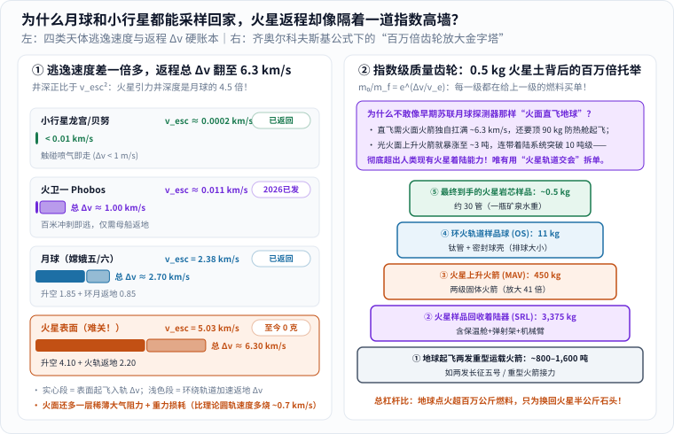
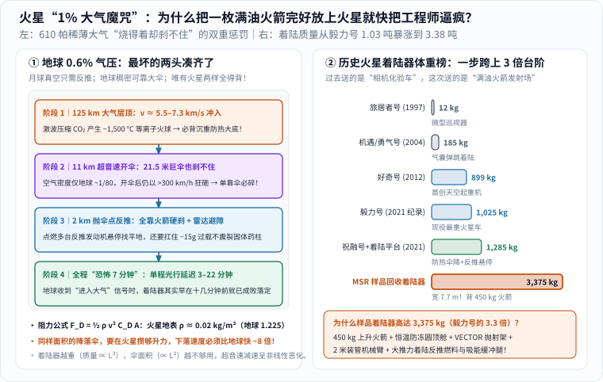
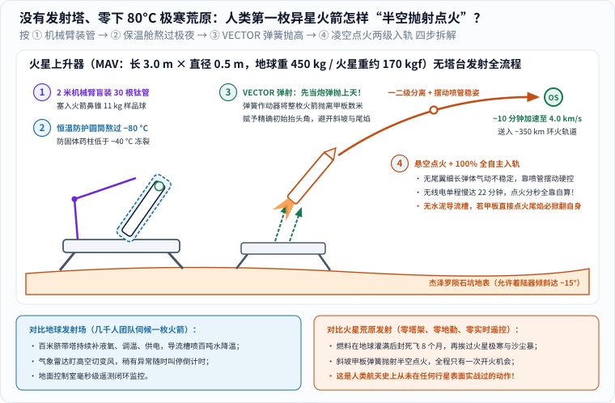
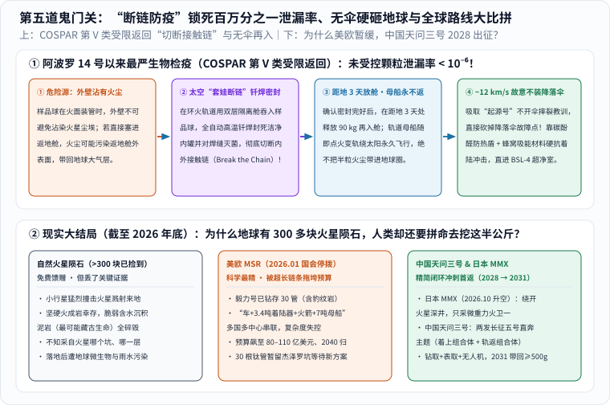

翻开截至 2026 年底的人类深空探测成绩单，你会发现一个极其反常的“空白格”：

- **去月球挖土**：早在上世纪六七十年代，美国阿波罗计划与苏联月球号探测器就带回了约 `382` 公斤月岩；2020 年与 2024 年，中国嫦娥五号、嫦娥六号更先后从月球正面与神秘的月球背面南极-艾特肯盆地捧回了 `1,731` 克与 `1,935.3` 克月壤。
- **去上亿公里外的小行星挖土**：日本“隼鸟号”“隼鸟二号”先后从糸川与龙宫小行星带回样本，美国 OSIRIS-REx 也在 2023 年把小行星贝努（Bennu）的 `121.6` 克黑色碎石稳稳投进犹他沙漠。
- **去更远的深空探路**：从木星、土星、天王星、海王星到冥王星，人类探测器全都飞掠过；1977 年升空的旅行者 1 号甚至刚刚在 2026 年 11 月跨过距离地球 **`1` 光日（约 `259` 亿公里）** 的门槛，孤身闯进了星际空间（参见[旅行者 1 号飞出 1 光日的星际工程账本]()）。
- **单程去火星表面**：从 1976 年海盗 1 号算起整整半个世纪，人类已经把海盗号、探路者号、勇气号、机遇号、凤凰号、好奇号、洞察号、毅力号以及中国“天问一号 / 祝融号”等十余台着陆器与漫游车成功送上了火星地表。

然而，一旦把问题换成 **“派探测器去火星表面铲一捧土，再装进火箭发回地球”**——全人类的历史总战绩至今是冷冰冰的四个字：**零克（`0 g`）**！

更让人真切感受到这件事有多棘手的，是最近一两年接连发生的三件大事：

1. **样品管早就装好了，却困在火星“等快递员”**：NASA“毅力号”火星车自 2021 年降落杰泽罗陨石坑（Jezero Crater）以来，已经精心钻取并钛焊密封了 **30 根岩芯 / 风化层样品管与 3 根见证管** [[5]](#ref-5)——其中 10 根备份管甚至从 2022 年底起就排成一列，静静躺在火星“三岔口（Three Forks）”沙地上晒太阳。
2. **美欧百亿美元方案被迫踩刹车**：当 NASA 与欧空局（ESA）真正把“去火星接这 30 根管子回家”的工程图纸细化出来后，2023 年独立评审委员会算出的总账单飙升到了惊人的 **`80` 亿至 `110` 亿美元**，返回时间一路推迟到 **2040 年** [[6]](#ref-6)；到了 **2026 年 1 月**，美国国会通过 2026 财年拨款法案（`H.R. 6938`），正式砍掉了原有“火星采样返回（MSR）”架构的预算 [[1]](#ref-1)[[7]](#ref-7)。
3. **绕开井底与正牌冲刺**：**2026 年 10 月 20 日**刚刚升空的日本火卫探测计划（MMX），干脆绕开火星地表，只敢去微小重力的火星卫星**火卫一（Phobos）**采几克土回来 [[10]](#ref-10)；放眼全球，目前唯一进入工程正样冲刺阶段的火星表面采样返回任务，是计划在 **2028 年前后用两枚长征五号分两次发射、2031 年前后带回至少 `500` 克火星样品**的中国**天问三号** [[9]](#ref-9)。

为什么“单程登陆火星”人类已经成功了十几次，“小行星采样回家”也连战连捷，偏偏**“从火星发射一枚小火箭回地球”**却成了整个太阳系无人探测公认的头号天堑？

只要顺着物理学与航天工程的硬账本往下算，你会发现挡在半公斤火星石头回家路上的，不是某一个单点难题，而是**五道互相放大的“鬼门关”**。

---

## 一、第一道鬼门关：引力井的“指数级高利贷”——逃逸速度只比月球大一倍，为什么火箭账单翻了上百倍？

### 1. 小行星靠“吹口气”、火卫一靠“蹬一脚”，为什么到了火星突然撞墙？

很多人的第一反应是：“小行星龙宫、贝努离地球也有上亿公里远，既然都能采样回来，火星不也是上亿公里吗？”

这个直觉忽略了太空旅行最核心的一条铁律：**在没有摩擦的宇宙空间里，“滑行几亿公里”本身几乎不烧燃料；真正吃掉成百上千吨推进剂的，是从一颗大质量星球的“引力井”井底硬生生爬出来！**

我们在[三大宇宙速度]()里推导过，一颗质量为 $$M$$、半径为 $$R$$、表面重力加速度为 $$g = GM / R^2$$ 的星球，要把物体从地表彻底抛离它的引力束缚，所需的**表面逃逸速度** $$v_{\mathrm{esc} }$$ 为：

$$
v_{\mathrm{esc} } = \sqrt{\frac{2GM}{R} } = \sqrt{2gR}
$$

而单位质量物体爬出这口“引力井”必须克服的引力势能深度 $$\Delta \Phi$$，恰恰正比于逃逸速度的**平方**：

$$
\Delta \Phi = \frac{GM}{R} = \frac{1}{2} v_{\mathrm{esc} }^2 = gR
$$

把人类已经去过（或正在去）的四类采样目标摆在同一张桌子上算一算，差距立刻触目惊心：

1. **小行星贝努 / 龙宫（已返回）**：直径仅约 `500–900` 米，表面重力不到地球的十万分之一，逃逸速度只有 **$$v_{\mathrm{esc} } \approx 0.1\text{–}0.2\ \mathrm{m/s}$$**——比你在客厅散步还慢十倍！探测器根本不需要“着陆”再“发射火箭”，只需像蜻蜓点水一样伸出机械臂贴地喷一口高压氮气（`Touch-and-Go`），轻轻推一下（$$\Delta v < 1\ \mathrm{m/s}$$）就飘回太空了。
2. **火卫一 Phobos（2026 年 10 月日本 MMX 启程目标 [[10]](#ref-10)）**：虽然同样身处火星轨道，但这块“太空土豆”平均半径仅约 `11.1 km`，表面逃逸速度只有 **$$v_{\mathrm{esc} } \approx 11.4\ \mathrm{m/s}$$**（约 `41 km/h`，骑辆电动自行车的速度！）。从火卫一表面弹起来几乎不费推进剂，真正的燃料账单只是母船从环火高轨退回地球所需的约 **`1.0 km/s`** 变轨速度。
3. **月球（阿波罗、月球号、嫦娥五号 / 六号已返回）**：月球表面重力 $$g_{\mathrm{Moon} } = 1.62\ \mathrm{m/s^2}$$，半径 `1,737.4 km`，逃逸速度 **$$v_{\mathrm{esc} } = 2.38\ \mathrm{km/s}$$**。月球表面是纯粹的真空，没有一丝空气阻力，上升器点火后很快就能压平俯仰角贴着低空横向加速，从月面进入环月轨道约需 $$\Delta v_{\mathrm{asc} } \approx 1.85\ \mathrm{km/s}$$，再从环月轨道加速踏上返地归途约需 $$\Delta v_{\mathrm{TEI} } \approx 0.85\ \mathrm{km/s}$$，返程总计 **$$\Delta v_{\mathrm{Moon} } \approx 2.70\ \mathrm{km/s}$$**。
4. **火星表面（至今 `0` 克！）**：火星表面重力 $$g_{\mathrm{Mars} } = 3.71\ \mathrm{m/s^2}$$（月球的 `2.29` 倍），半径 `3,389.5 km`（月球的 `1.95` 倍），两项相乘再开方，逃逸速度猛增到 **$$v_{\mathrm{esc} } = 5.03\ \mathrm{km/s}$$**！按平方关系算，**火星的引力井深度是月球的 $$(5.03 / 2.38)^2 \approx 4.47$$ 倍**！
   - 单是维持在 `350 km` 高的低火星圆轨道（LMO）不掉下来，轨道速度就要达到 $$v_{\mathrm{LMO} } = 3.38\ \mathrm{km/s}$$；
   - 再加上火星表面有一层稀薄大气，火箭刚起飞时不能像月球上那样立刻横过来飞，必须先竖直向上爬出稠密低空，白白多交一笔约 `0.6–0.7 km/s` 的**重力损耗与气动阻力税**，使得从火星地表入轨的实际速度增量高达 **$$\Delta v_{\mathrm{asc} } \approx 4.0\text{–}4.1\ \mathrm{km/s}$$** [[2]](#ref-2)；
   - 入轨后还没完！要把样品从 `350 km` 低环火轨道加速到挣脱火星引力、并贴上飞回地球的霍曼转移椭圆，还要再补一脚 **$$\Delta v_{\mathrm{TEI} } \approx 2.20\ \mathrm{km/s}$$**！
   - 两段加起来，火星表面样品回家的总速度门槛高达 **$$\Delta v_{\mathrm{Mars} } \approx 6.30\ \mathrm{km/s}$$**——比月球返程整整多出了 **`3.6 km/s`**！

### 2. 齐奥尔科夫斯基公式的指数铁拳：为什么半公斤石头要烧掉地球上百万公斤燃料？

“多出 `3.6 km/s`，不就是速度翻到 `2.3` 倍吗？把上升器做得大 `2.3` 倍不就行了？”

千万别被线性直觉骗了！我们在[多级火箭的动力原理]()里讲过，火箭加速时必须**自己背着还没烧掉的燃料一起加速**，速度增量 $$\Delta v$$ 与起飞满油质量 $$m_0$$、燃尽后干重 $$m_f$$ 之间服从残酷的**齐奥尔科夫斯基指数定律**：

$$
\Delta v = v_e \ln\!\left(\frac{m_0}{m_f}\right) \quad \Longrightarrow \quad \frac{m_0}{m_f} = \exp\!\left(\frac{\Delta v}{v_e}\right)
$$

式中的 $$v_e = I_{\mathrm{sp} } g_0$$ 是发动机有效喷气速度（单位 $$\mathrm{km/s}$$）。对于能在火星极寒环境下存放大半年而不挥发的固体推进剂或可贮存双组元液体推进剂，比冲 $$I_{\mathrm{sp} }$$ 通常只有 `285–315 s`，即 $$v_e \approx 2.80\text{–}3.09\ \mathrm{km/s}$$。

看看指数函数 $$\exp(\Delta v / v_e)$$ 是怎样“滚雪球”的：

- **为什么绝对不敢学苏联月球号“火星直飞地球”？**
  1970 年苏联“月球 16 号”之所以结构简单，是因为月球 $$\Delta v$$ 小，上升器顶着返地舱从月面点火**一口气直接射回地球**，省去了轨道交会。要是把这招搬到火星上（单程直飞 $$\Delta v \approx 6.30\ \mathrm{km/s}$$，头顶还要扛着重约 `90 kg` 的地球高速再入防热舱 [[4]](#ref-4)），按 $$v_e \approx 2.9\ \mathrm{km/s}$$ 算，仅理想质量比就高达 $$\exp(6.30 / 2.90) \approx 8.8$$；再扣掉两级火箭发动机、贮箱、绝热层和姿态控制系统的结构死重，单是这枚立在火星上的火箭就要重达 **`2.5` 到 `4` 吨**，把它安全送下去的火星着陆器总重更会飙破 **`10` 吨大关**——远超人类现有火星着陆技术的极限！
- **唯一活路：“火星轨道交会”接力，但依然是一座百万倍金字塔！**
  因此，无论是美欧原 MSR 方案还是中国天问三号 [[1]](#ref-1)[[9]](#ref-9)，全都必须拆成两艘船打配合：**返程回地球那几吨燃料绝对不许下火星表面**，而是留在环火轨道的母船上；降落到火星地表的火箭只干一件事——把最轻的样品球送进低环火轨道！

即便已经这样精打细算到骨头缝里了，我们照着 NASA 公布的工程实数 [[2]](#ref-2)[[3]](#ref-3)[[4]](#ref-4) 一层层往下乘，依然会算出一座令人倒吸凉气的**“百万倍质量放大金字塔”**：

- **第 5 层（塔尖终极收获）**：约 **`0.5 kg`** 火星岩芯与风化层（约 30 根钛管，相当于手头一瓶矿泉水的重量）[[2]](#ref-2)[[5]](#ref-5)；
- **第 4 层（轨道样品球 OS）**：加上钛管与防撞密封球壳，变成 **`11 kg`**（直径约 `23 cm`，排球大小）[[2]](#ref-2)；
- **第 3 层（火星上升器 MAV）**：为了给这 `11 kg` 小球挣出 `~4.0 km/s` 入轨速度，需要一枚 **`450 kg`** 的两级固体火箭（放大约 **41 倍**）[[2]](#ref-2)；
- **第 2 层（火星回收着陆器 SRL + 轨道返回母船 ERO）**：为了把 `450 kg` 火箭连同保温舱、弹射架、机械臂安全放到火星上，着陆器干重飙到 **`3,375 kg`** [[3]](#ref-3)；而在环火轨道接应并飞回地球的母船重达 **`7,000 kg`** [[4]](#ref-4)；
- **第 1 层（地球发射台总起飞质量）**：为了把这两大坨合计逾 10 吨的航天器先推出地球 `11.2 km/s` 的逃逸引力井送上奔火轨道，地球发射台上必须点燃**两枚重型运载火箭**（例如天问三号规划的两枚约 `870` 吨级长征五号 [[9]](#ref-9)），起飞总质量高达 **`800` 至 `1,600` 吨（约 `100` 万到 `160` 万公斤）**！

_图 1 先看左栏：小行星与火卫一几乎没有引力井，月球返程总 $$\Delta v \approx 2.70\ \mathrm{km/s}$$，而火星表面入轨加返地总 $$\Delta v$$ 跃升至 $$6.30\ \mathrm{km/s}$$；再看右栏：在齐奥尔科夫斯基指数定律放大下，地球发射台上逾百万公斤推进剂层层托举，最终只换回实验室桌面上约 `0.5 kg` 火星石头。_

**一百万公斤地球起飞质量，只换回半公斤火星石头**——而且这枚 `450 kg` 的返程火箭还没开始点火呢，怎么先把它毫发无伤地放到火星地面上，就已经撞上了第二道鬼门关。

---

## 二、第二道鬼门关：火星“1% 大气魔咒”——为什么把一枚满油火箭完好放上火星就把工程师逼疯？

### 1. 610 帕稀薄大气：既足够把飞船烧成火球，又远不够用降落伞刹停！

去月球着陆（如嫦娥五号）虽然没有空气帮忙减速，但胜在**干脆利落**：全程真空不生热，不需要笨重的防热罩，一套变推力反推发动机从头刹到尾就行。回地球（如神舟飞船）虽然高速冲进大气层会剧烈摩擦生热，但胜在**空气足够稠密**：防热大底扛过高温后，只要哗啦一下撑开大降落伞，浓密空气就能把返回舱稳稳拖慢到每秒几米的温柔速度。

唯独火星，偏偏卡在全太阳系最刁钻、最尴尬的夹缝里！

火星表面平均大气压只有约 **`610 Pa`（约合地球海平面标准大气压 `101,325 Pa` 的 `0.6%`）**，近地表空气密度仅 $$\rho_{\mathrm{Mars} } \approx 0.020\ \mathrm{kg/m^3}$$，大约只有地球海平面（$$1.225\ \mathrm{kg/m^3}$$）的**六十分之一**。这“不到百分之一”的稀薄二氧化碳大气，精准凑齐了气动减速**最坏的两头**：

1. **前半程“嫌它太厚”——不背防热大底必烧穿**：当探测器以 $$5.5\text{–}7.3\ \mathrm{km/s}$$ 的极速扎进 `125 km` 火星高层大气时，前方来不及让开的二氧化碳分子被高超声速激波剧烈压缩，迎风面峰值温度飙升到 **`~1,500 °C`**，足以把铝合金结构瞬间熔穿。因此你一公斤都不能省，必须老老实实背上一整套沉重的烧蚀防热大罩。
2. **后半程“嫌它太薄”——撑开二十米巨伞照样摔成碎片**：等防热罩好不容易把速度磨到马赫数 2 左右，打开降落伞时，灾难来了。根据流体力学阻力公式，质量为 $$m$$ 的着陆器挂在面积为 $$A$$ 的降落伞下，重力与气动阻力平衡时的**终端下落速度** $$v_{\mathrm{term} }$$ 为：

$$
\frac{1}{2}\rho_{\mathrm{Mars} } v_{\mathrm{term} }^2 C_D A = m g_{\mathrm{Mars} } \quad \Longrightarrow \quad v_{\mathrm{term} } = \sqrt{\frac{2 m g_{\mathrm{Mars} } }{\rho_{\mathrm{Mars} } C_D A} }
$$

把火星与地球的数字代进去一比：虽然火星重力 $$g_{\mathrm{Mars} }$$ 只有地球的 `0.38` 倍，但分母上的空气密度 $$\rho_{\mathrm{Mars} }$$ 暴跌了 **60 倍**（在 `10 km` 开伞高度处甚至相差近百倍）！一乘一除再开根号，**同样大小的降落伞在火星低空的平衡落速比地球快出约 `5` 到 `8` 倍**！哪怕撑开直径 **`21.5 m`** 的巨型超声速盘缝带伞，着陆器下坠速度依然超过 **`300 km/h`**——比高速公路上狂飙的跑车还快两倍！如果单靠降落伞触地，舱内那枚装满固体火药的上升器当场就会摔成一地碎渣。因此在离地最后两公里，必须果断砍断降落伞，点燃多台大推力反推火箭贴地急刹！

### 2. 弹道系数恶化与“恐怖 7 分钟”：着陆体重一步跨上 3.3 倍新台阶

更棘手的是“体重暴涨”带来的连锁反应。看看人类过去近三十年成功送上火星地表的探测器质量纪录 [[3]](#ref-3)：

- 1997 年“旅居者号”火星车：仅 **`12 kg`**（气囊弹跳着陆）；
- 2004 年“勇气号 / 机遇号”：**`185 kg`**（气囊弹跳极限）；
- 2012 年“好奇号”与 2021 年“毅力号”：**`899 kg` → `1,025 kg`**（气囊彻底扛不住，被迫发明惊心动魄的火箭悬停“空中吊车 Sky Crane”）；2021 年中国天问一号着陆平台携祝融号组合体总重亦约为 **`1,285 kg`**；
- **火星采样返回着陆器（SRL）**：因为肚子里要硬塞进一枚 **`450 kg` 满油上升火箭**、恒温保护圆筒、弹射支架与 **`2 m` 采样机械臂**，着陆器仅干重就暴涨到 **`3,375 kg`（宽达 `7.7 m`）——一下子跨上了毅力号 `3.3` 倍的全新台阶** [[3]](#ref-3)！

为什么重量翻了 3.3 倍，难度却不止翻 3.3 倍？这就是我们在[动植物身高体重的平方—立方律]()里见过的几何魔咒——气动力学里叫**弹道系数 $$\beta = m / (C_D A)$$ 恶化**：

当航天器线性尺寸放大 $$L$$ 倍（受地球运载火箭整流罩直径 `4.5–5.4 m` 限制，防热大底直径甚至没法等比放大！），质量 $$m \propto L^3$$ 飞速膨胀，迎风截面积 $$A \propto L^2$$ 却远远跟不上。质量越大、刹车面积相对越小，飞船在稀薄高空就**越刹不住车**——别人飞到海拔 `11 km` 时已经降到马赫数 2 可以安全开伞了，而 `3.38` 吨的大家伙冲到离地只有几公里的极低空时仍然处于狂暴的超声速状态，留给“抛大底 → 开巨伞 → 雷达锁地面 → 点反推火箭”的总时间被极限压缩到几十秒之内！

再加上地火之间动辄 **`3` 到 `22` 分钟** 的单程无线电光速延迟：当地球控制大厅刚刚收到“我开始进入火星大气层了”的第一个比特时，远在火星上的这艘着陆器其实早在十几分钟前就已经走完了生与死的全过程。这长达 **7 分钟** 的连环闯关，不允许地面工程师敲半个键盘，**100% 靠星载电脑当场自救**。

_图 2 先看左栏高度剖面：火星 610 帕大气制造了“高空 `1,500 °C` 激波烧蚀 + 低空巨伞仍超 `300 km/h` 刹不住”的双重夹击；再看右栏质量条形对比：为了背负 `450 kg` 满油返程火箭，采样回收着陆器质量跃升至 `3,375 kg`（毅力号的 `3.3` 倍），直面平方—立方律下的弹道系数极限。_

---

## 三、第三道鬼门关：零下 80°C 荒原无塔台起飞——为什么人类第一枚火星火箭要先“当炮弹抛到半空”再点火？

假定我们闯过了前两关，终于把着陆器稳稳停在了火星杰泽罗陨石坑的乱石滩上。接下来，人类要干一件**航天史上从未在任何另一颗行星表面做过的事**——发射一枚入轨运载火箭！

### 1. 地球上几千人伺候一枚火箭，火星上却是“零塔台、零地勤、零后悔药”

先想想地球上发射一枚火箭有多“娇生惯养”：

- 发射台上立着几十米高的钢铁脐带塔，直到点火前最后几分钟还在源源不断往箭体里补加 `-183 °C` 的液氧、吹高纯氮气控温除湿、给全箭电池充电；
- 发射台正下方挖好了深达十几米的钢筋混凝土导流槽，点火前几秒瞬间喷出上百吨冷水，吸收三千摄氏度尾焰的冲击波和震耳欲聋的声振（否则反弹的声波就能把火箭自己的仪器震碎！）；
- 天空中有探空气球和测风雷达紧盯高空风切变，控制室里坐着几百名分系统工程师，任何一个阀门压力偏了 `1%`，立刻按下暂停键排障重来。

现在把镜头切到火星荒原 [[2]](#ref-2)[[3]](#ref-3)：

这里**没有发射塔、没有补加管路、没有水泥导流槽、没有测风雷达，方圆两亿公里内更没有一个人类维修工**！这枚被称为**火星上升器（MAV：长仅 `3.0 m`、直径仅 `0.5 m`，地球质量约 `450 kg`，火星重力下约合 `170` 公斤力）**的袖珍两级火箭 [[2]](#ref-2)，早在地球装船时就已经灌满推进剂封死，先在深空颠簸了八九个月，又硬扛了着陆时高达 `~15g` 的减速过载，然后还要在火星露天停放好几个月甚至一年，等机械臂把 `30` 根钛合金样品管一根不差地塞进它鼻锥那只 `11 kg` 的样品球里 [[2]](#ref-2)[[3]](#ref-3)。

### 2. 零下 80°C 药柱防冻裂与 JPL 奇招：VECTOR 弹簧“半空抛射点火”

在这段漫长的火星等待期里，第一个杀手是**极寒**：

在地球上性能最好的液氢液氧或液氧甲烷低温推进剂，放在火星上若没有庞大复杂的零蒸发制冷机，几个月下来早就气化漏光了。如果改用结构最简单可靠的**两级固体火箭**（NASA MAV 方案 [[2]](#ref-2)），又会撞上高分子材料物理的死穴——火星夜晚地表温度动辄暴跌至 **`-80 °C` 乃至 `-100 °C`**！固体火箭药柱本质上是一整块掺满高氯酸铵氧化剂与铝粉的合成橡胶（如端羟基聚丁二烯 HTPB），一旦冻到玻璃化转变温度（约 `-40 °C` 以下）就会变硬变脆，热胀冷缩之下极易拉出肉眼难辨的细微裂纹。**固体药柱哪怕裂开一道毫米级缝隙，点火瞬间上千帕的高温高压燃气钻进裂缝，燃烧面积骤增数倍，整枚火箭在半秒钟内就会当场炸成礼花！** 为此，着陆器必须像揣暖水袋一样把整枚火箭裹进一只**恒温防护圆筒（Thermal Igloo）**里，日夜不停耗电保温。

等到装好样品、掀开保温筒盖准备点火的那一刻，第二个杀手又跳了出来：**着陆器很可能歪斜着停在高达 `15°` 的乱石斜坡上，而且脚下就是娇贵的着陆器甲板，没有任何导流槽！**

如果你敢像地球上那样让火箭站在甲板上直接点火：第一级固体发动机喷出的炽热超声速含铝尾焰会迎头砸在甲板上猛烈反弹，不仅会把无尾翼的细长火箭自己掀翻擦挂，飞溅的熔融氧化铝残渣和冲击波更可能直接炸断支架，让上升器在离地第一米就栽进沙坑！

怎么破这个死局？NASA 喷气推进实验室（JPL）的工程师从潜艇冷发射导弹和迫击炮里借来灵感，专门发明了一套名为 **VECTOR（Vertically Ejected Controlled Tip-Off Release，垂直弹射受控俯仰释放）** 的绝活 [[2]](#ref-2)[[3]](#ref-3)：

1. **第 ①—② 步（装管与解封）**：`2 m` 长的采样转移机械臂把 30 根样品管装入火箭鼻锥样品球并锁紧，恒温圆筒打开顶盖并抬起仰角 [[3]](#ref-3)；
2. **第 ③ 步（先当炮弹抛上天！）**：起飞零秒**发动机根本不点火**！着陆器支架上的高低两组高速弹簧 / 气动作动器猛然发力，像打篮球挑篮一样，把整枚 `450 kg` 的火箭**直接凌空抛到离甲板数米高的半空中**；更妙的是，前后作动器特意设计了精确的冲量差，让火箭在腾空上升的同时，顺势在空中优雅地转过一个预设的抬头俯仰角——一下子既躲开了斜坡倾角，又对准了预定入轨方向！
3. **第 ④ 步（半空凌空点火 + 无尾翼硬控入轨）**：就在火箭升至半空顶点、彻底远离下方着陆器甲板的那一瞬间，第一级固体发动机**轰然凌空点火**！由于为了塞进直径仅半米的保温筒，这枚火箭连一片气动稳定尾翼都没法装，飞行中天生存在气动静不稳定趋势，全靠星载计算机以毫秒级频率摆动柔性矢量喷管（TVC）硬控姿态；燃烧完第一级后抛壳、点燃第二级并依靠自旋稳定，在短短 **约 `10` 分钟** 内把速度一路推上 **`~4.0 km/s`**，精准把 `11 kg` 样品球送入距离火星表面约 **`350 km`** 的环火圆轨道 [[2]](#ref-2)！

_图 3 按上部 ①→④ 顺序跟读：① `2` 米机械臂将样品管装入火箭鼻锥 `11 kg` 样品球；② 恒温防护圆筒抵御 `-80 °C` 寒夜防止固体药柱低于 `-40 °C` 冻裂；③ VECTOR 弹簧系统先将 `450 kg` 火箭抛离斜坡甲板数米并赋予初始抬头角；④ 半空凌空点火，两级接力约 `10` 分钟加速至 `4.0 km/s` 入轨。下部两卡对比地球千人保障发射场与火星“三无”起飞环境。_

---

## 四、第四道鬼门关：错过一班再等 26 个月、到了还得苦等 15 个月，再在上亿公里外“盲抓”一只 23 厘米小球

### 1. 开普勒第三定律锁死的天体时刻表：为什么到了火星不能装完土立刻回家？

嫦娥五号和嫦娥六号去月球挖土，因为月球始终绕着地球转，随时都能点火返航，从海南文昌发射到内蒙四子王旗开舱取土，全程分别只用了 **`23` 天** 和 **`53` 天**。

可火星不一样！地球和火星是在两条半径不同的跑道上各自绕太阳狂奔的行星（参见[霍曼变轨与轨道飞行全过程]()）。我们用开普勒第三定律亲手算一算地火之间的“天体列车时刻表”（取地球平均轨道半径 $$r_E = 1.000\ \mathrm{AU}$$，公转周期 $$T_E = 365.256\ \mathrm{d}$$；火星平均轨道半径 $$r_M = 1.52368\ \mathrm{AU}$$，公转周期 $$T_M = 686.980\ \mathrm{d}$$）：

**第一步：算发船窗口——为什么每 26 个月才开一班省油船？**

内圈地球角速度更快，平均每天绕太阳转 $$\omega_E = 360^\circ / 365.256 = 0.9856^\circ/\mathrm{d}$$；外圈火星慢悠悠，每天只转 $$\omega_M = 360^\circ / 686.980 = 0.5240^\circ/\mathrm{d}$$。地球在内道重新套圈追上火星同一相对相位角的**会合周期** $$T_{\mathrm{syn} }$$ 为：

$$
T_{\mathrm{syn} } = \frac{1}{\dfrac{1}{T_E} - \dfrac{1}{T_M} } = \frac{360^\circ}{\omega_E - \omega_M} \approx 779.9\ \text{天} \approx 26\ \text{个月}
$$

**第二步：算单程旅途——最省油的霍曼去程要飞多久？**

连接地球轨道（近日点 $$r_E$$）与火星轨道（远日点 $$r_M$$）双切椭圆的半长轴为 $$a_t = \frac{1}{2}(r_E + r_M) = 1.26184\ \mathrm{AU}$$。由开普勒第三定律，沿半个椭圆滑行到火星所需的单程时间为：

$$
T_{\mathrm{trans} } = \frac{1}{2} T_E \, a_t^{3/2} = \frac{1}{2} \times 365.256 \times 1.26184^{3/2} \approx 258.9\ \text{天}
$$

**第三步：算等位账单——为什么到了火星绝对不能铲完土马上回地球？**

为了让飞船在 `258.9` 天后抵达远日点（$$180^\circ$$ 处）时刚好撞见火星，地球出发那一刻，火星必须提前处在地球前方 $$180^\circ - \omega_M T_{\mathrm{trans} } = 180^\circ - 135.7^\circ = +44.3^\circ$$ 的位置。

可等你真花 `258.9` 天飞到火星时，回头找地球一看——傻眼了！内圈飞奔的地球在这 `258.9` 天里已经转过了 $$\omega_E T_{\mathrm{trans} } \approx 255.2^\circ$$，此刻**地球早就甩开火星，跑到火星前方 $$+75.2^\circ$$ 的远方去了**！要是这时候强行点火往回追，你需要横穿太阳引力场硬拐大弯，燃料开销高到任何现有化学火箭都付不起。要想搭上省油的返程霍曼椭圆（让地球在 `258.9` 天后刚好转过 `255.2°` 在终点接住你），你必须老老实实待在火星轨道上苦等，直到内圈的地球绕太阳多追一圈、来到火星**后方 $$-75.2^\circ$$** 的对称位置！地球需要追赶的相对夹角为 $$360^\circ - 2 \times 75.2^\circ = 209.6^\circ$$，对应的**强制等位时间**为：

$$
T_{\mathrm{wait} } = \frac{209.6^\circ}{\omega_E - \omega_M} \approx 454.1\ \text{天}
$$

算一算总账：**去程 `259` 天 + 火星强制等位 `454` 天 + 返程 `259` 天 = 整整 `972` 天（约 `2.7` 年）**！（注：真实工程任务如中国天问三号会利用火星椭圆轨道偏心率 $$e \approx 0.093$$ 并采用略微偏离双切的准霍曼能量轨道，把总往返周期优化压缩到约 `2.5` 至 `3` 年，如 2028 年前后发射、2031 年前后返回 [[9]](#ref-9)；但**一旦地面采样或上升器排障耽搁了短短两三周错过返航窗口，全套设备就得在严酷的火星轨道上白白多熬 `26` 个月**，对电池寿命与机械可靠性是地狱级拷问！）

### 2. 上亿公里外“大海捞针”：7 吨巨舰全自主盲抓一只 23 厘米排球

在等待返航窗口期间，环火轨道上还要上演一出比嫦娥五号环月交会惊险十倍的**“太空盲抓”** [[4]](#ref-4)：

嫦娥五号在距离地球 `38` 万公里的环月轨道交会对接时，无线电单程延迟只有 **`1.28` 秒**，地面飞控中心可以实时监视并随时辅助修正；而且上升器本身是一艘带电池、带姿态推进器、带微波雷达应答机与激光反射器的主动合作航天器。

而在美欧火星采样方案里，为了给那枚 `450 kg` 的火星小火箭抠出每一克重量，被送进 `350 km` 环火轨道的**样品球（OS）直径只有 `23 cm`（只比排球大一圈）、重仅 `11 kg`，浑身上下既没有推进器，也没有电池和无线电信标** [[2]](#ref-2)[[4]](#ref-4)！它纯粹是一颗以每秒 **`3.4 km`** 狂飙的金属“盲球”。

来接它的欧空局**地球返回轨道器（ERO）**重达 **`7,000 kg`**，两侧张开翼展长达 **`38 m`**（总面积 `144 m²`，比一座标准篮球场还宽）的巨型太阳翼 [[4]](#ref-4)。在距离地球 `5,500` 万至 `4` 亿公里、往返信号慢达 **`44` 分钟** 的深空孤岛上，这艘 7 吨巨舰必须全靠自己的光学相机在 **`1,000` 公里开外** 的漫天繁星中，搜出那颗仅靠反射微弱阳光的 `23 cm` 小亮点，再抵近开启激光雷达（LiDAR）自主编队，张开捕获漏斗一口把它吞进肚子 [[4]](#ref-4)！（也正因为无源盲抓风险极高，中国天问三号在工程设计中特别强化了上升器与轨返组合体之间的主动微波 / 激光导引自主交会与样品转移闭环，力求把轨道丢球风险压到最低 [[9]](#ref-9)。）

_图 4 左栏（含单次播放运动示意，；开启系统“减少动态效果”时自动展示静态完整轨迹）：蓝点从 ① 地球出发经 `259` 天抵达 ② 火星时，内圈地球已跑到前方 `+75.2°`，必须沿紫虚线随火星苦等 `454` 天至 ③ 返程窗口，再飞 `259` 天于 ④ 回到地球；右栏展示 `7` 吨母船在 `>1,000 km` 外光学搜寻并激光雷达盲抓直径仅 `23 cm` 的无源样品球。_

---

## 五、第五道鬼门关：半粒火星尘土都不许碰地球空气——“断链防疫”与无伞硬砸沙漠

### 1. 阿波罗 14 号以来最严生物检疫：百万分之一泄漏红线

好不容易把样品球吞进母船、苦等 15 个月等到返航窗口、点火飞了八个半月回到地球家门口——你以为终于可以像迎接神舟飞船那样开着直升机去草地上开舱庆祝了吗？

恰恰相反，**最后一公里藏着一道月球与小行星采样完全不需要面对的生物安全铁幕**！

国际空间研究委员会（COSPAR）对所有地外天体采样返回制定了严格的**行星保护（Planetary Protection）**分级法规 [[8]](#ref-8)：月球、小行星糸川、龙宫与贝努表面要么毫无液态水历史，要么在几十亿年强紫外与宇宙射线暴晒下绝无现代生命可能，因此全都属于 **“非受限地球返回（Unrestricted Earth Return）”**。

但火星截然不同！毅力号所在的杰泽罗陨石坑，三十多亿年前曾是一片河流汇入的古老湖泊三角洲 [[1]](#ref-1)[[11]](#ref-11)。虽然表面如今干燥寒冷，但科学家既不能 100% 排除岩芯微孔里潜藏着未知火星微生物休眠体的极小概率，更承受不起地球空气中无处不在的细菌反过来钻进样品盒、把价值连城的“外星生命证据”污染成乌龙事件的代价！

因此，任何从火星表面带回样品的任务，都被强制划入自 1971 年阿波罗 14 号解除月岩检疫以来，人类半个多世纪首次重新启用的最高等级——**COSPAR 第 V 类：受限地球返回（Category V: Restricted Earth Return）** [[8]](#ref-8)！工程硬指标只有冷酷的一句话：**在整个返回与着陆过程中，哪怕一粒未受控火星微尘泄漏进地球生物圈的概率，也必须严格小于百万分之一（$$P < 10^{-6}$$）** [[8]](#ref-8)！

### 2. 太空“套娃钎焊断链” + 故意砍掉降落伞以 145 km/h 硬砸地面！

“把盖子拧紧点不就不漏了吗？”没那么简单！请想一个细思极恐的细节：

那只 `23 cm` 的样品球在火星上装填样品管时，一直暴露在火星沙尘里——也就是说，**样品球的外表面早已沾满了火星灰尘**！如果你只是在太空把它抓进地球返回舱，那么脏样品球就会污染返回舱内壁，进而污染舱门缝隙，落地时照样把火星灰尘带进地球大气！

为了堵死这个漏洞，美欧与各国行星保护团队设计出了一套巧夺天工的太空全自动“无菌套娃术”——**切断接触链（Break the Chain of Contact）** [[4]](#ref-4)[[8]](#ref-8)：

1. **双室隔离套娃**：母船捕获脏样品球后，通过单向隔离门将它推进一只早已在地球彻底灭菌的**次级密封罐**内部，全过程脏样品球只接触密封罐内腔，密封罐外壁始终处于洁净室侧；
2. **500°C 高温钎焊死封 + 焊缝灭菌**：机械装置合上罐盖，用高温金属**钎焊（Brazing）**把接缝彻底熔成一整块实心金属，同时用超过 **`500 °C`** 的高温把焊缝交界圈可能沾染的任何有机大分子或微生物彻底碳化灭活——至此，这只金属罐的外壁与火星环境之间的物理接触链被 **100% 斩断**！
3. **母船提前 3 天“壮士断腕”永不入球**：飞到距离地球约 **3 天** 航程时，7 吨重的返回母船必须先一步精密测轨确认再入走廊绝对无误，才把重约 **`90 kg`**、直径 **`1.25 m`** 的碟形**地球再入舱（EES）**投向美国犹他州试验训练场（UTTR）；紧接着，因为母船捕获机构曾接触过火星样品球外壁，母船立即点火变轨冲入永久绕日轨道，**绝不允许自己擦碰地球大气层半步** [[4]](#ref-4)！
4. **约 `12 km/s` 极速再入，而且故意不装降落伞！** 最违反普通人直觉的一招就在最后几十秒：这只从行星际轨道飞回来的再入舱，冲入地球大气层的速度高达 **`~12 km/s`**（近地轨道飞船返回约 `7.8 km/s`，动能正比于 $$v^2$$，单位质量热负荷猛增逾两倍！）；等气动防热罩把速度降下来后，它**身上竟然连一具降落伞都不装**，直接以约 **`40 m/s`（约 `145 km/h`）** 的高速砰然硬砸进犹他沙漠 [[4]](#ref-4)！
   为什么放着现成的降落伞不用？因为 NASA 吃过一次刻骨铭心的亏：2004 年采集太阳风粒子的“起源号（Genesis）”返回舱回到犹他沙漠时，就因为一枚小小的重力加速度开关在组装时画反了方向，降落伞全程未开，返回舱直接摔裂在沙地上！对于百万分之一泄漏红线的火星样品来说，多一套火工切割与伞绳机构，就多一个致命故障点；不如直接把再入舱做成气动自稳定的钝头飞碟，内部裹满多层碳纤维蜂窝吸能材料与钛钢装甲球，**就算以 `145 km/h` 硬砸地面也绝不开裂分毫**，随后连舱带土装进移动生物安全舱，直送全球首座兼具 **BSL-4 最高生物安全负压隔离** 与 **超净无尘防地球污染** 双重标准的样品接收实验室 [[4]](#ref-4)[[8]](#ref-8)！

### 3. 终极追问：地球上明明已经捡到 300 多块免费“火星陨石”，为什么人类还要拼命去挖这半公斤？

读完上面五道鬼门关，相信你心头一定会冒出最后一个灵魂发问：**天文学家不是早就确认，在南极冰盖和撒哈拉沙漠里已经捡到了超过 `300` 块天然“火星陨石”（远古小行星猛烈撞击火星表面时崩飞到太空、游荡几百万年后掉在地球上的石头）吗？既然老天爷免费送货上门，人类何苦花几百亿经费、冒着九死一生的工程风险去火星亲手挖这半公斤？**

NASA 火星科学团队给出了三条任何天然陨石都永远无法替代的硬核科学理由 [[1]](#ref-1)[[11]](#ref-11)：

1. **致命的“幸存者偏差”——最可能藏着古生命证据的岩石全在撞击起飞时碎成渣了！**
   想把一块石头靠小行星撞击硬生生崩出火星 $$5.03\ \mathrm{km/s}$$ 的逃逸速度，瞬间冲击压强高达数十吉帕（$$\mathrm{GPa}$$）。只有极其坚硬、年轻、致密的**火成玄武岩（岩浆冷却岩）**才扛得住这记重锤飞出火星；而在古湖泊河口慢慢沉淀下来、真正最擅长包裹远古微生物化石与有机分子的**松软泥岩、页岩、碳酸盐与硫酸盐水成沉积岩**，在撞击瞬间早就粉身碎骨了！换句话说，地球上捡到的 300 多块天然火星陨石，几乎清一色全是“烤硬的火山石”，偏偏把最可能写着生命答案的那几页泥沙史书全撕掉了！
2. **丢失了“案发现场门牌号”**：捡到的陨石完全不知道它来自火星哪座山、哪条古河床、哪一米地层上下剖面；而毅力号与未来的天问三号每钻取一根样品，都会同步拍下毫米级显微图像、拉曼光谱与地质层位坐标 [[5]](#ref-5)[[11]](#ref-11)。
3. **没有地球污染，才能动用“重达几百吨的地球神器”**：天然陨石掉在地球冰原或沙漠里少则几百年、多则几万年，早已被地球水汽与微生物浸染；而火星车自己背得动的化验仪器最多只有微波炉大小、几十公斤重。一旦把严格钛焊无菌密封的原位样品带回地球，全世界最顶尖的公里级同步辐射光源、纳米二次离子质谱仪（NanoSIMS）与飞秒激光同位素分析仪就能轮番上阵，哪怕石头里只留存着万亿分之一的远古生命同位素偏折或氨基酸手性不对称，也逃不过地球实验室的眼睛 [[1]](#ref-1)[[11]](#ref-11)！

放眼截至 **2026 年底**的真实世界赛场 [[1]](#ref-1)[[7]](#ref-7)[[9]](#ref-9)[[10]](#ref-10)：

- 美欧原版 MSR 因“漫游车 + 3.4 吨着陆器 + 固体上升器 + 7 吨电推轨道器”跨洲多中心串联链条过于庞杂，在 2026 年初暂停原有拨款，NASA 正重新征集更精简的商业重型着陆替代架构，杰泽罗陨石坑里的 30 根钛合金样品管仍在静静等待 [[5]](#ref-5)[[6]](#ref-6)[[7]](#ref-7)；
- 日本 JAXA 的 MMX 探测器已于 **2026 年 10 月 20 日** 从种子岛顺利升空，选择先去重力微弱的火卫一“小试牛刀”，计划 2031 年带回火卫一表面样品 [[10]](#ref-10)；
- 中国国家航天局（CNSA）则在天问一号一次实现“绕、着、巡”与嫦娥五号、六号两度月球轨道无人自主交会采样返回的技术底座上，确立了由 **“着陆器 + 上升器 + 服务器”组合体** 与 **“轨道器 + 返回器”组合体** 构成的双火箭（两枚长征五号）精简闭环方案，锚定 **2028 年前后发射、2031 年前后把人类历史上第一捧亲手采自火星表面的至少 `500` 克珍贵样品带回地球** [[9]](#ref-9)！

_图 5 上栏拆解阿波罗 14 号以来最严苛的 COSPAR 第 V 类“受限地球返回”四步闭环：① 外壁沾尘风险 → ② 太空双室套娃与 `500 °C` 钎焊彻底切断接触链 → ③ 抵地前 `3` 天投舱、母船点火永不入球 → ④ 再入舱取消降落伞以约 `145 km/h` 靠蜂窝吸能硬砸犹他沙漠，确保泄漏概率 `< 10^-6`。下栏汇总天然火星陨石缺陷与截至 2026 年底的美欧、中国天问三号及日本 MMX 最新进展。_

---

## 六、一张表收束全局：火星往返五道鬼门关总账单

把从地球点火到实验室开箱的全链条叠在一起，你就彻底明白为什么半个世纪以来没有一克火星表面样品被探测器带回地球了——**这五道关不是“五选一”，而是概率连乘的串联闯关，任何一环出 `1%` 的差错就是满盘归零**：

| 关卡 | 核心物理 / 工程死结 | 与月球 / 小行星采样的量级鸿沟 | 人类发明的硬核破局招数 |
| :--- | :--- | :--- | :--- |
| **① 引力井指数账单** | $$v_{\mathrm{esc} } = 5.03\ \mathrm{km/s}$$，返程总 $$\Delta v \approx 6.30\ \mathrm{km/s}$$，受齐奥尔科夫斯基公式 $$\exp(\Delta v/v_e)$$ 指数放大 | 引力井比月球深 **`4.5` 倍**；直飞返地火箭将重达数吨 | 放弃表面直飞，强制采用**环火轨道交会**；地球两枚重型火箭（逾千吨）换回 `~0.5 kg` 样品 [[2]](#ref-2)[[9]](#ref-9) |
| **② 1% 稀薄大气重型着陆** | 表面气压仅 `610 Pa`（地球 `0.6%`），弹道系数 $$\beta = m/(C_D A)$$ 随质量恶化 | 满油火箭令着陆器飙至 **`3,375 kg`**（毅力号 `3.3` 倍），巨伞落速仍 `>300 km/h` | 烧蚀防热大底扛 `1,500 °C` + 超声速巨伞 + 多台反推火箭贴地盲刹（全程光速延迟自救）[[3]](#ref-3) |
| **③ `-80 °C` 荒原无塔起飞** | 无发射塔、无导流槽、斜坡达 `15°`；固体药柱低于 `-40 °C` 易脆裂炸膛 | 人类从未在任何另一颗**行星**表面发射过入轨火箭 | **恒温防护圆筒**越冬保温 + **VECTOR 弹簧系统**先将 `450 kg` 火箭抛至半空再凌空点火 [[2]](#ref-2)[[3]](#ref-3) |
| **④ 26 个月窗口与深空盲抓** | 会合周期 `780` 天；抵火时地球超前 `+75.2°`；单程光速延迟高达 `22` 分钟 | 嫦娥采样全程 `23–53` 天、延迟 `1.3` 秒；火星往返需 **`~972` 天**（被迫等位 `454` 天） | 跨窗口超长寿命设计 + 上亿公里外光学相机与激光雷达**全自主捕获 `23 cm` 样品球** [[4]](#ref-4)[[9]](#ref-9) |
| **⑤ 百万分之一断链防疫** | COSPAR 第 V 类受限返回：未受控火星物质泄漏率须 **$$< 10^{-6}$$** | 月球与小行星均为非受限返回，挂伞落地即可开箱 | 太空双室套娃 + **`500 °C` 钎焊切断接触链** + 母船绕日永不入球 + **无伞蜂窝硬砸落地**直送 BSL-4 超净室 [[4]](#ref-4)[[8]](#ref-8) |

也许再过短短五年——到 2031 年前后，当人类第一只真正装满火星泥沙与湖相沉积岩碎片的密封罐在地球超净实验室里被机械手缓缓旋开时，回望今天算过的每一个公式、每一克被抠到极致的死重、那记在荒凉红土地半空中轰然点亮的火焰，我们才会真正懂得：那半公斤泥土里装着的，不只是三十多亿年前火星古湖泊的秘密，更是人类用数学与工程智慧硬生生从太阳系引力深井里捧出来的一座丰碑。

---

## 参考资料与核查说明

文中引用的探测器质量、速度增量、几何尺寸、行星保护标准及各国任务时间表均直接核查自以下官方机构技术页面、NASA 技术报告服务器（NTRS）论文与立法公开档案：

1. NASA Science. *Mars Sample Return Mission Overview*（核实美欧联合火星采样返回任务整体架构演变、杰泽罗陨石坑古湖泊三角洲背景及任务状态更新）：<https://science.nasa.gov/mission/mars-sample-return/>
2. NASA Science. *Mars Ascent Vehicle (MAV)*（核实火星上升器关键工程参数：箭长约 `3 m`、直径约 `0.5 m`、地球质量约 `450 kg`、两级固体推进架构、约 `10` 分钟加速至约 `4 km/s` 进入环火轨道，以及重约 `11 kg`、尺寸 `0.24 m × 0.23 m`、可容纳 `30` 根样品管的轨道样品容器 OS）：<https://science.nasa.gov/mission/mars-sample-return/mars-ascent-vehicle/>
3. NASA Science. *Sample Retrieval Lander (SRL)*（核实样品回收着陆器尺寸 `7.7 m × 2.1 m`、地球质量 `3,375 kg`［毅力号 `1,025 kg` 的约 `3.3` 倍，史上规划最大火星着陆器］、`2 m` 采样转移机械臂及 VECTOR 弹射起飞支撑系统）：<https://science.nasa.gov/mission/mars-sample-return/sample-retrieval-lander/>
4. NASA Science. *Earth Return Orbiter (ERO) & Earth Entry System (EES)*（核实欧空局 `7,000 kg` 电/化混合推进返回轨道器、`38 m` 翼展 / `144 m²` 太阳翼、距地球逾 `5,000` 万公里外通过 `>1,000 km` 光学探测与近距激光雷达全自主捕获样品球、太空生物密封、抵地前 `3` 天释放重约 `90 kg` 且宽 `1.25 m` 的无降落伞地球再入舱 EES 以约 `145 km/h` 着陆犹他试验训练场并令母船变轨绕日的完整流程）：<https://science.nasa.gov/mission/mars-sample-return/earth-return-orbiter/>
5. NASA Science. *Perseverance Mars Rock Samples Inventory*（核实毅力号携带总计 `43` 根钛合金管［`38` 根采样管 + `5` 根见证管］，已焊封 `30` 根岩芯/风化层样品管与 `3` 根见证管，含存放于“三岔口 Three Forks”地面备份点位的 `10` 根样品管）：<https://science.nasa.gov/mission/mars-2020-perseverance/mars-rock-samples/>
6. NASA News Release 25-001 (Jan 7, 2025). *NASA to Explore Two Landing Options for Returning Samples from Mars*（核实 2023 年 9 月独立评审委员会估算原架构耗资 `80–110` 亿美元、返回推迟至 `2040` 年后，NASA 启动双着陆精简替代方案评估的背景）：<https://www.nasa.gov/news-release/nasa-to-explore-two-landing-options-for-returning-samples-from-mars/>
7. The Planetary Society (Jan 25, 2026). *The Space Advocate Newsletter, January 2026 (FY 2026 Appropriations H.R. 6938)*（核实 2026 年 1 月美国国会通过 `H.R. 6938` 拨款法案，在保留 NASA 科学主体经费的同时终止原 MSR 工程拨款的立法进展）：<https://www.planetary.org/space-advocate/space-advocate-january-2026>
8. Harrington, A. D., et al. (NASA JSC / JPL, 53rd Lunar and Planetary Science Conference, 2022, NTRS ID `20210026720`). *Mars Sample Return (MSR) Sample Receiving Facility Assessment Study*（核实阿波罗 14 号以来首次启用 COSPAR 第 V 类“受限地球返回 Category V: Restricted Earth Return”标准、切断接触链“Break the Chain of Contact”、未受控释放概率 `< 10^-6` 及兼具 BSL-4 生物安全隔离与超净防污染双重标准的样品接收设施要求）：<https://ntrs.nasa.gov/citations/20210026720>
9. China National Space Administration (CNSA). *China celebrates Space Day with a sneak peek at Tianwen 3's tech*（核实中国天问三号由着陆器、上升器、服务器、轨道器、返回器五部分组成，计划于 **2028 年前后由两枚长征五号运载火箭**从文昌分两次发射，**2031 年前后携火星表面样品返回地球**的官方工程规划）：<https://www.cnsa.gov.cn/english/n6465652/n6465653/c10743241/content.html>
10. JAXA Institute of Space and Astronautical Science (ISAS). *Martian Moons eXploration (MMX)*（核实日本火卫一采样返回探测器于 **2026 年 10 月 20 日**从种子岛升空，利用火卫一微弱逃逸速度采回样品并避开火星地表深引力井的任务定位）：<https://www.isas.jaxa.jp/en/missions/spacecraft/current/mmx.html>
11. NASA Science. *Mars Sample Return Science Overview*（核实地球已发现逾 `300` 块天然火星陨石为何无法替代原位采样返回：高速撞击溅射导致的火成岩幸存者偏差［脆弱湖相沉积岩碎裂缺失］、缺失原位地层坐标以及地球风化生物污染）：<https://science.nasa.gov/mission/mars-sample-return/science/>
