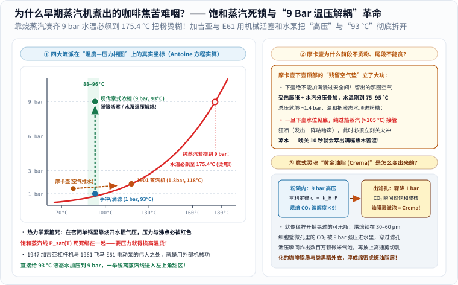
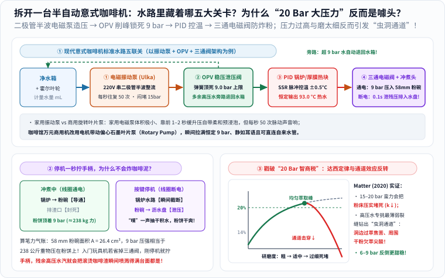
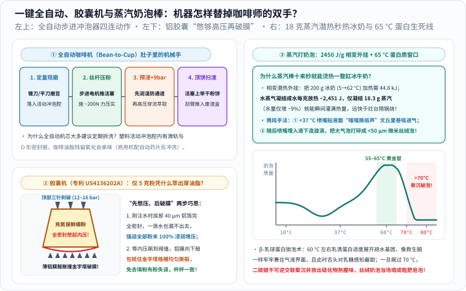
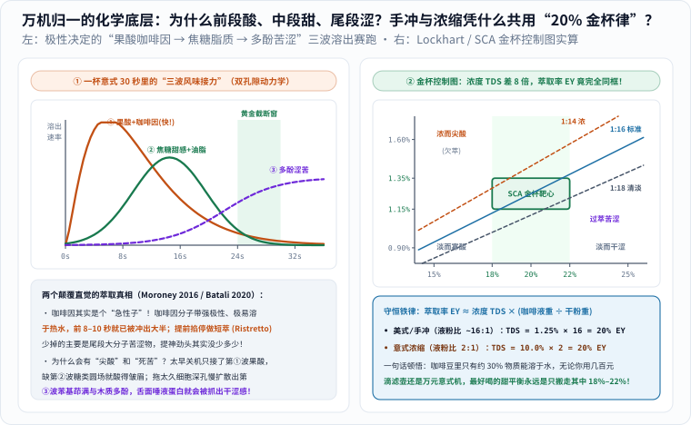

走进任何一间厨房、茶水间或街角咖啡馆，你会看到几台脾气截然不同的机器，每天都在上演几桩反直觉的“物理魔术”：

- **百元美式滴滤壶**：拆开底盖，里面既没有水泵、没有电机，也没有一块单片机芯片——可倒进水箱的凉水却能自己逆重力爬上 `25` 厘米高的头顶花洒，以刚好的 `92–96 °C` 淋在滤纸上；更神的是，水箱流干的下一秒，它不用任何水位传感器就能“咔嗒”一声自动切进 `75–80 °C` 保温。
- **燃气灶上的八角摩卡壶**：只要三分钟就能咕嘟出一壶浓香黑咖啡；可但凡你刷手机晚关火十秒钟，或者加水时不小心没过了那颗黄铜安全阀，整壶咖啡瞬间就会变得像烧糊的橡胶一样焦苦。
- **几百元的“20 Bar 高压意式机” vs 十万元的咖啡馆商用机**：电商详情页把 `15 Bar`、`20 Bar` 字样印得比机器还大；可推开精品咖啡馆大门，十万元一台的商用旗舰却死死把冲煮压力锁在 **`9 Bar`**——为什么压力翻了一倍多，萃出来的浓缩反而**同时又尖酸、又焦苦**？
- **胶囊机与蒸汽奶泡棒**：一颗只有 **`5` 克**咖啡粉（不到咖啡馆双份粉碗三分之一）的小小铝壳胶囊，凭什么不用布粉压粉就能流出一层厚厚的虎斑黄金油脂（Crema）？一根细细的蒸汽喷嘴插进冰牛奶，为什么十来秒就能把整杯奶加热到 `62 °C` 丝绒微泡，一旦飙过 `70 °C` 却立刻塌成粗糙的肥皂泡？

别被五花八门的外壳晃花了眼。从热力学、多孔介质流体力学与食品化学的底层看，地球上所有咖啡机从头到尾只做一件事：

> **一颗烘焙咖啡豆里，约 `70%` 是根本不溶于水的木质纤维骨架，只有约 `30%` 的质量能溶于水；而这 `30%` 可溶物里，又只有最精华的 `18%–22%` 好喝 [[10]](#ref-10)。所有咖啡机的机械、水路与温控设计，都是在同时驯服温度 $$T$$、压强 $$P$$、流速 $$Q$$ 与粉层渗透率 $$k$$ 四个物理量，把那黄金 `20%` 干净利落地搬进杯子里。**

下面我们就拿一把螺丝刀和几条硬核物理定律，按从简到繁的进化顺序，把美式滴滤壶、摩卡壶、半自动意式机、一键全自动机、胶囊机与蒸汽奶泡棒挨个拆个底朝天。

---

## 一、美式滴滤壶的“无泵魔术”：没有电机也没有芯片，冷水凭什么自己爬上 25 厘米高的头顶，烧干还能自动断电？

### 1. 液体二极管 + 1600 倍蒸汽膨胀：把沸腾气泡变成“推水活塞”

如果你把家里那台百元美式滴滤咖啡机翻过来拆掉塑料底板，一定会大吃一惊：整台机器的动力心脏，只是一根紧贴在保温底盘下面的 **U 形铝制电热管（功率约 `800–1000 W`）**，加上水箱出口处一颗几毛钱的**硅胶挡片或小球单向止回阀** [[1]](#ref-1)。

没有水泵叶轮，水凭什么往高处走？我们先算算把水推上滤杯顶端的花洒需要多大劲。

假设冷水水面到顶部喷淋花洒的高度差是 $$\Delta h = 0.25\ \mathrm{m}$$（`25` 厘米），水的密度 $$\rho \approx 1000\ \mathrm{kg/m^3}$$，重力加速度 $$g = 9.81\ \mathrm{m/s^2}$$。根据流体静力学公式，这截水柱压在底部的静水压强差只有：

$$
\Delta P_{\mathrm{head} } = \rho g \Delta h \approx 1000 \times 9.81 \times 0.25 \approx 2453\ \mathrm{Pa} \approx 0.024\ \mathrm{bar}
$$

还不到大气压的**四十分之一**（我们在[虹吸现象与 10.3 米大气压极限]()里算过，`1` 个标准大气压足足能托起 `10.3` 米高的水柱，`25` 厘米在热力学眼里简直轻如鸿毛）。

再看水在铝管里受热沸腾时会发生什么：在常压 `100 °C` 下，$$1\ \mathrm{g}$$ 液态水原本只占约 $$1.04\ \mathrm{cm^3}$$ 的体积；一旦相变成水蒸气，体积瞬间暴涨到约 **`1673 cm³`**——**膨胀了整整 `1600` 多倍**！

不过，光有蒸汽膨胀还推不动水：假如铝管两头都敞开，气泡一鼓起来，往回推冷水箱阻力更小，只会在冷水箱里“咕嘟咕嘟”冒泡泡。Hamilton Beach 与 Sunbeam 等早期滴滤壶专利（如美国专利 `US4744291A` 与英国专利 `GB761268A` [[1]](#ref-1)）点石成金的一笔，就是在冷水箱通往加热铝管的入口处塞进一颗**单向止回球阀（Check Valve）**——你可以把它理解成我们在[汽车油箱负压呼吸阀]()里见过的**“流体二极管”**：

1. **补水导通**：不沸腾时，水箱里的冷水靠重力顶开轻巧的小球，流进底部的 U 形加热铝管；
2. **反压锁死与弹状流（Slug Flow）推升**：铝管通电几秒后，管壁局部水温率先达到沸点，炸出一串蒸汽泡。局部气压刚蹿升几千帕，立刻把左侧单向球阀**死死顶回阀座封住退路**！无处可逃的高压蒸汽泡只能像活塞一样向右膨胀，推着前面那一截还没完全沸腾的热水柱（工程上叫 **“气泡泵 / 热虹吸弹状流”**），顺着竖直升水管一路冲上 `25` 厘米高的顶部花洒；
3. **泄压循环**：蒸汽泡把热水推出花洒后破裂泄压，铝管内压强回落，冷水箱重力再次推开单向阀补入下一口冷水——每秒钟如此循环数次，就把整箱水一节一节“端”上了头顶！

_左图：无泵滴滤壶靠“单向止回阀 + 1600 倍蒸汽体积膨胀”组成气泡泵，克服仅 `0.024 bar` 的 `25 cm` 水位差将热水推上花洒（图中气水交替上升动画自动播放一次后停在完整静态视图；开启系统“减少动态效果”时直接展示静态步骤）。右图：加热铝管有水时被沸腾相变锁在 `~110 °C`，水干瞬间失去冷却几秒蹿过 `135 °C`，触发双金属片弹开转入 `75–80 °C` 保温。[单独打开大图（刷新可重播）](/assets/images/coffee-machine-principles/drip-bubble-pump-and-bimetal-switch.svg)。_

### 2. 既然靠沸腾推水，为什么淋下来的水不是烫焦咖啡的 100 °C，而是刚好的 92–96 °C？

读到这里，细心的读者马上会抓出一个漏洞：**“既然动力来自水沸腾变蒸汽，那冲到咖啡粉上的岂不是 `100 °C` 滚水？怎么没把咖啡烫苦？”**

这正是气泡泵最巧妙的“冷热掺兑账” [[1]](#ref-1)：因为托起 `25` 厘米水柱只需要微不足道的 `0.024 bar` 压差，整截水柱根本不需要全部烧开！铝管内壁只需要让**不到 `1%–2%` 的贴壁薄水膜**闪蒸成气泡，就足以像弹簧一样把前面那一大截 **`88–95 °C` 的未沸腾液态水**推上去。在爬升途中，细小蒸汽泡又会重新冷凝把潜热匀给周围水柱，再扣掉升水管与花洒喷淋时的散热，落到咖啡粉床上的水滴温度刚好稳稳落在精品咖啡协会（SCA）推荐的 **`92–96 °C` 黄金冲煮温区** [[10]](#ref-10)（反倒是廉价劣质滴滤壶因为加热管功率太小或水垢堵塞，水温掉到 `82 °C` 以下，才会冲出寡淡发酸的刷锅水）。

### 3. 没有水位传感器，它怎么精准感知“水箱流干了”？——相变锁温与双金属片跳断

更绝的是右半幅图的纯机械“自动停机”逻辑 [[1]](#ref-1)。百元滴滤壶没有浮球开关、没有电容液位计，凭什么每次都在水箱流干的那几秒精准切入保温？

答案藏在初中物理最朴素的**沸腾相变潜热**里：

1. **有水冲煮期（相变锁温）**：只要冷水箱还有水不断流进 U 形铝管，液态水汽化每秒钟都在疯狂带走热量（每克水汽化吸热 `2257 J`）。哪怕 `900 W` 电热丝全功率猛烧，铝管外壁温度也会被沸腾的水死死“钉”在 **`105–115 °C`** 附近动弹不得；
2. **水干瞬间（干烧蹿温）**：当水箱最后一滴水流进铝管变成蒸汽喷出（就是你每次在厨房听见滴滤壶发出最后一声长长的 **“嗤——咕噜！”** 的那一刻），管内瞬间只剩空气，换热系数暴跌几十倍。失去液态水吸热镇压后，铝管外壁温度在短短几秒内直奔 **`135–145 °C`**；
3. **双金属片弹跳（Snap-Action Bimetal）**：紧贴在铝管外壁上的温控器里，焊着一片由两种热膨胀系数不同的合金叠压而成的弧形**双金属片**（$$\alpha_1 \neq \alpha_2$$）。一旦越过 `135 °C` 阈值，膨胀快的那一层把弧片猛地往反方向“咔嗒”拱翻，弹开银触点切断主加热功率（或切入低占空比间歇供电 / 串联 PTC 限流电阻），让上方紧贴玻璃壶底的金属盘刚好维持在 **`75–80 °C`** 保温区！而在铝管最底下，通常还串着一颗 **`216–240 °C` 一次性热熔断体（Thermal Fuse）**：万一双金属片触点老化粘连，保险丝直接永久熔断，从物理根源杜绝火灾。

---

## 二、困扰人类半个世纪的“热力学死锁”：为什么靠烧蒸汽攒不出好喝的 9 Bar 浓缩？

美式滴滤壶虽然便宜省心，但有个天生的慢脾气：靠常压重力渗过中粗研磨的咖啡粉，萃一壶要等 `4–6` 分钟，浓度（`TDS`）只有 **`1.2%` 左右**。十九世纪末二十世纪初，急性子的意大利人想出了一个念头：**如果把咖啡磨成极细的面粉状，再用高压热水在 `25` 秒内强行压过去，能不能现点现做一杯浓稠十倍的“快车咖啡（Espresso）”？**

没想到，就是这个看似简单的念头，一头撞上了热力学最硬的一堵墙——整整困住了工程师将近五十年！

### 1. 1901 贝泽拉蒸汽机与饱和蒸汽压曲线：要高压就必烫焦的“热力学死胡同”

1901 年（1902 年递交美国专利申请、1903 年获批美国专利 `US726793A`，后由帕沃尼 Desiderio Pavoni 量产推广 [[2]](#ref-2)），米兰发明家**路易吉·贝泽拉（Luigi Bezzera）**造出了世界上第一台带独立冲煮手柄（Portafilter）的立式铜锅炉意式咖啡机。

他的思路非常符合工业革命的蒸汽机直觉：在一个密封大铜桶底下点燃气火，下半截是滚水，上半截攒满水蒸气；拧开多路旋塞阀（专利图中的水路 `A`、汽路 `V`、排空 `S` [[2]](#ref-2)），就靠桶顶的水蒸气压迫底下的开水穿过咖啡粉饼！

可贝泽拉和此后四十年的同行们很快发现一个绝望的怪圈：**锅炉气压稍微调高一点，煮出来的咖啡就焦苦得像中药渣；把温度降下来，气压又跌回原形，根本压不动细粉！**

为什么会这样？因为在任何“只有液态水和水蒸气共存”的密闭锅炉里，热力学吉布斯相律规定系统**只有一个独立自由度**——压强 $$P$$ 和沸点温度 $$T$$ 被**饱和蒸汽压曲线**（工程上常用安托万方程 Antoine Equation 精确拟合）死死绑在同一根绳子上：

$$
\log_{10} P_{\mathrm{sat} }(T) = A - \frac{B}{C + T}
$$

把水在高温区的实验常数代入一算，冷酷的数字立刻宣判了“纯蒸汽加压”的死刑：

- 常压敞口壶（`1.01 bar`）：水在 **`100.0 °C`** 沸腾；
- 贝泽拉 1901 蒸汽咖啡机（约 `1.5–2.0 bar`）：锅炉水温已经飙到 **`111–120 °C`** [[2]](#ref-2)，咖啡里的绿原酸内酯与木质多酚开始大量热解溶出，焦苦味扑面而来；
- **假如你想单靠烧水攒蒸汽，硬攒出今天意式浓缩标准的 `9.0 bar` 压强呢？** 饱和水蒸气对应的锅炉水温必须烧到惊人的 **`175.4 °C`**！在 `175.4 °C` 下冲咖啡，无异于拿高压灭菌锅直接把咖啡粉碳化成黑焦油！

_左图：由水饱和蒸汽压方程精确绘制的“温度—压力相图”。密封烧水攒气压永远逃不出红色曲线（攒到 `9 bar` 水温必飙至 `175.4 °C`）；1947 年加吉亚弹簧活塞与 1961 年飞马 E61 电动泵首次用外部机械功把 `93 °C` 液态水单独压上 `9 bar`，跳进左上角甜区。右上：摩卡壶靠安全阀下方留出的“残留空气垫”受热膨胀，在 `75–95 °C` 就温和推水升槽。右下：`9 bar` 下亨利定律令烘焙二氧化碳溶解度翻 9 倍，出孔骤降回 `1 bar` 瞬时成核裹上油膜形成黄金油脂（Crema）。[单独打开大图](/assets/images/coffee-machine-principles/steam-pressure-trap-vs-nine-bar-decoupling.svg)。_

### 2. 摩卡壶的救场巧思：为什么说明书千叮咛万嘱咐“水位绝不能没过安全阀”？

在真正打破死锁之前，1933 年意大利人阿方索·比乐蒂（Alfonso Bialetti）发明的八角铝制**摩卡壶（Moka Express）**，先用了一个极聪明的“借力巧计”，让普通家庭在燃气灶上也能煮出近似浓缩的咖啡。

很多人以为摩卡壶也是靠 `115 °C` 纯蒸汽硬顶上去的——其实完全搞反了！2026 年发表的摩卡壶热流耦合动力学研究 [[3]](#ref-3) 把下壶里的真实物理过程算得清清楚楚：**一杯好喝、不焦苦的摩卡壶咖啡，真正立下头功的是下壶顶部特意留出来的那一圈“残留空气垫（Headspace Air）”！**

按照道尔顿分压定律，摩卡壶下壶密封腔里的总压强 $$P_{\mathrm{total} }$$，等于**被困空气分压**与**水蒸气饱和分压**之和：

$$
P_{\mathrm{total} }(T) = P_{\mathrm{air} }(T) + P_{\mathrm{sat} }(T)
$$

当你往摩卡壶下壶倒水、严格停在**黄铜安全阀下方**时，水面上方留出了一小段密封空气层。点火加热后，哪怕下壶水温才刚升到 **`75–95 °C`**（水还远没沸腾！$$P_{\mathrm{sat} }$$ 只有 `0.38–0.85 bar`），上方那团被困空气受热膨胀叠加水汽蒸发，总压强 $$P_{\mathrm{total} }$$ **就已经率先跨过了 `1.4–1.7 bar`** [[3]](#ref-3)，把下壶里温和的液态热水稳稳顺着漏斗长管往上推，浸润咖啡粉升入上壶！

直到下壶液态水位降到漏斗管口以下，混合着 **`>105 °C` 纯过热蒸汽**的气流才突然接管通道，在上壶柱口喷出标志性的“噗噜噜”火山喷发声（论文中称为 *Strombolian phase* [[3]](#ref-3)）。这也一举解释了摩卡壶两条铁律背后的物理学：

1. **为什么加水绝不能没过安全阀？** 一来堵死安全阀会在粉槽堵塞时引发炸壶危险；二来一旦灌满水挤没了那层“空气垫”，就彻底退化成了 `115 °C` 纯蒸汽锅炉——水非得烧过沸点才推得动，第一滴出来的咖啡就是焦苦的！
2. **为什么下壶最好直接倒 `70 °C` 热水，且刚听到“噗噜”声就要立刻关火冲凉水？** 倒热水能缩短金属壶身把干咖啡粉提前“烤糊”的时间；而在尾段蒸汽喷发前及时撤火降温，正好把 `>105 °C` 蒸汽萃出的木质苦涩死死挡在杯外！

### 3. 1938–1961“温压解耦”大革命：加吉亚弹簧活塞与飞马 E61 电动泵，顺手撞出“黄金油脂（Crema）”

既然靠“加热水产生蒸汽”永远逃不出红色饱和曲线，怎样才能同时拥有 **`93 °C` 的温和水温** 和 **`9 Bar` 的狂暴压强**？

答案说破不值一文钱：**别让热量兼职干“苦力”！让锅炉只管把水烧到 `93 °C`，另找一只纯粹的“机械大手”去使劲推水！**

这场改写全球咖啡史的**“温压解耦（Temperature–Pressure Decoupling）”**革命分三步完成：

1. **1938 年告别蒸汽**：米兰酒吧老板**阿基莱·加吉亚（Achille Gaggia）**于 **1938 年 9 月 5 日**拿到意大利第 `365726` 号专利（*Sistema Lampo* 旋转螺杆活塞机构），率先用无蒸汽的热水压力穿粉 [[4]](#ref-4)；
2. **1947 年弹簧拉杆跃上 `8–10 Bar`**：**1947 年**加吉亚申请核心拉杆弹簧活塞专利（1948 年正式商用 [[4]](#ref-4)）——咖啡师用力往下压长拉杆时，把冲煮头里一根粗壮的钢制大弹簧狠狠压缩，同时让锅炉里约 `90–96 °C` 的热水流进活塞腔；松手瞬间，巨型弹簧回弹推动活塞，以 **`8–10 Bar` 的纯机械液压**把 `93 °C` 热水稳稳压穿极细粉饼！温度与压力彻底解耦，人类第一次跳进上图左上角的绿色甜区！
3. **1961 年飞马 E61 电动泵定型现代架构**：拉杆弹簧虽妙，但每压一杯都要靠胳膊较劲，且一管水容积固定。**1961 年 11 月**（1963 年公布专利 `FR1339414A` [[5]](#ref-5)），**埃内斯托·瓦伦特（Ernesto Valente）**为 Faema 公司设计出传奇的 **Faema E61**：首次装上**电机驱动的连续 `9 Bar` 旋转水泵**，并让新鲜冷水穿过蒸汽大锅炉里的**热交换铜管（Heat Exchanger）**即热到冲煮温度，再借沉重的黄铜冲煮头建立**热虹吸循环（Thermosiphon）**恒温——今天全世界咖啡馆吧台上的意式机，几乎全是它的直系子孙！

更有戏剧性的一幕发生在 1948 年加吉亚新机器刚装进米兰吧台时：当 `9 Bar` 热水第一次压穿新鲜烘焙的细粉，流进小瓷杯顶上竟然浮起了一层从未见过的**金棕色绵密泡沫**！习惯了黑汤的顾客差点退货，质问老板：“咖啡上面怎么飘着一层脏浮沫？”加吉亚灵机一动，给它起了个响亮的名字——**“天然黄金咖啡油脂（Crema naturale）”** [[4]](#ref-4)！

这层迷人的黄金虎斑 Crema 到底是怎么变出来的？2023 年《Scientific Reports》借助 X 射线显微 CT 扫描粉床结构 [[8]](#ref-8) 给出了完整微观机制：

- 咖啡豆在 `200 °C` 烘焙时会生成大量二氧化碳（约占熟豆重量的 `2%`），被锁在细胞壁 **`30–60 µm` 的微孔**里；
- 常压手冲时，这些二氧化碳只能在滤杯里鼓起一个大闷蒸汉堡包，白白跑进空气里；但在 **`9 Bar` 高压液态水**中，根据**亨利定律（Henry's Law）**：

$$
c = k_{\mathrm{H} } P
$$

  二氧化碳在水中的平衡溶解度 $$c$$ 与绝对压强 $$P$$ 成正比——`9 Bar` 下的溶解度瞬间翻了约 **`9` 倍**！原本赖在微孔里的二氧化碳被强行压进热咖啡液；
- 紧接着，裹挟着高压溶解气体的咖啡液高速挤过滤篮底部的微孔，压强在毫秒间暴跌回 **`1 Bar` 大气压**——液体瞬间严重过饱和，成百上千万颗微米级二氧化碳微泡像刚拧开的香槟一样集体成核析出，外面立刻裹上一层被高压剪切乳化的**咖啡油脂微滴与美拉德类黑精（Melanoidins）两亲分子膜** [[8]](#ref-8)，稳稳浮在液面，就成了浓郁丝滑的黄金油脂！

---

## 三、拆开一台半自动意式咖啡机：水路五道关卡怎么协同？为什么商家狂吹的“20 Bar 大压力”反而是智商税？

搞懂了 `9 Bar` 与 `93 °C` 为什么要分家，现在我们拧开一台现代家用 / 准商用半自动意式咖啡机的外壳，顺着硅胶水管从头走到尾，看看一滴凉水要闯过哪五道精密关卡 [[6]](#ref-6)。

_上图：现代半自动意式咖啡机标准水路五联关——霍尔流量计计量、50 Hz 半波二极管电磁振动泵造压、OPV 稳压泄压阀削掉超额压力退回水箱、PID 锅炉或厚膜块锁死 `93.0 °C`、三通电磁阀进粉碗。左下：三通电磁阀断电瞬间封死锅炉并接通排水盘，卸掉 `58 mm` 粉饼上约 `238 kgf` 的残余高压，防止拧手柄炸粉泥。右下：根据达西定律与《Matter》（2020）实证，磨太细配 `15–20 bar` 高压反而压塌粉床击穿“虫洞通道”，令平均萃取率倒退并同时萃出尖酸与苦涩。[单独打开大图](/assets/images/coffee-machine-principles/espresso-pump-opv-threeway-and-darcy.svg)。_

### 1. 第一关：为什么家用机开机“哒哒哒”直响，咖啡馆商用机却静悄悄？

把水从水箱抽出来加压的泵，分两大门派 [[6]](#ref-6)：

- **家用主力——电磁振动泵（Vibratory Solenoid Pump，以意大利 Ulka 泵最经典）**：体积只有鸡蛋大，里面根本没有旋转电机！它直接把家里 `220 V / 50 Hz` 交流电串上一颗**半波整流二极管**：交流电正半周导通时，电磁线圈吸动铁芯柱塞压缩弹簧往后退；负半周截止时，弹簧猛地把柱塞往前弹，配合前后两颗微型单向止回球阀，**每秒钟往复抽打 `50` 次**（这就是家用机每次萃取时“哒哒哒”低频轰鸣的来源！）。振动泵造价低、体积小，而且压力需要 `5–8` 秒慢慢爬坡，天然自带温和的“低压预浸泡”效果；当出口完全堵死（零流量闷堵）时，它的极限峰值压强能顶到 **`15–20 Bar`**。
- **商用旗舰——旋转叶片泵（Rotary Vane Pump）**：由大扭矩独立电机带动偏心黄铜腔里的四片石墨滑片高速旋转，一按开关 **`0.5` 秒内瞬时拉满恒定 `9 Bar`**，声音只有轻微的低沉嗡鸣，而且可以直接接自来水市政管网连续出杯几百次不衰减。

### 2. 第二、三关：OPV 稳压阀削掉“虚标高压”，PID 锅炉锁死 ±0.5 °C

紧跟在振动泵后面的第二关，是区分“玩具入门机”与“专业半自动机”的分水岭——**OPV 过压稳压泄压阀（Over-Pressure Valve）** [[6]](#ref-6)。

前面刚说过，一颗几十块钱的电磁振动泵在堵死出口时天生就能憋出 `15–20 Bar`。规范设计的咖啡机会在泵出口装一颗由精密调压弹簧顶住的 OPV 阀，把开启阈值精准校在 **`9.0 Bar`**：只要粉饼阻力让管路压强超过 `9 Bar`，OPV 弹簧立刻被顶开一条缝，把多余的高压水顺着旁通软管安静退回冷水箱，确保压在咖啡粉头上的永远是恒定平直的 `9 Bar`！

接着水流进入第三关**加热与温控系统**（常见四种构型：**即热铝质/厚膜加热块 Thermoblock** 升温最快仅需几秒；**单锅炉 Single Boiler** 萃取与打奶共用一锅需切换等待；**热交换锅炉 HX** 可边萃边打奶；**双锅炉 Dual Boiler** 一颗小锅炉专管 `93.0 °C` 冲煮、一颗大锅炉专管 `125 °C` 蒸汽，互不干扰）。现代中高端机型淘汰了温差高达 `±5 °C` 的机械温控片，改用热电偶配合 **PID 闭环控制算法 + 固态继电器（SSR）** 高频脉冲调功：

$$
u(t) = K_p e(t) + K_i \int_0^t e(\tau)\,\mathrm{d}\tau + K_d \frac{\mathrm{d}e(t)}{\mathrm{d}t}, \qquad e(t) = T_{\mathrm{set} } - T(t)
$$

比例项 $$K_p$$ 负责快速响应温差，积分项 $$K_i$$ 消除稳态漂移，微分项 $$K_d$$ 在冷水涌入瞬间提前预判补热，把冲煮水温波动死死按在 **`±0.2–0.5 °C`** 以内！

### 3. 第四关：如果没有“三通电磁阀”，停机一秒拧手柄为什么会炸一脸热泥浆？

水流抵达冲煮头前的第四关，是一颗在停机瞬间发出清脆 **“呲——”** 声的**三通电磁阀（3-Way Solenoid Valve）** [[6]](#ref-6)。别小看这声“呲”，我们先算算正在萃取的那一刻，小小咖啡粉碗里憋着多恐怖的力气！

标准商用粉碗直径 $$d = 58\ \mathrm{mm}$$（半径 $$r = 0.029\ \mathrm{m}$$），横截面积为：

$$
A = \pi r^2 = \pi \times (0.029)^2 \approx 2.642 \times 10^{-3}\ \mathrm{m^2} = 26.42\ \mathrm{cm^2}
$$

当上方压着 **`9 Bar` 表压**（即 $$9 \times 10^5\ \mathrm{Pa}$$）的热水时，整块掌心大的咖啡粉饼承受的总向下载荷高达：

$$
F = \Delta P \cdot A \approx (9 \times 10^5\ \mathrm{Pa}) \times (2.642 \times 10^{-3}\ \mathrm{m^2}) \approx 2378\ \mathrm{N} \approx 242\ \mathrm{kgf}
$$

**整整两百四十多公斤的重压**（相当于三个成年壮汉叠罗汉踩在你手里那只铁勺子上，这也是为什么意式手柄耳朵必须用厚重黄铜或不锈钢铸造）！

- **省掉三通阀的百元入门机**：停机断电后，粉饼上方依然困着一汪滚烫的高压残水无处可去。如果你刚关开关就顺手拧下手柄，外部卡扣松脱瞬间，残余高压带着滚烫咖啡泥 **“砰”地向四周喷溅（俗称“炸粉 / Puck Sneeze”）**，哪怕等半分钟再拧，敲出来的也是一滩稀泥汤；
- **配有常闭三通电磁阀的机器**：冲煮通电时，`锅炉 → 粉碗` 导通、排泄口封死；**停机断电的 `0.1` 秒内**，阀芯弹簧瞬间复位，同步**切断锅炉来水**并**打通 `粉碗上方 → 沥水盘泄压管`** [[6]](#ref-6)——伴随着清脆的“呲”声，`242` 公斤高压瞬间清零，还顺手把粉饼顶部的积水吸走，一磕手柄就是一块干爽完整的圆饼！

### 4. 第五关：达西定律与《Matter》（2020）实证——为什么“20 Bar 大压力”反而是智商税？

现在终于可以揭穿电商平台上最泛滥的一句宣传语了：**“升级 20 Bar 澎湃大压力，萃出双倍油脂！”**

首先戳破参数把戏：那台几百块钱的机器之所以敢标 `20 Bar`，恰恰是因为它用的也是同款几十元电磁振动泵，但**为了省成本故意砍掉了 `9 Bar` 的 OPV 稳压泄压阀**，直接拿水泵堵死出口（流量为零）时的“憋死极限压强”写进了广告词！

更要命的是物理后果。把压实的咖啡粉饼看作厚度为 $$L$$、横截面积为 $$A$$ 的多孔介质床层，热水（动力黏度 $$\mu$$）在压差 $$\Delta P$$ 驱动下穿粉的总体积流量 $$Q$$ 服从流体力学著名的**达西定律（Darcy's Law）**：

$$
Q = \frac{k A}{\mu} \frac{\Delta P}{L}
$$

式中的 $$k$$ 叫**粉床本征渗透率**（单位 $$\mathrm{m^2}$$），它对颗粒间隙极其敏感（按柯泽尼-卡门关系，近似与颗粒粒径平方 $$d_p^2$$ 及孔隙率高次方成正比）。

外行看达西公式会想当然地以为：“$$\Delta P$$ 翻倍到 `20 Bar`、豆子再磨细一点，萃取肯定更充分！”然而 **2020 年俄勒冈大学化学家 Christopher Hendon 与数学家 Jamie Foster 等人在 Cell 子刊《Matter》发表的里程碑论文** [[7]](#ref-7)，联合 2023 年 X 射线显微 CT 研究 [[8]](#ref-8)，用严密的偏微分方程与上千杯实测数据证明了**恰恰相反的反转现象**：

1. **双峰碎屑堵塞（Fines Migration & Clogging）**：烘焙豆质地脆硬，磨豆机切碎时必然同时产生 `200–1000 µm` 的多孔粗颗粒和大量 **`30–40 µm` 的破碎细胞壁极细粉（Fines）** [[8]](#ref-8)。当你用 `15–20 Bar` 的蛮力猛砸粉饼时，湿润松软的咖啡颗粒被强行压扁，微米级细粉被冲到底部堵死滤孔，导致局部渗透率 $$k$$ 断崖式暴跌！
2. **虫洞通道效应（Channeling）**：正反馈灾难随之爆发——水是专挑软柿子捏的流体！一旦粉床被压得太死，高压水就会在密度稍低的一两处薄弱点硬生生冲开毫米级的**“虫洞高速通道”** [[7]](#ref-7)：
   - **通道内壁（局部严重过萃 `>26%`）**：九成以上的热水顺着这几条虫洞狂泻而下，把通道周围几毫米咖啡粉里的焦苦内酯、木质多酚刮得干干净净，液体颜色瞬间发白变水；
   - **通道外围（大片死区欠萃 `<14%`）**：旁边八成咖啡粉根本没怎么过水，只渗出最表层尖锐刺舌的柠檬酸、苹果酸；
   - **杯中灾难**：两股液体混进同一个杯子，不仅全饼**平均萃取率不升反降**（见上图右下红色转折峰 [[7]](#ref-7)），喝进嘴里更是典型的**“又尖酸、又焦苦、还涩口”**！
3. **《Matter》给出的反直觉最优解**：实验团队把商用咖啡馆的机器压力从 `9 Bar` 主动下调到 **`6–9 Bar`**，配合**略调粗一点、分布更均匀的研磨度**——结果粉床彻底告别通道击穿，杯杯萃取率稳定一致，甚至**每杯少用 `25%` 咖啡豆**就能萃出更甜润干净的浓缩 [[7]](#ref-7)！（至于极低配百元机常用的“双层增压粉碗 Pressurized Basket”，则是在双层碗底只留**唯一一个针眼小孔**人为制造背压打假泡沫，哪怕装粗粉也能喷出气泡，但风味层次与真正靠咖啡粉自身建立阻力的单层粉碗不可同日而语。）

---

## 四、全自动机、胶囊机与蒸汽奶泡棒：机器怎样把咖啡师的双手装进盒子里？

半自动咖啡机虽好玩，但磨豆、布粉、压粉、控时每一步都考验手法。办公室茶水间与忙碌的清晨是怎么把这套复杂动作压缩成“按一下键”的？还有那根神奇的蒸汽棒，又是怎样十秒打发冰牛奶的？

_左上：全自动咖啡机（Bean-to-Cup）依靠机身内可拆卸的步进丝杆冲泡器，自动完成定量磨豆落腔、机械活塞约 `200 N` 压实、`9 bar` 预浸萃取与顶起刮渣四连动作。左下：胶囊机专利（`US4136202A`）刚注水时底部 `40 µm` 铝箔完全密封不漏水，迫使 `5 g` 粉 `100%` 浸润增压，直到超限撑裂在金字塔凸格板上闪蒸出厚油脂。右图：仅 `18.3 g` 水蒸气冷凝即可释放约 `44.8 kJ` 潜热把 `200 g` 冰牛奶升至 `62 °C`，并在 `55–65 °C` 令 β-乳球蛋白适度展开锁住微泡；一旦超过 `70 °C` 二硫键不可逆聚集，奶泡当场塌陷发腥。[单独打开大图](/assets/images/coffee-machine-principles/bean-to-cup-capsule-and-steam-microfoam.svg)。_

### 1. 一键全自动咖啡机（Bean-to-Cup）：藏在塑料门板后的“丝杆机械手”

很多人好奇：全自动咖啡机顶上倒豆子、底下直接出浓缩，用完一拉开渣盒全是一块块圆整的干粉饼——里面难道藏着一只小人手在帮忙压粉敲渣？

真差不多！打开全自动咖啡机的侧门，你会看到一套由工程塑料（高端商用机为加热金属）拼成的**步进冲泡器总成（Brew Unit / Infuser）**，每按一次键就精确上演一套四拍机械舞：

1. **定量现磨落腔**：顶部锥刀或平刀磨豆机按脉冲计时研磨 `8–14 g` 新鲜咖啡粉，顺着滑道落进斜张开的冲泡圆筒；
2. **丝杆/凸轮机械压粉**：直流减速电机或步进电机驱动丝杆齿轮（编码器数脉冲测行程），把冲泡圆筒摆正推向顶部密封活塞，施加约 **`150–250 N`（`15–25` 公斤力）** 的机械压力将松散干粉压实成饼；
3. **低压预浸 + `9 Bar` 穿刺萃取**：即热加热块与振动泵先打入两秒热水停顿闷蒸（让粉层吸水膨胀填平缝隙），随后全压推进穿过弹簧背压油脂阀流入杯中；
4. **顶升刮渣复位**：萃取结束泄压后，下活塞一路顶到圆筒最顶端把湿粉饼托出筒口，摇臂刮板顺势一扫，“啪嗒”推进废渣盒！

这也顺带解释了全自动机最大的痛点——**卫生维护**：由于这套精密滑轨与硅胶 O 形圈常年待在潮湿温暖的暗箱里，飞溅的咖啡细粉与氧化酸败的油脂极易发霉卡死，所以家用机必须定期拔出冲泡器冲水涂食品级硅脂，而便利店商用全自动机每天打烊都得自动吞药片跑一遍碱性除油自清洁。

### 2. 胶囊咖啡机（专利 US4136202A）：区区 5 克咖啡粉，凭什么萃出浓厚油脂？

再看办公桌上小巧的胶囊咖啡机：撕开一颗标准意式铝壳胶囊称一称，里面居然只有区区 **`5–5.5` 克**咖啡粉，还不到咖啡馆双份粉碗（`18–20 g`）的三分之一，也没人帮它压粉——凭什么它每次都能稳定萃出一层绵密油脂？

秘密全写在雀巢工程师**埃里克·法夫尔（Eric Favre）**于 1976 年申请、1979 年获批的奠基专利 `US4136202A` [[11]](#ref-11) 里——核心就六个字：**“先憋压，后破膜”**！

1. **氮气锁鲜保住“气源”**：普通咖啡豆磨成粉暴露在空气里，几十分钟内微孔里的二氧化碳和挥发性香气就会跑掉大半；铝壳胶囊在工厂研磨灌装瞬间充入高纯氮气（残氧量低于 `1%`），用约 **`80 µm` 厚的深冲铝壳**完全隔绝氧气、湿气与光线，把烘焙二氧化碳死死锁在颗粒里几个月不跑气；
2. **顶部刺破注水，底部严防死守**：当你合上手柄，顶部三根空心刺针扎穿胶囊窄顶，振动泵开始打入 **`12–16 Bar`** 热水——**注意！此时胶囊底部那层厚约 `30–60 µm` 的薄铝箔膜是完好无损、一滴水都不漏的！**
3. **金字塔凸板“超限齐裂”**：正因为出口起初完全封死，打进来的高压热水不可能像劣质半自动机那样找一条缝提前溜走，而是被迫充满整颗圆锥腔，让 `5` 克咖啡粉 **`100%` 均匀浸润并同步升压**；随着内压越憋越高，薄薄的底膜向下鼓胀，紧紧贴在一块布满**截顶金字塔小凸起（Pyramid Extraction Plate）**的底座上 [[11]](#ref-11)。直到张应力跨过铝箔极限强度的那一瞬间，几十个金字塔尖角同时把铝箔撑开均匀微缝，饱含溶解二氧化碳的浓咖啡液顺着导流槽一涌而出，瞬间闪蒸出厚厚的 Crema！

### 3. 蒸汽打奶泡：18 克水蒸气的“2450 焦相变外挂”，与 65 °C 乳清蛋白生死线

做完浓缩基底，卡布奇诺与拿铁的另一半灵魂是**天鹅绒微奶泡（Microfoam）**。这里藏着两个连老咖啡师都经常只知其然、不知其所以然的硬核科学问题：**第一，为什么一根细细的蒸汽管能在短短 `12` 秒内把整杯冰牛奶烫热？第二，为什么牛奶一旦打过 `70 °C`，拉花奶泡就彻底废了？**

第一个问题，正是我们在[哈气暖手与 2420 焦水汽相变外挂]()里讲过的**凝结潜热降维打击**！我们来真刀真枪算一笔热量账：

假设拉花缸里装着 **`200 g` 刚从冰箱拿出来的 `5 °C` 冰牛奶**（全脂牛奶比热容 $$c_{\mathrm{milk} } \approx 3.93\ \mathrm{J/(g\cdot K)}$$），我们要把它加热到最佳适口温度 **`62 °C`**（温升 $$\Delta T = 57\ \mathrm{K}$$），总共需要吸收多少热量？

$$
Q_{\mathrm{milk} } = m_{\mathrm{milk} }\, c_{\mathrm{milk} }\, \Delta T = 200 \times 3.93 \times (62 - 5) = 44{,}802\ \mathrm{J} \approx 44.8\ \mathrm{kJ}
$$

而在咖啡机蒸汽锅炉（约 `125 °C`、绝对压强约 `2.3 Bar`）里蓄势待发的饱和水蒸气，每 **`1 g` 蒸汽**喷进冰牛奶里瞬间冷凝成 `62 °C` 液态水，会交出两笔丰厚的热量——汽化潜热 $$L_{\mathrm{vap} }(125\,^\circ\mathrm{C}) \approx 2188\ \mathrm{J/g}$$ 加上液态水降温显热 $$c_w(125 - 62) \approx 263\ \mathrm{J/g}$$：

$$
\Delta h_{\mathrm{steam} } \approx 2188 + 4.18 \times 63 \approx 2451\ \mathrm{J/g}
$$

两者一除，答案让人拍案叫绝：

$$
m_{\mathrm{steam} } = \frac{44{,}802\ \mathrm{J} }{2451\ \mathrm{J/g} } \approx 18.3\ \mathrm{g}
$$

**仅仅只需要 `18.3` 克水蒸气冷凝进牛奶里**（水量只增加了约 **`9%`**，舌头根本尝不出稀释感！），就瞬间往牛奶内部直接倾泻了 **`44.8 kJ`** 的庞大热能——如果折算成 `12` 秒加热时间，等效直接入奶热功率高达 **`3700 W` 以上**，而且热量是在牛奶内部每一个气泡界面原地释放，完全没有锅底导热烤糊奶皮的烦恼！

再看第二个问题：**为什么咖啡师打奶时左手必须死死贴着不锈钢拉花缸壁，一旦觉得“烫得没法连摸两秒（约 `60–62 °C`）”就得立刻关汽？**

食品胶体化学研究（如《Frontiers in Nutrition》2021 与《Molecules》2022 乳蛋白热变性与泡沫稳定性综述 [[12]](#ref-12)）揭示了牛奶里那场惊心动魄的分子接力：

1. **第一阶段：低温进气（`5 → 37 °C`，“嗤嗤”撕纸声）**：趁牛奶冰凉黏度高，把蒸汽喷嘴尖端贴在液面下 `1–2 mm` 处。高速蒸汽射流根据文丘里效应卷入一串串细小空气泡（必须在 `37 °C` 前完成进气，否则后期没时间把大气泡打碎）；
2. **第二阶段：偏心漩涡切碎（`37 → 62 °C`，静音翻滚）**：将喷嘴往下沉入液面数毫米并偏靠缸壁，靠高速射流角动量拉出强力漩涡，把毫米级粗气泡生生剪切成肉眼看不见单颗颗粒（直径 **`<50 µm`**）、泛着湿油漆般反光的**天鹅绒微泡**；
3. **蛋白质生死线（`55–65 °C` 黄金窗 vs `>70 °C` 塌陷灾难）**：真正裹住气泡防止破裂的功臣，不是乳脂（大颗脂肪球在低温半固态时甚至会刺破液膜消泡，直到 `>40 °C` 完全融化才变温顺），而是牛奶中的**乳清蛋白——尤其是 β-乳球蛋白（$$\beta$$-Lactoglobulin）** [[12]](#ref-12)！
   - 在 **`55–65 °C` 黄金窗口**内，原本蜷成线团的 β-乳球蛋白发生**温和局部去折叠（Partial Unfolding）**，把原本藏在肚子里的**疏水基团**伸进气泡内部空气侧，把外围**亲水基团**留在水相侧，像一层严丝合缝的弹性铠甲裹住每一颗微泡；与此同时，乳糖在人体舌尖甜味受体上的感知甜度刚好达到峰值！
   - **一旦越过 `70–75 °C` 红线**：β-乳球蛋白发生**不可逆热变性与二硫键（$$\mathrm{-S-S-}$$）交联聚沉** [[12]](#ref-12)——不仅当场释放出游离巯基挥发物（就是煮沸牛奶那股难闻的“熟鸡蛋腥臭味”），而且界面蛋白膜失去弹性变脆凝结，整缸细腻丝绒奶泡会在几十秒内迅速合并塌陷成干巴巴的大肥皂泡！

---

## 五、万机归一的化学底层：为什么前段酸、中段甜、尾段涩？手冲与意式浓缩凭什么共用同一条“20% 金杯律”？

拆完了五花八门的硬件，我们退后一步问一个最根本的问题：**无论你是用百元美式滴滤壶、两百元摩卡壶，还是十万元的商用浓缩机，热水钻进咖啡粉的那几十秒到几分钟里，分子层面到底发生了什么？**

这和我们在[红星二锅头“掐头去尾看花摘酒”的 751 种风味分子时序]()里看到的物理逻辑异曲同工——只不过蒸馏酒靠的是“沸点与极性挥发快慢”，而咖啡靠的是**“水溶性极性与双孔隙扩散快慢”**！

_左图：根据双孔隙萃取模型（Moroney 2016）与时间分辨感官化学研究（Batali 2020），极性强的果酸与咖啡因在最前段率先冲出，随后是焦糖甜感与乳化脂质，尾段则是慢溶的大分子苦涩多酚；黄金截断窗（`18%–22%`）负责“掐尾保甜”。右图：由质量守恒律精确绘制的 Lockhart / SCA 金杯控制图——`1:16` 手冲滴滤（`TDS = 1.25%`）与 `1:2` 意式浓缩（`TDS = 10.0%`）虽然浓度相差整整 `8` 倍，对咖啡豆可溶物的萃取率 `EY` 却双双落在 `20%`！[单独打开大图](/assets/images/coffee-machine-principles/extraction-kinetics-and-golden-cup-chart.svg)。_

### 1. 双孔隙萃取与三波分子赛跑：为什么咖啡因其实是个“急性子”？

2016 年数学家康妮·莫罗尼（Kevin Moroney）团队在《Journal of Mathematics in Industry》建立的**双孔隙咖啡萃取方程（Double-Porosity Model）** [[9]](#ref-9)，联合加州大学戴维斯分校咖啡中心（UC Davis Coffee Center）在《Scientific Reports》（2020）发表的化学动力学实测 [[10]](#ref-10)，把一杯咖啡的溶出拆成了两步几何输运与三波化学冲刺：

- **几何上的“快洗 + 慢渗”**：磨豆刀盘切碎豆子时，颗粒外表面被切破的细胞瞬间暴露在水流里，在最初几秒上演**高速冲洗（Fast Surface Washout）**；而颗粒内部完好的 `30–60 µm` 细胞腔，则必须等热水渗进去溶解固体，再靠菲克扩散定律（Fick's Law）慢吞吞往外钻 [[9]](#ref-9)。
- **化学上的“三波接力赛”** [[10]](#ref-10)：水是强极性小分子溶剂，“相似相溶”与分子量大小决定了上千种化合物的出场顺序：
  1. **第一波先锋（前段：果酸 + 咖啡因！）**：分子量小、亲水极性极强的有机酸（柠檬酸、苹果酸、奎宁酸）冲在最前面——**而且注意一个颠覆绝大多数人常识的真相：咖啡因（Caffeine）在水热条件下极易溶出，也是第一波就跑出来的“急性子”** [[10]](#ref-10)！很多人以为浓缩提前几秒掐停做“精萃短笛（Ristretto）”咖啡因会减半，或者把意式拉长流一分钟做“长萃（Lungo）”能双倍提神——**全错！** 前 `8–12` 秒已经洗出了七八成咖啡因，拖长尾段多出来的绝大部分只是苦涩木质杂味！
  2. **第二波中坚（中段：焦糖甜感 + 类黑精醇厚 + 乳化香气）**：紧随其后溶出的，是焦糖化低聚糖、美拉德反应生成的棕色类黑精与裹挟着数百种挥发性呋喃、吡嗪芳香物的微乳化油脂——正是它们把第一波孤零零的尖酸包裹、平衡成饱满圆润的酸甜感！
  3. **第三波殿后（尾段：苦味内酯 + 涩口植物多酚）**：分子量偏大、极性较弱的苯基林满（Phenylindanes）、绿原酸深度裂解苦味物与植物木质多酚溶解最慢。一旦萃取过头把它们大批拽进杯子，多酚分子就会直接抓住你口腔唾液里的富含脯氨酸蛋白质沉淀下来——让舌面瞬间发麻、发紧、干涩难咽！

所以所谓“会做咖啡”，本质上就是**等第一波果酸被第二波焦糖醇厚稳稳托住，赶在第三波苦涩多酚大部队杀到之前，果断按下停止键**！

### 2. 一行守恒律统摄所有咖啡机：为什么浓度差 8 倍的美式与浓缩，萃取率却都在 20%？

既然手冲滴滤喝起来清爽如茶，意式浓缩喝起来浓稠如糖浆，凭什么咖啡科学家说它们遵守的是**同一条“金杯准则（Golden Cup Standard）”**？

早在 1957 年，麻省理工学院生物化学家**欧内斯特·洛克哈特（Ernest Earl Lockhart）**就指出，评判任何一杯咖啡必须严格区分两个完全独立的物理量 [[10]](#ref-10)：

1. **浓度（Strength，用总溶解固体占比 `TDS` 表示）**：你端起的这杯咖啡液体里，溶解的咖啡固形物占百分之几？（决定了喝进嘴里是“浓稠厚重”还是“清淡如水”，可用光学折光仪一秒测出。）
2. **萃取率（Extraction Yield，简称 `EY` 或 `PE`）**：你投进机器的那几克干咖啡粉里，到底有百分之几的质量被水溶出来带进了杯子？（决定了你从豆子里捞出了哪几波风味分子——偏低必尖酸寡淡，偏高必焦苦干涩！）

根据最基本的**溶质质量守恒定律**，杯中溶出的咖啡固形物总质量 $$M_{\mathrm{solids} } = \mathrm{TDS} \times M_{\mathrm{bev} }$$（$$M_{\mathrm{bev} }$$ 为杯中咖啡液总质量），除以投入的干咖啡粉质量 $$M_{\mathrm{dose} }$$，就得到统摄一切咖啡器具的**金杯守恒公式** [[10]](#ref-10)：

$$
\mathrm{EY} = \frac{M_{\mathrm{solids} } }{M_{\mathrm{dose} } } = \mathrm{TDS} \times \frac{M_{\mathrm{bev} } }{M_{\mathrm{dose} } }
$$

现在把两台天差地别的机器端上桌，代入公式算一算：

- **美式滴滤壶 / 手冲滤杯**：用 $$M_{\mathrm{dose} } = 15\ \mathrm{g}$$ 干粉，滤出 $$M_{\mathrm{bev} } = 240\ \mathrm{g}$$ 咖啡液（液粉比 `16 : 1`；注水约 `270 g`，其中约 `30 g` 水被湿咖啡渣吸留），折光仪测得浓度仅为清澈的 **`TDS = 1.25%`**：

$$
\mathrm{EY}_{\mathrm{drip} } = 1.25\% \times \frac{240}{15} = 1.25\% \times 16 = 20.0\%
$$

- **咖啡馆双份意式浓缩（Double Espresso）**：用 $$M_{\mathrm{dose} } = 18\ \mathrm{g}$$ 极细粉，在 `9 Bar` 下仅萃出 $$M_{\mathrm{bev} } = 36\ \mathrm{g}$$ 浓稠液体（液粉比 `2 : 1`），折光仪测得浓度高达 **`TDS = 10.0%`**：

$$
\mathrm{EY}_{\mathrm{espresso} } = 10.0\% \times \frac{36}{18} = 10.0\% \times 2 = 20.0\%
$$

**真相水落石出！** 意式浓缩的液体浓度（`10%`）虽然整整是美式滴滤（`1.25%`）的 **`8` 倍**，但它们从咖啡豆里搬出来的精华比例，**双双精准停在 `18%–22%` 的黄金甜区正中央（`20%`）**！

如果你往这杯 `36 g` 意式浓缩里兑入 `204 g` 热水做成一杯 `240 g` 的**美式咖啡（Americano）**，它的 `TDS` 立刻被稀释到 $$36 \times 10\% / 240 = 1.50\%$$，瞬间回到滴滤壶的浓度区间——两者之所以口感仍有区别，纯粹是因为意式浓缩用金属滤篮配合 `9 Bar` 高压留住了大量被乳化的微米级咖啡油脂滴（带来醇厚滑感与焦香），而滴滤壶的致密纤维滤纸把绝大部分油脂拦截在了纸上（带来干净透亮的茶感）！

把今天拆解过的五大主流咖啡机放在同一张工程总表里横向一比，各自的脾气与边界便一目了然：

| 咖啡机家族 | 驱动力物理机制 | 典型冲煮压强 | 粉床水温 | 典型研磨粒径 | 杯中浓度 `TDS` | 目标萃取率 `EY` |
| :--- | :--- | :--- | :--- | :--- | :--- | :--- |
| **美式滴滤壶** | 单向止回阀 + 沸腾气泡升水泵 | `~1.0 bar`（常压重力） | `92–96 °C` | 中粗（`600–900 µm`） | `1.15%–1.35%` | `18%–22%` |
| **灶上摩卡壶** | 密封下壶残留空气膨胀 + 水汽分压 | `1.4–1.8 bar` | `75–95 °C`（尾段 `>105 °C`） | 中细（`350–500 µm`） | `4%–7%` | `18%–22%` |
| **半自动意式机** | 电磁振动泵/旋转泵 + OPV 稳压阀 | **`6–9 bar`**（温压解耦） | `90–96 °C`（PID `±0.5 °C`） | 极细（`200–350 µm` 含细粉） | `8%–12%` | `18%–22%` |
| **一键全自动机** | 步进丝杆机械手压粉 + 振动泵背压阀 | `8–9 bar`（冲泡腔内） | `88–94 °C`（厚膜/加热块） | 细（自动磨豆落腔） | `6%–9%` | `18%–22%` |
| **铝壳胶囊机** | 顶部刺针注水 + 底部 `40 µm` 铝箔超限破裂 | `12–16 bar`（破膜峰值） | `88–93 °C`（即热块） | 细且窄分布（充氮锁鲜 `5 g`） | `5%–8%` | `18%–22%` |

---

## 六、家庭实操排错速查：读懂原理后，三句话救活一杯难喝的咖啡

当你不再把咖啡机当成玄学黑盒，而是看清它肚子里流动的气泡、压差与蛋白质构象，日常做咖啡时最头疼的三大翻车现场，用三句物理诊断就能药到病除：

1. **浓缩 `10` 秒钟哗啦流完、油脂苍白秒散、喝起来尖酸像柠檬水**：达西定律里粉床渗透率 $$k$$ 太大，水流没等第二波焦糖溶出就溜走了（`EY < 16%`）。**只改一个变量——把磨豆机往细调小半格**（或检查豆子是否放了三个月跑光了烘焙二氧化碳）。
2. **前面憋了十秒一滴不出，突然滋出几股歪歪扭扭的白水柱，喝起来“既尖酸又焦苦涩口”**：恭喜你亲手复现了《Matter》论文里的**过细堵塞 + 虫洞通道效应**！千万别再使劲死压粉锤了——**反直觉地把磨豆机往粗调回一点**，压粉前用细针把结块拨匀（WDT 布粉），让水流平铺穿过整张粉床，甜感立刻回来。
3. **摩卡壶总有一股烟灰橡胶苦味 / 奶泡总打成干硬洗洁精泡**：摩卡壶下壶改倒 **`70 °C` 温水**、水位严格停在**安全阀下沿以下**，刚听到第一声“噗噜”气泡声立即端离炉火冲壶底降温；蒸汽打奶时，左手贴紧不锈钢缸壁，一旦觉得**烫得没法停留两秒（约 `60 °C`）立刻关汽**，绝不跨越 `70 °C` 乳清蛋白聚沉红线！

下次清晨按下咖啡机开关，听见滴滤壶最后那声“嗤——咕噜”的跳断、摩卡壶第一声欢快的“噗噜”、意式机停机时清脆的“呲——”泄压，或是蒸汽棒撕开冰牛奶那几秒温柔的“嗤嗤”声时，你会知道：那不是杂乱的机器噪音，而是热力学相变、流体二极管、达西多孔渗流与蛋白质折叠，在你的厨房里准时合奏的晨间交响曲。

---

## 参考资料

1. **Wallin, G. W. / Hamilton Beach Inc. (1988)**, *Electric Drip Coffee Maker*, US Patent [`US4744291A`](https://patents.google.com/patent/US4744291A/en)（1982 年优先权）；以及 **Jepson, I., & Koci, L. F. / Sunbeam Corp. (1956)**, *Automatic Electric Percolator*, UK Patent [`GB761268A`](https://patents.google.com/patent/GB761268A/en)。——原始专利图纸与权利要求详述了无泵滴滤壶的“单向球阀 + 电热铝管沸腾气泡升水回路（Thermosiphon Bubble Pump）”、`92–96 °C` 喷淋温区及铝管干烧越过 `~135 °C` 触发双金属片自动跳断转入保温的纯机械控制逻辑。
2. **Bezzera, L. (1903)**, *Coffee-Making Machine*, US Patent [`US726793A`](https://patents.google.com/patent/US726793A/en)（1901 年米兰首创，1902 年提交美国申请，后转让予 Desiderio Pavoni）。——世界首台带独立单杯粉碗手柄（Portafilter）与水/汽/排空多路旋塞阀的立式蒸汽锅炉意式咖啡机原始专利，工作于约 `1.5–2 bar` 饱和水蒸气压下。
3. **Siregar, R. E. (2026)**, *A Minimal Thermo–Fluid Model for Pressure-Driven Extraction in a Moka Pot*, arXiv preprint [`arXiv:2601.03663`](https://arxiv.org/html/2601.03663)。——定量建立了比乐蒂八角摩卡壶的热流耦合方程，证明下壶安全阀下方留出的残留空气层（Headspace Air）受热膨胀叠加水汽分压，使液态水在 `75–95 °C`、`~1.4–1.7 bar` 下温和升槽，直到下壶液位见底才进入 `>105 °C` 蒸汽喷发（Strombolian）苦涩尾段。
4. **Gaggia Milano Official Heritage Archive**, *85 Years of Heritage: 1938–1947* ([Gaggia 官方历史档案](https://www.gaggia.com/85-years-of-heritage-1938-1947/))。——明确区分了阿基莱·加吉亚 1938 年 9 月 5 日意大利第 `365726` 号无蒸汽热水专利（*Sistema Lampo*）与 1947 年弹簧拉杆活塞专利（`8–10 bar`，1948 年商用），记录了“温压解耦”及第一杯天然黄金咖啡油脂（*Crema naturale*）的诞生史实。
5. **Valente, E. / Faema S.p.A. (1963)**, *Perfectionnements aux machines à café*, French Patent [`FR1339414A`](https://patents.google.com/patent/FR1339414A/en)（意大利优先权日 1961 年 11 月 28 日）。——现代商用半自动意式咖啡机鼻祖 Faema E61 的核心专利：首次以电机驱动连续 `9 bar` 水泵配合热交换管与热虹吸恒温冲煮头，取代人力拉杆弹簧。
6. **US Patent Application [`US20140341552A1`](https://patents.google.com/patent/US20140341552A1/en)**, *Espresso Coffee Machine Having Improved Brewing Water Supply System*；以及 **La Marzocco S.r.l. (2025)**, WIPO Patent [`WO2025134017A1`](https://patents.google.com/patent/WO2025134017A1/en)。——详述现代意式咖啡机电磁振动泵（半波整流线圈 + 弹簧柱塞单向阀）、OPV 过压旁通稳压阀、PID 锅炉/厚膜加热温控与冲煮头三通电磁阀（3-Way Solenoid Valve）断电泄压排水的完整液压拓扑。
7. **Cameron, M. I., Morisco, D., Hofstetter, D., Uman, E., Wilkinson, J., Kennedy, Z. C., Fontenot, S. A., Lee, W. T., Hendon, C. H., & Foster, J. M. (2020)**, *Systematically Improving Espresso: Insights from Mathematical Modeling and Experiment*, *Matter* 2(3), 631–648 ([OSTI 开放全文 `1973594`](https://www.osti.gov/biblio/1973594), DOI: `10.1016/j.matt.2019.12.019`)。——通过多孔介质流固耦合模型与上千杯实测证明：研磨过细配合过高压力（如 `15–20 bar`）会导致粉床堵塞与局部虫洞通道击穿（Channeling），使平均萃取率不升反降并同时产生欠萃尖酸与过萃苦涩；`6–9 bar` 配合适度调粗研磨反而显著提升重现性并节省约 `25%` 豆量。
8. **Mo, C., Johnston, R., Navarini, L., Liverani, F. S., & Ellero, M. (2023)**, *Modeling swelling and filtration in espresso, moka, capsule and drip coffee extraction*, *Scientific Reports* 13, 16374 ([PMC 开放全文 `PMC10541431`](https://pmc.ncbi.nlm.nih.gov/articles/PMC10541431/))。——利用 X 射线显微 CT 重建意式、胶囊、摩卡壶与滴滤四大粉床三维孔隙，量化了研磨双峰粒径（`30–40 µm` 细粉与 `200–1000 µm` 多孔粗颗粒）、`30–60 µm` 细胞腔内烘焙二氧化碳在 `9 bar` 下的亨利定律增溶及出孔减压成核乳化形成 Crema 的物理过程。
9. **Moroney, K. M., Lee, W. T., O'Brien, S. B. G., Suijver, F., & Marra, J. (2016)**, *Coffee extraction kinetics in a well mixed system*, *Journal of Mathematics in Industry* 7, 3 ([PMC 开放全文 `PMC4986356`](https://pmc.ncbi.nlm.nih.gov/articles/PMC4986356/))。——建立并实验验证了咖啡颗粒“破碎外表面快洗（Fast Washout）+ 内部微孔慢扩散（Slow Intragranular Diffusion）”的双孔隙萃取动力学方程。
10. **Batali, M. E., Ristenpart, W. D., & Guinard, J.-X. (2020)**, *Brew temperature, at fixed brew strength and extraction, has little impact on the sensory profile of drip brew coffee*, *Scientific Reports* 10, 16450 ([PMC 开放全文 `PMC7536440`](https://pmc.ncbi.nlm.nih.gov/articles/PMC7536440/))。——系统梳理了 Lockhart（1957）与精品咖啡协会（SCA）金杯控制图（Golden Cup Control Chart，`EY = 18%–22%`、滴滤 `TDS = 1.15%–1.35%`、质量守恒律 $$\mathrm{EY} = \mathrm{TDS} \times M_{\mathrm{bev} } / M_{\mathrm{dose} }$$）以及极性果酸、咖啡因先溶出而苦涩多酚后溶出的时间分辨化学规律。
11. **Favre, E. / Nestec S.A. (1979)**, *Capsule for Beverage Preparation*, US Patent [`US4136202A`](https://patents.google.com/patent/US4136202A/en)（1976 年瑞士优先权）。——胶囊咖啡机奠基专利：密封充氮圆台铝壳由顶部刺针注入高压热水，底部薄铝箔膜起初完全密封迫使全粉床均匀增压浸润，直到贴紧金字塔凸起底座达到拉伸极限后同步破裂出液。
12. **Li, X. et al. (2021)**, *Effect of Heat Treatment on the Structure and Foaming Properties of Milk Proteins*, *Frontiers in Nutrition* 8, 714869 ([PMC 开放全文 `PMC8485980`](https://pmc.ncbi.nlm.nih.gov/articles/PMC8485980/))；以及 **Delahaije, R. J. B. M., & Wierenga, P. A. (2022)**, *Protein-Stabilized Foams: Adsorption, Denaturation, and Stability*, *Molecules* 27(8), 2358 ([PMC 开放全文 `PMC9000900`](https://pmc.ncbi.nlm.nih.gov/articles/PMC9000900/))。——实验阐明牛奶蒸汽打发中乳清蛋白（特别是 β-乳球蛋白）在 `55–65 °C` 适度去折叠暴露疏水侧链稳定 `<50 µm` 微奶泡，以及超过 `70–75 °C` 后发生不可逆二硫键交联聚集、释放挥发性硫化物异味并导致奶泡塌陷的分子机理。
