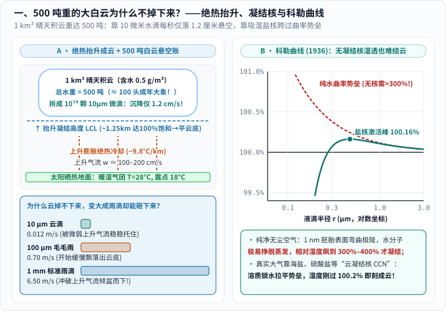
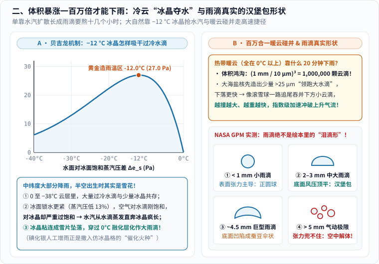
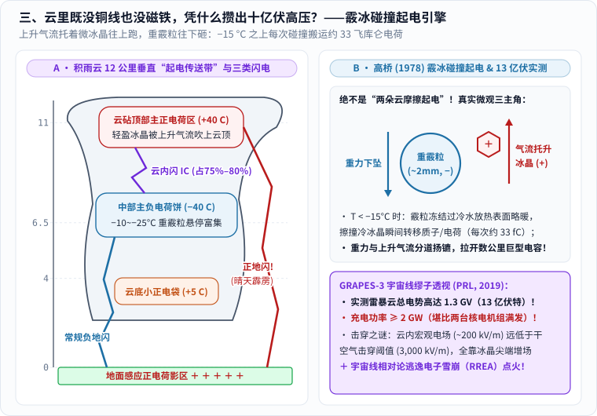
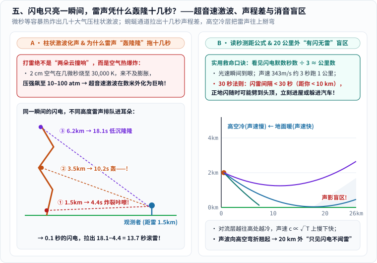

夏天的午后，只要趴在窗边看一场完整的雷阵雨，你其实就在短短一小时里看完了地球大气层最暴烈的一台“热电声大戏”。

最开始，晴朗的蓝天上只是慢悠悠飘着几朵软绵绵的大白云；不一会儿，云底越压越低、云顶像煮沸的花椰菜一样猛往上蹿，雪白的云团迅速黑压压地遮蔽天日；紧接着，豆大的雨点噼里啪啦砸向地面，一道刺眼的白光撕裂天空，几秒钟后，“咔嚓——轰隆隆隆”的闷雷震得玻璃窗嗡嗡作响。

这幕从小看到大的自然景象里，其实藏着五个连许多成年人都答反了的硬核追问：

1. **云到底有多重？** 很多人以为云像烟雾一样“几乎没有重量”。可美国地质调查局（USGS）算过一笔实打实的物理账：一朵长宽高各 $$1\ \mathrm{km}$$ 的普通晴天积云，里面悬浮的液态水重达 **$$500$$ 吨**——足足相当于 **$$100$$ 头成年非洲象** [[1]](#ref-1)！一百头大象悬在头顶，凭什么不会哗啦一下砸下来？
2. **有水汽就能结成云、有云就能下雨吗？** 恰恰相反！如果在实验室里把空气过滤得一尘不染，哪怕相对湿度飙到 $$300\%$$，水汽也极难自己凝结成云滴 [[2]](#ref-2)；而一粒云滴要想变成雨滴落下来，体积必须暴涨**一百万倍** [[3]](#ref-3)——甚至连盛夏三伏天的倾盆大雨，在几公里高空刚出生时大半居然是**雪花** [[4]](#ref-4) [[5]](#ref-5)！
3. **雨滴真的是绘本里上尖下圆的“眼泪形”吗？** 美国宇航局（NASA）全球降水测量任务的实测告诉我们：雨滴从小到大当过圆球、当过**汉堡包面包胚**、当过小降落伞，唯独从来没长成过泪滴形 [[6]](#ref-6)！
4. **没有铜线也没有发电机，软绵绵的云怎么造出十亿伏高压电？** 小时候常听人说“打雷闪电是因为两朵云撞在一起摩擦起电”，这其实是个流传极广的误解——哪怕天上只有一朵孤零零的积雨云，照样能疯狂劈出闪电 [[7]](#ref-7) [[8]](#ref-8)！更反直觉的是，当你看见一道闪电“从天上劈下来”时，真正亮瞎眼的那股强光脉冲，其实是**以三分之一光速从地面往上蹿回云端的** [[10]](#ref-10)！
5. **一道闪电主发光才持续万分之一秒，雷声凭什么“轰隆隆”拖上十几秒？** 为什么有时候夏夜天边明明闪个不停，耳朵里却安静得听不见半声雷响 [[12]](#ref-12)？

今天，我们就顺着一团湿空气从地面升空、结云、化雨、起电、击穿到炸响雷声的完整一生，把**云、雨、闪电和打雷**背后的物理学一次拆个底朝天。

---

## 一、一百头大象悬在头顶：500 吨的白云是怎么造出来、又凭什么不掉下来的？

### 1. 第一步：看不见的水汽变白云，全靠“上升膨胀自制冷”与平直云底

先澄清第一个最基础的事实：**你抬头看见的白云，绝不是“水蒸气”！**

真正的气态水蒸气（$$\mathrm{H_2O}$$ 单分子气体）和氮气、氧气一样，彻彻底底**无色透明、肉眼完全看不见**——烧开水时壶嘴根部那一小截“空白区”才是真水蒸气，往上飘散的那团“白气”，已经是遇冷重新凝结出来的成千上万颗**微米级液态小水珠**了。天上的云也是同理：它是悬浮在空中的无数微小液态水滴（高空冷云里还有微小冰晶）组成的气溶胶（关于这些微米水珠为什么能把阳光不挑波长地散射成雪白色、积厚了又为什么变成黑压压的乌云，我们在[《空气明明无色透明，为什么抬头却是蔚蓝的天空？》]()里专门算过光学厚度账）。

那地面附近明明好端端藏在空气里的透明水蒸气，为什么要跑到一两公里高空才集中现出原形？

答案只有四个字：**绝热冷却**。

太阳晒热大地后，贴近地面的暖湿空气团像隐形热气球一样往上升。越往高处走，周围的大气压越低，这团上升的空气就会向外膨胀推挤周围空气做功——**对外做功是要消耗自身内能的**！哪怕不跟外界交换半点热量，一团尚未饱和的干/湿空气每上升 $$1\ \mathrm{km}$$，温度就会按干绝热直减率自动下降：

$$
\Gamma_d = \frac{g}{c_p} \approx \frac{9.81\ \mathrm{m/s^2}}{1005\ \mathrm{J/(kg\cdot K)}} \approx 9.8\ ^\circ\mathrm{C/km}
$$

其中 $$g$$ 是重力加速度，$$c_p$$ 是空气定压比热容。空气越冷，容纳水蒸气的“胃口”（饱和蒸汽压）就呈指数级缩水。假设地面气温 $$28\ ^\circ\mathrm{C}$$、露点温度 $$18\ ^\circ\mathrm{C}$$，气团大约爬升到 $$1.25\ \mathrm{km}$$ 高度时，温度正好跌破露点，相对湿度撞上 $$100\%$$ 红线——这一层高度在气象学上叫作**抬升凝结高度（Lifting Condensation Level, LCL）**。

下次晴天抬头看朵朵积云时，不妨留意它们的肚子：**几乎所有晴天积云的底部都是像刀切一样平平齐齐的！** 那条无形的水平线，正是整片空气统一跨过 $$100\%$$ 饱和门槛的抬升凝结高度；而一旦水汽跨过这条线凝结成水滴，每克水汽都会当场释放出约 $$2260\text{–}2500\ \mathrm{J}$$ 的**凝结潜热**（我们在[《明明从同一张嘴吹出来，为什么哈气暖手、吹气却冰凉？》]()里算过这笔惊人的相变热量），反过来给云团加热助推，推着云顶咕嘟咕嘟往上冒成花椰菜状！

_先看左图 A：地面暖湿气团上升按每公里 $$9.8\ ^\circ\mathrm{C}$$ 绝热冷却，在抬升凝结高度（LCL）切出平直云底；$$1\ \mathrm{km^3}$$ 晴天积云虽重达 $$500$$ 吨，但拆成 $$10^{14}$$ 颗 $$10\ \mathrm{\mu m}$$ 微水滴后沉降速度仅 $$1.2\ \mathrm{cm/s}$$，被上升气流轻松托住。再看右图 B：精确计算的科勒曲线（Köhler, 1936）展示纯净水滴的开尔文曲率势垒（红虚线）与海盐凝结核把激活湿度压到 $$100.16\%$$ 的过程（青实线）。_

### 2. 第二步：500 吨重的大白云，凭什么悬在半空不砸下来？

顺着左图 A 来算那笔让人掉下巴的重量账。据美国地质调查局（USGS）水科学中心的测算 [[1]](#ref-1)，一朵体积 $$V = 1\ \mathrm{km^3} = 10^9\ \mathrm{m^3}$$ 的典型晴天积云，每立方米空气里大约悬浮着 $$\mathrm{LWC} \approx 0.5\ \mathrm{g}$$ 液态水。乘起来一看：

$$
M_{\text{水}} = 10^9\ \mathrm{m^3} \times 0.5\ \mathrm{g/m^3} = 5\times 10^8\ \mathrm{g} = 500{,}000\ \mathrm{kg} = 500\ \text{吨}！
$$

要是换成盛夏高耸入云的雷暴积雨云，体积动辄上百立方公里、每立方米含水量高达 $$1\text{–}3\ \mathrm{g/m^3}$$，一朵云肚子里装的水更是高达**几万到几十万吨**！这么多水凭什么悬在头顶不掉下来？靠的是两道物理护身符：

- **第一道护身符（反直觉的气体密度账）：潮湿的空气其实比干燥的空气更轻！** 很多人直觉以为“空气里掺了水汽肯定更沉”，其实刚好反了 [[1]](#ref-1)。根据阿伏伽德罗定律，同温同压下相同体积的气体含有相同数目的分子：干空气主要由氮气（$$\mathrm{N_2}$$，摩尔质量 $$28\ \mathrm{g/mol}$$）和氧气（$$\mathrm{O_2}$$，$$32\ \mathrm{g/mol}$$）组成，平均摩尔质量约 **$$29\ \mathrm{g/mol}$$**；而水分子（$$\mathrm{H_2O}$$）的摩尔质量只有 **$$18\ \mathrm{g/mol}$$**！空气里每塞进一个轻巧的水分子，就得挤走一个沉甸甸的氮氧分子，再叠加上凝结释放的潜热，整团云所在的暖湿气柱比周围干冷空气密度更低，本身就像热气球一样带着向上的浮力。
- **第二道护身符（微米尺度的黏滞终端速度）：把 $$500$$ 吨水剁碎成一百万亿颗微珠！** 同样一团铁，铸成铁球松手就砸脚面，磨成纳米铁粉撒进风里却半天落不了地。云里的 $$500$$ 吨水并没有抱成一个大水球，而是平摊成了约 $$10^{14}$$ 颗半径仅 $$r \approx 10\ \mathrm{\mu m}$$（千分之一厘米，比头发丝还细七八倍）的微水滴！当这么小的水滴往下落时，空气对它而言就像糖浆一样黏稠。把水滴重力 $$\frac{4}{3}\pi r^3 \rho_w g$$ 与**斯托克斯黏滞阻力** $$6\pi \eta r v_t$$ 画上等号（$$\rho_w = 1000\ \mathrm{kg/m^3}$$ 为水密度，$$\eta \approx 1.81\times 10^{-5}\ \mathrm{Pa\cdot s}$$ 为空气动力黏度），就能算出它的**终端沉降速度**：

$$
v_t = \frac{2 \rho_w g r^2}{9 \eta} \approx \frac{2 \times 1000 \times 9.81 \times (10^{-5})^2}{9 \times 1.81\times 10^{-5}} \approx 0.012\ \mathrm{m/s} = 1.2\ \mathrm{cm/s}
$$

**每秒钟才往下挪 $$1.2$$ 厘米**——掉完 $$1\ \mathrm{km}$$ 的距离足足要花 **$$23$$ 个小时**！而积云底下哪怕最温柔的暖气流，上升速度也有 $$100\text{–}200\ \mathrm{cm/s}$$，比微水滴下坠快出一百倍，吹口气就把这 $$500$$ 吨水珠稳稳托在了半空！

### 3. 第三步：科勒曲线——为什么没有空气里的“小脏粒”，湿度 300% 也结不出云？

再看右图 B，这里藏着大气物理最奇妙的一道门槛。1936 年，瑞典气象学家**希尔丁·科勒（Hilding Köhler）**算出了水滴胚胎的生死方程 [[2]](#ref-2)：

假如空气绝对洁净，一粒尘埃都没有，几个水分子偶然撞在一起拼成半径只有 $$r \approx 1\ \mathrm{nm}$$ 的超微水珠时，它的表面弯曲得极其剧烈。弯曲液面的表面张力会产生巨大的附加内压（拉普拉斯压强 $$\Delta p = 2\sigma / r$$），像挤海绵一样把水分子往外轰赶——这叫**开尔文曲率效应（Kelvin curvature effect）**。算下来，没有外援的纯水要想白手起家凝结成滴，空气相对湿度得飙升到荒唐的 **$$300\%\text{–}400\%$$**，在地球自然对流层里根本不可能发生！

那地球上的云是怎么在 $$100.2\%$$ 湿度下顺顺当当长出来的？**全靠空气里飘着的亿万颗“云凝结核（CCN）”做媒人！**

海浪拍碎卷起的亚微米**海盐微粒**、火山与植物排放氧化成的**硫酸盐微粒**、土壤扬尘与花粉碎屑，半径大多在 $$0.02\text{–}0.2\ \mathrm{\mu m}$$ 之间 [[2]](#ref-2) [[3]](#ref-3)。它们天生既给水汽提供了现成的“大号落脚点”（跳过最陡的纳米曲率深渊），溶解在水膜里后又靠盐离子死死拽住水分子不让它蒸发（**拉乌尔溶质效应 Raoult effect**）。把一正一负两股力量合在一起，就是著名的**科勒方程**：

$$
S(r) = \frac{e_{\text{eq}}(r)}{e_s(\infty)} = \exp\!\left(\frac{A}{r} - \frac{B}{r^3}\right) \approx 1 + \frac{A}{r} - \frac{B}{r^3}
$$

看右图 B 那条青色实线：溶质项 $$-B/r^3$$ 直接把高达 $$300\%$$ 的纯水势垒（红虚线）拽了下来，只剩下一个仅高出饱和线一丁点的“小土坡”——对一颗干半径 $$0.04\ \mathrm{\mu m}$$ 的海盐微粒，只要相对湿度跨过 **$$100.16\%$$** 的激活峰，水滴就会一脚迈过门槛，顺着右边下坡自动吸水长成云滴！没有这些不起眼的微尘和海盐，地球天空将几乎万里无云，陆地也会变成寸草不生的荒漠。

---

## 二、跨越“一百万倍体积鸿沟”：盛夏大雨出生时为什么是雪花，雨滴又长什么样？

云虽然造出来了，但离“下雨”还隔着一道令人绝望的数学鸿沟。

### 1. 光靠水汽凝结为什么下不出雨？

看一眼左图 A 和右图 B 的尺寸账 [[3]](#ref-3)：一颗标准云滴半径只有 $$r_0 = 10\ \mathrm{\mu m}$$，而一颗能顶住上升气流、不在半路蒸发干掉的标准雨滴，半径至少要达到 $$R = 1\ \mathrm{mm} = 1000\ \mathrm{\mu m}$$（直径 $$2\ \mathrm{mm}$$）。半径放大 $$100$$ 倍，球体体积 $$V = \frac{4}{3}\pi r^3$$ 就要放大：

$$
\left(\frac{R}{r_0}\right)^3 = \left(\frac{1000\ \mathrm{\mu m}}{10\ \mathrm{\mu m}}\right)^3 = 100^3 = 1{,}000{,}000\ \text{倍}！
$$

也就是说，**得把整整一百万颗云滴捏在一起，才攒得出一滴像样的雨！**

更要命的是，水汽往液滴表面扩散凝结的生长定律是 $$r\,\frac{\mathrm{d}r}{\mathrm{d}t} = \text{常数}$$，即半径增长速率 $$\frac{\mathrm{d}r}{\mathrm{d}t} \propto \frac{1}{r}$$——**水滴越长越慢**！刚激活时从 $$1\ \mathrm{\mu m}$$ 长到 $$10\ \mathrm{\mu m}$$ 只需两三分钟，可再想单靠吸水汽硬熬到 $$1\ \mathrm{mm}$$ 雨滴，足足要耗上**十几个小时** [[3]](#ref-3)，而一朵普通积云的寿命往往还不到一小时！

既然慢吞吞的凝结走不通，大自然究竟靠哪两条“高速公路”在二三十分钟内火速造出倾盆大雨？

_先看左图 A：按 Buck 饱和蒸汽压方程精确绘出 $$0$$ 至 $$-40\ ^\circ\mathrm{C}$$ 过冷水面与冰面的饱和蒸汽压差 $$\Delta e_s$$，在 $$-12.0\ ^\circ\mathrm{C}$$ 附近达峰值 $$27.0\ \mathrm{Pa}$$，驱动冰晶飞速“抢干”周围过冷水滴长成雪花，下落融化成雨。再看右图 B：上半部解释热带暖云靠大小水滴速度差“滚雪球碰并”，下半部对比 NASA GPM 实测的四阶段真实雨滴形状。_

### 2. 冷云高速路：贝吉龙“冰晶夺水大劫案”（为什么夏天的雨出生时也是雪？）

在温带和中纬度地区（包括中国绝大部分省市），哪怕地面是 $$35\ ^\circ\mathrm{C}$$ 的盛夏酷暑，按每公里降温 $$6\text{–}9\ ^\circ\mathrm{C}$$ 往上算，只要积雨云长到 $$5\ \mathrm{km}$$ 以上，云里的温度就已经跌破了 $$0\ ^\circ\mathrm{C}$$ 冰点！

但这里有一个极反直觉的冷知识：**云里那些微米级纯净小水滴，到了 $$0\ ^\circ\mathrm{C}$$ 根本不会结冰！** 因为缺少现成的冰晶格模板（冰核比云凝结核稀缺一百万倍），直径十几微米的云滴能以液态**“过冷水（Supercooled water）”**的身份一路硬扛到 **$$-38\ ^\circ\mathrm{C}$$** 才被迫自发冻结！

于是在 $$0\ ^\circ\mathrm{C}$$ 到 $$-38\ ^\circ\mathrm{C}$$ 的高空云层里，出现了“几百万颗过冷水滴包围着零星几片六角小冰晶”的奇妙混合局面。1911 年魏格纳提出设想、1935 年挪威气象学家**托尔·贝吉龙（Tor Bergeron）**与 1938 年德国物理学家**瓦尔特·芬德森（Walter Findeisen）**完整确立了著名的**韦格纳—贝吉龙—芬德森机制（WBF 机制）** [[4]](#ref-4) [[5]](#ref-5)：

在冰晶整齐的四面体氢键晶格里（我们在[《水分子明明拐着 104 度半的弯，凭什么拼出六角雪花？》]()里拆解过这套氢键锁扣），水分子被左邻右舍捆得比液态水里紧得多，想挣脱逃进空气难上加难。结果在**同一个零下温度**下，**冰面上的饱和蒸汽压 $$e_{s,\text{冰}}(T)$$ 永远低于过冷水滴表面的饱和蒸汽压 $$e_{s,\text{水}}(T)$$**！

看左图 A 精确计算的蓝色曲线：

- 当云内空气对过冷水滴刚刚达到 $$100\%$$ 饱和时，这团空气在六角冰晶眼里已经处于**高达 $$10\%\text{–}20\%$$ 的剧烈过饱和状态**！
- 尤其在 **$$-10\ ^\circ\mathrm{C}$$ 到 $$-15\ ^\circ\mathrm{C}$$ 的“黄金造雨温区”**（峰值约 $$-12\ ^\circ\mathrm{C}$$，压差 $$\Delta e_s = e_{s,\text{水}} - e_{s,\text{冰}} \approx 27\ \mathrm{Pa}$$），冰晶就像开足马力的抽湿机，疯狂把空气里的水蒸气吸到自己身上凝华长大；
- 空气湿度一被冰晶抽低，周围成千上万颗过冷水滴就觉得“空气变干了”，只得拼命蒸发自己的身体去补足水汽——**水分子就这样隔空上演“乾坤大挪移”，源源不断从过冷水滴搬家到冰晶身上！**

短短十几分钟，一片小冰晶就能抽干身边几十万颗云滴，再一路碰撞粘连成大片雪花或裹上过冷水冻成软雹（霰粒），沉甸甸地往下掉：如果冬天地面也很冷，落到你手心就是**鹅毛大雪**；如果夏天地面暖和，雪片掉过 $$3\text{–}4\ \mathrm{km}$$ 高度的 $$0\ ^\circ\mathrm{C}$$ 融化层时化成水珠，砸到你伞面上就是**豆大的夏雨**！

这也顺手解开了**“打炮发射碘化银（$$\mathrm{AgI}$$）人工增雨”**的原理：碘化银晶体的六方晶格间距跟天然冰晶几乎是一个模子刻出来的。往含有丰富过冷水、却恰好缺冰核的冷云里撒入碘化银微粒，就等于人工投下一批“假冰晶火种”，瞬间点燃贝吉龙夺水连锁反应！反过来，如果天上压根没有过冷水云团，“巧妇难为无米之炊”，打再多增雨火箭弹也挤不出一滴雨来。

### 3. 暖云高速路与 NASA 揭秘：雨滴其实是“汉堡包面包胚”！

那热带海岛上那些整朵云从头到脚都高于 $$0\ ^\circ\mathrm{C}$$、连一片冰晶都没有的**暖云**，又是怎么在午后二十分钟里哗哗倒下太阳雨的呢？

看右图 B 上半部分：暖云走的是暴力直接的**碰撞—并合（Collision–Coalescence）滚雪球路线** [[3]](#ref-3)。海洋上空飘着个头偏大的海盐核，能率先吸出少量半径超过 $$20\text{–}25\ \mathrm{\mu m}$$ 的“大号领跑水滴”。根据我们前面算的斯托克斯公式 $$v_t \propto r^2$$，大水滴比周围 $$10\ \mathrm{\mu m}$$ 的小水滴掉得快得多，一路向下追尾、吞并沿途挡路的小云滴；越吞越大，下落越快，扫荡截面越宽，呈指数级滚雪球壮大，直到长成毫米级大雨滴冲破云底！

那冲出云底的雨滴，在半空中到底长什么样？看右图 B 下半部分 NASA 全球降水测量（GPM）任务给出的流体力学铁证 [[6]](#ref-6)——**立刻把儿童绘本里“上尖下圆的眼泪形”从脑海里删掉吧！** 那只是人们看见水龙头滴水拉丝瞬间产生的错觉。真实高空坠落的雨滴由**表面张力**（想把水滴箍成表面积最小的圆球）和**迎面气动风压**（从正下方往上猛顶雨滴肚皮）贴身肉搏决定：

1. **直径 $$< 1\ \mathrm{mm}$$ 的小雨滴**：表面张力完胜空气阻力，几乎是完美无瑕的**正圆球**；
2. **直径 $$2\text{–}3\ \mathrm{mm}$$ 的中大雨滴**：下落速度达到 $$6\text{–}8\ \mathrm{m/s}$$，正下方迎面顶上来的高压气流把雨滴底面压得平平的，而两侧气流流速快、气压低（伯努利效应）让腰部横向鼓出，变成顶圆底平的**汉堡包上面那块面包胚**！
3. **直径 $$\sim 4.5\ \mathrm{mm}$$ 的巨型雨滴**：底部风压进一步把肚皮往里顶凹进去，变成一颗弯弯的**蚕豆**或张开的**微型降落伞**；
4. **直径 $$> 5\ \mathrm{mm}$$ 的气动死线**：当气动动压彻底压倒表面张力（流体力学韦伯数 $$\mathrm{We} = \rho_{\text{空气}} v^2 d / \sigma$$ 突破临界值），这把薄水伞在半空中“啪”地被气流撕裂解体，炸回几颗稳定的小雨滴！所以地球自然降雨里极少有直径超过 $$6\ \mathrm{mm}$$ 的整颗雨滴（如果冰晶掉进每秒几十米的超级强上升气流里反复上下翻滚、裹上十多层冰壳，不融化直接砸下来，那就是**冰雹**了）。

---

## 三、既没铜线也没磁铁：软绵绵的云凭什么攒出 13 亿伏特高压电？

雨下起来了，可闪电又是从哪冒出来的？

先把流传最广的童年谣言送进博物馆：**打雷闪电绝不是“两朵云迎头撞在一起摩擦起电”！** 两团气溶胶相遇只会像两缕炊烟一样柔和地掺和在一起；更重要的是，气象雷达每天都能拍到孤零零一朵单体积雨云在旷野上空独立发育，照样电闪雷鸣！

真正的起电发电机，就藏在**同一朵积雨云肚子里的“冰晶—霰粒垂直传送带”**上。

_先看左图 A：一座 $$12\ \mathrm{km}$$ 高的成熟积雨云被垂直气流拉成“上正、中主负、下小正”三极巨型电容，衍生出占 $$75\%\text{–}80\%$$ 的云内闪（紫）、常规负地闪（蓝）与威力惊人的云砧正地闪“晴天霹雳”（红）。再看右图 B：高桥劭（1978）与桑德斯（2008）证实的霰粒与冰晶非感应碰撞分离电荷机制，以及 GRAPES-3 宇宙线缪子实验（2019）实测的 $$1.3\ \mathrm{GV}$$（$$13$$ 亿伏特）电势与宇宙线雪崩击穿。_

### 1. 微观起电真相：下坠的“重霰粒”与上升的“轻冰晶”擦肩抢电荷

为什么冬天平缓的层云下雪几乎不打雷（极其罕见的“雷打雪”全发生在强对流冷锋里），偏偏夏天高耸的积雨云雷电交加？因为**起电必须同时凑齐四样法宝：猛烈的上升气流 + 过冷水滴 + 轻盈微冰晶 + 沉重的霰粒（软雹）！**

日本云物理学家**高桥劭（Tsutomu Takahashi, 1978）**在风洞冷室中模拟雷暴环境完成经典实验 [[7]](#ref-7)，随后英国物理学家**克莱夫·桑德斯（Clive Saunders, 2008）**在《空间科学评论》综述中系统总结了这套今天学界公认的主力机制——**非感应凇附碰撞起电（Non-inductive riming electrification）** [[8]](#ref-8)：

看右图 B 上半部分的微观碰撞现场：

1. 在积雨云中部 $$4\text{–}8\ \mathrm{km}$$ 高度（温度约 $$-10\ ^\circ\mathrm{C}$$ 到 $$-30\ ^\circ\mathrm{C}$$），直径几毫米的**霰粒（Graupel，裹满冻结小水珠的松脆冰球）**个头重，正顶着上升气流往下降；而直径几十微米的**六角小冰晶**身轻如燕，正乘着每秒十几米的上升气流往高空飞蹿；
2. 霰粒一边掉一边吞并沿途的过冷水滴结冰，冻结释放的潜热让霰粒表面比周围冷冰晶略暖一丁点，且两者表面准液态水膜（Quasi-liquid layer）厚度与生长速率不同。当轻冰晶迎面擦撞到重霰粒又弹开的那一刹那，水合氢离子（$$\mathrm{H^+}$$）与氢氧根（$$\mathrm{OH^-}$$）迁移速率的不对称会导致电荷跨界面转移——在所谓的**电荷反转温度（约 $$-15\ ^\circ\mathrm{C}$$）**以上的冷区（即 $$T < -15\ ^\circ\mathrm{C}$$），每次擦撞大约分离出 **$$10\text{–}35\ \mathrm{fC}$$**（飞库仑，$$10^{-15}\ \mathrm{C}$$）电荷：**重霰粒抢走负电（$$-$$），轻冰晶带走正电（$$+$$）** [[7]](#ref-7) [[8]](#ref-8)！
3. 一粒冰晶抢走的电荷虽然微乎其微，架不住整座云里每秒钟发生着天文数字般的擦撞，紧接着**重力与上升气流这对天然分拣机开始干活**：带正电的轻冰晶被上升气流一路吹上 $$8\text{–}12\ \mathrm{km}$$ 的云砧最高处，攒成巨大的**顶部主正电荷区**；带负电的重霰粒吹不上去，成片悬停富集在 $$4\text{–}7\ \mathrm{km}$$ 中层，摊成一张厚实的**中部主负电荷大饼**（而在云底靠近 $$0\ ^\circ\mathrm{C}$$ 处，因为 $$T > -15\ ^\circ\mathrm{C}$$ 极性反转，霰粒反而带上一小团**云底小正电袋**）！

与此同时，中层那块强大的负电荷大饼隔着几公里空气，把正下方大地土壤、建筑和树梢里的自由电子纷纷吓退，吸引来密密麻麻的**地面感应正电荷影区**——云走到哪，这片正电荷影子就跟到哪！

### 2. 13 亿伏特实测与一个困扰物理学几十年的“击穿悖论”

这台天然冰晶传送带到底能攒出多高的电压？过去百年里人类一直测不准，因为探空气球一飞进雷暴最狂暴的核心区，不是被闪电当场劈碎，就是金属探头自己引爆局部放电搅乱了测量。

直到 2019 年，印度塔塔基础研究院领衔的 **GRAPES-3 合作组**在《物理评论快报》（*Physical Review Letters*）发表了一项惊艳全场的突破 [[9]](#ref-9)：科学家在地面铺开近 $$400$$ 台宇宙线探测器，不往云里放一个气球，而是给头顶掠过的雷暴云做“宇宙线 $$\mu$$ 子（Muon）透视 CT”——高能带正电的 $$\mu$$ 子穿过雷雨云高压电场时会被减速损耗能量，通过反演每秒数百万颗 $$\mu$$ 子的通量跌落，他们首次在整朵雷暴云尺度上测出：**云内总电势高达 $$1.3\ \mathrm{GV}$$（整整 13 亿伏特！），持续发电功率超过 $$2\ \mathrm{GW}$$——抵得上两台百万千瓦级核电机组满负荷运转！**

可紧接着，闪电物理学家就撞上了一个著名的**“击穿电场悖论”** [[10]](#ref-10)：

在地面实验室里，要想硬生生击穿干燥绝缘的常压空气劈出电火花，电场强度必须高达约 **$$3000\ \mathrm{kV/m}$$**（每厘米 $$3$$ 万伏，即使扣掉 $$6\ \mathrm{km}$$ 高空空气密度减半的折扣，理论击穿门槛仍需约 $$1500\ \mathrm{kV/m}$$）。可无数火箭、飞机和电场探空仪钻进雷雨云实测，在闪电爆发前一刻，云里大尺度的宏观电场顶多只有 **$$150\text{–}400\ \mathrm{kV/m}$$**——**还差着足足五到十倍呢，绝缘的空气怎么就提前崩盘导通了？**

佛罗里达理工学院与佛罗里达大学闪电权威**约瑟夫·德怀尔（Joseph Dwyer）和马丁·乌曼（Martin Uman）**在 2014 年《物理报告》（*Physics Reports*）百页长篇综述中揭开了两把开锁暗器 [[10]](#ref-10)：

1. **高空宇宙线“逃逸电子雪崩（RREA）”点火**：每时每刻都有来自银河系深处的高能宇宙线撞进大气层，打出接近光速的高能种子电子。在大于约 $$200\ \mathrm{kV/m}$$ 的云内电场（恰称“逃逸击穿阈值”）加速下，这些相对论电子获得的电场推力超过了空气分子的碰撞阻力，一路像雪崩一样撞出成倍翻番的高能电子流（甚至伴随毫秒级伽马射线闪 TGF！）；
2. **冰晶与雨滴尖端的局部电场放大**：云里锋利的六角冰晶尖角和被强电场拉尖的水滴两端，会把局部微米级电场骤然放大几十倍，率先迸发出细密的正负电晕**流光（Streamers）**，无数流光汇流加热空气，终于烧出了第一截导电等离子体火种！

### 3. 看清三类闪电：最危险的“晴天霹雳”能斜劈十公里外！

全球每秒钟大约爆发 **$$44$$ 次**闪电（一年约 $$14$$ 亿次） [[11]](#ref-11)，但对照左图 A 你会发现它们并非同一种脾气：

- **云内闪 / 云间闪（IC，占全球闪电 $$75\%\text{–}80\%$$）**：绝大多数闪电其实根本不落地！它们直接在云顶正电荷区与中部负电荷区之间内部消化，把整座乌云像大灯笼一样从里面点亮（俗称“片闪”）；
- **常规负地闪（$$-\mathrm{CG}$$，占落地闪电约 $$90\%$$）**：从中部 $$5\ \mathrm{km}$$ 负电荷大饼向下劈往地面，把负电子倾泻进大地，峰值电流通常在 **$$30\ \mathrm{kA}$$（$$3$$ 万安培）** 左右；
- **云砧正地闪（$$+\mathrm{CG}$$，最凶险的“晴天霹雳”！）**：占落地闪电虽不到 $$10\%$$，却是防雷界头号杀手 [[10]](#ref-10) [[11]](#ref-11)！它从 $$10\ \mathrm{km}$$ 高空向外水平伸展的云砧顶部正电荷区出发，绕开正下方的雨幕，斜跨 **$$10\text{–}15\ \mathrm{km}$$** 劈向雷雨云前方的地面——那里头顶甚至还露出蓝天、一滴雨都没下！由于跨越路程极长、攒聚电势极高，正地闪峰值电流动辄高达 **$$200\text{–}300\ \mathrm{kA}$$**（常规闪电的近十倍），持续放电时间也更长，森林雷击大火、高压电网重创和许多“雨还没来就被雷劈”的户外悲剧，幕后真凶往往就是它！

---

## 四、慢放一万倍看闪电：为什么说你看见的那道强光，其实是从地面往上蹿的？

在肉眼看来，一道云地闪电就是“咔嚓一下从天上劈到地上”。可如果架起每秒拍摄数万帧的超高速摄像机，把短短 $$0.2$$ 秒（$$200\ \mathrm{ms}$$）的常规负地闪慢放一万倍，你会看到一幕颠覆常识的四阶段接力戏 [[10]](#ref-10) [[11]](#ref-11)！

_请从左往右跟读 $$0$$ 至 $$200\ \mathrm{ms}$$ 四格高速慢放：① 梯级先导每次跨约 $$50\ \mathrm{m}$$ 暗弱折线探路；② 逼近地面 $$30\text{–}100\ \mathrm{m}$$ 时诱发树尖/避雷针向上射出迎面先导；③ 上下接通瞬间，主回击以 $$1/3$$ 光速自地面往云端狂飙（图中单次无障碍闪光动画播放一次）；④ 残余通道每隔约 $$40\ \mathrm{ms}$$ 滑下直窜先导制造肉眼闪烁。下方三卡片算清通道粗细、温度与电能账。_

### 1. 四幕毫秒级慢动作：暗弱探路往下走，耀眼回击往上冲！

顺着上图四格胶片逐帧拆解：

1. **第一幕（$$0\text{–}19\ \mathrm{ms}$$）：瞎子摸象的“梯级先导（Stepped Leader）”**。闪电刚开始时，云底负电荷区并不是一条直线砸向地面——因为空气各处的湿度、微尘和电离度参差不齐，负电荷先锋只能像树根找水一样试探着往下拱：往前蹿出约 **$$50\ \mathrm{m}$$**，停顿 **$$20\text{–}50\ \mathrm{\mu s}$$**（微秒）等后方电荷跟上来充饱压，再挑局部阻力最小的方向分叉迈出下一个 $$50\ \mathrm{m}$$！这就画出了闪电标志性的锯齿折线与树枝分叉。它走完全程 $$4\text{–}5\ \mathrm{km}$$ 大约要花 $$20\ \mathrm{ms}$$（平均速度约 $$2\times 10^5\ \mathrm{m/s}$$），电流只有一两百安培，光芒极其暗淡，人眼根本来不及察觉。注意：**此时它在半空中根本不知道地上哪棵树最高！**
2. **第二幕（$$19.9\ \mathrm{ms}$$）：最后几十米才决定的“迎面先导（Upward Streamer）”**。直到梯级先导带着几千万伏负电势逼近地面最后 **$$30\text{–}100\ \mathrm{m}$$**（这个关键半径叫**击距 Striking Distance**）时，地面上的避雷针、铁塔、孤立大树乃至旷野上站立的人头顶，局部电场才猛然突破空气击穿极限，噌地从尖端**向上喷出一股长几米到几十米的橙紫色正电迎面先导**，主动迎上去跟下探的某根先导分叉“半空握手”（避雷针的真本事绝不是把雷“赶走”，恰恰是抢在屋角和人头之前先一步伸出迎面先导，把这记必落之雷稳稳接进接地扁钢引流入土！）。
3. **第三幕（$$20.00\ \mathrm{ms}$$）：三分之一光速自下而上的“耀眼回击（Return Stroke）”！** 上下两股先导指尖相碰的一瞬间，整条长达数公里的电离导线宣告彻底接通——相当于把一块充到上亿伏特的天地超级电容器当场**直接短路**！紧贴地面的电子率先泄入大地，紧接着上方电子多米诺骨牌般往下奔涌，这股剧烈放电与白炽强光波前以 **$$\frac{1}{3}c \approx 10^8\ \mathrm{m/s}$$（每秒十万公里！）的惊人速度，从地面接触点沿着刚刚探好的锯齿通道一路向上冲回云底**，只花约 $$50\text{–}100\ \mathrm{\mu s}$$ 就烧穿整片夜空！那些没摸到地面的半空侧枝也被顺道一并点亮——**你肉眼看见那道刺得人睁不开眼的闪电，正是这记自下往上倒冲的回击！**
4. **第四幕（$$60\text{–}200\ \mathrm{ms}$$）：连闪三五下的“直窜先导（Dart Leader）”**。第一记回击熄灭约 $$40\ \mathrm{ms}$$ 后，原先烧热的电离通道还没完全冷却复合，云里邻近区域的剩余负电荷不用再辛辛苦苦分步探路了，直接像坐滑梯一样顺着老通道一滑到底（不带分叉的直窜先导），再次触发自下而上的回击！一次云地闪电往往在 $$0.2\text{–}0.5$$ 秒内连劈 **$$3\text{–}5$$ 次**（最高纪录达二十多次），正好卡在人眼视觉暂留的边缘，所以我们总会觉得闪电在半空中“一明一暗抖动闪烁”。

### 2. 三笔颠覆直觉的闪电账：大拇指粗、比太阳烫 5 倍、却开不起发电厂！

再看图底 C 区的三张物理名片 [[10]](#ref-10) [[11]](#ref-11)：

- **闪电到底有多粗？只有一根大拇指粗（直径 $$2\text{–}3\ \mathrm{cm}$$）！** 新闻照片里那些看起来像水桶甚至摩天大楼一样粗的白色光柱，全是几万度强光让相机镜头和视网膜严重**过曝溢出的光晕**。如果不信，去沙漠或海滩看闪电劈进石英砂里烧熔凝结出的天然玻璃管——**闪电熔岩（Fulgurite）**，挖出来一量内径，清一色只有两三厘米粗！
- **闪电到底有多烫？约 $$30{,}000\ \mathrm{K}$$，是太阳表面的 $$5$$ 倍多！** 把 $$30{,}000\ \mathrm{A}$$ 巨流在百万分之一秒内硬塞进一根大拇指粗的空气柱里，焦耳热瞬间把氮分子和氧分子剥离电子烧成全电离**高温等离子体**（我们在[《等离子体到底是什么？》]()里讲过物质第四态的脾气），峰值温度飙到约 $$30{,}000\ \mathrm{K}$$（太阳光球层表面温度仅 $$5772\ \mathrm{K}$$，足足烫出 **$$5.2$$ 倍**！）。
- **既然功率上万亿瓦，为什么人类不建“捕雷发电厂”解决能源危机？** 这是一道最经典的**“功率 $$\neq$$ 能量”**算术题！一道典型回击瞬时电功率 $$P = V I$$ 确实高达 $$10^{12}\ \mathrm{W}$$ 量级，可它满功率发光发热的时间 $$\Delta t$$ 只有区区 **$$100\ \mathrm{\mu s} = 10^{-4}\ \mathrm{s}$$**！整道闪电释放的总能量约 $$1\text{–}10\ \mathrm{GJ}$$，其中 **$$99\%$$ 已经在半空几公里长的空气通道里白白烧成了光、热和雷声冲击波**；真正落到地面铁塔上可收集的电能往往只有几百兆焦（约 **$$50\text{–}300\ \mathrm{kWh}$$**，几百度电）——按五毛钱一度电算，**辛苦挨一记天雷，赚回来的电费才一两百块钱**，却要造出能硬抗几十万安培微秒冲击而不炸毁的超级电容阵列，还要赌老天爷今年肯往你铁塔上劈几下，纯属赔掉底裤的买卖！

---

## 五、一眨眼的闪电，凭什么炸出十几秒的滚雷？——激波、声影盲区与救命铁律

搞懂了 $$2\ \mathrm{cm}$$ 粗的通道在几微秒里烧到 $$30{,}000\ \mathrm{K}$$，“为什么会打雷”就再也不需要任何神话解释了。

### 1. 雷声的出生：来不及躲闪的空气炸出超音速柱状激波

美国大气物理学家**阿瑟·菲尤（Arthur A. Few）**在 1969 年《地球物理研究杂志》（*JGR*）的经典雷声功率谱论文中算清了这笔声学账 [[12]](#ref-12)：

常温空气大约是 $$300\ \mathrm{K}$$，闪电回击在短短几微秒内把它加热到 $$30{,}000\ \mathrm{K}$$——温度暴涨了 **$$100$$ 倍**！因为加热时间只有几微秒，周围的空气分子根本来不及往外挪步膨胀（热力学上的**等容暴热过程**），叠加上分子离解电离使粒子数翻倍，根据理想气体状态方程 $$p = n k_B T$$，这根指粗火柱内部的压强瞬间飙升到 **$$10\text{–}100$$ 个大气压**！

几十个大气压的高压等离子体柱像一管悬贯天地的隐形炸药，以数倍音速（马赫数 $$3\text{–}10$$）猛烈向外踹开周围冷空气，形成一道**超音速柱状冲击波（Shockwave）**。这道冲击波往外冲出 $$3\text{–}10\ \mathrm{m}$$ 后，能量摊薄减速，退化成普通人耳能听见的强压缩声波（主能量集中在 $$50\text{–}200\ \mathrm{Hz}$$ 浑厚低频段）——**这就是雷声！**

_先看左图 A：微秒等容升温炸出 $$10\text{–}100\ \mathrm{atm}$$ 柱状激波化为雷声；一道 $$6\ \mathrm{km}$$ 长的蜿蜒闪电虽在瞬间同时炸响，但底端（$$1.5\ \mathrm{km}$$）、中段（$$3.5\ \mathrm{km}$$）与云顶（$$6.2\ \mathrm{km}$$）的声波分别在 $$4.4\ \mathrm{s}$$、$$10.2\ \mathrm{s}$$ 和 $$18.1\ \mathrm{s}$$ 排队抵达耳朵，把瞬间爆炸拉长成 $$13.7\ \mathrm{s}$$ 的“咔嚓—轰隆隆”滚雷。再看右图 B：默数秒数除以 $$3$$ 测距法则，以及对流层上冷下暖把声线向上折射、在约 $$20\ \mathrm{km}$$ 外造出“只见闪电不闻雷”声影盲区的实算轨迹。_

### 2. 为什么雷声不是“啪”地响一声就完，而是“咔嚓—轰隆隆”拖十几秒？

既然闪电回击在万分之一秒内就贯通了整条通道，为什么我们听到的雷声从来不是短促的一声枪响，而是连绵不绝滚上十几秒？看左图 A 的几何三角形，你就立刻恍然大悟了：

我们平时听鞭炮，鞭炮是一个**“点声源”**，声音同时出发同时到耳；可一道闪电是长达 **$$5\text{–}8\ \mathrm{km}$$ 的巨型折线“线声源”**！

假设落雷点距离你 $$1.5\ \mathrm{km}$$，常温空气声速 $$c_s \approx 343\ \mathrm{m/s}$$：

- **第 $$4.4$$ 秒（清脆“咔嚓”炸雷）**：离你最近的地面根部（$$1.5\ \mathrm{km}$$）发出的声波率先冲进耳朵！因为路程短，上千赫兹的清脆高频声波还没被空气吸收掉，听起来就像头顶撕裂布帛或炸药爆裂般脆响；
- **第 $$10.2$$ 秒（震耳“轰——”巨响）**：半空中 $$3.5\ \mathrm{km}$$ 处有一截刚好侧对着你的横向折线段，整段几百米通道发出的声波到你耳朵的距离几乎相等，**同相扎堆同时抵达**，叠成一声震得胸口发闷的低沉巨响！
- **第 $$18.1$$ 秒（绵延“隆隆”尾音）**：远在 $$6.2\ \mathrm{km}$$ 云顶深处发出的雷声姗姗来迟。跑完六公里山路后，高频脆响早已被大气黏滞和分子弛豫吃得干干净净，只剩下波长几米、极耐衰减的超低频声波，再混上云团、山谷和楼宇的层层反射回声，化作渐行渐远的“隆隆隆……”

你看：**$$18.1\ \mathrm{s} - 4.4\ \mathrm{s} = 13.7\ \mathrm{s}$$！** 明明同一瞬间炸响的一根闪电，硬是被声速的慢性子拉成了一首长达十几秒的交响曲！

### 3. 读秒测距口诀，与 20 公里外“只见闪电不闻雷”的消音盲区

光速 $$c \approx 3\times 10^8\ \mathrm{m/s}$$（我们在[《一眨眼绕地球七圈半的光，人类是怎么测出速度的？》]()里追过它的脚步）比空气声速 $$c_s \approx 343\ \mathrm{m/s}$$ 快了将近**九十万倍**。因此闪电的光几乎零延迟到眼，而雷声跑完 $$1\ \mathrm{km}$$ 恰好要花 $$\frac{1000}{343} \approx 2.92\ \mathrm{s} \approx 3\ \mathrm{s}$$。

这就给了每个人随身携带的一把**雷暴测距尺**：一看见闪光就开始默数“一、二、三……”，数到第 $$\Delta t$$ 秒听见第一声雷响，闪电离你的距离（单位：公里）就是：

$$
d\ (\mathrm{km}) \approx \frac{\Delta t\ (\mathrm{s})}{3}
$$

顺着这行式子，全球防雷机构总结出了著名的**“30 秒安全警戒线”** [[11]](#ref-11)：一旦从看见闪电到听见雷声的间隔**短于 $$30$$ 秒**，说明雷暴核心已经逼近你身边 **$$10\ \mathrm{km}$$ 以内**——还记得我们第三节讲过的云砧正地闪“晴天霹雳”能斜劈 $$10\text{–}15\ \mathrm{km}$$ 吗？此时哪怕你头顶还没掉雨点，你也已经站在了下一道闪电的射程靶心上，应当立刻停止户外球类、游泳、钓鱼和山地徒步，进屋或上车避险，直到最后一声雷响过去 $$30$$ 分钟后再恢复户外活动！

反过来，夏天夜晚乘凉时，我们经常看见远方地平线上云团一闪一闪亮个不停，竖起耳朵等半天却**连一丝雷声都听不见**。古人以为这是一种“只发光不打雷的热闪电（Heat Lightning）”，其实冤枉它了——远处那朵积雨云底下此刻正雷声震天呢！你之所以听不见，全怪右图 B 算出的**大气声折射盲区** [[12]](#ref-12)：

空气中的声速只跟绝对温度 $$T$$ 的平方根成正比：

$$
c_s(z) = \sqrt{\gamma R_d T(z)}
$$

白天与夏夜对流层越往高处越冷（平均每升高 $$1\ \mathrm{km}$$ 降温约 $$6.5\ ^\circ\mathrm{C}$$），所以**地面暖空气里声速快、高空冷空气里声速慢**。根据斯涅尔折射定律 $$\frac{\cos\theta(z)}{c_s(z)} = \text{常数}$$，声波波前下半截跑得比上半截快，整条向下传播的声线就会被大气**一路向上掰弯，贴着地面约 $$15\text{–}25\ \mathrm{km}$$ 处轻轻擦过，随后翘起飞向高空**！站在 $$20\ \mathrm{km}$$ 外的你，眼睛能隔着百公里直线看见高耸云顶的闪光，耳朵却正好落在了声线翘起下方的**声影盲区（Acoustic Shadow Zone）**里，自然上演“只见电光闪，不闻雷公鸣”的默片奇观！

### 4. 顺手带走三条救命的硬核防雷物理

读透了闪电与电流的脾气，最后三条关乎性命的防雷真相也就一目了然了：

1. **为什么雷暴天躲进紧闭车窗的小汽车里很安全？千万别再说是“靠四个橡胶轮胎绝缘”了！** 一道闪电连几公里厚的绝缘空气都能摧枯拉朽般劈穿，怎么可能被车底下几厘米厚、还沾满雨水泥浆的橡胶轮胎拦住？汽车（以及钢筋混凝土建筑）真正救命的物理机制是**法拉第笼效应（Faraday Cage）**：全封闭金属车壳是优良导体，哪怕闪电正面劈中车顶，数万安培电流也会沿着金属外壳外表面分流导下，通过轮毂边缘电弧跳入地面，而金属笼内部电场几乎为零——只要关紧车窗、手别去摸车门金属框或外接天线，坐在车里就稳如泰山（同理，敞篷车、玻璃钢顶棚观光车和摩托车没有封闭金属顶，完全不管用！）。
2. **为什么绝对不能躲在孤立的大树或无防雷网的小凉亭下？** 大树高耸的树冠极易率先伸出迎面先导把雷引下来，但湿木头的电阻比铜铁大成千上万倍！几万安培电流灌进树干，一方面瞬间把树皮汁液汽化炸裂，更可怕的是树干电压飙升至数百万伏，电流觉得“走树干太堵，不如跳进旁边人体更痛快”，直接隔空横劈出一道**侧闪（Side Flash）**击中树下避雨的人！
3. **为什么雷电落进泥地会放倒一圈牛羊——警惕致命的“跨步电压”！** 当数万安培雷电流从树根或杆塔扎进土壤向四周径向散开时，泥土电阻率 $$\rho_e$$ 不小，地面径向电场 $$E_r(r) = \frac{\rho_e I}{2\pi r^2}$$ 会在离落雷点不同距离的地面之间拉出每米数千甚至数万伏的电势差！牛羊前后蹄跨距长达一两米，电流立刻从前蹄钻入、穿过心脏、从后蹄流出——这就是**跨步电压（Step Voltage）**。万一你在户外空旷处来不及进屋或上车，同时感觉头发竖起、皮肤发麻（身边迎面先导即将成型的极危信号！），**切忌迈开大步狂奔或大字形趴在湿地上**（趴下反而让手到脚跨距最大且贴近胸腔心脏！），正确动作是：**立刻远离高大孤立物，双脚脚跟紧紧并拢（把两脚电势差压到最小），低头下蹲双手抱膝或捂耳**，待头顶强放电掠过后迅速转移进坚固建筑或全金属汽车内。

下次再撞见乌云压城、大雨倾盆、电光撕裂长空时，不妨在心里默数三秒一公里：那朵托着几百吨水珠的巨云里，无数零下十二度的六角冰晶正在抽干过冷水滴化作汉堡包形的雨点，高空的冰晶与下坠的霰粒正擦肩攒起十亿伏特的电势，而那道自地面逆冲云霄的三分之一光速回击，正在为你奏响十几秒穿越冷暖大气的雷鸣交响曲。

---

## 参考资料与核查来源

1. **U.S. Geological Survey (USGS), Water Science School (2019)**, *How Much Does a Cloud Weigh?* — 详细核算体积 $$1\ \mathrm{km^3}$$、典型液态含水量 $$\mathrm{LWC} \approx 0.5\ \mathrm{g/m^3}$$ 的晴天积云总液态水质量达 $$500{,}000\ \mathrm{kg}$$（$$500$$ 公吨，约合 $$100$$ 头大象），并阐明湿空气分子量低于干空气的正浮力与微水滴微弱沉降机制：[https://www.usgs.gov/water-science-school/science/how-much-does-a-cloud-weigh](https://www.usgs.gov/water-science-school/science/how-much-does-a-cloud-weigh)
2. **Hilding Köhler (1936)**, *The nucleus in and the growth of hygroscopic droplets*, *Transactions of the Faraday Society*, **32**, 1152–1161 — 云微物理学奠基原始论文，定量建立综合表面张力开尔文曲率项（$$+A/r$$）与吸湿溶质拉乌尔项（$$-B/r^3$$）的液滴平衡蒸汽压科勒曲线方程：[https://doi.org/10.1039/TF9363201152](https://doi.org/10.1039/TF9363201152)
3. **Geosciences LibreTexts — Atmospheric Stability and Precipitation**, *5.3: Cloud Droplets & Precipitation Processes* — 系统梳理云凝结核（CCN）、从 $$10\ \mathrm{\mu m}$$ 云滴到 $$1\ \mathrm{mm}$$ 雨滴的一百万倍体积鸿沟、凝结增长瓶颈以及暖云碰撞—并合（Collision–Coalescence）与冷云冰相过程：[https://geo.libretexts.org/Courses/De_Anza_College/An_Introduction_to_Weather_and_Climate/05%3A_Atmospheric_Stability_and_Precipitation/5.03%3A_Cloud_Droplets](https://geo.libretexts.org/Courses/De_Anza_College/An_Introduction_to_Weather_and_Climate/05%3A_Atmospheric_Stability_and_Precipitation/5.03%3A_Cloud_Droplets)
4. **Tor Bergeron (1935)**, *On the physics of cloud and precipitation*, *Procès-Verbaux de l'Association de Météorologie, UGGI (Lisbon 1933)*, 156–178；以及 **Walter Findeisen (1938)**, *Die kolloidmeteorologischen Vorgänge bei der Niederschlagsbildung*, *Meteorologische Zeitschrift*, **55**, 121–133（英译刊于 *Bulletin of the American Meteorological Society*, 2015, **96**(11), 1929–1939） — 确立过冷水与冰晶混合云中因冰水饱和蒸汽压差驱动冰晶快速生长并融化成雨的韦格纳—贝吉龙—芬德森（WBF）机制：[https://doi.org/10.1175/BAMS-D-14-00127.1](https://doi.org/10.1175/BAMS-D-14-00127.1)
5. **Arden L. Buck (1981)**, *New Equations for Computing Vapor Pressure and Enhancement Factor*, *Journal of Applied Meteorology*, **20**(12), 1527–1532 — 提供 $$0\ ^\circ\mathrm{C}$$ 至 $$-40\ ^\circ\mathrm{C}$$ 液态过冷水与六角冰晶高精度饱和蒸汽压经验方程（本文图二左幅实算曲线依据）：[https://doi.org/10.1175/1520-0450(1981)020<1527:NEFCVP>2.0.CO;2](https://doi.org/10.1175/1520-0450(1981)020%3C1527:NEFCVP%3E2.0.CO;2)
6. **NASA Global Precipitation Measurement (GPM) Mission (2013)**, *The Anatomy of a Raindrop* — 结合风洞摄影与双偏振降水雷达澄清“泪滴形雨滴”误区，详述 $$<1\ \mathrm{mm}$$ 正球形、$$2\text{–}3\ \mathrm{mm}$$ 汉堡包形扁球、$$4.5\ \mathrm{mm}$$ 凹陷形及 $$>5\ \mathrm{mm}$$ 气动破碎四阶段演化：[https://gpm.nasa.gov/science/anatomy-of-a-raindrop](https://gpm.nasa.gov/science/anatomy-of-a-raindrop)
7. **Tsutomu Takahashi (1978)**, *Riming Electrification as a Charge Generation Mechanism in Thunderstorms*, *Journal of the Atmospheric Sciences*, **35**(8), 1536–1548 — 经典风洞实验论文，定量测出过冷水环境下霰粒与冰晶碰撞每次转移约数十飞库仑电荷及电荷反转温度（约 $$-15\ ^\circ\mathrm{C}$$）规律：[https://doi.org/10.1175/1520-0469(1978)035<1536:REAACG>2.0.CO;2](https://doi.org/10.1175/1520-0469(1978)035%3C1536:REAACG%3E2.0.CO;2)
8. **Clive P. R. Saunders (2008)**, *Charge Separation Mechanisms in Clouds*, *Space Science Reviews*, **137**, 335–353 — 雷暴云起电机制权威综述，总结非感应霰—冰碰撞起电、准液态层表面机理与积雨云三极电荷结构成因：[https://doi.org/10.1007/s11214-008-9345-0](https://doi.org/10.1007/s11214-008-9345-0)
9. **B. Hariharan et al. [GRAPES-3 Collaboration] (2019)**, *Measurement of the Electrical Properties of a Thundercloud Through Muon Imaging by the GRAPES-3 Experiment*, *Physical Review Letters*, **122**, 105101 — 利用宇宙线 $$\mu$$ 子成像首次在全云尺度测出雷暴云 $$1.3\ \mathrm{GV}$$（$$13$$ 亿伏特）电势与 $$\ge 2\ \mathrm{GW}$$ 充电功率：[https://doi.org/10.1103/PhysRevLett.122.105101](https://doi.org/10.1103/PhysRevLett.122.105101)
10. **Joseph R. Dwyer & Martin A. Uman (2014)**, *The physics of lightning*, *Physics Reports*, **534**(4), 147–241 — 现代闪电物理学集大成综述，详述雷暴云击穿悖论、宇宙线相对论逃逸电子雪崩（RREA）、梯级先导、迎面先导、$$1/3$$ 光速上行回击、直窜先导及高能辐射物理：[https://doi.org/10.1016/j.physrep.2013.09.004](https://doi.org/10.1016/j.physrep.2013.09.004)
11. **UK Met Office — Weather & Climate Guides**, *Thunder and Lightning* — 权威气象机构科普页，核实全球每秒约 $$44$$ 次（年约 $$14$$ 亿次）闪电频率、闪电通道约 $$30{,}000\ ^\circ\mathrm{C}$$（太阳表面 $$5$$ 倍）高温、正地闪“晴天霹雳（Bolt from the blue）”风险、读秒测距及 $$30/30$$ 防雷安全准则：[https://weather.metoffice.gov.uk/learn-about/weather/types-of-weather/thunder-and-lightning](https://weather.metoffice.gov.uk/learn-about/weather/types-of-weather/thunder-and-lightning)
12. **Arthur A. Few (1969)**, *Power spectrum of thunder*, *Journal of Geophysical Research*, **74**(28), 6926–6934 — 定量建立闪电通道微秒等容升温柱状超音速冲击波弛豫为低频雷声的物理模型，并阐明蜿蜒通道声程差滚雷与对流层温度递减向上声折射制造约 $$20\ \mathrm{km}$$ 外声影盲区的机制：[https://doi.org/10.1029/JC074i028p06926](https://doi.org/10.1029/JC074i028p06926)
