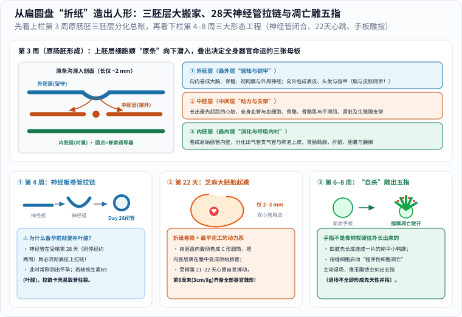
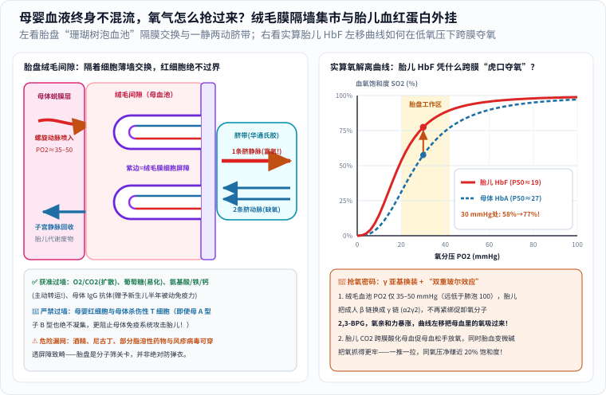
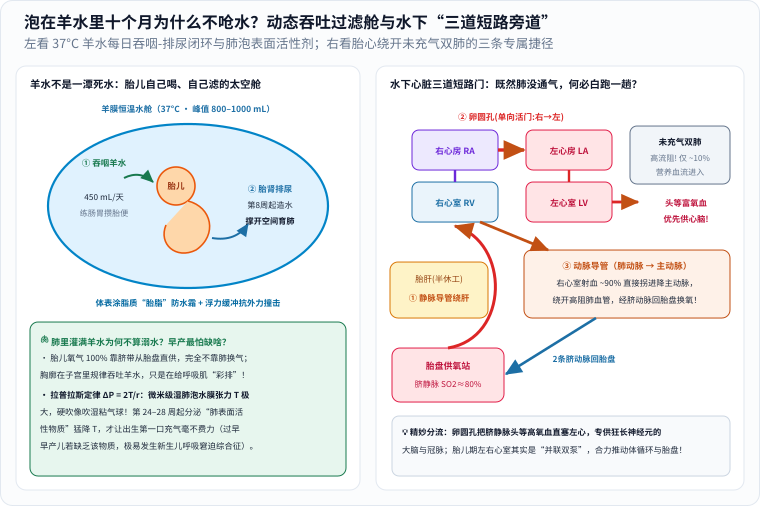
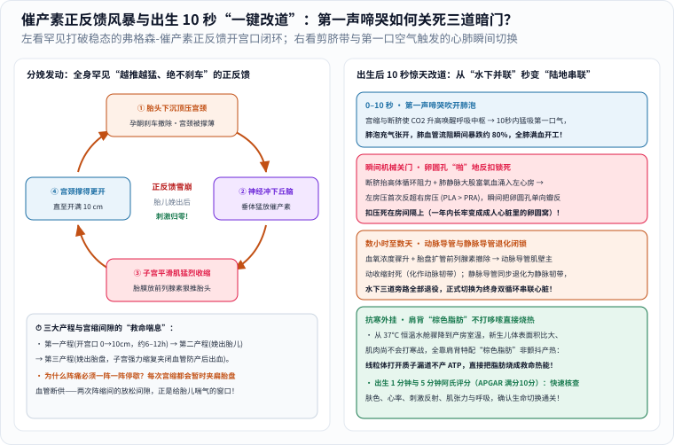

拿一支最细的铅笔在白纸上轻轻点一个小黑点，直径大约是 **$$0.12\,\text{毫米}$$**，重量只有 **$$1.5\,\text{微克}$$**（一粒芝麻的两千分之一）。

这是人体最大的一颗细胞——**卵母细胞**，也是我们每一个人来到这个世界时的全部家当。没有一张外部施工图纸、没有一只看不见的手伸进子宫捏泥人，仅仅过了受精后的 **$$38\,\text{周}$$**（临床按末次月经算约 **$$40\,\text{周} / 280\,\text{天}$$**）[[2]](#ref-2)[[4]](#ref-4)，这颗勉强能被肉眼瞄见的小圆点，竟然凭着细胞内部自带的分子指令，一路翻倍成约 **$$3\times 10^{12}$$（3 万亿）颗**分工严密的细胞，体重暴涨 **$$22\,\text{亿倍}$$**，变成一个重约 **$$3.4\,\text{千克}$$**、有心跳、会眨眼、一出产房就能放声大哭的新生儿[[4]](#ref-4)！

然而，只要你跳出习以为常的温情叙事，拿物理学、化学与生理学的放大镜去盯紧这 280 天里的每一个环节，马上就会撞上一连串颠覆常识的硬核谜题：

- **起跑线之谜**：课本和绘本里总说“两亿颗精子赛跑，跑得最快的第一名撞开卵子大门”。可生殖生物学的显微实测恰恰相反——**第一个冲到卵子面前的精子永远进不去**！要是没有几百位“先遣队员”集体牺牲凿墙，冠军连大门的把手都摸不着；而一旦第一颗精子融进细胞膜，假如有第二颗精子紧跟着钻进来，胚胎就会立刻因为三倍体（$$69$$ 条染色体）走向死亡，卵子是怎样在**几毫秒内**把大门焊死的[[1]](#ref-1)？
- **不长个的分裂与免疫豁免之谜**：受精卵一边顺着输卵管往子宫漂，一边从 $$1$$ 颗切成 $$2$$ 颗、$$4$$ 颗、$$16$$ 颗直到约 $$100$$ 颗细胞，可整团胚胎的外径居然**一微米都不变大**[[2]](#ref-2)！更蹊跷的是，胎儿身上有一半基因来自爸爸，对妈妈凶悍的免疫系统来说是不折不扣的“半异体移植物”；如果妈妈是 A 型血、宝宝是 B 型血，为什么怀胎十月既不会发生溶血凝集，妈妈的杀伤性 T 细胞也不会把胎儿当异物排斥掉[[2]](#ref-2)？
- **水下呼吸与出生 10 秒改道之谜**：胎儿整整十个月都泡在温暖的羊水里，肺泡里灌满液体却从来不会“溺水”，甚至每天还要大口喝下将近一瓶矿泉水那么多的羊水[[3]](#ref-3)；既然双肺在出生前根本不通气，胎儿的心脏为什么要多开**三道“违章捷径”**，又凭什么在剪断脐带、发出第一声啼哭的 **$$10\,\text{秒}$$** 之内，把整套水下管网瞬间改造成伴随终身的陆地双循环系统[[3]](#ref-3)[[5]](#ref-5)？

在前面的文章里，我们已经聊过[《为什么地球能孕育生命》]()的行星演化大账，也拆解过成人[《心脏血液循环流动原理》]()。今天，我们就把镜头推进妈妈温暖的子宫深处，顺着时间轴连闯五关，亲眼见证一场比发射星际飞船更精密百倍的生命建造工程。

---

## 一、两亿选一却不是“最快者赢”：毫秒级防重锁、只切蛋糕不发面与破壳着床

### 1. 先过酸海与免疫岗哨：没在半路“脱外套”的精子连门都敲不开

故事的起点是一场极其悬殊的淘汰赛[[1]](#ref-1)。

一方是刚刚从卵巢排进输卵管伞端、直径约 $$0.12\,\text{mm}$$ 的**次级卵母细胞**。它自带丰厚的细胞质营养库，外披两层坚固铠甲：最外圈是好几层颗粒细胞抱成的**放射冠（Corona radiata）**，紧贴细胞膜外侧的是一层厚实透明的糖蛋白硬壳——**透明带（Zona pellucida）**。留给它的独立存活窗口只有短短 **$$24\,\text{小时}$$**[[1]](#ref-1)。

另一方则是数以亿计（单次约 **$$2\text{–}3\,\text{亿颗}$$**）、全长仅约 $$0.05\,\text{mm}$$、几乎卸掉了除细胞核与线粒体发动机之外一切行李的**精子**（可在输卵管内潜伏等待 $$3\text{–}5\,\text{天}$$）[[1]](#ref-1)。

为什么明明只需要 $$1$$ 颗精子，却偏要派出两三亿大军？因为前方的关卡比想象中残酷得多[[1]](#ref-1)：

1. **酸性屏障与黏液迷宫**：刚进入生殖道，$$\mathrm{pH} \approx 3.8$$ 的强酸环境瞬间淘汰掉数千万体弱的精子；浓稠的宫颈黏液又拦下大批畸形或游姿歪斜的选手；
2. **白细胞搜捕与岔路分流**：闯进子宫腔的幸存者还要躲过母体吞噬性白细胞的围追堵截，随后在左右两条输卵管路口二选一（只有排卵那一侧才有卵母细胞！），耗时 $$30\,\text{分钟到 }2\,\text{小时}$$ 抵达输卵管壶腹部时，两三亿大军往往只剩下**区区几百到几千名决赛选手**[[1]](#ref-1)；
3. **至关重要的“获能（Capacitation）”改装**：这是英国生理学家**罗伯特·爱德华兹（Robert G. Edwards，2010 年诺贝尔生理学或医学奖得主）**当年攻克人类体外受精（试管婴儿）时踩破的关键玄机之一[[1]](#ref-1)[[7]](#ref-7)——刚出发的精子头部细胞膜里嵌满胆固醇，结构太厚太稳，哪怕你直接把它贴到卵子脸上，它也完全没本事钻进去！只有在女性生殖道分泌液的浸泡洗礼下，洗掉精浆里的抑制肽、抽走头部细胞膜里的胆固醇，把顶体帽削薄到一触即发的状态，精子才真正拿到受精许可证[[1]](#ref-1)。

这也就解释了那个反直觉的真相：**第一个游到卵子身边的精子，几乎绝不可能是最后受精的那一颗**[[1]](#ref-1)！面对厚厚的放射冠细胞墙和透明带铠甲，单凭一颗精子头顶那点微不足道的消化酶根本啃不动。必须有**几百颗获能精子**前赴后继地撞上去，启动**顶体反应（Acrosomal reaction）**，释放透明质酸酶和顶体蛋白酶协同融化胶质、一点点凿出一条狭窄通道，最后才有一颗恰逢其时赶到的幸运精子穿过透明带，与卵母细胞的细胞膜正面贴合[[1]](#ref-1)。

### 2. 毫秒电锁 + 秒级水泥门：差一秒钟就会酿成三倍体灾难

就在那颗胜出精子的细胞膜与卵母细胞膜融合的一刹那，整场战役最惊险的倒计时开始了[[1]](#ref-1)：

外围还有几十颗已经钻进透明带缝隙的精子近在咫尺！我们在[《错字率压到百亿分之一，为什么每个新生儿还是自带 60 个新突变？》]()里讲过，精子和卵子都是经过减数分裂的单倍体（各带 $$n = 23$$ 条染色体），两者合二为一刚好凑齐人类正常的二倍体（$$2n = 46$$ 条）。假如有第二颗精子晚半秒钟挤进卵细胞，胚胎就会变成拥有 $$3n = 69$$ 条染色体的**三倍体（Polyspermy）**，基因剂量彻底失衡，绝大多数会在早期流产夭折[[1]](#ref-1)。

怎样在几毫秒内把所有后来者拒之门外？卵母细胞演化出了一套滴水不漏的**快慢双保险锁**（见图 1 左下）[[1]](#ref-1)：

_图 1：先看上栏从输卵管壶腹部到子宫底的 7 天漂流路线（支持动画的浏览器可见橙色受精卵微粒沿管道单次推进并着床；开启“减少动态效果”则直接展示静态阶段节点）：注意从 Day 0 受精卵到 Day 5 百细胞囊胚，外圈蓝色透明带硬壳把总直径牢牢锁在约 $$0.12\,\text{mm}$$；再看左下快慢双重防多精锁与右下囊胚首次分工及双胞胎分家时刻表。[单独打开图片](/assets/images/human-gestation/fertilization-locks-and-cleavage-hatching.svg)_

1. **第一把锁——快阻断（Fast block，毫秒级电闸）**：第一颗精子膜融合的瞬间，卵母细胞膜上的钠离子（$$\mathrm{Na}^+$$）通道闪电般打开，膜外高浓度的 $$\mathrm{Na}^+$$ 呼啸涌入，让原本内负外正的细胞膜瞬间反转成**正电位（去极化）**[[1]](#ref-1)。其他精子的融合蛋白一碰到正电位当场失灵弹开！这把“高压电锁”在几毫秒内生效，替卵子死守最危险的**前 $$1\,\text{分钟}$$**[[1]](#ref-1)。
2. **第二把锁——慢阻断 / 皮质反应（Cortical reaction，永久水泥门）**：趁着电锁顶住大门的这一分钟，精子入卵掀起的细胞内钙离子（$$\mathrm{Ca}^{2+}$$）巨浪席卷全卵，唤醒埋伏在卵膜正下方成千上万颗**皮质颗粒（Cortical granules）**[[1]](#ref-1)。它们齐刷刷向膜外吐出蛋白酶与黏多糖——蛋白酶咔嚓剪断透明带上所有残余的精子结合受体，把挂在半路的精子全部松脱赶走；黏多糖吸水膨胀并让透明带迅速交联硬化，浇筑成一道连钻头都钻不透的**受精膜（Fertilization membrane）**[[1]](#ref-1)！

更妙的是，直到精子真正进门这一刻，原本一直停滞在第二次减数分裂中期的次级卵母细胞才正式“苏醒”，做完最后一次分裂排出第二极体，让雌原核（$$23$$ 条染色体）与雄原核（$$23$$ 条染色体）各自复制 DNA 后迎面融合——**一颗拥有完整 $$46$$ 条染色体独特配方的单细胞合子（Zygote，受精卵），至此正式诞生**[[1]](#ref-1)！

### 3. 为什么连切六刀总体积一丝不涨？“硬壳护送”与早孕试纸上的双红线

受精完成后，输卵管内壁纤毛温柔摆动配合平滑肌蠕动，推着这颗新生命向子宫进发，全程大约需要 **$$3\text{–}4\,\text{天}$$**[[2]](#ref-2)。

在赶路的日子里，受精卵开启了紧锣密鼓的有丝分裂——科学家给这段分裂起了个专门的名字叫**卵裂（Cleavage）**[[2]](#ref-2)：
- 受精约 $$30\,\text{小时}$$ 切成 $$2$$ 颗细胞（卵裂球）；
- 第 $$2.5\,\text{天}$$ 切成 $$4\text{–}8$$ 颗细胞（1978 年 7 月 25 日世界首例试管婴儿路易丝·布朗诞生时，爱德华兹与斯特普托医生正是在体外培养到 **$$8$$ 细胞期**将她送回母亲子宫的[[7]](#ref-7)）；
- 第 $$3\text{–}4\,\text{天}$$ 滚进子宫腔时，已经切成 $$16$$ 颗以上紧紧挤成一团的实心小球，酷似一颗小桑葚，称为**桑椹胚（Morula）**[[2]](#ref-2)；
- 第 $$5\,\text{天}$$ 左右，细胞数突破约 **$$100$$ 颗**，中间充水撑出一个空腔，升级为**囊胚（Blastocyst）**[[2]](#ref-2)。

仔细看图 1 上栏那串圆球，你会发现一个极其反常的几何现象：**细胞数量翻了整整一百倍（$$1 \to 100$$），可整颗胚胎的外直径居然死死停在 $$0.12\,\text{mm}$$ 原地不动**[[2]](#ref-2)！每切一刀，里面的子细胞体积就缩小一半，活像切一块装在铁盒里的生日蛋糕，只切块、绝不发面！

大自然为什么要定下这条“**禁止半路长胖**”的铁律？答案是两重精妙绝伦的工程考量[[2]](#ref-2)：

- **第一，防卡壳、防宫外孕**：输卵管最窄的峡部内径只有大约 $$1\,\text{毫米}$$，而且管壁娇嫩、没有弹性。如果胚胎在半路上就急着吸水长大，或者脱掉光滑的透明带外壳露出黏性细胞，当场就会卡在输卵管里就地扎根——这就是凶险万分的**输卵管异位妊娠（宫外孕，约占妊娠 $$1\%\text{–}2\%$$）**，一旦撑破输卵管会引发危及生命的内出血[[2]](#ref-2)。外面那层坚韧光滑的透明带硬壳，正是护送它安全滑进宽敞子宫的“特氟龙太空舱”！
- **第二，省掉生长期、抢时间搭班子**：普通体细胞分裂一次，得先花漫长的生长期合成蛋白质把个头长大一倍；而卵母细胞早就提前攒够了满仓营养库存，卵裂直接跳过生长期高速连切，短短 5 天就拉起一支百人工程队，完成了人生**第一次重大分工**（图 1 右下）[[2]](#ref-2)：
  - 缩在囊胚一角的一小撮**内细胞团（Inner cell mass）**：未来将发育成**胎儿自己的全部身体**；
  - 围在外圈球壳上的**滋养层（Trophoblast）**：未来不长进宝宝身体，而是专门负责扎根子宫、建造后勤基地**胎盘与绒毛膜**[[2]](#ref-2)！（顺便破译一个常见好奇：如果这颗受精卵半路意外裂成两份，就会生出基因几乎 $$100\%$$ 相同的**同卵双胞胎**——若在 $$2$$ 细胞期早早分家，两人各有独立胎盘；若像多数情况那样等到第 5 天囊胚期，只有里面的“内细胞团”一分为二、外圈滋养层没分家，姐弟/兄弟俩就会住在**同一个胎盘**里[[1]](#ref-1)！）

到了受精后第 $$6\,\text{天}$$，漂在子宫腔里的囊胚终于分泌蛋白酶，在透明带硬壳上咬开一个破口，像小鸡出壳一样钻出来——这叫**透明带孵化（Hatching）**[[2]](#ref-2)。紧接着在第 $$7\text{–}10\,\text{天}$$，外层滋养层细胞融合成多核的合体滋养层，主动消化松软肥厚的子宫底内膜，把自己稳稳埋进子宫壁，完成**着床（Implantation）**[[2]](#ref-2)。

着床成功的当天，胚胎立刻干了一件保命大事：原本卵巢排卵后留下的**黄体**如果没收到怀孕信号，再过几天就会萎缩停产孕酮，子宫内膜随之剥落来月经，把刚扎根的胚胎一块冲走！千钧一发之际，滋养层细胞向母体血液狂发一封化学加急电报——**人绒毛膜促性腺激素（$$\mathrm{hCG}$$）**，命令卵巢黄体：“别萎缩！我们已经着床了，继续全速分泌孕酮保住内膜！”[[2]](#ref-2) 多余的 $$\mathrm{hCG}$$ 从母体肾脏滤进尿液，着床后短短几天，早孕试纸就能捕捉到它，亮起那道宣告新生命到来的**双红线**[[2]](#ref-2)！

---

## 二、一张扁圆盘怎样“折纸”变出人形？三胚层大搬家、22 天第一声心跳与凋亡雕五指

着床站稳脚跟后，受精第 $$3$$ 周到第 $$8$$ 周被称为**胚胎期（Embryonic period）**[[2]](#ref-2)。

千万别小看这短短六周！刚满第 $$2$$ 周时，未来的宝宝还只是夹在羊膜腔和卵黄囊之间的一张**双层扁平小圆盘**，直径还不到 $$1\,\text{毫米}$$，看不出半点头尾手脚；可等到第 $$8$$ 周末胚胎期收官时，尽管它从头顶到屁股（顶臀长）只有约 **$$3\,\text{厘米}$$**、体重仅约 **$$8\,\text{克}$$**（两颗葡萄重），全身所有器官系统的雏形却已经**全部搭建完毕**[[2]](#ref-2)！

一张扁平小薄片，究竟是靠哪几招“折纸魔法”变出立体五脏六腑的？

### 1. 第 3 周“原肠胚大搬家”：为什么你的大脑居然和皮肤表皮是亲兄弟？

发育生物学家刘易斯·沃尔珀特曾留下一句名言：“你一生中最重要的时刻不是出生、结婚或死亡，而是**原肠胚形成（Gastrulation）**。”

受精第 $$3$$ 周一开场，扁平胚盘背侧中线上突然凹陷出一条浅沟，叫**原条（Primitive streak）**[[2]](#ref-2)。原条前端的组织中心（德国胚胎学家**汉斯·斯佩曼 Hans Spemann** 因发现这类指挥周围细胞命运的“胚胎组织者效应”，荣获 **1935 年诺贝尔生理学或医学奖**[[8]](#ref-8)）释放出精确的化学导航信号，指挥上层细胞排着队朝原条涌去，像跳水一样往下潜入，硬生生把两层薄片改造成了**上、中、下三张母板——三大胚层（Germ layers）**（图 2 上栏）[[2]](#ref-2)：

_图 2：先看上栏第 3 周原肠胚剖面与右侧三色命运总表，理解全身两百多种细胞如何从外、中、内三张胚层分工长出；再从左到右看下栏第 4–8 周的三项关键形态工程——第 28 天拉上拉链的神经管（备孕叶酸窗口）、第 22 天率先起跳的原始心管，以及第 6–8 周靠细胞主动凋亡镂空刻出的五根手指。[单独打开图片](/assets/images/human-gestation/gastrulation-three-layers-and-organogenesis.svg)_

- **① 外胚层（Ectoderm，留守最表层）——管“对外感知与外披铠甲”**：既向外包覆成全身的表皮、毛发、指甲、汗腺和坚硬的牙釉质，又向内卷折成**大脑、脊髓、视网膜和全身外周神经**[[2]](#ref-2)！很多人第一次听到“大脑和皮肤表皮同出一门”都会大吃一惊，但从演化视角一想就通了：远古单细胞或多细胞生物想要感知外界冷热光暗，传感器当然只能装在身体最外层表皮上，后来为了保护精密中枢，才把这片感光感触的表皮往身体内部卷藏起来变成了脑和脊髓！
- **② 中胚层（Mesoderm，潜入中间层）——管“动力泵、管道与钢筋水泥支架”**：分化成全身的骨骼、软骨、骨骼肌、平滑肌、真皮结缔组织，以及**最先开工的心脏、血管、血细胞和肾脏**[[2]](#ref-2)。
- **③ 内胚层（Endoderm，铺在最底层）——管“消化与呼吸隧道内衬”**：随着扁平胚盘向腹侧左右合拢、头尾卷折成一根 C 形立体圆筒（胚胎折叠），最底层的内胚层被直接卷进肚子中央，围成一根贯通头尾的**原始肠管**，未来长成咽喉、气管、支气管、肺泡上皮，以及食管、胃肠黏膜、肝脏、胆囊和胰腺[[2]](#ref-2)！

### 2. 三场争分夺秒的微雕工程：28 天拉链、22 天心跳与“自杀”刻出的手指

三张胚层刚铺好，第 $$4$$ 到第 $$8$$ 周紧接着上演了三幕不可思议的建造奇观（图 2 下栏）[[2]](#ref-2)：

1. **第 4 周“神经管拉链”与备孕叶酸的硬核真相**：在中胚层脊索的诱导下，背侧外胚层先加厚成一块扁平的**神经板**，随后两侧边缘高高隆起变成神经褶，在背部正中线迎面合拢，像拉羽绒服拉链一样从中间往头尾两头闭合，卷成一根空心的**神经管（Neural tube）**——它的前端鼓出脑泡长成大脑，后段长成脊髓[[2]](#ref-2)。
   请注意时间点：**整条神经管拉链必须在受精后第 $$28\,\text{天}$$ 左右彻底封口**[[2]](#ref-2)！受精第 $$28$$ 天是什么概念？按月经周期算，这时候准妈妈的月经才刚刚推迟两周左右，很多人甚至还没买早孕试纸测出自己怀孕！而神经管细胞高速分裂合成 DNA 极度依赖维生素 $$\mathrm{B}_9$$——也就是**叶酸（Folate）**。如果这关键的头四周缺了叶酸，神经管尾端拉链没拉严，就会造成新生儿**脊柱裂（Spina bifida）**；头端没封口更会导致致命的无脑畸形[[2]](#ref-2)。这就是为什么全世界产科医生都反复叮嘱：**叶酸不能等查出怀孕再吃，必须从备孕前就开始提前储备**！
2. **第 21–22 天的第一声心跳**：胚胎长过 $$2\,\text{毫米}$$ 后，单靠营养分子自己慢吞吞扩散已经喂不饱内部细胞了，必须立刻架设水泵送货！于是早在受精后**第 $$21\text{–}22\,\text{天}$$**（第 4 周初，胚胎还只有一粒芝麻大），两条中胚层内皮细管就在胸前融合成一根原始心管，自发跳起了全人生的第一拍搏动[[2]](#ref-2)！大约一周后，暂时挑起造血重担的胚胎肝脏造出第一批红细胞（骨髓要到胎儿中晚期才全面接管造血），鲜红的血液就正式在几毫米长的小身体里奔流起来了[[2]](#ref-2)[[3]](#ref-3)。
3. **第 6–8 周“以死塑生”雕出五根手指**：到第 $$5$$ 周伸出四肢芽、第 $$6$$ 周长出手板和脚板时，人类的手脚起初根本没有分开的手指头，而是像小鸭子蹼一样连成一整片扁圆浆板[[2]](#ref-2)！五根灵巧的手指并不是像树枝抽芽那样硬往外蹿出来的——恰恰相反，到了第 $$6\text{–}8$$ 周，夹在五道指骨雏形缝隙之间的蹼状细胞收到基因下达的撤退指令，整齐划一地启动**程序性细胞凋亡（Apoptosis）**，干净利落地自我拆解、被邻近细胞温和清理吸收，这才像玉匠镂空雕花一样“刻”出了五根独立分开的手指和脚趾[[2]](#ref-2)（倘若这一步凋亡信号漏执行了一点点，宝宝出生时就会带着两根手指皮肤相连的“先天性并指”）。

跨过第 $$8$$ 周末这道分水岭，所有器官地基全部验收合格，小生命从第 $$9$$ 周起正式摘掉“胚胎”头衔，改称**胎儿（Fetus）**，进入长达 $$30$$ 周精雕细琢与体重狂飙的成长期[[3]](#ref-3)。

---

## 三、母婴血液终身不混流，氧气怎么抢过来？绒毛膜隔墙集市与胎儿血红蛋白的“左移外挂”

从第 $$4$$ 周起逐步接管、到第 $$14\text{–}16$$ 周完全成熟的**胎盘（Placenta）**，是人类生命史上唯一一个**由母子两个人共同出资合建、用完十个月就功成身退的临时超级器官**——它一人身兼胎儿的“肺脏 + 小肠 + 肾脏 + 内分泌腺”四大职能[[2]](#ref-2)。

### 1. 隔着薄墙赶集：哪怕妈妈 A 型血、宝宝 B 型血也绝不混流凝集

日常生活中最容易误解的一句话就是“母子血脉相连”。很多人真的以为，脐带就像一根输液皮管，一头插在妈妈血管里、另一头插在宝宝肚脐上，妈妈的血直接流进宝宝身体里转一圈再流回来。

**如果真是那样，母子俩在第一天就会双双出大事！**[[2]](#ref-2)

试想：其一，如果妈妈是 O 型或 A 型血，血液里天然带着抗 B 抗体，而宝宝遗传了爸爸的 B 型血，一旦两股血直接混流，红细胞当场就会凝集溶血；其二，胎儿全身细胞表面都贴着一半来自父亲的陌生抗原标签，妈妈血液里巡逻的**细胞毒性 T 淋巴细胞**一旦闯进胎儿体内，立刻就会像围剿异体移植器官一样对胎儿发起致命免疫攻击[[2]](#ref-2)！

真实的胎盘是怎样化解这个死局的？请看图 3 左栏的微观解剖[[2]](#ref-2)：

_图 3：先看左栏胎盘剖面，母体螺旋动脉把富氧血喷进“绒毛间隙血池”，胎儿血管藏在树根状分支的绒毛膜屏障内部隔墙交换，红细胞与杀伤性 T 细胞终生不过界；再看右栏由希尔方程实算的氧解离曲线，对比胎儿 $$\mathrm{HbF}$$（红实线）与母体成人 $$\mathrm{HbA}$$（蓝虚线）在胎盘低氧分压区（黄色带）近 $$20\%$$ 的饱和度跃升。[单独打开图片](/assets/images/human-gestation/placenta-barrier-and-fetal-hemoglobin-curve.svg)_

- **珊瑚树泡在血湖里**：胎儿这一侧的绒毛膜向子宫蜕膜深处伸出成千上万根分叉如珊瑚树般的**绒毛膜绒毛（Chorionic villi）**，绒毛内部包裹着胎儿自己的毛细血管网；而母体这一侧的子宫螺旋动脉直接开口，把温暖的母体动脉血喷涌进绒毛四周的空腔——**绒毛间隙（Intervillous space）**里[[2]](#ref-2)。
- **终身隔墙不混血**：胎儿毛细血管里的胎血，与绒毛外池子里的母血之间，始终隔着一层由合体滋养层与毛细血管内皮组成的微米级**胎盘屏障**！**正常妊娠全程，母体红细胞、白细胞与胎儿红细胞连一颗都不会越过这道薄墙直接混流**[[2]](#ref-2)（这也解释了为什么 $$\mathrm{Rh}$$ 阴性血型的母亲怀第一胎 $$\mathrm{Rh}$$ 阳性宝宝时，通常不会在孕期产生抗 $$\mathrm{Rh}$$ 溶血抗体，往往要到分娩胎盘剥离、微量胎血意外擦入母血时才会首次致敏[[2]](#ref-2)）。
- **精挑细选的“跨墙海关”与它的软肋**：隔着这层摊开总面积超过 $$10\,\text{平方米}$$ 的极薄细胞墙，氧气和二氧化碳顺着浓度差自由扩散；水溶性葡萄糖走专门通道易化扩散；胎儿拼命长身体急需的**氨基酸、铁离子和钙离子**，哪怕母血浓度低，胎盘也会消耗能量**主动逆浓度往胎儿那边硬泵**；甚至母体的 **$$\mathrm{IgG}$$ 免疫球蛋白抗体**也被特批跨墙送给宝宝，替新生儿撑起出生后头半年的天然防疫保护伞[[2]](#ref-2)！但必须警惕的是：胎盘屏障防不住脂溶性小分子和部分病原体——**酒精、尼古丁、部分镇静药物以及风疹病毒**都能轻易穿墙而过伤害胚胎神经与心脏发育[[2]](#ref-2)。
- **包裹防折果冻的“一静两动”脐带**：交换完物资后，连接胎盘与胎儿肚脐的脐带里藏着与成人常识刚好反过来的配色（我们在[心脏血液循环文章]()里强调过：向心叫静脉、离心叫动脉）——**$$1$$ 条粗大的脐静脉**把刚从胎盘抢来的鲜红**富氧营养血**送往胎儿心脏，**$$2$$ 条螺旋缠绕的脐动脉**把胎儿用完的缺氧代谢废物血送回胎盘过滤；三根血管外围塞满富含黏多糖的弹性果冻——**华通氏胶（Wharton's jelly）**，哪怕调皮的胎儿在羊水里翻跟头把脐带拧成麻花，血管也不会被轻易压瘪断流[[2]](#ref-2)！

### 2. 低氧血池里的“抢氧外挂”：胎儿血红蛋白 $$\mathrm{HbF}$$ 为什么换掉两条蛋白质链？

看懂了“隔墙交换”，一个让无数医学生拍案叫绝的物理化学难题就浮出水面了[[6]](#ref-6)：

成年人吸气时，肺泡里的氧分压高达 **$$P_{\mathrm{O}_2} \approx 100\,\text{mmHg}$$**，成人血红蛋白（$$\mathrm{HbA}$$）自然能轻松装满 $$98\%$$ 的氧气。可是胎盘绒毛间隙里的母体血池是动脉血与静脉血混合的缓流池，这里的氧分压只有可怜的 **$$35\text{–}50\,\text{mmHg}$$**[[6]](#ref-6)！在这种低氧压下，成人血红蛋白自己都快抓不住氧气要往外卸货了——要是胎儿红细胞里装的也是同款成人血红蛋白，隔着胎盘薄膜两边抢氧能力五五开，胎儿岂不是一分钟就要窒息缺氧？

为了打赢这场跨膜夺氧战，胎儿祭出了两件分子级神器（图 3 右栏）[[6]](#ref-6)：

1. **换装 $$\gamma$$ 亚基，甩掉“松手扳手” $$\text{2,3-BPG}$$**：成年人的血红蛋白 $$\mathrm{HbA}$$ 由两条 $$\alpha$$ 链和两条 $$\beta$$ 链拼成（$$\alpha_2\beta_2$$），红细胞里有一种糖酵解副产物叫 **$$\text{2,3-二磷酸甘油酸（2,3-BPG）}$$**，专门插进两条 $$\beta$$ 链中央的正电荷口袋里，逼着血红蛋白松手释放氧气[[6]](#ref-6)。而胎儿在子宫里专门生产另一套**胎儿血红蛋白 $$\mathrm{HbF}$$（$$\alpha_2\gamma_2$$）**——把两条 $$\beta$$ 链换成了 $$\gamma$$ 链，口袋里少了一对关键正电荷氨基酸，$$\text{2,3-BPG}$$ 根本抓不牢！没有了这把“卸氧扳手”捣乱，$$\mathrm{HbF}$$ 对氧气的亲和力陡然飙升[[6]](#ref-6)。
   用生理学标准的希尔协同结合方程（Hill equation，协同系数 $$n \approx 2.7$$）可以直接算出两者的差距：

$$
S_{\mathrm{O}_2}(P_{\mathrm{O}_2}) = \frac{P_{\mathrm{O}_2}^{\,n} }{P_{\mathrm{O}_2}^{\,n} + P_{50}^{\,n} } \times 100\%
$$

   其中半饱和氧分压 $$P_{50}$$（装满一半氧气所需的氧分压，数值越小代表吸氧越狠）：母体成人 $$\mathrm{HbA}$$ 的 $$P_{50} \approx 26.8\,\text{mmHg}$$，而胎儿 $$\mathrm{HbF}$$ 的 $$P_{50}$$ 直接降到了 **$$\approx 19.0\,\text{mmHg}$$**！把胎盘交换界面常见的 $$P_{\mathrm{O}_2} = 30\,\text{mmHg}$$ 代入上式：
   - 母体 $$\mathrm{HbA}$$ 只能留住 **$$57.6\%$$** 的氧，正大把往外吐氧；
   - 隔膜对面的胎儿 $$\mathrm{HbF}$$ 却能一把抓牢 **$$77.4\%$$** 的氧，净赚近 **$$20$$ 个百分点**的血氧饱和度，稳稳把母血吐出来的氧气吸进脐静脉！
2. **“双重玻尔效应（Double Bohr Effect）”顺水推舟**：与此同时，胎儿代谢产生的二氧化碳（$$\mathrm{CO}_2$$）跨过胎盘钻进母血池，让母血局部变酸（$$\mathrm{pH}$$ 微降）——根据玻尔效应，变酸逼着母体血红蛋白进一步松手放氧；反过来，刚卸掉酸性 $$\mathrm{CO}_2$$ 的胎儿血液瞬间变得微偏碱性（$$\mathrm{pH}$$ 微升），又让胎儿 $$\mathrm{HbF}$$ 把氧气攥得更紧[[6]](#ref-6)！一推一拉双向加持，哪怕母婴红细胞终身不见面，氧气照样滚滚流向新生命！（等到出生开始自己大口呼吸高氧空气后，婴儿才会在半年内慢慢拆掉太紧抓氧的 $$\mathrm{HbF}$$，换回方便向肌肉卸氧的成人 $$\mathrm{HbA}$$。）

---

## 四、泡在羊水里十个月为什么不呛水？每日吞吐循环舱与水下“三道短路门”

进入第 $$9$$ 周后的胎儿期，宝宝住进了那座充满清澈液体的温暖水晶宫——**羊膜囊（Amniotic sac）**，并在第 $$16\text{–}20$$ 周开始伸手踢腿，让妈妈第一次感受到奇妙的**胎动（Quickening）**[[3]](#ref-3)。这里藏着每个孩子和大人都问过的两个经典疑问：**泡在水里十个月，为什么皮肤不泡烂、肺里不呛水？**

### 1. 每天自己喝下近一瓶矿泉水：羊水根本不是一潭死水

先揭开羊水的真实身份（图 4 左栏）[[2]](#ref-2)[[3]](#ref-3)：

_图 4：先看左栏羊膜恒温水舱里“吞咽羊水 $$\to$$ 肠道吸收滤渣 $$\to$$ 胎肾排出无菌尿液”的动态自循环，以及第 24–28 周起抵抗拉普拉斯表面张力的肺表面活性物质；再看右栏胎儿心脏绕开半休工肝脏与未充气高阻双肺的三条专属水下捷径（①静脉导管、②卵圆孔、③动脉导管）。[单独打开图片](/assets/images/human-gestation/amniotic-loop-and-three-fetal-shunts.svg)_

- **防泡烂盔甲——胎脂（Vernix caseosa）**：你如果把手指泡在温水里两小时，角质层就会吸水发白起皱；胎儿泡在 $$37^\circ\mathrm{C}$$ 羊水里两百多天却皮光水滑，全靠第 $$16\text{–}20$$ 周起皮脂腺在全身涂满了一层厚厚的乳白色蜡质防水面霜——**胎脂**（同时体表还长出一层细软胎毛帮着挂住胎脂，临近足月胎毛褪去，胎脂还能在顺产时充当天然人体润滑剂）[[3]](#ref-3)。
- **自己喝、自己排的活水循环舱**：怀孕极早期，羊水主要来自母体血浆的清澈滤出液；但从第 $$8\text{–}12$$ 周胎儿肾脏正式开工以后，羊水（足月前峰值约 **$$800\text{–}1000\,\text{mL}$$**）就变成了一套每几个小时彻底翻新一遍的**动态内循环水池**[[2]](#ref-2)[[3]](#ref-3)——胎儿每天张嘴大口吞咽 **$$400\text{–}500\,\text{mL}$$** 羊水，既提前锻炼了吞咽反射和胃肠蠕动，又把羊水里脱落的上皮碎屑、胎毛与胆汁浓缩拦截在大肠里，攒成墨绿色无菌的**胎便（Meconium，正常要等出生后才第一次排出）**；水分吸收进胎血，代谢废物由脐动脉送去胎盘交给妈妈处理，干净的水分再由胎儿双肾滤成**完全无菌的清澈稀释尿液**排回羊膜腔[[3]](#ref-3)！别嫌弃这听起来像“喝自己的尿”——正是胎肾源源不断撑起的羊水容积，给胎儿留出了自由舒展四肢、防止脐带受压的失重缓冲垫，更关键的是让胎儿胸廓能在水里反复做“呼吸体操”，把肺部支气管树撑大育熟[[3]](#ref-3)！
- **肺泡灌水为何不算溺水？早产儿最怕缺的“防粘洗洁精”**：陆地人掉进水里之所以溺水窒息，是因为我们的血液全指望肺泡空气供氧，水一灌进肺就断了氧源；而胎儿的氧气 $$100\%$$ 由脐带从胎盘直供，肺在子宫里原本就是装满液体、练习胸肌起伏的“停工待机车间”，自然谈不上溺水[[3]](#ref-3)[[5]](#ref-5)！
  不过，等出生那一秒要把几亿个湿漉漉的微米级肺泡第一次吹开充气时，会撞上一道恐怖的物理拦路虎——**拉普拉斯球面表面张力定律**：

$$
\Delta P = \frac{2T}{r}
$$

  肺泡半径 $$r$$ 极小（仅几十微米），如果肺泡内壁贴着纯水膜（表面张力 $$T$$ 很大），水分子彼此死死拉扯，想把塌陷的小肺泡吹鼓所需要的跨壁气压 $$\Delta P$$ 就会高得惊人，就像吹一只内壁涂了胶水的湿气球！为此，从妊娠第 **$$24\text{–}28\,\text{周}$$** 开始，肺泡 II 型细胞加班加点分泌一种磷脂蛋白复合物——**肺表面活性物质（Surfactant）**，像撒进水膜里的天然洗洁精一样把表面张力 $$T$$ 大幅砍低[[3]](#ref-3)。这也是为什么不足 $$28$$ 周出生的极早产儿最怕发生**新生儿呼吸窘迫综合征（RDS）**，现代新生儿重症监护室（NICU）拯救早产宝宝的头号法宝，正是往气管里滴注外源性肺表面活性物质加持续正压通气（CPAP）[[3]](#ref-3)！

### 2. 水下心脏的“三道短路旁道”：最肥美的富氧血先喂给谁？

既然胎儿的双肺没充气、肺血管紧缩盘曲，流动阻力高得像堵死的胡同（只需要约 $$10\%$$ 的微量血流进去喂饱肺组织本身长身体），如果胎儿的心脏还傻乎乎照搬成年人那套“右心室把 $$100\%$$ 的血全泵进肺里，流回左心房再泵全身”的串联路线，右心室当场就会累趴下[[3]](#ref-3)！

于是，胎儿的心血管系统极其聪明地临时加装了**三条出生即作废的专属水下捷径（Shunts）**（图 4 右栏）[[3]](#ref-3)：

1. **第一道捷径——静脉导管（Ductus venosus，绕开半休工的肝）**：脐静脉带着从胎盘刚抢来的全身体最富氧鲜血（血氧饱和度约 $$80\%$$）钻进肚脐后，没有慢吞吞钻进胎肝繁杂的毛细血窦网，而是顺着**静脉导管**一脚油门直穿下腔静脉，火速奔向心脏[[3]](#ref-3)！
2. **第二道捷径——卵圆孔（Foramen ovale，右心房直穿左心房的“VIP 脑供氧通道”）**：成年人的左右心房之间是一堵严丝合缝的实心墙；可在胎儿的房间隔上，却开着一扇只许“从右往左推开”的单向活门——**卵圆孔**[[3]](#ref-3)！下腔静脉涌进右心房的头等高氧血，顺着血流导向直接推开卵圆孔冲进左心房 $$\to$$ 左心室 $$\to$$ 升主动脉，第一时间灌进冠状动脉和颈动脉，**优先喂饱耗氧最猛的心肌与正在以每分钟数十万颗速度狂造神经元的大脑**（详见[《难道婴儿只是缩小版大人吗？》]()）[[3]](#ref-3)！
3. **第三道捷径——动脉导管（Ductus arteriosus，肺动脉直拐降主动脉）**：从上腔静脉回流的下半程低氧血进入右心室，被泵进肺动脉干后，一看前方双肺阻力太高，约 **$$90\%$$** 的血液干脆在胎盘前列腺素的护航下，拐进连接肺动脉与主动脉弓末端的粗管——**动脉导管**，直接汇入降主动脉流向躯干下肢，最后顺着两条脐动脉重返胎盘充氧[[3]](#ref-3)！

看明白这套管网有多绝了吗？在子宫水下世界里，胎儿的左右心室根本不是成年人那样的“一前一后串联接力”，而是靠卵圆孔和动脉导管并联在一起的**双涡轮并联泵**，合力推动血液在“胎儿身体 $$\leftrightarrow$$ 胎盘”之间高速流转[[3]](#ref-3)！

---

## 五、催产素正反馈风暴与出生 10 秒“一键改道”：第一声啼哭如何关死三道暗门？

为了托举起这个飞速长大的小生命，准妈妈的身体在孕中晚期也经历了一场静悄悄的极限改造：原本只有拳头大的子宫被撑大几十倍，全身**总血容量足足增加了约 $$30\%$$（多出 $$1\text{–}2\,\text{升}$$ 血液！）**，每分钟呼吸通气量暴涨 **$$50\%$$**，每天替两个人呼吸、替两个人过滤肾脏代谢物[[4]](#ref-4)。

终于，在受精后约 **$$266\text{–}270\,\text{天}$$**（约 $$38.5$$ 周，临床末次月经满 $$40$$ 周）前后，所有器官与皮下白色/棕色脂肪储备就绪，身高长到约 **$$51\,\text{厘米}$$**、体重约 **$$2.5\text{–}4\,\text{千克}$$** 的足月胎儿，迎来了人生最惊心动魄的一场越狱——**分娩与降生**[[3]](#ref-3)[[4]](#ref-4)。

### 1. 全身罕见“绝不踩刹车”的正反馈风暴，与阵痛间隙的救命秘密

学过生理学的读者都知道，人体 $$99\%$$ 的日常调控（体温、血糖、血压）全靠**负反馈（Negative feedback）**：高了就往下压，低了就往上抬，一心维持稳态。唯独到了生孩子这一刻，“保持原状”绝对生不出宝宝，身体必须启动极为罕见的**正反馈雪崩（Positive feedback）**（图 5 左栏）[[4]](#ref-4)！

_图 5：先看左栏顺时针旋转的四步“弗格森—催产素正反馈闭环”，理解阵痛为何越缩越密直至宫口开满 $$10\,\text{cm}$$、以及宫缩停歇间隙如何保护胎儿不缺氧；再看右栏从上往下的出生 10 秒心肺切换链条——第一口气降肺阻、左房压反超拍死卵圆孔、高氧锁死动脉导管，以及肩背棕色脂肪非颤抖产热。[单独打开图片](/assets/images/human-gestation/oxytocin-labor-and-first-breath-switchover.svg)_

在前七八个月里，高水平的**孕酮**一直像手刹一样镇静子宫平滑肌，防止早产[[4]](#ref-4)。临近足月时，胎儿肾上腺皮质醇升高，胎盘雌激素与孕酮之比大幅反转，子宫肌壁表面长出密密麻麻的**催产素受体**，手刹正式松开[[4]](#ref-4)：

1. 倒立入盆的胎头往下顶压子宫颈，把宫颈撑薄拉宽；
2. 宫颈机械牵拉感受器顺着神经把火急信号直送妈妈大脑下丘脑与垂体后叶（**弗格森反射**），触发大量**催产素（Oxytocin）**涌入血液[[4]](#ref-4)；
3. 催产素加上胎膜同步释放的**前列腺素**，驱动子宫底平滑肌发起更猛烈的收缩，把胎头更狠地往下推向宫颈[[4]](#ref-4)；
4. 宫颈被撑得更开 $$\to$$ 神经信号更强 $$\to$$ 催产素飙得更高……一轮推高一轮，宫缩从最初每 $$15\text{–}30\,\text{分钟}$$ 一阵，一路加密到每 **$$1.5\text{–}2\,\text{分钟}$$** 就猛缩整整一分钟，硬生生把原本紧闭如笔管的宫颈口撑开到直径 **$$10\,\text{厘米}$$**（第一产程），随后将胎儿推出产道（第二产程），直到宝宝滑出产道、宫颈牵拉刺激归零，这场正反馈风暴才戛然而止；紧接着第三产程娩出胎盘，子宫继续强力缩复，用交错肌纤维把剥离面的大血管死死夹扁，替妈妈止住产后大出血[[4]](#ref-4)！

这里顺便揭开一个让无数准爸妈揪心的细节：**为什么生孩子不能一口气连续用劲推出来，非要痛一分钟、停两分钟，一阵一阵地来？**

答案关乎胎儿生死[[4]](#ref-4)：每一次子宫强力收缩，都会把穿行在子宫肌壁里的母体螺旋血管暂时夹扁，**短暂切断胎盘的富氧血供应**！倘若子宫像抽筋一样连续十分钟不停歇（这也是临床催产素滴注速度必须精密监控的原因），胎儿就会陷入严重宫内缺氧窘迫。**两次剧烈阵痛之间那宝贵的一两分钟平静间隙，恰恰是大自然留给胎盘重新充血、让宝宝在冲刺间隙大口“回血吸氧”的救命窗口**[[4]](#ref-4)！

### 2. 出生后 10 秒“惊天改道”：第一声啼哭怎样啪地关死三道水下暗门？

当婴儿滑出产道、脐带被双钳夹闭剪断（即便无人剪脐，暴露在体外低温下的脐带华通氏胶也会在 $$20$$ 分钟内自然吸水肿胀，配合血管平滑肌收缩自动夹闭止血[[5]](#ref-5)）的那一瞬间，一场比宇航员太空舱脱钩更惊险的**十秒生死切换**打响了（图 5 右栏）[[5]](#ref-5)：

1. **$$0\text{–}10\,\text{秒}$$：第一声啼哭吹开肺泡，肺血管阻力暴跌 $$80\%$$**：产道挤压加上断脐切断了胎盘气源，新生儿血液里的二氧化碳（$$\mathrm{CO}_2$$）迅速升高、血液微酸化，强烈刺激脑干延髓呼吸中枢[[5]](#ref-5)。出生 **$$10\,\text{秒}$$** 之内，宝宝猛吸人生第一大口空气、随即放声啼哭！由于肺泡里早就铺好了肺表面活性物质，亿万肺泡瞬间充气张开，残余羊水经淋巴管与毛细血管迅速排空吸收；原本紧缩盘曲的肺部毛细血管床豁然舒展，**肺循环流阻瞬间断崖式暴跌**，右心室泵出的血液潮水般涌进双肺换气[[5]](#ref-5)！
2. **瞬间机械锁门：左心房压反超，一巴掌拍死“卵圆孔”**：一边是剪断低阻力胎盘让左心面对的全身血管阻力骤升，另一边是刚从双肺满载氧气回来的大股肺静脉血猛灌进左心房——**人生第一次，左心房压力反超了右心房压力（$$P_{\text{LA} } > P_{\text{RA} }$$）**[[5]](#ref-5)！还记得房间隔上那扇只准“从右往左开”的单向活门卵圆孔吗？左心房高压一顶，“啪”地一声就把两片活门瓣膜死死反扣在房间隔墙面上，当场完成功能性封堵（随后在出生后一年内慢慢纤维化长牢，变成我们每个成年人右心房隔墙上那个浅浅的纪念凹坑——**卵圆窝 Fossa ovalis**）[[5]](#ref-5)！
3. **数小时到数天：高血氧自动焊死“动脉导管”**：随着肺泡吸进新鲜空气，主动脉血氧分压从胎儿期的二三十毫米汞柱飙升到近百毫米汞柱，加上制造扩管前列腺素的胎盘已经被剪掉，连接肺动脉与主动脉的**动脉导管**管壁平滑肌感知到高氧，立刻自动剧烈收缩封死，最终退化成一根实心结缔组织索——**动脉韧带**；与此同时，不再走血的**静脉导管**也在肝脏下方萎缩成**静脉韧带**[[5]](#ref-5)。

短短几秒到几小时之间，三道水下旁路全部精准退役，水下“并联双泵”无缝切换成了我们上一篇讲过的[终身串联四腔双循环心脏]()[[5]](#ref-5)！

与此同时，突然从 $$37^\circ\mathrm{C}$$ 恒温羊水掉进二十多度产房的新生儿，体表面积与体积之比远大于成人，骨骼肌还没发育出“冷得打哆嗦（寒战产热）”的本领[[5]](#ref-5)。好在胎儿期早就未雨绸缪，在宝宝的肩胛、后背与胸口囤好了一层富含血管与特制线粒体的**棕色脂肪（Brown adipose tissue）**——冷风一吹，棕色脂肪线粒体直接打开解偶联蛋白通道，**故意不造 $$\mathrm{ATP}$$，把脂肪氧化释放的化学能 $$100\%$$ 原地转化成热能（非颤抖性产热）**，像一件自带电池的隐形电热背心稳稳护住新生儿体温[[5]](#ref-5)！产房医护人员则在出生后 **$$1\,\text{分钟}$$** 和 **$$5\,\text{分钟}$$**，按麻醉科女医生弗吉尼亚·阿普加 1952 年发明的 **APGAR 阿氏评分**（肤色 Appearance、心率 Pulse、刺激反射 Grimace、肌张力 Activity、呼吸 Respiration，满分 $$10$$ 分，$$\ge 8$$ 分为优秀通关）快速打分，为这场跨越 280 天的生命远征盖上圆满的通关印章[[5]](#ref-5)。

---

## 六、一张时间总表收束全篇：从 1 颗细胞到 3 万亿细胞的 280 天生命账本

把整趟生命孕育之旅摊开在一张时间表上，你会对我们每个人身体里的精密秩序肃然起敬：

| 发育阶段 | 受精后时间（临床孕周约 +2 周） | 代表尺寸 / 质量 | 核心突破与不可思议的物理生物机制 |
| :--- | :--- | :--- | :--- |
| **受精与合子** | 第 $$0$$ 天（临床约第 2 周） | $$\approx 0.12\,\text{mm}$$ / $$1.5\,\mu\text{g}$$ | 获能精子团队凿穿放射冠；**毫秒 $$\mathrm{Na}^+$$ 电锁 + 秒级 $$\mathrm{Ca}^{2+}$$ 皮质水泥门**锁死多精入卵；$$23+23=46$$ 条染色体合璧[[1]](#ref-1) |
| **卵裂与着床** | 第 $$1\text{–}10$$ 天（临床第 3 周） | 外径恒为 $$\approx 0.12\,\text{mm}$$（约 $$100$$ 细胞） | 透明带硬壳箍住胚胎**只分裂不长体积**防输卵管卡壳；第 6 天破壳孵化着床，分泌 **$$\mathrm{hCG}$$** 保住黄体（早孕试纸变红）[[2]](#ref-2) |
| **胚胎折纸与造器官** | 第 $$3\text{–}8$$ 周（临床第 5–10 周） | 从 $$2\,\text{mm}$$ 长至 **$$3\,\text{cm}$$ / $$8\,\text{g}$$** | 第 3 周原肠胚叠出**外、中、内三胚层**；**第 21–22 天心管起跳**；**第 28 天神经管拉链封口**（叶酸窗口）；细胞凋亡镂空雕出五指，备齐全部器官雏形[[2]](#ref-2)[[8]](#ref-8) |
| **胎盘成熟与快速生长** | 第 $$9\text{–}24$$ 周（临床第 11–26 周） | 顶臀长 $$9\,\text{cm} \to 23\,\text{cm}$$ | 母婴血液隔着绒毛膜**终身零混流**；胎儿血红蛋白 **$$\mathrm{HbF}$$（$$\alpha_2\gamma_2$$）** 左移曲线跨膜夺氧；吞咽羊水 + 胎肾排尿动态循环，16–20 周现胎动[[2]](#ref-2)[[3]](#ref-3)[[6]](#ref-6) |
| **冲刺储备期** | 第 $$25\text{–}38$$ 周（临床第 27–40 周） | 全长 $$\approx 51\,\text{cm}$$ / **$$2.5\text{–}4\,\text{kg}$$** | 肺泡分泌**表面活性物质**降拉普拉斯张力；水下三旁道（静脉导管/卵圆孔/动脉导管）并联供血；囤积皮下白脂肪与御寒**棕色脂肪**[[3]](#ref-3)[[5]](#ref-5) |
| **分娩与出生 10 秒改道** | 受精约 $$266\text{–}270$$ 天（临床约 40 周） | 约 **$$3\times 10^{12}$$** 颗细胞（增重 $$22$$ 亿倍） | **催产素正反馈**开宫口至 $$10\,\text{cm}$$；出生 $$10$$ 秒内第一声啼哭吹开肺泡，$$P_{\text{LA} } > P_{\text{RA} }$$ **拍死卵圆孔**，高氧闭锁动脉导管，无缝切入陆地人生[[4]](#ref-4)[[5]](#ref-5)！ |

读完这 280 天的闯关史，下次再看到产检单或抱着刚出生的小婴儿时，不妨摸一摸胸口或肚脐——你肚脐眼内侧连着的那几根不起眼的腹壁与肝下韧带，以及你左右心房隔墙上那个早已愈合的小酒窝（卵圆窝），正是当年你在妈妈温暖的羊水海洋里潜航十个月、最后在第一声啼哭中荣耀毕业留下的终身勋章。

---

## 参考资料与延伸阅读

1. Betts, J. G., et al., *Anatomy and Physiology 2e*, Section 28.1: **Fertilization**, OpenStax, Rice University (2022). [https://openstax.org/books/anatomy-and-physiology-2e/pages/28-1-fertilization](https://openstax.org/books/anatomy-and-physiology-2e/pages/28-1-fertilization) —— 核查精子跨酸碱与免疫屏障淘汰过程、生殖道胆固醇剥离获能（Capacitation）、数百精子协同顶体反应、钠离子去极化快阻断与钙波皮质反应慢阻断双重防多精机制，以及同卵/异卵双胞胎形成时期与胎盘归属。
2. Betts, J. G., et al., *Anatomy and Physiology 2e*, Section 28.2: **Embryonic Development**, OpenStax, Rice University (2022). [https://openstax.org/books/anatomy-and-physiology-2e/pages/28-2-embryonic-development](https://openstax.org/books/anatomy-and-physiology-2e/pages/28-2-embryonic-development) —— 核查等体积卵裂、桑椹胚与囊胚透明带孵化着床、$$\mathrm{hCG}$$ 维持黄体分泌孕酮、原肠胚外/中/内三胚层分化谱系、第 4 周神经管闭合与叶酸缺乏脊柱裂机制、第 4 周初原始心管起跳、指间程序性细胞凋亡，以及胎盘绒毛膜母婴血液零混流隔离屏障与一静两动脐带结构。
3. Betts, J. G., et al., *Anatomy and Physiology 2e*, Section 28.3: **Fetal Development**, OpenStax, Rice University (2022). [https://openstax.org/books/anatomy-and-physiology-2e/pages/28-3-fetal-development](https://openstax.org/books/anatomy-and-physiology-2e/pages/28-3-fetal-development) —— 核查胎儿期（第 9 周至出生）器官成熟时间线、羊水吞咽与胎肾无菌排尿循环、胎脂与胎便生理特征、肺表面活性物质对抗肺泡表面张力机制，以及胎儿心血管三大旁路（静脉导管、卵圆孔、动脉导管）分流路径。
4. Betts, J. G., et al., *Anatomy and Physiology 2e*, Section 28.4: **Changes During Pregnancy, Labor, and Birth**, OpenStax, Rice University (2022). [https://openstax.org/books/anatomy-and-physiology-2e/pages/28-4-changes-during-pregnancy-labor-and-birth](https://openstax.org/books/anatomy-and-physiology-2e/pages/28-4-changes-during-pregnancy-labor-and-birth) —— 核查受精龄（约 38.5 周）与末次月经孕周（约 40 周）换算、母体血容量增加 $$30\%$$ 与通气量增加 $$50\%$$ 的生理适应、宫颈牵拉—催产素—前列腺素正反馈分娩环路、三大产程及宫缩间歇期恢复胎盘供氧的生理意义。
5. Betts, J. G., et al., *Anatomy and Physiology 2e*, Section 28.5: **Adjustments of the Infant at Birth and Postnatal Stages**, OpenStax, Rice University (2022). [https://openstax.org/books/anatomy-and-physiology-2e/pages/28-5-adjustments-of-the-infant-at-birth-and-postnatal-stages](https://openstax.org/books/anatomy-and-physiology-2e/pages/28-5-adjustments-of-the-infant-at-birth-and-postnatal-stages) —— 核查出生 10 秒内第一口呼吸的二氧化碳触发机制、肺血管阻力骤降与左心房压反超关闭卵圆孔（形成卵圆窝）、高氧关闭动脉导管、华通氏胶自然缩窄脐血管、棕色脂肪非颤抖产热及 1952 年 APGAR 新生儿评分标准。
6. Betts, J. G., et al., *Anatomy and Physiology 2e*, Section 22.5: **Transport of Gases**, OpenStax, Rice University (2022). [https://openstax.org/books/anatomy-and-physiology-2e/pages/22-5-transport-of-gases](https://openstax.org/books/anatomy-and-physiology-2e/pages/22-5-transport-of-gases) —— 核查胎盘绒毛间隙低氧分压环境（$$35\text{–}50\,\text{mmHg}$$ vs 胎血约 $$20\,\text{mmHg}$$）、胎儿血红蛋白 $$\mathrm{HbF}$$ 亚基结构更高氧亲和力左移曲线、$$\text{2,3-BPG}$$ 调节机制与玻尔效应。
7. NobelPrize.org, *The Nobel Prize in Physiology or Medicine 2010 — Robert G. Edwards (Summary & Press Release)*, Nobel Prize Outreach. [https://www.nobelprize.org/prizes/medicine/2010/press-release/](https://www.nobelprize.org/prizes/medicine/2010/press-release/) —— 核查罗伯特·爱德华兹阐明人类卵母细胞成熟与精子获能条件、1969 年首次实现人类卵子体外受精，以及与帕特里克·斯特普托合作将 8 细胞期胚胎移植诞生世界首例试管婴儿路易丝·布朗（1978 年 7 月 25 日）的科学史实。
8. NobelPrize.org, *The Nobel Prize in Physiology or Medicine 1935 — Hans Spemann*, Nobel Prize Outreach. [https://www.nobelprize.org/prizes/medicine/1935/summary/](https://www.nobelprize.org/prizes/medicine/1935/summary/) —— 核查汉斯·斯佩曼发现原肠胚发育过程中的“胚胎组织者效应（Organizer effect）”及其诱导神经管与体轴形成的里程碑贡献。
