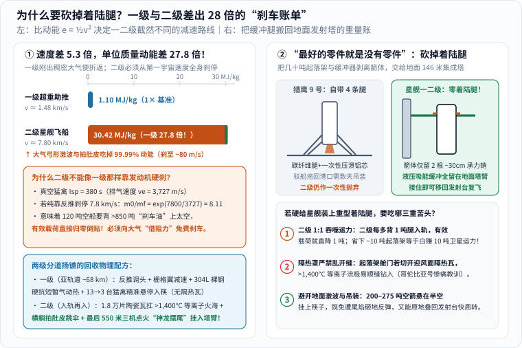
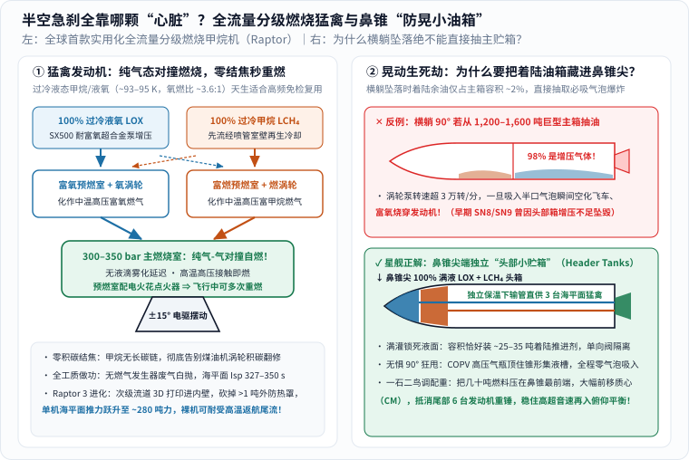
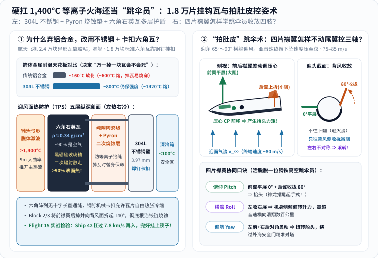
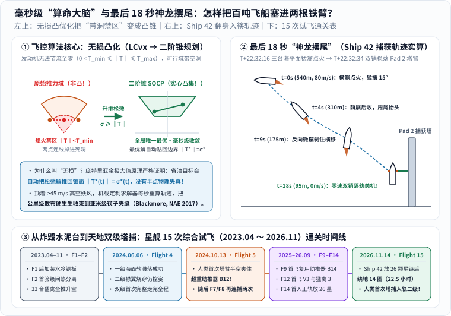

如果你看过 2024 年 10 月星舰第 5 次试飞（Flight 5）里，71 米高、两百多吨重的**超重型助推器（Super Heavy）**从天而降，稳稳挂进发射塔两根巨型机械臂（俗称“机械哥斯拉筷子”）的画面 [10]；或者刚刚目睹了 **2026 年 11 月 14 日星舰第 15 次试飞（Flight 15）**中，编号 `Ship 42` 的二级飞船在部署完 26 颗星链 V3 卫星、绕地球飞行 **14 圈（22.5 小时）**、硬闯上千摄氏度再入火海之后，在离地仅五百米处横躺点火、一记“神龙摆尾”甩成竖直，把两根仅约 30 厘米长的承力销精准塞进 2 号发射塔筷子里的历史性一幕 [11, 12, 13]——你的第一反应八成是：**这帮工程师是不是疯了？**

毕竟，在此之前的十年里，SpaceX 自己研发的“猎鹰 9 号”（Falcon 9）明明已经给出了教科书般的标准答案：箭体底部装四条碳纤维铝合金折叠腿，落地前刷地一下撑开，稳稳站在陆地水泥坪或海上无人驳船上 [1]。既然“自带四条腿”已经成熟到闭着眼都能成功，为什么到了总高 **124.4 米**（Block 3 构型）、起飞重量逾 **5,000 吨**的星舰系统 [9, 14]，SpaceX 反而把这套成熟方案亲手推翻，干出一连串看似自找麻烦的怪事：

1. **为什么非要砍掉着陆腿，拿昂贵的发射塔去冒险“空手接白刃”？** 万一没接准，几十层楼高的火箭砸在发射台上，岂不是连老窝都端了？
2. **为什么一级助推器能头朝上、屁股朝下竖着飞回来，二级星舰飞船却非要横躺着“拍肚皮”（Belly-Flop）往下掉，直到离地几百米才玩命猛甩翻身？** 老老实实像一级那样竖着点火减速不好吗？
3. **二级飞船肚皮底下明明有能装 1,200～1,600 吨推进剂的巨型主油箱，为什么要多此一举，在最尖端的鼻锥里塞两个独立的“小油壶”（Header Tanks）？**
4. **那两根几十吨重的钢铁“筷子”，难道真是靠蛮力夹紧箭体薄壳，像夹红烧肉一样靠摩擦力把两百多吨火箭捏在半空的吗？**

把这四个疑问一层层剥开，你会发现：星舰回收里每一个看似惊险杂技的动作，都不是为了炫技，而是被**齐奥尔科夫斯基火箭方程、平方速度动能鸿沟、低温涡轮泵流体力学与机载凸优化数学**一步步逼出来的唯一最优解。今天，我们就顺着一级与二级各自的回家之路，把整套星舰回收工程彻底拆开看个明白。

---

## 一、底层总账单：为什么非要砍掉着陆腿？一级与二级之间横着一道“28 倍动能鸿沟”

### 1.1 同样是回地球，一级助推器与二级飞船面对的根本不是同一场物理考试

很多人聊起“火箭回收”，容易把一级助推器和二级飞船混为一谈。其实，在我们在[《真空里没空气可蹬，火箭靠什么狂飙？为什么发射卫星非要边飞边扔铁桶？》]()和[《从发射卫星读懂三大宇宙速度》]()里算过的多级分工下，它们分离那一刻手里的“速度欠条”天差地别 [7, 10, 14]：

- **一级“超重型助推器”（Super Heavy）**：它的任务只是把二级托举出最稠密的低层大气。在起飞约 2 分 40 秒、高度约 $$65\text{–}70\text{ km}$$ 处分离时，在返航发射场（RTLS）工况下速度约为 **$$v_1 \approx 1.48\text{ km/s}$$**（约 $$5{,}300\text{ km/h}$$，约 4.5～5 倍音速）[10, 14]。
- **二级“星舰飞船”（Starship）**：它必须继续狂飙入轨，加速到近地轨道第一宇宙速度 **$$v_2 \approx 7.80\text{ km/s}$$**（约 $$28{,}080\text{ km/h}$$，超过 25 倍音速）[7, 11]。

注意！决定“刹车有多难、摩擦生热有多猛”的物理量，不是速度 $$v$$ 本身，而是每千克箭体携带的**比动能（Specific Kinetic Energy）** $$e_k = \frac{1}{2}v^2$$。由于速度头上顶着一个**平方**，$$5.27$$ 倍的速度差距瞬间被放大成了将近 **28 倍**的能量鸿沟 [7]：

$$
\begin{aligned}
e_1 &= \frac{1}{2} v_1^2 = \frac{1}{2}\times (1{,}480\text{ m/s})^2 \approx 1.10\text{ MJ/kg} \\
e_2 &= \frac{1}{2} v_2^2 = \frac{1}{2}\times (7{,}800\text{ m/s})^2 = 30.42\text{ MJ/kg} \\
\frac{e_2}{e_1} &= \left(\frac{7.80}{1.48}\right)^2 \approx 27.8
\end{aligned}
$$

**$$30.42\text{ MJ/kg}$$ 是什么概念？** 1 公斤 TNT 炸药爆炸释放的化学能大约只有 $$4.18\text{ MJ}$$——也就是说，重返大气层的星舰二级飞船，**全身每一公斤不锈钢和隔热瓦，都揣着相当于 7.3 公斤 TNT 炸药的纯动能！** 想要平安落地，这股庞大的能量必须一分不差地清零。

那二级飞船能不能学一级助推器，干脆调转喷管、点火反推，靠发动机硬生生刹停呢？我们把真空版“猛禽”发动机（Raptor Vacuum）高达 $$I_{\text{sp} } = 380\text{ s}$$（等效排气速度 $$v_e = I_{\text{sp} } g_0 \approx 3{,}727\text{ m/s}$$）的顶尖性能代进齐奥尔科夫斯基火箭方程算一笔账就死心了 [14]：

$$
\frac{m_0}{m_f} = \exp\!\left(\frac{\Delta v}{v_e}\right) = \exp\!\left(\frac{7{,}800}{3{,}726.5}\right) \approx 8.11
$$

质量比 $$8.11$$ 意味着：一艘空重 $$m_f \approx 120\text{ t}$$ 的二级星舰，如果只靠喷气反推刹掉 $$7.8\text{ km/s}$$ 的轨道速度，它必须在入轨之后还随身背着整整 **$$120\times (8.11 - 1) \approx 853\text{ t}$$ 的纯刹车燃料**！而星舰二级的有效载荷设计目标才是 $$100\text{–}200\text{ t}$$ [9, 14]——真这么干，别说送卫星和宇航员去月球火星了，把整舱货物全扔光再倒贴五百吨油都不够刹车的！

因此，物理定律给一、二级判了两条截然不同的回家路线 [7, 8, 10]：
- **一级（$$1.10\text{ MJ/kg}$$）**只需靠返航点火抵消水平速度，再用不锈钢裸壳和栅格翼吃掉约八成下落动能，最后点火刹停剩余两三百米每秒的尾速，全程连一片陶瓷隔热瓦都不用贴；
- **二级（$$30.42\text{ MJ/kg}$$）**则必须贴满约 **1.8 万片陶瓷隔热瓦**，把整艘 52 米长的飞船横过来当“人肉刹车板”，让地球大气层的弓形激波与空气阻力免费吃掉从 $$7{,}800\text{ m/s}$$ 跌到约 $$80\text{ m/s}$$ 终端速度之间的动能——算一下平方比就知道，大气层替它刹掉了整整 **$$1 - (80/7{,}800)^2 \approx 99.99\%$$** 的能量！直到最后半公里，发动机才出手收掉仅剩 $$0.01\%$$ 的残余动能。

### 1.2 “最好的零件就是没有零件”：把着陆腿搬回地面发射塔的三重精算

既然减速账单算清了，为什么不论一级还是二级，SpaceX 都铁了心把猎鹰 9 号引以为傲的四条折叠着陆腿全砍光了？这正是马斯克反复强调的那句工程格言——**“最好的零件就是没有零件（The best part is no part）”**在火箭总体质量账上的直接体现 [9, 10, 13]：

1. **二级“1 公斤换 1 公斤”的残酷入轨惩罚**：猎鹰 9 号之所以敢背着约 2 吨重的四条着陆腿飞，是因为它**只回收第一级**，着陆腿飞到六七十公里高就掉头回家了，折算到入轨载荷的惩罚大约只有 $$5:1$$（多背 5 公斤腿只少运 1 公斤卫星）。可星舰是**二级入轨飞船**！根据火箭方程，任何跟着二级一路加速到 $$7.8\text{ km/s}$$ 的死重，都会 **$$1:1$$ 等额扣减有效载荷**。要支撑上百吨空船、扛过着陆冲击并包裹耐高温护罩的重型收放起落架，动辄重达 **8～12 吨**——砍掉它，就等于每一发星舰凭空白赚 10 吨近地轨道运力！
2. **绝不在 $$1{,}400\,^\circ\text{C}$$ 隔热罩上乱开起落架舱门**：2003 年美国“哥伦比亚号”航天飞机的惨痛空难提醒整个航天界：在高超声速等离子火海包裹的迎风面上，任何活动舱门、铰链缝隙与密封条都是致命薄弱点 [7]。不装伸出式起落架，星舰腹部就能保持完整连续的钝头曲面。
3. **避开地面尾焰反弹激波，实现“航班化”原地叠放**：超重助推器返航干重高达 **200～275 吨**（接近猎鹰 9 号一级的十倍！），猎鹰 9 号落地后还要靠一次性铝合金蜂窝压溃芯（Crush core）吸能、靠港口起重机折腾好几天才能翻修完毕；而把缓冲液压缸留在地面 **146 米高的集成发射捕获塔（Mechazilla，被 SpaceX 称为“第零级 Stage Zero”）**上，箭体半空挂上机械臂，不仅避开了猛禽尾焰近距砸向水泥地反弹回发动机舱的毁灭性声学激波，还能在捕获后直接由机械臂平移回 **370 吨重的轨道发射台（OLM）**上，为未来几小时内再次加注起飞铺平道路 [10, 13, 14]。

*图 1：先看左栏，比动能与速度平方成正比，使星舰二级（$$30.42\text{ MJ/kg}$$）需要消散的能量达到超重助推器（$$1.10\text{ MJ/kg}$$）的 $$27.8$$ 倍，纯靠火箭反推需 $$8.11$$ 倍质量比，因此二级必须靠大气耗散 $$99.99\%$$ 动能；再看右栏，砍掉一二级着陆腿并把缓冲导轨移至地面 146 米发射塔，一举消除了二级 $$1:1$$ 运力损失、隔热罩开孔风险与地面二次吊装环节（[单独打开高清原图](/assets/images/starship-recovery/mass-penalty-and-two-stage-energy-gap.svg)）。*

---

## 二、一级“超重型助推器”7 分钟闭环：热分离、华夫饼栅格翼与半空“夹筷子”真相

先把目光投向第一棒选手——高约 **71～72.3 米**（Block 1 至 Block 3）、直径 **9 米**、底部密密麻麻塞满 **33 台猛禽发动机**的超重型助推器 [10, 14]。从点火拔地而起到稳稳挂回发射塔筷子上，全程不到 **7 分钟（约 416 秒）**，却环环相扣地演完了五幕高难度硬核动作 [10]。

### 2.1 级间“热分离（Hot-Staging）”：为什么不等一级关机断干净，二级就贴脸喷火？

传统多级火箭（包括猎鹰 9 号）用的都是礼貌斯文的**“冷分离”**：一级发动机全部熄火（MECO）$$\rightarrow$$ 爆炸螺栓或气动推杆把两级推开 $$\rightarrow$$ 滑行几秒钟拉开安全距离 $$\rightarrow$$ 二级再点火。

但在超重助推器第 2 次试飞（2023 年 11 月）之后，SpaceX 全面改成了极具视觉冲击力的**“级间热分离”** [10, 14]：当火箭在 $$T+02:39$$ 冲上约 64 公里高空时，助推器并不是把 33 台发动机全关掉，而是**关掉外围 30 台，唯独保留正中心 3 台猛禽节流到约 $$50\%$$ 推力继续往前顶**；几乎同一秒，头顶上的星舰二级直接点燃全部 **6 台猛禽发动机**，几千度的炽热尾焰顺着镂空通风的级间段护环喷薄而出，硬把两级轰开！

为什么要冒着烤焦助推器顶盖的风险这么干？核心有两个精妙算计 [10, 14]：
- **消灭“失重漂油”与重力损耗，白捡约 $$10\%$$ 入轨运力**：我们在[《飞向太空的火箭为什么要借转、拧腰又禁转？》]()里提过，一旦发动机全停进入微重力，贮箱里上千吨液氧和液态甲烷就会失重飘离箱底吸口。保留中心 3 台猛禽持续给箭体施加微正加速度，既替二级省去了专门的“沉底小火箭”，又让全程推力零中断，不给地球引力任何白白往下拽火箭的空档（Gravity loss），单这一招就把星舰入轨运力提升了约 **$$10\%$$**！
- **顺水推舟帮一级“借力掉头”**：二级尾焰顶在助推器锥形防热穹顶上的偏心力矩，配合中心 3 台猛禽的矢量摆动，能推着 70 米长的助推器迅速完成 $$180^\circ$$ 翻身调头，紧接着点燃中环 10 台发动机（合计 **13 台内圈发动机**）执行约 55 秒的**返航点火（Boostback burn）**，把飞往外海的抛物线硬生生掰回得克萨斯星港海岸 [10]。

### 2.2 为什么返航助推器偏爱“华夫饼栅格翼”，而不装普通飞机尾翼？

关掉返航发动机后，助推器从约 70 公里高空一头扎回大气层，速度一路飙回 4 倍音速以上。这时全靠顶部的**栅格翼（Grid Fins）**掌舵控制升力与落点 [4, 10]。

很多人好奇：栅格翼活像四块镂空的华夫饼铁网（早期 Block 1/2 装 4 片；2026 年首飞的 **Block 3 升级为尺寸更大、呈 $$90^\circ / 90^\circ / 180^\circ$$ 分布的 3 片电驱栅格翼** [14]），为什么不装光滑平整的三角翼面？NASA 艾姆斯研究中心在风洞（马赫数 $$0.5\text{–}2.5$$）里对网格安定面做过系统实测（`NASA NTRS 20110013520`），揭示了它不可替代的三大绝活 [4]：

1. **铰链力矩极小，电机轻轻一拧就转得动**：传统大展弦比平板舵面迎风面积长，高速气流压中心一旦偏离转轴，就会产生大得吓人的扭转力矩（Hinge moment），需要极其笨重的液压舵机；而栅格翼由几十个蜂窝小格组成，**顺气流方向的弦长极短**，压心几乎死死钉在旋转轴附近，用紧凑轻便的伺服电机就能在高超声速气流里灵活微调角度 [4]！
2. **大迎角不易失速**：蜂窝格壁像无数道整流栅栏一样约束住气流，哪怕箭体倾斜出二三十度大迎角，依然能保持稳定的升力斜率而不突然失速翻滚 [4]。
3. **跨音速唯一的“小脾气”恰好帮忙减速**：栅格翼唯一的缺点是在接近 **1 倍音速（跨音速区，$$\text{Mach} \approx 0.9\text{–}1.2$$）**时，每个小方格内部都会形成局部激波“雍塞（Choking）”，阻力骤增 [4]。但在助推器回家路上，我们巴不得空气阻力越大越好——这股额外的激波阻力正好帮火箭免费踩了一脚重刹！

### 2.3 33 台发动机“三环分工”与筷子夹火箭的两个核心真相

当栅格翼把助推器领回离地仅约 **1 公里**处时，高潮上演了。这里藏着两个普通观众最容易误解的硬核细节 [1, 10, 14]：

**真相一：助推器在点火前，其实根本没有瞄准发射塔，而是故意瞄准海里！**
几百吨重的钢铁炮弹万一发动机没点着，绝不能砸毁地面耗资数十亿美元的发射场。因此，超重助推器在无动力滑翔段的自然弹道落点，**始终指在博卡奇卡海滩外侧的墨西哥湾海面上** [1, 10]。与此同时，地面与箭载计算机正在以毫秒级频率核对上千项传感器健康指标，外加飞行主任（Flight Director）的手动许可口令：
- 一旦任何一项指标亮红灯——比如 **2024 年 11 月第 6 次试飞（Flight 6）**中升空尾焰震坏了塔顶通信天线，或者 **2026 年 11 月第 15 次试飞**中 `Booster 22` 返航燃料偏紧提前关机——计算机连一秒钟犹豫都没有，自动执行**“外海弃捕（Offshore Divert）”**，让助推器顺着原定安全弧线落入海湾软溅落，发射塔毫发无损 [11, 12, 14]！
- 只有千项自检全部绿灯，助推器才在约 1 公里高空先点燃中心 3 台 + 中环 10 台共 **13 台可摆动猛禽**猛烈急刹（外环那 20 台猛禽为省重量压根没装摆动舵机和空中重燃系统，只在起飞时出死力）；短短几秒把超声速刹进亚声速后，中环 10 台立即熄火，仅靠**正中心 3 台猛禽（具备 $$\pm 15^\circ$$ 大角度电动推力矢量摆动）**深度节流，像直升机一样横着平移进两根张开的筷子中间 [10, 14]！

**真相二：“筷子”绝不是靠蛮力挤扁箭体薄壳，而是靠“双销坐滑轨”！**
直径 9 米的不锈钢箭体壁厚只有约 **$$3.97\text{ mm}$$**（比两枚叠在一起的一元硬币还薄！），全靠内部几个大气压的增压气体撑住刚度，就像一只巨大的易拉罐 [5, 14]。如果两根 36 米长的钢铁机械臂真拿水平夹紧力去死捏罐身，当场就会把薄壳挤瘪！
真正的结构极其巧妙：机械臂向内合拢到比 9 米箭体略宽一点的安全窄缝后便停住；在助推器前穹顶下方两侧（Block 3 更绝，直接把挂点融进了呈 $$180^\circ$$ 对称的两片栅格翼根部结构里，连独立挂销零件都省了 [14]），伸出**两根锻造高强度承力挂销（Catch pins）**。随着中心 3 台猛禽缓缓收油，这两根承力销稳稳坐落在筷子顶面一整排**可压缩液压/弹簧缓冲导轨（Shock-absorbing rails）**上，顺势压下缓冲行程、吸收残余下沉动能，随后发动机彻底熄火——整支 70 多米高的巨箭，其实是像单杠体操运动员**“双腋架在双杠上”**一样悬吊在半空的 [10, 14]！

*图 2：左栏按时间顺序展示超重助推器从升空、$$T+2\text{ 分 }41\text{ 秒}$$ 保留 3 台发动机的级间热分离、13 机返航点火、栅格翼滑翔、外海自动弃捕安全门到最后 1 公里“13 变 3”平移挂入发射塔筷子的完整轨迹（含单次播放路径动画；若在开启“减少动态效果”或滚到此处前已播完，图中完整保留全部静态航迹与编号，[单独打开图片](/assets/images/starship-recovery/super-heavy-hot-staging-and-chopstick-catch.svg)刷新页面即可重播）；右栏上为底部 33 台猛禽“外 20 固定 + 中 10 摆动 + 中心 3 精控”三环布局，下为双承力销坐落塔臂顶部液压缓冲轨的真实受力方式。*

---

## 三、动力与供油双绝活：全流量分级燃烧“猛禽”与藏在鼻锥尖的“防晃小油箱”

看完一级助推器行云流水的“13 机点火 $$\rightarrow$$ 3 机悬停平移”，又想到二级飞船还要在横躺下坠时突然秒级点火翻身，稍微懂点液体火箭脾气的读者一定会倒吸一口凉气：**液体火箭发动机最怕两件事——一是积碳结焦难伺候，二是油箱剧烈晃动吸进气泡当场爆炸。星舰凭什么敢拿液体机玩空中杂技？**

答案全藏在星舰的两大独门内功里：**人类历史上第一款投入实用飞行的全流量分级燃烧甲烷发动机——“猛禽”（Raptor）**，以及塞在二级飞船最尖端的**“头部小贮箱”（Header Tanks）** [14]。

### 3.1 为什么放弃功勋卓著的煤油机，死磕全流量分级燃烧（FFSC）液氧甲烷？

猎鹰 9 号用的“梅林”（Merlin 1D）发动机烧的是精炼航空煤油（RP-1）与液氧，采用结构简单的**燃气发生器循环**：抽出一小股燃料烧完推涡轮泵，然后把黑烟废气直接排掉。这套方案立下汗马功劳，但要冲刺“像民航客机一样落地不拆发动机、加满油接着飞”甚至未来在火星表面就地造燃料（我们在[《为什么人类至今没从火星带回一克土？》]()里聊过的萨巴蒂尔反应 $$\text{CO}_2 + 4\text{H}_2 \rightarrow \text{CH}_4 + 2\text{H}_2\text{O}$$），煤油机就撞上了两道死墙 [14]：
1. **煤油长碳链高温裂解结焦（Coking）**：RP-1 是含十几个碳原子的复杂烃类，在冷却细小通道或富燃涡轮里受热超过一定温度就会析出坚硬的积碳油泥，堵死喷注器与涡轮叶片；
2. **化学点火液（TEA-TEB）次数受限**：梅林靠三乙基铝/三乙基硼遇氧自燃（每次点火喷出一道标志性绿光），随身携带的点火液罐用完一管少一管。

为此，SpaceX 直接挑战了苏联 1960 年代 `RD-270` 和美国 2000 年代 `IPD` 都只停留在地面试车台上的液体火箭“皇冠明珠”——**全流量分级燃烧循环（Full-Flow Staged Combustion, FFSC）** [14]：

- **双预燃室吃干榨尽 100% 工质**：深冷过冷到约 $$93\text{–}95\text{ K}$$（密度比沸点液体再高约 $$8\%\text{–}12\%$$）的液氧与液态甲烷（$$\text{CH}_4$$，仅含单个碳原子，干净零结焦，按约 **$$3.6:1$$** 氧燃质量比配比以控制室壁热负荷），**100% 的液氧**流进由耐高温抗氧化超合金 `SX500` 打造的**富氧预燃室与氧涡轮泵**，化作中温高压富氧燃气；与此同时，**100% 的液态甲烷**先流过喷管壁完成再生冷却，再流进**富燃预燃室与燃涡轮泵**，化作中温高压富甲烷燃气 [14]。
- **300～350 个大气压下的“纯气态对撞自燃”**：两股预燃后的高温高压气体冲进主燃烧室——注意，这里**完全省去了传统液体发动机喷雾、破碎、蒸发成气体的毫秒级延迟**！气体与气体通过分子扩散瞬间均匀混合，在超过 **$$300\text{–}350\text{ bar}$$**（人类现役火箭发动机最高室压纪录）的高温高压下**一碰即燃**，再配合预燃室里的**双火炬电火花点火器（Torch igniters）**，只要有电有气，在半空中想点几次就点几次 [14]！
- **Raptor 3 的“裸奔”减重奇迹**：到了 2026 年 5 月在第 12 次试飞首秀的第三代 **Raptor 3**，工程师甚至把原本缠满发动机外表的复杂二次管路与冷却流道，直接通过金属 3D 打印融进了发动机壳体内壁里！这一刀不仅把单机海平面推力推高到约 **280 吨力**，更直接砍掉了外围重达 **1 吨以上**的独立发动机防热护罩——整台发动机外表干净得像一件现代雕塑，裸露在外就能硬扛返航时的炙热回流 [14]。

### 3.2 致命的“空瓶晃水”：为什么要把二级着陆燃料藏进鼻锥最尖端？

有了秒级重燃的猛禽还不够。想象一下二级星舰飞船以 **$$90^\circ$$ 水平横躺姿态**从万米高空往下掉、紧接着要在几秒内猛甩 $$90^\circ$$ 竖起来的画面 [8, 14]：

星舰二级的主液氧箱和主甲烷箱足足有几十米长，总容积能装 **1,200～1,600 吨**推进剂；可等到飞船入轨放完卫星、重返大气层准备最后着陆时，全身只需要留下大约 **25～35 吨**着陆燃料——**还不到巨型主油箱总容积的 $$2\%$$**！

你试着拿一只两升装的大可乐瓶，倒掉 $$98\%$$，只留瓶底浅浅一汪水，然后把瓶子**横过来平拍在半空，再猛地一甩竖起来**——那一小滩水是不是瞬间在瓶壁上撞成漫天水花和气泡，瓶口吸管吸上来的全是一口接一口的空气？
对每分钟转速超过 **3 万转**的低温涡轮泵来说，这就是当场宣判死刑！一旦泵口吸进哪怕半口增压气体（气态氧或气态甲烷），叶片周围液体负载骤降，涡轮泵会在零点几秒内发生**空化飞车（Cavitation overspeed）**，推力瞬间暴跌，甚至因富氧摩擦把金属涡轮直接当柴火烧炸——2020 年底到 2021 年初早期高空原型机 `SN8`、`SN9` 着陆前冒出骇人“绿火”（发动机富氧烧蚀铜内衬的特征颜色）并触地爆炸，根源正是着陆供油增压没喂饱 [14]！

为了从物理根源上锁死液面，SpaceX 想出了一招堪称一石二鸟的绝妙布局——**鼻锥尖端独立“头部小贮箱”（Header Tanks）** [14]：
1. **满灌锁死，零晃动死角**：在二级飞船最前端的鼻锥尖顶，直接用壳体围出一只球冠形的**液氧头部小箱**，紧贴其下方再设一只**液态甲烷头部小箱**，总容积不多不少，正好把着陆所需的几十吨推进剂**$$100\%$$ 灌得满满当当**，并用单向阀与主箱隔绝、由周围一圈复合材料高压气瓶（COPV）与自生增压气体死死顶住锥形集液槽 [14]。装满水的密封小水袋不管你怎么横躺、翻滚、倒立，里面连半个气泡都晃不出来，两根长长的**独立保温下输管（Downcomers）**穿过载荷舱与主贮箱，把纯液态深冷推进剂稳稳喂进船尾中心 3 台海平面猛禽嘴里！
2. **顺手给“头轻脚重”的飞船调平配重**：别忘了，空船状态下船尾坠着 6 台沉甸甸的猛禽发动机和推力结构，整艘船严重“屁股沉、脑袋轻”。如果不在船头压一块几十吨的秤砣，高超声速横躺再入时气流一吹就会把空空的船头掀翻失控！把几十吨着陆燃料原封不动存放在鼻锥最尖端，不花一克额外死重，就天然把全船**质心（Center of Mass, CM）**大幅往前拽，稳稳配平了再入气动姿态 [8, 14]！

*图 3：左栏拆解猛禽发动机（Raptor）全流量分级燃烧流程——100% 过冷液氧与 100% 过冷液态甲烷各自驱动预燃室涡轮后，以纯气态在 300～350 bar 主燃烧室高速扩散自燃，配合电火花点火与 $$\pm 15^\circ$$ 电动摆动实现空中多次可靠重燃；右栏对比从 98% 充满气体的主箱直接抽油引发空化爆炸的反例，与鼻锥尖端 100% 满液双头部小贮箱经独立保温下输管稳定供油并前移质心的工程正解（[单独打开高清原图](/assets/images/starship-recovery/raptor-ffsc-and-header-tank-slosh-shield.svg)）。*

---

## 四、二级“星舰飞船”闯关记：1.8 万片挂钩陶瓷瓦硬扛 $$1{,}400\,^\circ\text{C}$$ 火海，再学跳伞员“横拍肚皮”

如果说一级超重助推器的回收已经够惊艳，那二级星舰飞船的回家之路才真正踏入了人类航天史上从未有人走通的无人区——在此之前，唯一能从 $$7.8\text{ km/s}$$ 轨道回家的带翼载具只有美国航天飞机（Space Shuttle），可航天飞机每次落地后，上百名技师要拿着放大镜逐一检查修补 **24,000 多块尺寸各异、用硅橡胶手工粘在铝合金蒙皮上的隔热瓦**，光地面检修就要耗费好几个月、数亿美元，彻底沦为“最昂贵的半复用” [7]。

星舰凭什么敢号称未来无需大修就能快速复飞？秘密藏在**材料大换血**与**“拍肚皮”跳伞气动学**的跨界组合里。

### 4.1 为什么抛弃航天铝合金与碳纤维，改用“做汤锅”的 304L 不锈钢 + 1.8 万片机械挂钩六角瓦？

早期星舰（当时的代号还叫 ITS / BFR）原本打算用昂贵的航空碳纤维复合材料制造，但在 2018 年底，SpaceX 做出了一个震惊业界的大转弯：**全箭改用每公斤只要几美元的 `304L` 奥氏体不锈钢！** [5, 7, 14]

初听觉得土气，一查美国国家标准与技术研究院（**NIST**）的低温材料数据库（`NIST Cryogenics Database`）和高温力学曲线，你会拍案叫绝 [5]：
- **在零下近两百度的深冷端（液氧 $$90\text{ K}$$ / 液态甲烷 $$112\text{ K}$$）**：普通碳钢会冻得像玻璃一样脆断，而 `304L` 奥氏体不锈钢在深冷变形下会诱发部分马氏体相变，**抗拉强度不仅不降，反而比室温暴涨一倍以上**，同时依然保持极佳的延展韧性 [5]！
- **在再入大气层的酷热端**：传统火箭和航天飞机用的高强铝合金（如 2219 或铝锂合金），一旦受热超过 **$$150\text{–}180\,^\circ\text{C}$$** 就会永久退火软化，约 **$$600\,^\circ\text{C}$$** 便直接熔穿；碳纤维环氧树脂基体耐温同样只有约 $$180\text{–}200\,^\circ\text{C}$$。这意味着铝合金或碳纤维飞船头顶悬着一把死神镰刀——**迎风面只要掉一块瓦，等离子火舌瞬间就能烧穿舱壁！** 而 `304L` 不锈钢直到 **$$800\,^\circ\text{C}$$** 左右仍保有可观结构强度，熔点更是高达 **$$1{,}400\text{–}1{,}450\,^\circ\text{C}$$** [5, 7]！这不仅让背风面（银色裸钢面）一片隔热瓦都不用贴，更为迎风面买下了一份超强容错险。

在迎风面（黑色肚皮侧），星舰构建了一套纵深达五层的**非烧蚀为主 + 烧蚀兜底**复合热防护体系（TPS） [6, 7, 14]：
1. **9 米钝头脱体弓形激波**：二级再入并不是尖头扎进空气，而是横过直径 9 米的粗圆肚皮迎风。钝头曲面把超声速压缩激波远远推离船壁（我们在[《等离子体到底是什么？》]()里讲过，再入高温主要来自激波绝热压缩空气电离，而非简单表面摩擦），让绝大部分电离热流顺着尾流直接吹走 [7]。
2. **约 18,000 片统一规格的六角多孔石英陶瓷纤维瓦（CFIT）**：每片瓦内部约 **$$85\%\text{–}90\%$$ 的体积全是静止空气孔隙**，密度仅约 $$0.3\text{–}0.4\text{ g/cm}^3$$（比软木塞还轻，导热系数极低）[6, 7]；外表面烧结一层高发射率黑色硼硅酸盐玻璃釉，在受热发红时按斯特藩-玻尔兹曼辐射定律 $$q_{\text{rad} } = \varepsilon\sigma T^4$$ 把 **$$90\%$$ 以上的入射热流原路辐射回太空** [7]。
3. **淘汰胶水，改用焊钉“按扣”机械挂接 + 六边形错缝**：为了告别航天飞机“一块瓦一个编号、人工涂胶贴几个月”的噩梦，星舰绝大部分部位采用完全相同的正六边形标准瓦（六边形既能无缝铺满平面，又天然消除了正方形网格那种顺气流一路贯通的十字长缝），由焊接机器人先在不锈钢壁上焊好金属卡扣销钉，再把隔热瓦像按衣服暗扣一样“咔哒”扣上去——既允许瓦片受热自由微胀不崩裂，坏了哪块几分钟就能拆换 [7, 14]！
4. **缝隙陶瓷毡（Crunch wrap）+ `Pyron` 二次烧蚀防线**：在第 3、第 4 次试飞实测发现高温等离子流容易顺着瓦间热胀缝隙往里钻后，SpaceX 在瓦底全面加铺了一层名为 `Pyron` 的二次烧蚀垫，并在瓦缝间塞入柔性陶瓷纤维密封条 [7, 12, 14]。2024 年 6 月第 4 次试飞中，哪怕前襟翼铰链被等离子体烧穿大半露出骨架，不锈钢结构与冗余防热依然撑着飞船完成了海面翻身软着陆；随后 Block 2 / Block 3 将两片前襟翼变薄、后移并以 **$$140^\circ$$ 上反角退入背风阴影区**，终于在 **2026 年 11 月第 15 次试飞**中，让满速轨道再入的 `Ship 42` 完好穿越黑障火海，稳稳飞回发射塔 [11, 12, 14]！

### 4.2 高空跳伞员的物理学：四片“不往下翻”的襟翼怎样控住 52 米巨船？

熬过了 $$70\text{–}50\text{ km}$$ 高空的等离子火海，星舰二级降入中低空稠密大气，进入全球航天迷最津津乐道的**“横拍肚皮（Belly-Flop）”自由落体段** [8, 14]。

为什么它不像航天飞机那样长一对大三角机翼滑翔进跑道？两个原因：**第一**，一对能托起上百吨不锈钢飞船的大机翼死重惊人，入轨纯属累赘；**第二**，星舰的终极目的地包括月球与火星——月球压根没有空气，火星没有三公里长的水泥跑道（而且火星表面大气密度只有地球的 $$1\%$$，机翼升力微乎其微）[8, 9, 14]！

于是，星舰干脆模仿起了**穿飞鼠装的高空跳伞运动员（Skydiver）**：在无动力下落段，飞船把迎角（Angle of Attack）拉到惊人的 **$$65^\circ\text{–}90^\circ$$**，水平横躺着迎向下方冲上来的气流 [8]。按流体阻力平衡方程估算：

$$
m g = \frac{1}{2}\rho C_D A_{\text{belly} } v_t^2 \implies v_t = \sqrt{\frac{2 m g}{\rho C_D A_{\text{belly} } } }
$$

对于质量约 $$110\text{–}120\text{ t}$$、水平迎风投影面积超过 $$400\text{ m}^2$$ 的 52 米大圆筒，在距地 1 公里附近的低空（空气密度 $$\rho \approx 1.11\text{ kg/m}^3$$，横圆柱阻力系数 $$C_D \approx 1.05$$），稳态**终端下落速度 $$v_t$$ 被死死按在仅约 $$75\text{–}85\text{ m/s}$$（约 $$270\text{–}300\text{ km/h}$$）** [8, 14]！

更妙的是船头两片**前襟翼（Forward flaps）**与船尾两片**后襟翼（Aft flaps）**的操纵方式 [8, 14]：
- 普通飞机副翼和升降舵是上下双向偏转借升力；而星舰的四片襟翼为了绝不探进肚皮底下的高温激波区，**只往背风侧（上方阴影区）做 $$0^\circ$$（水平平展，兜风阻力最大）到约 $$80^\circ$$（向上收拢折起，让风溜走阻力最小）的单向收放运动**——跟跳伞员伸开或抱拢双臂双腿一模一样 [8]！
- **想抬头（Pitch up）？** 前襟翼水平摊平（$$0^\circ$$ 增大船头空气托力），后襟翼往上折起（$$70^\circ\text{–}80^\circ$$ 减小船尾托力），全船气动**压心（CP）**瞬间移到**质心（CM）**前方，气流自己就把船头顶起来！反之则低头 [8]。
- **想向左/向右横向拐弯（Roll / Cross-range）？** 左边前后两翼同时向上折起、右边两翼水平摊开，飞船立刻向左侧倾，利用高超声速约 $$0.5$$ 的升阻比滑翔出数百公里的横向机动距离——在第 15 次试飞中，`Ship 42` 正是先故意把轨迹偏到墨西哥湾外海确认飞船健康，随后侧倾襟翼潇洒拐弯，精准对准了陆地上的 2 号捕获塔 [11, 12]！
- **想扭转船头方向（Yaw）？** 左前翼与右后翼对角线差动收放，就能产生干净利落的偏航扭矩 [8]。

*图 4：左栏对比传统铝合金与 `304L` 不锈钢的耐温天花板，并从左（热端）至右（冷端）剖解钝头弓形激波、六角多孔石英纤维瓦、缝隙陶瓷毡与 `Pyron` 二次烧蚀层、焊钉卡扣不锈钢壁组成的五层纵深防热系统；右栏通过侧视力矩图与迎头截面图，解释星舰在约 $$80\text{ m/s}$$ 横躺下落中如何仅靠四片襟翼向背风侧 $$0^\circ\text{–}80^\circ$$ 收放，像跳伞员一样独立控制俯仰、横滚与偏航（[单独打开高清原图](/assets/images/starship-recovery/starship-tps-tiles-and-belly-flop-aerodynamics.svg)）。*

---

## 五、毫秒级“算命大脑”与最后 18 秒“神龙摆尾”：无损凸优化怎样把百吨飞船塞进筷子？

现在，`Ship 42` 已经顶过了火海，横躺着飘到了得克萨斯星港 2 号发射塔斜上方约 **500～550 米**的低空，下落速度约 $$80\text{ m/s}$$ [8, 11, 12]。如果不点火，大约 **6.5 秒**后它就会拍扁在地上；而它要在短短 **18 秒**之内（Flight 15 实测：$$T+22:32:16$$ 点火 $$\rightarrow$$ $$T+22:32:34$$ 挂销落轨 [11, 12]），把一栋横躺下坠的 17 层不锈钢大楼猛甩 $$90^\circ$$ 竖直、刹掉全部下坠和横向甩尾冲量，还要把两侧仅 **30 厘米（约 1 英尺）长**的承力销分毫不差地停进两根铁臂之间！

这背后的幕后总导演，正是以 SpaceX 首席火箭着陆工程师 **Lars Blackmore** 与控制论学者 **Behçet Açıkmeşe** 等人为代表的现代航天制导皇冠算法——**无损凸化（Lossless Convexification, LCvx）与实时二阶锥规划（SOCP）** [1, 2, 3]。

### 5.1 为什么火箭精准着陆在数学上曾是一道“带死洞的非凸难题”？

Blackmore 在美国国家工程院院刊（NAE *Frontiers of Engineering*, 2017）的经典综述里点破过垂直回收火箭的尴尬处境 [1]：它既不像洲际弹道导弹（速度极快、弹道系数极大，高空大风吹不动它），也不像民航客机（有巨大机翼，没对准跑道可以随时拉起来复飞）。返航火箭又轻又空、像一根迎风招展的羽毛球筒，高空急流横风动辄超过 **$$100\text{ mph}$$（约 $$45\text{ m/s}$$）**；更要命的是，许多回收阶段里火箭最低单机推力甚至大于残余空重（$$T_{\min} > m g$$，即所谓“自杀式悬停冲击 Hoverslam”）——早点半秒钟刹停会在半空倒着往上窜，晚点半秒钟就砸进地里，全程**只有一次机会，绝无复飞可能** [1]！

要想顶着实时变化的乱流在半空改写航迹，机载计算机不能死背地面提前算好的老剧本，而必须在飞行途中**每隔几十分之一秒就重新解一遍三维最优轨迹规划问题** [1, 2]。

可传统的轨迹优化在这里撞上了一堵数学高墙：**推力下界造成的“非凸性（Non-convexity）”** [2, 3]！
什么叫凸集（Convex set）？几何上非常直观：一个集合里随便挑两个合法方案 $$A$$ 和 $$B$$，连接它们的整条线段都还落在这个集合里，就像一只实心碗——往碗里放一颗玻璃珠，顺着坡度往下滑，**必定滑到唯一的碗底全局最优解，绝不会卡在半路坑洼里** [2]。

然而，任何真实的液体火箭发动机在点火工作时，**绝对不可能平滑节流到 $$1\%$$ 或 $$0\%$$**（室压太低会引发燃烧室剧烈喘振熄火）；它的三维推力矢量 $$\mathbf{T}(t) = (T_x, T_y, T_z)$$ 必须同时满足最小节流下界 $$T_{\min} > 0$$、最大推力上界 $$T_{\max}$$ 以及最大摆角锥约束 $$\theta_{\max}$$ [2, 3]：

$$
0 < T_{\min} \le \lVert \mathbf{T}(t) \rVert_2 \le T_{\max}, \qquad \hat{\mathbf{n} }^\top \mathbf{T}(t) \ge \lVert \mathbf{T}(t) \rVert_2 \cos\theta_{\max}
$$

你在纸上画出这个推力允许范围（见图 5 左上橙色区域），就会发现它根本不是一只实心碗，而是一块**中间被挖掉了一大块圆洞（$$\lVert\mathbf{T}\rVert_2 < T_{\min}$$ 熄火禁区）的空心扇形环**！你在左半边挑一个向右偏摆的合法推力 $$\mathbf{T}_A$$，在右半边挑一个向左偏摆的合法推力 $$\mathbf{T}_B$$，取两者的平均中点 $$\frac{1}{2}(\mathbf{T}_A + \mathbf{T}_B)$$——**砰！中点不偏不倚掉进了正中间那个“发动机熄火禁区”死洞里！** [2, 3]
在优化数学里，这种带洞的**非凸问题**是机载计算机的噩梦：传统非线性求解器既没法保证算得完，还可能一头栽进错误的局部死胡同，等你算出来火箭早就摔成废铁了 [1, 2]。

### 5.2 Açıkmeşe 与 Blackmore 的“升维魔术”：松弛变量 $$\sigma(t)$$ 如何做到零误差毫秒求解？

2007 至 2013 年间（最初为 NASA 火星精准着陆立项，随后由 Blackmore 带进 SpaceX 写进猎鹰 9 号与星舰飞控内核 [1, 2]），研究者发明了一记漂亮得像魔术一样的数学破局——**无损凸化（Lossless Convexification）** [2, 3]：

与其在二维/三维平面里跟那个空心圆洞死磕，不如**多引入一个标量松弛变量 $$\sigma(t)$$**（代表时刻 $$t$$ 的推力模长上限），把原本的等式/双边范数夹逼改写成高一维空间里的两条凸不等式 [2, 3]：

$$
\lVert \mathbf{T}(t) \rVert_2 \le \sigma(t), \qquad T_{\min} \le \sigma(t) \le T_{\max}
$$

奇迹发生了！在 $$(\mathbf{T}, \sigma)$$ 组成的四维空间里，$$\lVert \mathbf{T} \rVert_2 \le \sigma$$ 恰好是一只标准的实心**二阶冰激凌圆锥（Second-Order Cone）**，再用 $$T_{\min} \le \sigma \le T_{\max}$$ 两刀横截面一夹，得到的是一块**严丝合缝、没有任何内洞的实心凸台**（图 5 左上绿色区域）！整个轨迹规划问题瞬间变成了凸优化里最成熟的**二阶锥规划（SOCP）**，配合斯坦福大学 Stephen Boyd 团队开发的 `CVXGEN` 等定制代码生成技术，箭载计算机能在**确定性的几十分之一秒（毫秒级）**内，百分之百算出全局唯一最优解 [1, 2]！

这时候你可能要追问一句：**慢着！你把 $$\lVert \mathbf{T} \rVert_2 \ge T_{\min}$$ 偷偷放松成了 $$\lVert \mathbf{T} \rVert_2 \le \sigma$$，万一算出来的最优解偷懒停在锥体肚子中间（比如 $$\sigma = T_{\min}$$ 但实际 $$\lVert \mathbf{T} \rVert_2 = 0.2 T_{\min}$$），现实里的猛禽发动机岂不是照样要喘振熄火？**
这正是这项定理敢叫**“无损（Lossless）”**的惊艳之处 [2, 3]：因为优化的目标函数是**消耗推进剂最少**（即最小化 $$\int \sigma(t)\,\mathrm{d}t$$，因为质量流率正比于 $$\sigma$$），数学家利用最优控制论里的**庞特里亚金极大值原理（Pontryagin's Maximum Principle）**严格证明了——任何浪费 $$\sigma > \lVert \mathbf{T} \rVert_2$$ 的内部点都白烧了燃料却没多出推力，因此全局最优解在几乎所有时刻都会**自动把自己紧紧贴回圆锥外表面**：

$$
\lVert \mathbf{T}^*(t) \rVert_2 = \sigma^*(t) \in [T_{\min}, T_{\max}]
$$

**既借实心凸锥享受了毫秒级必收敛的极速计算，算出来的答案又分毫不差地落回原本带洞的真实物理边界上，半点近似误差都没有！** 在星舰这种气动与推力强耦合的非线性翻转段，飞控进一步在无损凸化骨架外层套上快速迭代的**序列凸规划（Sequential Convex Programming, SCP）**，把公里级的再入风偏硬生生收束进亚米级的筷子夹缝 [2, 8]！

### 5.3 拆解最后 18 秒“神龙摆尾（Flip-and-Burn）”的四步慢镜头

在凸优化飞控大脑的指挥下，让我们按慢镜头回放 `Ship 42` 最后那惊心动魄的 **18 秒钟** [8, 11, 12]：

1. **$$t = 0\text{ s}$$（距地约 $$540\text{ m}$$，下坠速度约 $$80\text{ m/s}$$）——气动+推力双管齐下猛甩船尾**：前襟翼死死摊平兜住气流，后襟翼瞬间向背风面折起到极致（约 $$80^\circ$$）撤掉尾部空气阻力；同一刻，鼻锥头部小贮箱供油，船尾正中心 **3 台海平面猛禽**轰然点火，并把喷管向肚皮侧猛摆 **$$15^\circ$$**，用几百吨侧向推力像抡大锤一样把船尾往下甩 [8, 12]！
2. **$$t \approx 4\text{ s}$$（距地约 $$310\text{ m}$$）——角速度飙至每秒数十度，飞船甩向竖直**：52 米长的银黑巨舰在半空划出一道优美的圆弧，迎角从近 $$90^\circ$$ 迅速压回 $$30^\circ$$ 以内，三台猛禽的主推力方向终于转到了正下方开始全力对抗重力与下落惯性 [8]。
3. **$$t \approx 9\text{ s}$$（距地约 $$175\text{ m}$$）——极其细腻的“微反向过摆（Pendulum Counter-Tilt）”**：注意看图 5 右上的第 3 帧！刚才把百吨船尾猛甩过来的过程，不可避免地给飞船带去了一股横向平移甩尾冲量；为了不撞上旁边的发射塔柱，飞船竖直后并不会立刻僵直不动，而是故意往反方向微倾约 $$5^\circ\text{–}10^\circ$$，用斜向推力把刚才自己甩出来的横向漂移速度干净利落地刹回零，同时视推重比关闭 1 台或将 3 台海平面猛禽深度节流 [8, 11, 12]！
4. **$$t = 18\text{ s}$$（距地约 $$95\text{ m}$$ 捕获轨高度，三维速度 $$\approx 0\text{ m/s}$$）——零速入筷，双销落轨**：飞船像被无形丝线提住一样，竖直悬停在 2 号塔张开的两根机械臂正中央；液压绞车驱动双臂迅速合拢，前襟翼根部下方的**两根约 30 厘米承力销**稳稳坐上筷子顶部的缓冲导轨，猛禽应声熄火——**人类历史上第一艘从地球轨道重返大气层、在半空被发射塔稳稳接住的入轨级航天器就此诞生** [11, 12, 13]！

*图 5：左上对比原始带熄火死洞的非凸推力圆环扇区与引入松弛变量 $$\sigma(t)$$ 后升维而成的实心二阶锥规划（SOCP）凸集，解释机载计算机毫秒级实时重算亚米级抗风轨迹的数学原理；右上复现 2026 年 11 月 14 日 Flight 15 任务中 `Ship 42` 从约 540 米横躺点火、甩尾竖直、反向微倾消横移到 95 米零速挂入 Pad 2 筷子的 18 秒动力学姿态序列；下栏汇总 2023 年 4 月首飞至第 15 次试飞的五步关键工程跨越（[单独打开高清原图](/assets/images/starship-recovery/lossless-convex-guidance-and-flip-burn-timeline.svg)）。*

---

## 六、尾声与清醒边界：接住一级和二级之后，离“像坐飞机一样去火星”还差哪几步？

回望从 2023 年 4 月第 1 次试飞把水泥发射台轰出大坑、在半空失控自毁，到 2024 年 10 月第 5 次试飞首次用筷子夹住一级 `Booster 12`（随后在第 7、第 8 次试飞连捕成功，并在 2025 年 5 月第 9 次试飞首次复飞捕获助推器 `B14-2`），再到 **2026 年 9 月第 14 次试飞首次完整入轨部署 26 颗星链 V3 卫星**，直至 **2026 年 11 月 14 日第 15 次试飞首次在 2 号塔半空夹住绕地 14 圈归来的入轨飞船 `Ship 42`** [10, 11, 12, 13, 14]——短短三年半 15 次高密度迭代，SpaceX 已经把“一二级双塔捕获”这件曾被无数人视为科幻动画的狂想，砸成了铁打的工程现实。

不过，按照科学写作一贯的严谨态度，我们也必须分清**“已经跑通的里程碑”**与**“仍在攻坚的下一座大山”** [9, 11, 13, 14]：

1. **同一发任务里的“天地双捕满贯”与高频免修验证仍在路上**：在第 15 次试飞中，虽然二级 `Ship 42` 创造了首次入轨塔捕的历史，但同发的一级 `Booster 22` 因返航推进剂余量触发保护阈值自动改道落海，尚未在同一发任务里同时把一级和二级双双挂上塔臂 [11, 12]；更重要的是，“接住 `Ship 42`”只是第一步，接下来那 1.8 万片挂钩隔热瓦和 `Pyron` 底层到底能不能像民航客机那样**不换瓦或仅抽换极少数瓦片就在几天内再次点火入轨**，正是接下来第 16 次试飞及后续航班化测试要交出的真正考卷 [7, 13]。
2. **通往月球与火星的终极关卡——深冷推进剂在轨加注（Orbital Propellant Transfer）**：把一两百吨星舰送上近地轨道，已经烧光了二级主油箱里的燃料；要想让这艘巨舰继续挣脱地球引力奔向月球（NASA 阿尔忒弥斯计划载人登月舱 HLS）乃至火星，还必须发射多艘“星舰加油机（Tanker）”，在近地轨道零重力环境下精准对接，把上千吨零下近两百度的液氧与液态甲烷安全倒进它的油箱里，并抑制长途飞行中的蒸发损耗（Boil-off）[9, 14]。

但无论如何，当你下次再在直播镜头里看到那两根笨拙又精准的钢铁筷子在半空轻轻一合、稳稳托住刚从太空火海归来的百吨银黑飞船时，你看到的不再只是一场惊心动魄的钢铁杂技，而是**28 倍动能分配、级间热分离、华夫饼低力矩气动、全流量气态燃烧、鼻锥满液防晃、304L 宽温域不锈钢与二阶锥凸优化数学**合奏出的一曲现代工程交响乐。

---

## 参考资料与核查出处

1. **Lars Blackmore** (Principal Rocket Landing Engineer, SpaceX), *"Autonomous Precision Landing of Space Rockets"*, *Frontiers of Engineering: Reports on Leading-Edge Engineering from the 2016 Symposium*, National Academy of Engineering / National Academies Press, pp. 15–20 (2017). 核查了高空横风扰动、“Hoverslam”过推重比约束及机载定制凸优化（`CVXGEN`）将火箭着陆散布从公里级压缩至 10 米以内的工程机制：[https://www.nationalacademies.org/read/23659/chapter/10](https://www.nationalacademies.org/read/23659/chapter/10) （DOI: `10.17226/23659`）
2. **Danylo Malyuta, Taylor P. Reynolds, Michael Szmuk, Thomas Lew, Riccardo Bonalli, Marco Pavone & Behçet Açıkmeşe**, *"Convex Optimization for Trajectory Generation: A Tutorial on Generating Dynamically Feasible Trajectories Reliably and Efficiently"*, *IEEE Control Systems Magazine*, 42(5), 40–113 (2022). 核查了无损凸化（LCvx）、二阶锥规划（SOCP）与序列凸规划（SCP）在六自由度火箭着陆制导中的完整数学形式：[https://ar5iv.labs.arxiv.org/html/2106.09125](https://ar5iv.labs.arxiv.org/html/2106.09125)
3. **Danylo Malyuta & Behçet Açıkmeşe**, *"Lossless Convexification of Optimal Control Problems with Semi-continuous Inputs"*, *21st IFAC World Congress* (2020). 核查了非零推力下界 $$0 < T_{\min} \le \lVert \mathbf{T}(t) \rVert_2 \le T_{\max}$$ 的松弛变量升维构造及由庞特里亚金极大值原理导出的边界紧致性证明：[https://ar5iv.labs.arxiv.org/html/1911.09013](https://ar5iv.labs.arxiv.org/html/1911.09013)
4. **Daniel A. Pruzan, Michael R. Mendenhall, William C. Rose & David M. Schuster**, *"Grid Fin Stabilization of the Orion Launch Abort Vehicle"*, **NASA Technical Reports Server (`NTRS 20110013520`)**, 29th AIAA Applied Aerodynamics Conference (2011). 核查了蜂窝栅格翼在马赫数 $$0.5\text{–}2.5$$ 风洞实测中的极小铰链力矩、大迎角抗失速特性及跨音速激波雍塞阻力机制：[https://ntrs.nasa.gov/citations/20110013520](https://ntrs.nasa.gov/citations/20110013520)
5. **National Institute of Standards and Technology (NIST)**, *"Cryogenic Material Properties Database — AISI 304L Stainless Steel"* & Derimow et al. (2025), *Cryogenics*. 核查了 `304L` 奥氏体不锈钢在液氧/液态甲烷深冷温区（$$90\text{–}112\text{ K}$$）应变诱发强化与延展性表现，以及相对铝合金的高温强度保留优势：[https://trc.nist.gov/cryogenics/materials/304LStainless/304LStainless_rev.htm](https://trc.nist.gov/cryogenics/materials/304LStainless/304LStainless_rev.htm)
6. **Yiming Wang et al.**, *"Establishment and Application of an Elastic–Plastic Damage Constitutive Model for Ceramic Fiber Insulation Tiles"*, *Materials*, 17(23), 5887 (2024). 核查了低密度高孔隙率石英陶瓷纤维隔热瓦（密度 $$0.3\text{–}0.4\text{ g/cm}^3$$、孔隙率约 $$85\%\text{–}90\%$$）的微观结构与热力本构特性：[https://pmc.ncbi.nlm.nih.gov/articles/PMC11677205/](https://pmc.ncbi.nlm.nih.gov/articles/PMC11677205/)
7. **Patrick J. Shamberger** (Texas A&M University), *"Starship's first orbital flight put its heat shield to the test – how it fares could determine if SpaceX's vision is possible"*, *The Conversation* (Sept 29, 2026). 核查了 $$7.8\text{ km/s}$$ 轨道再入约 $$30\text{ MJ/kg}$$ 比动能耗散、约 18,000 片机械卡扣六角硅基陶瓷瓦、黑硼硅玻璃高辐射涂层及二次烧蚀防热层演进：[https://theconversation.com/starships-first-orbital-flight-put-its-heat-shield-to-the-test-how-it-fares-could-determine-if-spacexs-vision-is-possible-292960](https://theconversation.com/starships-first-orbital-flight-put-its-heat-shield-to-the-test-how-it-fares-could-determine-if-spacexs-vision-is-possible-292960)
8. **Liwei Chen, Tong Qin, Zhenhua Huangfu, Li Li & Wei Wei**, *"Optimization of Flip-Landing Trajectories for Starship based on a Deep Learned Simulator"*, arXiv preprint `arXiv:2508.06520` (2025). 核查了星舰大迎角水平“拍肚皮（Belly-Flop）”气动控制、前后襟翼背风侧 $$0^\circ\text{–}80^\circ$$ 不对称偏转与矢量推力耦合完成 $$90^\circ$$ 翻身软捕获的动力学模型：[https://arxiv.org/abs/2508.06520](https://arxiv.org/abs/2508.06520)
9. **NASA Marshall Space Flight Center / Human Landing System Program**, *"SpaceX Starship Human Landing System Overview & Integrated Architecture"*, **NASA NTRS `20260008717`** (2026). 核查了星舰系统总体架构、近地轨道推进剂加注需求与无跑道地外天体垂直着陆背景：[https://ntrs.nasa.gov/citations/20260008717](https://ntrs.nasa.gov/citations/20260008717)
10. **Ryan Weber**, *"SpaceX catches a Super Heavy booster during a milestone Flight 5 for Starship"*, *NASASpaceFlight* (Oct 13, 2024). 核查了人类首次发射塔机械臂捕获超重助推器 `Booster 12` 的完整时序（热分离、返航点火、13 机着陆急刹转 3 机横向平移、双承力销落入液压缓冲轨及千项塔箭健康自检逻辑）：[https://www.nasaspaceflight.com/2024/10/starship-flight-5-catch/](https://www.nasaspaceflight.com/2024/10/starship-flight-5-catch/)
11. **Will Robinson-Smith**, *"Starship Flight 15: SpaceX catches first Starship upper stage at Starbase"*, *Spaceflight Now* (Nov 13–14, 2026). 核查了第 15 次试飞实时遥测时序：`Booster 22` 外海自动弃捕、`Ship 42` 部署 26 颗星链 V3 卫星、绕地 14 圈（22.5 小时）、单猛禽离轨点火、$$T+22:32:16$$ 三机翻身点火及 $$T+22:32:34$$ 于 Pad 2 机械臂成功挂销捕获：[https://spaceflightnow.com/2026/11/13/live-coverage-starship-flight-15-attempts-to-recover-full-vehicle-in-double-launch-pad-catch/](https://spaceflightnow.com/2026/11/13/live-coverage-starship-flight-15-attempts-to-recover-full-vehicle-in-double-launch-pad-catch/)
12. **Ryan Weber & Chris Bergin**, *"Starship Flight 15: SpaceX makes history with Ship 42 tower catch"*, *NASASpaceFlight* (Nov 14, 2026). 核查了 `Ship 42` 跨墨西哥再入走廊、墨西哥湾外海安全拐点及两根约 1 英尺承力销落入 Pad 2 筷子的技术复盘：[https://www.nasaspaceflight.com/2026/11/starship-flight-15-spacex-history/](https://www.nasaspaceflight.com/2026/11/starship-flight-15-spacex-history/)
13. **Eric Berger**, *"With Starship catch, SpaceX still shows it can dazzle the world"*, *Ars Technica* (Nov 14, 2026). 核查了 `Ship 42` 首次入轨级塔捕的工程意义及后续隔热瓦快速复飞验证重点：[https://arstechnica.com/space/2026/11/with-starship-catch-spacex-still-shows-it-can-dazzle-the-world/](https://arstechnica.com/space/2026/11/with-starship-catch-spacex-still-shows-it-can-dazzle-the-world/)
14. **Wikipedia Contributors**, *"SpaceX Starship"* & *"SpaceX Starbase"*（更新至 2026 年 11 月 Flight 15）. 核查了 Block 1/2/3 尺寸推力演进、猛禽全流量分级燃烧室压与氧燃比、鼻锥双头部小贮箱及下输管结构、3 片电驱栅格翼集成挂点与 146 米发射塔参数：[https://en.wikipedia.org/wiki/SpaceX_Starship](https://en.wikipedia.org/wiki/SpaceX_Starship) 、 [https://en.wikipedia.org/wiki/SpaceX_Starbase](https://en.wikipedia.org/wiki/SpaceX_Starbase) （SpaceX 官方车型页 [https://www.spacex.com/vehicles/starship](https://www.spacex.com/vehicles/starship) 依赖前端 JavaScript 渲染）
