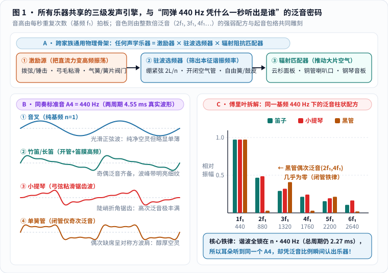
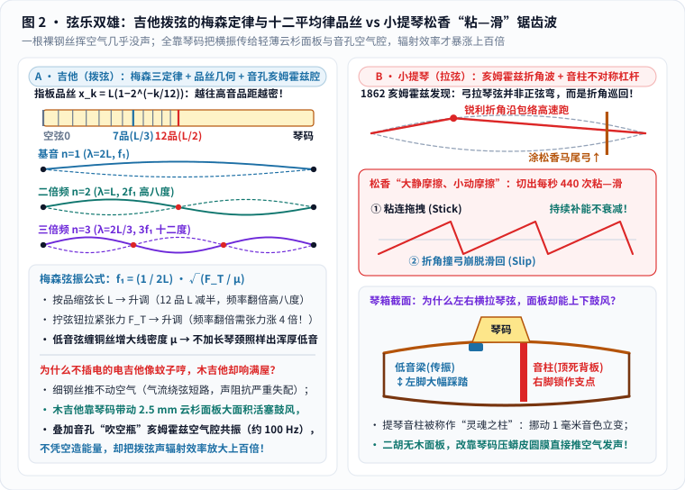
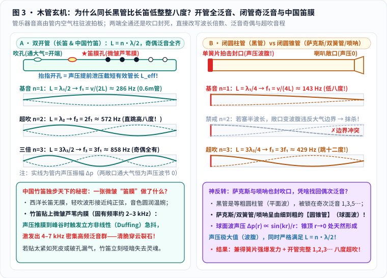
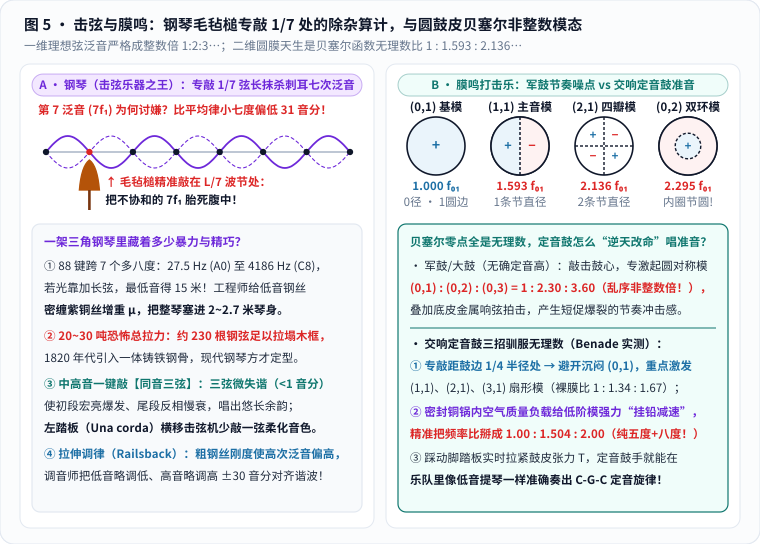

闭上眼睛，让乐团里的乐手轮流奏响同一个标准音 **$$\mathrm{A_4}$$（国际标准音高，每秒振动 $$440$$ 次，即 $$440\ \mathrm{Hz}$$）**。

哪怕你从来没学过五线谱，也绝不会把清越穿云的**中国竹笛**认成醇厚微哑的**单簧管（黑管）**，更不会把颗粒清脆的**木吉他**听成如泣如诉的**小提琴**、带金属哭腔的**十孔口琴**，或者金石裂帛般的**小号**。

但只要细想三秒钟，一连串反直觉的物理怪事就会冒出来：

1. **既然所有乐器推着耳膜每秒往返的次数一模一样（都是 $$440$$ 次），空气里传来的就只是压力的一紧一松——凭什么耳朵半秒就能“验明正身”？**
2. 把一根吉他钢弦单独拴在两颗铁钉之间拨响，凑到十厘米外都几乎听不见；可一旦把它架上一只**不插电的空心木头盒子**，声音凭什么瞬间响彻整间客厅？这难道违反能量守恒吗？
3. 吉他拨一下就越来越轻，为什么小提琴手拿着**涂了松香的马尾弓**往同一个方向匀速直拉，琴弦却没有被拉偏卡死，反而能持续每秒剧烈抖动几百次？
4. **长笛**和**单簧管**拿在手里都是大约 $$60\ \mathrm{cm}$$ 长的圆管子，为什么单簧管吹出的最低音，硬生生比长笛**低了整整一个八度**？更神的是，**萨克斯**和**唢呐**明明也像单簧管一样用簧片封住了吹口，为什么它们却又能像长笛一样吹出偶次泛音？
5. **口琴**既没有长管子也没有绷紧的弦，为什么同一个孔**吹气是一个音、吸气是另一个音**，蓝调乐手还能不按任何机关凭空把音“压弯”半格？**小号**全身只有**三颗按键**，怎么凑齐十二平均律的全部半音？**钢琴**的小毛毡槌为什么偏偏要敲在琴弦总长的 **$$1/7$$** 处？而一面圆鼓皮凭什么在军鼓上是“咚嚓”节奏声，到了交响乐队的**定音鼓**上却能准确唱出 Do 和 Sol？

今天，我们就顺着空气与固体的真实力学方程，把人类几千年打磨出来的**弦乐、木管、自由簧、铜管、键盘击弦与膜鸣打击乐**一次性拆开看透。

---

## 一、先拆开所有乐器共用的底层引擎：为什么同样奏出每秒 440 次振动，你闭着眼也能一秒认出竹笛、小提琴、吉他和黑管？

表面上看，口琴靠铜片、吉他靠钢丝、竹笛靠竹筒、小号靠嘴唇，彼此八竿子打不着；但在声学物理学家眼里（参见新南威尔士大学乔·沃尔夫教授主持的 [UNSW Music Acoustics 乐器声学综述](https://newt.phys.unsw.edu.au/music/) 与 [OpenStax 大学物理第 16.6 节](https://openstax.org/books/university-physics-volume-1/pages/16-6-standing-waves-and-resonance)），地球上几乎所有声学乐器，骨子里都装着同一套**“三级串联发声引擎”**。

_先看顶部 A 框的三级流水线，再对比左下 B 框四种乐器同奏 $$440\ \mathrm{Hz}$$ 时的真实两周期波形（总长 $$4.55\ \mathrm{ms}$$），最后看右下 C 框的傅里叶拆解柱状谱：大家的大周期完全一样，但倍频泛音（$$2f_1, 3f_1, 4f_1\dots$$）的高低胖瘦截然不同，尤其是单簧管的偶次泛音几乎清零。_

### 1. 任何原声乐器的三块核心拼图：激励器 × 驻波选频器 × 辐射阻抗匹配器

你平时手的动作——无论是手指拨一下、琴弓匀速拉过去，还是嘴巴呼出一股平稳的气流——本质上都是**直流（单向）或极慢的机械输入**，本身根本不是每秒几百次的声波。要把你手和肺里的力气变成音乐，乐器必须按顺序闯过三关（图 1A）：

1. **第一级：激励源（Exciter，把慢动作切成高频脉冲）**
   拨片勾放琴弦、钢琴毛毡槌敲击琴弦（瞬态冲击）；提琴松香弓毛对琴弦一抓一放、单簧管芦苇片一开一合、小号手嘴唇一张一闭、笛子吹口薄气流的上下摆尾（持续自激阀门）。它们的任务是源源不断制造剧烈的力学扰动。
2. **第二级：驻波选频器（Resonator，从乱波里筛出精准音高）**
   扰动一进到有限长度的紧绷琴弦、空气管或金属簧片里，波跑到两端边界就会反射回来。正向波与反向波迎头相撞叠加，绝大多数杂乱频率互相抵消淹没，只有那些**波长刚好能塞进边界整数倍半波长（或奇数倍四分之一波长）的本征频率**才能同相叠加放大，锁成稳定的**驻波（Standing wave）**，并反过来指挥第一级阀门按它的节奏开关！
3. **第三级：辐射阻抗匹配器（Radiator，替纤细振子推动大片空气）**
   细钢丝或窄管口里的驻波虽然剧烈，但跟辽阔而轻软的房间空气直接硬碰时，绝大部分声能都被反射闷死在乐器肚子里。因此必须靠**吉他/小提琴的轻薄云杉面板、二胡的蟒皮、铜管外翻的大喇叭口、钢琴巨大的音板**充当“声学变速箱”，把高力小面积振动转换成大面积空气推力，送进你的耳朵（关于声波进耳后如何驱动听小骨与耳蜗基底膜分频，可延伸阅读[《我们是如何听到的》]()）。

### 2. 傅里叶泛音密码与“起音指纹”：音高看基频，音色看谐波配方

现在回答开头第一个大问题：**同样是 $$440\ \mathrm{Hz}$$，为什么竹笛、小提琴和黑管听起来天差地别？**

法国数学家约瑟夫·傅里叶证明过一条贯穿物理学的铁律（详见我们之前的推导[《傅里叶怎样把温度拆成波》]()）：**任何每秒严格重复 $$f_1$$ 次的复杂周期波形 $$p(t)$$，无论长得多么棱角分明，都能唯一拆解成一串整数倍频率纯正弦波的叠加：**

$$
p(t) = \sum_{n=1}^{\infty} A_n \sin(2\pi n f_1 t + \varphi_n)
$$

把式子里的每一项对号入座：

- **$$n = 1$$（基音 / 基频 $$f_1 = 440\ \mathrm{Hz}$$）**：决定整个波形最长的重复大周期 $$T = \frac{1}{440}\ \mathrm{s} \approx 2.27\ \mathrm{ms}$$。无论后面叠了多少倍频，因为 $$2f_1, 3f_1, 4f_1\dots$$ 在 $$2.27\ \mathrm{ms}$$ 里刚好跑完 $$2, 3, 4\dots$$ 个整圈，合成波依然精准地每 $$2.27\ \mathrm{ms}$$ 完整重演一次——所以人类大脑毫不犹豫地把它们的**音高（Pitch）**统统听成同一个 $$\mathrm{A_4}$$！
- **$$n = 2, 3, 4\dots$$（二次、三次、四次谐波 / 泛音 Harmonics，即 $$880\ \mathrm{Hz}、1320\ \mathrm{Hz}、1760\ \mathrm{Hz}\dots$$）**：不同乐器的驻波边界与激励方式，决定了各自独一无二的振幅权重谱 $$\{A_1, A_2, A_3, \dots\}$$（图 1B、1C）：
  - **金属音叉**：几乎只有孤零零一根 $$1f_1$$ 柱子，光滑正弦波空灵纯净，听久了却显得单薄；
  - **小提琴**：松香粘滑拉出陡峭的锯齿折角波，$$1f_1, 2f_1, 3f_1 \dots 10f_1$$ 一路排开，高频泛音极其丰满浓郁；
  - **单簧管（黑管）**：一头封死、一头敞开的圆柱管直接扼杀了偶次驻波，导致 **$$2f_1(880\ \mathrm{Hz})、4f_1(1760\ \mathrm{Hz})$$ 几乎清零**，只剩 $$1f_1, 3f_1, 5f_1$$ 撑起带方波平肩的醇厚木管味！

除此之外，声学心理学家做过一个著名的**“剪掉起音”盲测实验**：如果把长笛、小号、小提琴和钢琴录音最开头的 **前 $$50 \sim 100\ \mathrm{ms}$$（起音瞬态 Attack transient——比如指尖刮弦声、笛口吐气嘶声、琴槌闷击声）** 用剪刀裁掉，只放中间平稳延音段，哪怕是专业乐手，认错乐器的概率也会飙升好几倍！也就是说：**稳态泛音柱状谱 + 最初零点几秒的起音包络（ADSR）**，共同拼出了每件乐器的身份证。

---

## 二、弦乐家族（吉他、小提琴、二胡）：一根裸钢丝挥空气几乎是哑巴，木琴箱和松香马尾弓到底施了什么魔法？

我们先拿最熟悉的**弦乐器**开刀——无论是弹拨类的**木吉他、琵琶、古筝**，还是弓拉类的**小提琴、大提琴、中国二胡**，它们的驻波选频器都是一根两端锁死在**上弦枕（Nut）**与**琴码（Bridge）**之间、有效长度为 $$L$$ 的紧绷细弦。

_左栏 A 拆解吉他：先看指板品丝越往高音越密，再看 $$n=1,2,3$$ 三阶弦驻波与梅森公式，底部解释云杉面板与音孔的声阻抗匹配；右栏 B 拆解小提琴：先看 1862 年亥姆霍兹发现的抛物线折角波，再看松香一粘一滑的锯齿时间图，最后看琴箱截面里蓝色低音梁与红色音柱怎样把水平拉弦变成垂直鼓风。_

### 1. 梅森三定律与吉他指板算术：为什么品丝越往琴箱走越密？

一根紧绷细弦上的横波跑得多快？由牛顿第二定律对一小段弯曲弦元做受力分析（推导见 [OpenStax 大学物理第 16.3 与 16.6 节](https://openstax.org/books/university-physics-volume-1/pages/16-6-standing-waves-and-resonance)），波速 $$v$$ 只取决于两个物理量——弦被拉得多紧（**张力 $$F_T$$**，单位牛顿 $$\mathrm{N}$$）和弦本身有多粗重（**线密度 $$\mu = m/L$$**，每米弦长多少千克，单位 $$\mathrm{kg/m}$$）：

$$
v = \sqrt{\frac{F_T}{\mu} }
$$

因为弦的两端被死死按住动弹不得（位移恒为 $$0$$，叫**波节 Node**），能存活下来的第 $$n$$ 阶驻波必须正好在总长 $$L$$ 里塞进 $$n$$ 个半波长，即 $$L = n\frac{\lambda_n}{2}$$，波长 $$\lambda_n = \frac{2L}{n}$$。用频率等于波速除以波长 $$f_n = \frac{v}{\lambda_n}$$，法国神父兼物理学家马兰·梅森（Marin Mersenne）早在 1636 年总结出的**梅森弦振定律**就跳了出来：

$$
f_n = \frac{n}{2L}\sqrt{\frac{F_T}{\mu} } \qquad (n = 1, 2, 3, \dots)
$$

我们直接拿一把标准民谣木吉他（有效弦长 $$L = 0.65\ \mathrm{m}$$）的 1 号高音 $$\mathrm{E_4}$$ 裸钢弦做一次真刀真枪的验算：钢丝直径约 $$0.30\ \mathrm{mm}$$，线密度 $$\mu \approx 5.5 \times 10^{-4}\ \mathrm{kg/m}$$，拧紧琴头弦钮施加张力 $$F_T \approx 72\ \mathrm{N}$$（相当于挂着一袋 $$7.3\ \mathrm{kg}$$ 的大米！）。代入基频（$$n=1$$）：

$$
f_1 = \frac{1}{2 \times 0.65}\sqrt{\frac{72}{5.5 \times 10^{-4} } } \approx \frac{361.8}{1.30} \approx 278\ \mathrm{Hz} \quad (\text{再拧紧到 } 102\ \mathrm{N}\text{ 即精准对准 }\mathrm{E_4}\approx 329.6\ \mathrm{Hz}\text{！})
$$

这行公式一口气揭开了吉他与提琴身上的**三件设计秘密**（图 2A）：

1. **左手按品改弦长 $$L$$**：现代**十二平均律**把一个八度（频率翻 $$2$$ 倍）等比切成 $$12$$ 个半音，每往高走一个半音，频率乘上 $$2^{1/12} \approx 1.05946$$。因为张力 $$F_T$$ 和线密度 $$\mu$$ 不变时 $$f_1 \propto 1/L$$，第 $$k$$ 根金属品丝离琴码的剩余弦长必须是 $$L_k = L \cdot 2^{-k/12}$$，即离上弦枕的距离为：

   $$
   x_k = L\bigl(1 - 2^{-k/12}\bigr)
   $$

   代入 $$k = 7$$（纯五度），$$L_7 \approx 0.667 L \approx \frac{2}{3}L$$；代入 $$k = 12$$，**第 12 品恰好坐落在整根弦正中央 $$x_{12} = L/2$$**，弦长砍半、基频精准翻倍升八度！而且因为每往下一格都是按**剩余长度**再削掉约 $$5.6\%$$，越靠近音孔的品丝自然越排越密。如果你不把弦按死在指板上，而是用指肚**轻轻虚触在 $$L/2$$（12 品）或 $$L/3$$（7 品）正上方拨弦后迅速抬手**，就会当场抹杀基音 $$n=1$$，只留下晶莹剔透如钟铃般的二倍频或三倍频——这就是吉他手最爱炫技的**“自然泛音”**！
2. **拧弦钮改张力 $$F_T$$**：注意 $$F_T$$ 戴着根号！想只靠拉紧把一根弦升高整整一个八度（$$f_1$$ 翻 $$2$$ 倍），张力 $$F_T$$ 必须暴涨 **$$4$$ 倍**——钢丝当场就会崩断！所以调音钮只用来微调音准。
3. **低音粗弦缠铜丝改线密度 $$\mu$$**：吉他最粗的 6 号低音弦 $$\mathrm{E_2}$$（$$82.4\ \mathrm{Hz}$$）频率只有 1 号弦的四分之一。如果不换粗细光靠加长琴颈，吉他得造到 **$$2.6\ \mathrm{m}$$ 长**！工程师的绝招是在高强度钢芯外面**密密麻麻缠绕一层紫铜或磷青铜细丝**：铜圈几乎不增加弯曲僵硬感，却让线密度 $$\mu$$ 暴增 $$16$$ 倍，在同样 $$0.65\ \mathrm{m}$$ 的短琴颈上轻松唱出深沉浑厚的低音。

### 2. 木琴箱不是“凭空造能量的放大器”，而是拯救声短路的“阻抗变速箱”

拿一把实心电吉他，拔掉音箱线使劲扫弦，声音微弱得像蚊子哼；可同样力气扫一把木吉他，整间屋子都在震。**多出来的巨大响度是从哪来的？**

真相藏在**声学短路（Acoustic short-circuiting）**与**能量守恒**里（参见 [UNSW 弦与共鸣箱声学](https://newt.phys.unsw.edu.au/music/strings.html)）：

- 一根直径不到 $$1\ \mathrm{mm}$$ 的钢弦往右摆动时，它右前方的空气根本来不及被压缩成远场声波，就直接绕过这根细得可怜的钢丝，溜到它左后方腾出的低压空隙里去了！就像你拿一根织毛衣的细针在水桶里来回划水，根本激不起大浪。结果电吉他实心木头几乎不吸收弦能，弦可以空晃十几秒不外泄；
- 木吉他则把钢弦架在硬木**琴码**上，逼着琴弦每一次微小的拉扯都拽动厚度仅约 **$$2.5\ \mathrm{mm}$$**、纹理顺直轻盈坚挺的**云杉木面板（Soundboard）**。几百平方厘米的大木板像一面大扇子整片上下鼓风，空气再也来不及绕边逃跑，只能老老实实化作声压波辐射出去！因为能量泄放得猛，木吉他的延音反而比不插电的电吉他短——**总能量一分没多，只是把原本白白耗散成摩擦热的机械能，高效率换成了声波功率！**
- 可是中低音波长动辄两三米，连直径三四十厘米的面板也嫌小怎么办？琴箱正面那个圆圆的**音孔（Sound hole）**登场了：背板与侧板围成的封闭空气腔充当“空气弹簧”，音孔附近那一团进出吞吐的空气柱充当“活塞质量块”，两者组成一个标准的**亥姆霍兹共振器（Helmholtz resonator，跟对着空啤酒瓶口吹气呜呜响完全同源）**：

  $$
  f_{\mathrm{H} } = \frac{c}{2\pi}\sqrt{\frac{S}{V L_{\mathrm{eff} } } }
  $$

  其中 $$c \approx 343\ \mathrm{m/s}$$ 是声速，$$S$$ 是音孔面积，$$V$$ 是琴箱容积，$$L_{\mathrm{eff} }$$ 是含端口修正的音孔有效气柱长。一把民谣吉他的 $$f_{\mathrm{H} }$$ 精确落在 **$$100\ \mathrm{Hz}$$ 上下**（小提琴一对 $$\mathrm{f}$$ 孔腔共振约在 $$275\ \mathrm{Hz}$$），专门替最低的几个音托起温暖厚实的胸腔共鸣！

### 3. 小提琴与二胡：1862 年亥姆霍兹抓拍到的松香“粘—滑”折角波，与差一毫米就毁音的“灵魂音柱”

拨弦乐器一放手就只能坐吃山空，怎么才能让弦唱出绵延不断的长音？答案是**涂满松香（Rosin）的马尾弓**。

很多人直觉以为“琴弓把弦拉弯成一条光滑圆弧在那抖”，1862 年德国物理学巨匠赫尔曼·冯·亥姆霍兹（Hermann von Helmholtz）用振动显微镜第一次看清了真相，当场颠覆所有人的想象（图 2B，详见 [UNSW 琴弓与亥姆霍兹运动解析](https://newt.phys.unsw.edu.au/music/Bows.html)）：

- **真实的小提琴弦在任何一瞬间都不是弯弧，而是由两条笔直的线段拼成的锐利“折角（Helmholtz corner）”**！这个折角沿着一圈抛物线包络，每秒绕整根弦飞奔 $$f_1$$ 圈；
- 马尾毛涂上松香后，拥有极悬殊的**大静摩擦、小动摩擦**（滑动时摩擦热甚至让局部微米级松香软化打滑，一停住瞬间凝固抓牢）。在每一个周期里：
  1. **粘连阶段（Stick，占周期绝大部分时间）**：松香死死咬住琴弦，带着接触点以弓速匀速平移，往弦里充入弹性势能；
  2. **崩脱滑回阶段（Slip，一闪而过）**：在弦上巡回的“亥姆霍兹折角”撞上弓毛接触点，剧烈的折角恢复力瞬间扯断静摩擦，琴弦像弹弓一样逆着弓向闪电滑回，折角飞奔向另一端反射回来再次把弦按在弓毛上粘牢！

这样一粘一滑切出来的位移波形，天生就是富含全套整数倍高频泛音的**不对称锯齿波**。但小提琴琴箱里还藏着最后一处神来之笔（图 2B 右下）：乐手明明是**左右水平**拉弓，而面板必须**上下垂直**鼓风才推得动空气！打开小提琴肚子，你会发现它是**故意造偏心的**：

- 琴码左脚（低音 $$\mathrm{G}$$ 弦侧）底下粘着一根纵贯面板的木条叫**低音梁（Bass bar）**，负责把振动均匀传遍整块面板；
- 琴码右脚（高音 $$\mathrm{E}$$ 弦侧）底下几毫米处，竖直硬塞着一根直径约 $$6\ \mathrm{mm}$$ 的云杉圆木棍，把面板和背板死死顶在一起——法国制琴师敬畏地叫它 **“灵魂（L'âme，即音柱 Soundpost）”**！右脚被音柱锁成几乎不动的支点，水平拉扯琴码顶部的力矩立刻绕着右脚支点旋转，逼着**左脚像踩风箱踏板一样大起大落**！制琴师用弯钩把这根小木棍往左或往右挪动哪怕 **$$1\ \mathrm{mm}$$**，整把提琴是高亢明亮还是沙哑暗淡当场剧变。
- 而中国**二胡**走出了另一条同样绝妙的路：二胡没有上弦枕（直接靠千金线截弦，手指悬空按弦不碰指板，因此揉弦滑音极其细腻像人声抽泣），琴筒一端更是不装木面板，直接蒙上一张紧绷的**蟒蛇皮圆膜**，由竹木小琴码压在蟒皮中央推动空气，叠加千金以下余弦与皮膜的耦合高频，拉出了独步东方的苍凉鼻音。

---

## 三、木管家族（中国竹笛、长笛、单簧管、萨克斯与唢呐）：为什么同样 60 厘米长的黑管，最低音硬生生比竹笛低了整整一个八度？

放下琴弦，我们拿起管乐器。先把一个最容易被名字骗倒的音乐史冷知识挑明：**“木管乐器（Woodwinds）”跟它是不是木头造的毫无关系！** 通体银光闪闪的现代金属**长笛**、金光灿灿的黄铜**萨克斯**，在声学分类上统统是铁打的**木管家族**——因为区分木管与铜管的不是外壳材料，而是**激励方式与开孔截管原理**。

_左栏 A 是两端通大气的双开管（长笛、中国竹笛）：看 $$n=1,2,3$$ 声压驻波奇偶全齐，底部拆解微皱芦苇“笛膜”如何靠立方非线性激发出 $$4\text{--}7\ \mathrm{kHz}$$ 清脆泛音；右栏 B 对比单簧管闭圆柱管：吹口封死变声压波腹，$$L=\lambda_1/4$$ 让同长管直降八度且抹杀 $$n=2$$ 偶次泛音，右下紫色框揭秘萨克斯/双簧管/唢呐如何靠圆锥管球面波找回全套泛音。_

### 1. 两类气动激励器：“气簧劈边摆尾” vs “簧片负阻阀门”

嘴里吹出的只是一股稳定的直流气，管子凭什么自己响起来（参见 [UNSW 长笛与单簧管声学对比](https://newt.phys.unsw.edu.au/music/flutes.v.clarinets.html)）？木管家族演化出了截然相反的两套自激引擎：

- **气簧劈边类（Air-reed / Edge-blown：中国竹笛、洞箫、西洋长笛、竖笛、排箫）**：没有任何固体簧片！乐手把嘴唇聚成细缝，吹出一束扁平高速气带（Air jet），正对吹孔对岸锋利的**劈边（Labium）**。只要管内驻波有一丝一毫的横向声流波动，这束气带就会像风中旗帜一样，按驻波节奏一会儿拐进管内充气、一会儿甩向管外大气——**这束来回摆尾的空气射流本身就是一片“看不见的空气簧片”**！因为吹孔直接大敞着连通外界大气，吹孔处的**声压起伏 $$\Delta p$$ 被大气压死死钳在 $$0$$（声压波节，声阻抗极小值）**。
- **固体簧片阀门类（单簧管的单片芦苇簧 Single reed；双簧管、大管、中国唢呐与管子的两片芦苇对拍簧 Double reed）**：含在嘴里的薄芦苇片构成一个受气压控制的弹性窄缝阀门。口腔高压与管内回波声压配合，当管内声压升高顶开簧片（或按相位闭合）时，刚好在驻波压强最高的那半周期往管里猛灌高能气流，扮演声学上的“负电阻放大器”。关键来了：因为嘴唇含紧笛头，簧片几乎把吹口封死，空气分子在这里撞墙走投无路——**吹口处不再是声压零点，而是声压剧烈震荡的最大值（声压波腹 Pressure antinode，声阻抗极大值）！**

### 2. 开管 vs 闭圆柱管：半波长与四分之一波长之战，解释“黑管低八度 + 奇次泛音”

抓住了“敞口声压恒为 $$0$$（波节）、封口声压最大（波腹）”这两条铁律，长笛与单簧管的所有差别只用三行中学算术就能彻底算穿（图 3A、3B，对照 [OpenStax 大学物理第 17.4 节](https://openstax.org/books/university-physics-volume-1/pages/17-4-normal-modes-of-a-standing-sound-wave)）：

1. **双开管（长笛、中国竹笛，吹孔通大气 + 管尾通大气，两端全是声压波节 $$0$$）**：
   从 $$0$$ 出发再回到 $$0$$，管长 $$L$$ 里塞进的最短驻波至少得是**半个波长** $$L = \frac{\lambda_1}{2}$$，高阶驻波塞进任意整数个半波长 $$L = n\frac{\lambda_n}{2}$$。取室温 $$20\ ^\circ\mathrm{C}$$ 空气声速 $$v \approx 343\ \mathrm{m/s}$$、有效管长 $$L = 0.60\ \mathrm{m}$$：

   $$
   f_n^{\text{开管} } = \frac{n v}{2L} \qquad (n = 1, 2, 3, 4, \dots)
   $$

   算一下：基音 $$f_1 = \frac{343}{1.20} \approx 286\ \mathrm{Hz}$$；用力急吹（**超吹 Overblowing**）跳到第二阶 $$n=2$$ 时，$$f_2 = 2f_1 \approx 572\ \mathrm{Hz}$$——**直接干净利落地跳高一个八度，奇次、偶次泛音一个不落！**
2. **一闭一开等粗圆柱管（单簧管 / 黑管，吹口声压波腹 + 管尾敞口声压波节 $$0$$）**：
   从最大值（波腹）一路降到最小值（$$0$$ 波节），最短只需要塞进 **四分之一波长** $$L = \frac{\lambda_1}{4}$$，波长足足是同长竹笛的 $$2$$ 倍（$$\lambda_1 = 4L = 2.40\ \mathrm{m}$$）！如果硬塞 $$2$$ 个四分之一波长（即半波长），管尾敞口就会变成波腹，跟外面的大气压边界正面撞车，当场被物理定律抹杀！因此只允许塞进 **$$1, 3, 5\dots$$ 奇数个四分之一波长**：

   $$
   f_n^{\text{闭圆柱} } = \frac{n v}{4L} \qquad (n = 1, 3, 5, 7, \dots\ \text{仅奇次谐波！})
   $$

   代入同样 $$L = 0.60\ \mathrm{m}$$：单簧管最低基音 $$f_1 = \frac{343}{2.40} \approx 143\ \mathrm{Hz}$$——**一寸管子都没加长，最低音直接比长笛（$$286\ \mathrm{Hz}$$）低了整整一个八度！** 而且按下泛音键超吹时，因为 $$n=2$$ 不存在，黑管无法跳八度，而是直接蹦到 **$$n=3$$（$$3f_1 \approx 429\ \mathrm{Hz}$$，整整一个八度加纯五度的“十二度”！）**——这就是为什么学单簧管的新手总觉得低音区和高音区指法像换了一件乐器，也是黑管低音区（Chalumeau 音区）为什么听起来那么幽深空灵的终极物理根源。

至于木管管壁上一排排**音孔（Tone holes）**是干什么的？当你抬起手指打开靠下的一颗音孔时，管外大气顺着小孔涌进来把该处的声压钳近 $$0$$（相当于把管子提前在这里锯断，缩短了有效管长 $$L_{\mathrm{eff} }$$），音高随之逐级攀升。

### 3. 两个最迷人的声学彩蛋：中国竹笛的“微皱笛膜”，与萨克斯/唢呐的“圆锥管大反转”

看到这里，细心的读者一定会追问两个极精彩的问题：

- **第一问：中国竹笛和西洋长笛都是双开管，为什么西洋长笛听着温婉如丝绒，中国梆笛/曲笛却能吹出《扬鞭催马运粮忙》那种清脆到穿云裂石的金属质感？**
  秘密全在吹孔与第一指孔之间额外挖出的那颗椭圆形**膜孔**，以及贴在上面的那张半透明芦苇内膜——**笛膜（Dimo）**（台湾声学家蔡振家等发表于《美国声学会志》*JASA* 的实测研究，参见 [Tsai, *JASA* 2004/2012 竹笛膜非线性声学](https://pubs.aip.org/asa/jasa/article-abstract/115/3/1352/546273/Acoustic-effects-of-membrane-wrinkles-on-a-Chinese)）。老笛手贴笛膜绝不能绷成平平整整的死皮，而一定要用两手大拇指揉搓出细密均匀的**横向微皱纹**！微皱笛膜自身的固有频率在 $$2 \sim 3\ \mathrm{kHz}$$ 左右，平时随管内低频声压轻柔起伏；可一旦声压推到波峰波谷把皱纹瞬间拉平绷紧，膜的恢复刚度突然呈**立方非线性（Duffing 硬化弹簧）**暴增，每一次拉平都会像甩鞭子尖一样辐射出一串 **$$4 \sim 7\ \mathrm{kHz}$$**（恰好处在人耳外耳道最敏感频段！）的密集高频谐波群！一旦笛膜受潮松垮或拉得太紧没了皱纹，竹笛立刻变得闷哑无神。
- **第二问：萨克斯（单簧片）、双簧管和中国唢呐（双簧片），吹口明明也和单簧管一样被簧片封死了，为什么它们超吹时却跳八度（$$2f_1$$），拥有完整的 $$1, 2, 3, 4\dots$$ 全泛音列？**
  这是一道连大学物理竞赛都常考错的妙题（图 3B 右下，详见 [UNSW 圆锥管与圆柱管驻波解析](https://newt.phys.unsw.edu.au/music/pipes.html)）！单簧管是上下等粗的**圆柱管**，里面跑的是振幅不变的一维平面波 $$\cos(kx)$$；而萨克斯、双簧管和唢呐的管身是从细吹口一路向外均匀张开的**圆锥管（Conical bore）**！在圆锥管里传播的是球面波，声压振幅随离锥顶距离 $$r$$ 按球面扩散规律变化：

  $$
  \Delta p(r) \propto \frac{\sin(kr)}{r}
  $$

  你看 $$\frac{\sin(kr)}{r}$$ 这个神仙函数：在管尾敞口 $$r = L$$ 处要令 $$\Delta p(L) = 0$$，必须满足 $$\sin(kL) = 0$$，即 $$kL = n\pi \implies L = n\frac{\lambda_n}{2}$$（跟双开管完全一样的半波长整数倍！）；可是在吹口逼近圆锥顶点 $$r \to 0$$ 时，中学重要极限 $$\lim_{r\to 0}\frac{\sin(kr)}{kr} = 1 \neq 0$$，**声压居然自动在尖端封口处登顶成了波腹最大值**！圆锥管就这样左脚踩住了封口簧片的暴烈声功率，右脚踩住了双开管完整的 $$1, 2, 3\dots$$ 全泛音与八度超吹——这就是萨克斯为什么既有木管的灵巧指法、又有铜管般嘹亮穿透力，而唢呐更是一响就能压住全场百鸟朝凤！

---

## 四、自由簧与铜管家族（口琴、手风琴、笙 vs 小号、圆号、长号）：口琴为什么一吹一吸是两个音还能“压”出哭腔？小号只靠三颗按键怎么凑齐十二个半音？

接下来这组对手，一个能揣进衬衫口袋（**十孔布鲁斯口琴、复音口琴、手风琴**，以及它们共同的东方老祖宗——三千年前的中国**笙**），另一个则是交响乐团后排最威风凛凛的金属巨兽（**小号、圆号、长号、大号**）。

_左栏 A 展示十孔口琴单格剖面（若浏览器开启运动效果，上方蓝色吹音簧会演示一次正压推入窄槽斩波后停稳；开启减少动态效果则直接展示清晰静态几何）：上方吹音簧钉在内侧、下方吸音簧钉在外侧，底部揭秘悬臂梁频率公式、调音师锉刀口诀与 1998 年 JASA 实测的蓝调“双簧接力压音”；右栏 B 拆解铜管乐器的自然泛音阶梯与 $$+5.9\%/+12.2\%/+18.9\%$$ 三活塞加管算术。_

### 1. 口琴、手风琴与笙的“自由簧”：音高不听管子的，锉刀刮尖升调、刮根降调！

单簧管的芦苇片振动时会啪啪拍打在笛头边框上，叫**拍击簧（Beating reed）**；而十七世纪末中国**笙**传入欧洲后启发诞生的口琴与手风琴，用的是一片铆在黄铜簧板长方孔一端、左右留有几十微米极细缝隙、**能够自由穿过槽口往返摆动而不撞边框的黄铜弹性薄片——自由簧（Free reed）**（匹兹堡卡内基梅隆与工业实验室团队发表于《美国声学会志》的经典高速摄像与气流测量研究：[Bahnson, Antaki & Bechtel, *JASA* 1998](https://pubs.aip.org/asa/jasa/article-abstract/103/4/2134/563961/Acoustical-and-physical-dynamics-of-the-diatonic)）。

对着图 4A 看清十孔布鲁斯口琴身上**三个最反直觉的物理真相**：

1. **为什么同一个琴孔，吹气是 Do（$$\mathrm{C}$$），吸气却变成了 Re（$$\mathrm{D}$$）？**
   拆开口琴外壳你会发现，每一格气道上下贴着两片安装方向相反的簧片，它们天生是两扇**“单向气动自动门（闭簧 Closing reed）”**：
   - 上方的**吹音簧**铆在气道**内侧**，自由端略微向上翘起留出一道窄缝。当你**吹气**时，琴格内正压把吹音簧往外推入窄槽关闭气流，簧片弹力又把它拉回弹开——每秒几百次把直流气斩成声波脉冲！而此时下方的吸音簧装在**外侧**，正压只会把它往外越顶越开，根本没法形成周期闭锁，乖乖保持沉默；
   - 反过来当你**吸气**时，格内负压把外侧的**吸音簧**往格内窄槽里吸闭激振，而内侧的吹音簧被吸开歇业！一格藏双簧、正负压分流，巴掌大的十个孔瞬间塞进 $$20$$ 个音。
2. **口琴的音高由谁拍板？调音师为什么“锉薄簧尖升调、锉薄簧根反而降调”？**
   跟竹笛完全相反，口琴那几厘米短的塑料/木头琴格根本装不下驻波——口琴的音高几乎百分之百由黄铜簧片这根**一端固定悬臂梁（Cantilever beam，与石英表里的音叉同源，可对照[《石英钟与电脑时钟》]()）**自身的杨氏模量 $$E$$、密度 $$\rho$$、厚度 $$h$$ 和长度 $$L$$ 拍板：

   $$
   f_1 \propto \frac{h}{L^2}\sqrt{\frac{E}{\rho} }
   $$

   低音孔簧片又长又在尖端留着厚重配重块，高音孔簧片极短极轻。工厂调音师手里拿一把小锉刀，口诀极其精妙：
   - 如果这个音偏低了要**升高音高**：用锉刀轻轻刮薄**簧片最尖端（自由端）**——尖端几乎不受弯曲应力，刮薄只相当于摘掉一点末端惯性质量 $$m_{\mathrm{eff} }$$，弹簧负载变轻，振动立刻变快升调！
   - 如果这个音偏高了要**降低音高**：用锉刀轻轻刮薄**靠近铆钉的簧片根部**——根部是整根悬臂梁弯曲力矩最大的地方，刮薄等于把弹簧掰软（刚度 $$k_{\mathrm{eff} }$$ 大降），振动立刻变慢降调！
3. **蓝调大师不按任何键，凭什么吸气时能把音硬生生“压弯（Bending）”半音甚至全音，吹出催人泪下的哭腔？**
   Bahnson 等人在 1998 年 *JASA* 论文里把微型内窥镜和压力传感器塞进演奏者口腔与琴格，彻底破了案：在十孔口琴第 1～6 孔里，吸音簧的固有频率比同格吹音簧高（例如第 4 孔吹音是 $$\mathrm{C_5}$$、吸音是 $$\mathrm{D_5}$$）。当乐手压低舌根、拱起口腔把自己的声道调谐成一个固有频率落在 $$\mathrm{C_5}$$ 与 $$\mathrm{D_5}$$ 之间的**亥姆霍兹共振腔**时，剧烈的声阻抗耦合会先强行拖慢吸音簧，再往下压时甚至**把原本歇业的同孔低音吹音簧以反向“开簧模式”唤醒接力振动**！上下两片簧片在同一个气格里隔空交接班，音高就在 $$\mathrm{D_5} \to \mathrm{C^\#_5} \to \mathrm{C_5}$$ 之间丝滑下潜，连半点台阶都没有！

### 2. 铜管家族（小号、圆号、长号）：嘴唇就是簧片，三颗活塞怎么拼出全部半音？

到了小号、圆号、长号和大号手里，整件金属乐器上连一片木头或金属簧片都找不着——**演奏者紧贴在杯形号嘴（Mouthpiece）里的两片嘴唇，就是这件乐器的“肉身簧片（Lip reed）”！**

这里藏着两重极漂亮的设计智慧（图 4B，详见 [UNSW 铜管乐器声学](https://newt.phys.unsw.edu.au/music/brassacoustics.html)）：

1. **第一重：不按任何键，光绷紧嘴唇就能爬上“自然泛音天梯”（冲锋号的原理）**
   按理说，嘴唇封死了吹口，长达约 $$1.4\ \mathrm{m}$$ 的降 $$\mathrm{B}$$ 调小号应该像单簧管一样只剩 $$1, 3, 5\dots$$ 奇次泛音才对，那根本没法吹曲子！制琴工匠用了两招“乾坤大挪移”：在前端装上带碗腔与喉道的**杯形号嘴**把高次模态往下拉，在尾端焊上急剧外翻的**大喇叭口（Flaring bell）**让高次短波跑得更远才反射、把低次模态往上推——两头一挤，原本残缺的奇次数列（除掉一个低哑跑调、平时不用的脚踏音 $$n=1$$）被精准掰成了**完整的整数倍自然谐波列 $$n = 2, 3, 4, 5, 6, 8\dots$$**！
   你一个按键都不碰，只靠嘴角肌肉收紧或放松嘴唇改变唇簧固有频率，就能像换挡一样依次锁定 **$$2f_1(\text{Do}) \to 3f_1(\text{Sol}) \to 4f_1(\text{高音 Do}) \to 5f_1(\text{Mi}) \to 6f_1(\text{高音 Sol}) \to 8f_1(\text{倍高 Do})$$**——军营里连一颗按键都没有的**军号（冲锋号、熄灯号）**，全部激昂旋律就是纯粹靠嘴唇在这几级自然泛音梯上跳出来的！
2. **第二重：泛音梯中间缺的半音怎么办？三颗活塞键的二进制长度算术！**
   你看 $$2f_1(\mathrm{C_4})$$ 和 $$3f_1(\mathrm{G_4})$$ 之间隔着纯五度，中间足足漏掉了 $$6$$ 个半音（$$\mathrm{F^\#、F、E、E^\flat、D、D^\flat}$$）。怎么补齐？
   - **长号（Trombone）**最耿直：直接把主管做成一根无级伸缩的 **$$\mathrm{U}$$ 形拉管（Slide）**，右手往外推到 7 个把位连续加长管身 $$L$$，还能拉出滑稽或威风的无缝大滑音（Glissando）；
   - **小号、圆号、大号**则装上了精妙绝伦的**三颗活塞阀门（Valves）**，按下哪颗键，气流就绕进哪截附加弯管，精准按十二平均律把总管长延长固定比例：
     - 按 **2 号键（中指）**：延长主管长度的 $$2^{1/12} - 1 \approx \mathbf{+5.95\%}$$ $$\longrightarrow$$ 整体降 **$$1$$ 个半音**；
     - 按 **1 号键（食指）**：延长主管长度的 $$2^{2/12} - 1 \approx \mathbf{+12.25\%}$$ $$\longrightarrow$$ 整体降 **$$2$$ 个半音**；
     - 按 **3 号键（无名指）**：延长主管长度的 $$2^{3/12} - 1 \approx \mathbf{+18.92\%}$$ $$\longrightarrow$$ 整体降 **$$3$$ 个半音**！
     有了 $$1、2、3$$ 这三块积木，单按或组合按下（$$2、1、1+2\text{ 或 }3、2+3、1+3、1+2+3$$），就能把自然泛音梯整体往下平移 $$1 \sim 6$$ 个半音，严丝合缝填满所有音程空缺！（细算一笔：当 $$1+3$$ 组合想降 $$5$$ 个半音时，两截独立附管简单相加只有 $$12.25\% + 18.92\% = 31.17\%$$，比真正降 $$5$$ 个半音所需的 $$2^{5/12}-1 = 33.48\%$$ 短了一截导致音偏高，所以专业小号在第 3 号滑管上专门留了一个无名指拉环，吹低音 $$\mathrm{D}$$ 和 $$\mathrm{C^\#}$$ 时手指顺手往外蹬出约一两厘米实时补偿！）

再补一个震撼的铜管现象：为什么小号和长号轻吹时温暖圆润，一旦乐手卯足肺活量强吹（Fortissimo），音色会突然炸裂成金光四射的**“金属撕裂声（Brassy tone）”**？荷兰埃因霍温理工大学 Hirschberg 等人在 1996 年 *JASA* 论文（[Hirschberg *et al.*, *JASA* 1996 长号激波实测](https://pubs.aip.org/asa/jasa/article-abstract/99/3/1754/559563/Shock-waves-in-trombones)）中测出：强吹时细长圆柱主管里的声压高达几千帕，波峰处空气被绝热压缩升温，声速比波谷快，在长达一两米的窄管里跑着跑着，**波峰真的追上了波谷，陡化成一道真正的微型声学激波（Shock wave）**，瞬间催生出瀑布般的超高次泛音！

---

## 五、击弦之王与膜鸣打击乐（钢琴、军鼓与交响定音鼓）：钢琴毛毡槌为什么偏偏敲在琴弦的 1/7 处？一面二维圆鼓皮凭什么也能唱出准音 Do-Sol？

最后我们来到乐器王国的两个极端：一边是一人顶一支交响乐队、横跨七个多八度的**现代三角钢琴**；另一边是看似只管打拍子、实则藏着高等数学特殊函数的**圆膜鼓家族**。

_左栏 A 拆解钢琴：先看紫色第 7 泛音驻波与棕色毛毡槌精准敲击在 $$L/7$$ 红色波节处，再读下方四条硬核工程细节（缠铜丝缩琴身、20～30 吨铸铁钢骨、同音三弦微失谐与 Railsback 拉伸调律）；右栏 B 拆解圆鼓皮前四阶贝塞尔振动模态 $$(0,1),(1,1),(2,1),(0,2)$$ 的无理数频率比，底部对比军鼓敲心节奏噪点与交响定音鼓如何把频率比掰成 $$1:1.5:2$$ 唱出准音。_

### 1. 钢琴里的暴力力学与温柔心计：20 吨铸铁钢骨、1/7 除杂敲击点与同音三弦

1709 年意大利制琴师巴尔托洛梅奥·克里斯托福里（Bartolomeo Cristofori）把羽管键琴“拨弦（音量固定没法轻重变化）”改造成精巧的擒纵小木槌“击弦（敲完瞬间弹开不捂死琴弦）”，并给它起名 *gravicembalo col piano e forte*（**“能弱也能强的键琴”**，简称 **Pianoforte / 钢琴**）。掀开一架现代音乐会三角钢琴的顶盖（参见佐治亚州立大学 [HyperPhysics 钢琴声学专题](http://hyperphysics.phy-astr.gsu.edu/hbase/Music/pianof.html)），里面藏着四项登峰造极的物理工程（图 5A）：

1. **88 键跨越 150 倍频率，全靠紫铜缠丝把 15 米巨兽塞进客厅**：从最左端最低音 $$\mathrm{A_0}$$（$$27.5\ \mathrm{Hz}$$）到最右端最高音 $$\mathrm{C_8}$$（$$4186\ \mathrm{Hz}$$），频率跨度超过 **$$152$$ 倍**！如果全用同一种裸钢丝只靠加长弦长 $$L$$，最高音弦长 $$5\ \mathrm{cm}$$，最低音弦就得修到 **$$7.6 \sim 15\ \mathrm{m}$$ 长**，三间卧室都装不下！工程师一方面让高音弦短而细、中低音弦长而粗，另一方面在最低音区的钢芯外缠上**一层乃至双层紫铜丝**巨幅推高线密度 $$\mu$$，并且让低音长弦斜跨在中高音弦上方（交叉排列 Overstringing），硬是把整座乐器之王收进了 $$2 \sim 2.7\ \mathrm{m}$$ 的优雅弧形琴壳里。
2. **20～30 吨恐怖总拉力与一体铸铁钢骨**：为了在巨大的云杉音板上激发出震耳欲聋的声压，全琴约 **$$230$$ 根高碳钢弦**每根都被拉紧到 $$700 \sim 900\ \mathrm{N}$$ 左右，合起来整架琴框日夜承受着 **$$20 \sim 30$$ 吨**（相当于五六头成年非洲象压在上面！）的恐怖内拉力。古典时期的全木质钢琴稍微拉紧就会扭曲崩塌，直到 1820 年代美国发明一体浇筑的金色**铸铁钢骨（Cast-iron plate）**扛住这股巨力，肖邦与李斯特手下雷霆万钧的现代钢琴才真正定型。
3. **为什么包裹羊毛毡的琴槌，偏偏要瞄准离弦端约 $$1/7 \sim 1/8$$ 的位置敲下去？**
   回头算一算整数倍谐波列里的音程：$$2f_1$$ 是纯八度，$$3f_1$$ 是十二度（纯五度），$$4f_1$$ 是双八度，$$5f_1$$ 是纯律大三度，$$6f_1$$ 是高音纯五度——前六阶泛音全都甜美协和！唯独到了 **第 7 泛音（$$7f_1$$）**，按十二平均律换算音分差，$$1200\log_2(7/4) \approx 968.8$$ 音分，比标准小七度（$$1000$$ 音分）整整**偏低了 $$31.2$$ 音分**，混在和弦里又酸又涩极度刺耳！
   怎么精准处决这个老七而不伤及无辜？看图 5A 顶部的紫色驻波：**第 7 泛音正好在离弦枕 $$x = L/7$$ 处有一个静止不动的波节（Node）**！把毛毡槌准确安装在这个波节附近往上敲，相当于你想推秋千却使劲往秋千顶部的铁横梁转轴上推——**$$7f_1$$ 根本吃不到半点敲击能量，当场被胎死腹中**！而裹在木槌外面的高密度压缩羊毛毡还自带非线性软外硬里弹性：轻弹（*pp*）时外层软毛慢悠悠接触琴弦，抹平高次谐波，音色温润如玉；重砸（*ff*）时直接压透软层露出硬芯，接触时间极短，瞬间炸出辉煌灿烂的高频泛音！
4. **“同音三弦”悠长歌唱的秘密，与调音师故意调歪的“拉伸调律”**：
   仔细看钢琴中高音区，每个琴键敲下去其实同时砸响 **$$3$$ 根同音钢弦**！如果三根弦完全同相猛推音板，能量一下就泄光了（砰的一声立刻衰减）；但因为三根弦之间存在小于 $$1$$ 音分的极微小自然失谐与耦合，刚敲下最初零点几秒（Prompt sound）三弦同相爆发宏亮音量，随后逐渐滑入反相牵制状态，向音板泄能的速度慢下好几倍（Aftersound），唱出钢琴特有的悠长余韵！踩下最左边的**柔音踏板（Una corda，“一根弦”）**，整套键盘击弦机往右横移几毫米，让槌头少敲一根弦并用未磨损的软毛毡侧面触弦，连音色都一起变柔和。更有意思的是，粗硬钢丝不是理想柔绳，自身的弯曲刚度会让它的第 $$n$$ 泛音比精确整数倍略微偏高（$$f_n = n f_1 \sqrt{1 + B n^2}$$，叫**非谐性 Inharmonicity**）——所以顶级钢琴调律绝不能死盯电子表全按 $$2^{1/12}$$ 调平，调音师必须把最低音故意往低调低约 $$30$$ 音分、最高音故意往高调高约 $$30$$ 音分（著名的**雷尔斯巴克曲线 Railsback curve**），八度合弹时高音基频才能刚好咬住低音偏高的二次泛音，听起来通透辉煌！

### 2. 二维圆鼓皮的贝塞尔无理数诅咒，与交响定音鼓怎样“逆天改命”唱准音

最后一站：为什么一维的弦和空气管随便一弹一吹都有清晰音高，而二维圆鼓皮（比如架子鼓的军鼓、大鼓、中国堂鼓）一槌敲下去，听起来却是**没有明确 Do-Re-Mi 音高的“咚！啪！”节奏声**？

因为波一旦从一维直线走进**二维圆形薄膜**（半径为 $$a$$，外圈箍死恒为 $$0$$），控制它的二维波动方程在极坐标下拆开后，不再是每隔 $$\pi$$ 就等距过零点的正弦函数 $$\sin(kx)$$，而是德国天文学家兼数学家贝塞尔解出来的**第一类贝塞尔函数 $$J_m(kr)$$**（详见 [HyperPhysics 圆膜贝塞尔模态](http://hyperphysics.phy-astr.gsu.edu/hbase/Music/cirmem.html)）！

我们用两个指标 $$(m, n)$$ 标记圆鼓皮的振动花样——$$m$$ 代表穿过圆心的**静止节直径条数**，$$n$$ 代表包括外边框在内的**静止同心节圆圈数**。令 $$J_m$$ 的第 $$n$$ 个正零点为 $$j_{mn}$$，各阶模态的固有频率比为：

$$
f_{mn} = \frac{j_{mn} }{2\pi a}\sqrt{\frac{T}{\sigma} } \implies f_{01} : f_{11} : f_{21} : f_{02} : f_{31} \approx \mathbf{1.000 : 1.593 : 2.136 : 2.295 : 2.653}
$$

看看这串数字（图 5B）：**没有一个是整数倍！全是不成调的无理数比值！**

- **军鼓与大鼓（无确定音高打击乐）**：鼓手一棒敲在鼓皮正中心，所有带节直径的模态（$$m \ge 1$$）因为中心正好在静止线上全被压制，只激起圆对称的 $$(0,1):(0,2):(0,3) = 1 : 2.295 : 3.598$$ 乱序非谐波群，军鼓底面还紧贴着一排金属弹簧丝（响弦 Snare）啪啪拍击底皮，专门制造干脆利落、穿透全场而不抢旋律调性的节奏脉冲！
- **交响定音鼓（Timpani）：三招把无理数硬掰成 $$1 : 1.5 : 2$$ 准音！**
  可是在贝多芬《第五交响曲》和理查·施特劳斯《查拉图斯特拉如是说》开头，那几面硕大的紫铜大锅**定音鼓**明明能准确无误地敲出宏伟的 **$$\mathrm{C\text{—}G\text{—}C}$$（Do—Sol—Do）旋律音高**！它是怎么打破贝塞尔无理数魔咒的？美国声学大师阿瑟·贝纳德（Arthur H. Benade）对克利夫兰管弦乐团定音鼓的经典实测揭开了三步绝技（参见 [HyperPhysics 定音鼓声学与空气负载](http://hyperphysics.phy-astr.gsu.edu/hbase/Music/timpani.html)）：
  1. **敲击位置定规矩**：定音鼓手绝不敲鼓心，而是专敲**距离鼓边约 $$1/4$$ 半径处**——这一槌既压暗了沉闷短命的圆对称模 $$(0,1)$$，又重点唤醒了沿圆周分瓣的扇形家族 **$$(1,1)、(2,1)、(3,1)$$**（在裸膜真空中它们原本的比值是 $$1.593 : 2.136 : 2.653 = \mathbf{1 : 1.34 : 1.67}$$，还是偏窄）；
  2. **密封铜锅里的空气“挂铅减速”**：定音鼓底下扣着一口硕大的半球形密封铜釜！当 $$(1,1)$$（左半鼓皮下压、右半鼓皮上拱）振动时，铜锅里沉甸甸的空气团被迫在锅底左右来回大搬家，相当于给低阶模态挂上了沉重的**附加空气惯性质量**，把 $$(1,1)$$ 的频率狠狠往下拽慢了一大截；而更高阶的四瓣 $$(2,1)$$、六瓣 $$(3,1)$$ 空气就近对流抵消，受减速影响依次减小——一增一减之间，克利夫兰实测定音鼓中 $$(1,1) : (2,1) : (3,1)$$ 的真实频率比被神奇地掰成了：

     $$
     f_{11} : f_{21} : f_{31} \approx \mathbf{1.00 : 1.504 : 2.00}
     $$

     也就是如果把 $$(1,1)$$ 听成二倍频 $$2f_0$$，这三阶刚好对齐 **$$2 : 3 : 4$$（基音八度 : 纯五度 : 双八度）的完美整数谐波比**！人脑听觉中枢瞬间锁定虚拟基频，听出了浑厚无比的准确定音！
  3. **脚踏板实时变调**：鼓座底下连着精密连杆踏板，乐手右脚轻轻一踩拉紧整圈鼓皮张力 $$T$$，不到半秒就能在乐曲中途把整口大鼓从 $$\mathrm{C}$$ 滑升到 $$\mathrm{F}$$ 或 $$\mathrm{G}$$！

（顺便提一句：木琴、马林巴、编钟与三角铁不靠绷紧的膜，而是靠金属或硬木板条自身的弯曲刚度发声，声学上叫**体鸣乐器 Idiophones**。一根均匀自由木条的弯曲模态原本也是无理数比 $$1 : 2.756 : 5.404$$，马林巴工匠专门把木琴键**底面正中央挖成深浅精确的抛物线拱形凹槽**，精准削软基模刚度，硬把第二阶泛音调成了严丝合缝的 $$4.00$$ 倍双八度！）

---

## 六、一张总表收拢全局：主要乐器家族发声原理速查单

把今天拆解过的全部主流乐器摆到同一张物理坐标系里，下次再去听音乐会或看民乐演出，你一眼就能看穿每件乐器手里的底牌：

| 乐器家族与代表 | 第一级：激励方式 | 第二级：驻波选频边界与谐波特征 | 第三级：辐射匹配与独门绝技 |
| :--- | :--- | :--- | :--- |
| **拨弦乐器** （吉他、琵琶、古筝） | 手指/拨片瞬态勾放 | 两端固定弦 $$L = n\lambda/2$$；奇偶全泛音 $$1,2,3\dots$$ | 薄云杉面板活塞辐射 + 音孔亥姆霍兹腔（吉他约 $$100\ \mathrm{Hz}$$）；十二平均律品丝越往高音越密 |
| **弓弦乐器** （小提琴、大提琴、二胡） | 松香马尾弓“粘—滑”自激 | 两端固定弦上的**亥姆霍兹抛物线折角波**；锯齿波高次泛音极丰满 | 小提琴靠低音梁+偏心**音柱**把横拉变竖踏；二胡靠蟒皮圆膜辐射与无指板悬按揉滑音 |
| **气簧开管木管** （中国竹笛、洞箫、长笛） | 扁平高速气带劈边摆尾 | 两端通大气双开管 $$L = n\lambda/2$$；全泛音，超吹跳高八度（$$2f_1$$） | **中国竹笛**独门微皱芦苇“笛膜”触发立方非线性，辐射 $$4\text{--}7\ \mathrm{kHz}$$ 穿云清脆泛音 |
| **簧片闭圆柱木管** （单簧管 / 黑管） | 单片芦苇簧压控负阻阀门 | 吹口波腹+敞口波节 $$L = (2k-1)\lambda/4$$；**仅奇次泛音 $$1,3,5\dots$$** | 同管长最低音比长笛**直降八度**；超吹跳过 $$2f_1$$ 直蹦十二度（$$3f_1$$），低音醇厚幽深 |
| **簧片闭圆锥木管** （萨克斯、双簧管、唢呐） | 单簧或双芦苇对拍簧阀门 | 圆锥管球面波 $$\sin(kr)/r$$ 在锥顶成波腹且 $$L = n\lambda/2$$ | 神反转兼得簧片暴烈声压 + 双开管完整 $$1,2,3\dots$$ 全泛音与八度超吹 |
| **自由簧气鸣乐器** （口琴、手风琴、中国笙） | 窄槽自由穿行黄铜悬臂梁 | 音高由簧片刚度/质量决定 $$f_1 \propto (h/L^2)\sqrt{E/\rho}$$（非管长！） | 十孔口琴一格双闭簧吹吸分流；锉尖升调、锉根降调；口腔耦合唤醒双簧实现**蓝调压音** |
| **唇簧铜管乐器** （小号、圆号、长号、军号） | 演奏者双唇紧绷张合自激 | 杯形号嘴+外翻喇叭口把管模整形成自然泛音梯 $$2,3,4,5,6,8\dots$$ | 军号纯靠嘴唇爬泛音梯；小号三活塞延长 $$+5.9\%/+12.2\%/+18.9\%$$ 拼齐半音；强吹窄管生激波 |
| **键盘击弦乐器** （现代三角/立式钢琴） | 擒纵毛毡木槌瞬态敲击 | 缠铜低音弦 + $$20\text{--}30$$ 吨铸铁钢骨；专敲 **$$L/7$$ 波节**抹杀刺耳 $$7f_1$$ | 大面积云杉音板；中高音**同音三弦**微失谐唱出长延音；Railsback $$\pm 30$$ 音分拉伸调律 |
| **圆膜打击乐器** （军鼓、大鼓 vs 定音鼓） | 鼓槌瞬态敲击二维圆膜 | 裸圆膜受贝塞尔零点支配 $$1 : 1.593 : 2.136 : 2.295$$（天生无理数比） | 军鼓敲鼓心激圆对称乱序模打节奏；**定音鼓**敲 $$1/4$$ 鼓边+密封铜锅空气负载掰出 $$1:1.5:2$$ 准音 |

人类从来不是先写出偏微分方程和贝塞尔函数才去发明乐器的；恰恰相反，几千年来无数双敏感的耳朵与长满老茧的巧手——揉皱一张芦苇笛膜的笛工、把云杉音柱挪动半毫米的克雷莫纳琴匠、把木琴键底面挖成拱槽的匠人、用大铜锅兜住鼓皮空气的制鼓师——在一次次“怎么听着更顺耳、传得更远”的试错打磨里，殊途同归地摸准了波动方程最深处的每一条数学边界。

---

## 参考资料与延伸阅读

1. **OpenStax 大学物理教材（弦驻波、梅森定律与开闭空气管谐波严格推导）**：William Moebs, Samuel J. Ling, Jeff Sanny, *University Physics Volume 1*, [16.6 Standing Waves and Resonance](https://openstax.org/books/university-physics-volume-1/pages/16-6-standing-waves-and-resonance) 与 [17.4 Normal Modes of a Standing Sound Wave](https://openstax.org/books/university-physics-volume-1/pages/17-4-normal-modes-of-a-standing-sound-wave)（Rice University，支持弦波速 $$v=\sqrt{F_T/\mu}$$、开管 $$f_n=nv/(2L)$$ 与闭圆柱管奇次谐波 $$f_n=nv/(4L)$$ 公式）。
2. **新南威尔士大学音乐声学实验室（UNSW Music Acoustics，各类管弦乐器实测与阻抗曲线百科）**：Prof. Joe Wolfe *et al.*, School of Physics, UNSW Sydney, [Strings, standing waves and harmonics](https://newt.phys.unsw.edu.au/music/strings.html)、[Bows and strings (Helmholtz motion)](https://newt.phys.unsw.edu.au/music/Bows.html)、[Guitar acoustics & Helmholtz resonance](https://newt.phys.unsw.edu.au/music/guitar/guitarintro.html)、[Flutes vs. clarinets & conical bores](https://newt.phys.unsw.edu.au/music/flutes.v.clarinets.html) 及 [Brass instrument acoustics](https://newt.phys.unsw.edu.au/music/brassacoustics.html)（支持吉他云杉面板阻抗匹配与 $$100\ \mathrm{Hz}$$ 音孔腔共振、小提琴松香粘滑折角波与音柱/低音梁不对称杠杆、圆锥管球面波全泛音及铜管杯形号嘴+喇叭口模态重排与三活塞管长算术；部分互动声音演示需开启浏览器音频与网络访问，不影响本文正文独立阅读）。
3. **十孔口琴双自由簧气动动力学与蓝调压音实测论文**：H. T. Bahnson, J. F. Antaki, and Q. Z. Bechtel, *"Acoustical and physical dynamics of the diatonic harmonica"*, *The Journal of the Acoustical Society of America (JASA)*, 103(4), 2134–2144 (1998), [官方摘要与 DOI 页面](https://pubs.aip.org/asa/jasa/article-abstract/103/4/2134/563961/Acoustical-and-physical-dynamics-of-the-diatonic)（支持十孔口琴吹吸双闭簧工作机制、悬臂梁调音规律以及蓝调压音时声道耦合唤醒同孔双簧接力振动机制）。
4. **中国竹笛微皱芦苇“笛膜”立方非线性声学实测**：Chen-Gia Tsai（蔡振家）*et al.*, *"Acoustic effects of membrane wrinkles on a Chinese flute"*, *JASA*, 115(3), 1352–1359 (2004), [官方摘要页](https://pubs.aip.org/asa/jasa/article-abstract/115/3/1352/546273/Acoustic-effects-of-membrane-wrinkles-on-a-Chinese)（支持微皱笛膜拉平瞬间产生立方非线性硬化并激发出 $$4 \sim 7\ \mathrm{kHz}$$ 高频清脆谐波群）。
5. **铜管乐器强吹“金属撕裂声”与管内非线性激波实验**：A. Hirschberg, J. Gilbert, R. Msallam, and A. P. J. Wijnands, *"Shock waves in trombones"*, *JASA*, 99(3), 1754–1758 (1996), [官方摘要页](https://pubs.aip.org/asa/jasa/article-abstract/99/3/1754/559563/Shock-waves-in-trombones)（支持铜管强吹时细长主管内高声压波峰追上波谷陡化为激波并催生高频泛音瀑布）。
6. **钢琴击弦点、拉伸调律与圆鼓膜/定音鼓贝塞尔模态解析**：Carl R. Nave, *HyperPhysics*, Georgia State University, [Grand Piano Acoustics](http://hyperphysics.phy-astr.gsu.edu/hbase/Music/pianof.html)、[Vibrational Modes of a Circular Membrane](http://hyperphysics.phy-astr.gsu.edu/hbase/Music/cirmem.html) 与 [Timpani (Kettle Drum) Acoustics](http://hyperphysics.phy-astr.gsu.edu/hbase/Music/timpani.html)（引据 Arthur H. Benade, *Fundamentals of Musical Acoustics*, Oxford University Press, 1976，支持钢琴 $$L/7$$ 敲击点抑制第 7 泛音、同音三弦双段衰减、Railsback 拉伸调律，以及圆膜贝塞尔零点 $$1:1.593:2.136:2.295$$ 与克利夫兰定音鼓空气负载掰正 $$1.00:1.504:2.00$$ 谐波比）。
7. **科罗拉多大学 PhET 互动声波与傅里叶合成器（延伸动手实验）**：PhET Interactive Simulations, University of Colorado Boulder, [Fourier: Making Waves（傅里叶：造波）](https://phet.colorado.edu/zh_CN/simulations/fourier-making-waves)（需浏览器启用 JavaScript，可亲手拖动 $$1f_1 \dots 11f_1$$ 振幅滑块，实时听见纯正弦波如何一步步变成小提琴锯齿波或单簧管奇次方波）。
