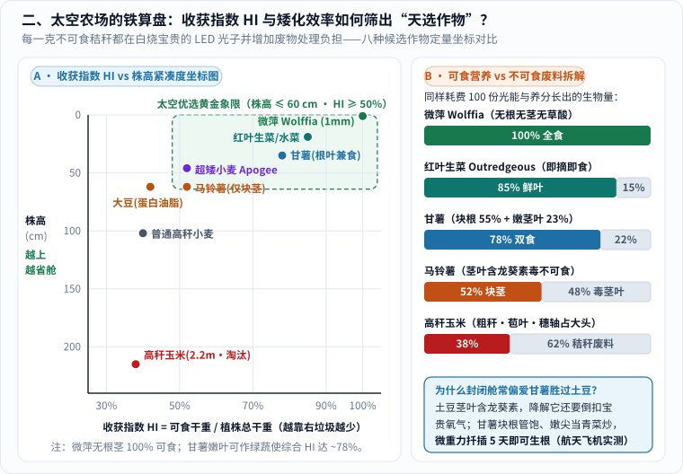
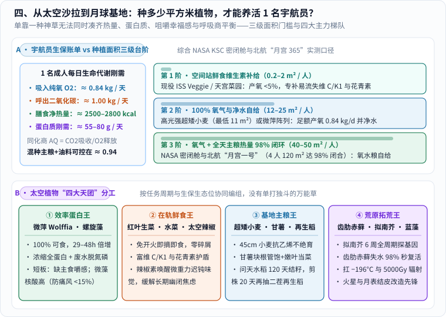
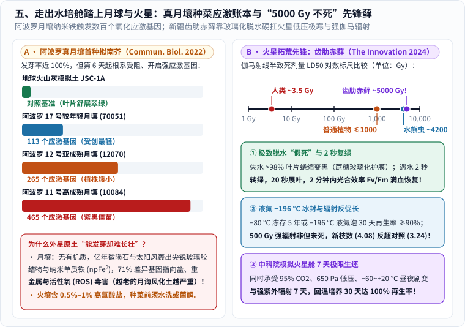

看过科幻电影《火星救援》的读者，大概都忘不了植物学家马克·沃特尼在火星栖息舱里切开土豆、拌上粪肥种出满棚绿叶的名场面。

如果把问题直接抛给今天的航天生命保障工程师：**“到底哪种植物最适合在外太空生长？为什么偏偏是它？”**

很多人的第一直觉是挑“产量大、耐旱或者好活的庄稼”，比如玉米、苹果树或者仙人掌。可一旦把地球重力抽走、把培养舱焊成寸土寸金的密闭铁罐，地球农学常识会瞬间倒转——

- **在太空随便给土浇水，不是在滋润根系，而是在给根系套上“塑料袋”活活憋死** [[3]](#ref-3)；
- **哪怕光照、水分和矿质营养全都给足，如果舱内空气少了强制对流与痕量气体过滤，长势喜人的矮秆小麦竟会开出 `288` 穗空壳、出现 `100%` 雄性绝育**（1995–1996 年“和平号”空间站真实悬案）[[4]](#ref-4)；
- **每多长出 `1` 克不能吃的树皮、玉米秆或带毒土豆秧，不仅白烧了极其昂贵的太阳能 LED 光子，腐烂降解时还会反过来夺走宇航员保命的氧气** [[8]](#ref-8)。

正因如此，外太空从来不存在一株包打天下的“万能神草”。经过半个多世纪的轨道真实验证与地面密闭舱测试，NASA、欧洲空间局（ESA）、中国空间站“问天”实验舱以及北京航空航天大学“月宫一号”团队，实际上筛选出了一支**按物理极限与生态位严密分工的“太空植物四大天团”**：

1. **效率蛋白与净水总冠军**：直径仅 `1` 毫米、无根无茎、`100%` 全株可食、最快 `29.3` 小时翻一倍的地球最小开花植物——**微萍（*Wolffia*，又称无根萍）** [[6]](#ref-6)[[7]](#ref-7)；
2. **轨道空间站鲜食护盾王**：免开火即摘即食、专补冻干食品易降解维生素与抗辐射花青素的**红叶生菜（`'Outredgeous'`）、水菜、矮秆番茄与太空辣椒（`'Española Improved'`）** [[1]](#ref-1)[[2]](#ref-2)[[10]](#ref-10)；
3. **月球/火星基地主粮当家王**：身高仅 `45` 厘米且抗乙烯绝育的**超矮春小麦（`'USU-Apogee'`）**、块根与嫩叶兼食的**甘薯（红薯）**，以及在“问天”实验舱跑通“种子到种子”还能割一茬再抽二茬穗的**太空再生稻** [[4]](#ref-4)[[5]](#ref-5)[[11]](#ref-11)[[12]](#ref-12)；
4. **外星原土与荒原拓荒王**：在阿波罗真月壤里探明氧化应激账本的**拟南芥** [[13]](#ref-13)，以及失水 `>98%` 两秒复绿、熬过 `-196 °C` 液氮与 `5,000 Gy` 伽马辐射、在中科院模拟火星舱存活 `100%` 再生的荒漠先锋——**齿肋赤藓（*Syntrichia caninervis*）** [[14]](#ref-14)。

它们凭什么击败地球上其余三十多万种植物脱颖而出？让我们顺着植物在太空面临的**流体物理关、生物量效率关、代谢闭环关与外星风化土辐射关**，一步步算清背后的硬核账本。

---

## 一、失重下的水气双悖论：为什么在太空浇水反而会把根“憋死”、把麦穗“熏绝育”？

在地球上，植物捕获光子把二氧化碳和水合成有机物（参见[可视化理解光合作用]()），同时根系与叶片时刻进行有氧呼吸拆解糖分供能（参见[可视化理解呼吸作用]()）。这两套生命引擎之所以在地球花盆里运转得毫不费力，全靠我们习以为常的 **`1 g` 重力加速度（$$g \approx 9.8\ \mathrm{m/s^2}$$）** 在暗中免费干了两件大事：**替叶片扇风，替根系排水**。

一旦进入近地轨道微重力环境（$$\mu g \approx 10^{-6}\,g \sim 10^{-4}\,g$$），这两项免费服务同时消失，立刻引爆致命的**“水气双悖论”** [[3]](#ref-3)。

### 1. 浮力对流归零：瑞利数坍塌与“和平号”288 穗小麦绝育悬案

在地球空气中，叶片受光升温或蒸腾水汽后，周围空气密度发生微小变化，热而轻的气体自动上浮、冷而重的气体自动下沉——流体力学用无量纲**瑞利数（Rayleigh number）**衡量这种自然浮力对流的强弱：

$$
Ra = \frac{g\,\beta\,\Delta T\,L^3}{\nu\,\alpha}
$$

其中 $$g$$ 是重力加速度，$$\beta$$ 是气体热膨胀系数，$$\Delta T$$ 是温差，$$L$$ 是叶片特征尺度，$$\nu$$ 与 $$\alpha$$ 分别是运动黏度与热扩散率。当太空舱内 $$g \to 0$$ 时，$$Ra \to 0$$，**自然浮力对流彻底停摆** [[3]](#ref-3)。

如果舱内不开风扇，气体只能靠极其缓慢的分子热运动进出气孔，每片叶子表面都会裹上一层厚厚的**停滞边界层（Stagnant boundary layer）**：外面的 $$\mathrm{CO_2}$$ 挤不进来，叶片蒸腾的水汽散不出去，更要命的是——**植物自身释放的催熟激素气体“乙烯（$$\mathrm{C_2H_4}$$）”会在叶片和花穗周围越攒越浓！**

1995 年至 1996 年，美俄科学家在“和平号（Mir）”空间站的 `Svet` 温室里种下了超矮秆小麦（`Super Dwarf`）。植株长势郁郁葱葱，总共抽出了 **`288` 个麦穗**；可等宇航员满怀期待剥开麦壳时，竟然发现**里面连一粒饱满种子都没有——结实率 `0%`！** [[4]](#ref-4)

难道失重直接摧毁了开花植物的有性生殖？犹他州立大学布鲁斯·巴格比（Bruce Bugbee）与坎贝尔（W. F. Campbell）团队把太空带回的固定样本切开镜检，又在地面做了严密的对照实验，终于揪出了真凶 [[4]](#ref-4)：

- 当时“和平号”舱内空气中含有 **`1.1–1.7 μmol/mol`（即 `1.1–1.7 ppm`，百万分之一点几）** 的痕量乙烯气体，加上微重力停滞气膜把乙烯死死锁在麦穗周围；
- 小麦花粉母细胞在减数分裂后原本必须完成两次有丝分裂，发育出含 **`3` 个细胞核（`1` 个营养核 + `2` 个精核）** 的成熟花粉才能授粉；而在 `>1 ppm` 乙烯熏蒸下，花粉粒停滞在 `0–2` 个核的败育状态，花药干瘪不开裂，造成了 **`100%` 雄性不育** [[4]](#ref-4)！
- 随后在 1999 年，团队换上专门选育的抗乙烯品种并强化舱内通风除乙烯，太空小麦立刻结出了沉甸甸的饱满麦粒 [[4]](#ref-4)。

### 2. 毛细张力称霸：邦德数反转与差出 10,000 倍的根区窒息

地上的叶片怕“气不动”，地下的根系更怕“水流不走”。液体受重力与表面张力的博弈由**邦德数（Bond number）**决定：

$$
Bo = \frac{\Delta \rho\,g\,L^2}{\sigma}
$$

其中 $$\Delta \rho$$ 是水气密度差，$$L$$ 是土壤孔隙特征尺度，$$\sigma \approx 0.072\ \mathrm{N/m}$$ 是水的表面张力。在地球花盆里，浇多了水会顺着大孔隙往下漏走，把富含 `21%` 氧气的新鲜空气抽进土壤缝隙；而在微重力下 $$Bo \ll 1$$，**毛细表面张力彻底接管流体行为**——水不再往下流，而是像一团黏稠果冻般顺着亲水根系表面爬升，把所有根毛严严实实地裹进一层厚水壳里 [[3]](#ref-3)。

别忘了根系没有叶绿体，全靠有氧呼吸维持离子泵吸收养分！常温下氧气在空气中的分子扩散系数约为 $$D_{\mathrm{air} } \approx 2.0 \times 10^{-5}\ \mathrm{m^2/s}$$，而在液态水中的扩散系数仅有 $$D_{\mathrm{water} } \approx 2.1 \times 10^{-9}\ \mathrm{m^2/s}$$——**氧气穿过液态水膜的速度比穿过空气慢了整整约 `10,000` 倍**！水膜只要增厚几毫米，根区溶解氧就会在几小时内耗尽，触发根系缺氧窒息（Hypoxia）、无氧发酵烂根 [[3]](#ref-3)。

### 3. 空间站培养舱的三招破局与太空选种“五道硬考题”

看懂了瑞利数与邦德数的物理死结，你就能一眼看透国际空间站 `Veggie` / `APH`（高级植物培养舱）与中国空间站“问天”植物培养箱为什么长得像一台精密呼吸机 [[1]](#ref-1)[[2]](#ref-2)：

*图 1：微重力水气双悖论与空间站破局方案（，支持动画的环境可见强制送风流线与微重力乙烯停滞包络；开启“减少动态效果”时自动定格完整终态）。左栏（A）对比地球 `1 g` 浮力对流与重力排水同微重力下“叶面停滞层攒乙烯 + 毛细水壳憋死根”的双重陷阱；右栏（B）拆解空间站培养舱的红蓝绿 LED、强制通风除乙烯滤芯与 `1–2 mm` 煅烧黏土“植物枕”；底栏（C）汇总太空选拔植物的五道硬门槛。*

1. **红 + 蓝 + 绿三色精准 LED 灯阵**：叶绿素吸收峰值集中在红光（约 `660 nm`）与蓝光（约 `450 nm`），但早期纯红蓝灯照出来的菜叶呈诡异的紫黑色，宇航员根本看不出叶片有没有黄化生病；后来 NASA 专门补入约 `5%–10%` 的绿光（约 `530 nm`），既能穿透上层冠层照亮下部叶片，又让菜叶恢复清脆欲滴的绿色，大幅提升了宇航员的心理愉悦感 [[1]](#ref-1)[[2]](#ref-2)。
2. **强制通风风扇 + 高锰酸钾 / 光催化 $$\mathrm{TiO_2}$$ 除乙烯滤芯**：用人造微风强行削薄叶面停滞边界层，同时把乙烯死死压在 `<0.05 ppm` 的安全线以下 [[1]](#ref-1)[[4]](#ref-4)。
3. **多孔煅烧黏土“植物枕（Plant Pillow）”**：抛弃泥土，改装粒径 `1–2 mm` 的多孔焙烧蒙脱石陶粒（Arcillite）与聚合物包衣控释肥，底部配亲水导水芯垫 [[2]](#ref-2)。细微内孔靠毛细基质势锁住薄水膜供根毛啜饮，颗粒之间的大缝隙则强制留给空气流通，实现“水气分道、既湿又透”！

即便硬件解决了水气矛盾，发射质量和舱内容积依然贵如黄金（哪怕在[SpaceX 星舰双级筷子捕获完全复用]()压低近地轨道运费后，奔赴月球与火星的深空载荷和受控加压舱体积依然极其受限）。因此，任何想拿“太空船票”的植物，都必须先过图 1 底部的**五道硬考题**：**超高收获指数（HI）、极致矮小紧凑、飞速倍增周期、高密营养护盾、免虫媒授粉与强耐逆性**。

---

## 二、太空农场的铁算盘：收获指数 HI 与矮化效率如何筛出“天选作物”？

为什么苹果树、桃树、高秆玉米、甘蔗这些地球上的王牌作物，在太空选秀第一轮就会被直接刷掉？答案藏在两个冷酷的工程指标里。

### 1. 收获指数公式：每一克不可食秸秆都是在太空“倒贴氧气”

植物生理学用**收获指数（Harvest Index, $$HI$$）**衡量一株植物把光合产物转化为人类食物的诚意：

$$
HI = \frac{M_{\mathrm{edible,dry} } }{M_{\mathrm{total,dry} } }
$$

其中 $$M_{\mathrm{edible,dry} }$$ 是人类可食用部分的干重，$$M_{\mathrm{total,dry} }$$ 是整株植物（含根、茎、老叶、果壳、穗轴）的总干重 [[8]](#ref-8)。再算上培养舱高度 $$H$$、种植面积 $$A$$ 与生育周期 $$T$$，航天农学家真正追求的是**单位舱容日产可食干重**：

$$
\eta_V = \frac{M_{\mathrm{edible,dry} } }{A \cdot H \cdot T} = \frac{\text{总生物量产率} \times HI}{H}
$$

在地球露天农田里，阳光白给、空气无限，玉米长到 `2.2` 米高、$$HI \approx 38\%$$ 根本不是问题，剩下 `62%` 的玉米秆、苞叶和玉米芯可以粉碎还田或喂牛。但在密闭太空舱里，这 `62%` 的不可食纤维素与木质素是**双重灾难** [[8]](#ref-8)：

- **第一重浪费（白烧电费）**：在空间站或月夜基地里，每一个光合有效光子（PAR）都是太阳能电池板或核反应堆发电驱动 LED 换来的，花 `62%` 的电能去长不能吃的硬秸秆纯属亏本；
- **第二重反噬（倒扣氧气）**：光合作用每合成 `1` 摩尔葡萄糖骨架净释放 `6` 摩尔 $$\mathrm{O_2}$$；如果你不能吃掉这部分生物量，而是丢进生物反应器让好氧微生物降解堆肥，微生物呼吸会按 `1:1` **把当初释放的那部分宝贵氧气重新吸光，再变回二氧化碳吐回舱内**！如果直接烘干打包当垃圾扔掉，又白白锁死了舱内循环的碳、氮、磷和水。

*图 2：太空候选作物的收获指数 $$HI$$ 与株高紧凑度定量坐标对比（）。左图（A）横轴为收获指数 $$HI$$（越靠右垃圾越少），纵轴倒置表示株高（越靠上越适合多层立体叠放），绿色虚线框标出“株高 `≤ 60 cm` 且 `HI ≥ 50%`”的太空优选黄金象限；右图（B）拆解同样耗费 `100` 份光能与养分时五种作物的可食部分与废料占比。*

沿着图 2 左栏的绿色黄金象限往右上角看，谁优谁劣一目了然：高秆玉米（`215 cm`，`HI ≈ 38%`）和普通高秆小麦（`~100 cm`，`HI ≈ 40%`）双双出局；而**超矮春小麦 `'USU-Apogee'`（株高压到 `45 cm`，`HI ≈ 52%`）**、**红叶生菜（株高 `~18 cm`，`HI ≈ 85%`）**、**甘薯（蔓生平铺 `<35 cm`，综合 `HI ≈ 78%`）**，直到右上角极点——**株高仅 `1 mm`、收获指数高达 `100%` 的微萍（*Wolffia*）**，构成了无可争议的第一梯队 [[6]](#ref-6)[[8]](#ref-8)！

### 2. 为什么《火星救援》种马铃薯，真实密闭舱专家却往往更偏爱甘薯？

这儿有一个特别反常识的细节：**马铃薯（土豆，*Solanum tuberosum*）确实是 NASA 重点研究的太空高热量块茎作物，但在许多封闭生态生保设计（包括 NASA 塔斯基吉大学专项和北航“月宫”系列选型对比）中，甘薯（红薯，*Ipomoea batatas*）往往比马铃薯更受宠！** 为什么？看一眼图 2 右下角就明白了 [[5]](#ref-5)[[8]](#ref-8)：

1. **龙葵素毒秧 vs 根叶双食**：马铃薯属于茄科，它的地上茎叶含有剧毒糖苷生物碱——**龙葵素（Solanine）**，人类绝对不能吃，因此马铃薯的 `48%` 地上茎叶全是必须耗氧处理的废料（$$HI \approx 52\%$$）；反观旋花科的**甘薯**，地下块根富含淀粉和 $$\beta$$-胡萝卜素管饱，地上的嫩茎尖与叶片本身就是一道鲜美高钙绿叶菜（广东人常吃的“番薯叶”）！根叶兼食直接把综合收获指数推高到 **`75%–80%`** [[5]](#ref-5)[[8]](#ref-8)。
2. **微重力无性扦插神速生根**：带整袋沉甸甸的种薯上天太占发射质量，而用种子种土豆又容易性状分离。1999 年 7 月，莫特利（D. G. Mortley）与惠勒（R. M. Wheeler）团队把 `'Whatley/Loretan'` 甘薯茎段送上“哥伦比亚号”航天飞机（STS-93 任务），实测证明**哪怕剪下一截甘薯藤插进微重力基质，短短 `5` 天就能长出茂密的不定根（每株 `19–22` 条根、总根长超 `40 cm`）并积累淀粉** [[5]](#ref-5)！宇航员一边掐嫩尖炒菜，一边把剪下的茎段顺手扦插扩繁，连种子库都省了。

---

## 三、效率总冠军“微萍（Wolffia）”：1 毫米无根开花植物怎样 20 天供足成人蛋白？

如果把问题限定得更极致一点：**单论“单位体积、单位时间生产人类优质全蛋白与氧气的极限效率”，地球上最适合上太空的高等植物到底是谁？**

近年欧洲空间局（ESA）与意大利那不勒斯腓特烈二世大学阿罗内（Giovanna Aronne）、罗马诺（Leone Ermes Romano）团队给出了一致答案：不是大豆，也不是生菜，而是池塘水面上像绿沙砾一样不起眼的**微萍（*Wolffia*，又称无根萍 / 水蛋 Watermeal）** [[6]](#ref-6)[[7]](#ref-7)。

### 1. 砍掉一切根茎木质素：地球最小开花植物的“俄罗斯套娃”繁殖术

微萍可不是低等单细胞藻类——它是正儿八经的**被子植物（开花植物，天南星科浮萍亚科）**，同时保持着吉尼斯世界纪录认证的两项植物界极限：**地球上体型最小的开花植物**，也是**繁殖速度最快的开花植物** [[6]](#ref-6)。

为了把生长速度推到物理极限，微萍在演化中干了一件极其激进的事：**它把根、茎、叶柄、维管束和木质素统统砍掉了！** 整株植物简化成一颗长仅 **`0.5–1.2` 毫米**（和一根回形针钢丝直径差不多大）的翠绿色椭圆球体，称为**叶状体（Frond）** [[6]](#ref-6)：

- **上半球自带“救生圈”，下半球直接当嘴喝肥**：叶状体背侧长有充满气体的通气组织（Aerenchyma）与气孔，天然浮在气-液界面呼吸 $$\mathrm{CO_2}$$；腹侧表皮直接浸在营养液薄膜里，无需任何根毛就能高效吞食宇航员尿液回收液里的铵态氮（$$\mathrm{NH_4^+}$$）与磷酸盐 [[6]](#ref-6)！
- **三代同堂的“套娃囊袋芽殖”**：普通农作物要经历发芽、长叶、抽薹、开花、授粉、灌浆几个月的漫长周期；微萍平时根本懒得开花，它在叶状体一端开了一个漏斗状**生殖囊（Reproductive pocket）**，里面的分生组织像机关枪一样不断向外吐出克隆子株——更绝的是，显微镜切片显示：**当子代新株还在母体生殖囊里没脱离时，子代肚子里就已经怀上了第三代“孙辈”原基！** [[6]](#ref-6)
- **唯一不含草酸钙针晶的安全浮萍**：普通青萍（*Lemna*）和紫萍（*Spirodela*）细胞里含有大量尖锐的**草酸钙针晶（Calcium oxalate raphides）**，吃多了不仅扎嗓子、阻碍矿物质吸收，更会诱发**肾结石**——而失重环境下宇航员骨骼脱钙本就会导致尿钙飙升、极易长肾结石！唯有微萍属（*Wolffia*）天然**不含草酸钙针晶**，整株 `100%` 可直接鲜食做沙拉、打奶昔或烘干磨成高蛋白面粉 [[6]](#ref-6)！

### 2. 指数倍增动力学：10 克火种怎样在 20 天滚出“日产 600 克蛋白池”？

2024 年 11 月，罗马诺与范·卢恩（Jack J. W. A. van Loon）团队在《Scientific Reports》发表了在欧洲空间局大直径离心机与随机定位仪（RPM，模拟微重力）中对 `4` 个微萍物种、`7` 个克隆株的精确生长动力学测量 [[7]](#ref-7)。在养分与光照充足阶段，微萍生物量 $$M(t)$$ 严格服从一阶指数倍增方程：

$$
M(t) = M_0 \, e^{RGR \cdot t}, \qquad DT = \frac{\ln 2}{RGR}
$$

其中 $$RGR$$ 是相对生长速率（单位：$$\mathrm{d}^{-1}$$），$$DT$$ 是生物量翻一倍所需的**倍增时间（Doubling Time）**。实测数据刷新了人们对高等植物生长速度的认知 [[6]](#ref-6)[[7]](#ref-7)：

- **最快倍增纪录**：微萍属中的 *Wolffia microscopica* 最快倍增时间仅需 **`29.3` 小时**（约 `1.22` 天生物量就翻一番）[[6]](#ref-6)！而在 2024 年多克隆对比中，球状微萍（*Wolffia globosa* `Clone 9528`）测得了高达 **`0.559 / 天`** 的相对生长速率（对应 `29.8` 小时翻倍）[[7]](#ref-7)。
- **越迷你的植株长越快**：实验发现微萍个体尺寸与相对生长率呈高达 **`r = -0.925`** 的强负相关——**个体越微小的克隆株，表面积/体积比越大，吸收养分和分裂出芽反而越迅猛**，并且在模拟微重力与过载下依然保持极高增殖率 [[7]](#ref-7)！

*图 3：太空效率总冠军“微萍（Wolffia）”解剖结构与指数倍增产蛋账本（，支持动画的环境可见 `10 g` 火种沿指数曲线攀升至 `2,000 g` 母本池并进入每日锯齿采收稳态；开启“减少动态效果”时直接展示完整曲线）。左栏（A）展示 `1 mm` 无根叶状体的通气浮水组织、“母怀子、子怀孙”套娃生殖囊及全谱营养亮点；右栏（B）按 `Romano et al. (2024)` 实测模型绘制 `20` 天建池与每日捞取 `600 g` 鲜品的稳态循环。*

不妨跟着论文里的模拟微重力优选株（*W. globosa* `Clone 8356`）亲手算一笔深空任务账 [[7]](#ref-7)：

1. **发射时只需揣“两茶匙”火种**：宇航员根本不用像《火星救援》那样扛几百公斤种粮上天，只需在培养袋里装上 **`10` 克鲜微萍**（约两茶匙）；
2. **20 天滚雪球建池**：即便按留有余地的模拟微重力工作速率（约 `20` 天扩大 `200` 倍，对应有效 $$RGR \approx \frac{\ln 200}{20} \approx 0.265\ \mathrm{d}^{-1}$$；稳态稀疏采收期 $$RGR \approx 0.357\ \mathrm{d}^{-1}$$），短短 **`20` 天**后，`10` 克微萍就能滚雪球般铺满多层浅液膜培养盘，达到 **`2,000` 克（`2` 公斤）** 稳态母本池 [[7]](#ref-7)；
3. **此后每天捞 `600` 克吃，次日自动长满**：从第 `20` 天起，宇航员每天从池子里捞走 **`600` 克鲜微萍**端上餐桌，池中剩余 $$1,400\ \mathrm{g}$$ 母本在接下来 `24` 小时内按 $$1400 \times e^{0.357 \times 1} \approx 2,000\ \mathrm{g}$$ 自动长回满池！
4. **蛋白质与污水净化一箭双雕**：微萍干重中**优质全谱蛋白质高达 `20%–35%` 以上**（集齐人类全部 `9` 种必需氨基酸，氨基酸谱媲美大豆与牛奶酪蛋白），脂肪中约 **`80%` 是多不饱和脂肪酸**（富含保护宇航员心血管与视网膜的 $$\omega\text{-3}$$ 亚麻酸）[[6]](#ref-6)。按欧洲食品安全局（EFSA）成人每日 `0.8 g/kg` 体重的蛋白质摄入标准，**这每天现捞的约 `600` 克鲜微萍，单枪匹马就能补齐 `1` 名成年宇航员全天的蛋白质刚需** [[7]](#ref-7)！同时，它在废水培养液中 `7` 天即可吸除 **`70%–80%` 的总氮与总磷**，顺手把废水净化成了蒸腾饮用水 [[6]](#ref-6)。

> **追问一句：既然微萍（以及螺旋藻 *Arthrospira/Spirulina*、小球藻 *Chlorella* 等单细胞微藻）效率这么逆天，为什么不让宇航员顿顿只吃微萍和绿藻糊糊？**
> 两个硬约束决定了它们只能当“蛋白与制氧尖兵”，不能包办全部食谱：
> 1. **微藻的“尿酸痛风红线”**：螺旋藻和小球藻细胞分裂极快，干重中含有高达 **`4%–6%` 的核酸（RNA/DNA）**；人体代谢嘌呤核酸的终产物是**尿酸**，长期大量食用微藻极易引发高尿酸血症、痛风与肾结石，因此航天营养学通常把微藻摄入量严格限制在总热量的 **`<15%`**（每日干重不超过约 `50 g`）[[8]](#ref-8)——相比之下，高等植物微萍的核酸占比低得多，适口性也清爽如嫩芽！
> 2. **热量密度与心理咀嚼刚需**：微萍鲜品含水量约 `92%–95%`，靠吃水灵灵的绿叶凑够每天 `2,600 kcal` 热量得吃好几大盆；况且在长达三年的深空幽闭舱里，清脆的生菜、辛香的辣椒和热腾腾的小麦面包、烤红薯带来的**咀嚼幸福感**，是防止宇航员抑郁厌食的救命良药 [[1]](#ref-1)[[10]](#ref-10)。

---

## 四、从轨道沙拉吧到月球基地农场：养活 1 名宇航员到底要种多少平方米？

既然单靠一种植物不行，把整个**生物再生生命保障系统（BLSS）**拼起来，到底需要种多大面积的植物，才能让 `1` 名宇航员在太空实现呼吸与吃饭自由？

### 1. 生命保障三级面积账本与呼吸商 / 同化商配平

翻开 NASA《生命保障基线数值与假设文档（BVAD）》[[9]](#ref-9) 与肯尼迪航天中心惠勒（Raymond M. Wheeler）的经典测算 [[8]](#ref-8)，`1` 名标准成年宇航员每天的生命代谢硬账单非常清晰：

- **吸入氧气（$$\mathrm{O_2}$$）**：约 **`0.84 kg / 天`**；
- **呼出二氧化碳（$$\mathrm{CO_2}$$）**：约 **`1.00 kg / 天`**；
- **膳食净代谢热量**：约 **`2,500–2,800 kcal / 天`**（折合碳水、蛋白质与脂肪干物质约 `620–700 g / 天`）；
- **洁净饮用与食物复水**：约 **`2.5–3.0 kg / 天`**（不含洗漱卫生用水）。

对应这张账单，太空农业沿着种植面积分出了清清楚楚的**三级台阶**（图 4 上栏）[[8]](#ref-8)[[11]](#ref-11)：

*图 4：宇航员每日代谢账单、光合种植面积三级台阶与太空植物“四大天团”分工（）。上栏（A）对比 `1` 名成人每日氧、碳、热量需求与 `0.2–2 m²`（鲜食补给）、`12–25 m²`（氧气与净水自给）、`40–50 m²`（氧水粮 `98%` 闭环）三级面积门槛；下栏（B）按任务生态位梳理效率蛋白王、在轨鲜食王、基地主粮王与荒原拓荒王的协同分工。*

- **第 1 阶（人均 `0.2–2 m²`）：现役空间站“鲜食维生素护盾吧”**
  目前国际空间站的 `Veggie`（种植面积仅约 `0.17 m²`/台）与天宫“问天”菜园都处在这一阶 [[1]](#ref-1)[[2]](#ref-2)。它们产出的氧气不到宇航员需求的 `5%`，却解决了长达三年火星往返（参见[火星采样返回与行星际往返之难]()）中一个致命隐患：**预包装冻干太空粮在长期储存与宇宙辐射下，维生素 C、维生素 B1（硫胺素）和维生素 K1 会持续降解流失！** [[2]](#ref-2)
  2020 年科达达德（C. L. M. Khodadad）与马萨（G. D. Massa）团队对国际空间站种植的 **`'Outredgeous'` 红叶罗曼生菜**做了全套营养与微生物组核查：叶片细菌与真菌总数完全处在地球超市生菜安全范围内（`2.14–4.86 log10 CFU/g`，无大肠杆菌与沙门氏菌），同时富含钾、维生素 K1、维生素 C 以及紫红色叶片特有的**花青素与多酚抗氧化剂**——恰好帮宇航员清除银河宇宙射线在体内打出的自由基 [[2]](#ref-2)！
  2021 年，NASA 更在 `APH` 舱里历时 **`137` 天**种出了太空首茬结果蔬菜——**`'Española Improved'` 新墨西哥哈奇辣椒（PH-04 任务）** [[10]](#ref-10)。为什么要费劲种辣椒？因为在失重下人体血液向头部涌集，几乎每位宇航员都会长期处于类似重感冒鼻塞的**“太空鼻塞”味觉迟钝状态**；清脆火辣的鲜辣椒素不仅富含维 C，更能瞬间唤醒麻木的味蕾 [[10]](#ref-10)！

- **第 2 阶（人均 `12–25 m²`）：`100%` 氧气与饮用水自给线**
  由于人体除了吃进去的固体食物外还有一部分碳氢被氧化成水，种植物**凑够 `1` 个人呼吸的氧气比凑够全天热量更容易**：在中等光强下只需 **`20–25 m²`** 作物（若给超矮小麦打上 `1,500 μmol·m⁻²·s⁻¹` 的超强光，最低仅需 **`11 m²`**），光合放氧就能足额覆盖 `0.84 kg/天` 的纯氧需求，叶片蒸腾冷凝水更是天然的超纯饮用水 [[8]](#ref-8)！

- **第 3 阶（人均 `40–50 m²`）：氧气 + 净水 + 全天主粮 `98%` 终极闭环**
  想把每天 `2,500–2,800 kcal` 的主食热量也全部种出来，人均面积需跨上 **`40–50 m²`** [[8]](#ref-8)。而且这儿藏着一个极精妙的化学配平难题——**人体呼吸商（$$RQ$$）与植物同化商（$$AQ$$）的错位**：

$$
RQ = \frac{n_{\mathrm{CO_2,exhaled} } }{n_{\mathrm{O_2,inhaled} } } \approx 0.85\text{–}0.87, \qquad AQ = \frac{n_{\mathrm{CO_2,absorbed} } }{n_{\mathrm{O_2,released} } }
$$

  如果你只种小麦、水稻、甘薯这类纯碳水化合物主粮（合成淀粉 $$(\mathrm{CH_2O})_n$$），植物的 $$AQ \approx 1.00$$——意思是植物每吐出 `1` 摩尔氧气就要吃掉 `1` 摩尔二氧化碳；可宇航员每吸入 `1` 摩尔氧气只呼出 `0.86` 摩尔二氧化碳！长此以往，舱内 $$\mathrm{CO_2}$$ 会被抽干，$$\mathrm{O_2}$$ 却越攒越高逼近爆燃红线！
  怎么配平？**必须搭配种植富含脂肪与蛋白质的大豆、花生、油莎豆或微萍**（合成长链脂肪酸还原度高，放氧多于吸碳，$$AQ \approx 0.70\text{–}0.80$$）！2017 年 5 月至 2018 年 5 月，北京航空航天大学刘红教授团队主持的**“月宫 365”实验**在总面积 `160 m²`（其中两个植物舱共 **`120 m²` 立体多层种植**，服务 `4` 名乘员）的“月宫一号”密闭舱中连续运行了创世界纪录的 **`370` 天**，混种小麦、马铃薯、甘薯、大豆、草莓及 `30` 余种蔬菜，把系统整体物质闭合度推到了惊人的 **`98%`** [[11]](#ref-11)！

### 2. 主粮天团的两大绝活：45 厘米抗乙烯小麦与“问天”太空再生稻

在月球与火星基地的 `120 m²` 主粮舱里，两项专为太空定制的作物育种突破功不可没：

- **犹他州立大学 / NASA `'USU-Apogee'` 超矮春小麦**：针对前文“和平号”高秆难塞进培养架和乙烯绝育两大痛点，布鲁斯·巴格比团队历经十余年杂交选育出专供太空的 `'USU-Apogee'`——**成熟株高仅约 `45` 厘米**（不到普通小麦的一半，可在立体货架上轻松叠三四层），叶片紧凑不遮光，对高浓度乙烯具有极强耐受性，在受控强光下创下了地球与轨道小麦单位面积产量的最高纪录 [[4]](#ref-4)[[8]](#ref-8)。
- **中国科学院“问天”实验舱 120 天全生命周期水稻与“太空再生稻”**：小麦磨粉烤面包方便，但亚洲宇航员更想念晶莹饱满的大米饭。2022 年 7 月 29 日至 11 月 25 日，中国科学院分子植物科学卓越创新中心郑慧琼研究员团队随神舟十四号在“问天”实验舱开展了 **`120` 天**空间培养实验，**在国际上首次完成了水稻“从种子到种子”全生命周期空间培养并收获饱满稻种** [[12]](#ref-12)！更令人拍案叫绝的是，团队在轨验证了**“空间再生稻”技术**——把成熟水稻剪掉上部稻穗、留下稻茬后，短短 **`20` 天内老稻桩上又重新抽出了 `2` 个新稻穗** [[12]](#ref-12)！这意味着在狭窄太空舱里种一次稻子可以连续收割两茬，省去了一半的播种耗材、育苗周期和根茬垃圾！

---

## 五、走出水培舱踏上月球与火星：真月壤种菜应激账本与“5000 Gy 不死”先锋藓

只要有电、有水和密闭舱，人类今天已经能靠水培与植物枕种出微萍、生菜、小麦和水稻。但如果要建设永久月球科研站与火星定居点，成百上千吨栽培基质不可能全从地球用火箭运过去——**我们能不能直接挖脚下的月壤（Lunar regolith）和火壤（Martian regolith）来种植物？如果把植物直接扔到火星表面，谁能活着扎下第一根？**

2022 年和 2024 年发表的两篇里程碑论文，第一次用真实实验揭开了谜底。

### 1. 阿波罗真月壤首种拟南芥：发芽率近 100%，为何第 6 天起变成“紫黑僵苗”？

半个世纪以来，人类虽然带回了月岩，却一直舍不得拿珍贵的真月壤做破坏性种菜实验。直到 2022 年 5 月，佛罗里达大学保罗（Anna-Lisa Paul）、埃拉尔多（Stephen M. Elardo）与费尔（Robert J. Ferl）团队获批借出阿波罗 11 号（`10084`）、阿波罗 12 号（`12070`）和阿波罗 17 号（`70051`）三次登月带回的共 **`12` 克真月壤**（每个培养孔仅装 **`900` 毫克**！），种下了植物学界的“小白鼠”——**拟南芥（*Arabidopsis thaliana*）**，并以地球火山灰模拟月壤 `JSC-1A` 作为对照 [[13]](#ref-13)。

实验过程像坐过山车一样跌宕起伏 [[13]](#ref-13)：

1. **前 `48–60` 小时惊喜开局**：滴入水和营养液后，所有阿波罗真月壤孔里的拟南芥种子**发芽率接近 `100%`**，翠绿的两片子叶顺利展开——证明月壤既没有携带外星致病毒素，也不会物理割碎萌发胚根！
2. **第 `6–8` 天起急转直下**：一旦耗尽种子自带的子叶营养、幼苗主根开始往月壤深处扎根觅食时，所有真月壤里的植株都出现了严重生长阻滞：根系扭曲短小，莲座叶远小于火山灰对照组，并大量积累花青素变成**暗紫黑色僵苗**！
3. **转录组测序揪出“月壤成熟度毒害梯度”**：第 `20` 天提取全基因组 RNA 测序后，真相水落石出（图 5 左栏）——相比地球火山灰对照，种在**阿波罗 17 号较年轻高地月壤**里的拟南芥开启了 **`113` 个差异应激基因**；**阿波罗 12 号亚成熟月壤**开启了 **`265` 个**；而在暴露于月球表面风化最久的**阿波罗 11 号高成熟月海月壤**里，差异应激基因飙升到了 **`465` 个**！其中 **`71%` 的基因全部指向盐胁迫、重金属毒害与活性氧（ROS）氧化损伤** [[13]](#ref-13)！

*图 5：外星原土种植应激账本与火星地表拓荒先锋“齿肋赤藓”（）。左栏（A）按 `Paul, Elardo & Ferl (2022)` 实测绘出地球模拟土与三批阿波罗真月壤的差异应激基因数（`113` → `265` → `465`），揭示太阳风纳米单质铁（$$\mathrm{npFe^0}$$）的氧化毒害及火壤高氯酸盐门槛；右栏（B）按 `Li, Zhang et al. (2024)` 对数标尺对比伽马射线半致死剂量 $$\mathrm{LD_{50} }$$（人类约 `3.5 Gy` vs 齿肋赤藓约 `5,000 Gy`），并列出脱水秒级复绿、液氮冰封与模拟火星舱 `7` 天 `100%` 再生三大实测纪录。*

为什么越老的月壤越伤根？因为月球没有大气层与磁场保护，长达数亿年的微陨石高速撞击与太阳风质子轰击（太空风化，Space weathering），把月表矿物熔融焊成了尖锐多孔的玻璃胶结物（Agglutinates），并把二价铁还原成极活泼的**纳米单质铁颗粒（$$\mathrm{npFe^0}$$）**——一遇水和氧气就会剧烈产生自由基灼伤根毛 [[13]](#ref-13)！至于火星土壤，“凤凰号”与“好奇号”早已测出其中含有 **`0.5%–1%` 的高氯酸盐（$$\mathrm{ClO_4^-}$$）**，会抑制人类甲状腺摄碘 [[8]](#ref-8)。因此，未来在月球优先挑**较年轻、低成熟度的风化土**，在火星先用**水洗淋溶或高氯酸盐还原菌脱毒**，再派先锋植物去熟化土壤，才是科学正途！

### 2. 火星拓荒总先锋：失水 98% 两秒复绿、硬扛 5000 Gy 辐射的“齿肋赤藓”

那么，有没有一种陆生绿色植物，连加压温室都不挑，能直接扛住火星表面 **`95%` 二氧化碳缺氧、`650 Pa` 极低气压（不到地球海平面的 `1%`）、`-60 °C` 极寒与致命电离辐射**的轮番轰炸？

2024 年 7 月，中国科学院新疆生态与地理研究所张道远、匡廷云院士与张元明团队在《The Innovation》发表重磅研究：他们在新疆古尔班通古特沙漠生物结皮中找到了一种身高仅几毫米的荒漠苔藓——**齿肋赤藓（*Syntrichia caninervis*）**，它在四项极端生存大考中交出了令天体生物学家瞠目结舌的成绩单（图 5 右栏）[[14]](#ref-14)：

1. **失水 `>98%` 玻璃化“假死”与 `2` 秒极速满血复活**：普通农作物失水 `20%–30%` 就会细胞膜撕裂枯死；齿肋赤藓能主动脱去 **`>98%` 的细胞水分**，叶片蜷缩发黑进入代谢静止的“无水生命（Anhydrobiosis）”状态，同时在细胞质内大量合成蔗糖与抗逆蛋白形成固态玻璃化保护壳、锁住叶绿体膜结构。更神奇的是，一旦滴上一滴水，它**`2` 秒钟瞬间由黑转绿，`20` 秒叶片完全舒展，`2` 分钟内光系统最大光化学效率（$$F_v/F_m$$）恢复如初** [[14]](#ref-14)！叶片顶端的白色芒尖还能像集水纳米针一样直接捕捉空气中的微弱凝结水。
2. **零下 `196 °C` 液氮浸泡 `30` 天不死**：团队把脱水状态（甚至含水状态）的齿肋赤藓塞进 **`-80 °C` 超低温冰箱冻存整整 `5` 年**，或者直接扔进 **`-196 °C` 液氮罐浸泡 `30` 天**，取出回温培养后，脱水组再生率依然高达 **`90%–95%` 以上** [[14]](#ref-14)！
3. **硬扛 `5,000 Gy` 伽马射线——连水熊虫都得让三分**：人类全身急性受照约 **`3.5–5 Gy`（戈瑞）** 就会半数死亡，绝大多数维管植物在 `500–1,000 Gy` 下就会彻底绝育枯死，连地表最强抗逆动物“水熊虫”的半致死剂量也约为 `4,200 Gy`；而齿肋赤藓的伽马射线半致死剂量高达 **`LD50 ≈ 5,000 Gy`**！最匪夷所思的是，在 **`500 Gy` 强辐射照射下，它不但没受伤，单株再生新枝数（`4.08` 枝）反而显著超过了未受辐射的对照组（`3.24` 枝）** [[14]](#ref-14)！
4. **中科院模拟火星舱四重炼狱 `7` 天 `100%` 生还**：团队将脱水齿肋赤藓放进中国科学院行星大气模拟舱（PASF），**同时施加火星级四重极端环境**——`95%` $$\mathrm{CO_2}$$ 大气、`650 ± 30 Pa` 极低压、`-60 °C` 至 `+20 °C` 昼夜剧烈温差以及高强度紫外辐射（UVC / UVB / UVA），连续暴露 `1`、`2`、`3`、`7` 天后取出置于地球温湿砂土培养 `30` 天，**全部达成了 `100%` 存活再生长出新枝** [[14]](#ref-14)！

这里同样要严守科学边界：**齿肋赤藓并不是让宇航员炒着吃的太空主粮，它在无液态水、`-60 °C`、`650 Pa` 的极干休眠态下只是“保命不死”，想要活跃进行光合作用产氧和分枝扩繁，依然需要阶段性的液态水膜与适宜温度窗口** [[14]](#ref-14)。它真正的历史使命，是在月球与火星的低成本充气穹顶或半开放试验区里充当**第一批绿色拓荒先锋（生物土壤结皮）**——把死寂尖锐的外星风化碎石一步步固结、分泌有机酸风化矿质、积累腐殖质，最终为甘薯、小麦、水稻和红叶生菜铺出第一层真正的“外星黑土地”！

---

## 六、总结：没有一株“万能神草”，只有各司其职的太空植物梦之队

回到最初的问题：**到底什么植物最适合在外太空生长，为什么？**

答案不是单一物种的名字，而是一张由流体物理、质量能量守恒与分子抗逆机制共同写就的**太空植物工程选型表**：

| 太空生态位 | 代表冠军植物 | 收获指数 $$HI$$ | 株高 / 形态 | 生长倍增周期 | 不可替代的核心优势 | 适用边界与短板 |
| :--- | :--- | :--- | :--- | :--- | :--- | :--- |
| **效率蛋白与净水总冠军** | **微萍（*Wolffia*）** | **`~100%`** | `0.5–1.2 mm` 无根浮水球 | 最快 `29.3 h` 翻倍；`20 d` 建稳态池 | 地球最小最快开花植物；无草酸钙针晶；`20%–35%+` 全谱蛋白 + $$\omega\text{-3}$$；`7 d` 脱除废水 `70%–80%` 氮磷 [[6]](#ref-6)[[7]](#ref-7) | 含水量高，缺乏主食淀粉热量密度与固体咀嚼感 |
| **轨道鲜食抗氧化王** | **红叶生菜 `'Outredgeous'` / 水菜** | `~85%` | `15–20 cm` 紧凑莲座叶 | `28 d` 即摘即食 | 免烹饪零碎屑；精准补齐冻干粮易降解的维 C、维 K1、钾与抗宇宙射线花青素 [[1]](#ref-1)[[2]](#ref-2) | 热量与蛋白质极低，仅承担营养护盾与心理调节 |
| **轨道味觉唤醒王** | **太空辣椒 `'Española Improved'`** | `~45%–55%` | `<40 cm` 矮化灌丛 | `~120–137 d` 挂果 | 自花授粉（风扇轻吹即结果）；高维 C + 辣椒素打破微重力“太空鼻塞”味觉迟钝 [[10]](#ref-10) | 生育期较长，需精细调控花期水分与通风 |
| **基地主粮与制氧主力** | **超矮春小麦 `'USU-Apogee'`** | `~52%` | **`~45 cm`** 超矮直立 | `60–75 d` 成熟 | 耐受舱内痕量乙烯不绝育；耐受超强光（最低 `11 m²/人` 供足全天纯氧）；面粉耐储 [[4]](#ref-4)[[8]](#ref-8) | 需脱粒磨粉烘烤加工；纯碳水 $$AQ \approx 1.0$$ 需配油料作物 |
| **根叶兼食热量王** | **甘薯 `'Whatley/Loretan'`** | **`~75%–80%`**（根叶双食） | `<35 cm` 平铺蔓生 | 扦插 `5 d` 生根；`90–120 d` 收薯 | 块根供高密淀粉与胡萝卜素，嫩茎叶直接作青菜（无土豆茎叶龙葵素毒）；免带沉重种薯 [[5]](#ref-5)[[8]](#ref-8) | 块根膨大对根区通气孔隙度要求高 |
| **低耗连作主粮王** | **太空矮秆再生稻** | `~50%` | 矮化紧凑株型 | `120 d` 结籽 + 剪株 **`20 d` 抽二茬穗** | “问天”舱实测种子到种子全周期；割一茬收两季，省种子、省育苗期、减半根茬废料 [[12]](#ref-12) | 脱壳加工耗能，需精密控水防微重力液滴飘散 |
| **外星荒原拓荒先锋** | **齿肋赤藓（*Syntrichia caninervis*）** | 非食用拓荒种 | 数毫米致密垫状结皮 | 遇水 **`2 s` 复绿**，`2 min` 恢复光合 | 失水 `>98%` 玻璃化休眠；扛 `-196 °C` 液氮、`5,000 Gy` 伽马辐射与模拟火星舱 `7 d` `100%` 再生 [[14]](#ref-14) | 极干极寒下仅休眠保命，活跃生长与改土仍需液态水窗口 |

从空间站植物枕里那一抹治愈乡愁的紫红生菜，到 `20` 天就能滚出成人全天蛋白池的 `1` 毫米微萍，再到能顶着 `5,000` 戈瑞辐射在火星风化砂上甦醒的荒漠小苔藓——人类走向星辰大海时最可靠的旅伴，依然是这群在地球上演化了数亿年、把每一颗光子都算到极致的绿色生命。

---

## 参考资料

1. NASA, *Growing Plants in Space*（国际空间站 `Veggie` 与 `Advanced Plant Habitat (APH)` 官方技术综述：介绍红蓝绿 LED 光谱配比、强制通风与太空生菜、水菜、百日草等在轨栽培验证）：<https://www.nasa.gov/exploration-research-and-technology/growing-plants-in-space/>
2. Khodadad, C. L. M., Hummerick, M. E., Spencer, L. E., Dixit, A. R., Richards, J. T., Romeyn, M. W., Smith, T. M., Wheeler, R. M., & Massa, G. D. (2020). Microbiological and Nutritional Analysis of Lettuce Crops Grown on the International Space Station. *Frontiers in Plant Science*, 11, 199.（国际空间站 `Veggie` 煅烧黏土植物枕种出的 `'Outredgeous'` 红叶生菜微生物安全性 `2.14–4.86 log10 CFU/g` 及维 K1、维 C、钾与花青素测定）：<https://pmc.ncbi.nlm.nih.gov/articles/PMC7067979/>
3. Vandenbrink, J. P., & Kiss, J. Z. (2016). Space, the final frontier: A critical review of recent experiments performed in microgravity. *Plant Science*, 243, 115–119.（微重力下浮力自然对流消失导致气体交换停滞边界层、毛细水膜裹死根区引发缺氧 `Hypoxia` 等植物空间物理效应综述）：<https://pmc.ncbi.nlm.nih.gov/articles/PMC5739877/>
4. Campbell, W. F., Salisbury, F. B., Bugbee, B., Klassen, S., Naegle, E., Strickland, D. T., Bingham, G. E., Levinskikh, M., Iljina, G. M., Veselova, T. D., Sytchev, V. N., Podolsky, I., McManus, W. R., Bubenheim, D. L., Stieber, J., & Jahns, G. (2001). Comparative floral development of Mir-grown and ethylene-treated, earth-grown Super Dwarf wheat. *Journal of Plant Physiology*, 158(8), 1051–1060.（查明“和平号”空间站 `288` 穗小麦 `0%` 结实率系舱内 `1.1–1.7 μmol/mol` 痕量乙烯阻断花粉三核发育导致雄性绝育，并推动抗乙烯超矮小麦 `'USU-Apogee'` 选育；NASA NTRS 档案）：<https://ntrs.nasa.gov/citations/20020048664>
5. Mortley, D. G., Bonsi, C. K., Hill, W. A., Morris, C. E., Williams, C. S., Davis, C. F., Wheeler, R. M., Levine, H. G., & Petersen, B. V. (2008). Influence of Microgravity Environment on Root Growth, Soluble Sugars, and Starch Concentration of Sweetpotato Stem Cuttings. *Journal of the American Society for Horticultural Science*, 133(3), 327–332.（“哥伦比亚号”航天飞机 STS-93 任务实测 `'Whatley/Loretan'` 甘薯茎段在微重力下 `5` 天快速生根积累淀粉及根叶兼食优势）：<https://pmc.ncbi.nlm.nih.gov/articles/PMC2827937/>
6. Romano, L. E., & Aronne, G. (2021). The World Smallest Plants (*Wolffia* Sp.) as Potential Species for Bioregenerative Life Support Systems in Space. *Plants*, 10(9), 1896.（系统论证地球最小开花植物微萍 `Wolffia` 无根无茎 `HI ≈ 100%`、不含草酸钙针晶、最快倍增时间 `29.3 h`、`20%–35%+` 全蛋白、`~80%` 多不饱和脂肪酸及 `7` 天去除污水 `70%–80%` 氮磷）：<https://pmc.ncbi.nlm.nih.gov/articles/PMC8470744/>
7. Romano, L. E., van Loon, J. J. W. A., Vincent-Bonnieu, S., & Aronne, G. (2024). *Wolffia*, a potential crop for space: growth rate and morphological traits of 7 clones under simulated microgravity and hypergravity. *Scientific Reports*, 14, 28108.（ESA 变重力实测微萍最高 `RGR = 0.559 /day`、体型与倍增速率负相关 `r = -0.925`，并推算 `10 g` 火种 `20` 天建成 `2,000 g` 稳态池、日采 `600 g` 鲜品满足成人日蛋白质刚需）：<https://pmc.ncbi.nlm.nih.gov/articles/PMC11564545/>
8. Wheeler, R. M. (2017). Agriculture for Space: People and Places Paving the Way. *Open Agriculture*, 2(1), 14–32（NASA KSC NTRS `20170011105`：定量给出 `20–25 m²`［超强光下 `11 m²`］满足 `1` 名乘员全天氧气、`40–50 m²` 满足氧气与热量闭环，以及收获指数 `HI`、马铃薯龙葵素废料、微藻核酸上限与火壤高氯酸盐约束）：<https://ntrs.nasa.gov/citations/20170011105>
9. Anderson, M. S., Ewert, M. K., & Keener, J. F. (2018). *Life Support Baseline Values and Assumptions Document (BVAD)*, NASA/TP-2015-218570/REV1.（NASA 官方宇航员每日生命代谢基准值：耗氧约 `0.84 kg/d`、呼出二氧化碳约 `1.00 kg/d` 及膳食能量与水账本）：<https://ntrs.nasa.gov/citations/20180001338>
10. NASA (2021). *Pepper Seeds Ready to Spice Up Space Station*（`Plant Habitat-04` 任务在国际空间站 `APH` 历时约 `4` 个月成功培育 `'Española Improved'` 太空辣椒及缓解微重力味觉迟钝机制）：<https://www.nasa.gov/humans-in-space/pepper-seeds-ready-to-spice-up-space-station/>
11. Yang, J., Fu, Y., & Liu, H. (2022). Microbiomes of air dust collected during the ground-based closed bioregenerative life support experiment "Lunar Palace 365". *Environmental Microbiome*, 17, 4.（记录北航“月宫一号”`160 m²` / 双植物舱 `120 m²` 支撑 `4` 名乘员连续运行 `370` 天、实现 `98%` 系统闭合度与多作物协同生保数据）：<https://pmc.ncbi.nlm.nih.gov/articles/PMC8793263/>
12. 中国农业科学院转载科技日报报道（2022）：《历经120天全生命周期培养 我国在国际上首次成功收获太空水稻种子》（中国科学院分子植物科学卓越创新中心郑慧琼团队在“问天”实验舱完成 `120` 天水稻全生命周期结籽及剪株 `20` 天再生出 `2` 个新稻穗的“太空再生稻”实验）：<https://cast.caas.cn/zx/kjyw/324971.html>
13. Paul, A.-L., Elardo, S. M., & Ferl, R. (2022). Plants grown in Apollo lunar regolith present stress-associated transcriptomes that inform prospects for lunar exploration. *Communications Biology*, 5, 382.（人类首次在阿波罗 11、12、17 号真月壤中种植拟南芥：近 `100%` 发芽后出现根系受阻与分别达 `465`、`265`、`113` 个差异基因的盐、金属与活性氧应激梯度，与月壤成熟度及纳米单质铁 `npFe⁰` 正相关）：<https://pmc.ncbi.nlm.nih.gov/articles/PMC9098553/>
14. Li, X., Bai, W., Yang, Q., Yin, B., Zhang, Z., Zhao, B., Kuang, T., Zhang, Y., & Zhang, D. (2024). The extremotolerant desert moss *Syntrichia caninervis* is a promising pioneer plant for colonizing extraterrestrial environments. *The Innovation*, 5(4), 100657.（实测新疆古尔班通古特沙漠齿肋赤藓耐受 `>98%` 脱水并在 `2 s` 复绿、`2 min` 恢复光合，耐受 `-80 °C` 冻存 `5` 年与 `-196 °C` 液氮 `30` 天，伽马辐射 `LD50 ≈ 5,000 Gy`［`500 Gy` 促长］，并在中科院模拟火星舱暴露 `7` 天后达成 `100%` 再生）：<https://pmc.ncbi.nlm.nih.gov/articles/PMC11282406/>
