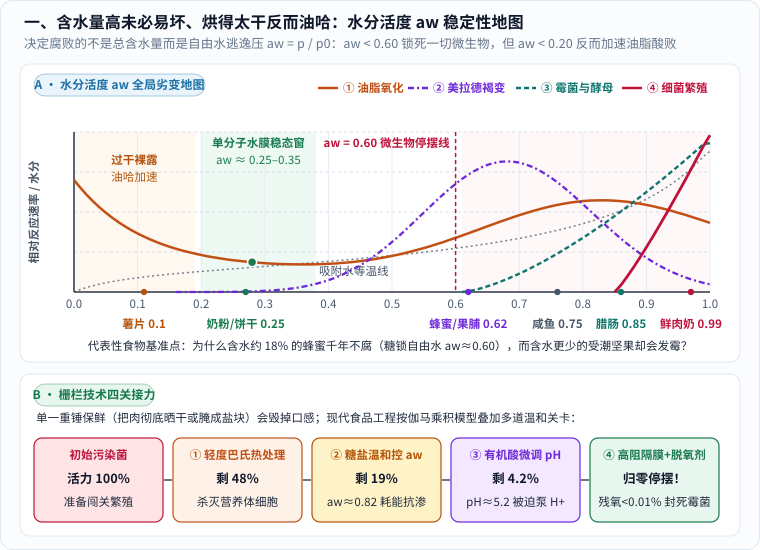
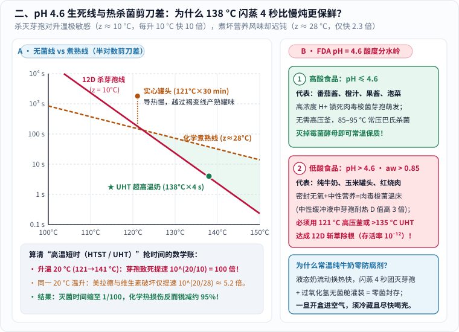
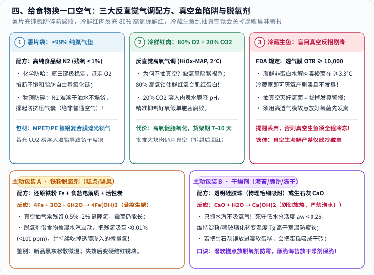
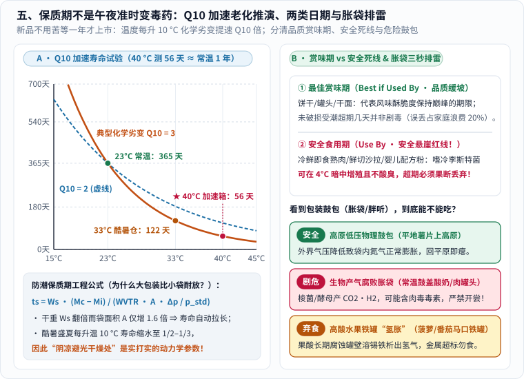

逛超市往购物车里拿东西时，我们几乎每天都在和各种看似自相矛盾的“保鲜怪象”打照面：

- **怪象一：常温纯牛奶放半年不坏，难道真没偷偷加防腐剂？** 一碗鲜肉汤在夏天的厨房桌面上搁半天就发酸起泡，可一盒摆在常温货架上的纯牛奶，保质期动辄 **6 到 12 个月**，翻看配料表却只有冷冰冰的三个字——“生牛乳”。它凭什么不靠防腐剂、不靠冰箱，硬扛过一整个酷暑？
- **怪象二：为什么含水约 $$18\%$$ 的蜂蜜千年不腐，含水仅 $$9\%$$ 的受潮花生却会发霉，而把饼干薯片烤到“极致干燥”反而坏得更快？** 如果水是腐败之源，难道不是越干越耐放吗？为什么食品厂偏偏要给奶粉和苏打饼干留下一层薄薄的“救命水膜”？
- **怪象三：既然氧气会让食物氧化变质、滋生霉菌，为什么超市冷鲜牛排的塑料盒里反而要故意充进高达 $$80\%$$ 的高浓度氧气（比空气含氧量还高近四倍）？** 更让人后背发凉的是：为什么把新鲜生鱼片抽成真空放进家用冷藏室，非但不是“双保险”，反而被美国食品药品监督管理局（FDA）列为可能致命的高危禁区 [[6]](#ref-6)？
- **怪象四：一盒牛奶纸砖里只夹了一层厚约 $$6.3\ \mu\mathrm{m}$$（不到头发丝十分之一）的铝箔，凭什么能挡住一整年的阳光与氧气？** 糕点袋里的“脱氧剂”和海苔袋里的“干燥剂”长得像双胞胎，要是把它们对调放错，会发生什么翻车现场？

别把食品包装当成一层只会印广告图案的塑料皮。每一盒牛奶、每一袋薯片、每一罐午餐肉背后，其实都是一场横跨**化学热力学、微生物生理学、化学反应动力学与高分子传质工程**的精密攻防战。

> **一句话先亮出底牌：食物变质无非输在两条战线上——“外敌入侵（细菌、酵母、霉菌繁殖）”与“内鬼自毁（脂肪自由基氧化、美拉德褐变、吸潮玻璃化塌陷）”。现代保质技术从不靠单一毒药硬刚，而是用热力学水分活度 $$a_w$$ 锁死自由水、借 $$138\ ^\circ\mathrm{C}$$ 超高温与 $$z$$ 值剪刀差在煮坏风味前团灭芽孢、靠多层复合高分子与微米铝箔切断氧气水汽渗透，再配合气调换气与铁粉脱氧剂守住微环境稳态 [[1]](#ref-1) [[4]](#ref-4) [[5]](#ref-5) [[9]](#ref-9)！**

下面我们就顺着一袋食物从配方、杀菌、穿盔甲、换空气直到印上保质期标签的五道工序，把这套藏在厨房与超市里的硬核科学彻底拆透。

---

## 一、第一道防线：决定腐败的从来不是“含水量”，而是自由水的逃逸渴望——水分活度 $$a_w$$

很多人直觉认为：“食物里水越多越容易坏，水越少越耐放。”可只要拿两样家常食物一比，这个直觉就会当场失灵：

一罐纯正成熟蜂蜜，总含水量高达 **$$17\%\text{–}18\%$$**，在常温橱柜里放上几年都不会发霉长菌；而一把干花生或干核桃，总含水量哪怕只吸潮涨到 **$$9\%\text{–}10\%$$**（还不到蜂蜜的一半），就能长出剧毒的黄曲霉！

为什么同样是水，在花生里是霉菌的温床，在蜂蜜里却成了微生物碰不到的“海市蜃楼”？

### 1. 用蒸汽逃逸压给“自由水”称重：水分活度 $$a_w = p / p_0$$

1953 年，澳大利亚微生物学家威廉·斯科特（William J. Scott）一针见血地指出：微生物根本看不见食物的“总含水量（Moisture Content）”，它们只能利用那些没有被糖、盐、蛋白质氢键死死拴住、能够自由跨过细胞膜参与生化反应的**“自由水”**。

在化学热力学里，衡量水分子“到底有多自由”的严格标尺叫做**水分活度（Water Activity，记作 $$a_w$$）**：把食物密封在一个恒温小盒子里，等盒内空气湿度与食物内部达到热力学平衡后，测出盒内水蒸气分压 $$p$$，再除以同一温度下纯水的饱和水蒸气压 $$p_0$$：

$$
a_w = \frac{p}{p_0} = \frac{\mathrm{ERH}}{100\%}
$$

式子里的符号非常直观：

- $$p$$ 是食物表面平衡水蒸气分压（单位 $$\mathrm{Pa}$$），$$p_0$$ 是同温度纯水的饱和蒸气压（单位 $$\mathrm{Pa}$$）；
- $$\mathrm{ERH}$$ 是平衡相对湿度（Equilibrium Relative Humidity）：如果一包饼干的 $$a_w = 0.25$$，把它敞口摆在相对湿度 $$70\%$$（对应环境等效 $$a_w = 0.70$$）的梅雨天客厅里，水分子必然顺着化学势差 $$\Delta \mu = RT \ln(a_{w,\text{环境}} / a_{w,\text{食物}})$$ 疯狂往饼干里钻，直到饼干变软回潮！
- 纯水的 $$a_w = 1.00$$；鲜肉、鲜鱼、鲜牛奶的 $$a_w \approx 0.98\text{–}0.99$$；饱和食盐水的 $$a_w = 0.75$$；而蜂蜜里高浓度的果糖与葡萄糖通过密集的羟基氢键把水分子牢牢锁住，把 $$a_w$$ 压到了 **$$0.55\text{–}0.62$$** [[1]](#ref-1)！

英国莱斯特大学微生物学家威廉·格兰特（W. D. Grant）在发表于《英国皇家学会哲学会刊 B》（*Philosophical Transactions of the Royal Society B*）的综述中系统梳理了地球生命在低水分活度下的绝对极限 [[1]](#ref-1)：

1. **绝大多数腐败细菌与食源性致病菌**（沙门氏菌、大肠杆菌、肉毒梭菌等）：在 $$a_w < 0.91$$ 时就已经无法分裂；耐盐性极强的金黄色葡萄球菌在有氧条件下也止步于 $$a_w \approx 0.86$$（美国 FDA 据此将 $$a_w = 0.85$$ 定为罐藏低酸食品监管的重要水活分界线 [[3]](#ref-3)）；
2. **常见产毒霉菌与普通酵母**：在 $$a_w < 0.80$$（霉菌）与 $$a_w < 0.88$$（普通酵母）时陆续停工；
3. **地球微生物增殖的终极地板——$$a_w = 0.60$$**：即便是最极端的嗜干丝状真菌（如 *Xeromyces bisporus*）和耐高渗酵母，极限也卡在 **$$a_w \approx 0.61$$**。一旦把食物的 $$a_w$$ 控制在 **$$0.60$$ 以下**，地球上没有任何细菌、酵母或霉菌还能分裂增殖 [[1]](#ref-1)！

_先看上半幅全局地图的横轴（水分活度 $$a_w$$ 从 $$0.0$$ 到 $$1.0$$）：右侧红线（④ 细菌）在 $$0.85$$ 以下归零，青色虚线（③ 霉菌与酵母）在 $$0.60$$ 红虚线左侧彻底归零；但请重点盯住橙色实线（① 油脂氧化）——它在 $$a_w < 0.20$$ 的极度干燥区非但没有降为零，反而高高翘起，与右侧共同夹出一个绿色的“单分子水膜稳态窗（$$a_w \approx 0.25\text{–}0.35$$）”。再看下半幅栅栏技术：四道温和关卡按乘法接力把初始细菌活力一步步清零，无需把肉晒成木柴。[单独打开大图](/assets/images/food-packaging-preservation/water-activity-stability-map-and-hurdles.svg)。_

### 2. 反直觉的“过干悖论”：为什么把薯片和奶粉烘到极致干燥，反而更快泛出哈喇味？

看到 $$a_w < 0.60$$ 就能封杀全部微生物，你肯定会想：“那干脆把奶粉、坚果和薯片彻底抽干到 $$a_w = 0.05$$ 岂不是万无一失？”

**千万使不得！这正是食品化学家西奥多·拉布扎（Theodore Labuza）与马库斯·卡雷尔（Marcus Karel）揭示的著名“过干酸败悖论”**。马萨诸塞大学食品科学系古穆斯与德克尔（Gumus & Decker, 2021）在《Foods》期刊综述低水分食品脂质氧化机制时专门指出（引证 Quast & Karel 1972 经典薯片实验）[[2]](#ref-2)：当低水分食品被干燥得**太狠**（例如 $$a_w$$ 压低到 $$0.10$$ 附近，低于 $$0.25$$）时，不饱和脂肪酸的氧化酸败速率非但没有继续下降，反而**掉头大幅飙升**！

看懂上图的橙色 U 型谷底，只需追踪油脂表面那一层只有**一个水分子厚**的保护膜（即 `BET` 吸附等温线的单分子层水分 $$M_0$$，通常落在 **$$a_w \approx 0.25\text{–}0.35$$** 区间）：

- **在黄金稳态窗（$$a_w \approx 0.25\text{–}0.35$$）**：这层刚好铺满亲水位点的单分子水膜，一方面与脂质氢过氧化物（$$\mathrm{ROOH}$$）形成氢键，阻止它均裂分解成自由基（有关喷雾干燥如何把奶粉水分精准停在这一窗口，可对照本站 [《为什么鲜牛奶不能直接架锅熬成粉？》]()）；另一方面给微量的铁、铜等促氧化金属离子套上“水合外壳”，钝化它们的催化活性 [[2]](#ref-2)；
- **一旦烘得过干（$$a_w < 0.15$$）**：这层单分子水膜被生生扒光！食品内部留下无数酥松的微毛细孔道供氧气长驱直入，裸露的金属离子直接贴上氢过氧化物，自由基链式反应火力全开——微生物虽然一个没长，薯片和核桃却迅速泛出一股刺鼻的“油哈喇味”（己醛等挥发性醛酮）[[2]](#ref-2)；
- **而如果吸潮升到中等水活区（$$a_w \approx 0.55\text{–}0.75$$）**：水又变成了流动的溶剂，让还原糖和氨基酸自由碰撞，把紫色点划线代表的**非酶美拉德褐变**推向最高峰（奶粉变黄结块、果干发黑正发生在这里；美拉德与酶促褐变的分子细节可延伸阅读 [《白白胖胖的莲藕凭什么切开变褐？》]()）[[5]](#ref-5)。

### 3. 栅栏技术（Hurdle Technology）：不用晒成木柴、腌成盐巴，软嫩牛肉干凭什么常温放半年？

那如果我们既想要休闲卤味、半干牛肉干、软面包的**湿润软嫩口感**（$$a_w$$ 往往在 $$0.80\text{–}0.90$$ 之间），又想常温保存几个月，该怎么办？

德国肉类学家洛塔尔·莱斯特纳（Lothar Leistner）提出了现代食品工业最核心的设计哲学——**栅栏技术（Hurdle Technology）**。法国国家农业研究院普若尔团队（Pujol et al., 2012）在《应用与环境微生物学》（*Applied and Environmental Microbiology*）建立的“等栅栏伽马预测模型（Gamma-type model）”用一行极漂亮的乘法公式写透了它的威力 [[12]](#ref-12)：

$$
\mu = \mu_{\mathrm{opt}} \cdot \gamma(T) \cdot \gamma(\mathrm{pH}) \cdot \gamma(a_w) \cdot \gamma(\mathrm{O}_2) \cdot \gamma(\text{有机酸})
$$

这里 $$\mu_{\mathrm{opt}}$$ 是细菌在最舒服条件下的最大比生长速率，而每一个 $$\gamma \in [0, 1]$$ 代表一道温和关卡对生长速率的折扣因子 [[12]](#ref-12)。细菌为了维持细胞内部的稳态（Homeostasis）——比如在微酸环境里拼命往膜外泵出 $$\mathrm{H}^+$$，在高渗糖盐环境里拼命合成相容性溶质保水——每一项自救都要狂烧细胞里的能量货币 `ATP`（细菌独立产能与代谢机制可参看 [《一文读懂细菌与病毒的区别》]()）。当你把“轻度巴氏加热 + 糖盐微降 $$a_w$$ + 乳酸微调 $$\mathrm{pH}$$ + 抽氧脱氧剂”四道谁都不毁口感的小栏杆串在一起时，乘积效应会让细菌的 `ATP` 彻底枯竭，代谢当场归零！

---

## 二、第二道防线：$$\mathrm{pH} = 4.6$$ 生死线与热杀菌剪刀差——为什么 $$138\ ^\circ\mathrm{C}$$ 闪蒸 4 秒反而比慢炖更保鲜？

靠降水分活度能管住饼干、果脯和牛肉干；可面对纯牛奶、椰汁、玉米罐头、红烧肉罐头这些**水分活度高达 $$0.98\text{–}0.99$$、口感决不能加盐加糖改变**的湿润食物，又该怎么做到“不加一滴防腐剂、常温放一年”？

1809 年，法国糕点师尼古拉·阿佩尔（Nicolas Appert）响应拿破仑军队的悬赏，发明了把食物装进玻璃瓶密封煮沸保存的罐藏术——耐人寻味的是，当时距离巴斯德证明“微生物导致腐败”整整早了半个世纪！直到 20 世纪热杀菌动力学成熟，食品工程师才真正算清楚：热杀菌绝不是“煮得越久越好”，而是一场精妙绝伦的**对数与指数赛跑**。

### 1. 为什么是 $$\mathrm{pH} = 4.6$$？肉毒梭菌芽孢与“一万亿罐退一”的 $$12D$$ 法则

如果你在家里自己做番茄果酱罐头，放在沸水锅（$$100\ ^\circ\mathrm{C}$$）里煮上十几分钟就能安心吃一冬天；可如果你在家用同样的沸水锅自制密封四季豆罐头或肉罐头，却可能酿成致命惨剧！

分水岭就在于微生物界最凶险的潜伏杀手——**肉毒梭菌（*Clostridium botulinum*）**。它产生的肉毒毒素是已知毒性最强的天然物质之一；更棘手的是，它在逆境下会缩成穿多层钙—吡啶二羧酸铠甲的**芽孢（Spore）**，在 $$100\ ^\circ\mathrm{C}$$ 沸水里煮几个小时都死不了。一旦罐头密封抽走了氧气，耐热幸存下来的厌氧芽孢就会脱壳萌发、大肆产毒！

美国 FDA 在联邦法规《低酸与酸化罐藏食品指南》（`21 CFR Part 113 / 114`）中划下了一条全球食品工业铁律——**$$\mathrm{pH} = 4.6$$ 生死分水岭** [[3]](#ref-3)：

- **高酸食品（平衡 $$\mathrm{pH} \le 4.6$$，如番茄汁、柑橘汁、果酱、醋渍酸黄瓜）**：高浓度的氢离子彻底锁死了肉毒梭菌芽孢的萌发机制。既然头号耐热恶魔无法苏醒，工厂只需用 **$$85\text{–}95\ ^\circ\mathrm{C}$$ 常压巴氏杀菌**灭掉不耐热的霉菌、酵母和嗜酸菌，就能安全常温销售 [[3]](#ref-3)；
- **低酸罐藏食品（平衡 $$\mathrm{pH} > 4.6$$ 且 $$a_w > 0.85$$，如纯牛奶、肉罐头、八宝粥、甜玉米罐头）**：中性无氧营养汤正是肉毒梭菌的天堂！明尼苏达大学奥德劳格与普夫卢格（Odlaug & Pflug, 1977）在《应用与环境微生物学》实测发现：同一株 A 型肉毒梭菌芽孢在中性磷酸盐缓冲液（$$\mathrm{pH}\ 7.0$$）里的耐热 $$D$$ 值，比在酸性番茄汁（$$\mathrm{pH}\ 4.2$$）里足足**高出约 $$3$$ 倍** [[11]](#ref-11)！

在恒定高温 $$T$$ 下，芽孢存活数 $$N(t)$$ 按一级反应动力学呈指数衰减，工程上写成十进制对数形式：

$$
\log_{10}\!\left(\frac{N_0}{N(t)}\right) = \frac{t}{D_T}
$$

其中 **$$D_T$$ 值（Decimal Reduction Time，十进位缩减时间）** 是在温度 $$T$$ 下**每杀灭 $$90\%$$ 芽孢（即存活数砍掉一个数量级）所需的分钟数**。对于低酸罐头，国际通用的商业无菌安全底线叫做 **$$12D$$ 概念（Botulinum Cook）**：必须将肉毒梭菌芽孢存活概率生生压低 $$12$$ 个数量级（$$N / N_0 = 10^{-12}$$）——哪怕每罐原本混入 $$1$$ 粒最顽固的肉毒芽孢，生产**一万亿（$$10^{12}$$）罐**也最多只允许 $$1$$ 罐残存！由于蛋白水解型肉毒梭菌在标准参考温度 $$121.1\ ^\circ\mathrm{C}$$（$$250\ ^\circ\mathrm{F}$$）下的 $$D_{121.1} \approx 0.21\text{–}0.25\ \mathrm{min}$$，达成 $$12D$$ 等效杀菌值至少需要 **$$F_0 \ge 3.0\ \mathrm{min}$$** [[4]](#ref-4)。

_先看左栏半对数坐标图（横轴温度 $$100\text{–}150\ ^\circ\mathrm{C}$$，纵轴对数受热时间）：红色实线是斜率极陡的 $$12D$$ 杀芽孢底线（$$z = 10\ ^\circ\mathrm{C}$$），棕色虚线是斜率平缓的化学煮熟损伤线（$$z \approx 28\ ^\circ\mathrm{C}$$）。在 $$121\ ^\circ\mathrm{C}$$ 左侧，实心肉罐头因为固体导热慢，受热长达 $$30\ \mathrm{min}$$ 越过棕色虚线，产生浓郁“熟罐头味”；而向右跨过 $$135\ ^\circ\mathrm{C}$$ 后，两条直线剪出大片绿色保鲜窗口——$$138\ ^\circ\mathrm{C}$$ 闪蒸 $$4\ \mathrm{s}$$ 既越过了红线杀光芽孢，又远远躲在棕线下方留住了鲜奶风味。再看右栏对照 FDA $$\mathrm{pH} = 4.6$$ 杀菌分界。[单独打开大图](/assets/images/food-packaging-preservation/thermal-12d-vs-uht-z-value-crossover.svg)。_

### 2. $$z$$ 值剪刀差：为什么 $$138\ ^\circ\mathrm{C}$$ 烫 4 秒，反而比 $$121\ ^\circ\mathrm{C}$$ 炖半小时营养好得多？

看懂了 $$12D$$，下一个困扰无数人的灵魂拷问马上来了：**常温超高温灭菌奶（UHT 奶）加热到 $$135\text{–}145\ ^\circ\mathrm{C}$$，温度比高压锅还高，怎么没把牛奶煮成焦黄色的炼乳味，反而保留了绝大部分营养？**

秘密全藏在左栏那两条直线**一陡一缓的斜率差**里！在食品热工学中，让 $$D_T$$ 值缩短为原来的 $$1/10$$（即反应提速 $$10$$ 倍）所需升高的温度，叫做 **$$z$$ 值**：

$$
\frac{t(T)}{t(T_{\mathrm{ref}})} = 10^{-(T - T_{\mathrm{ref}})/z}
$$

根据阿伦尼乌斯定律，化学反应活化能 $$E_a$$ 越高，反应速率对升温就越敏感，对应的 $$z$$ 值就越小。恰恰在这里，大自然送给了食品工程师一份无价大礼：

1. **杀灭细菌芽孢（蛋白质与核酸协同变性失活）**：活化能极高（$$E_a \approx 280\text{–}300\ \mathrm{kJ/mol}$$），对应的 **$$z_{\text{芽孢}} \approx 9.4\text{–}10.0\ ^\circ\mathrm{C}$$** [[11]](#ref-11)——**温度每升高 $$10\ ^\circ\mathrm{C}$$，杀芽孢速度暴涨 $$10$$ 倍；升高 $$20\ ^\circ\mathrm{C}$$，暴涨 $$100$$ 倍！**
2. **破坏维生素与美拉德褐变蒸煮味（普通小分子化学反应）**：活化能低得多（$$E_a \approx 80\text{–}110\ \mathrm{kJ/mol}$$），对应的 **$$z_{\text{化学}} \approx 25\text{–}31\ ^\circ\mathrm{C}$$**（典型值约 $$28\ ^\circ\mathrm{C}$$）——**同样升高 $$10\ ^\circ\mathrm{C}$$，营养破坏和褐变速度只快了 $$10^{10/28} \approx 2.28$$ 倍；升高 $$20\ ^\circ\mathrm{C}$$，只快了约 $$5.2$$ 倍！**

我们来算一笔干脆利落的账：假设把牛奶的杀菌温度从 $$121.1\ ^\circ\mathrm{C}$$ 一口气拉高 $$20\ ^\circ\mathrm{C}$$ 到 $$141.1\ ^\circ\mathrm{C}$$：

- 达成同样 $$F_0 = 3\ \mathrm{min}$$（$$180\ \mathrm{s}$$）商业无菌所需的受热时间，瞬间缩减为原来的 $$1/100$$，也就是仅需 **$$1.8\ \mathrm{s}$$**（工业常见 UHT 规程为 **$$137\text{–}142\ ^\circ\mathrm{C}$$ 保持 $$2\text{–}4\ \mathrm{s}$$**，欧盟乳品化学家组卫生规范上限为 $$145\ ^\circ\mathrm{C}$$ 不超过 $$10\ \mathrm{s}$$ [[4]](#ref-4)）；
- 在这短短 $$1.8\ \mathrm{s}$$ 里，美拉德褐变与维生素破坏速率虽然快了 $$5.2$$ 倍，但乘以缩短到 $$1/100$$ 的时间后，累计化学热损伤只有 $$5.2 \times \frac{1}{100} \approx \mathbf{5.2\%}$$——**比 $$121.1\ ^\circ\mathrm{C}$$ 保温灭菌整整减少了近 $$95\%$$ 的化学破坏** [[4]](#ref-4)！

那为什么午餐肉罐头不能也用 $$140\ ^\circ\mathrm{C}$$ 闪蒸 4 秒？因为牛奶是低黏度液体，可以通过板式换热器或蒸汽直接喷射在 1 秒内均匀热透又瞬间闪蒸冷却 [[4]](#ref-4)；而午餐肉是实心固体，只能靠极其缓慢的傅里叶热传导往罐心传热——要是外层开到 $$140\ ^\circ\mathrm{C}$$，等罐心终于升到 $$121\ ^\circ\mathrm{C}$$ 时，贴着铁皮的外圈肉早就被烤焦炭化了！

这也就彻底解开了“常温纯牛奶零防腐剂”的谜底：**先在管道里用 $$>135\ ^\circ\mathrm{C}$$ 闪蒸几秒杀灭一切微生物及芽孢，再在经过 $$35\%$$ 过氧化氢浴或电子束（`eBeam`）彻底灭菌的无菌舱内灌入六层阻隔纸砖密封 [[4]](#ref-4) [[7]](#ref-7)。盒子里一颗活菌都没有，外面的菌又进不去，当然不需要半滴防腐剂！** 反过来，一旦你插上吸管戳破铝箔，空气里的细菌立刻顺着吸管掉进营养丰富的中性纯奶里，所以开封后必须冷藏并在一两天内喝完。

---

## 三、第三道防线：为什么没有一种单层塑料能包打天下？六层无菌纸砖与“怕水阻氧夹心膜”

食物内部的菌杀光了、水分活度也调好了，接下来轮到包装袋登场。外行看食品袋觉得不过是一层薄薄的塑料纸；内行拿显微镜把一盒常温奶纸砖或一袋微波意面封口膜切开横截面，看到的却是一座**五层到七层各司其职的微型长城**。

为什么食品工业宁可承担回收分选变难的代价，也要把好几种截然不同的材料叠成“千层饼”（包装占据了全球塑料总用量的约 **$$44\%$$** [[5]](#ref-5)）？

### 1. 高分子渗透定律 $$P = D \times S$$：防水的材料偏偏漏氧，挡氧的材料偏偏怕水！

与玻璃瓶和金属铁罐那种晶格致密、分子根本钻不过去的刚性容器不同，所有塑料高分子链在室温下都在做微小的热运动，链段之间不断闪现纳米级的“瞬态自由体积空穴”。气体和水蒸气穿过一张厚度为 $$L$$、面积为 $$A$$ 的完整无孔塑料膜，遵循经典的**溶解—扩散模型（Solution-Diffusion Model）**：

$$
J = \frac{P \cdot A \cdot \Delta p}{L}, \qquad P = D \times S
$$

式子中 $$J$$ 是单位时间透过的气体量，$$\Delta p$$ 是膜两侧的气体分压差，而决定材料本征阻隔能力的渗透系数 $$P$$ 等于**扩散系数 $$D$$**（分子在链缝里跳得多快）与**溶解度系数 $$S$$**（气体有多喜欢溶进这种高分子）的乘积。工程上把固定厚度薄膜在单位压差下每天每平方米透过的氧气毫升数叫做 **氧气透过率（`OTR`，单位 $$\mathrm{cc/(m^2\cdot day\cdot atm)}$$）**，透过的克水汽数叫做 **水蒸气透过率（`WVTR`，单位 $$\mathrm{g/(m^2\cdot day)}$$）** [[5]](#ref-5)。

恰恰因为化学里的**“相似相溶”铁律**，单层塑料天生患上了严重的“偏科症”：

- **非极性聚烯烃（聚乙烯 `LDPE / HDPE`、聚丙烯 `PP`）**：整条碳氢链毫无极性，极性水分子（$$\mathrm{H}_2\mathrm{O}$$）根本溶不进去（$$S_{\mathrm{H_2O}}$$ 极小），所以它们是**绝佳的防潮防水卫士**，而且熔点适中、极易热封焊合；但非极性的氧气分子（$$\mathrm{O}_2$$）和香气分子却能轻易溶进聚乙烯非晶区长驱直入——单层聚乙烯袋装油炸花生，防潮满分，隔氧却一败涂地！
- **强极性羟基高分子（乙烯—乙烯醇共聚物 `EVOH`、聚乙烯醇 `PVOH`）**：分子主链上挂满了高密度的羟基（`–OH`），链与链之间织成一张极其致密的三维**分子间氢键大网**，非极性氧气连条缝都钻不过去，干态阻氧能力傲视群雄 [[10]](#ref-10)！可一旦遇到潮湿空气，极性水分子就会疯狂扑上来与羟基争抢氢键位点（即高分子物理中的**水诱导增塑与氢键重分布**），撑大链间自由体积、压低玻璃化转变温度 $$T_g$$，导致阻氧能力在潮湿环境下断崖式暴跌几十上百倍 [[10]](#ref-10)！

_先看左栏六层无菌纸砖剖面：从左向右追踪三束入侵箭头（动画单次演示分级拦截，亦保留静态虚线与阻断圆环）：最外层聚乙烯（①）率先拦下外部潮湿水汽，原木纸板（②，占总重约 $$70\%$$）扛住运输挤压，而紫外光与氧气一直穿透前三层，直到撞上仅厚约 $$6.3\ \mu\mathrm{m}$$ 的第 ④ 层超薄铝箔被彻底清零；底部说明液面下带液热封如何实现“零顶空灌装”。再看右栏上半部 2025 年实测四种复合膜货架期对比，以及下半部全塑透明包装如何用两层疏水聚烯烃把怕水的 `EVOH` 严密夹在正中间。[单独打开大图](/assets/images/food-packaging-preservation/six-layer-aseptic-carton-and-evoh-barrier.svg)。_

### 2. 拆开一盒常温奶纸砖与一袋透明卤味盒：看懂两种“扬长避短”巅峰工程

既然单打独斗谁都有软肋，材料工程师就发明了两套堪称教科书的组合拳：

1. **常温奶的“六层无菌复合纸砖”（以利乐砖 Tetra Brik Aseptic 为代表）**：
   整只纸盒按重量算大约由 **$$70\%$$ 原木纸板 + $$25\%$$ 聚乙烯塑料 + 仅 $$5\%$$ 超薄铝箔** 复合而成 [[7]](#ref-7)。别看第 ④ 层铝箔厚度只有约 **$$6.3\text{–}9\ \mu\mathrm{m}$$**（比家用烧烤锡纸还薄三倍），致密的面心立方金属铝晶格对紫外线、可见光和氧气的透过率在无针孔理想状态下几乎为零！土耳其埃格大学图尔克塞维尔团队（Türksever et al., 2025）在 **$$38\ ^\circ\mathrm{C} / 90\%\ \mathrm{RH}$$** 极端湿热加速条件下实测对比发现 [[5]](#ref-5)：
   - 含 $$9\ \mu\mathrm{m}$$ 实体铝箔的三层复合膜 `PET / Al-foil / LDPE`：**`OTR` 低至 $$0.026\ \mathrm{cc/(m^2\cdot day\cdot atm)}$$，`WVTR` 低至 $$0.049\ \mathrm{g/(m^2\cdot day)}$$**，推算可接受货架期高达 **$$800.3$$ 天**；
   - 表面真空蒸镀纳米氧化铝陶瓷层的透明高阻隔膜 `PET·AlOx / LDPE`：`OTR = 0.130`，`WVTR = 0.190`，货架期达 **$$577.9$$ 天**——不仅透明看得见内容物，而且不含导电金属层，能安全通过金属探测器或放进微波炉加热（金属铝箔在微波交变电场中涡流打火的物理原因可参看 [《彻底读懂微波炉工作原理》]()）[[5]](#ref-5)；
   - 薯片袋常用的真空镀铝膜 `MPET / LDPE`：`OTR = 0.335`，`WVTR = 0.356`，货架期 **$$407.6$$ 天**；
   - 单一材质易回收镀铝聚丙烯 `MBOPP`：`OTR` 飙升至 **$$12.190$$**（漏氧速率是实体铝箔复合膜的 **$$469$$ 倍**！），货架期缩短至 **$$229.3$$ 天** [[5]](#ref-5)。
   更绝的是无菌砖的灌装手法：纸材先卷成连续圆筒竖直向下走，牛奶直接灌满整个纸筒内部，横向超声波热封钳**潜入牛奶液面以下**直接夹扁熔融内层 `PE` 切断成砖——盒内连半个残留空气泡（顶空）都不留！
2. **全塑透明盒的“五层共挤三明治” `PP / Tie / EVOH / Tie / PP`**：
   番茄酱挤挤瓶、婴儿果泥吸吸袋、锁鲜熟食碗既要求透明或可微波，又必须严格挡氧，怎么办？工程师用马来酸酐接枝粘合树脂（`Tie layer`）做“双面胶”，把极薄一层怕水的 `EVOH` 严严实实夹在内外两层疏水 `PP` 或 `PE` 正中央——外层聚烯烃挡住环境潮气，内层聚烯烃挡住食物自身水分，让夹心层里的 `EVOH` 终年保持干燥高阻氧状态！

---

## 四、第四道防线：给食物换一口空气——三大反直觉气调配方、真空鱼陷阱与脱氧剂

选好了高阻隔包装膜，如果在封口那一瞬间把满满一袋普通空气（含 **$$20.9\%$$ 氧气** [[9]](#ref-9)）一起封了进去，袋内的氧气照样够霉菌开派对、够油脂酸败变哈。

于是就有了**气调包装（Modified Atmosphere Packaging, `MAP`）**与**主动包装（Active Packaging）**。有趣的是，面对不同的食物，工程师往袋子里充的气体不仅完全不同，甚至有几条规则彻底颠覆普通人的生活常识！

_上排从左到右对比三张气调与减氧卡片：① 薯片充 $$>99\%$$ 高纯氮气兼顾化学防酸败与物理防压碎；② 冷鲜牛排盒反直觉充入 $$80\%\ \mathrm{O}_2 + 20\%\ \mathrm{CO}_2$$，用高氧锁住鲜红氧合肌红蛋白、用二氧化碳溶水降酸抑菌；③ 红色高危警示卡解释为什么冷藏生鱼严禁盲目抽真空——必须保留 `OTR` $$\ge 10{,}000$$ 透气膜让好氧腐败菌充当“发臭报警器”，否则真空生鱼必须全程冷冻。下排对比铁粉受控生锈吃氧的脱氧剂与硅胶/生石灰吸潮保脆的干燥剂。[单独打开大图](/assets/images/food-packaging-preservation/map-gas-recipes-botulism-trap-and-scavengers.svg)。_

### 1. 薯片袋鼓鼓囊囊装的不是“空气”，而是 $$>99\%$$ 高纯氮气；那为什么不充二氧化碳？

每次撕开一袋薯片看到只装了半袋，不少人都会吐槽厂家“卖空气”。其实里面充的绝不是普通空气，而是把残氧置换到 **$$1\%$$ 以下的高纯食品级氮气（$$\mathrm{N}_2$$）**：

- 氮分子拥有键能高达 $$945\ \mathrm{kJ/mol}$$ 的氮氮三键（$$\mathrm{N}\equiv\mathrm{N}$$），常温下化学性质极度惰性，既能把氧气赶跑、掐断油炸薯片表面不饱和脂肪酸的光氧化与自由基酸败，又不会与任何风味物质反应；
- **为什么薯片不能充同样不助燃、还能抑菌的二氧化碳（$$\mathrm{CO}_2$$）？** 因为 $$\mathrm{CO}_2$$ 在水和油脂里的溶解度极高！一旦把纯 $$\mathrm{CO}_2$$ 充进富含油脂的薯片袋或刚烘焙好的咖啡豆袋，气体很快就会大量溶解进油脂微孔里，导致袋内气压骤降——原本鼓鼓的防压安全气囊会自己瘪成紧贴薯片的“伪真空袋”，运输途中一压全碎成渣！

### 2. 超市冷鲜牛排为什么反其道而行，往盒里狂充 $$80\%$$ 的超高浓度纯氧？

既然氧气催生脂肪氧化和好氧菌，按理说给超市冰柜里的冷鲜牛排、冷鲜肉糜抽真空岂不是最好？

恰恰相反！去生鲜超市留意那种硬质深托盘、顶面绷着高阻隔透明膜的冷鲜红肉盒，里面充的往往是令人瞠目结舌的**高氧气调配方（`HiOx-MAP`）：$$80\%\ \mathrm{O}_2 + 20\%\ \mathrm{CO}_2$$** [[8]](#ref-8)（Jaberi et al., 2019，《亚洲—大洋洲动物科学杂志》`PMC6409465`）！

原因是一场围绕**肌红蛋白（Myoglobin）血红素铁配位态**的视觉心理博弈 [[8]](#ref-8)：

- 在完全抽真空缺氧时，肌肉里的色素处于还原态**脱氧肌红蛋白（$$\mathrm{Fe}^{2+}$$）**，呈现暗沉发乌的紫褐色；如果在微残氧（$$0.5\%\text{–}2\%$$）区间徘徊，更会迅速氧化成棕褐色的**高铁肌红蛋白（$$\mathrm{Fe}^{3+}$$，Metmyoglobin）**——肉明明很安全新鲜，消费者一看暗褐色却扭头就走 [[8]](#ref-8)！
- 当顶空充入高达 **$$80\%$$ 的高分压纯氧**时，氧气深入肉表数毫米厚组织，强行把肌红蛋白牢牢钉在樱桃鲜红色的**氧合肌红蛋白（Oxymyoglobin）**状态；与此同时，搭配的 **$$20\%\ \mathrm{CO}_2$$** 迅速溶解进肉表面的水膜生成碳酸并干扰细菌胞内脱羧酶，精准压制头号冷鲜肉杀手——好氧假单胞菌（*Pseudomonas*）[[8]](#ref-8)！
- 当然，科学从没有免费午餐：贾贝里团队实测证实，在 $$2\ ^\circ\mathrm{C}$$ 储藏第 $$4$$ 天起，`HiOx-MAP` 肉糜的脂质氧化指标（`TBARS` 丙二醛值）就会突破 $$1\ \mathrm{mg/kg}$$ 感官阈值，而真空组几乎不氧化 [[8]](#ref-8)。因此远途冷链批发的整块牛排依然采用真空贴体包装（拆袋接触空气 15 分钟即可重新“回红”），只有终端零售展示盒才用高氧气调换取 7–10 天的鲜红颜值。

### 3. 救命冷知识：为什么美国 FDA 严令禁止把普通生鱼片随便抽成真空放冷藏室？

很多家庭买了一台家用真空封口机后，喜欢把菜市场刚买回来的新鲜海鱼、三文鱼块抽成严严实实的真空袋，随手塞进 $$4\text{–}8\ ^\circ\mathrm{C}$$ 的冰箱冷藏室，觉得“既隔绝氧气又放进了冰箱，放一个礼拜肯定比敞口安全”。

**请立刻停下这个动作！这恰恰是食品安全史上著名的“拔掉烟雾报警器”陷阱！**

美国 FDA 在专门针对水产品减氧包装（Reduced Oxygen Packaging, `ROP`）发布的强制执法警示《Import Alert 16-125》中给出了极为严厉的科学解释 [[6]](#ref-6)：

1. 海洋与淡水沉积物及鱼类肠道中普遍存在**非蛋白水解型肉毒梭菌（Non-proteolytic *C. botulinum*，主要为 E 型及部分 B、F 型）**。与陆地罐头里那种需要 $$10\ ^\circ\mathrm{C}$$ 以上才活跃的菌株不同，这种水产嗜冷菌株只要在 **$$\ge 3.3\ ^\circ\mathrm{C}$$（$$38\ ^\circ\mathrm{F}$$）** 就能萌发并产生致命肉毒毒素——而绝大多数超市冷柜与家用冷藏室的实际波动温度都在 **$$4\text{–}10\ ^\circ\mathrm{C}$$** [[6]](#ref-6)！
2. 更可怕的是“非蛋白水解”这五个字：它在鱼肉里悄悄合成剧毒时，**不分解蛋白质产生尸胺、腐胺或硫化氢臭味，鱼肉看起来、闻起来依然毫无异样**！
3. 如果生鱼包在普通透气保鲜膜里，喜欢氧气的好氧腐败菌（假单胞菌等）会在肉毒毒素长出来**之前**抢先繁殖，让鱼肉发黏发臭，逼着你把它扔进垃圾桶；**可一旦你把生鱼抽成真空（或充氮气密封），你亲手闷死了所有会发臭报警的好氧腐败菌，却给厌氧且不发臭的肉毒梭菌腾出了独霸全场的无氧温室**——FDA 1996–1997 年实验证实，在 $$7.2\text{–}10\ ^\circ\mathrm{C}$$ 下，真空冷藏生鱼往往在消费者察觉腐败之前就已经出现致命毒素 [[6]](#ref-6)！

正因如此，FDA 明确规定：凡是仅靠普通冷藏保存的生鲜鱼类，包装薄膜的氧气透过率必须高达 **`OTR` $$\ge 10{,}000\ \mathrm{cc/(m^2\cdot 24\ h)}$$（$$24\ ^\circ\mathrm{C}$$）**——故意放氧气进来养活“发臭报警菌”；如果你一定要买或自制真空密封的生鲜鱼虾，**唯一安全的家庭做法是立刻冻进 $$-18\ ^\circ\mathrm{C}$$ 冷冻室，且吃之前剪开真空袋在冷藏室透气解冻** [[6]](#ref-6)！

### 4. 双胞胎小纸包千万别搞混：铁粉脱氧剂 vs 防潮干燥剂

哪怕动用了工业级抽真空或充氮机，饼干孔隙、面包气孔和核桃仁褶皱里依然会窝藏 $$0.5\%\text{–}2\%$$ 的残余氧气，而许多好氧霉菌在 $$0.5\%$$ 残氧下照样能长出绿毛 [[9]](#ref-9)。于是 1977 年日本三菱瓦斯化学率先推出了改变烘焙业的“主动包装”神器——**铁系脱氧剂（Oxygen Absorber）**[[9]](#ref-9)。

拉筹伯大学奇切洛（Cichello, 2015）在《食品科学与技术杂志》综述指出 [[9]](#ref-9)：这包透气纸塑复合小袋里装的核心成分，其实就是**还原铁粉 + 微量食盐（$$\mathrm{NaCl}$$ 电解质催化剂）+ 活性炭**。它借用包装内食物自身散发的微量湿气启动一场受控的“闪电生锈反应”：

$$
4\mathrm{Fe} + 3\mathrm{O}_2 + 6\mathrm{H}_2\mathrm{O} \longrightarrow 4\mathrm{Fe(OH)}_3 \longrightarrow 2\mathrm{Fe}_2\mathrm{O}_3\cdot 3\mathrm{H}_2\mathrm{O}
$$

配合高阻隔外袋，小小一包 $$2.5\ \mathrm{g}$$ 级的脱氧剂不仅能吞掉 $$100\ \mathrm{mL}$$ 纯氧（相当于把近 $$500\ \mathrm{mL}$$ 空气里的氧气一扫而空），更能把顶空残氧一路抽干到惊人的 **$$< 0.01\%$$（$$< 100\ \mathrm{ppm}$$，极限甚至可达 $$< 0.0001\%$$）**，还会继续吃掉整个货架期里顺着塑料膜慢慢渗进来的微量氧气 [[9]](#ref-9)！你用手一捏就能判断它有没有失效：刚拆封工作时粉末呈黑灰色、松散且略带微温（生锈放热）；一旦吸饱失效，就结成了硬邦邦的红褐色铁锈块 [[9]](#ref-9)。

请一定把它和海苔、仙贝袋里的**干燥剂（Desiccant）**区分开：

- **湿软月饼、华夫饼、半干坚果**需要保持湿润口感（$$a_w \approx 0.70\text{–}0.85$$），必须放**铁粉脱氧剂**防霉防哈；如果误塞进一包生石灰干燥剂（$$\mathrm{CaO} + \mathrm{H}_2\mathrm{O} \to \mathrm{Ca(OH)}_2$$，剧烈放热，严禁撕开泡水！），三天就把软蛋糕吸成了咬不动的干砖头；
- **酥脆烤海苔、雪饼、冻干草莓**极度怕潮（一旦吸湿越过玻璃化转变温度 $$T_g$$ 就会从脆态塌陷成皮筋态），主力放**硅胶或生石灰干燥剂**死守低 $$a_w$$！

---

## 五、第五道防线：保质期怎么不用苦等一年就能算出来？看懂 $$Q_{10}$$ 加速老化、两类日期与胀袋排雷

最后，当我们拿起一包印着“保质期 12 个月”的新口味零食时，你有没有好奇过一个极现实的工程问题：**厂家研发出一款新配方，难道真的要先在仓库里傻等整整 365 天，确认没坏才敢上市开卖吗？而且食物是不是在第 365 天晚上 23:59 还安全美味，零点钟声一响就准时变成毒药？**

### 1. 用温度换时间：阿伦尼乌斯方程与 $$Q_{10}$$ 加速寿命试验（`ASLT`）

食品研发工程师当然不用干等一年。只要劣变机制以化学反应（如多酚降解、维生素损失、脂质氧化、美拉德褐变）为主导，反应速率常数 $$k(T)$$ 就服从物理化学的**阿伦尼乌斯方程（Arrhenius Equation）**：

$$
k(T) = A_0 \exp\!\left(-\frac{E_a}{RT}\right)
$$

在工程实践上，通常引入直观的**温度系数 $$Q_{10}$$**——即储存温度每升高 $$10\ ^\circ\mathrm{C}$$，劣变速率加快的倍数（相应地，货架寿命 $$t_s$$ 缩短为原来的 $$1 / Q_{10}$$）：

$$
t_s(T_2) = t_s(T_1) \cdot Q_{10}^{-(T_2 - T_1)/10}
$$

对于绝大多数常温包装食品的化学品质劣变，典型 **$$Q_{10}$$ 值落在 $$2.0\text{–}3.0$$ 之间**。爱沙尼亚塔林理工大学萨尔尼特团队（Saarniit et al., 2023）在《Foods》期刊对巴氏杀菌果蔬谷物泥开展加速货架期试验（`ASLT`）时，正是采用 **$$Q_{10} = 3$$** 建立温度—时间折算标尺 [[13]](#ref-13)：

- 在 **$$23\ ^\circ\mathrm{C}$$** 标准常温下储存 **$$365$$ 天（整整 $$1$$ 年）** 的化学老化程度；
- 放进 **$$40\ ^\circ\mathrm{C}$$** 恒温加速培养箱（$$\Delta T = +17\ ^\circ\mathrm{C}$$），只需测试 $$365 \times 3^{-1.7} \approx \mathbf{56.4\ \text{天}}$$（不到两个月）就能提前跑完一整年的品质衰减曲线 [[13]](#ref-13)！
- **更值得每个家庭警惕的是反过来的教训**：如果你夏天把一箱标称“常温保质 12 个月”的牛奶、坚果或食用油堆在闷热到 **$$33\ ^\circ\mathrm{C}$$** 的阳台或汽车后备厢里（比 $$23\ ^\circ\mathrm{C}$$ 仅高出 $$10\ ^\circ\mathrm{C}$$），按 $$Q_{10} = 3$$ 计算，它的真实品质寿命已经悄悄缩水到了 **$$365 / 3 \approx 122$$ 天（仅剩 4 个月）**！包装袋背面那句看似废话的“请置于阴凉干燥避光处保存”，其实是字字千金的指数动力学方程。

而对于饼干、布丁粉、奶粉这类靠防潮决生死的干制品，货架寿命 $$t_s$$ 还直接由包装几何尺寸决定 [[5]](#ref-5)：

$$
t_s = \frac{W_s \cdot (M_c - M_i)}{\mathrm{WVTR} \cdot A \cdot (\Delta p / p_{\mathrm{std}})}
$$

其中 $$W_s$$ 是袋内干物质净重，$$M_i$$ 是出厂初始含水率，$$M_c$$ 是结块或疲软的临界含水率，$$A$$ 是包装袋总表面积。根据我们在 [《为什么蚂蚁放大一百倍会当场骨折？》]() 里讲过的**平方—立方律**：当你把一袋 $$20\ \mathrm{g}$$ 迷你随手包换成 $$500\ \mathrm{g}$$ 家庭大袋装时，干重 $$W_s$$ 增大了 $$25$$ 倍，而袋子表面积 $$A$$ 只增大约 $$25^{2/3} \approx 8.5$$ 倍——在用同一种包装膜的前提下，**未开封的大包装天生比迷你小袋更耐放近 3 倍**！

_先看左栏 $$Q_{10}$$ 指数衰减曲线：沿橙色实线（$$Q_{10} = 3$$）从 $$23\ ^\circ\mathrm{C}$$ 常温的 $$365$$ 天向右滑到 $$33\ ^\circ\mathrm{C}$$ 酷暑仓，寿命骤降至 $$122$$ 天；再向右到 $$40\ ^\circ\mathrm{C}$$ 加速老化箱，仅需 $$56$$ 天即可模拟常温一年变化。再看右栏上半部区分“品质赏味期缓坡”与“安全死线悬崖”，以及下半部遇到包装鼓包时的“安全物理鼓包 / 剧危产气胖听 / 果酸腐蚀氢胀”三秒排雷指南。[单独打开大图](/assets/images/food-packaging-preservation/arrhenius-q10-shelf-life-and-date-labels.svg)。_

### 2. 别再白白扔掉好食物，也别拿命试险：分清两类日期与三种“鼓包胀袋”

美国 FDA 在《如何减少食物浪费并保障食品安全》官方指南中披露了一个惊人的统计数字：消费者对食品包装日期标签的误解，直接造成了约 **$$20\%$$ 的家庭食物浪费** [[14]](#ref-14)！要既不冤枉好食物、又绝不踩中安全红线，只需看清两件事：

1. **分清“品质缓坡”与“安全悬崖”**：
   - **最佳赏味期（国际通行 `Best if Used By / Best Before`，国内多与常温干货罐头保质期对应）**：针对饼干、薯片、挂面、罐头、常温饮料等微生物早已锁死的食品，它代表厂家承诺**风味、香气与酥脆度处于最佳水准**的期限，而不是“安全毒药线” [[14]](#ref-14)。只要包装完好未漏气、未受潮发霉或酸败，哪怕刚过几天也并不会突然生出毒素；
   - **安全食用死线（国际通行 `Use By`，以及法规强制要求的婴儿配方奶粉标签）**：针对**冷鲜即食熟肉、冷鲜三明治、鲜切果蔬沙拉、巴氏鲜奶**，嗜冷致病菌**单核细胞增生李斯特菌（*Listeria monocytogenes*）**能在 $$4\ ^\circ\mathrm{C}$$ 冰箱里持续分裂增殖 [[12]](#ref-12) [[14]](#ref-14)，且不产生明显酸臭味！再加上婴儿配方奶粉一旦超期可能导致核心维生素营养衰减危及婴儿唯一口粮 [[14]](#ref-14)——面对这两类产品，**到期必须果断丢弃，绝不凑合**！
2. **看到袋子或罐头“鼓包（胀袋 / 胖听）”，三秒钟定生死**：
   - **唯一安全的情况——高原低压物理鼓包**：你从成都或北京背了一包密封完好的充氮薯片飞到拉萨（海拔 $$3650\ \mathrm{m}$$，外界大气压降至约 $$0.65\ \mathrm{atm}$$），袋内氮气顺着波义耳定律 $$p_1 V_1 = p_2 V_2$$ 正常膨胀把袋子撑得像皮球，带回平原就自动恢复，完全安全；
   - **头号红色警报——微生物产气腐败胀袋（胖听）**：在平原常温或冰箱里，原本平坦的酸奶膜高高鼓起、卤味熟食真空袋松脱发胀、或者金属午餐肉罐头两头铁盖凸起按不下去——这是厌氧梭菌、大肠菌群或产气酵母正在里面疯狂发酵释放 $$\mathrm{CO}_2$$ 与 $$\mathrm{H}_2$$ 的铁证！尤其低酸肉菜罐头一旦胖听，可能伴随致命肉毒毒素，**连开盖闻一下、用筷子蘸一点尝尝都绝对禁止，直接密封丢弃**；
   - **化学腐蚀弃食——高酸水果马口铁罐“氢胀”**：菠萝、山楂、番茄酱等强酸性罐头储存过久，有机酸缓慢腐蚀镀锡薄钢板内壁溶出锡铁离子并析出氢气（$$\mathrm{Fe} + 2\mathrm{H}^+ \to \mathrm{Fe}^{2+} + \mathrm{H}_2\uparrow$$），虽非细菌产毒，但重金属溶出与风味均已严重劣化，同样应当弃食。

---

## 六、收官全景表：一眼看懂身边 6 类食物究竟靠什么“冻龄”

下一次整理自家冰箱和零食柜时，你只需对照下面这组底层密码，就能像食品工程师一样一眼看穿每件包装背后的玄机：

1. **常温纯牛奶（利乐砖，常温 6–12 个月）**：靠 **$$138\ ^\circ\mathrm{C} \times 4\ \mathrm{s}$$ 超高温灭菌**利用 $$z$$ 值剪刀差团灭芽孢 + **六层铝箔纸砖液面下无顶空无菌热封**，实现零防腐剂长效锁鲜 [[4]](#ref-4) [[7]](#ref-7)；
2. **奶粉 / 苏打饼干（充氮铁罐或镀铝袋，12–24 个月）**：靠脱水把 $$a_w$$ 精准停在 **$$0.25\text{–}0.30$$ 单分子水膜稳态窗**（防微生物且避开过干氧化谷外区）+ **低 `WVTR / OTR` 阻隔层锁气防潮** [[2]](#ref-2) [[5]](#ref-5)；
3. **膨化薯片（镀铝复合袋，6–9 个月）**：靠极低 $$a_w$$ + **`MPET` 遮光防紫外光催化氧化** + **$$>99\%$$ 高纯氮气防碎防哈气囊**；
4. **月饼 / 软华夫饼（高阻隔透明袋 + 小纸包，2–4 个月）**：靠糖油压低部分 $$a_w$$ + **`EVOH` 或涂布高阻隔膜** + **铁粉脱氧剂生锈把残氧抽至 $$<0.01\%$$** 饿死好氧霉菌 [[9]](#ref-9) [[10]](#ref-10)；
5. **超市冷鲜牛排盒（硬质托盘，$$0\text{–}4\ ^\circ\mathrm{C}$$ 7–10 天）**：靠低温链 + **$$80\%\ \mathrm{O}_2$$ 锁住鲜红氧合肌红蛋白** + **$$20\%\ \mathrm{CO}_2$$ 溶水降酸抑假单胞菌** [[8]](#ref-8)；
6. **冷藏生鲜海鱼片（生鲜冷柜，1–2 天或冷冻）**：严防 $$\ge 3.3\ ^\circ\mathrm{C}$$ 无臭产毒的非蛋白水解肉毒梭菌——**冷藏态必须用 `OTR` $$\ge 10{,}000$$ 高透气膜保留好氧菌发臭报警，若抽真空则必须全程 $$-18\ ^\circ\mathrm{C}$$ 冷冻** [[6]](#ref-6)！

从拿破仑时代的密封玻璃瓶，到今天一片厚度不足百微米却集成了五六种高分子与金属晶格的复合薄膜，人类保住一口新鲜饭菜的全部智慧，说到底从不是往食物里撒满神秘化学药水，而是摸清每一个水分子、氧分子、氢离子与细菌芽孢的脾气，在热力学与动力学边界上搭起最巧的那道栅栏。

---

## 参考资料与核查来源

1. **W. D. Grant (2004)**, *Life at low water activity*, **Philosophical Transactions of the Royal Society B: Biological Sciences**, 359(1448): 1249–1267. [PMC1693405 原文](https://pmc.ncbi.nlm.nih.gov/articles/PMC1693405/) —— 核查地球微生物增殖的水分活度绝对下限（嗜干真菌与耐高渗酵母极限 $$a_w \approx 0.61$$，$$a_w < 0.60$$ 停止一切微生物分裂）及饱和食盐水 $$a_w = 0.75$$ 等渗透基准。
2. **Cansu Ekin Gumus & Eric A. Decker (2021)**, *Oxidation in Low Moisture Foods as a Function of Surface Lipids and Fat Content*, **Foods**, 10(4): 860. [PMC8071306 原文](https://pmc.ncbi.nlm.nih.gov/articles/PMC8071306/) —— 核查低水分食品（薯片、苏打饼干、粉末）“干燥过度（如 $$a_w = 0.10$$）反而比中等偏低水活加速脂质氧化酸败”的实证规律与单分子水膜保护机制。
3. **U.S. Food and Drug Administration (FDA)**, *Acidified & Low-Acid Canned Foods Guidance Documents & Regulatory Information (21 CFR Parts 108, 113, 114)*. [FDA 官方法规指南](https://www.fda.gov/food/guidance-documents-regulatory-information-topic-food-and-dietary-supplements/acidified-low-acid-canned-foods-guidance-documents-regulatory-information) —— 核查低酸罐藏食品（平衡 $$\mathrm{pH} > 4.6$$ 且 $$a_w > 0.85$$）与高酸/酸化食品（$$\mathrm{pH} \le 4.6$$）的法定分界线及肉毒梭菌商业无菌控制要求。
4. **Aytül Hamzalıoğlu, Işıl Aktağ & Vural Gökmen (2026)**, *Multi-Response Kinetic Modeling of the Maillard Reaction in Milk During Heating at Ultra-High-Temperature Range*, **Journal of Agricultural and Food Chemistry**, 74(20): 15776–15789. [PMC13220311 原文](https://pmc.ncbi.nlm.nih.gov/articles/PMC13220311/) —— 核查常温牛奶 UHT 超高温瞬时灭菌工艺（$$>135\ ^\circ\mathrm{C}$$ 配合无菌包装、最低等效灭菌值 $$F_0 = 3\ \mathrm{min}$$、$$145\ ^\circ\mathrm{C}\times 10\ \mathrm{s}$$ 上限）及高温短时抑制美拉德反应的动力学数据。
5. **Can Türksever, Banu Koç & Ozlem Kizilirmak Esmer (2025)**, *Sustainable Alternatives in Multilayer Packaging: Storage Stability of Pudding Powder Under Accelerated Storage Conditions*, **Foods**, 14(22): 3806. [PMC12650960 原文](https://pmc.ncbi.nlm.nih.gov/articles/PMC12650960/) —— 核查包装占全球塑料用量 $$44\%$$，以及 $$38\ ^\circ\mathrm{C}/90\%\ \mathrm{RH}$$ 下 `PET/9µm Al-foil/LDPE`（`OTR` $$0.026$$、`WVTR` $$0.049$$、寿命 $$800.3$$ 天）、`PET.AlOx/LDPE`（$$577.9$$ 天）、`MPET/LDPE`（$$407.6$$ 天）与单层 `MBOPP`（$$229.3$$ 天）实测对比与 `GAB` 吸附等温线模型。
6. **U.S. Food and Drug Administration (FDA)**, *Import Alert 16-125: Detention Without Physical Examination of Refrigerated (Not Frozen) Raw Fish and Fishery Products in Reduced Oxygen Packaging Due to the Potential for Clostridium botulinum Toxin Production*. [FDA Import Alert 16-125 原文](https://www.accessdata.fda.gov/cms_ia/importalert_28.html) —— 核查水产品非蛋白水解型肉毒梭菌在 $$\ge 3.3\ ^\circ\mathrm{C}$$（$$38\ ^\circ\mathrm{F}$$）无明显腐败臭味下产毒风险，以及冷藏生鱼透气包装膜 `OTR` $$\ge 10{,}000\ \mathrm{cc/(m^2\cdot 24\ h)}$$（$$24\ ^\circ\mathrm{C}$$）或全程冷冻规定。
7. **Tetra Pak Official Technical Documentation**, *Aseptic Packaging FAQ & Role of Cartons: Food Protection*. [Tetra Pak 无菌包装技术问答](https://www.tetrapak.com/solutions/packaging/packages/aseptic-packages/faq-aseptic-packaging) 与 [材料分层说明](https://www.tetrapak.com/en-sg/sustainability/carton-equity/food-protection) —— 核查无菌纸砖平均材料构成（约 $$70\%$$ 纸板、$$25\%$$ 聚乙烯防潮热封层、$$5\%$$ 超薄铝箔阻光阻氧阻菌层）及过氧化氢浴/电子束无菌灌装工艺。
8. **Rahimeh Jaberi, Güzin Kaban & Mükerrem Kaya (2019)**, *Effects of vacuum and high-oxygen modified atmosphere packaging on physico-chemical and microbiological properties of minced water buffalo meat*, **Asian-Australasian Journal of Animal Sciences**, 32(3): 421–429. [PMC6409465 原文](https://pmc.ncbi.nlm.nih.gov/articles/PMC6409465/) —— 核查冷鲜红肉 $$80\%\ \mathrm{O}_2 + 20\%\ \mathrm{CO}_2$$ 高氧气调（`HiOx-MAP`）维持氧合肌红蛋白鲜红色泽（$$a^*$$ 值）、抑制假单胞菌与第 4 天后 `TBARS` 脂质氧化升高的权衡数据。
9. **Simon Angelo Cichello (2015)**, *Oxygen absorbers in food preservation: a review*, **Journal of Food Science and Technology**, 52(4): 1889–1895. [PMC4375217 原文](https://pmc.ncbi.nlm.nih.gov/articles/PMC4375217/) —— 核查铁系脱氧剂（还原铁粉、食盐与活性炭）受湿气激活氧化反应机制、将包装顶空氧浓度压低至 $$< 100\ \mathrm{ppm}$$（$$< 0.01\%$$）乃至 $$< 0.0001\%$$ 的能力及外观失效判据。
10. **Sakib Khan, Abu Saifullah, Zhongyi Zhang & Hom N. Dhakal (2026)**, *Structure–Processing–Property Relationships in PVOH/PBAT Blends Plasticized with Dipentaerythritol, ε-Caprolactone, and Water*, **ACS Omega**, 11(42): 65331–65350. [PMC13718211 原文](https://pmc.ncbi.nlm.nih.gov/articles/PMC13718211/) —— 核查富含羟基聚合物（`PVOH / EVOH`）依靠三维氢键网络阻隔氧气，以及小分子水竞争羟基氢键引起增塑、自由体积增大和湿态阻氧下降的高分子物理机制。
11. **T. E. Odlaug & I. J. Pflug (1977)**, *Thermal destruction of Clostridium botulinum spores suspended in tomato juice in aluminum thermal death time tubes*, **Applied and Environmental Microbiology**, 34(1): 23–29. [PMC242582 原文](https://pmc.ncbi.nlm.nih.gov/articles/PMC242582/) —— 核查肉毒梭菌芽孢热致死温度敏感系数 $$z = 9.4\text{–}9.9\ ^\circ\mathrm{C}$$，以及中性缓冲液（$$\mathrm{pH}\ 7$$）中耐热 $$D$$ 值约为酸性番茄汁（$$\mathrm{pH}\ 4.2$$）$$3$$ 倍的实验数据。
12. **Laure Pujol et al. (2012)**, *Establishing Equivalence for Microbial-Growth-Inhibitory Effects (“Iso-Hurdle Rules”) by Analyzing Disparate Listeria monocytogenes Data with a Gamma-Type Predictive Model*, **Applied and Environmental Microbiology**, 78(4): 1069–1080. [PMC3273012 原文](https://pmc.ncbi.nlm.nih.gov/articles/PMC3273012/) —— 核查莱斯特纳栅栏技术（Hurdle Technology）与温度、$$\mathrm{pH}$$、$$a_w$$、有机酸乘积抑制因子伽马预测模型。
13. **Kärt Saarniit, Hanna Lang, Rain Kuldjärv, Oskar Laaksonen & Sirli Rosenvald (2023)**, *The Stability of Phenolic Compounds in Fruit, Berry, and Vegetable Purees Based on Accelerated Shelf-Life Testing Methodology*, **Foods**, 12(9): 1777. [PMC10178123 原文](https://pmc.ncbi.nlm.nih.gov/articles/PMC10178123/) —— 核查基于 $$Q_{10} = 3$$ 的加速货架期试验（`ASLT`）换算关系（$$23\ ^\circ\mathrm{C}$$ 储存 $$182, 274, 365, 427$$ 天对应 $$40\ ^\circ\mathrm{C}$$ 下 $$28, 42, 56, 66$$ 天）。
14. **U.S. Food and Drug Administration (FDA)**, *How to Cut Food Waste and Maintain Food Safety*. [FDA 消费者食品安全指南](https://www.fda.gov/food/consumers/how-cut-food-waste-and-maintain-food-safety) —— 核查日期标签误解占消费者食物浪费约 $$20\%$$、“Best if Used By”代表最佳风味品质期而非安全死线（婴儿配方奶粉除外）及冷链控制规范。
