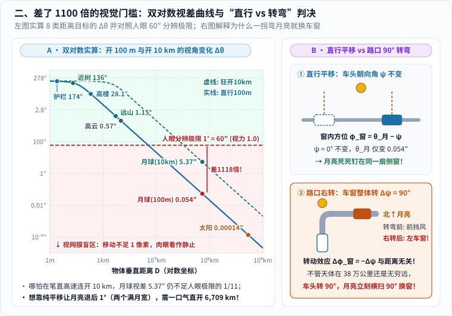
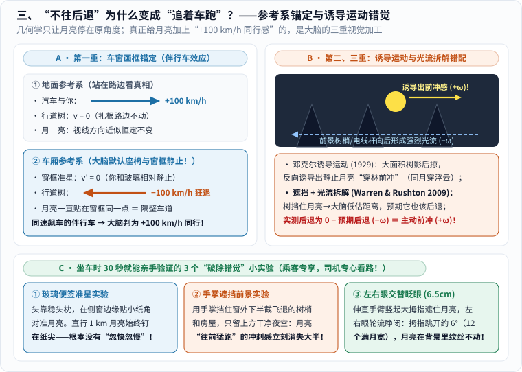
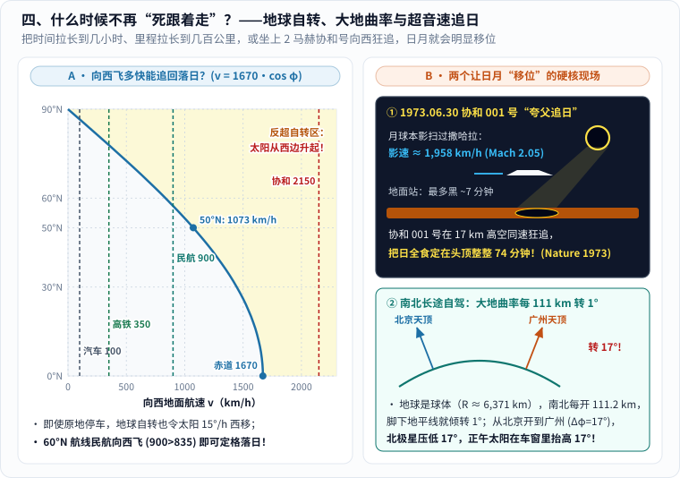
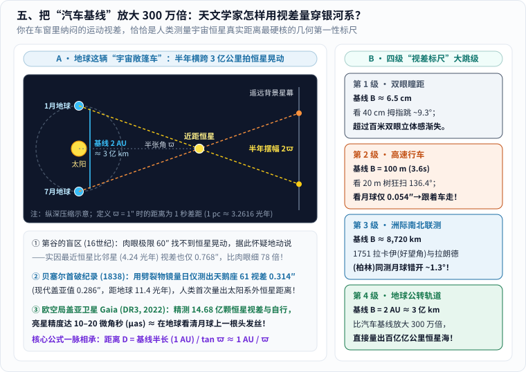

几乎每个人的童年记忆里，都有过这样一幕奇妙的夜路：

一家人坐车在高速公路或国道上飞驰，你把下巴垫在后排车窗边往外看——紧挨路肩的波形护栏化作一道模糊的白线，二十米外的行道树像多米诺骨牌一样“刷刷”往后猛退，远一点的居民楼和高架水塔也在稳步向后滑去。唯独挂在夜空里的那轮明月（或者白天耀眼的太阳），不管爸爸把车开到时速 $$60$$ 公里还是 $$120$$ 公里，它都稳稳悬在车窗同一个位置，**车开快它就跟得快，红灯踩刹车它也立刻停住，穿过一排排树梢、跃过一栋栋屋顶，像个寸步不离的专属保镖一样追着你回家**！

如果你去问身边的成年人：“为什么太阳和月亮会跟着汽车走呀？”十个人里有九个会笑着摆摆手：“傻孩子，那是因为太阳和月亮离我们太远啦！”

慢着——这句话听起来无比正确，可只要你多追问半步，就会抓到一个藏得很深的**逻辑漏洞**：

1. **“离得远”最多只能解释太阳和月亮为什么“没有往后退”（角度没变），可为什么你的眼睛和大半个童年都无比确信：它不是呆在原地不动，而是在以 $$100\ \mathrm{km/h}$$ 的速度“主动往前追着我们的车跑”？**
2. **到底要远到什么程度才算“够远”？** 为什么五公里外的大山看着也很远，开一会儿车还是能看出它慢慢往后退，而月亮哪怕你在笔直高速上狂开 $$10$$ 公里，肉眼也看不出半点退后？
3. **如果月亮真的“死死跟着我们”，为什么汽车在十字路口右转一个 $$90^\circ$$ 弯，刚才还在前挡风玻璃上的月亮，一眨眼就溜到左侧车窗去了？**
4. **有没有什么交通工具能把太阳“甩在身后”，甚至把刚落山的太阳重新从西边追回来？** 1973 年一群科学家开着超音速飞机去追月亮的影子，居然创造了一项怎样的世界纪录？

今天，我们就顺着后排车窗里的这道目光，把**几何光学、人眼生理极限、大脑视觉神经科学与天体测量学**串成一条完整的证据链，一次把这个从小问到大的问题彻底拆透。

---

## 一、车窗外的五层速度阶梯：为什么近树狂退，月亮却像被钉在玻璃上？

### 1. 先建直觉：把视线想成一根连在眼睛和景物之间的橡皮筋

我们先不管天上的月亮，先在平地上做一个最简单的动作：

你在客厅里盯着两米外餐桌上的一只水杯，身体保持朝向正前方，横着往右迈两大步。你会发现，为了让目光继续锁住水杯，你的眼珠必须**大幅度往左转**——也就是说，水杯在你视野里的方位角往后（往左）猛退了一大截。反过来，如果你盯着窗外几百米远的一座电视塔，同样往右横迈两大步，你的眼珠几乎不用怎么转，电视塔还在差不多原来的方向上。

在物理学和视觉科学里，这种**“因为观察者自身位置移动，导致不同距离的物体在视野里发生不同幅度方向偏转”**的现象，就叫**运动视差（Motion Parallax）** [[6]](#ref-6)。

现在把你放进一辆以 $$v = 100\ \mathrm{km/h}$$（约 $$27.78\ \mathrm{m/s}$$）沿笔直公路匀速行驶的汽车里。短短 $$\Delta t = 3.6\ \mathrm{s}$$ 的工夫，汽车就从位置 $$A$$ 往前直行了整整 $$L = 100\ \mathrm{m}$$ 到达位置 $$B$$。假设在路程正中间时刻，路边距离车道垂直距离为 $$D$$ 的地方正好有一棵树、一栋楼、一座山和天上的一轮明月，连接你眼睛与目标的那根“视线橡皮筋”到底转过了多大角度 $$\Delta\theta$$？

画一个等腰三角形就能直接写出精确几何公式：

$$
\Delta\theta = 2\arctan\!\left(\frac{L}{2D}\right)
$$

这里 $$L$$ 是汽车直行走过的基线长度（单位：米 $$\mathrm{m}$$），$$D$$ 是目标到公路的垂直距离（单位：$$\mathrm{m}$$）。当目标离你非常远（$$D \gg L$$）时，反正切函数可以直接化简成极其清爽的小角度反比律（单位为弧度 $$\mathrm{rad}$$，$$1\ \mathrm{rad} \approx 57.30^\circ \approx 206{,}265''$$）：

$$
\Delta\theta \approx \frac{L}{D}
$$

如果看“一瞬间向后掠过的快慢”，设此刻目标视线与车头前进方向的夹角为 $$\alpha$$（正前方 $$\alpha = 0^\circ$$，正侧方车窗 $$\alpha = 90^\circ$$），那么它在你视野里向后退却的瞬时角速度 $$\omega$$ 就是：

$$
\omega = \frac{v\sin\alpha}{D}
$$

注意分子上那个不起眼的 $$\sin\alpha$$！它顺手解释了你坐车时的另一个细节：**哪怕是同一排近处路灯，远在正前方挡风玻璃尽头（$$\alpha \approx 0^\circ,\ \sin\alpha \approx 0$$）时看着几乎不怎么横移；可一旦逼近正侧方车窗（$$\alpha = 90^\circ,\ \sin\alpha = 1$$），角速度瞬间飙到峰值 $$v/D$$，“嗖”地一下就往后甩出去了！**

_先看上图 A 的俯视光路（注：纵深做了压缩示意，真实月球距离是近树的 1922 万倍）：汽车从虚线初态 A 直行 100 米到终态 B，看 20 米近树的绿色视线从右前方 +68.2° 猛甩到右后方 −68.2°（转过 136.4°），而来自 38.4 万公里外月球的两束金色月光近乎严格平行（夹角仅 0.054 角秒）；再看下图 B 乘客右侧车窗（按 110° 横向视野真实角比例映射，单次动画将 3.6 秒真实车程放慢 2 倍为 7.2 秒播放并停在终态，虚线标出 0 秒初态）：近树飞掠、楼房稳退、远山微移，唯独月亮纹丝不动。[单独打开大图（刷新可重播单次动画）](/assets/images/moon-following-car/car-window-motion-parallax-hierarchy.svg)。_

### 2. 算清五层距离硬账：平行月光怎样把月亮“焊”在原方向？

把真实距离一个个代进 $$\Delta\theta = 2\arctan(L / 2D)$$，看看汽车往前开出 **$$L = 100\ \mathrm{m}$$（仅需 $$3.6$$ 秒）** 时，窗外五层景物的方位角到底变了多少（地月平均距离取 NASA 实测值 $$384{,}400\ \mathrm{km}$$ [[1]](#ref-1)，日地平均距离 $$1\ \mathrm{AU}$$ 取国际天文学联合会精确定义值 $$149{,}597{,}870.7\ \mathrm{km}$$ [[2]](#ref-2) [[3]](#ref-3)）：

1. **紧贴路肩的高速护栏（$$D = 2.5\ \mathrm{m}$$）**：$$\Delta\theta = 2\arctan(50 / 2.5) = \mathbf{174.3^\circ}$$！正擦过车窗那零点几秒里，瞬时角速度高达 $$637^\circ/\mathrm{s}$$，人眼根本来不及聚焦，直接糊成一条飞驰的银带；
2. **路边行道树（$$D = 20\ \mathrm{m}$$）**：$$\Delta\theta = 2\arctan(50 / 20) = \mathbf{136.4^\circ}$$！刚从右前窗露头，三秒多钟就已经甩到右后窗角落去了；
3. **两百米外的居民楼（$$D = 200\ \mathrm{m}$$）**：$$\Delta\theta = 2\arctan(50 / 200) = \mathbf{28.1^\circ}$$，相当于横跨了四分之一扇车窗，肉眼清清楚楚看着它稳步后退；
4. **五公里外的远山（$$D = 5{,}000\ \mathrm{m}$$）**：$$\Delta\theta = 2\arctan(50 / 5000) = \mathbf{1.15^\circ}$$（约两个满月并排的宽度），短看几秒觉得很稳，盯上十几秒就能看出它在缓缓往后滑；
5. **月球（$$D = 384{,}400\ \mathrm{km} = 3.844\times 10^8\ \mathrm{m}$$）**：

$$
\Delta\theta_{\text{月}} \approx \frac{100\ \mathrm{m}}{3.844\times 10^8\ \mathrm{m}} = 2.601\times 10^{-7}\ \mathrm{rad} \approx \mathbf{0.0000149^\circ} = \mathbf{0.0537''}\text{（角秒）}
$$

6. **太阳（$$D \approx 1.496\times 10^{11}\ \mathrm{m}$$，比月亮还要远约 $$389$$ 倍）**：

$$
\Delta\theta_{\text{日}} \approx \frac{100\ \mathrm{m}}{1.496\times 10^{11}\ \mathrm{m}} = 6.68\times 10^{-10}\ \mathrm{rad} \approx \mathbf{0.000138''}\text{（万分之一角秒量级！）}
$$

这就是图一上半部分画出的物理真相：**路灯或近树离你只有十几米，光线是向四面八方张开的“发散光扇”，你一走动，接住的光线角度就大变；而月亮远在 $$38.4$$ 万公里外、太阳远在 $$1.5$$ 亿公里外，洒向整条高速公路的光束在百米尺度上几乎是严格平行的直线！** 无论你的车在 A 点还是开到了 100 米外的 B 点，抬头迎向这束平行光的仰角和方位角都分毫不差。

---

## 二、差了 1100 倍的生理门槛：视网膜看不见 0.054 角秒，但一拐弯就露馅

### 1. 0.054 角秒到底有多小？比人眼一个“感光像素”还细一千倍！

也许你会较真：“$$0.0537''$$ 虽然很小，可毕竟不是严格的 $$0$$ 呀！要是我视力超级好，或者爸爸在笔直的高速公路上一口气开出去 $$10$$ 公里，我能不能看出月亮往后退了一丁点？”

把账算到人眼视网膜的生理极限上，答案会让你倒吸一口凉气。

天文学和眼科学把圆周 $$1^\circ$$ 等分成 $$60$$ 角分（$$60'$$），再把 $$1$$ 角分等分成 $$60$$ 角秒（$$60''$$），所以 $$1^\circ = 3600''$$。给你一个伸手就能试的直观标尺：**把手臂伸直竖起小拇指，小拇指甲盖的宽度大约是 $$1^\circ$$（$$3600''$$）；天上一轮满月的视直径大约是半个小拇指甲盖，即 $$31' \approx 1860''$$** [[1]](#ref-1)。

那么，一个拥有标准好视力（国际标准 $$20/20$$ 或 $$6/6$$，对应中国五分视力表 **$$5.0$$ / 小数 $$1.0$$**）的健康人眼，视网膜中央凹最密集的视锥细胞到底能分辨多小的角度移动？眼科学经典教材 *Webvision* 与美国眼科学会（AAO）给出的生理极限——**最小分辨角（Minimum Angle of Resolution, MAR）**——恰好是 [[4]](#ref-4) [[5]](#ref-5)：

$$
\theta_{\text{人眼极限}} \approx 1' = 60'' \approx 0.0167^\circ
$$

换句话说，如果视野里某个光点移动的角度小于 $$60''$$（在没有紧贴参照物辅助的自由天幕下甚至更宽），它在你视网膜上根本还没跨出同一组感光细胞的接收域，在肉眼看来就是**百分之百的纹丝不动**！

_左图 A 在双对数坐标下实算汽车直行 100 米（蓝实线）与狂开 10 公里（青虚线）时从护栏到太阳的视差角 Δθ，红色虚线标出人眼 1.0 视力的 60 角秒分辨门槛——月球在 100 米车程下仅偏 0.054 角秒，比肉眼极限小 1118 倍，即便连开 10 公里（5.37 角秒）仍深陷粉红色盲区；右图 B 对比“直行平移”与“路口右转 90°”：转弯直接旋转车窗参考系，无论天体多远都会瞬间横扫换窗。[单独打开大图](/assets/images/moon-following-car/angular-shift-log-scale-vs-eye-limit.svg)。_

对照上图 A 里的红色门槛线，我们来核对三个惊人的数字：

- **开出 $$100$$ 米（$$3.6$$ 秒）**：月球方位仅变 $$0.0537''$$，跟人眼 $$60''$$ 的分辨门槛整整差了 **$$\frac{60}{0.0537} \approx 1118$$ 倍**！太阳更是差了 **$$43.5$$ 万倍**！
- **笔直狂开 $$10$$ 公里（以 $$100\ \mathrm{km/h}$$ 连开 $$6$$ 分钟不拐弯）**：月球纯平移带来的视差角扩大一百倍，变成 $$5.37''$$——**依然还不到人眼分辨极限 $$60''$$ 的十一分之一，也不到满月自身圆盘宽度（$$1860''$$）的三百四十分之一**！
- **极端思想实验**：假如把大地铺成一块无限大的平坦桌面，同时关掉地球自转，你想单靠开车直行产生的运动视差，让月亮在天幕上明显往后退开 **$$1^\circ$$（约两个满月宽，一根小拇指甲盖宽）**，你得一口气开出去多远？

$$
L_{1^\circ} = D_{\text{月}}\times\frac{\pi}{180} = 384{,}400\ \mathrm{km}\times 0.017453 \approx \mathbf{6{,}709\ \mathrm{km}}
$$

**$$6{,}709$$ 公里！** 比从中国最东端的抚远一直开到最西端的帕米尔高原还要远一千多公里！所以在日常几公里、几十公里的车程里，单靠车辆平移想把月亮“甩在身后”，在几何学上根本不可能办到。

### 2. 关键判决：为什么汽车一拐弯，死心塌地的月亮立刻“跑去别的车窗”？

读到这里，一个极有趣的反例就水落石出了：**既然月亮这么稳，为什么汽车在路口一拐弯、或者开上盘山公路绕弯时，月亮突然就不肯乖乖待在原来的车窗里了，一会儿滑到前挡风玻璃，一会儿又蹿到左边车窗去？**

看一眼图二右侧的 B 栏，答案只在一行极简单的加减法里。

你在车厢里觉得月亮在“哪扇窗户的哪个位置”，看的并不是月亮相对地球北极的绝对天文方位角 $$\theta_{\text{天体}}$$，而是它**相对于车头朝向角 $$\psi_{\text{车头}}$$ 的夹角** $$\varphi_{\text{窗}}$$：

$$
\varphi_{\text{窗}} = \theta_{\text{天体}} - \psi_{\text{车头}}
$$

把汽车的运动拆成“直行平移”和“转弯旋转”两种纯粹动作一比就明白了：

- **直行平移（$$\Delta\psi_{\text{车头}} = 0^\circ$$）**：车头始终朝正东开，没有旋转；平移带来的 $$\Delta\theta_{\text{天体}} \approx -L/D \approx -0.054'' \approx 0^\circ$$。两项相减 $$\Delta\varphi_{\text{窗}} \approx 0^\circ$$，月亮像焊死了一样钉在右侧车窗正中央；
- **路口右转 $$90^\circ$$（$$\Delta\psi_{\text{车头}} = +90^\circ$$）**：天上的月亮方向 $$\theta_{\text{天体}}$$ 依然没变，**但你坐着的整辆车连同四面车窗一起顺时针转了 $$90^\circ$$**！于是：

$$
\Delta\varphi_{\text{窗}} = 0^\circ - 90^\circ = -90^\circ
$$

请注意：**这个 $$-90^\circ$$ 里根本没有距离 $$D$$！** 这意味着旋转效应跟距离远近毫无关系——哪怕是一颗远在百亿光年外的类星体，只要爸爸把方向盘往右打满拐过一个十字路口，它在你车窗坐标系里的位置照样会在几秒钟内横扫 $$90^\circ$$，从正前挡风玻璃一溜烟滑到左侧车窗！

---

## 三、破案下半场：“不往后退”凭什么被大脑翻译成“以 100 公里时速追着我跑”？

现在，到了整篇文章最核心、也最容易被普通科普漏掉的下半场追问：

**几何视差只证明了一件事——月亮在视网膜上的角度变化 $$\Delta\theta \approx 0$$（即“没有往后掉队”）。可为什么坐在车里的孩子和大人，感受到的绝不是“远处天边挂着一盏不动的灯”，而是无比鲜活地觉得“月亮正在树梢后面以 $$100\ \mathrm{km/h}$$ 的高速跟我们并肩狂奔，我们加速它也猛冲，我们踩刹车它也急停”？**

这并不是你的眼睛坏了，而是人类演化出数百万年的**视觉大脑**，在现代高速车厢里同时触发了三重精妙的知觉机制。

_先看左图 A：大脑默认你坐着的车厢和窗框是“静止原点”，在窗框上保持不动恰好是隔壁车道同速伴行车的视觉特征；再看右图 B：飞退的树冠与电线杆通过邓克尔诱导运动（1929）和大脑皮层光流拆解错配（2009），硬生生给静止的月亮赋予了穿林前冲的强烈速度感；底部 C 给出下次坐车 30 秒就能亲测的三个破错觉小实验。[单独打开大图](/assets/images/moon-following-car/induced-motion-and-window-reference-frame.svg)。_

### 1. 第一重：车窗画框锚定与“隔壁车道伴行车效应”

当你安稳地靠在汽车座椅上时，座椅、前排头枕、车门内饰板和**矩形车窗边框**相对于你的身体全都是静止的（相对速度 $$v' = 0$$）。在缺乏颠簸感的高速巡航中，你的视觉系统会本能地把这扇**车窗边框**当成衡量外界物体动静的“静止画框”。

想一想你在高速公路上的日常经验：**窗外什么样的东西，会一边伴随路边树木刷刷飞退，一边死死停在你右侧车窗玻璃的同一个位置上？**

只有一个答案——**隔壁车道上那辆同样踩着 $$100\ \mathrm{km/h}$$ 油门、跟你们并驾齐驱的伴行汽车！**

大脑每天都在用这条经验法则判断交通态势：凡是在飞驰的车窗画框里保持相对方位不变的目标，必然正以与本车完全相同的速度 $$+\mathbf{v}_{\text{车}}$$ 向前飞驰！更绝的是这套参考系绑定还是**实时同步**的：当爸爸一脚油门提速到 $$120\ \mathrm{km/h}$$，路边的树后退得更猛，月亮依然钉在窗框原处，大脑立刻判定“哇，月亮也提速到 $$120$$ 了！”；当遇到收费站一脚刹车停稳，路边的树停住、车厢停住，月亮自然也就“跟着我们一起稳稳刹停”了！

### 2. 第二重：邓克尔诱导运动——“月穿浮云”与“穿林狂奔”是同一种错觉

光有车窗框还不够。不知道你注意过没有：**当公路两边全是光秃秃的戈壁荒漠时，月亮“往前猛跑”的速度感其实没那么强烈；可一旦公路两边长满高大的白杨树、电线杆和错落的楼房屋顶，月亮穿过树梢往前冲刺的感觉就会猛烈十倍！**

这正是德国格式塔心理学家**卡尔·邓克尔（Karl Duncker）**在 1929 年通过经典暗室实验揭示的**诱导运动（Induced Motion）**定律 [[7]](#ref-7)。

邓克尔在完全漆黑的房间里放了一个**绝对静止不动的小光点**，并在光点外围套上一个大亮框（或大片纹理背景）。当他悄悄把外围大框往左移动、而让中间的小光点纹丝不动时，几乎所有受试者都指天发誓：**大框没怎么动，是里面那个小光点正在自己往右跑！**

为什么大脑会颠倒黑白？因为在自然界里，占据视野大面积的背景纹理（森林、山崖、云海）通常是稳定的世界底板，而视野里的小圆点通常是飞鸟或走兽。当大片前景树影、电线杆和云朵以角速度 $$-\omega$$ 排山倒海般往车后掠过时，视觉系统会自动把这股大面积运动的一部分当成“背景基准”，反过来在静止的月亮身上**诱导出方向相反（$$+\omega$$，即朝车头前方！）的剧烈视运动**。

你在夏夜院子里抬头看**“云破月来”**时早就见过一模一样的把戏：明明是低空的碎云被大风吹着往左跑，挂在几十万公里外的月亮动都没动，可任何人抬头看去，都会觉得是那轮明月正劈开云浪、健步如飞地往右穿梭！

### 3. 第三重：树枝遮挡 + 天穹压扁 + 大脑皮层“光流拆解”错配

2009 年，英国视觉神经科学家**保罗·沃伦（Paul A. Warren）**与**西蒙·拉什顿（Simon K. Rushton）**在《当代生物学》（*Current Biology*）发表的一项著名实验，进一步从大脑皮层运算机制揭开了最后一层底牌——**光流拆解（Optic Flow Parsing）** [[8]](#ref-8)。

当我们在真实世界里走路或坐车前进时，周围静止景物在视网膜上会拉出一整片向后流淌的**光流场（Optic Flow）**。大脑中颞叶视觉区（`MT/V5` 与 `MST` 区）为了帮我们在运动中揪出真正会动的猎物或来车，进化出了一套全自动的“减法器”：大脑先根据深度线索估计某个物体离我们有多远，算出“如果它是静止的，此刻本来应该以多快的角速度 $$\omega_{\text{预期}} < 0$$ 往后退”，然后拿视网膜实测角速度减去这个预期值：

$$
\omega_{\text{感知主动运动}} = \omega_{\text{视网膜实测}} - \omega_{\text{预期后退}}
$$

现在看看夜路上的月亮发生了什么“连环误判”：

1. **遮挡线索锁定前后次序**：路边飞退的树冠、高压线塔和屋顶一次次把月亮挡在后面，给大脑输入了铁证如山的深度信号——“月亮在树林后面”；
2. **扁平天穹大幅低估距离**：正如我们在[《太阳到底是早上近还是中午近？——读懂〈两小儿辩日〉的现代原理》]()里讲过的，人眼面对空旷天幕时无法直接感知几十万公里的纵深，大脑默认把苍穹压扁成一口扣在远山和树林后方不太远处的“浅碗”；
3. **减法器算出一股巨大的正向残差**：既然大脑直觉把月亮放进了“树林和云层后方不远处”的深度档位，光流拆解器就预期月亮也应该像远树或高楼那样以 $$-\lvert\omega_{\text{预期}}\rvert$$ 往后滑。可视网膜传回来的实测角速度却是 **$$0$$**！一做减法：

$$
\omega_{\text{感知主动运动}} = 0 - \bigl(-\lvert\omega_{\text{预期}}\rvert\bigr) = +\lvert\omega_{\text{预期}}\rvert > 0
$$

正号代表**朝车头前进方向主动狂奔**！于是你的视觉皮层当场拍板：“报告！树林后面那个大圆盘不仅没往后退，反而正以跟我们汽车一模一样的速度往前飞奔！”

下次坐车（**切记：只限乘客操作，开车的司机专心看路！**），你只需花 30 秒做一下图三底部的三个小实验，就能亲手把大脑这三重把戏抓个现行：

- **实验 ①（撕掉“忽快忽慢”错觉）**：把后脑勺稳稳贴住座椅头枕，在侧窗玻璃安全边缘贴一小角便签纸当“准星”对准月亮。只要车在笔直路段开，不管时速从 $$40$$ 飙到 $$100$$ 还是减速，月亮都死死钉在纸尖上，半毫米都没往前蹿过；
- **实验 ②（关掉邓克尔诱导运动）**：抬起手掌挡住下半截车窗里飞退的树梢、路灯和房顶，只留最上方干净的夜空和月亮——你会惊讶地发现，月亮那种“劈荆斩棘往前猛冲”的速度感瞬间消失了大半；
- **实验 ③（6.5 厘米双眼视差对比）**：伸直手臂竖起大拇指刚好遮住月亮，闭上右眼用左眼看，再闭上左眼换右眼看——你两只眼睛相距仅约 $$6.5\ \mathrm{cm}$$，离眼睛约 $$60\ \mathrm{cm}$$ 的大拇指就在背景里左右跳开了足足 **$$2\arctan(6.5 / 120) \approx 6.2^\circ$$（约 $$12$$ 个满月宽！）**，而远方的月亮在背景星空里连一丝颤动都没有！

---

## 四、反例与边界：什么时候太阳和月亮不再“跟着走”？甚至能被人类反超？

科学最迷人的地方，就是把一条结论推到极限边界，看看它在什么条件下会失效。太阳和月亮真的永远“死跟着我们”吗？当然不是！只要打破**“短时间、百公里内、亚音速、平直路面”**这四个隐含前提中的任何一个，日月就会明显移位——甚至在极端条件下被人类反超！

_左图 A 按 v = 1670·cos φ 实算不同北纬追平太阳周日西移所需的向西地面航速（浅黄色区域代表向西飞得比地球自转还快，落日会从西边倒着升起）；右上 B① 还原 1973 年 6 月 30 日协和 001 号在撒哈拉上空以 2.05 马赫追赶月球本影、把日全食拉长到 74 分钟的《自然》杂志经典实验；右下 B② 展示南北长途行车时地球曲率每 111.2 公里令地平线倾转 1°。[单独打开大图](/assets/images/moon-following-car/earth-curvature-and-supersonic-sun-chase.svg)。_

### 1. 把时间拉长到几小时：就算原地停车，地球自转每小时也转 15°

如果你下午四点从上海出发一路往西开往武汉，开到傍晚六点半再看前挡风玻璃，太阳早就从半空一头扎进地平线底下了——这跟你的车开了几百公里几乎没关系，纯粹是因为**地球自己正在脚下自西向东不停旋转**！

按一个平均太阳日 $$24$$ 小时转满 $$360^\circ$$ 计算，太阳在天空中的周日视运动角速度是：

$$
\omega_{\text{太阳周日}} = \frac{360^\circ}{24\ \mathrm{h}} = 15^\circ/\mathrm{h} = 0.25^\circ/\mathrm{min}
$$

太阳和月亮的视直径都大约是 $$0.53^\circ$$。也就是说，**哪怕你把车熄火停在服务区一动不动，每隔短短 $$2$$ 分钟，太阳就会向西走完它自己一整个圆盘的宽度！** 月亮除了随地球自转西沉之外，自己还在绕地球自西向东公转（周期 $$27.32$$ 天，每小时向东退约 $$0.55^\circ$$ [[1]](#ref-1)），两者叠加后，月亮每小时依然向西横跨约 **$$14.5^\circ$$**。短看一两分钟觉得它寸步不离，睡一觉起来它早就横穿半个天空了。

### 2. 把路程拉长到上千公里：大地是个球，南北每开 111 公里天顶歪 1°

前面我们算“直开 $$6{,}709\ \mathrm{km}$$ 月亮才因视差退 $$1^\circ$$”时，特意强调了“假设大地是平的”。可在真实的球形地球（平均半径 $$R_E \approx 6{,}371\ \mathrm{km}$$ [[2]](#ref-2)）上，沿着经线往正南或正北每开出：

$$
s_{1^\circ} = \frac{2\pi R_E}{360^\circ} \approx \mathbf{111.2\ \mathrm{km}}
$$

你脚下的地面切平面和头顶的“天顶方向”就会顺着地球弧度**实打实地倾转 $$1^\circ$$**！假如寒假你坐车或乘京广高铁从北京（约 $$40^\circ\mathrm{N}$$）一路南下到广州（约 $$23^\circ\mathrm{N}$$），南北跨越 $$17^\circ$$ 纬度（约 $$1{,}890\ \mathrm{km}$$）：夜空里的北极星会在后车窗里实实在在往下压低 $$17^\circ$$，而正午十二点的太阳则会在车窗里往上抬高整整 $$17^\circ$$！这不是视差，而是**你顺着地球球面把自己的地平线坐标系转了 $$17^\circ$$**。

### 3. 向西飙过音速：把落日从西边“追回来”的协和号与 74 分钟日全食传奇

既然太阳东升西落是因为地球自西向东转，那如果我们在飞机上**朝正西方向猛追**，能不能追上太阳，让太阳真的“钉”在天上永不落山？

算一下不同纬度 $$\varphi$$ 上，追平太阳周日运动所需的向西地面速度（取地球赤道半径 $$R_{\text{赤道}} \approx 6{,}378.1\ \mathrm{km}$$ [[2]](#ref-2)）：

$$
v_{\text{追日}}(\varphi) = \frac{2\pi R_{\text{赤道}}}{24\ \mathrm{h}}\cos\varphi \approx 1670\cos\varphi\ \mathrm{km/h}
$$

看图四左侧 A 栏那条蓝色实算曲线，答案按纬度分成了极其戏剧性的几档：

- **在赤道（$$\varphi = 0^\circ$$）**：地面以 **$$1{,}670\ \mathrm{km/h}$$** 向东狂奔（比海平面音速 $$1{,}225\ \mathrm{km/h}$$ 还快！），普通汽车（$$100\ \mathrm{km/h}$$）、复兴号高铁（$$350\ \mathrm{km/h}$$）和亚音速民航客机（$$900\ \mathrm{km/h}$$）全都望尘莫及；
- **在北京纬度（$$\varphi = 40^\circ\mathrm{N}$$）**：需 **$$1{,}279\ \mathrm{km/h}$$**；在伦敦/巴黎纬度（$$\varphi = 50^\circ\mathrm{N}$$）：需 **$$1{,}073\ \mathrm{km/h}$$**；
- **在北纬 $$60^\circ\mathrm{N}$$ 以北高纬航线（如奥斯陆、安克雷奇或极地航线）**：地球自转线速度降到了 **$$835\ \mathrm{km/h}$$** 以下！此时一架以 $$900\ \mathrm{km/h}$$ 向西巡航的普通波音或空客宽体客机，就已经**跑赢了地球自转**——乘客趴在舷窗边，真能亲眼看到一轮红日定格在地平线上久久不落！
- **超音速协和号客机（Concorde）的“西边日出”**：1976 至 2003 年间执飞伦敦/巴黎—纽约跨大西洋航线的协和号超音速客机，巡航速度高达 **$$2.02$$ 马赫（约 $$2{,}150\ \mathrm{km/h}$$）**——在 $$50^\circ\mathrm{N}$$ 航线上足足比地球自转快了一倍！傍晚刚日落时从伦敦起飞向西横跨大西洋，机舱里的乘客会目睹一幕违背直觉的奇景：**刚才已经在西边落下去的太阳，居然从西边大西洋海平线上倒着重新升了起来！** 飞抵纽约时，当地手表时间甚至比从伦敦起飞时的当地钟点还要“早”！

而科学史上最震撼的一次“追日追月”，发生在 **1973 年 6 月 30 日**的撒哈拉沙漠上空 [[9]](#ref-9)。

那天发生了 20 世纪持续时间最长的一次日全食，月球本影在北非地面自西向东狂扫的速度约为 **$$1{,}958\ \mathrm{km/h}$$（$$544\ \mathrm{m/s}$$）**——站在地面的天文学家哪怕待在最佳观测点，最多也只能看大约 **$$7$$ 分钟**日全食，月亮影子就呼啸而过了。为了彻底看清太阳日冕，法国天体物理学家皮埃尔·莱纳（Pierre Léna）与英美法联合团队改装了第一架原型机**协和 `001` 号**，在机舱顶部开了特制石英观测窗，飞上 $$16.2\text{–}17.7\ \mathrm{km}$$ 平流层，以 **$$2.05$$ 马赫**的超音速钻进月亮的本影里同速狂追！

结果发表在当年《自然》（*Nature*）杂志上 [[9]](#ref-9)：在穿越毛里塔尼亚、马里、尼日尔与乍得的高空航程中，太阳与黑月亮被硬生生“锁”在机顶舷窗里长达 **$$74$$ 分钟**——创造了人类观测日全食时长的历史纪录！

---

## 五、从后座车窗到 3 亿公里量天尺：人类怎样靠“不跟着走”量穿银河系？

故事讲到最后，有一个最浪漫的反转：

你在汽车后座纳闷的那个小烦恼——**“汽车才开了 100 米，基线太短，导致天体完全看不出视差晃动”**——在科学史上竟然困扰了全世界最顶尖的天文学家整整**两千年**；而人类一旦设法把这条“行车基线”放大到极致，它立刻摇身一变，成了丈量整个银河系的**宇宙第一性标尺**！

_左图 A 展示地球在 1 月与 7 月横跨公转轨道直径 2 AU（约 3 亿公里）超长基线时，近距恒星在遥远星幕上投出的半年视差摆幅 2ϖ（纵深压缩示意），并梳理第谷盲区、1838 年贝塞尔首测天鹅座 61 与 2022 年盖亚卫星微角秒级巡天；右图 B 把双眼 6.5 厘米、行车 100 米、1751 年洲际联测月球 8720 公里与地球轨道 3 亿公里串成四级同源视差标尺。[单独打开大图](/assets/images/moon-following-car/cosmic-baseline-stellar-parallax-ruler.svg)。_

顺着上图右侧 B 栏的四级台阶往上看，你会发现从你的眼眶到百亿亿公里外的星海，用的自始至终都是**同一个等腰三角形公式 $$\Delta\theta \approx B / D$$**：

### 1. 前三级跳：从 6.5 厘米眼距、100 米公路，跳到跨半球联测月球

- **第 1 级（双眼基线 $$B \approx 6.5\ \mathrm{cm}$$）**：造物主把我们的两只眼睛横向隔开 $$6.5$$ 厘米，靠左右眼看到的微小角度差拼出立体深度，帮你稳稳接住飞来的羽毛球、把线穿进针眼；但一旦距离超过百米，双眼视差掉到两角分以下，立体感就力不从心了；
- **第 2 级（行车基线 $$B = 100\ \mathrm{m}$$）**：坐上汽车，几秒钟拉出百米基线，百米外的高楼和几公里外的远山立刻恢复了层次分明的前后纵深，但在 $$38.4$$ 万公里外的月亮面前败下阵来；
- **第 3 级（跨半球基线 $$B \approx 8{,}720\ \mathrm{km}$$）**：怎样才能让“死跟着走”的月亮也在星空背景上跳开一大截？把两台望远镜架到地球南北两端！1751 至 1752 年，法国天文学家**拉卡伊（Nicolas-Louis de Lacaille）**远渡重洋赶赴南非好望角（$$33.9^\circ\mathrm{S}$$），与守在德国柏林天文台（$$52.5^\circ\mathrm{N}$$）、几乎处在同一条经线上的年轻天文学家**拉朗德（Jérôme Lalande）**约好同时观测月球。南北直线弦长约 $$8{,}720\ \mathrm{km}$$ 的巨型基线一拉，两人眼里的月亮终于在背景恒星之间错开了足足 **$$1.3^\circ$$（超过两个半满月宽！）**，一举精确算出了地月真实距离！

### 2. 第谷的千年困惑与贝塞尔 1838 年的 0.314 角秒破冰

可到了测量太阳系外的**恒星**时，连整个地球直径（$$1.27\times 10^4\ \mathrm{km}$$）都瞬间不够用了！

1543 年哥白尼提出“地球绕着太阳公转”时，16 世纪最伟大的裸眼观测大师**第谷·布拉赫（Tycho Brahe）**（我们在[《差了 8 角分掀翻两千年正圆执念：一文读透开普勒三大定律》]()里讲过他那双神准的眼睛）提出了一个极其严密的物理反驳：**如果地球真的坐在一辆轨道直径高达 $$3$$ 亿公里的“宇宙敞篷车”上绕太阳飞驰，那我们在 1 月份和 7 月份隔着 $$3$$ 亿公里看天上的近处恒星，它们怎么可能像汽车窗外的月亮一样纹丝不动、测不出半点视差晃动呢？**

第谷用自己精密到角分级的巨型象限仪找了一辈子，也没看见任何一颗恒星发生周年晃动，于是他至死都不肯相信地球在绕太阳公转。

第谷的逻辑半点没错，他唯一没敢想到的，是**宇宙空旷得远超人类想象**！

直到哥白尼去世近三百年后的 **1838 年 10 月**，德国数学家兼天文学家**弗里德里希·威廉·贝塞尔（Friedrich Wilhelm Bessel）**利用夫琅禾费精制的劈裂物镜量日仪（Heliometer），经过一年多死磕，终于在**天鹅座 61（61 Cygni）**身上抓到了人类历史上第一个确凿无疑的**恒星周年视差（Annual Parallax，定义为公转轨道半径 $$1\ \mathrm{AU}$$ 对恒星张开的半角 $$\varpi$$）** [[10]](#ref-10)：

$$
\varpi_{\text{贝塞尔}} = 0.3136'' \pm 0.0202''
$$

（现代盖亚空间望远镜复测的精确值为 $$0.286''$$，对应距离 $$11.4$$ 光年。）

算一算这个角度有多绝望：**哪怕把汽车 $$100$$ 米的基线放大 $$300$$ 万倍，换成地球半年横跨 $$2\ \mathrm{AU} \approx 2.992\times 10^8\ \mathrm{km}$$ 的巨无霸轨道基线，哪怕是离太阳系最近的一颗恒星——半人马座比邻星（距离 $$4.24$$ 光年，约 $$40$$ 万亿公里），它的周年视差 $$\varpi$$ 也只有区区 $$0.768''$$！** 比第谷肉眼 $$60''$$ 的分辨极限整整细了 **$$78$$ 倍**，难怪第谷盯穿夜空也看不出星星在晃！

为了纪念这把不用任何物理假设、纯靠初中三角学就能直量星海的硬核尺子，天文学家干脆把**周年视差角 $$\varpi = 1''$$ 时对应的天体距离**正式定为宇宙学最核心的距离单位——**$$1$$ 秒差距（parsec，缩写 $$\mathrm{pc}$$）** [[3]](#ref-3)：

$$
1\ \mathrm{pc} = \frac{1\ \mathrm{AU}}{\tan(1'')} \approx 206{,}265\ \mathrm{AU} \approx 3.0857\times 10^{13}\ \mathrm{km} \approx 3.2616\ \text{光年}
$$

### 3. 终极进化：盖亚空间望远镜，在地球看清月球上的一根头发丝

今天，人类已经把这门始于“车窗看月”的视差绝技推到了神乎其技的境界。

欧洲空间局（ESA）发射的**盖亚空间望远镜（Gaia）**驻守在日地拉格朗日 $$L_2$$ 点附近，避开地球大气湍流的干扰，随着地球一起绕太阳每年兜出 $$3$$ 亿公里的基线。在 2022 年发布的第三批完整科学数据（**Gaia DR3**）中，盖亚一举建立起包含 **$$18.06$$ 亿个天体**的巨型星表，并为其中 **$$14.68$$ 亿颗恒星**精确测出了周年视差距离与空间运动速度 [[11]](#ref-11)；对于中亮星，它的视差测量精度达到了惊人的 **$$10\text{–}20$$ 微角秒（$$\mathrm{\mu as}$$，即百万分之十角秒）** [[12]](#ref-12)！

$$10$$ 微角秒是什么概念？它相当于**你站在北京的马路边抬头望月，能清清楚楚分辨出 $$38.4$$ 万公里外月球表面宇航员头盔上落下的一根头发丝（直径约 $$0.02\ \mathrm{mm}$$）！** 如果把盖亚望远镜装到你家的汽车后座上，别说往前开 $$100$$ 米（$$0.054'' = 54{,}000\ \mathrm{\mu as}$$），**哪怕爸爸只踩油门让车往前轻轻挪动 $$2$$ 厘米，盖亚都能当场抓出月亮往后退的那一丁点角度！**

下次夜晚再坐上飞驰的汽车，当孩子指着窗外惊讶地喊“爸爸快看，月亮一直在追着我们的车跑呢！”的时候，你可以笑着带他把手贴在车窗边看上一眼：

那轮穿过树梢与你同行的明月，一半是 $$38.4$$ 万公里平行月光送给眼睛的温柔几何，一半是大脑在飞退林影间为你合成的伴行幻梦；而两百年前的贝塞尔与今天翱翔深空的盖亚卫星，正是顺着孩子指向车窗的这道好奇目光，把一百米公路放大成三亿公里的星际航道，一寸一寸量出了整座银河系的壮阔疆域。

---

## 参考资料与核查来源

1. **NASA Space Science Data Coordinated Archive (NSSDCA)**, *Moon Fact Sheet* (Dr. David R. Williams) — 核实地月平均距离 $$384{,}400\ \mathrm{km}$$（近地点约 $$363{,}300\ \mathrm{km}$$，远地点约 $$405{,}500\ \mathrm{km}$$）、月球平均视直径约 $$31'$$（$$1896''$$）及恒星月公转周期 $$27.3217$$ 天：[https://nssdc.gsfc.nasa.gov/planetary/factsheet/moonfact.html](https://nssdc.gsfc.nasa.gov/planetary/factsheet/moonfact.html)
2. **NASA Space Science Data Coordinated Archive (NSSDCA)**, *Earth Fact Sheet* — 核实地球赤道半径 $$6{,}378.137\ \mathrm{km}$$、平均半径 $$6{,}371.0\ \mathrm{km}$$、平均太阳日 $$24.0000\ \mathrm{h}$$、恒星自转周期 $$23.9345\ \mathrm{h}$$ 及轨道半径参数：[https://nssdc.gsfc.nasa.gov/planetary/factsheet/earthfact.html](https://nssdc.gsfc.nasa.gov/planetary/factsheet/earthfact.html)
3. **Andrej Prša et al. [IAU 2015 Resolution B3] (2016)**, *Nominal Values for Selected Solar and Planetary Quantities: IAU 2015 Resolution B3*, *The Astronomical Journal*, **152**(2), 41 — 核实国际天文学联合会（IAU）精确天文单位定义 $$1\ \mathrm{AU} = 149{,}597{,}870{,}700\ \mathrm{m}$$ 及秒差距（$$\mathrm{pc}$$）天文常数基准：[https://arxiv.org/abs/1510.07674](https://arxiv.org/abs/1510.07674)
4. **Michael Kalloniatis & Charles Luu**, *Visual Acuity*, in *Webvision: The Organization of the Retina and Visual System* (University of Utah / University of Pittsburgh Health Sciences) — 视觉生理学权威教材，详述正常 $$20/20$$（$$6/6$$）人眼中央凹视锥细胞排布与 $$1$$ 角分（$$60''$$）最小分辨角（MAR）生理极限：[https://www.webvision.pitt.edu/book/part-viii-psychophysics-of-vision/visual-acuity/](https://www.webvision.pitt.edu/book/part-viii-psychophysics-of-vision/visual-acuity/)
5. **American Academy of Ophthalmology (AAO)**, *What Does 20/20 Vision Mean?* — 临床眼科学权威说明，核实标准视力表字母整体张角 $$5$$ 角分、笔画间隙最小分辨角 $$1$$ 角分（$$60''$$）定义：[https://www.aao.org/eye-health/tips-prevention/what-does-20-20-vision-mean](https://www.aao.org/eye-health/tips-prevention/what-does-20-20-vision-mean)
6. **Brian Rogers & Maureen Graham (1979)**, *Motion Parallax as an Independent Cue for Depth Perception*, *Perception*, **8**(2), 125–134 — 视觉心理物理学经典论文，实验证实即使剥离双眼立体视差与图形线索，纯粹由观察者横向位移产生的运动视差（$$\omega \propto v/D$$）本身即可独立构建精确的前后深度层次感知：[https://doi.org/10.1068/p080125](https://doi.org/10.1068/p080125)
7. **Karl Duncker (1929)**, *Über induzierte Bewegung (Ein Beitrag zur Theorie optisch wahrgenommener Bewegung)*, *Psychologische Forschung*, **12**(1), 180–259 — 格式塔心理学关于“诱导运动”的奠基之作，通过实验确立当大面积外框或前景纹理发生移动时，人类视觉系统会将静止的小目标感知为朝相反方向主动运动（解释“月穿浮云”与车窗外月亮穿林前冲感的核心机制）：[https://doi.org/10.1007/BF02409210](https://doi.org/10.1007/BF02409210)
8. **Paul A. Warren & Simon K. Rushton (2009)**, *Optic Flow Processing for the Assessment of Object Movement during Ego Movement*, *Current Biology*, **19**(18), 1555–1560 (PMID: 19699091) — 揭示人类大脑视觉系统在自身运动时执行全局“光流拆解（Flow Parsing）”：从视网膜实测运动中减去对应感知深度的预期后退光流，从而解释被前景树木遮挡且距离被低估的静止天体为何会产生强烈同向主动伴行感：[https://doi.org/10.1016/j.cub.2009.07.057](https://doi.org/10.1016/j.cub.2009.07.057)
9. **J. E. Beckman, J. Begot, P. Charvin, D. N. B. Hall, P. Léna, A. Soufflot, D. H. Liebenberg & P. A. Wraight (1973)**, *Eclipse Flight of Concorde 001*, *Nature*, **246**(5428), 72–74 — 1973 年 6 月 30 日协和 `001` 号超音速原型机在北非上空 $$16.2\text{–}17.7\ \mathrm{km}$$ 高度以 $$2.05$$ 马赫（地面航速约 $$544\ \mathrm{m/s} \approx 1{,}958\ \mathrm{km/h}$$）追赶月球本影、将日全食连续观测时间延长至 $$74$$ 分钟的一手科学报告：[https://doi.org/10.1038/246072a0](https://doi.org/10.1038/246072a0)
10. **Friedrich Wilhelm Bessel (1838)**, *On the Parallax of 61 Cygni* (Letter to Sir John Herschel, dated Oct. 23, 1838), *Monthly Notices of the Royal Astronomical Society*, **4**(17), 152–161（德文详篇刊于 *Astronomische Nachrichten*, **16**(365), 65–96） — 科学史上首次成功测定太阳系外恒星周年视差（天鹅座 61，初测值 $$0.3136'' \pm 0.0202''$$）的一手历史文献：[https://doi.org/10.1093/mnras/4.17.152](https://doi.org/10.1093/mnras/4.17.152)
11. **European Space Agency (ESA)**, *Gaia Data Release 3 (Gaia DR3) Overview* (2022) — 核实盖亚空间望远镜 DR3 星表总计 $$18.06$$ 亿个天体源及其中 $$14.68$$ 亿颗恒星的完整五参数/六参数周年视差与自行天体测量解：[https://www.cosmos.esa.int/web/gaia/dr3](https://www.cosmos.esa.int/web/gaia/dr3)
12. **European Space Agency (ESA)**, *Gaia Science Performance — Astrometric Performance* — 官方科学性能指标文档，核实盖亚任务对亮星至中亮星（$$G \le 14\text{–}15\ \mathrm{mag}$$）达 $$10\text{–}22\ \mathrm{\mu as}$$（微角秒）量级的视差标准误差精度：[https://www.cosmos.esa.int/web/gaia/science-performance](https://www.cosmos.esa.int/web/gaia/science-performance)
