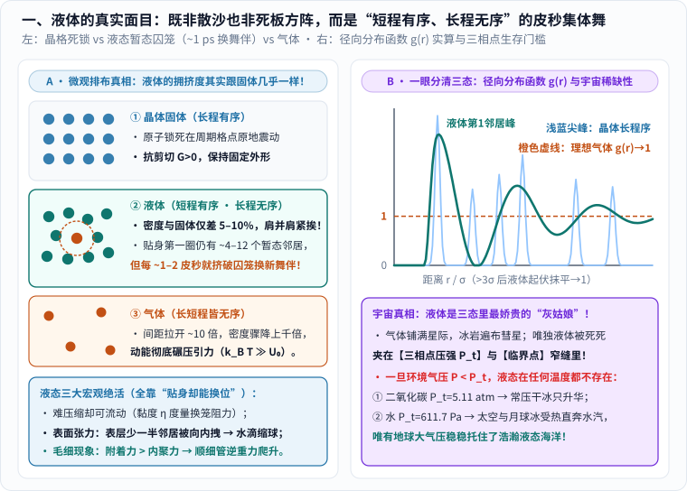
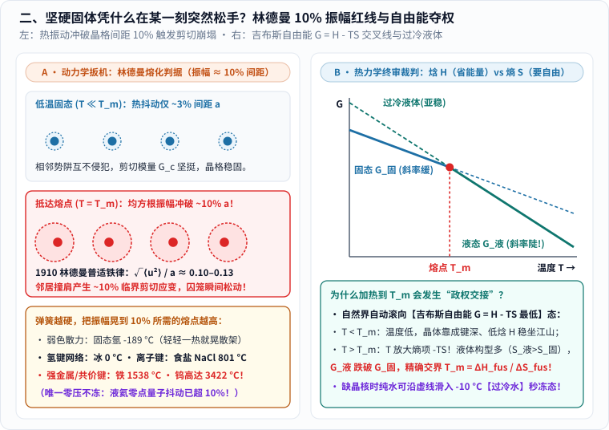
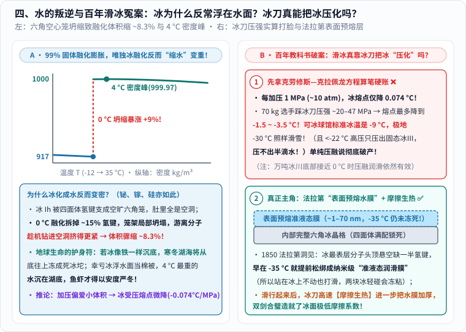
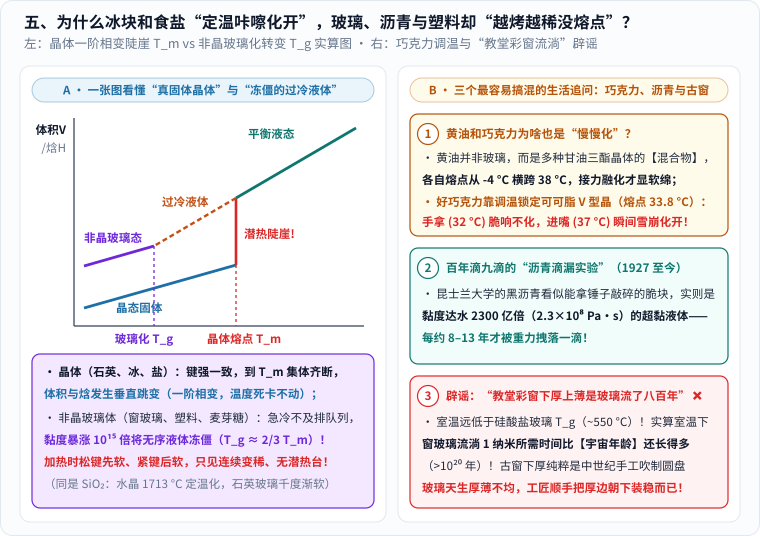

把一块零下 $$20\,^\circ\text{C}$$ 的坚冰放进锅里开大火猛烧，插上一支精密温度计，你会看到一幕违背直觉的怪事：

前几十秒，温度计一路爬升到 $$0.0\,^\circ\text{C}$$；可一旦锅底冒出第一滴液态水，任凭灶下蓝白色火苗呼呼猛舔整整五六分钟，锅里冰块越缩越小、液态水越来越多，温度计的读数却像焊死了一样**纹丝不动地钉在 $$0.0\,^\circ\text{C}$$**——直到最后一粒冰碴彻底消失的那一秒，水温才重新开始往上蹿！

围绕着“固体怎样变成液体、液体到底是什么”，日常生活里还藏着一连串让人越想越困惑的谜题：

1. **液体到底是“稠一点的气体”，还是“散了架的固体”？** 为什么一满杯水使出吃奶的力气也压不瘪千分之一，可轻轻一歪杯子它却哗啦流走？为什么浩瀚宇宙里到处是星云气体和彗星冰岩，唯独“海洋”罕见得像奇迹？
2. **坚硬的铁块、食盐和冰块，凭什么偏偏在某个精确温度“咔嚓松手”？** 原子之间又没有商量好，是谁给晶格下达了整齐划一的解散令？
3. **冰块化成水为什么不胀反缩？冰刀滑冰真像老课本写的那样“靠体重把冰压化出一层水”吗？** 拿热力学公式真刀真枪算一笔压强账，你会发现一个流传了上百年的教科书冤案！
4. **为什么冰块和食盐有铁打不动的熔点，而窗玻璃、塑料、黄油、巧克力和沥青却没有熔点，只会在火上“越烤越软、越烤越稀”？** 欧洲老教堂的彩色玻璃下厚上薄，真是玻璃在室温下偷偷流淌了八百年吗？

今天，我们就顺着一颗原子从晶格囚徒变成流动舞伴的全过程，把**液体的真实微观形式**与**从固体到液体的相变密码**彻底拆开看清。

---

## 一、液体的真实面目：既非散沙也非死板方阵，而是“短程有序、长程无序”的皮秒集体舞

很多人小时候背“固、液、气三态”时，脑海里会形成一个严重失真的画面：固体分子紧挨着排方阵，气体分子隔着十万八千里乱飞，那液体大概就是“分子之间留着半大不小的空隙，稀稀拉拉飘着”。

**错！如果拿尺子去量分子间距，液体的拥挤程度其实跟固体几乎一模一样！**

### 1. 肩并肩挤在一起，凭什么还能哗哗流动？

我们可以拿最熟悉的水和金属来做个定量对比（数据引自 OpenStax 大学化学教材 [*Chemistry 2e* §10.2–10.5](https://openstax.org/books/chemistry-2e/pages/10-2-properties-of-liquids)）：大多数固体在熔化成液体时，体积只膨胀 **$$3\%\text{–}10\%$$**（水甚至反过来缩小约 $$8.3\%$$）。换算成三维空间里的分子中心间距 $$d \propto \rho^{-1/3}$$，液体分子与最近邻居的距离跟固体相比**差别不到 $$3\%$$**——大家依然是肩并肩、肉贴肉地挤成一团！也正因为分子之间根本没有多余的空隙可压，液态水的等温压缩率极小，哪怕加上 $$100$$ 个大气压（约 $$1000$$ 米深海），水的体积也只缩小不到 $$0.5\%$$，这正是液压千斤顶能顶起几十吨卡车的底气。

既然挤得跟固体一样紧，液体凭什么不硬邦邦地抗拒变形，反而能顺着指缝流走？

秘密全在**“囚笼寿命”**四个字里：

- 在**晶体固体**中，每个原子都被化学键或分子间引力死死钉在周期性晶格格点上（关于离子键、共价键与金属键如何搭起固体骨架，可参看[化学键的底层密码]()）。它就算热得发抖，也只能围着原位打转，左边是谁、右边是谁，一辈子不换人。因此固体拥有非零的静态剪切模量 $$G > 0$$，能保持固定外形。
- 在**液体**中，分子热运动的能量刚好跨过了一道微妙门槛：**它还远不足以挣脱分子间引力飞向空中（$$k_{\mathrm{B} } T \sim U_0$$，不像气体那样 $$k_{\mathrm{B} } T \gg U_0$$），却已经足够推开身边肩膀的阻拦！** 于是，每颗液体分子都被周围 $$4\text{–}12$$ 颗贴身邻居围成一个**暂态囚笼（Transient Cage）**；它在笼子里抖动几十下，每隔大约 **$$1\text{–}2\text{ ps}$$（皮秒，$$10^{-12}$$ 秒）** 就会瞅准缝隙挤破囚笼，跟旁边的分子交换位置、换一批新舞伴！

先看上图左栏的三层微观对比，再对照右栏实算的曲线：物理学家为了给这种“贴身有规矩、远处没队形”的状态拍一张精准数学快照，定义了**径向分布函数 $$g(r)$$**（纽约大学 Mark E. Tuckerman 教授《高等统计力学》[*Advanced Statistical Mechanics* §7.3](https://chem.libretexts.org/Bookshelves/Physical_and_Theoretical_Chemistry_Textbook_Maps/Statistical_Mechanics_(Tuckerman)/07%3A_Classical_Fluids/7.03%3A_The_Radial_Distribution_Function)）：随便挑一颗分子当圆心，去数距离它 $$r$$ 处单位体积里出现邻居的概率是平均密度的多少倍——

1. **理想气体（橙色虚线）**：除了分子硬核不重叠之外毫无队形，处处 $$g(r) \to 1$$，平平无奇；
2. **晶体固体（浅蓝尖峰）**：每隔固定晶格距离就冒出一根高耸尖峰，哪怕往外量几百、几万层原子依然分毫不差，叫作**长程有序（Long-Range Order）**；
3. **液体（深青实线）**：在贴身第一圈（$$r \approx \sigma$$，分子直径）高高耸起**第一配位峰**，第二圈、第三圈还能看到微弱起伏，可一旦超过 **$$3\text{–}4$$ 个分子直径**（约 $$1$$ 纳米），波纹就迅速衰减抹平回 $$g(r) = 1$$！这就叫**“短程有序、长程无序”**——跟电影散场时拥挤的人流一模一样：你身边一米内永远紧挨着五六个人（短程有序），但十米开外根本排不出横平竖直的操场队列，整个人群还能顺着走廊拐弯流动（长程无序）！

### 2. 黏度、表面张力与毛细爬升：全是“贴身换笼”派生的绝活

一旦看懂了“肩并肩的皮秒换笼舞”，液体在生活里最迷人的三大宏观脾气就全通了（数据引自 OpenStax [*Chemistry 2e* §10.2](https://openstax.org/books/chemistry-2e/pages/10-2-properties-of-liquids)）：

- **黏度（Viscosity，$$\eta$$）就是“换笼摩擦阻力”**：分子形状越圆润、牵手越松，挤出囚笼越轻松，黏度就越低——$$25\,^\circ\text{C}$$ 时水的黏度仅 $$0.890\,\text{mPa}\cdot\text{s}$$；而蜂蜜里挤满了长链糖分子和密集氢键，彼此钩挂缠绕，黏度飙升到 $$2000\text{–}10000\,\text{mPa}\cdot\text{s}$$，倒出来就像慢动作丝带。
- **表面张力（Surface Tension，$$\gamma$$）来自“表层分子少了一半邻居”**：水内部的分子上下左右都被氢键均匀拉扯，合力为零；可最表层的水分子头顶是稀疏空气，**少了一半邻居向上的拉力**，结果被下方的同伴死死往肚子里面拽！想把一颗内部分子拉到表面扩大面积，就必须花能量扯断氢键。因此液体总是拼命把表面积缩到最小——荷叶上的露珠自动滚成表面积最小的圆球，水黾能拿细腿把水面压出酒窝当蹦床（$$25\,^\circ\text{C}$$ 纯水表面张力高达 $$71.99\,\text{mN/m}$$，在常见室温液体里仅次于金属键拉扯的液态汞 $$486.5\,\text{mN/m}$$）。
- **毛细现象（Capillary Action）**：当玻璃细管插进水里，二氧化硅管壁满是极性基团，对水分子的**附着力**比水分子彼此的**内聚力**还强，水就会顺着管壁往上爬，拉出凹液面并把整柱水逆着重力拽高——参天大树和毛巾吸水都有它的功劳。

### 3. 宇宙真相：液体其实是物质家族里最娇贵的“灰姑娘”

在地球上我们天天拧开水龙头接水，总觉得液体理所当然；可放眼整个宇宙（包括更高能的第四态，见[等离子体到底是什么]()），恒星里全是等离子体，星际空间飘满稀薄气体，彗星与小行星上冻满坚冰与岩石——**唯独自由存在的液体，在宇宙中罕见得近乎奢侈！**

为什么？翻开相图（OpenStax [*Chemistry 2e* §10.4](https://openstax.org/books/chemistry-2e/pages/10-4-phase-diagrams)）就能看到一条铁律：**任何物质想要拥有液态，环境气压 $$P$$ 必须高于它的“三相点压强 $$P_{\mathrm{t} }$$”！** 一旦气压低于 $$P_{\mathrm{t} }$$，分子刚从固体晶格挣脱出来，头顶没有足够的气压盖子按住它，就会跳过液态**直接升华成气体**：

- 二氧化碳的三相点高达 $$P_{\mathrm{t} } = 5.11\,\text{atm}$$（$$-56.6\,^\circ\text{C}$$）。地球常压只有 $$1\,\text{atm}$$，低于门槛，所以舞台上的“干冰”受热永远不会化成一滩液态二氧化碳，只会直接冒白烟升华；
- 水的三相点在 $$P_{\mathrm{t} } = 611.7\,\text{Pa}$$（约 $$0.006\,\text{atm}$$，$$0.01\,^\circ\text{C}$$）。外太空、月球表面乃至火星绝大部分低气压荒漠都低于或擦着这条生死线，冰块晒太阳只能直接跑成水汽；**恰恰是因为地球拥有厚实的 $$101.3\,\text{kPa}$$ 大气被子稳稳压在 $$611.7\,\text{Pa}$$ 之上，液态海洋才得以在地球表面安稳流淌了四十亿年！**

---

## 二、坚硬固体凭什么在某一刻突然松手？林德曼 10% 振幅红线与自由能夺权

现在我们回到最核心的问题：**一块冷冰冰、硬邦邦的晶体固体，不断给它加热时，内部到底发生了什么，让它在熔点 $$T_{\mathrm{m} }$$ 那一刻突然集体松手变成液体？**

这背后有一套极其漂亮的**“微观动力学扳机 + 宏观热力学终审”**双层机制。

### 1. 微观扳机：林德曼 10% 晶格振幅红线（1910）

哪怕在零下两百度的严寒里，固体里的原子也绝不是静止的，而是在各自晶格平衡位置附近像拴着弹簧的小球一样不停热振动。温度 $$T$$ 越高，振动能量 $$k_{\mathrm{B} } T$$ 越大，原子的摆幅就越剧烈。

1910 年，德国物理学家弗雷德里希·林德曼（Frederick Lindemann）提出了一个震惊凝聚态物理界的普适猜想（现代中子散射与剪切模量重审见 Buchenau, Zorn & Ramos 2013 综述论文 [*A new view of the Lindemann criterion*, arXiv:1311.4739](https://arxiv.org/abs/1311.4739)）：不管是零下 $$189\,^\circ\text{C}$$ 就融化的固态氩、$$0\,^\circ\text{C}$$ 融化的冰，还是 $$3422\,^\circ\text{C}$$ 才融化的灯丝金属钨，**当原子热振动的均方根位移 $$\sqrt{ \langle u^2 \rangle }$$ 增大到相邻原子间距 $$a$$ 的大约 $$10\%\text{–}13\%$$ 时，晶格必定崩溃熔化！**

$$
\delta_{\mathrm{L} } = \frac{\sqrt{ \langle u^2 \rangle } }{a} \approx 0.10 \sim 0.13 \quad (\text{单方向坐标约 } 0.072\,a)
$$

看上图左栏上下两排原子的振动红圈：

- 当低温振幅只有 $$2\%\text{–}3\%\,a$$ 时，每颗原子乖乖待在自己的势阱碗底，互不侵犯；
- 可一旦加热让振幅冲破 **$$10\%\,a$$** 红线，相邻两颗原子面对面晃过来时就会猛烈“撞肩”，在局部瞬间制造出约 **$$10\%$$ 的临界剪切应变**！此时把原子塞进隔壁空隙的能量壁垒急剧塌陷，原本抵抗变形的晶体剪切模量 $$G_{\mathrm{c} }$$ 再也锁不住队形，缺陷与换位像雪崩一样席卷全晶格——固体咔嚓松手，化作流动的液体！

这条 $$10\%$$ 红线还顺带解开了两个大谜团：

1. **为什么不同固体熔点差几千度？** 因为把弹簧晃开 $$10\%$$ 所需的温度正比于化学键刚度 $$k a^2$$！氩原子之间只有微弱的范德华色散力，$$-189\,^\circ\text{C}$$ 的微弱热能就能晃破 $$10\%$$；食盐 $$\text{NaCl}$$ 靠强静电离子键拉扯，得烧到 $$801\,^\circ\text{C}$$；金属钨靠密集的 $$d$$ 轨道共价—金属键锁死，足足要烧到 $$3422\,^\circ\text{C}$$ 才能晃开那要命的 $$10\%$$！
2. **为什么唯独“氦（$$\text{He}$$）”在常压下哪怕降到绝对零度（$$0\,\text{K}$$）也冻不成固体？** 因为氦原子质量太轻、彼此吸引力又太弱，光靠海森堡不确定性原理赋予的**量子零点振动**，振幅就已经超过了原子间距的 $$30\%$$（远超 $$10\%$$ 林德曼红线）！除非外加 $$25$$ 个大气压硬把它摁住，否则液氦天生就是永不冻结的量子液体。

### 2. 热力学终审裁判：焓 $$H$$（省能量）与熵 $$S$$（要自由）的政权交接

如果说林德曼判据讲清了“原子怎么晃散架”，那么热力学第二定律则精确算出了**熔点 $$T_{\mathrm{m} }$$ 到底落在几度**。

在恒温恒压下，大自然永远偏爱**吉布斯自由能 $$G$$ 最低**的状态：

$$
G = H - T S
$$

公式里的两项是一对死对头：

- **焓 $$H$$（成键深度 / 省能量派）**：整齐排成晶格时，每根化学键都对准最舒服的角度和距离，势能最深、焓 $$H_{\text{固} }$$ 最低；一旦化成液体扯歪一部分键，焓变高（$$H_{\text{液} } > H_{\text{固} }$$，差值就是熔化焓 $$\Delta H_{\text{fus} } > 0$$）。光看省能量，固体永远占优。
- **熵 $$S$$（微观花样数 / 要自由派）**：固体原子死守格点，排法单一，熵 $$S_{\text{固} }$$ 小；液体允许原子每秒上万亿次换囚笼、解锁海量无序构型（简单原子液体每颗原子大约多出 $$\Delta S_{\text{fus} } \approx k_{\mathrm{B} }$$ 的构型熵，对应摩尔熔化熵约 $$8\text{–}10\,\text{J/(mol}\cdot\text{K)}$$，即理查兹规则），所以 **$$S_{\text{液} } > S_{\text{固} }$$**！

再看上图右栏的两条斜线（横轴为温度 $$T$$，斜率 $$\partial G / \partial T = -S$$）：因为液体的熵更大，**液态自由能曲线 $$G_{\text{液} }(T)$$ 往下倾斜得比固态 $$G_{\text{固} }(T)$$ 更陡！**

- 当 **$$T < T_{\mathrm{m} }$$** 时，温度因子 $$T$$ 很小，“要自由”的 $$-TS$$ 项掀不起风浪，省能量的蓝线 $$G_{\text{固} }$$ 位置更低，**固体稳坐江山**；
- 当 **$$T > T_{\mathrm{m} }$$** 时，高温把 $$-TS$$ 权重彻底放大，陡峭的青线 $$G_{\text{液} }$$ 一举跌破蓝线，**液体夺取政权**；
- 两条线相交的那一点（$$\Delta G = \Delta H_{\text{fus} } - T_{\mathrm{m} } \Delta S_{\text{fus} } = 0$$），就是固液两相平起平坐、和平共处的**精确熔点**：

$$
T_{\mathrm{m} } = \frac{\Delta H_{\text{fus} } }{\Delta S_{\text{fus} } }
$$

> **顺手看懂网红实验“零下十度矿泉水一拍秒结冰”**：液体结冰时需要先凑出几百个分子排齐的微小“晶核”，跨越界面能小山坡。如果一瓶超纯水极其干净、容器极其光滑，降温越过 $$0\,^\circ\text{C}$$ 时找不到晶核带头，它就会顺着上图右栏青色虚线滑进 **$$-5\,^\circ\text{C}$$ 甚至 $$-15\,^\circ\text{C}$$ 的亚稳态“过冷水（Supercooled Water）”**！此时它的自由能明明比冰高，像拉满的捕鼠夹；你只要伸手猛拍瓶身制造一串空化微气泡当晶核，整瓶水就会在一两秒内刷地长满冰花！

---

## 三、猛火一直烧，为什么冰水混合物死卡在 0 °C 不升温？334 kJ/kg 熔化潜热账本

解开了熔点的由来，开头那个“猛火烧冰五分钟、温度计死锁 $$0.0\,^\circ\text{C}$$”的厨房怪象就可以逐笔对账了。

让我们拿 **$$1\,\text{kg}$$（即 $$55.51\,\text{mol}$$）零下 $$20\,^\circ\text{C}$$ 的冰**，按真实实验热力学参数（OpenStax [*Chemistry 2e* §10.3](https://openstax.org/books/chemistry-2e/pages/10-3-phase-transitions)：冰比热容 $$c_{\text{冰} } \approx 2.09\,\text{kJ/(kg}\cdot\text{K)}$$，水摩尔熔化焓 $$\Delta H_{\text{fus} } = 6.01\,\text{kJ/mol}$$ 即 $$333.6\,\text{kJ/kg}$$，液态水比热容 $$c_{\text{水} } = 4.184\,\text{kJ/(kg}\cdot\text{K)}$$），完整算一遍它从 $$-20\,^\circ\text{C}$$ 烧到 $$100\,^\circ\text{C}$$ 的三笔能量账：

1. **第一段（冰升温：$$-20\,^\circ\text{C} \to 0\,^\circ\text{C}$$）**：吸收热量 $$Q_1 = 1.0 \times 2.09 \times 20 = \mathbf{41.8\,\text{kJ} }$$。热量让冰晶格里的水分子越抖越凶，温度飞快爬到 $$0\,^\circ\text{C}$$ 熔点红线。
2. **第二段（固液共存潜热长平台：$$0\,^\circ\text{C}$$ 冰 $$\to 0\,^\circ\text{C}$$ 水）**：接下来必须足足灌进 **$$Q_2 = 55.51 \times 6.01 = \mathbf{333.6\,\text{kJ} }$$** 的热量，才能把这 $$1\,\text{kg}$$ 冰全部化完！注意看这个数字有多吓人：**光是把 $$0\,^\circ\text{C}$$ 的冰变成 $$0\,^\circ\text{C}$$ 的水吞掉的 $$333.6\,\text{kJ}$$ 热量，如果拿去烧同等重量的 $$0\,^\circ\text{C}$$ 液态水，足够把它直接烧到 $$333.6 \div 4.184 = \mathbf{79.7\,^\circ\text{C} }$$ 的烫嘴热茶！**
3. **第三段（液态水升温：$$0\,^\circ\text{C} \to 100\,^\circ\text{C}$$）**：最后一粒冰化尽后，再注入 $$Q_3 = 1.0 \times 4.184 \times 100 = \mathbf{418.4\,\text{kJ} }$$，水温一路升至沸点（随后还将迎来更夸张的 $$2257\,\text{kJ/kg}$$ 汽化平台，这也是[哈气暖手与汗水蒸发降温外挂]()的能量源泉）。

*（提示：可并在浏览器刷新重播单次描线过程；开启系统“减少动态效果”或静态阅读时均完整保留实算折线与数值标注。）*

### 1. 火苗灌进去的 334 千焦能量，到底藏哪儿去了？

为什么第二段灌进整整 $$333.6\,\text{kJ}$$ 的真金白银热量，温度计却瞎了一样一格不涨？

答案藏在**温度计的“偏心眼”**里：

$$
T \propto \langle E_{\mathrm{k} } \rangle \quad (\text{温度只测量分子热运动的平均动能！})
$$

分子的总内能 $$U = E_{\mathrm{k} } + U_{\text{pot} }$$ 分成两个账户：**动能账户 $$E_{\mathrm{k} }$$**（跑和抖有多快）与**势能账户 $$U_{\text{pot} }$$**（克服化学键拉力爬到了多高的势阱台阶上）。温度计只能看见动能账户，对势能账户完全失明！

在 $$0.0\,^\circ\text{C}$$ 的冰水混合物里，只要还有固相冰存在，灶火送进来的每一焦耳能量，一旦想让局部水温冒头超过 $$0\,^\circ\text{C}$$，就会立刻传导给紧挨着的 $$0\,^\circ\text{C}$$ 冰晶界面，**$$100\%$$ 当作“拆键赎身费”存进势能账户 $$\Delta U_{\text{pot} }$$**，用来把水分子从六角晶格座位上撬下来！分子的平均运动速度一分没涨，温度自然纹丝不动地死锁在 $$0.0\,^\circ\text{C}$$——1761 年苏格兰化学家约瑟夫·布莱克（Joseph Black）正是看穿了这笔“藏起来不被温度计察觉的热”，才把它命名为**熔化潜热（Latent Heat of Fusion）**。

更妙的是，把熔化焓（$$6.01\,\text{kJ/mol}$$）跟完全扯断所有氢键变成水蒸气的汽化焓（$$0\,^\circ\text{C}\text{–}25\,^\circ\text{C}$$ 约 $$44\text{–}45\,\text{kJ/mol}$$，$$100\,^\circ\text{C}$$ 时 $$40.67\,\text{kJ/mol}$$）一除：

$$
\frac{6.01}{44.0} \approx 13.7\%
$$

立刻验证了我们在第一节讲的微观图景：**冰融化成水时，根本没有把氢键全拆光，而仅仅拆断（或严重扭弯）了约 $$13\%\text{–}15\%$$ 的刚性氢键！** 剩下八成以上的氢键依然在液态水里以皮秒级速度一边断开、一边重连——花一成半的赎身费，就换来了整杯水的自由流淌！

### 2. 冰块镇可乐为什么比 0 度冰水猛 8 倍？

看懂了潜热账本，两个生活现象瞬间透亮：

- **夏天冰镇饮料必须加冰块，光倒 $$0\,^\circ\text{C}$$ 冰水没用**：如果往热可乐里兑 $$100\,\text{g}$$ 的 $$0\,^\circ\text{C}$$ 液态冰水，它升到 $$10\,^\circ\text{C}$$ 只能吸走 $$4.2\,\text{kJ}$$ 热量；而同样放进 $$100\,\text{g}$$ 的 $$0\,^\circ\text{C}$$ 冰块，光是化成 $$0\,^\circ\text{C}$$ 水就要狂吸 $$33.4\,\text{kJ}$$ 潜热，再加上升到 $$10\,^\circ\text{C}$$ 的 $$4.2\,\text{kJ}$$，**吸热降温本领足足是同温冰水的近 $$9$$ 倍**，而且没化完之前能把整杯饮料稳稳摁在 $$0\,^\circ\text{C}$$ 附近！
- **为什么俗话说“下雪不冷化雪冷”？** 高空水汽凝华成雪花时向外释放潜热，往往伴随暖湿气流抬升；而雪停转晴开始融雪时，漫山遍野的积雪每化掉 $$1\,\text{kg}$$ 就要从地表空气里硬抽走 $$333.6\,\text{kJ}$$ 热量，再叠加上冷锋过境与潮湿空气极高的导热损耗，体感自然冷得刺骨。

---

## 四、水的叛逆与百年滑冰冤案：冰为什么反常浮在水面？冰刀真能把冰压化吗？

宇宙里 $$99\%$$ 的物质（铁、铜、蜡烛、猪油、食盐）从固体熔化成液体时，因为原子挤开了松散囚笼，**体积都会膨胀、密度都会变小**——把一块固体铁扔进铁水里，铁块会哐当沉底；把一块凝固的蜡扔进熔化的蜡油里，蜡块也会乖乖沉底。

唯独我们每天喝的**水**（以及硅、锗、镓、铋等极少数具有开阔方向性共价/准共价骨架的物质），上演了一出拯救地球生命的惊天叛逆！

### 1. 六角空心笼坍缩：融化反而“缩水” 8.3%，4 °C 沉底护住整湖生命

正如我们在[雪花与冰晶的数学物理原理]()中详细算过的那样，水分子带着 $$104.5^\circ$$ 的弯角和两正两负四个氢键抓手。结成常压六方冰（$$\text{Ice Ih}$$）时，每颗水分子为了严丝合缝配齐四个四面体方向氢键，被迫把彼此支开，搭成一座**肚子里全是六角形大空洞的镂空水晶宫**，密度只有 **$$916.7\,\text{kg/m}^3$$**。

当温度升到 $$0\,^\circ\text{C}$$ 拆掉那 $$13\%\text{–}15\%$$ 的氢键时，奇迹发生了：**部分空心六角笼轰然坍塌，挣脱束缚的游离水分子趁机钻进了原本空荡荡的笼心空隙里！**

看上图左栏实算的密度跳变曲线：

- 在 $$0\,^\circ\text{C}$$ 融化瞬间，水的密度从冰的 $$916.7\,\text{kg/m}^3$$ 垂直暴涨约 **$$+9.1\%$$** 到液态水的 **$$999.84\,\text{kg/m}^3$$**（对应体积反常缩小约 **$$8.3\%$$**——反之水结冰体积暴胀约 $$9\%$$，足以把冬天室外的铸铁水管和密封啤酒瓶活活撑裂！）；
- 化成水之后，从 $$0\,^\circ\text{C}$$ 继续加热到 $$4\,^\circ\text{C}$$，残余冰状微团簇还在继续坍缩钻空隙（增密效应）并压过了普通热胀冷缩（减密效应），直到 **$$3.98\,^\circ\text{C}$$** 才抵达液态水的最高密度峰 **$$999.97\,\text{kg/m}^3$$**！

别小看这短短 $$4$$ 度的反常：假如冰跟铁块一样比液态重，冬天湖面结的每一层薄冰都会立刻沉入湖底，新露出的水面继续结冰沉底，不出一个寒冬，江河湖海就会从底往上冻成晒不化的实心死冰坨！正因为冰比水轻浮在表面当隔热棉被，而最重的 $$4\,^\circ\text{C}$$ 液态水稳稳沉在湖底，鱼虾和早期水生生命才得以躲过一次次冰期浩劫。

### 2. 百年教科书破案：冰刀滑冰，真靠体重把冰“压化”吗？

因为冰的体积比水大（$$\Delta v = v_{\text{水} } - v_{\text{冰} } < 0$$），根据热力学**克劳修斯—克拉佩龙方程（Clausius–Clapeyron Equation）**，给冰施加高压会偏爱体积更小的液态水，从而让冰的熔点随压强略微降低：

$$
\frac{\mathrm{d}T_{\mathrm{m} } }{\mathrm{d}P} = \frac{T_{\mathrm{m} } (v_{\text{水} } - v_{\text{冰} })}{\Delta H_{\text{fus} } }
$$

1886 年，爱尔兰物理学家约翰·乔利（John Joly）据此提出了一个写进全世界无数中学课本的优美解释：“滑冰运动员踩在窄窄的冰刀上压强极大，把脚下的冰压低熔点融化成水膜，所以冰面才滑！”

**听起来严丝合缝？让我们把真实物理常数代进上面的公式，现场算一笔硬账**（定量综述引自美国奥伯林学院化学家 Robert Rosenberg 2005 年发表于《今日物理》的经典论文 [*Why Is Ice Slippery?*, Physics Today 58(12), 50–55](https://physicstoday.aip.org/features/why-is-ice-slippery)）：

取 $$T_{\mathrm{m} } = 273.15\,\text{K}$$，$$v_{\text{水} } - v_{\text{冰} } = \frac{1}{999.84} - \frac{1}{916.7} = -9.07 \times 10^{-5}\,\text{m}^3/\text{kg}$$，$$\Delta H_{\text{fus} } = 3.336 \times 10^5\,\text{J/kg}$$，算出斜率：

$$
\frac{\mathrm{d}T_{\mathrm{m} } }{\mathrm{d}P} \approx -0.0743\,\text{K/MPa} \quad (\text{即每加压 } 10\text{ 个大气压，冰熔点才降 } 0.074\,^\circ\text{C}\text{！})
$$

现在请一位 $$70\,\text{kg}$$（重力约 $$686\,\text{N}$$）的花样滑冰选手单脚踩在冰刀上：冰刀有效接触刃宽约 $$1.5\,\text{mm}$$、接触长度约 $$15\text{–}20\,\text{cm}$$（接触面积约 $$2.2\text{–}3.0 \times 10^{-4}\,\text{m}^2$$），压强只有 **$$2.3\text{–}3.1\,\text{MPa}$$**，连让冰熔点降 **$$0.3\,^\circ\text{C}$$** 都做不到！就算冰刀只有极短一段刃尖着冰，把局部压强极限推高到 $$20\text{–}47\,\text{MPa}$$，冰的熔点也顶多降到 **$$-1.5\,^\circ\text{C} \sim -3.5\,^\circ\text{C}$$**！

**打脸的事实来了：**

1. 国际标准室内冰球馆的比赛冰面温度常年维持在 **$$-9\,^\circ\text{C}$$** 左右，冬奥会高山滑雪与越野滑雪在 **$$-20\,^\circ\text{C}$$ 乃至 $$-30\,^\circ\text{C}$$** 照样飞驰！
2. 更绝杀的是，水相图上液态水能靠加压存在的最低温度极限在 **$$-22\,^\circ\text{C}$$**（$$209.9\,\text{MPa}$$）——低于 $$-22\,^\circ\text{C}$$ 时，哪怕你拿液压机加再大的压强，六方冰只会变成更致密的**固态冰 III（Ice III）**，一滴液态水都压不出来！
3. 何况你穿着平底橡胶鞋（压强不到 $$0.03\,\text{MPa}$$，熔点变化 $$< 0.003\,^\circ\text{C}$$）站上冰面，照样脚底打滑摔跟头！

（注：压融机制并非全无用武之地——在厚达数百米、底部温度本来就贴近 $$0\,^\circ\text{C}$$ 的温带冰川底部，岩石凸起处的高压融水确实帮助冰川绕过障碍缓慢滑动；但在人类滑冰与滑雪场景下，单纯压融说早已破产。）

### 3. 真正让冰面打滑的两位幕后真凶

既然不是冰刀压化的，冰面上的润滑水膜到底是从哪儿冒出来的？答案是上图右栏下半部分展示的**“双剑合璧”**（Rosenberg, [*Physics Today* 2005](https://physicstoday.aip.org/features/why-is-ice-slippery)）：

- **第一功臣：法拉第“表面预熔准液态层”（Intrinsic Surface Premelting）**。早在 1850 年，迈克尔·法拉第在皇家学会拿两块冰轻轻一碰发现它们瞬间冻粘在一起时，就天才地猜到了真相——冰晶内部的水分子有上下左右完整的四面体氢键锁死，可**最表层的水分子头顶悬空、天生少了一半氢键抓手**！拴得松，自然不需要等到 $$0\,^\circ\text{C}$$ 才晃散架！现代 X 射线衍射、核磁共振与原子力显微镜证实：**哪怕在 $$-30\,^\circ\text{C} \sim -35\,^\circ\text{C}$$ 的严寒里，冰的最外表面也天生裹着一层厚约 $$1\text{–}70\,\text{nm}$$、无需任何外压就自动松绑的“准液态水膜（Quasi-Liquid Layer）”！** 所以你穿平底鞋一脚踩上去，哪怕一动不动，脚底下也已经踩着一层天然纳米滚珠润滑油了（直到接近 $$-40\,^\circ\text{C}$$ 极寒时这层膜彻底冻薄，南极探险家才会感觉雪地涩得像沙子一样拉不动雪橇）。
- **第二功臣：高速摩擦生热（Frictional Heating）**。1939 年剑桥大学 Bowden 与 Hughes 在瑞士高山冰洞里用木头、金属等不同导热率的雪橇实测证明：一旦冰刀或雪板高速滑行起来，刀刃与冰面剧烈摩擦产生的热量集中在微米级接触点上，瞬间把那层纳米级预熔水膜加热增厚成微米级液态水垫，让摩擦系数暴跌到 $$0.005\text{–}0.02$$ 的极低水平！

---

## 五、为什么冰块和食盐“定温咔嚓化开”，玻璃、沥青与塑料却“越烤越稀没熔点”？

最后，我们把厨房和工坊里另一半“明明也是硬块变软流淌，却根本找不到熔点”的古怪固体请上台面：为什么冰块有 $$0\,^\circ\text{C}$$ 熔点、纯铁有 $$1538\,^\circ\text{C}$$ 熔点，可玻璃匠吹玻璃管、修路工人熬黑沥青、小朋友烤热熔胶棒时，它们却没有一个固定熔点，只是随着温度升高**从硬变韧、从韧变软、像麦芽糖一样越拉越稀**？

### 1. 真固体“晶体” vs 冻僵的无序液体“非晶玻璃体”

看清这件事，只需要比较同样由二氧化硅（$$\text{SiO}_2$$）组成的两兄弟（OpenStax [*Chemistry 2e* §10.5](https://openstax.org/books/chemistry-2e/pages/10-5-the-solid-state-of-matter)）：

- **天然水晶（石英晶体）**：硅氧四面体按严格周期阵列排得整整齐齐，**每一根 $$\text{Si—O}$$ 键的长度、角度和键能全都一模一样**。加热到 $$1713\,^\circ\text{C}$$ 时，所有化学键在同一时刻达到林德曼红线集体齐断，体积与焓发生垂直跳变（热力学**一阶相变**），展现出刀切般锋利的熔点 $$T_{\mathrm{m} }$$ 和潜热平台。
- **石英玻璃 / 普通窗玻璃（非晶态固体 Amorphous Solid）**：把熔融的液态二氧化硅快速冷却时，黏稠的硅氧网络来不及找座位排队结成晶体，在大约 **$$T_{\mathrm{g} } \approx \frac{2}{3} T_{\mathrm{m} }$$**（玻璃化转变温度，普通钠钙窗玻璃约 $$550\,^\circ\text{C}$$；见 Buchenau et al. [arXiv:1311.4739](https://arxiv.org/abs/1311.4739)）附近，液体的黏度暴涨了足足 **$$10^{15}$$ 倍**（超过 $$10^{12}\,\text{Pa}\cdot\text{s}$$），分子换笼的时间从皮秒拉长到了几百年乃至几亿年——**它本质上是一盆还没来得及排队就被“原地冻僵”的无序过冷液体！**

对照上图左栏的体积/焓—温度曲线：因为非晶玻璃体内部的键角和键长歪七扭八、有松有紧，给它重新加热跨过玻璃化温度 $$T_{\mathrm{g} }$$ 时，**最松的键先软化松动，较紧的键后松动，根本不存在“同一温度集体齐断”的潜热陡崖**！所以玻璃、松香、麦芽糖和绝大多数非晶塑料（如有机玻璃 PMMA、聚苯乙烯）都没有固定熔点，而是在几百度的宽温区里连续变软——这恰恰是玻璃工匠的福音：如果玻璃像冰块一样上一秒硬邦邦、下一秒哗啦变成稀水，人类根本没法吹制灯泡、酒杯和实验室烧瓶！

### 2. 三个最容易搞混的生活追问：黄油巧克力、百年沥青与教堂古窗

顺着这张图右栏的三张卡片，我们还能一口气破掉三个流传极广的迷思：

1. **黄油和巧克力为啥也是“慢慢变软”，它们也是玻璃吗？**
   不是！黄油之所以从冰箱拿出来先硬后软，是因为牛奶脂肪并非单一纯净物，而是**几十种长短不一的甘油三酯晶体的混合物**，不同成分各自的晶体熔点从 $$-4\,^\circ\text{C}$$ 一路铺到 $$38\,^\circ\text{C}$$，随温度升高分批接力融化！而可可脂更绝：它能结出 I 到 VI 共**六种不同排法的晶型（同质多晶）**，熔点从 $$17\,^\circ\text{C}$$ 到 $$36\,^\circ\text{C}$$ 不等。顶级巧克力师费尽心机“调温（Tempering）”，就是为了把可可脂全部诱导出**熔点恰好在 $$33.8\,^\circ\text{C}$$ 的第 V 晶型**——比手指温度（约 $$31\text{–}32\,^\circ\text{C}$$）略高，拿在手里清脆响亮不粘手；一放进 $$37\,^\circ\text{C}$$ 的嘴巴里，瞬间整体跨过晶体陡崖，丝滑雪崩般化满舌尖！
2. **拿锤子能敲碎的黑沥青，到底是固体还是液体？**
   1927 年，澳大利亚昆士兰大学的托马斯·帕内尔（Thomas Parnell）教授把加热的沥青倒进封口漏斗，三年后剪开漏斗嘴悬空放置。这块在室温下拿铁锤一砸就脆裂成碎片的黑疙瘩，其实正处在玻璃化转变区上方的**超黏无序液体**状态（黏度约为水的 $$2300$$ 亿倍，$$\eta \approx 2.3 \times 10^8\,\text{Pa}\cdot\text{s}$$）——在将近一百年的漫长岁月里，它全靠重力一寸寸往下流，平均每 **$$8\text{–}13$$ 年**才啪嗒滴落一滴（截至目前共滴落 $$9$$ 滴），成了吉尼斯认证的全球最长寿实验室演示！
3. **终极辟谣：“欧洲中世纪大教堂的彩色玻璃下厚上薄，是因为玻璃是液体流了八百年”——真的吗？**
   **彻头彻尾的都市传说！** 诚然玻璃在微观结构上属于非晶无序态，但在 $$20\,^\circ\text{C}$$ 室温下（远低于钠钙硅酸盐玻璃约 $$550\,^\circ\text{C}$$ 的 $$T_{\mathrm{g} }$$），它的平衡黏度高得突破天际（外推超过 $$10^{35}\,\text{Pa}\cdot\text{s}$$）。美国康宁公司材料学家 Edgar D. Zanotto（1998，《美国物理杂志》*Am. J. Phys.* 66, 392）与 Yvonne Stokes（1999）早就严格算过：**在室温重力下，一块中世纪教堂窗玻璃哪怕想往下流淌区区 $$1$$ 纳米、让底部肉眼可辨地变厚，所需的时间超过 $$10^{20}$$ 年——比 $$138$$ 亿年的宇宙年龄还要长出一百亿倍！** 有些古窗之所以一头厚一头薄（甚至有的上厚下薄、左厚右薄！），纯粹是因为中世纪工匠采用“旋转吹制圆盘法（Crown Glass）”手工甩制玻璃片时边缘天生厚薄不均，镶嵌师傅为了结构稳固，大多顺手把厚重的一边朝下装进铅框里罢了！

---

## 六、全文收束：一张表装走固液三态与熔化全账本

下次当你端起一杯咔嚓作响的冰美式，看着透明的冰块浮在液面、温度稳稳停在 $$0\,^\circ\text{C}$$，透过玻璃杯壁望向窗外时，不妨在脑海里回放这张纵贯微观与宏观的物理全景表：

| 核心问题 | 物理机制与定量硬指标 | 日常印证与反直觉推论 |
| :--- | :--- | :--- |
| **液体到底是什么形态？** | 分子间距与固体相差 $$<3\%$$，但每 $$1\text{–}2\,\text{ps}$$ 冲破暂态囚笼换舞伴；$$g(r)$$ 呈**短程有序、长程无序**；仅存于气压 $$P > P_{\mathrm{t} }$$ 区间 | 难压缩却可流动；表层少一半邻居产生表面张力；常压低于 $$\text{CO}_2$$ 三相点 $$5.11\,\text{atm}$$ 故干冰只升华 |
| **固体为何在熔点突然松手？** | **林德曼判据**：热振动均方根振幅冲破原子间距 **$$10\%\text{–}13\%$$**；热力学上 $$T_{\mathrm{m} } = \Delta H_{\text{fus} }/\Delta S_{\text{fus} }$$ 处 $$G_{\text{液} }$$ 跌破 $$G_{\text{固} }$$ | 键越硬熔点越高（氩 $$-189\,^\circ\text{C}$$ vs 钨 $$3422\,^\circ\text{C}$$）；液氦量子零点抖动超 $$10\%$$ 故常压永不冻结 |
| **猛火烧冰为何死卡 $$0\,^\circ\text{C}$$？** | 温度只测平均动能；$$333.6\,\text{kJ/kg}$$ **熔化潜热** $$100\%$$ 转为拆断约 $$14\%$$ 氢键的分子势能 | 同重 $$0\,^\circ\text{C}$$ 冰块镇饮料吸热能力是 $$0\,^\circ\text{C}$$ 冰水的近 $$9$$ 倍；冰水共存天然定标 $$0.00\,^\circ\text{C}$$ |
| **冰为何浮水？冰面为何滑？** | 六角氢键空笼融化坍缩使体积反常缩小 **$$8.3\%$$**（$$4\,^\circ\text{C}$$ 密度最重）；冰刀压融仅降温 $$1\text{–}3\,^\circ\text{C}$$ 远不够用 | 浮冰护住冬季湖底生命；冰面滑靠**法拉第表面预熔纳米水膜**（至 $$-35\,^\circ\text{C}$$）+ **摩擦生热** |
| **玻璃与沥青为何没有熔点？** | 急冷跳过结晶，在 $$T_{\mathrm{g} } \approx \frac{2}{3} T_{\mathrm{m} }$$ 黏度暴涨 $$10^{15}$$ 倍冻成**非晶玻璃体**；键强不均故连续软化无潜热台 | 巧克力调温锁定 $$33.8\,^\circ\text{C}$$ 第 V 晶型；沥青百年滴九滴；教堂古窗下厚纯属手工吹制误差 |

原来，从硬邦邦的固体到温柔流淌的液体，根本不是原子突然变远了，而是它们在热能的鼓点下，把死守一辈子的固定座位，跳成了一场每秒上万亿次换舞伴却依然紧紧相拥的集体圆舞曲。

---

## 参考资料与核查来源

1. **OpenStax（莱斯大学开源大学化学教材）**，Paul Flowers et al., *Chemistry 2e*, Chapter 10 *Liquids and Solids*：
   - [§10.2 Properties of Liquids](https://openstax.org/books/chemistry-2e/pages/10-2-properties-of-liquids)（核查水与常见液体黏度、$$25\,^\circ\text{C}$$ 水表面张力 $$71.99\,\text{mN/m}$$ 与汞 $$486.5\,\text{mN/m}$$、表层分子配位不对称与毛细现象机制）；
   - [§10.3 Phase Transitions](https://openstax.org/books/chemistry-2e/pages/10-3-phase-transitions)（核查水摩尔熔化焓 $$\Delta H_{\text{fus} } = 6.01\,\text{kJ/mol} = 333.6\,\text{kJ/kg}$$、汽化焓对比及升温曲线 $$0\,^\circ\text{C}$$ 固液共存恒温平台能量计算）；
   - [§10.4 Phase Diagrams](https://openstax.org/books/chemistry-2e/pages/10-4-phase-diagrams)（核查水三相点 $$611.7\,\text{Pa} / 0.01\,^\circ\text{C}$$、二氧化碳三相点 $$5.11\,\text{atm} / -56.6\,^\circ\text{C}$$ 与固液共存线负斜率）；
   - [§10.5 The Solid State of Matter](https://openstax.org/books/chemistry-2e/pages/10-5-the-solid-state-of-matter)（核查晶体固体与非晶态固体如石英水晶 vs 石英玻璃的微观排布与软化差异）。
2. **Mark E. Tuckerman（纽约大学化学与数学教授）**，*Statistical Mechanics: Theory and Molecular Simulation*（LibreTexts 公开章节 [§7.3 The Radial Distribution Function](https://chem.libretexts.org/Bookshelves/Physical_and_Theoretical_Chemistry_Textbook_Maps/Statistical_Mechanics_(Tuckerman)/07%3A_Classical_Fluids/7.03%3A_The_Radial_Distribution_Function)）：核查径向分布函数 $$g(r)$$ 严格统计力学定义，以及理想气体、短程有序衰减振荡液体与长程周期晶体三态 $$g(r)$$ 特征。
3. **U. Buchenau, R. Zorn, and M. A. Ramos** (2014), *"Probing cooperative liquid dynamics with the mean square displacement"* / 预印本 [*"A new view of the Lindemann criterion"*, arXiv:1311.4739](https://arxiv.org/abs/1311.4739)（*Phys. Rev. E* 90, 042312）：核查 1910 年林德曼熔化判据定量数值（三维均方根振幅比 $$\sqrt{ \langle u^2 \rangle } / a \approx 0.10\text{–}0.13$$，单坐标约 $$0.072\,a$$）、$$10\%$$ 临界剪切应变解锁液体构型熵 $$\Delta S_{\text{fus} } \approx k_{\mathrm{B} }$$ 以及非晶玻璃化转变经验关系 $$T_{\mathrm{g} } \approx \frac{2}{3} T_{\mathrm{m} }$$。
4. **Robert Rosenberg** (Dec 2005), [*"Why Is Ice Slippery?"*, *Physics Today* 58(12), 50–55](https://physicstoday.aip.org/features/why-is-ice-slippery)（`doi:10.1063/1.2169444`）：核查克劳修斯—克拉佩龙方程实算冰熔点压降斜率 $$-0.0743\,^\circ\text{C/MPa}$$、滑冰刀刃压强不足以解释 $$-9\,^\circ\text{C}$$ 冰球场与 $$-30\,^\circ\text{C}$$ 滑雪及 $$-22\,^\circ\text{C}$$ 冰 III 极限、1850 年法拉第表面预熔准液态层实验与 1939 年 Bowden & Hughes 摩擦生热实测证据。
5. **Edgar D. Zanotto** (1998), *"Do cathedral glasses flow?"*, *American Journal of Physics* 66(5), 392–395（及 **Y. M. Stokes** 1999, *Proc. R. Soc. Lond. A* 455, 2751–2756）：核查钠钙硅酸盐窗玻璃在室温（远低于 $$T_{\mathrm{g} } \approx 550\,^\circ\text{C}$$）下重力流淌弛豫时间远超宇宙年龄（$$>10^{20}$$ 年）及中世纪旋转圆盘吹制玻璃厚度不均史实。
