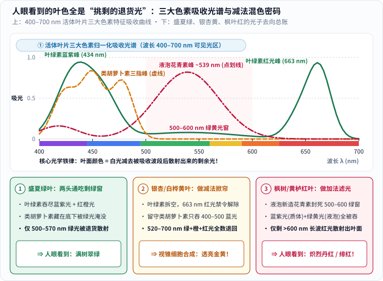
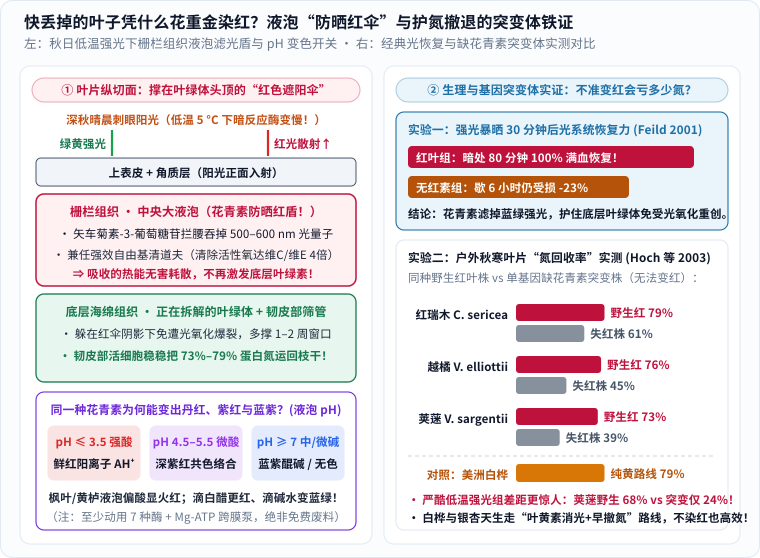
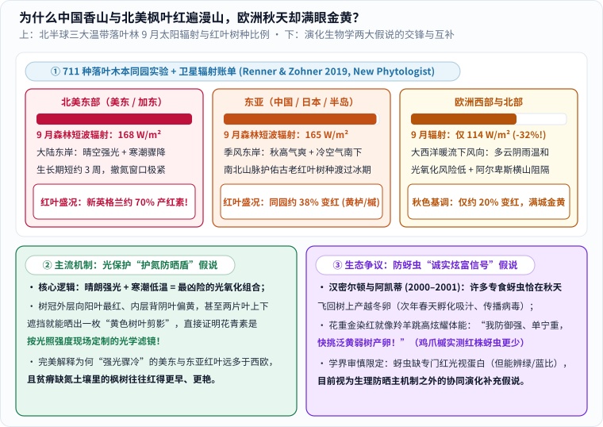
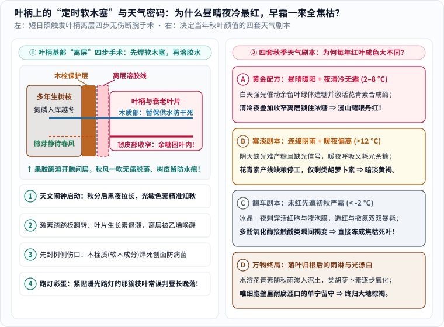

每年十月到十一月，只要冷空气往南一推，北半球的山林与街道就会以**每小时超过 $$1\ \mathrm{km}$$** 的推进速度，自北向南掀起一场席卷大陆的色彩巨浪 [[3]](#ref-3)。

可只要你蹲在树下捡起两片秋叶仔细端详，几个乍看习以为常、越想越不对劲的谜题就会立刻冒出来：

- **为什么银杏、白桦、法国梧桐和杨树到秋天只会变黄，而元宝枫、鸡爪槭、北京香山的黄栌与江南的乌桕却能烧成漫山火红？** 难道黄叶树身体里天生缺“红色颜料”，还是红叶树比黄叶树多藏了一套底牌？
- **更违背经济学直觉的是：枫叶明明再过十来天就要被大树彻底扔掉了，大树为什么还要在落叶前夕大动干戈，耗费宝贵的糖分和 `ATP` 全新赶制满液泡的花青素？** 这就好比一栋老房子下周就要爆破拆迁，房东却在拆楼前三天自掏腰包把外墙重刷了一遍昂贵的朱砂红漆——几亿年的自然选择怎么可能纵容这种败家行为？
- **很多科普书说“大树分解叶绿素是为了把叶绿素里的氮原子收回来过冬”——可生物化学家追踪同位素和分子结构后却发现：叶绿素卟啉环里的那 $$4$$ 个氮原子，最后居然原封不动地跟着枯叶掉进了泥土里！** 既然一个氮都没抠出来，大树每年费尽周折拆掉全球超过 **$$10$$ 亿吨**叶绿素，到底图什么？
- **为什么同一种枫树，有的年份红得像火烧云，有的年份却灰头土脸偏黄褐，遇到一场初秋早霜甚至一夜冻成焦黑死叶？为什么中国香山、九寨沟和北美新英格兰秋色火红绚烂，而去西欧旅行看到的秋天却几乎清一色是金黄？**

别小看脚边这一片薄薄的黄叶或红叶。它绝对不是生命力枯竭后的“被动腐烂”，而是一棵多年生大树在寒冬封冻前，严格按照天文光周期、光化学防爆动力学、光学滤波与外科断腕手术执行的**年度战略大撤退**。

> **一句话先亮出底牌：秋叶变黄是“做减法”——大树为了安全搬走叶绿体蛋白质里占全叶 $$75\%\text{–}80\%$$ 的氮素，必须先把失去蛋白束缚后会变成“光毒炸弹”的叶绿素拆成无色链状分子，从而让春夏一直潜伏在叶内的脂溶性类胡萝卜素掀帘显出金黄 [[1]](#ref-1) [[5]](#ref-5)；而秋叶变红则是“做加法”——面对秋日“晴空强光 + 低温卡壳”的光氧化险境，枫树与黄栌在表层液泡里临时赶制水溶性花青素撑起一把“防晒红伞”，滤掉 $$500\text{–}600\ \mathrm{nm}$$ 过剩绿黄光，掩护底层细胞把氮素抢运回树干过冬 [[8]](#ref-8) [[9]](#ref-9)！**

下面我们就钻进一片正在变色的秋叶内部，按“先拆雷、再显黄、后染红、看地理、断叶柄”的五步逻辑，把这场壮丽的撤退工程拆个水落石出。

---

## 一、先破最大误区：大树秋天拆掉十亿吨叶绿素，压根不是为了抠出那 4 个氮原子！

要读懂红叶和黄叶，第一步必须先问：**统治了整个春夏的漫山翠绿，到秋天究竟去哪儿了？**

瑞士有机化学家**伯恩哈德·克劳特勒（Bernhard Kräutler）**在 2016 年发表于《德国应用化学》（*Angewandte Chemie*）的权威综述里算过一笔地球级大账：每年地球陆地植物与水生藻类合成并彻底拆解的叶绿素总量超过 **$$10^9$$ 吨（$$10$$ 亿吨）** [[1]](#ref-1)。但长久以来，坊间甚至不少中学教辅都流传着一个看似顺理成章的解释：“叶绿素分子含氮，大树秋天拆叶绿素，是为了把叶绿素里的氮回收进树干。”

**这个流传甚广的说法，在分子层面上其实是错的！**

_先看左栏衰老叶肉细胞里的“双线协同撤退”（绿色虚线含单次氮素抢运流向短动画，开启系统“减少动态效果”或动画结束后均保持完整静态路径，刷新页面可重播）：叶绿体内占全叶 $$75\%\text{–}80\%$$ 氮素的 Rubisco 等蛋白质被拆成氨基酸经韧皮部撤回枝干过冬；而游离叶绿素则由孟德尔基因 `SGR` 去镁酶与 `PAO` 加氧酶剪开卟啉环排雷解毒，化为无色叶绿胆素（`NCC/DNCC`）把环内 $$4$$ 个氮死死锁进液泡随枯叶丢弃！右栏对照决定秋叶四色的四大家族户口簿。_

### 1. 一笔让人拍案惊奇的植物氮账：真正要救的金库是八成蛋白质，不是叶绿素环

为什么大树犯不着去抠叶绿素分子里的氮？算一下叶片里的“氮资产负债表”就瞬间明白了：

对一棵温带落叶树来说，碳、氢、氧可以从空气和雨水里敞开拿（详见我们之前算过的[《可视化理解光合作用》]()），唯独**氮（$$\mathrm{N}$$）和磷（$$\mathrm{P}$$）**是根系必须耗费巨量呼吸能量、仰仗菌根真菌从贫瘠土壤里一粒粒淘出来的硬通货。如果每年秋天任由满树绿叶直接带着氮磷掉进土里，第二年春天还没等冻土化透，光秃秃的枝条就拿不出蛋白质去抽芽开花（早春开花抽叶的家底账可对照[《龙抬头春寒未退，光秃秃的枝条凭什么一夜爆满繁花？》]()）。

那么，一片健康绿叶里的氮到底存在哪儿？日本东北大学石田宏幸与诺奖得主大隅良典团队（2008）在《植物生理学》（*Plant Physiology*）中给出了精确测定 [[4]](#ref-4)：

- 在典型 $$\mathrm{C}_3$$ 植物叶片中，**$$75\%\text{–}80\%$$ 的总氮集中在叶肉细胞的叶绿体里**；
- 但叶绿体里这八成氮素中，绝大多数都装在**光合蛋白质**身上——光是负责抓取二氧化碳的 **Rubisco 酶（核酮糖-1,5-二磷酸羧化/加氧酶）**一种蛋白质，就独占了全叶总蛋白的 **$$12\%\text{–}30\%$$**，再加上类囊体膜上密密麻麻的**捕光叶绿素结合蛋白（`LHCII` 等）**，蛋白质才是真正的“氮素国库” [[4]](#ref-4)！
- 相比之下，叶绿素分子的化学式虽为 $$\mathrm{C}_{55}\mathrm{H}_{72}\mathrm{MgN}_4\mathrm{O}_5$$（叶绿素 $$a$$，中心箍着 $$1$$ 个镁离子 $$\mathrm{Mg}^{2+}$$ 和 $$4$$ 个吡咯氮原子），但这 $$4$$ 个氮原子加起来只占叶片总氮的**不到 $$2\%$$**！

更铁证如山的是：克劳特勒团队把变黄落叶液泡里的叶绿素降解终产物——**叶绿胆素（Phyllobilins，包括无色非荧光叶绿素分解产物 `NCCs` 与二氧代产物 `DNCCs`）**分离出来做核磁与质谱分析，发现每一个无色链状分子里，当年叶绿素卟啉环上的 **$$4$$ 个氮原子一个不少、完完整整地留在里面**，最后跟着枯叶一起落进泥土 [[1]](#ref-1) [[3]](#ref-3)！

也就是说：**大树忙活一秋天，压根就没拆出叶绿素环里的那 $$4$$ 个氮！**

### 2. 孟德尔豌豆基因的百年悬案：为什么游离叶绿素瞬间会变成“单线态氧光毒炸弹”？

这就更奇怪了：既然大树根本不要叶绿素里的这 $$4$$ 个氮，直接去把旁边的 Rubisco 和捕光蛋白拆成氨基酸运走不就完了吗？干嘛非要先花大力气把叶绿素拆成无色碎片？

答案只有四个字：**排雷防爆！**

整个夏天，叶绿素之所以能安全地吸收阳光做光合作用，是因为它被严丝合缝地镶嵌在**捕光蛋白复合体（`LHC`）**的分子卡槽里，吸收的光能可以在皮秒（$$10^{-12}\ \mathrm{s}$$）级时间内顺着电子传递链导走。可一旦秋天到来，大树为了回收那 $$75\%\text{–}80\%$$ 的蛋白质氮，开始用自噬小体（如直径 $$0.4\text{–}1.2\ \mu\mathrm{m}$$ 的 Rubisco 小体 `RCBs` [[4]](#ref-4)）和蛋白酶拆卸捕光蛋白时，灾难就来了：

失去蛋白质外壳束缚的**游离叶绿素**（及其脱镁中间体脱镁叶绿酸 `Pheophorbide a`），是一颗极其凶险的**光敏炸弹**！只要秋日阳光一照，游离叶绿素吸收光子跃迁到激发三重态（$$^3\mathrm{Chl}^*$$），却找不到电子受体泄洪，就会立刻把激发能直接砸给细胞里无处不在的氧气（$$^3\mathrm{O}_2$$），瞬间制造出破坏力极强的**单线态氧（$$^1\mathrm{O}_2$$）**与超氧自由基：

$$
\mathrm{Chl} \xrightarrow{h\nu} {^1\mathrm{Chl}^*} \xrightarrow{\text{系间窜越}} {^3\mathrm{Chl}^*} \xrightarrow{+\,{^3\mathrm{O}_2}} \mathrm{Chl} + {^1\mathrm{O}_2}\ (\text{剧毒光氧化剂！})
$$

这团单线态氧会在几小时内把叶绿体膜、液泡膜和叶脉韧皮部活细胞统统烧穿！**一旦细胞提前暴毙，正在打包撤退的八成蛋白质氮就会全部烂在死叶里，一克都运不回树干！**

为了拆除这颗光毒炸弹，高等植物演化出了一条精密得如同拆弹部队般的 **`PAO`/叶绿胆素解毒流水线** [[1]](#ref-1) [[2]](#ref-2) [[3]](#ref-3)：

1. **先把叶绿素 $$b$$ 统一归口为叶绿素 $$a$$**：由 `NYC1/NOL` 与 `HCAR` 两种还原酶把叶绿素 $$b$$ 还原成叶绿素 $$a$$（否则后续拆弹酶不认账！）；
2. **孟德尔豌豆基因 `SGR` 出手拔掉中心镁离子**：还记得中学课本里孟德尔 1866 年杂交实验的**“黄色豌豆 vs 绿色豌豆”**吗？整整 **150 年后**，日本北海道大学田中步与下田洋介团队（2016）在《植物细胞》（*The Plant Cell*）上终于揭晓了孟德尔绿色子叶基因（`STAY-GREEN`，简称 `SGR`）的真实身份——它编码的正是拆弹第一步的核心酶 **“去镁螯合酶（Mg-dechelatase）”** [[2]](#ref-2)！野生豌豆熟透时，`SGR` 拔出叶绿素 $$a$$ 中心的 $$\mathrm{Mg}^{2+}$$（镁离子顺带被植物回收利用），子叶褪绿变黄；而孟德尔手里的绿豌豆正是 `SGR` 基因突变失活的“滞绿突变体”，连第一步拔镁都做不到，所以干透了还是绿的！
3. **剪掉疏水长尾巴（`PPH`）**：脱镁叶绿素酶（Pheophytinase）一刀剪掉脂溶性的植醇长链（Phytol），变成脱镁叶绿酸 $$a$$；
4. **最关键的“剪环断电”（`PAO` + `RCCR`）**：**脱镁叶绿酸 $$a$$ 加氧酶（`PAO`）**在氧气参与下一刀剪开共轭卟啉大环！共轭大环一旦剪断成开链四吡咯，原本能吸收红光与蓝光的共振天线当场报废，在 `RCCR` 还原下变成无色（仅在紫外灯下发短暂蓝光）的初级荧光分解产物 `pFCC` [[1]](#ref-1) [[3]](#ref-3)；
5. **打包锁进液泡（`ABCC2`）**：无色链状分子跨膜运进中央大液泡，在微酸环境下异构化为彻底无色、无荧光、无光毒性的**非荧光叶绿素分解产物（`NCCs`/`DNCCs`）**，安安静静锁在液泡里等叶子落地 [[1]](#ref-1) [[3]](#ref-3)。

所以，**树叶褪绿的本质，是一场为了掩护八成蛋白氮安全撤离而率先执行的“光化学拆弹工程”！**

### 3. 四大色素户口簿与一个五分钟厨房热水实验

把叶绿素拆成无色透明链之后，秋叶舞台上的颜色就完全交给另外三位主角了。在往下看之前，一定要先把树叶里**四大色素家族的“住址”和“溶解脾气”**分清（对照上图右栏）：

- **① 叶绿素 $$a / b$$（翠绿）**：住在叶绿体类囊体膜上，**脂溶性（不溶于水）**，春夏绝对主力，入秋被拆成无色分子退场；
- **② 类胡萝卜素（金黄/橙黄，含叶黄素 Lutein 与 $$\beta$$-胡萝卜素等）**：同样住在叶绿体（衰老期转入质体小球脂滴），**脂溶性（不溶于水）**，**整个春夏一直都在叶子里面**，只是平时被高浓度的绿色盖住了 [[5]](#ref-5)；
- **③ 花青素（鲜红/绯红/紫红，以矢车菊素-3-葡萄糖苷为主）**：住在细胞中央大液泡的水溶液里，**水溶性糖苷**，绝大多数绿色夏叶里含量几乎为零，是红叶树种**到了秋天临时耗糖全新合成**的 [[8]](#ref-8) [[10]](#ref-10)；
- **④ 单宁与氧化多酚（枯褐/棕褐）**：嵌在细胞壁和衰老基质里，涩口耐腐，等红黄两色全都褪尽或细胞冻死褐变后留守到底，让天下落叶最终统统归于大地棕褐 [[12]](#ref-12)。

理解了“脂溶 vs 水溶”的户口差别，你今晚回家就能陪孩子做一个**五分钟厨房实验**：捡一片火红的枫叶（或黄栌叶）和一片金黄的银杏叶，分别撕碎放进两只玻璃杯，冲入滚开水泡五分钟——**泡红枫叶的水会迅速染成漂亮的粉红色/紫红色**（液泡膜破裂，水溶性花青素直接溶进热水）；而**泡黄银杏叶的水却依然清亮，几乎染不上半点金黄**（因为类胡萝卜素是脂溶性的油性分子，死死抱在质体脂滴里，除非你倒点酒精或食用油去萃，否则白开水根本泡不动它）！

---

## 二、黄叶是怎么来的？做减法的“掀窗帘魔术”与人眼减法混色密码

搞懂了叶绿素拆弹，**银杏、白桦、鹅掌楸、杨树、柳树与悬铃木**为什么一到深秋就齐刷刷变成透亮的金黄色，答案立刻水到渠成——因为这是一场纯粹**做减法的“掀窗帘魔术”**。

_先看上图 $$400\text{–}700\ \mathrm{nm}$$ 可见光区的三条活体特征吸收曲线：叶绿素 $$a+b$$（绿色实线）在 $$434\ \mathrm{nm}$$ 蓝紫光与 $$663\ \mathrm{nm}$$ 红光各竖起一座高墙，唯独放行中间的绿光；类胡萝卜素（橙色虚线）只在 $$424\text{–}478\ \mathrm{nm}$$ 蓝光区亮出经典“三指峰”；液泡花青素（绯红点划线）则精准堵在 $$539\ \mathrm{nm}$$ 绿黄光窗口。再对照下图三张混色卡片，就能一眼算清绿叶、黄叶与红叶反射进人眼的光子总账。_

### 1. 叶面颜色全是“挑剩的退货光”：为什么拆掉吸红光的叶绿素，叶子就变黄了？

很多人第一次看植物吸收光谱都会愣一下：**“类胡萝卜素是黄色的，难道不是因为它吸收黄光吗？”恰恰相反！一片不发光的树叶呈现什么颜色，取决于它“不吃哪一段光、把哪一段光退货散射进你的眼睛”** [[6]](#ref-6)。

如果把活体叶片的吸收率记为 $$A(\lambda)$$、反射率记为 $$R(\lambda)$$、透射率记为 $$T(\lambda)$$（波长 $$\lambda \in [400, 700]\ \mathrm{nm}$$），能量守恒给出最简洁的叶片光学恒等式 [[6]](#ref-6)：

$$
R(\lambda) + T(\lambda) = 1 - A(\lambda)
$$

也就是说，色素在哪个波段吸收率 $$A(\lambda)$$ 接近 $$1$$，那个波段的光就被“吃干抹净”；只有在 $$A(\lambda)$$ 很低的波段，光子才能在海绵组织细胞间隙的气-水界面上反复折射散射，穿出叶面进入人眼。沿着上图的波长轴从左往右核对三笔账 [[5]](#ref-5) [[6]](#ref-6)：

1. **盛夏绿叶（双峰夹击，只剩绿谷）**：叶绿素 $$a$$ 和 $$b$$ 把 $$400\text{–}480\ \mathrm{nm}$$ 的蓝紫光和 $$630\text{–}680\ \mathrm{nm}$$ 的红橙光吃掉了九成以上，唯独对 $$500\text{–}570\ \mathrm{nm}$$ 的绿光吸收较弱（上图绿色实线中间深深的山谷）。此时叶绿体里虽然早就住满了类胡萝卜素（质量比通常约为叶绿素的 $$1/4$$ 到 $$1/3$$），但类胡萝卜素吃的也是 $$400\text{–}500\ \mathrm{nm}$$ 蓝光，完全躲在叶绿素的蓝紫吸收峰阴影里，反射出来的光被绿光彻底统治，所以我们只能看到满树苍翠。
2. **银杏与白桦的秋日黄叶（撤掉 663 nm 红光禁令！）**：入秋后叶绿素被 `PAO` 途径拆成无色分子，$$A_{\text{叶绿素}}(\lambda) \to 0$$——最戏剧性的变化发生了：**原本死死封锁 $$630\text{–}680\ \mathrm{nm}$$ 红橙光的那堵高墙轰然倒塌！** 此刻留在质体里的类胡萝卜素只在 $$424\text{–}478\ \mathrm{nm}$$ 蓝紫光区亮出标志性的“三指吸收峰”（峰值约 $$448\text{–}450\ \mathrm{nm}$$ [[5]](#ref-5)），对 $$510\ \mathrm{nm}$$ 以上的绿光、黄光、橙光、红光统统不吸收！于是，$$520\text{–}700\ \mathrm{nm}$$ 的中长波光子全数从叶肉细胞壁散射出来，同时激活人眼视网膜的**中波（绿敏 $$M$$）与长波（红敏 $$L$$）视锥细胞**，唯独短波（蓝敏 $$S$$）视锥细胞沉寂——人类大脑把“有绿 + 有红 - 无蓝”的视觉信号合成为无比通透耀眼的**金黄色**！

### 2. 类胡萝卜素一直在场：从捕光天线保镖到衰老质体里的“脂滴养老院”

也许你会追问：**“既然叶绿体都在大拆迁了，为什么同住在一个屋檐下的类胡萝卜素没有跟着叶绿素一起消失？”**

瑞士纳沙泰尔大学费利克斯·凯斯勒（Felix Kessler）与莎拉·罗泰特（Sarah Rottet）团队（2016）在《植物科学前沿》（*Frontiers in Plant Science*）上揭开了这个细胞器级的微观奥秘 [[5]](#ref-5)：

- **春夏当“副手兼防暴保镖”**：春夏时节，叶黄素（Lutein）、$$\beta$$-胡萝卜素、紫黄质（Violaxanthin）与新黄质（Neoxanthin）一方面帮叶绿素拓宽蓝青光捕光频段，另一方面执行救命的**“叶黄素循环（Xanthophyll cycle）”**——正午阳光太毒时，紫黄质迅速脱环氧变成玉米黄质（Zeaxanthin），把捕光天线上多余的激发能直接变成热能安全散掉，同时淬灭漏网的单线态氧。
- **入秋搬进“质体小球脂滴养老院”**：当秋天类囊体膜解体、叶绿体转变为**衰老质体（Gerontoplast）**时，质体内部会迅速膨胀起许多直径数百纳米的脂蛋白微滴——**质体小球（Plastoglobules）** [[5]](#ref-5)。强疏水性的类胡萝卜素从解体的膜蛋白上脱身后，并没有散落在水相里挨刀，而是顺势钻进质体小球的油脂核心，并且大量与脂肪酸结合成化学性质极其稳定的**类胡萝卜素脂肪酸酯**！
- 因为这层油脂微滴的庇护，类胡萝卜素在衰老叶片里的降解速度（由 `CCD4` 裂解双加氧酶缓慢调控 [[5]](#ref-5)）比叶绿素慢得多——**绿色大幕唰地拉开，稳坐“脂滴养老院”的叶黄素与胡萝卜素便把整棵银杏和白桦染成了纯粹的黄金塔！**

---

## 三、红叶凭什么最反常？给快扔掉的叶子重金刷红漆，原来是在撑“防晒护氮伞”！

如果说银杏变黄是顺水推舟的“省钱掀帘”，那么**鸡爪槭、糖槭、红瑞木、黄栌、乌桕、野漆树、爬山虎和越橘**在深秋变红，就是植物生理学上困扰了科学家整整一百多年的头号悬案。

莫斯科大学光学植物学家梅尔兹利亚克（Mark N. Merzlyak）团队（2008）与新西兰植物学家凯文·古尔德（Kevin S. Gould，2004）用精确生化证据确认 [[6]](#ref-6) [[10]](#ref-10)：**绝大多数秋季红叶里的花青素，根本不是夏天藏在叶子里的存货，而是在叶绿素已经开始大量拆解的衰老期，由植物耗费糖分与能量从零全新合成（*de novo* synthesis）的！**

_先看左栏叶片纵切面：深秋晴冷清晨，栅栏组织中央大液泡里新赶制的矢车菊素苷精准吞掉 $$500\text{–}600\ \mathrm{nm}$$ 强绿黄光并清除活性氧，像一把“红色遮阳伞”护住底层正在拆解的叶绿体与韧皮部筛管；左下角展示液泡 $$\mathrm{pH}$$ 对花青素分子结构的酸红碱蓝调控。再看右栏两项硬核实验：Feild 等（2001）证实红叶强光暴晒后 $$80$$ 分钟即可 $$100\%$$ 恢复，Hoch 等（2003）用三组单基因缺花青素突变体铁证“能变红的野生株比失红突变株多救回 $$18$$ 至 $$34$$ 个百分点的宝贵氮素”！。_

### 1. 不是现成显色，而是从零开工：至少 7 道酶工序与跨膜泵出来的矢车菊素苷

这笔“刷红漆”的账到底有多贵？古尔德（2004）在综述《大自然的瑞士军刀：叶片花青素的多重保护角色》中逐一清点了合成流水线 [[10]](#ref-10)：

秋季红叶中最核心的红色分子是**矢车菊素-3-*O*-葡萄糖苷（Cyanidin-3-*O*-glucoside）**。要造出它，衰老中的叶肉细胞必须以光合余糖转化的苯丙氨酸/香豆酰辅酶 A（`4-coumaroyl-CoA`）和丙二酰辅酶 A（`malonyl-CoA`）为原料，**依次唤醒查尔酮合酶（`CHS`）等至少 $$7$$ 种专职酶**拼出三环黄酮骨架，再挂上一分子葡萄糖增加水溶性与稳定性，最后还得消耗 **`Mg-ATP` 驱动液泡膜转运泵**，把造好的花青素一分子一分子泵进细胞上方的中央大液泡里 [[10]](#ref-10)！

一棵精打细算了几亿年的大树，凭什么要在临丢弃的叶子上砸下这笔巨款？

### 2. 秋寒晴天的致命矛盾：5 °C 低温卡住暗反应，液泡红伞如何拦腰吞下绿黄强光？

2001 年，哈佛大学植物学家**泰勒·菲尔德（Taylor S. Feild）、大卫·李（David W. Lee）与米歇尔·霍尔布鲁克（N. Michele Holbrook）**在《植物生理学》（*Plant Physiology*）发表了里程碑论文《为什么树叶在秋天变红》，一举戳破了秋日叶片面临的致命物理生化矛盾 [[8]](#ref-8)：

回忆一下光合作用的两半车间：
- **上半场（光反应：天线吸光 + 电子传递）**是纯光物理与超快电子跃迁过程，**几乎不受低温影响**——哪怕深秋清晨气温只有 $$3\text{–}5\ ^\circ\mathrm{C}$$，只要晴空万里，阳光照样以每秒上千微摩尔光子（$$1500\ \mu\mathrm{mol\ m^{-2}\ s^{-1}}$$）的猛烈火力砸进叶肉；
- **下半场（暗反应：卡尔文循环酶促固碳 + 韧皮部装车运氮）**却是实打实的生物化学酶反应与跨膜运输，**一旦遇上 $$5\ ^\circ\mathrm{C}$$ 秋寒，酶活性就像冻僵的手指一样骤降大半**！

更糟的是，此时叶片已经拆掉了一半叶绿素，整片叶子变薄、变透，原本在夏天被表层叶绿素挡住的强光，现在长驱直入照透整片叶肉！**“上游光子洪水猛灌，下游酶促车间冰封停工”**——无处可去的高能电子瞬间在残余叶绿体里引发严重的**低温光抑制（Chilling photoinhibition）**，喷涌出过氧化氢（$$\mathrm{H}_2\mathrm{O}_2$$）和超氧阴离子自由基（$$\mathrm{O}_2^{\bullet-}$$），眼看就要把负责拆卸并外运那 $$75\%\text{–}80\%$$ 蛋白氮的细胞活活烧死！

就在这千钧一发之际，大树在朝向太阳的**栅栏组织中央大液泡**里紧急灌满了红色的矢车菊素苷，打出了漂亮的**“一伞一盾”组合拳** [[6]](#ref-6) [[8]](#ref-8) [[10]](#ref-10)：

1. **第一招：光学防晒红伞（Optical Sunscreen）**。对照第二张光谱图，活体液泡里的花青素在 **$$500\text{–}600\ \mathrm{nm}$$** 绿黄光波段有一座宽达 $$70\text{–}80\ \mathrm{nm}$$ 的强吸收峰（由于液泡内自组装与共色效应，活体吸收峰红移至 **$$537\text{–}542\ \mathrm{nm}$$** [[6]](#ref-6)）。别忘了太阳光谱的能量巅峰恰恰就在绿黄光附近！表层大液泡像一块天然红色滤光玻璃，直接把射向下层叶绿体的 $$550\ \mathrm{nm}$$ 光子通量**削减了 $$2$$ 到 $$4$$ 倍（滤除率 $$50\%\text{–}75\%$$）** [[6]](#ref-6)，把多余光能直接在液泡水相里化成无害微热散掉；至于花青素放行的 $$>600\ \mathrm{nm}$$ 红光，大量散射出叶面——这正是漫山红叶映入我们眼帘的那抹丹红！
2. **第二招：四倍战力的自由基清道夫（Antioxidant Shield）**。万一仍有少量强光漏进叶绿体激发出过氧化氢（$$\mathrm{H}_2\mathrm{O}_2$$），中性小分子 $$\mathrm{H}_2\mathrm{O}_2$$ 会穿过膜扩散进液泡，当场被花青素酚羟基扑灭——体外自由基清除实验表明，花青素清除活性氧的能力高达日常抗氧化剂**维生素 C（抗坏血酸）与维生素 E（$$\alpha$$-生育酚）的 $$4$$ 倍** [[10]](#ref-10)！

### 3. 三组“不准变红”突变体的铁证，以及液泡 pH 酸红碱蓝调色盘

“光学防晒护氮”听起来严丝合缝，但怎么证明它真的帮大树多救回了氮，而不是科学家的浪漫脑补？

菲尔德团队（2001）先拿北美洲常见的**红瑞木（*Cornus stolonifera*）**做了正面交锋 [[8]](#ref-8)：向阳红叶栅栏组织液泡含有 $$0.45\pm 0.025\ \mu\mathrm{g\ cm^{-2}}$$ 花青素，而遮阴黄叶花青素为 $$0$$（两者类胡萝卜素几乎相等，分别为 $$3.3$$ 与 $$3.1\ \mu\mathrm{g\ cm^{-2}}$$）。同时用 $$1500\ \mu\mathrm{mol\ m^{-2}\ s^{-1}}$$ 强光暴晒 $$30$$ 分钟后，红叶底层叶绿体的光系统 II 量子效率（$$\Phi_{\mathrm{PSII}}$$）比黄叶**高出 $$50\%$$**；移入黑暗后，**红叶仅用 $$80$$ 分钟就 $$100\%$$ 满血复原，而无花青素的黄叶哪怕在黑暗里缓了整整 $$6$$ 小时，依然留下了 $$22.7\%\pm 3.5\%$$ 的不可逆损伤** [[8]](#ref-8)！

紧接着在 2003 年，威斯康星大学植物学家**威廉·霍赫（William A. Hoch）、埃里克·辛萨斯（Eric L. Singsaas）与布伦特·麦考恩（Brent H. McCown）**设计了一个更绝的“一锤定音”实验 [[9]](#ref-9)：不能拿枫树和银杏跨物种比（毕竟不同树种家底不同），他们专门找来了**红瑞木（*Cornus sericea*）、越橘（*Vaccinium elliottii*）与鸡树条荚蒾（*Viburnum sargentii*）**三个木本物种的**野生红叶植株 vs 单基因缺失无法合成花青素的纯黄突变株**——除了能不能造花青素这一个基因外，其余遗传背景几乎一模一样！

把它们种在户外经受真实秋寒与强光考验，等落叶时一测**氮素回收效率（Nitrogen Resorption Efficiency）**，结果让整个植物学界心服口服 [[9]](#ref-9)（对照上图右下条形图）：

- **红瑞木**：能变红的野生株成功救回 **$$79\%$$** 的氮，失红突变株只救回 **$$61\%$$**（白白多丢了 $$18$$ 个百分点！）；
- **越橘**：野生红叶株救回 **$$76\%$$**，失红突变株跌到 **$$45\%$$**（多丢 $$31$$ 个百分点！）；
- **鸡树条荚蒾**：户外自然条件下野生红叶株救回 **$$73\%$$** vs 失红突变株 **$$39\%$$**；若放进低温强光人工严酷胁迫室，野生红叶株仍能稳稳救回 **$$68\%$$** 的氮，而无法打红伞的突变株直接崩溃到只救回 **$$24\%$$**——整整差出近 **$$3$$ 倍** [[9]](#ref-9)！

有趣的是，霍赫团队顺手把天生只变黄、绝不造花青素的**美洲白桦（*Betula papyrifera*）**也放进同一块实验地对照，结果白桦不靠半点花青素，照样干净利落地救回了 **$$79\%\text{–}80\%$$** 的氮 [[9]](#ref-9)！这恰好解答了开头的问题：**演化从来不止一套标准答案**——银杏、白桦这类“纯黄派”靠的是极强的叶黄素循环消光能力、抗氧化酶系与更果断的早期撤氮节奏；而枫树、黄栌、红瑞木和越橘这类木本植物，则把宝押在了“临时撑起液泡花青素红伞、多争取一两周抢运时间”的精妙战术上！

顺便再揭秘一个细节：**为什么同样靠花青素，枫叶和黄栌是鲜艳的丹红，乌桕和红瑞木深秋却泛出浓郁的酒红甚至紫红，而蓝莓和牵牛花里的同款花青素竟能显蓝色？**

化学家维尔施泰特（Richard Willstätter，1915 诺贝尔化学奖得主）开启、皮纳与巴西利奥（Basílio & Pina，2016）在热力学与动力学层面完整定量的**花色苷多态酸碱平衡**给出了答案 [[7]](#ref-7)：在水溶液中，火红色的**花色苷阳离子（Flavylium cation，$$\mathrm{AH}^+$$）**会随酸碱度 $$\mathrm{pH}$$ 发生可逆质子转移与水合开环：

$$
\underbrace{\mathrm{AH}^+}_{\text{鲜红阳离子 }(\mathrm{pH}\le 3.5)} + \mathrm{H}_2\mathrm{O} \rightleftharpoons \underbrace{\mathrm{A}}_{\text{紫蓝醌式碱 }(\mathrm{pH}\ 4.5\text{–}7)} + \mathrm{H}_3\mathrm{O}^+
$$

（同时还伴随 $$\mathrm{AH}^+ + 2\mathrm{H}_2\mathrm{O} \rightleftharpoons \mathrm{B} + \mathrm{H}_3\mathrm{O}^+$$ 生成无色半缩酮 $$\mathrm{B}$$ 与查尔酮 [[7]](#ref-7)。）

- 枫树、黄栌叶肉细胞的中央大液泡呈明显酸性（$$\mathrm{pH}\approx 3.5\text{–}4.2$$），平衡偏向鲜红的 $$\mathrm{AH}^+$$ 阳离子：若此时叶绿体里还有残余的金黄色类胡萝卜素底色，**“液泡红 + 质体黄”叠在一起就是明亮的橘红/橙红** [[12]](#ref-12)；等类胡萝卜素也退去，就烧成纯粹的丹红；
- 而红瑞木、乌桕或老熟红叶液泡 $$\mathrm{pH}$$ 略高（$$4.5\text{–}5.5$$），部分 $$\mathrm{AH}^+$$ 脱质子变成紫红色的醌式碱 $$\mathrm{A}$$，再与液泡里的黄酮醇、有机酸或金属离子发生分子间堆叠（**共色效应 Copigmentation**），就调出了深邃高贵的勃艮第酒红与紫红 [[7]](#ref-7)！（如果你把前面泡红枫叶的粉红茶汤分成两杯，一杯滴白醋，立刻变得更鲜红；另一杯撒一撮小苏打，瞬间变成蓝紫乃至蓝绿色——这就是天然酸碱指示剂！）

---

## 四、为什么中国香山与北美枫林红遍漫山，欧洲秋天却满眼金黄？

去过不同大洲看秋景的人，几乎都会注意到一个极其鲜明的地理奇观：每年深秋，**中国北京香山、辽宁本溪、川西米亚罗、日本京都**，以及**美国新英格兰与加拿大东南部**，到处都是层林尽染的漫山红叶；可到了同纬度的**英国、法国、德国和北欧**，乡间森林与城市公园却几乎清一色是桦树、栎树、山毛榉与欧洲白蜡组成的**金黄世界**，本土红叶树种寥寥无几！

为什么偏偏是“东亚 + 北美东部”红得热火朝天，而西欧却偏爱黄色？这恰恰成了检验“光保护护氮假说”与“昆虫协同演化假说”的全球天然实验室。

_先看上图三大温带落叶林区的硬数据对比（Renner & Zohner 2019）：北美东部（$$168\ \mathrm{W\ m^{-2}}$$）与东亚（$$165\ \mathrm{W\ m^{-2}}$$）9 月平均短波太阳辐射几乎并驾齐驱，叠加大陆东岸寒潮骤降，造就了极高的红叶树种比例（新英格兰林区约 $$70\%$$ 木本产花青素，同园统计东亚约 $$38\%$$ 变红）；而处在大西洋暖流下风向的欧洲森林 9 月辐射仅有 $$114\ \mathrm{W\ m^{-2}}$$（低了整整 $$32\%$$！），多云温和，仅约 $$20\%$$ 树种变红。下图并列展示光保护主流机制与防蚜虫炫富信号假说的核心证据与边界。_

### 1. 711 种树木同园大考与 32% 的太阳辐射差：大陆东岸“高光+骤冷”的天然熔炉

2019 年，慕尼黑大学演化生物学家**苏珊娜·伦纳（Susanne S. Renner）与康斯坦丁·佐纳（Constantin M. Zohner）**在植物学顶刊《新植物学家》（*New Phytologist*）发表了一项横跨北半球的大尺度研究 [[11]](#ref-11)。他们把来自北美、东亚和欧洲的 **$$711$$ 种落叶木本植物**种在慕尼黑植物园同一片土地上连续多年观察（排除了当地当年天气的干扰，纯粹看刻在基因里的演化本能），再去比对三大洲原产地的卫星气象数据，结果真相大白 [[11]](#ref-11)：

1. **太阳辐射账单差了整整三分之一**：9 月份正值北半球落叶树启动拆绿撤氮的关键窗口，**北美东部落叶林的日均短波太阳辐射高达 $$168\ \mathrm{W\ m^{-2}}$$，东亚落叶林高达 $$165\ \mathrm{W\ m^{-2}}$$**（秋高气爽、万里无云）；而位于北大西洋暖流与盛行西风下风向的**欧洲落叶林，9 月多云多雨，日均短波辐射只有 $$114\ \mathrm{W\ m^{-2}}$$——比北美足足少了 $$32\%$$** [[11]](#ref-11)！
2. **大陆东岸寒潮骤降 vs 海洋西岸温和入冬**：北美东部（无东西向高山阻挡极地冷涡）与中国北方、东北（受西伯利亚季风寒潮直扑）同属大陆东岸气候，秋天昼夜温差剧烈，常常在万里晴空下突然杀来一场几摄氏度的冷空气；北美东部树木的生长期甚至比欧亚同属亲戚还要短约 $$3$$ 周 [[11]](#ref-11)！**“刺眼晴空强光 + 骤降低温 + 紧迫的撤氮工期”**，把美东（如哈佛森林多达约 **$$70\%$$** 的当地木本物种秋季合成花青素 [[12]](#ref-12)）与东亚（同园统计约 **$$38\%$$** 树种变红 [[11]](#ref-11)）变成了最需要花青素防晒红伞的演化熔炉；反观多云温和、慢悠悠入冬的西欧，光氧化风险低得多，花重金造红伞划不来，于是约八成树种安心走省钱的黄色路线（仅约 **$$20\%$$** 变红 [[11]](#ref-11)）！
3. **冰川期的山脉走廊助攻**：第四纪冰期来袭时，北美阿巴拉契亚山脉与中国横断山-秦岭支脉多有南北走向通道，喜光耐寒的古老红叶类群得以南撤避难、冰退北归；而欧洲横亘着东西走向的阿尔卑斯山与比利牛斯山，许多第三纪遗留树种在冰川与高山夹击下灭绝，进一步拉大了欧美秋色的物种底数差距。

日常爬山时，你还能亲眼看到支持“光保护假说”的最直观铁证：**同一棵枫树或黄栌，树冠最外层直面骄阳的叶片总是红得发紫，而躲在树冠肚子里不见直射光的内膛叶却常常是鹅黄色** [[8]](#ref-8)；更绝的是，如果正好有一片上层树叶贴在另一片红叶表面挡住了阳光，揭开上层叶子时，你经常能在底下的红叶上看到一枚**边缘分明的金黄色树叶剪影**——阳光晒到的地方精准变红，被遮住的地方寸红不生！

### 2. 演化生物学的另一块拼图：汉密尔顿“向蚜虫炫富亮肌肉”假说与学界争议

不过，科学探索从来不会在单一解释面前止步。就在菲尔德团队发表防晒论文的同一年（2001），当代最传奇的演化生物学家**威廉·汉密尔顿（W. D. Hamilton）**遗作与学生**萨姆·布朗（S. P. Brown）**在《英国皇家学会学报 B》（*Proceedings of the Royal Society B*）上抛出了另一个脑洞大开的假说——**秋季树叶颜色的“累赘诚实信号假说（Handicap Signal Hypothesis）”**（意大利学者马可·阿凯蒂 Marco Archetti 亦独立提出协同演化模型）[[11]](#ref-11) [[13]](#ref-13)：

汉密尔顿注意到一个生态时间巧合：**秋天不仅是树叶撤氮的时候，恰恰也是成百上千种专食性蚜虫（Aphids）长出翅膀、飞回木本寄主树皮缝里产下“越冬卵”的高峰期！** 如果一棵树被大量蚜虫产满卵，第二年春天新芽刚冒头就会被孵出的若虫吸干汁液，还会感染致命植物病毒。

于是汉密尔顿提出：大树在秋天耗费巨资把叶子染得通红，就像雄孔雀拖着大尾巴、瞪羚见了狮子故意原地跳高（Stotting）一样，是在向找树产卵的蚜虫发出一封无法伪造的**“诚实炫富警告信”** [[13]](#ref-13)：

> **“看清楚了！我连快扔掉的破叶子都出得起钱刷满花青素，说明我营养充沛、单宁等化学防御武器拉满；你敢把卵产在我身上，明年春天你的后代必死无疑——识相的赶紧飞去旁边那棵连红漆都刷不起、早早泛黄的体弱病树！”**

支持这一假说的学者确实观察到：在欧洲与东亚的跨物种统计中，与专食性产卵蚜虫纠缠越深的槭属（*Acer*）、李属（*Prunus*）物种变红比例更高，日本野外调查也发现红叶鸡爪槭植株上的越冬蚜虫卵明显少于偏黄植株 [[13]](#ref-13)。

**但这里必须按科学规范做严格限定**：这一假说在生理与昆虫视觉界至今存在激烈争论 [[11]](#ref-11)。反对者指出了两个硬伤：第一，分子生物学检测显示**绝大多数蚜虫复眼只有紫外、蓝光和绿光三种视蛋白受体，压根没有专门的“红光受体”**！（尽管协同演化派后来补充论证：由于花青素抽走了 $$539\ \mathrm{nm}$$ 绿光，蚜虫依然能靠“绿光/蓝光反射比值骤降”分辨出红叶与黄叶。）第二，**贫瘠缺氮、根系受损或树皮受伤的虚弱枫树，到了秋天非但不是变黄，反而往往比健康壮树红得更早、更艳**——这与“体格越壮越红”的炫富前提刚好拧巴，却与“越缺氮的大树越输不起任何一克叶氮，因而必须更拼命撑起花青素防晒红伞护氮”的生理逻辑严丝合缝 [[9]](#ref-9) [[11]](#ref-11)！

因此，今天植物学界的主流共识非常清晰：**“低温强光下的光保护与护氮撤离”是驱动秋叶合成花青素的底层主机制 [[8]](#ref-8) [[9]](#ref-9) [[11]](#ref-11)，而昆虫视觉选择则可能部分叠加其上，扮演了次生生态修饰角色。**

---

## 五、无痛断腕与看天调色：叶柄上的“定时软木塞”怎样配合天气写出红叶日历？

当八成蛋白氮已经顺着韧皮部入库树干，叶绿素排雷完毕，红黄大戏演到高潮，大树还要完成入冬前最后一道生死工序——**把几万片薄叶子干净利落地扔掉**。

为什么要扔叶子？我们在[《为什么蚂蚁放大一百倍会当场骨折，参天巨树永远长不过 130 米？》]()里算过：阔叶树满树薄叶摊开的面积高达几百平方米，一旦冬天土壤结冰根系吸不到水，继续挂着满树阔叶蒸腾水分，整棵大树的木质部水柱几天内就会因负压空化断流而活活渴死；再遇上一场暴雪挂在阔叶上，几十吨重的树冠更会当场压断枝干！（针叶松杉之所以冬天敢不落叶，是因为人家把叶片缩成了裹着厚厚蜡质角质层、气孔深陷的细针。）

_先看左栏叶柄基部的“离层（Abscission Zone）”显微解剖与四步时间表：短日照拉低叶片生长素、唤醒乙烯后，木质部导管先维持供水，韧皮部筛管渐次收窄把白天余糖困在叶内助攻造红，树枝一侧提前焊好木栓质防水软木疤，最后果胶酶溶开胞间层胶水让秋风无痛断叶。再看右栏四套天气剧本，一眼读懂为什么“昼晴夜冷无霜”能催出极品丹红，而初秋早霜却让叶子一夜焦黑褐变。_

### 1. 先焊防水软木塞、再溶胞间胶水：短日照与乙烯指挥的“离层”四步手术

如果让你从自己身上掰掉几万块皮肤却不流一滴血、不感染一颗细菌，怎么做到？大树早在叶柄（Petiole）连接树枝的根部，预埋了一圈只有几层薄壁细胞厚的精密结构——**离层区（Abscission Zone，`AZ`）** [[14]](#ref-14)：

1. **第一步（看天文钟，不看假降温）**：大树怎么知道秋天真来了，而不是夏天刮了两天凉风？靠的是绝对不会骗人的**黑夜长度（光周期）**！秋分过后黑夜一天比一天长，叶片里的光敏色素（Phytochrome）精准读取暗期时长，拉响撤退总警报。（这就是为什么**紧挨着城市暖光路灯的那一小簇法桐或枫树枝叶，常常被路灯骗得以为还是长日照夏天，整棵树都秃了它还孤零零绿在枝头**——不过这簇“熬夜加班叶”一旦撞上寒潮来不及撤氮，就会吃大亏！）
2. **第二步（生长素与乙烯的激素跷跷板）**：春夏健康绿叶源源不断向叶柄输送**生长素（Auxin，`IAA`）**，压制离层不许妄动；入秋后叶片生长素供应断崖下跌，离层细胞瞬间对衰老激素**乙烯（Ethylene）**变得极度敏感，正式启动断腕程序 [[14]](#ref-14)。
3. **第三步（堵糖管、留水管、焊死软木塞）**：这一步简直像显微外科艺术——木质部输水导管暂时保持畅通，保证叶片在撤氮收尾阶段不会提前干枯死掉；与此同时，往外运糖的韧皮部筛管因胼胝质沉积与离层挤压渐渐收窄，**白天残余叶绿体造出的蔗糖在清冷夜晚流不出去，大量滞留在叶肉细胞里，正好给合成花青素送上了最充沛的原料与高糖激活信号**！紧接着，靠近树枝一侧的细胞大量沉积**木栓质（Suberin，也就是红酒软木塞的防水成分）与木质素**，提前把未来的创面焊成一道滴水不漏、真菌钻不进的防水保护疤（叶痕 Leaf scar）[[12]](#ref-12) [[14]](#ref-14)。
4. **第四步（酶溶胶水，秋风点穴）**：最后，靠近叶片一侧的离层细胞分泌**多聚半乳糖醛酸酶（果胶酶 `PG`）与纤维素酶**，精准溶化把细胞粘在一起的“水泥”——中胶层（胞间层 Middle lamella）[[14]](#ref-14)。此时整片红叶只靠几根脆薄的死木质部导管悬在枝头，一阵秋风吹过，或是清晨露珠一压，便飘然旋落，枝头只留下一枚眉眼精致的木栓叶痕，腋芽已经在叶痕上方披好鳞片静候春风。

### 2. 为什么“昼晴夜冷无霜”叶子最红，初秋严霜一来却一夜冻成焦枯死褐叶？

读到这里，开头最后一个生活谜题也迎刃而解了：**民间老话常说“霜打红叶红似火”——其实如果较真物理温度，真正把红叶催到巅峰的绝不是零下的冰霜，而是“白天晴朗暖阳 + 夜晚清冷无霜（$$2\text{–}8\ ^\circ\mathrm{C}$$）”的黄金天气组合** [[12]](#ref-12)（对照上图右栏四套剧本）：

- **剧本 A（大红之年：昼晴暖阳 + 夜清冷 $$2\text{–}8\ ^\circ\mathrm{C}$$ 无冰冻）**：白天万里无云，强光一面驱动残余叶绿体继续制造可溶性糖，一面通过光受体直接激活花青素合成基因；入夜气温降到 $$2\text{–}8\ ^\circ\mathrm{C}$$（高于冰点 $$0\ ^\circ\mathrm{C}$$），呼吸消耗低、韧皮部外运慢，叠加离层收窄，高浓度糖分死死锁在栅栏细胞里，花青素产线全速运转——漫山遍野立刻烧成最摄人心魄的极品丹红！
- **剧本 B（寡淡之年：秋雨连绵阴天 + 暖夜 $$>12\ ^\circ\mathrm{C}$$）**：阴雨天既缺光合造糖的阳光，又缺诱导防晒伞的强光警报；偏暖的夜晚还让细胞呼吸把攒下的一点余糖烧得精光。红叶树巧妇难为无米之炊，花青素寥寥无几，最后只能靠底子里的类胡萝卜素勉强泛出暗淡的浅黄褐。
- **剧本 C（翻车之年：还没变红就遭遇 $$<-2\ ^\circ\mathrm{C}$$ 初秋严霜）**：花青素合成是**只有活细胞才能干的精细活**！如果十月初树叶还绿着，突然杀来一场零下三五度的硬霜，锋利的冰晶一夜之间刺破细胞膜和液泡膜，原本隔离在液泡里的多酚底物直接撞上质体里的**多酚氧化酶（`PPO`）**，上演跟切开苹果、莲藕变黑一模一样的**酶促褐变**（详见我们写过的[《白白胖胖的莲藕凭什么切开变褐、下铁锅秒变紫黑？》]()）——整树绿叶连变黄变红的机会都没有，第二天太阳一晒直接枯萎成焦黑死褐叶！
- **剧本 D（大地终局：为什么所有落叶最后都会变成棕色？）**：等到深秋红叶黄叶铺满林间小道，细胞彻底死去，水溶性的花青素被几场秋雨冲进泥土，脂溶性的类胡萝卜素也在阳光与氧气下慢慢漂白分解；唯独牢牢嵌在细胞壁上、又苦又涩的**单宁（Tannins，多酚聚合物）与木质素氧化产物**水冲不走、菌啃不动，把昔日的万紫千红统统收束成温暖沉静的大地棕褐 [[12]](#ref-12)。

---

## 六、秋日散步就能做的四个观察彩蛋与参考资料

下次深秋带家人或孩子去公园、山林捡树叶时，不妨现学现卖，当场验证四个百试百灵的科学彩蛋：

1. **找“树叶防晒剪影”**：在向阳的黄栌、鸡爪槭或爬山虎墙面上，翻找两片上下紧贴重叠的叶子——揭开上面那片，看看底下那片红叶被遮住的部位是不是印着一块清清楚楚的**金黄色剪影**？这就是“花青素按局部强光现场定制”的铁证 [[8]](#ref-8)。
2. **找“叶脉断流红斑”**：如果你在一片还没全红的绿叶上，发现某一条支脉折断或被虫咬断，**只有断脉外侧那一小块三角区提前变得通红**——因为那条叶脉的韧皮部断了，糖运不出去，局部先触发了“高糖 + 强光”的花青素开关！
3. **找“熬夜加班的路灯树枝”**：夜里散步抬头看行道树（如悬铃木、银杏、元宝枫），找找紧贴在路灯灯罩旁边的那一两根树枝——是不是别的枝条早就变黄掉光了，唯独它还傻乎乎顶着一簇绿叶？
4. **回家做“红黄双叶开水实验 + 酸碱魔术”**：用开水分别泡碎红枫叶与黄银杏叶验证“水溶花青素 vs 脂溶类胡萝卜素”，再往粉红色的枫叶水里滴两滴白醋和一点食用碱面，亲眼看看液泡 $$\mathrm{pH}$$ 调色盘是怎么在红、紫、蓝绿之间秒速切换的 [[7]](#ref-7)！

原来，秋天从来不是草木萧瑟的败退，而是一棵树在漫长寒冬降临前，用最克制的化学算计、最精准的光谱滤波与最干净利落的断舍离，为来年春天的满树新绿存下希望。

---

### 参考资料与延伸阅读

1. **Bernhard Kräutler (2016)**. *Breakdown of Chlorophyll in Higher Plants—Phyllobilins as Abundant, Yet Hardly Visible Signs of Ripening, Senescence, and Cell Death*. **Angewandte Chemie International Edition**, 55(16): 4882–4907. [PMC4950323 全文](https://pmc.ncbi.nlm.nih.gov/articles/PMC4950323/) —— 支持全球每年降解逾 $$10$$ 亿吨叶绿素、`PAO`/叶绿胆素（`NCCs`/`DNCCs`）途径作为消除单线态氧光毒性拆弹工程，以及 $$4$$ 个吡咯氮原子完整保留在液泡无色分解产物中未被回收的核心化学证据。
2. **Yousuke Shimoda, Hisashi Ito & Ayumi Tanaka (2016)**. *Arabidopsis STAY-GREEN, Mendel's Green Cotyledon Gene, Encodes Magnesium-Dechelatase*. **The Plant Cell**, 28(9): 2147–2160. [PMC5059807 全文](https://pmc.ncbi.nlm.nih.gov/articles/PMC5059807/) —— 破解孟德尔 1866 年豌豆黄绿子叶基因（`SGR`）百年悬案，证实其编码叶绿素 $$a$$ 降解第一步拔除中心 $$\mathrm{Mg}^{2+}$$ 的去镁螯合酶。
3. **Sylvain Aubry, Bastien Christ, Bernhard Kräutler, Enrico Martinoia, Howard Thomas & Cyril Zipfel (2021)**. *An evergreen mind and a heart for the colors of fall*. **Journal of Experimental Botany**, 72(13): 4625–4633. [PMC8219035 全文](https://pmc.ncbi.nlm.nih.gov/articles/PMC8219035/) —— 支持北半球秋季褪绿波以 $$>1\ \mathrm{km\ h^{-1}}$$ 向南推进，以及叶绿体内开环（`NYC1/HCAR → SGR → PPH → PAO → RCCR`）与液泡 `ABCC2` 转运完整双阶段通路。
4. **Hiroyuki Ishida, Kohki Yoshimoto, Masanori Izumi, Daniel Reisen, Yasuo Yano, Makoto Makino, Yoshinori Ohsumi et al. (2008)**. *Mobilization of Rubisco and Stroma-Localized Fluorescent Proteins of Chloroplasts to the Vacuole by an ATG Gene-Dependent Autophagic Process*. **Plant Physiology**, 148(1): 142–155. [PMC2528122 全文](https://pmc.ncbi.nlm.nih.gov/articles/PMC2528122/) —— 支持 $$\mathrm{C}_3$$ 植物叶片 $$75\%\text{–}80\%$$ 总氮位于叶肉细胞叶绿体蛋白质（Rubisco 占全叶总蛋白 $$12\%\text{–}30\%$$）及自噬小体 `RCBs` 动员回收机制。
5. **Sarah Rottet, Piller L. E., Glauser G. & Felix Kessler et al. (2016)**. *Identification of Plastoglobules as a Site of Carotenoid Cleavage*. **Frontiers in Plant Science**, 7: 1855. [PMC5161054 全文](https://pmc.ncbi.nlm.nih.gov/articles/PMC5161054/) —— 支持脂溶性类胡萝卜素（$$448\text{–}450\ \mathrm{nm}$$ 蓝光三指峰）春夏常驻类囊体，衰老时转入衰老质体脂蛋白微滴“质体小球（Plastoglobules）”酯化留存、慢于叶绿素降解从而显露金黄。
6. **Mark N. Merzlyak, Olga B. Chivkunova, Alexei E. Solovchenko & K. Razi Naqvi (2008)**. *Light absorption by anthocyanins in juvenile, stressed, and senescing leaves*. **Journal of Experimental Botany**, 59(14): 3903–3911. [PMC2576631 全文](https://pmc.ncbi.nlm.nih.gov/articles/PMC2576631/) —— 支持活体叶片吸收-反射-透射定量关系、三大色素波段分工，以及液泡花青素在 $$500\text{–}600\ \mathrm{nm}$$（活体峰值 $$537\text{–}542\ \mathrm{nm}$$）将叶绿体光子捕获率削减 $$2\text{–}4$$ 倍的实测光谱数据。
7. **Nuno Basílio & Fernando Pina (2016)**. *Chemistry and Photochemistry of Anthocyanins and Related Compounds: A Thermodynamic and Kinetic Approach*. **Molecules**, 21(11): 1502. [PMC6273059 全文](https://pmc.ncbi.nlm.nih.gov/articles/PMC6273059/) —— 支持花青素在水溶液及液泡中的可逆多态平衡：强酸鲜红花色苷阳离子（$$\mathrm{AH}^+$$）、微酸至中性紫蓝醌式碱（$$\mathrm{A}$$）与水合无色半缩酮（$$\mathrm{B}$$）的热力学与动力学规律。
8. **Taylor S. Feild, David W. Lee & N. Michele Holbrook (2001)**. *Why Leaves Turn Red in Autumn. The Role of Anthocyanins in Senescing Leaves of Red-Osier Dogwood*. **Plant Physiology**, 127(2): 566–574. [PMC125091 全文](https://pmc.ncbi.nlm.nih.gov/articles/PMC125091/) —— 支持红瑞木向阳叶在衰老期于栅栏组织液泡全新合成花青素（$$0.45\ \mu\mathrm{g\ cm^{-2}}$$）、强光下底层叶绿体光系统效率高 $$50\%$$，以及暗恢复 $$80$$ 分钟完全复原（黄叶 $$6$$ 小时仍受损 $$22.7\%$$）的经典生理实验。
9. **William A. Hoch, Eric L. Singsaas & Brent H. McCown (2003)**. *Resorption Protection. Anthocyanins Facilitate Nutrient Recovery in Autumn by Shielding Leaves from Potentially Damaging Light Levels*. **Plant Physiology**, 133(3): 1296–1305. [PMC281624 全文](https://pmc.ncbi.nlm.nih.gov/articles/PMC281624/) —— 支持红瑞木、越橘、鸡树条荚蒾野生红叶株比单基因缺花青素突变株显著提高秋季氮素回收率（户外 $$73\%\text{–}79\%$$ vs $$39\%\text{–}61\%$$；严酷低温强光下荚蒾 $$68\%$$ vs $$24\%$$）及美洲白桦纯黄路线（$$79\%\text{–}80\%$$）对照证据。
10. **Kevin S. Gould (2004)**. *Nature's Swiss Army Knife: The Diverse Protective Roles of Anthocyanins in Leaves*. **Journal of Biomedicine and Biotechnology**, 2004(5): 314–320. [PMC1082902 全文](https://pmc.ncbi.nlm.nih.gov/articles/PMC1082902/) —— 支持秋季叶片主导花青素为矢车菊素-3-*O*-葡萄糖苷、从零合成需至少 $$7$$ 种酶与 `Mg-ATP` 液泡转运泵，以及体外清除活性氧自由基能力达抗坏血酸与 $$\alpha$$-生育酚 $$4$$ 倍的数据。
11. **Susanne S. Renner & Constantin M. Zohner (2019)**. *The occurrence of red and yellow autumn leaves explained by regional differences in insolation and temperature*. **New Phytologist**, 224(4): 1464–1471. [华盛顿大学论文主页与 DOI:10.1111/nph.15900](https://profiles.wustl.edu/en/publications/the-occurrence-of-red-and-yellow-autumn-leaves-explained-by-regio/) —— 支持 $$711$$ 种落叶木本同园实验统计（欧洲约 $$20\%$$ 变红、东亚约 $$38\%$$、美东最高）与 9 月森林日均短波太阳辐射对比（北美 $$168\ \mathrm{W\ m^{-2}}$$、东亚 $$165\ \mathrm{W\ m^{-2}}$$ vs 欧洲 $$114\ \mathrm{W\ m^{-2}}$$，低 $$32\%$$）。
12. **Harvard Forest (Harvard University)**. *Leaf Pigments & Physiological Processes of Autumn Foliage Color*. [哈佛森林官方科学导览页](https://harvardforest.fas.harvard.edu/education-opportunities/classic-outreach-resources/autumn-foliage-color/leaf-science/leaf-process/) —— 支持新英格兰森林约 $$70\%$$ 木本物种秋季产生花青素、花青素与类胡萝卜素叠加显橙红、昼晴夜冷无霜最佳天气条件及死叶单宁留守呈棕褐色的野外观测总结。
13. **W. D. Hamilton & S. P. Brown (2001)**. *Autumn tree colours as a handicap signal*. **Proceedings of the Royal Society B: Biological Sciences**, 268(1475): 1489–1493. [PMC1088768 全文](https://pmc.ncbi.nlm.nih.gov/articles/PMC1088768/) —— 提出秋季叶色针对秋季回迁产卵蚜虫的“诚实累赘警戒信号”假说与跨物种相关性分析。
14. **Jiahuizi Li & Shihao Su (2024)**. *Abscission in plants: from mechanism to applications*. **Advanced Biotechnology**, 2(3): 27. [PMC11740850 全文](https://pmc.ncbi.nlm.nih.gov/articles/PMC11740850/) —— 支持叶柄离层区生长素退潮与乙烯敏化、多聚半乳糖醛酸酶（果胶酶）与纤维素酶溶解胞间层，以及木栓质/木质素沉积封口形成保护性叶痕的分子与细胞机制。
