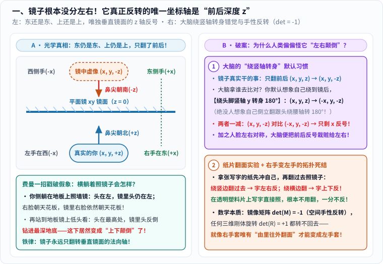
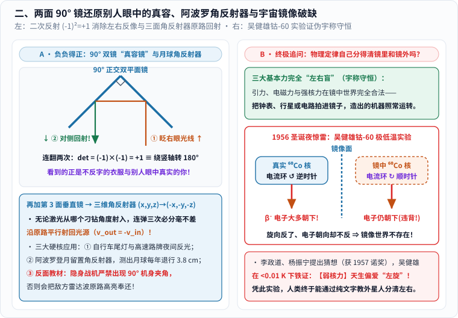
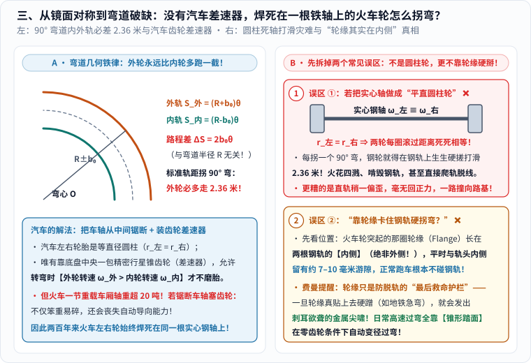
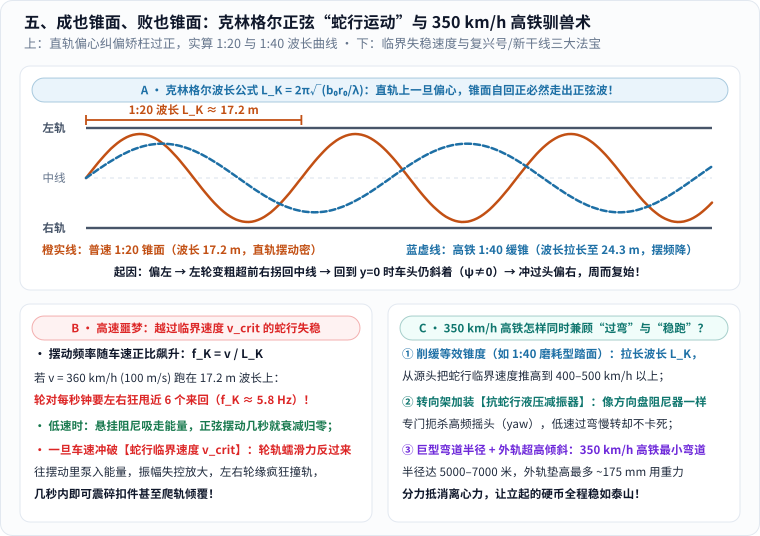

1983 年，诺贝尔物理学奖得主理查德·费曼（Richard P. Feynman）在英国广播公司 BBC 第二频道的科普访谈《*Fun to Imagine*》（想象的乐趣）里，津津有味地回忆起自己年轻时在麻省理工学院（MIT）兄弟会餐桌上经常被人拿来考校的两道“日常脑筋急转弯”：

1. **第一问（每天早上刷牙都会撞见）**：你站在浴室平面镜前，镜子明明只是一块上下左右完全均匀、没有任何方向偏见的玻璃镀膜——**它凭什么知道把你的左手和右手颠倒过来，却偏偏不把你的头顶和脚底也颠倒过来？**
2. **第二问（每次坐高铁和地铁都在脚下发生）**：拐弯时外圈路程永远比内圈长，汽车必须把后轴从中间切开、塞进一包精密齿轮（差速器），让外侧轮胎转得比内侧轮胎快，否则轮胎当场就会磨冒烟；可火车的左右两只钢轮，两百年来都是**死死焊在同一根实心钢轴上**、每秒钟转过的圈数分毫不差——**既没有差速器、也不能打方向盘，几百吨重的火车究竟凭什么丝滑拐过弯去？**

更妙的是，等你把这两道题一层层剥到底就会发现：它们表面上一个属于几何光学，一个属于铁道机械工程，骨子里讲的却是同一条物理主线——**空间对称性，以及“对称一旦破缺会发生什么”**。下面我们就把镜子搬进坐标系、把火车轮对切开横截面，一步步把这两个藏在眼皮底下的假象彻底拆穿。

---

## 一、镜子根本不分左右！它唯一动过的坐标轴只有“前后深度”

先回答第一道题最反直觉的真相：**平面镜从来没有颠倒过你的左右，也从来没有颠倒过你的上下；它在物理上唯一反转的，只有垂直于镜面的“前后深度轴”**（光学教材标准推导见 [OpenStax *University Physics Vol. 3* §2.1](https://openstax.org/books/university-physics-volume-3/pages/2-1-images-formed-by-plane-mirrors) 与费曼 [BBC *Fun to Imagine*: The Mirror](https://www.bbc.co.uk/programmes/p018ss3l)）。

### 1. 站在镜前向北看：东手仍在东、头顶仍在上，唯独鼻尖从朝北翻成朝南

把含糊不清的“左、右”先放一放，我们在浴室里画一个绝对清白的地理坐标系：假设浴室镜子挂在**正北墙**上（镜面就是水平东西轴 $$x$$ 与竖直上下轴 $$y$$ 张成的平面 $$z = 0$$），你面朝正北站在镜前 $$1\text{ m}$$ 处：

- **左右轴（东西向 $$x$$）**：你的右手伸向**正东**（$$+x$$），抬头看镜子里那个人——他靠近东墙的那只手同样伸向**正东**（$$+x$$），半步都没跑到西边去！你的左手指向**正西**（$$-x$$），镜中人西侧的手依然老老实实指向**正西**（$$-x$$）。
- **上下轴（天地向 $$y$$）**：你的头顶朝向**天花板**（$$+y$$），镜中人的头顶同样朝向**天花板**（$$+y$$）；你的脚踩在**地板**（$$-y$$），镜中人的脚也在**地板**（$$-y$$）。
- **前后轴（南北法向 $$z$$）**：唯一出大事的是第三根轴！你的后脑勺在南、鼻尖朝**正北**（$$+z$$）指着镜子；而镜子后面 $$1\text{ m}$$ 处的虚像（像距 $$d_i = -d_o$$），鼻尖却迎面朝**正南**（$$-z$$）指回你！

写成三维坐标变换，平面镜干的事情干净利落得像一把手术刀——保留平行于镜面的 $$x, y$$ 原封不动，只给垂直镜面的法向坐标 $$z$$ 添一个负号：

$$
M_z:\quad (x,\; y,\; z) \;\longmapsto\; (x,\; y,\; -z)
$$

费曼在访谈里给了一个一秒钟就能让全桌人恍然大悟的验证法：**要是镜子真有什么“认准左右颠倒”的特异功能，那你干脆横躺到地板上，侧着身子照墙上的镜子试试！**
当你头朝西、脚朝东侧躺在地板上时，你的右半边脸朝着天花板，左半边脸贴着地板。扭头看墙上的镜子：镜中人的右半边脸依然朝着天花板，左半边脸依然贴着地板——咦，你身体原本的“左”和“右”居然半点没颠倒？反过来，如果你站到一块铺在地板上的镜子上面低头往下看，你的头顶离镜面最远（$$+y$$），镜中人的头顶就会钻进地底最深处（$$-y$$）——这回同一面镜子，居然变成**“只颠倒上下、不颠倒左右”**了！

原因再清楚不过：**墙镜垂直于南北轴，所以只翻南北；地镜垂直于上下轴，所以只翻上下。平面镜一辈子只干一件事——把垂直戳进镜面的那根法向轴“由前翻后”。**

### 2. 破案时刻：为什么全人类都冤枉镜子“颠倒了左右”？

既然镜子只翻了前后，为什么全世界几乎每个人照镜子时，第一反应都一口咬定“镜子里的我是左右反的”？

答案不在玻璃里，而在**人类大脑默认的“转身比对动作”**里：

1. **大脑怎样把你挪到镜子后面去比对？** 看到镜中有一个面朝南站着的人，你的大脑想检查“他跟真实的我哪里不一样”，于是自动在脑海里演练：假设真实的我走到镜子后面，转过身来跟他摆出同一个朝南的姿势。请问，人类习惯怎么转过身？当然是双脚踩地、**绕着从头顶通向脚底的竖直轴 $$y$$ 水平转 $$180^\circ$$**！绝对没有人会想象自己双脚离地、头朝下倒立着**绕腰部横轴 $$x$$ 翻个 $$180^\circ$$ 跟头**去面对镜外！
2. **一减就破案了**：当你绕竖直轴 $$y$$ 旋转 $$180^\circ$$ 时，你的鼻尖固然从朝北变成了朝南（$$z \to -z$$），但你的东手和西手也跟着身体一起转了个半圈（$$x \to -x$$），变成：

$$
R_y(180^\circ):\quad (x,\; y,\; z) \;\longmapsto\; (-x,\; y,\; -z)
$$

现在把镜子真实造出的虚像 $$(x, y, -z)$$，拿去跟你脑海里“绕竖轴转身后的自己” $$(-x, y, -z)$$ 一对比——$$y$$ 相同，$$z$$ 也相同，**唯独 $$x$$ 差了一个负号！** 再加上人体外观恰好近似左右对称（左手和右手长得几乎一模一样，而脑袋和双脚截然不同），大脑瞬间就把“前后深度 $$z$$ 被镜子拍反”这笔账，顺水推舟栽赃到了“左右互换”头上。

不信你现在就拿一张白纸写上“科学”两个字去照镜子：
- 先正对着自己读一遍，此时字面朝向你的眼睛（朝南）；为了让镜子照见字，**你自己亲手把纸片绕着左右竖边翻了 $$180^\circ$$** 让字朝北——看，**早在进镜子之前，就已经是你自己的手把字左右翻反了！**
- 如果你换个手法，把这张纸**绕着上下横边翻 $$180^\circ$$** 朝向镜子，你会惊奇地发现：镜子里的字左右顺序完全正常，反而变成**上下倒立**了！
- 更绝的是：找一张**透明塑料片**写上字，举在眼前根本不翻面直接照镜子——镜子里的字跟塑料片上的字，上下不反、左右也不反，一模一样！

### 3. 数学死结：行列式等于 -1，右手套只有“由里往外翻面”才能变成左手套

当然，这并不是说镜中像和真实物体完全全等。在线性代数与[群论]()里，三维空间里一切真实的刚体旋转矩阵 $$R \in SO(3)$$，行列式永远等于正一（$$\det(R) = +1$$）；而平面镜反射矩阵 $$M_z = \operatorname{diag}(1, 1, -1)$$ 的行列式却是**负一**：

$$
\det(M_z) = 1 \times 1 \times (-1) = -1
$$

行列式等于 $$-1$$ 意味着空间的**手性（Chirality，又称宇称）发生了反转**。不管你在三维空间里怎么抓着一只真实的右手橡胶手套平移、歪头、倒立旋转，它的行列式始终是 $$+1$$，永远变不成镜子里那只左手套——除非你顺着深度轴做一次真正的“前后翻面”，也就是**把右手橡胶手套从手腕口由里往外翻个底朝天**，它才会瞬间变成一只左手手套！（唯一的拓扑例外，是我们在[莫比乌斯环那篇文章]()里见过的单侧不可定向曲面：只有沿着拧了半圈的莫比乌斯带遛一圈回来，右手才会在不翻面的情况下变成左手；而在我们生活的可定向三维欧氏空间里，镜像与真身隔着一道 $$\det = -1$$ 的拓扑鸿沟。）

*图 1：怎么看这张图——先看左栏俯视图，真实观察者面朝正北照镜时，东侧手（$$+x$$）在镜中仍在东侧，唯独垂直镜面的鼻尖从朝北（$$+z$$）翻成朝南（$$-z$$），侧躺与踩地镜实验进一步证明镜子只翻法向轴；再看右栏，大脑默认把镜中像与“绕竖轴转 $$180^\circ$$”后的自己做减法才生出左右颠倒错觉，而行列式 $$\det(M) = -1$$ 决定了右手套唯有由里往外翻面才能变成左手套（[单独打开高清原图](/assets/images/mirror-and-train/mirror-front-back-z-axis-and-handedness.svg)）。*

---

## 二、负负得正的 90° 真容镜、登月角反射器，以及连宇宙都分清左右的圣诞夜实验

既然照一次镜子乘了一个 $$-1$$，一个顺理成章的妙计立刻跳了出来：**要是让光线接连照两次镜子，$$(-1) \times (-1) = +1$$，手性岂不是当场“负负得正”还原回来了？**

### 1. 两面镜子拼成 90° 直角：为什么衣服上的字突然不反了？

把两块无框平面镜竖着立在桌上，让它们严丝合缝拼成一个 $$90^\circ$$ 直角（一面法向沿 $$x$$，一面法向沿 $$z$$），然后把脸正对着两镜交界棱线望进去（光学教材经典分析见 [OpenStax *University Physics Vol. 3* §1.2](https://openstax.org/books/university-physics-volume-3/pages/1-2-the-law-of-reflection)）：

- 从你右眼发出的光线先打在右侧镜面上，按入射角等于反射角横着弹向左侧镜面，再经左侧镜面第二次反射，恰好平行于原方向射回你的视野另一侧；
- 两次镜像变换相乘，矩阵变成了：

$$
M_x M_z = \operatorname{diag}(-1, 1, 1)\,\operatorname{diag}(1, 1, -1) = \operatorname{diag}(-1,\; 1,\; -1) = R_y(180^\circ), \qquad \det(M_x M_z) = (-1)^2 = +1
$$

算出来的结果竟然跟**绕竖直轴真实旋转 $$180^\circ$$ 一字不差**！在这面 $$90^\circ$$ 双镜（俗称“真容镜” True Mirror）里，你胸前 T 恤上的英文字母完全是正的；你冲它眨一下右眼，镜里对面的“你”会眨你视野左侧的那只眼——就像一个活生生的朋友站在对面看着你一样。很多人第一次照 $$90^\circ$$ 镜或看别人抓拍自己的照片时会觉得“怎么怪怪的不像我”，正是因为人的左右脸并非绝对对称，你长年累月在普通平面镜里看惯并喜欢上了自己 $$-1$$ 手性的反像，冷不丁见到别人眼中 $$+1$$ 手性的真实自己，大脑反而觉得陌生了！

### 2. 再添第三面垂直镜：阿波罗留置月球的角反射器与隐身战机的大忌

如果意犹未尽，在两面正交竖镜底下再垫上**第三面互相垂直的水平镜**，拼成墙角一样的**三维角反射器（Corner-Cube Retroreflector）**，空间三个坐标就一起翻号：

$$
M_x M_y M_z:\quad (x,\; y,\; z) \;\longmapsto\; (-x,\; -y,\; -z)
$$

无论一束光从多么歪斜刁钻的角度射进这个直角窝，接连在三面镜子上各弹一次后，出射方向向量必定满足 $$\vec{v}_{\text{out} } = -\vec{v}_{\text{in} }$$——**分毫不差地沿着来时的原路平行射回光源！** 这个纯几何奇迹撑起了三件大事：

1. **自行车尾灯与高速公路反光路牌**：塑料灯壳内壁压满了成千上万个微米到毫米级的微型直角棱锥，夜里后方汽车大灯一照，光束原路精准射回司机眼睛，自己不用装电池也亮得刺眼；
2. **阿波罗登月激光测距**：1969 年阿波罗 11 号及后续任务在月面摆下了由上百个石英角反射棱镜组成的阵列，地球天文台打出一束脉冲激光穿过 $$38\text{ 万公里}$$ 太空照中它，反射光依然能原路回到地面望远镜里——天文学家正是靠数出回波光子飞行时间，测准**月球每年正以约 $$3.8\text{ cm}$$ 的速度远离地球**；
3. **现代隐身战机的头号铁律**：角反射器对电磁雷达波同样好使！一旦机身和机翼、垂尾拼出 $$90^\circ$$ 直角，敌方雷达波照过来就会被原路百倍高亮奉还。所以你看 F-22、歼-20 等隐身战机，垂尾全都故意向外倾斜，进气道与弹舱锯齿严禁出现正交死角。

### 3. 终极对称之问：物理定律自己分得清镜里和镜外吗？（1956 钴-60 宇称破缺）

聊到这里，物理学家忍不住把问题推到了宇宙尽头：假如我们跟几万光年外一颗星球上的外星文明通上了纯文字无线电报（没有共同看得到的星座图片或实物快递），我们能不能光靠讲物理实验，教会外星人哪边是我们说的“左”、哪边是“右”（著名的“奥兹玛问题” Ozma Problem）？

在 1956 年之前，全世界所有物理学家都会拍胸脯回答：**绝无可能！因为大自然的一切基本物理定律都是左右对称（宇称守恒，Parity Conservation）的**——万有引力、电磁力、原子核里的强核力，搬进镜子里的世界全都一丝不差地成立。你教外星人绕一个逆时针螺线管通电造电磁铁，外星人若活在镜像定义里绕成顺时针，最终测出的同极相斥、异极相吸完全一样，永远查不出谁反了。

直到 1956 年，李政道与杨振宁在排查亚原子 $$\theta\text{-}\tau$$ 介子衰变疑案时石破天惊地指出：支配放射性 $$\beta$$ 衰变的**弱核力（Weak Interaction）从未被实验检验过宇称守恒**！同年圣诞节前后，实验物理学大师**吴健雄（Chien-Shiung Wu）**率领团队在美国国家标准局（今 NIST）完成了载入史册的极低温实验（一手实验档案见 [NIST *The Fall of Parity*](https://www.nist.gov/pml/fall-parity)）：

1. 她们把放射性**钴-60（$$^{60}\text{Co}$$）**原子核冻到热骚动几乎归零的 **$$0.01\text{ K}$$ 以下**（离绝对零度不到百分之一度），再用强磁场（可视作水平平面内一圈逆时针旋转的环形电流）把所有钴-60 原子核的自旋方向整齐排向同一个轴向；
2. 如果大自然果真左右不分，把这套装置放到竖直平面镜前一看：镜子里的环形电流从**逆时针变成了顺时针**（磁场与核自旋轴向反转），而竖直向上或向下喷射的 $$\beta^-$$ 衰变电子上下方向却**没有反转**；要让镜中实验与真实实验遵循同一套物理定律，向上飞出的电子数就必须严格等于向下飞出的电子数！
3. **圣诞夜揭晓的结果震惊了整个物理学界**：绝大多数 $$\beta^-$$ 电子都固执地朝着与核自旋相反的一端喷射出去！这意味着镜子里那个“电流顺时针、电子仍朝同一端猛喷”的装置，在真实宇宙里**根本造不出来**！

李政道与杨振宁因此在次年（1957 年）火速获颁诺贝尔物理学奖。原来，管辖放射性衰变与太阳氢聚变第一关的**弱核力天生是个“左撇子”**（只与左旋手性费米子耦合）！靠着吴健雄实验，人类第一次拥有了不靠实物、光发电报就能向全宇宙精准定义“左右”的绝对物理标尺。

*图 2：怎么看这张图——左栏上半部按精确几何光路画出 $$90^\circ$$ 正交双镜二次反射（$$\det = (-1)^2 = +1$$），下半部展示三面正交角反射器原路回射（$$\vec{v}_{\text{out} } = -\vec{v}_{\text{in} }$$）在阿波罗测月与隐身战机外形避忌上的正反应用；右栏对比真实 $$^{60}\text{Co}$$ 核与镜中 $$^{60}\text{Co}$$ 核，看懂“电流旋向反号而电子上下朝向不反号”如何一举证伪弱相互作用宇称守恒（[单独打开高清原图](/assets/images/mirror-and-train/corner-mirror-retroreflector-and-parity-wu.svg)）。*

---

## 三、从镜像对称跳进铁轨弯道：两只车轮焊死在一根实心钢轴上，没有差速器怎么拐弯？

看懂了镜子里的“左右对称与破缺”，现在低头看脚下的铁轨——当一列左右完全对称的火车驶入一道弯道时，铁轨的左右对称突然**破缺**了（铁路轮轨动力学标准推导见挪威科技大学 [NTNU *Railway Engineering* Ch. 10](https://www.ntnu.edu/documents/20587845/1266707380/Railways+Chapter10.pdf) 与费曼 [BBC *Fun to Imagine*: The Train](https://www.bbc.co.uk/programmes/p018ss4h)）。

### 1. 弯道几何铁律：拐过一个 90° 弯，外轨永远比内轨多出 2.36 米（竟与弯道半径无关！）

先把弯道账算明白。我国高铁与世界绝大多数干线铁路采用国际标准轨距 $$1435\text{ mm}$$（钢轨内侧距），左右两轮与轨顶接触点之间的中心跨度约为 $$2b_0 \approx 1.50\text{ m}$$（即半轨距 $$b_0 \approx 0.75\text{ m}$$）。假设列车驶过一段中心线曲率半径为 $$R$$、圆心转角为 $$\theta$$（弧度）的圆弧弯道：

- 外侧钢轨半径为 $$R + b_0$$，弧长 $$S_{\text{外} } = (R + b_0)\theta$$；
- 内侧钢轨半径为 $$R - b_0$$，弧长 $$S_{\text{内} } = (R - b_0)\theta$$；
- 两轨相减，弯曲半径 $$R$$ 当场互相抵消得干干净净！

$$
\Delta S = S_{\text{外} } - S_{\text{内} } = (R + b_0)\theta - (R - b_0)\theta = 2 b_0 \theta
$$

请仔细品味这个漂亮的消去结果：**不管这道弯是半径 $$300\text{ m}$$ 的地铁急弯，还是半径 $$7000\text{ m}$$ 的高铁大缓弯，只要列车拐满一个 $$90^\circ$$ 直角弯（$$\theta = \pi / 2$$），外侧车轮要滚过的钢轨长度，永远比内侧车轮铁板钉钉多出：**

$$
\Delta S_{90^\circ} = 2 \times 0.75\text{ m} \times \frac{\pi}{2} \approx 2.36\text{ m}
$$

整整两米三六——差不多相当于一只直径 $$1\text{ m}$$ 的火车轮要凭空多滚四分之三圈！

### 2. 汽车靠锯断车轴塞进齿轮差速器，20 吨轴重的火车为什么偏要用实心死轴？

马路上的汽车怎么补齐这两米多的路程差？因为汽车左右橡胶轮胎都是直径相等的平直圆柱（$$r_{\text{左} } = r_{\text{右} }$$），工程师只能把驱动桥从正中间锯成左右两截半轴，在中间塞进一包由行星锥齿轮组成的**差速器（Differential）**，允许拐弯时外侧车轮转得快、内侧车轮转得慢（$$\omega_{\text{外} } > \omega_{\text{内} }$$）。

那火车为什么不照抄汽车装个差速器？两个致命原因：
1. **重载强度扛不住**：一节重载货运车厢光一根车轴压下来的静载（轴重）就超过 $$20\text{–}25\text{ 吨}$$，要是把实心合金钢轴锯断塞进活动齿轮箱，不仅结构笨重昂贵，在亿万次金属冲击下极易断齿抱死；
2. **更致命的是——一旦左右车轮各自独立自由旋转，火车就会彻底丧失自动沿着轨道居中的导向能力！** 稍有一点风吹偏斜，自由轮就会一路斜撞向钢轨侧壁。因此从两百年前蒸汽机车诞生至今，绝大多数火车轮对始终坚持最硬核的结构：**左右两只钢轮过盈压装在同一根实心钢轴上，角速度严格锁死相等（$$\omega_{\text{左} } \equiv \omega_{\text{右} }$$）！**

### 3. 先拆掉两个流传最广的假答案：既不是平直圆柱硬搓，更不是靠轮缘卡轨硬掰！

角速度完全相等（$$\omega_{\text{外} } = \omega_{\text{内} }$$），外轮却要多跑 $$2.36\text{ m}$$——每次被问到这里，十个人里有九个会猜下面两个假答案：

- **误区 ①：“是不是靠钢轮在钢轨上硬打滑搓过去？”** 错！如果把实心轴火车轮真车成直筒圆柱（$$r_{\text{外} } = r_{\text{内} }$$），每拐一个弯，几十吨重的钢轮就得在钢轨顶面生生干磨打滑 $$2.36\text{ m}$$，不仅能耗惊人、火星四溅，不出几天就会把车轮磨出平疤、把钢轨啃报废，甚至直接爬上轨头脱轨。
- **误区 ②：“火车轮边上不是有一圈突出来的轮缘（Flange）吗？肯定是靠轮缘卡住钢轨硬掰着拐弯！”** 费曼在 MIT 餐桌上最爱追问这一句：*“慢着——请问你确定那圈突起的轮缘，是长在两根钢轨的外侧，还是内侧？”* 许多人脑海里以为火车轮像骑跨在钢轨外侧的凹槽滑轮，其实恰恰相反：**两只车轮的轮缘全都长在轨距的【内侧】！** 而且正常直线和大半径弯道行驶时，轮缘与钢轨内侧壁之间特意留着约 **$$7\text{–}10\text{ mm}$$ 的安全游隙**，根本互不接触！轮缘只是万一偏离过大时防脱轨的“最后救命护栏”——要是几十吨钢铁真以每小时三百公里的速度靠轮缘贴着钢轨硬蹭拐弯，轮缘和钢轨瞬间就会烧熔崩裂！

*图 3：怎么看这张图——左栏推导任意半径弯道上内外轨弧长差 $$\Delta S = 2b_0\theta$$（拐 $$90^\circ$$ 恒差 $$2.36\text{ m}$$）并说明汽车齿轮差速器原理；右栏拆穿“实心圆柱轮干磨打滑”与“靠轮缘卡轨硬拐”两大误区，注意认清火车轮缘位于两轨内侧且平时留有 $$7\text{–}10\text{ mm}$$ 游隙（[单独打开高清原图](/assets/images/mirror-and-train/car-differential-vs-solid-axle-train-dilemma.svg)）。*

---

## 四、把两个一次性纸杯底对底粘起来：1:20 锥形踏面怎样靠 15 毫米横移实现“无齿轮自动变速”？

既不打滑、又不装齿轮、还不碰轮缘，锁死角速度 $$\omega$$ 的两只车轮怎么跑出不同的线速度 $$v = \omega r$$？公式本身已经把唯一出路指出来了：**既然 $$\omega$$ 不能变，那就让两只车轮踩在钢轨上的有效滚动半径 $$r$$ 自动一变大、一变小！**

### 1. 桌面小实验：圆柱易拉罐只会滚直线，底对底双圆锥自己就会优雅画圆弧

你在家就能用两个一次性锥形纸杯复现这个天才发明：
- 如果把两个纸杯**口对口**粘成中间鼓、两头细的橄榄形架在两支平行铅笔轨道上，稍微一歪它就会滚落出轨；
- 反过来，把两个纸杯**杯底对杯底、杯口朝向内侧？不对——请看准方向：把大口径杯口朝向轨道内侧、小口径杯底朝向轨道外侧**（即**内厚外薄**，越靠近两轨中间车轮直径越大，越往轨道外侧边缘车轮直径越小！），架在两支平行铅笔上轻轻一推：哪怕你故意把它摆歪一点，它非但不会掉下去，反而会自动优雅地拐弯回正！

真实的火车车轮踏面（Wheel Tread），正是车削成这样一对**内粗外细的反向圆锥台**！在普速铁路与许多常规列车上，踏面的标准斜率（等效锥度 $$\lambda$$）通常取 **$$1:20$$**（$$\lambda = 0.05$$），即车轮往外横移 $$20\text{ mm}$$，接触点半径就改变 $$1\text{ mm}$$。肉眼乍一看几乎像平的，上了铁轨却是四两拨千斤的“纯几何无级变速箱”。

### 2. 迎弯外移 15 毫米：外轮踩上大半径粗肩，内轮退到小半径细端

现在跟着一列向**左**拐弯的火车，慢动作看清车底轮对在半秒钟内完成的精妙自组织：

1. **离心惯性轻轻外推**：铁轨开始向左弯曲，而沉重的轮对由于惯性倾向于继续走直线，于是整根实心车轴相对于钢轨自然向**右侧（弯道外轨方向）**横移了一小段距离 $$y_R$$；
2. **外轮变粗、内轮变细**：因为两只车轮都是“内侧粗、外侧细”，整根轴往右一挪——
   - **右侧外轮**把原本悬在轨距内侧的**粗肩部**推到了右轨顶上，有效滚动半径增大为 $$r_{\text{外} } = r_0 + \lambda y_R$$；
   - **左侧内轮**则把靠近外边缘的**细尾部**留在了左轨顶上，有效滚动半径缩小为 $$r_{\text{内} } = r_0 - \lambda y_R$$；
3. **同转一圈，外轮自动迈大步！** 要让内外两轮一丁点都不打滑（纯滚动），两轮半径之比只需恰好等于内外轨弯曲半径之比：

$$
\frac{r_0 + \lambda y_R}{r_0 - \lambda y_R} = \frac{R + b_0}{R - b_0}
$$

交叉相乘展开 $$(r_0 + \lambda y_R)(R - b_0) = (r_0 - \lambda y_R)(R + b_0)$$，两边消去 $$r_0 R$$ 与 $$-\lambda b_0 y_R$$，一行代数就推出了铁道工程最核心的**纯滚动横移黄金公式**：

$$
y_R = \frac{b_0 \, r_0}{\lambda \, R}
$$

把一组实实在在的列车参数代进去算一算：半轨距 $$b_0 = 0.75\text{ m}$$，名义车轮半径 $$r_0 = 0.50\text{ m}$$（车轮直径 $$1\text{ m}$$），踏面锥度 $$\lambda = 1/20 = 0.05$$，驶入一道曲率半径 $$R = 500\text{ m}$$ 的弯道：

$$
y_R = \frac{0.75 \times 0.50}{0.05 \times 500} = \frac{0.375}{25} = 0.015\text{ m} = 15\text{ mm}
$$

**仅仅向外横移 $$1.5\text{ 厘米}$$！** 此时外轮半径变大 $$0.75\text{ mm}$$（$$500.75\text{ mm}$$），内轮半径变小 $$0.75\text{ mm}$$（$$499.25\text{ mm}$$），两轮半径仅相差区区 **$$1.5\text{ mm}$$**，却刚好满足 $$\Delta r / r_0 = 1.5 / 500 = 0.3\% = 2b_0 / (2R) = 1.5 / 1000$$！不仅完美消化了每拐 $$90^\circ$$ 多出的 $$2.36\text{ m}$$ 路程差，更妙的是：因为在转向架弹性约束下，踩在大半径上的外轮每一步都比内轮迈得远，整根车轴还会自动产生一个指向弯心的偏航力矩，自己把车头顺着圆弧径向“拧”进弯道里！

### 3. 为什么干线铁路悄无声息，老地铁拐急弯却会发出刺耳尖叫？

不过，这条黄金公式 $$y_R = b_0 r_0 / (\lambda R)$$ 里也藏着一道硬天花板：**轮缘游隙只有大约 $$7\text{–}10\text{ mm}$$！**

- **在国铁干线与高铁上**（弯道半径 $$R \ge 1000\text{–}7000\text{ m}$$）：代入公式一算，$$R = 1000\text{ m}$$ 时只需横移 $$y_R = 7.5\text{ mm}$$，完全落在游隙范围之内（现代磨耗型曲线踏面靠近轮缘根部锥度还会陡增，能提供更大的等效半径差），因此轮缘全程悬空不碰轨，几百吨列车悄无声息就滑过了弯道；
- **在寸土寸金的城市地下铁急弯上**（老线路避让建筑桩基，弯道半径常常小到 $$R = 250\text{–}300\text{ m}$$）：公式算出纯滚动需要横移 $$y_R = 25\text{–}30\text{ mm}$$，可轮对刚往外挪到 $$10\text{ mm}$$，外轮内侧的**安全轮缘就“哐”地一下撞上了外轨内壁**！横移被强行卡死，半径差不够补齐弧长差，再加上同一转向架前后两根车轴被刚性轴距夹着无法同时严格对准圆心，车轮踏面与轮缘只能在钢轨上反复发生每秒上千次的**粘着—滑动（Stick-Slip）高频自激振动**——这就是地铁拐急弯时那阵让人头皮发麻的金属尖啸声的真正来源！

*图 4：怎么看这张图——上栏横截面准确画出了轮缘位于两轨内侧的 $$1:20$$ 内厚外薄锥形轮对，单次动画演示列车向左拐弯时轮对向外轨横移 $$y_R$$，使右轨踩上粗端大半径、左轨退到细端小半径（动画仅播放一次并定格在终态，支持系统“减少动态效果”设置；[单独打开原图](/assets/images/mirror-and-train/conical-wheelset-curve-steering-geometry.svg)刷新可重播）；下栏给出纯滚动横移公式实算，并用曲线标出 $$10\text{ mm}$$ 轮缘游隙上限如何划分“干线纯锥静音区”与“地铁急弯尖叫区”。*

---

## 五、成也锥面、败也锥面：克林格尔正弦“蛇行失稳”与时速 350 公里高铁的三大驯兽术

读到这里，你可能会忍不住鼓掌：锥形踏面简直是零成本的机械神作，要不再把锥度做得更陡一点（比如 $$1:5$$），让再急的弯都不磨轮缘好不好？

千万使不得！因为早在 1883 年，德国铁路工程师**约翰内斯·克林格尔（Johannes Klingel）**就从数学上算出了锥形踏面与生俱来的“恶魔副作用”——**蛇行运动（Hunting Oscillation）**（定量推导见 [NTNU *Railway Engineering* §10.3](https://www.ntnu.edu/documents/20587845/1266707380/Railways+Chapter10.pdf)）。

### 1. 纠偏为什么会矫枉过正？1883 年克林格尔波长公式算出的铁轨正弦舞步

设想轮对跑在笔直的平直铁轨上，冷不丁压过一颗小沙粒，往**左侧**偏了 $$3\text{ mm}$$：

1. **偏左触发右拐**：左轮立刻踩上粗端变大，右轮踩到细端变小，左轮比右轮滚得快，于是推着车轴朝右扭头，自动往轨道中心线（$$y = 0$$）走回来——前半程看似完美的自动纠偏！
2. **回到中线却刹不住斜角**：糟糕的是，当轮对重心好不容易回到轨道正中间（$$y = 0$$）的那一瞬间，左右两轮直径虽然重新相等了，**可刚才扭过来的车轴偏航角（$$\psi \ne 0$$）恰好处在斜得最厉害的峰值！**
3. **冲过头变成永无止境的正弦波**：斜着身子的轮对顺势冲过中线偏到**右侧**，右轮又变粗把它往左掰回来……横向位移 $$y$$ 与车头偏航角 $$\psi$$ 之间刚好差了 $$90^\circ$$ 相位，跟弹簧振子一模一样！克林格尔用纯运动学严格解出，自由锥形轮对在直轨上滚出的轨迹是一条纯正弦曲线，其空间波长 $$L_K$$ 只由几何尺寸决定：

$$
L_K = 2\pi \sqrt{\frac{b_0 \, r_0}{\lambda} }
$$

把前面的标准参数（$$b_0 = 0.75\text{ m},\; r_0 = 0.50\text{ m}$$）代进去一算：
- 若采用普速列车常见的 **$$1:20$$ 锥度**（$$\lambda = 0.05$$）：蛇行波长 $$L_K = 2\pi\sqrt{0.375 / 0.05} \approx \mathbf{17.2\text{ m} }$$，即火车每往前开 $$17.2\text{ m}$$ 就左右扭一个完整来回；
- 若把锥度削缓一半变成高铁常用的 **$$1:40$$ 缓锥**（$$\lambda = 0.025$$）：蛇行波长立刻拉长 $$\sqrt{2}$$ 倍，达到 $$L_K \approx \mathbf{24.3\text{ m} }$$！

### 2. 冲破临界速度的噩梦：每秒狂甩近 6 次的蛇行共振失稳

波长固定在十来米，车速 $$v$$ 一提上去会发生什么？轮对每秒钟左右摆动的频率 $$f_K = v / L_K$$ 会随车速成正比飙升！如果让一列 $$1:20$$ 锥度的轮对跑到时速 $$360\text{ km/h}$$（即 $$100\text{ m/s}$$），它每秒钟就要在钢轨上左右猛甩 $$100 / 17.2 \approx \mathbf{5.8\text{ 次} }$$！

在低速时，转向架弹簧与减振器能轻松吸走这点晃动能量；可一旦列车速度越过一道动力学红线——**蛇行临界速度 $$v_{\text{crit} }$$**，车轮与钢轨接触斑上的微观弹性蠕滑力（Creep Force）就会反过来像推秋千一样，每一周期都往横向摆动里净注入机械能！振幅在短短几秒内呈指数级暴涨，左右轮缘以几吨的冲击力疯狂来回撞击左右钢轨（极限环振荡），轻则把窗台上的水杯全部震飞、砸松钢轨扣件，重则直接爬轨倾覆！二十世纪中期人类冲击高速铁路时，挡在面前最凶险的“音障”，正是这道蛇行失稳墙。

### 3. 复兴号与新干线怎样驯服这匹野马：1:40 缓锥踏面、抗蛇行液压减振器与 7000 米超高大弯

既然锥度大了直轨发疯、锥度没了弯道打滑，今天时速 $$350\text{ km/h}$$ 的中国复兴号、法国 TGV 与日本新干线，是怎么在刀尖上同时搞定这对死敌的？（如果干脆连车轮都扔掉，就走进了我们在[磁悬浮列车那篇文章]()里拆解过的另一条技术路线；而在轮轨世界里，工程师祭出了三件硬核法宝，再加上高速旋转车轮自身的[角动量稳定性]()）：

1. **法宝一：削缓等效锥度（如 $$1:40$$ 定制磨耗型踏面）**：高铁专门精密设计低等效锥度踏面（新轮名义等效锥度低至 $$0.025\text{–}0.05$$ 量级，并定期用数控镟轮机床修整磨耗踏面），把克林格尔波长拉长到 $$24\text{ m}$$ 以上，从源头上把蛇行失稳临界速度推高到 **$$450\text{–}550\text{ km/h}$$ 以上**，给 $$350\text{ km/h}$$ 运营留足安全裕度；
2. **法宝二：转向架两侧挂上粗壮的“抗蛇行液压减振器”（Yaw Damper）**：下次在高铁站台低头看两节车厢转向架侧面，你会看到几根横着连接转向架与车体的粗大液压筒——它的阀门特性专门“欺快不欺慢”：遇到每秒好几次的高频蛇行摇头，液压油来不及挤过微孔，瞬间变身刚性铁棍把摆动死死摁住；而真正驶入漫长大弯道需要缓慢转角时，油液又能从容流过，绝不卡死过弯；
3. **法宝三：动辄 $$5000\text{–}7000\text{ m}$$ 的巨型弯道半径 + 外轨超高倾斜（Cant）**：既然锥度削缓到了 $$1:40$$，急弯自然转不过来，那高铁干脆**不修急弯**！时速 $$350\text{ km/h}$$ 高铁线路的最小平面曲线半径一般高达 **$$5000\text{–}7000\text{ m}$$**（算一算：$$R = 6000\text{ m},\; \lambda = 1/40$$ 时，所需纯滚动横移仅 $$y_R = 0.375 / 150 = \mathbf{2.5\text{ mm} }$$！），同时把弯道外侧钢轨比内侧垫高最多约 **$$175\text{ mm}$$**，让车身微微向弯心倾斜，借重力分力完美抵消离心力——这才能让你立在复兴号窗台上的那枚硬币，哪怕掠过大弯也纹丝不倒！

*图 5：怎么看这张图——上栏按克林格尔公式精确绘出 $$1:20$$ 锥度（橙实线，波长 $$17.2\text{ m}$$）与 $$1:40$$ 缓锥度（蓝虚线，波长 $$24.3\text{ m}$$）在直轨上的正弦蛇行轨迹；下栏左半部解释越过临界速度 $$v_{\text{crit} }$$ 后蠕滑力如何泵入能量引发失稳，右半部总结 $$350\text{ km/h}$$ 高铁兼顾“直轨稳跑”与“弯道顺拐”的三项核心工程设计（[单独打开高清原图](/assets/images/mirror-and-train/klingel-hunting-oscillation-and-high-speed-rail.svg)）。*

---

## 六、一表收束：从浴室镜面到复兴号车底，“对称与破缺”的五重对照

回看整趟旅程，无论是洗漱台前的一块玻璃，还是铁道上飞驰的钢铁巨龙，每一次让人拍案叫绝的反转，都浓缩在下面这张对照表里：

| 日常场景 | 直觉误区 | 真实物理机制与定量核心 | 工程或科学延伸 |
| :--- | :--- | :--- | :--- |
| **单面平面镜** | “镜子把左右颠倒了，却没颠倒上下” | 仅翻转法向深度 $$(x,y,z)\mapsto(x,y,-z)$$（$$\det = -1$$）；“左右反”源于大脑默认绕竖轴转 $$180^\circ$$ 比对 | 救护车车头印反字 `ECNALUBMA`，让前车后视镜一次反射还原正字 |
| **$$90^\circ$$ 双镜 & 三面角镜** | “多照几面镜子只会更乱” | 正交双镜二次反射 $$\det = (-1)^2 = +1$$ 还原真容；三面角镜实现 $$\vec{v}_{\text{out} } = -\vec{v}_{\text{in} }$$ 原路回射 | 阿波罗月球激光测距（年退行 $$3.8\text{ cm}$$）、高速反光牌、隐身战机禁 $$90^\circ$$ 角 |
| **钴-60 镜像实验** | “一切物理定律都左右对称” | 弱核力破坏宇称守恒：$$<0.01\text{ K}$$ 极化 $$^{60}\text{Co}$$ 的 $$\beta^-$$ 电子偏爱逆核自旋方向喷射 | 1957 诺贝尔物理奖；人类可凭纯文字电报向宇宙外星文明定义“左右” |
| **实心死轴火车过弯** | “靠轮缘硬卡钢轨”或“硬搓打滑” | 轮缘在轨距**内侧**留 $$7\text{–}10\text{ mm}$$ 游隙；靠 $$1:20$$ 内厚外薄锥面外移 $$y_R = \frac{b_0 r_0}{\lambda R}$$（$$R=500\text{ m}$$ 仅移 $$15\text{ mm}$$）自动差速 | 零齿轮承载 $$20\text{ 吨}$$ 重载并自导向；地铁 $$R\le 300\text{ m}$$ 急弯超游隙才触发尖啸 |
| **$$350\text{ km/h}$$ 高铁稳跑** | “踏面越陡导向越灵越好” | 直轨偏心触发克林格尔正弦蛇行 $$L_K = 2\pi\sqrt{\frac{b_0 r_0}{\lambda} }$$（$$17.2\text{ m}$$ vs $$24.3\text{ m}$$），超 $$v_{\text{crit} }$$ 失稳 | $$1:40$$ 缓锥踏面 + 转向架抗蛇行液压减振器 + $$5000\text{–}7000\text{ m}$$ 外轨超高大弯 |

下次早上刷牙照镜子，不妨冲镜子里的自己伸出东边的手，感受一下那个只被拍反了前后深度轴的 $$-1$$ 手性世界；下次踏上高铁站台，也不妨低头瞄一眼车厢底下那对看似平平无奇的车轮和横着的抗蛇行液压筒——正是那肉眼难辨的几十分之一锥度与区区几毫米的横移，撑起了人类两百年陆上钢铁动脉的全部优雅与疾驰。

---

## 参考资料与延伸阅读

1. **Richard P. Feynman, BBC2 *Fun to Imagine* (1983) — Episode 4 *"The Mirror"* & Episode 5 *"The Train"***：[BBC 官方节目档案（The Mirror）](https://www.bbc.co.uk/programmes/p018ss3l) 与 [BBC 官方节目档案（The Train）](https://www.bbc.co.uk/programmes/p018ss4h) —— 本文开篇两道麻省理工兄弟会餐桌脑筋急转弯、侧躺照镜思想实验以及火车轮缘位于轨内侧与锥形踏面自导向的经典物理叙事来源（需网络连接播放）。
2. **OpenStax, *University Physics Volume 3*, §1.2 *"The Law of Reflection"* & §2.1 *"Images Formed by Plane Mirrors"***：[1.2 反射定律与角反射器](https://openstax.org/books/university-physics-volume-3/pages/1-2-the-law-of-reflection) 及 [2.1 平面镜成像与手性反转](https://openstax.org/books/university-physics-volume-3/pages/2-1-images-formed-by-plane-mirrors) —— 支持平面镜虚像距离 $$d_i = -d_o$$、右手手套翻面比喻、$$90^\circ$$ 正交双镜消除左右反像及阿波罗登月角反射器原路回射原理。
3. **NIST Physical Measurement Laboratory, *"The Fall of Parity"***：[美国国家标准与技术研究院官方史料馆](https://www.nist.gov/pml/fall-parity) —— 详述 1956 年李政道、杨振宁宇称不守恒猜想与吴健雄团队在 $$<0.01\text{ K}$$ 极低温下开展极化钴-60（$$^{60}\text{Co}$$）$$\beta$$ 衰变实验的装置细节、原始数据与科学意义。
4. **C. S. Wu, E. Ambler, R. W. Hayward, D. D. Hoppes, and R. P. Hudson (1957), *"Experimental Test of Parity Conservation in Beta Decay"*, *Physical Review* 105(4), 1413–1415**：[APS *Physical Review* 原始论文](https://doi.org/10.1103/PhysRev.105.1413) —— 证伪弱相互作用镜像对称的一手实验论文。
5. **T. D. Lee and C. N. Yang (1956), *"Question of Parity Conservation in Weak Interactions"*, *Physical Review* 104(1), 254–258**：[APS *Physical Review* 原始论文](https://doi.org/10.1103/PhysRev.104.254) —— 提出弱核力宇称破缺检验方案并获 1957 年诺贝尔物理学奖的奠基论文。
6. **Norwegian University of Science and Technology (NTNU), *Railway Engineering — Chapter 10: Wheel–Rail Interaction***：[NTNU 铁道工程教材公开章节 PDF](https://www.ntnu.edu/documents/20587845/1266707380/Railways+Chapter10.pdf) —— 支持标准轨距 $$1435\text{ mm}$$、锥形踏面等效锥度 $$\lambda$$（$$1:20$$ 与 $$1:40$$）、纯滚动曲线横移公式 $$y_R = \frac{b_0 r_0}{\lambda R}$$、1883 年克林格尔正弦蛇行波长公式 $$L_K = 2\pi\sqrt{\frac{b_0 r_0}{\lambda} }$$ 及高速列车临界速度与抗蛇行减振器工程分析。
7. **Johannes Klingel (1883), *"Über den Lauf der Eisenbahnwagen auf gerader Bahn"*, *Organ für die Fortschritte des Eisenbahnwesens* 38, 113–123** —— 首次从运动学严格推导出自由锥形轮对直轨正弦蛇行运动波长公式的历史原始文献。
