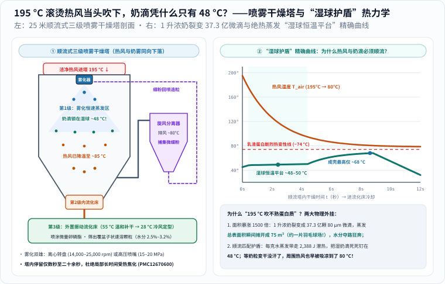
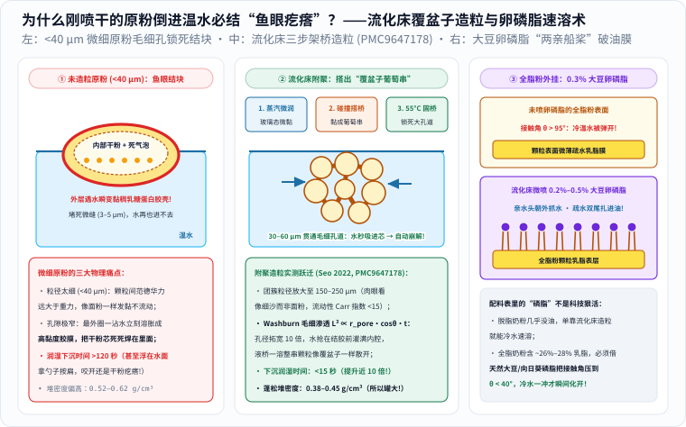
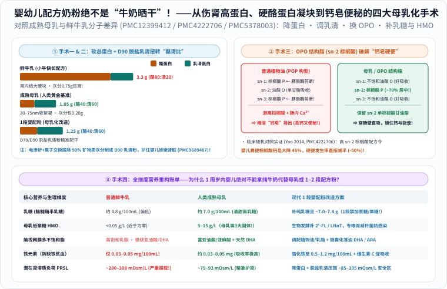
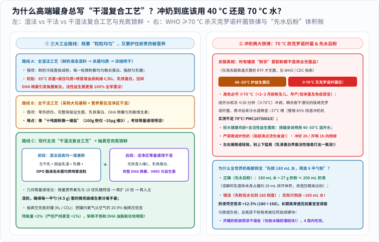

冲一杯奶粉，大概是地球上最稀松平常的动作之一：舀几平勺乳白色粉末撒进温水，手腕轻轻转几圈，几秒钟就化开成一杯奶香四溢的乳液。可只要你盯着奶粉罐上的配料表和冲调说明多琢磨几分钟，一连串极其反直觉的疑问就会冒出来：

- **鲜牛奶里 87.5% 都是水，为什么不能直接架锅熬干磨成粉？** 你要是真在家拿奶锅把一盒纯牛奶小火熬干，最后铲出来的绝不是洁白蓬松的奶粉，而是一坨焦黄发硬、带着焦糖怪味、拿开水泡半天都化不开的“死奶疙瘩”。现代工厂到底使了什么手段，能在抽干近九成水分的同时留住鲜奶的活性？
- **近 `200 °C` 热风当头吹下，蛋白质为什么没被“烤熟”？** 现代乳品厂那座七八层楼高的喷雾干燥塔里，进塔热风高达 **`180–200 °C`**——比蒸笼还烫一倍！可乳清蛋白只要超过 `74 °C` 就会大面积热变性凝固。滚烫热风迎面扑上去，微小的奶滴凭什么能把自身温度稳稳锁在 **`48 °C` 左右**全身而退？
- **为什么老式奶粉总结“鱼眼疙瘩”，全脂奶粉配料表里为什么总有“大豆磷脂”？** 刚从喷雾塔落下来的微细原粉其实极难冲开，一沾水就外湿内干抱成硬团；工程师是怎么把它改造成“冷水秒沉”的？为什么奶粉刚买回来开罐总觉得“没装满、空了一截”？
- **为什么 1 岁以内婴儿绝对不能拿纯牛奶当主食，婴配粉到底对牛奶动了哪几刀？** 同样叫“奶粉”，成人全脂奶粉和 1 段婴幼儿配方奶粉完全是两个物种！为什么小牛喝着健壮如飞的纯牛奶，直接喂给人类新生儿却会引发胃结硬块、高渗伤肾、缺铁贫血甚至拉出硬邦邦的“钙皂便”？罐身上常印的 **`D90` 脱盐乳清、`OPO` 结构脂、`HMO` 母乳低聚糖**究竟是真实分子工程还是营销噱头？
- **“湿法、干法、干湿复合工艺”孰优孰劣？冲奶到底该用 `40 °C` 还是 `70 °C` 的水？** 为什么世卫组织（WHO）与美国疾控中心（CDC）反复警告高危新生儿必须用 **`≥70 °C`** 的热水冲调粉状配方奶，而许多益生菌奶粉罐上却写着 `40–50 °C`？为什么全世界所有奶瓶都铁定要求**“先倒水、后放粉”**？

别看只是一勺只有 `4.5` 克重的乳白粉末，它背后其实站着过去一百五十年间**真空热力学、高速流体雾化、多相毛细界面化学、母乳分子组学与微生物风险控制**的精密合谋。

> **一句话先亮出底牌：现代奶粉制造的核心哲学，是用“负压偷沸点、出汗偷温度、架桥扩毛细、两亲破油膜”把近 8 斤鲜奶在几乎不伤蛋白质的前提下浓缩成 1 斤多孔颗粒；而婴幼儿配方奶粉，更是在此基础上把“为小牛半年翻几倍体重设计的牛乳”，从蛋白质比例、甘油三酯键位到低聚糖与矿物质负荷，逐一重构成逼近人类母乳的生命早期口粮 [[1]](#ref-1) [[6]](#ref-6)。**

下面我们就跟着一辆冷链奶罐车驶进工厂，从第一滴鲜奶一直追到宝宝嘴边的奶瓶，把这趟奇妙旅程一步步拆开看清。

---

## 一、从腐败鲜奶到工业奇迹：为什么做 1 斤奶粉，先得抽走近 7 斤水，还绝不能架锅硬熬？

### 1. 百年保鲜突围：从游牧晒干奶皮、李比希首款配方粉，到珀西 1872 年的“雾中造粉”专利

在没有冷链和杀菌技术的年代，刚挤出来的鲜奶是一颗名副其实的“微生物定时炸弹”：它富含乳糖、蛋白质、乳脂与矿物质，水分活度极高（$$a_w \approx 0.99$$），盛夏常温下搁置几个小时就会酸败变质，更可能传播结核杆菌、布鲁氏菌与沙门氏菌。据儿科学史文献记载，直到 19 世纪初，欧洲找不着母乳或乳母、被迫靠未杀菌动物奶和米糊喂养的婴儿，周岁内死亡率一度高达三分之一甚至更高 [[2]](#ref-2)。

人类最早想到的办法是“把水弄走”——早在 13 世纪，马可·波罗就在游记里记录过蒙古骑兵把脱脂马奶或牛乳在烈日下晒成干奶饼随军携带。但晒干和慢煮都没法保住牛奶原本的风味与溶解度。真正把乳制品保藏推向现代科学轨道的，是 19 世纪的三次关键跨越：

1. **1853–1885 年的“真空炼乳”探路**：美国发明家盖尔·博登（Gale Borden）在 1853 年利用真空蒸发锅低温抽水并加蔗糖抑菌，造出了甜炼乳；1885 年约翰·迈耶林（John B. Myerling）进一步造出无糖淡炼乳 [[2]](#ref-2)。人们第一次意识到：**只要把锅抽成负压，水根本不用烧到 `100 °C` 就能欢快沸腾！**
2. **1865 年李比希的第一款商业婴儿配方粉**：早在 1760 年，法国医生德-埃萨尔（Des-Essartz）就首次从化学成分上对比了人乳与牛乳的差异；到了 **1865 年**，德国有机化学巨匠**尤斯图斯·冯·李比希（Justus von Liebig）**研制并申请专利，推出了人类历史上第一款商业化母乳代用品——先做成液体，不久改良为更耐储存的粉末（以牛乳为底，配入小麦粉、麦芽粉和碳酸氢钾中和酸度），拉开了现代配方乳粉工业的序幕 [[2]](#ref-2)。
3. **1872 年珀西的“雾化瞬干”奠基专利**：早期的滚筒干燥法（把浓奶涂在滚烫铁筒上刮下薄片）依然难免烫伤蛋白质。**1872 年 4 月 9 日**，美国发明家**塞缪尔·珀西（Samuel R. Percy）**获批了改变整个食品与制药工业的美国专利 `US125406A`（*Improvement in Drying and Concentrating Liquid Substances by Atomizing*）：他首次提出，把液体高速打散成极微小的雾滴，同时送入加热或干燥的气流中，水分会在下坠瞬间蒸发殆尽，固体直接化作干粉落下，**“从而保护物质免受破坏性的化学变化”** [[1]](#ref-1)。随着 20 世纪 20 年代乳品需求激增与二战远征军口粮催熟，这项“雾中造粉”绝技彻底成为全球奶粉工业的心脏 [[3]](#ref-3)。

### 2. 第一道铁账：7.76 斤生鲜乳怎样变成 1 斤全脂粉？为什么真空降膜蒸发要先扛下 86.1% 的脱水活？

既然有了珀西的喷雾干燥塔，那是不是把牧场刚收来的鲜牛奶杀完菌，直接喷进热风塔里吹干就完事了？

**绝对不行——谁要是敢把生鲜乳直接往喷雾塔里喷，工厂老板月底看燃气账单能当场哭晕过去，造出来的粉还会又细又焦！** 我们不妨拿纸笔算一笔最硬核的**干物质守恒账**与**热耗账**：

_按“上 → 中 → 左下 → 右下”四步跟读：① 最上方五张卡片及单次流向动画展示从 `7.76 kg` 生鲜乳制取 `1.00 kg` 全脂奶粉的五道工业关卡（若页面加载后动画已播完，刷新或单独打开图片可重播；开启系统“减少动态效果”时直接显示静态全貌）；② 中间三色比例条直观揭示 `86.1%` 的水分早在低温真空蒸发器里就被抽走了；③ 左下红绿条对比“鲜奶直喷”与“真空浓缩+喷雾”近 5 倍的热能差距；④ 右下用斯托克斯定律拆解高压均质锁住乳脂的原理。[单独打开大图](/assets/images/milk-powder-manufacturing/fresh-milk-to-powder-mass-energy-pipeline.svg)。_

合格的生鲜牛乳中，约 **`87.5%` 全是水**，真正的“干货”（蛋白质、乳脂、乳糖、矿物质合称**总乳固体**）只占约 **`12.5%`**；而一罐耐储存的合格全脂奶粉，残余结合水必须压低到 **`3.0%` 左右**（总固体占 **`97.0%`**）[[4]](#ref-4)。由于整个脱水过程中干物质既不会凭空产生也不会蒸发飞走，要造出 $$m_{\mathrm{powder} } = 1.00\ \mathrm{kg}$$ 成品奶粉，所需的生鲜牛乳质量 $$m_{\mathrm{raw} }$$ 由质量守恒直接锁死：

$$
m_{\mathrm{raw} } \times 12.5\% = 1.00\ \mathrm{kg} \times 97.0\% \implies m_{\mathrm{raw} } = \frac{0.970}{0.125} = 7.76\ \mathrm{kg}.
$$

看清这个比例了吗？**足足 `7.76 公斤`（将近 `8 斤`！）生鲜牛乳，才能浓缩出 `1 斤` 全脂奶粉！** 在这趟旅程里，工厂总共必须从牛奶身上剥离掉：

$$
\Delta m_{\mathrm{water} } = 7.76 - 1.00 = 6.76\ \mathrm{kg}\ \text{纯净水}.
$$

如果直接在家架一口敞口锅常压熬掉这 `6.76 kg` 水，水非得烧到 **`100 °C`** 才肯沸腾不可。在长达几十分钟的 `100 °C` 煎熬里，牛奶里的还原糖（乳糖）会和蛋白质侧链上最宝贵的必需氨基酸——**赖氨酸（Lysine）**的游离氨基发生剧烈的**美拉德褐变反应（Maillard reaction）**，不仅把雪白的牛奶熬成焦黄苦涩的硬壳，还会让蛋白质交联死结、赖氨酸生物利用率断崖式报废！

那如果把 `7.76 kg` 稀鲜奶直接喷进热风塔呢？热风干燥属于典型的“低热效率高品位换热”——要把空气加热再吹进塔里带走 `1 kg` 水，哪怕算上排风余热回收，平均也要消耗约 **`3,800 kJ`** 的热能；直接吹干 `6.76 kg` 水，每造 1 公斤奶粉就要烧掉惊人的 **`25.7 MJ`** 热量！

现代乳品工业给出的标准解法，是在进喷雾塔之前，先立起几层楼高的不锈钢管束——**多效／MVR 真空降膜蒸发器（Falling-Film Vacuum Evaporator）**[[4]](#ref-4)：

1. **抽负压把沸点“偷”到 `48–70 °C`**：用真空泵把蒸发管内的气压抽低到约 **`12–30 kPa`（约 `0.12–0.3` 个大气压，常见工况如 `200 mbar`）**。气压一降，水分子挣脱液面的门槛骤降，牛奶在 **`48–70 °C` 的温和澡水温度**下就顺着不锈钢内壁形成薄薄一层液膜欢快沸腾，几十秒滑到底部就完成浓缩，乳清蛋白和赖氨酸毫发无伤 [[4]](#ref-4)！
2. **蒸汽潜热循环白嫖，一口气抽走 `86.1%` 的水**：蒸发出来的二次水蒸气，被**机械蒸汽再压缩机（MVR）**稍微加压升温几度，立刻送回管壁外侧当加热热源继续蒸下一批牛奶——潜热在系统里左手倒右手反复回收，每脱掉 `1 kg` 水仅耗能约 **`320 kJ`**（不到喷雾干燥的十分之一！）。
3. **精准停在 `50%` 固形物红线**：真空降膜蒸发一路把牛奶浓缩到总固体约 **`48%–50%`**（变成像炼乳一样顺滑的浓奶），此时浓缩乳质量只剩：

$$
m_{\mathrm{conc} } = \frac{0.970}{50.0\%} = 1.94\ \mathrm{kg}.
$$

算一算减掉的水量：$$7.76 - 1.94 = 5.82\ \mathrm{kg}$$！也就是说，**全部待脱水分的 `86.1%`（`5.82 ÷ 6.76`），已经在 `48–70 °C` 的真空蒸发器里用极低能耗悄悄抽干了**；留给后面高能耗喷雾干燥塔与流化床去啃的硬骨头，只剩最后那 **`0.94 kg` 水（占 `13.9%`）**！仅这一步接力，就把每公斤奶粉的总热耗从 `25.7 MJ` 暴砍到 **`5.43 MJ`，直接省下近八成（`78.9%`）能源**，还顺带让喷出来的奶粉颗粒更饱满紧实 [[4]](#ref-4)。
（顺便答一个好奇提问：为什么不在真空蒸发器里干脆蒸到 `97%` 全干？因为固形物一旦超过 `52%–55%`，浓奶黏度就会像胶水一样指数级暴涨，再也没法顺着管壁流下来，雾化喷嘴也会当场堵死！）

### 3. 双级高压均质（15–25 MPa）：用斯托克斯定律把上浮速度砍慢 100 倍，再给油滴穿上“蛋白防弹衣”

在进喷雾塔之前（或浓缩前后），奶液还要钻过一道极其暴力的窄缝——**`15–25 MPa`（相当于 `150–250` 个大气压，比我们前文聊过的[意式咖啡机 9 Bar 萃取水压]()还要猛二十多倍！）的双级高压均质阀** [[6]](#ref-6)。

为什么要受这道罪？因为刚挤出来的生牛乳里，乳脂肪球直径大多在 **`3–6 μm`（平均约 `4 μm`）**，个头大、密度比脱脂奶水相轻（$$\rho_{\mathrm{fat} } \approx 920\ \mathrm{kg/m^3} < \rho_{\mathrm{skim} } \approx 1035\ \mathrm{kg/m^3}$$）。根据流体力学经典的**斯托克斯上浮定律（Stokes' law）**，油滴在液体中往上飘的速度 $$v$$ 与其直径 $$d$$ 的**平方**成正比：

$$
v = \frac{d^2 \left(\rho_{\mathrm{skim} } - \rho_{\mathrm{fat} }\right) g}{18 \mu}.
$$

式子中 $$g$$ 为重力加速度，$$\mu$$ 为乳液动力黏度。当高压奶液以每秒近两百米的速度冲过微米级均质阀缝隙时，剧烈的剪切湍流与空化微爆，瞬间把 `4.0 μm` 的大脂肪球撕碎成 **`0.1–1.0 μm`（典型均值约 `0.4 μm`）** 的超微脂滴 [[6]](#ref-6)：

- **防分层**：直径 $$d$$ 缩小到原来的 $$1/10$$，平方项 $$d^2$$ 就缩小到原来的 **$$1/100$$**——脂肪上浮分层的速度直接**变慢 100 倍**，冲出来的奶再也不会表面浮一层厚油皮！
- **防氧化哈喇味**：脂肪球直径缩 10 倍，总表面积瞬间放大 10 倍，原本那点天然乳脂球膜（MFGM）根本不够包了。这时牛奶里的**酪蛋白胶束与乳清蛋白**会立刻扑上去，在每颗微脂滴外头严严实实裹上一层崭新的“蛋白质防弹衣” [[6]](#ref-6)。等一会儿进塔喷干时，绝大部分油脂都被锁在蛋白—乳糖基质内部，颗粒表面的“游离脂肪（Free fat）”极低，既不容易接触氧气变出“哈喇味”，也不会像油布一样把温水拒之门外。

---

## 二、25 米高塔里的热力学魔术：195 °C 热风当头吹下，奶滴凭什么稳守 48 °C 不变性？

### 1. 雾化器的几何爆炸：把 1 升浓奶瞬间撕成 37.3 亿颗微滴，摊出一片羽毛球场

现在，预热到约 `45–50 °C`、固形物 `50%` 的浓奶被泵上了高达 20 至 30 米的**喷雾干燥塔（Spray Drying Tower）**塔顶。在这里迎接它的，是两类工业雾化神器之一 [[3]](#ref-3)：

- **高速离心雾化转盘（Rotary Atomizer）**：直径约 `200–250 mm` 的精密开孔圆盘，以每分钟 **`14,000–25,000 转`**（边缘线速度突破每秒 180 米，超过高铁全速的两倍！）狂飙甩出液膜；
- **高压旋流喷嘴（High-Pressure Nozzle）**：用 **`15–20 MPa`** 高压把浓奶从碳化钨微孔里旋喷成空心锥状薄液膜，瞬间撕裂成均匀微雾（大型奶粉塔极青睐高压喷嘴，因为造出的颗粒更紧实、包裹气泡更少）[[3]](#ref-3)。

这一撕，到底发生了多恐怖的几何剧变？我们来算一笔小学立体几何就能验算的硬账：

假设把仅仅 **1 升**（体积 $$V = 10^{-3}\ \mathrm{m^3}$$，原本团成一个球的话直径约 `12.4 cm`，表面积仅 **`0.048 m²`**，还不到巴掌大）的浓缩奶，雾化成平均直径 $$d = 80\ \mu\mathrm{m} = 8.0 \times 10^{-5}\ \mathrm{m}$$（跟一根细头发丝差不多粗）的微球。微滴总颗数 $$N$$ 与雾群总表面积 $$A$$ 分别为：

$$
N = \frac{V}{\frac{1}{6}\pi d^3} = \frac{6 \times 10^{-3} }{\pi \times (8.0 \times 10^{-5})^3} \approx 3.73 \times 10^9\ \text{颗（37.3 亿颗！）},
$$

$$
A = N \cdot \pi d^2 = \frac{6 V}{d} = \frac{6 \times 10^{-3} }{8.0 \times 10^{-5} } = 75.0\ \mathrm{m^2}.
$$

从 **`0.048 m²` 暴涨到 `75.0 m²`——整整放大了 1,500 多倍！** 一盒 1 升装浓奶在冲出喷嘴的千分之几秒内，和热风接触的蒸发总面积瞬间铺开成**整整一片标准羽毛球场（`81.7 m²`）那么大**，而且每一颗微滴内部的水分走到表面最多只需跨越 `40 μm`（半根头发丝）的路程！

### 2. “湿球护盾”与顺流奥秘：只要还在“出汗”，每克水就能扛走 2,388 焦耳热浪

紧接着就是全篇最违反日常直觉的一幕：塔顶热风分配器轰然吹进经过高效空气过滤器（HEPA）净化的 **`180–200 °C`（典型值 `195 °C`）高温干热风**！很多读者第一次听说这个数字都会倒吸一口凉气：鸡蛋进 `100 °C` 沸水几秒钟蛋白就白花花凝固了，牛乳里娇贵的免疫球蛋白、乳铁蛋白和 $$\alpha$$-乳白蛋白只要超过 **`74 °C`** 就会剧烈热变性失活——`195 °C` 的热风当头浇下来，奶粉岂不是当场变成“熟蛋白渣”？

_先看左栏高塔气流走向，再对准右栏两条温度曲线：① 左栏展示热风与奶雾**同向下落（顺流式）**的三级干燥结构——塔顶恒速蒸发、锥底内置流化床、旋风分离器把微细粉回喷至塔顶湿区附聚、外置振动流化床冷却定型；② 右栏精确画出热风从 `195 °C` 跌至 `80 °C`（橙线），而奶滴（青线）靠水分汽化潜热死死钉在 `48–50 °C` 湿球恒温平台，全程从未触碰 `74 °C` 变性红线！[单独打开大图](/assets/images/milk-powder-manufacturing/spray-drying-tower-wet-bulb-shield.svg)。_

真相就藏在右栏那条神奇的青色温度曲线里——这是化工传热传质学里最优雅的**“绝热湿球护盾（Wet-Bulb Shield）”**与**“顺流匹配（Co-current Flow）”**双保险 [[3]](#ref-3)：

1. **第一重保险——恒速蒸发期的“出汗锁温”**：刚出喷嘴的奶滴浑身是自由水分。我们在之前讲[为什么哈气暖手、吹气却冰凉的相变密码]()时算过，液态水变成水蒸气是一个极其贪婪的“吸热黑洞”——在 `48 °C` 下，每蒸发 **1 克**水就要强行带走 **`2,388 焦耳`** 的汽化潜热 $$L_v$$！当 `195 °C` 热风扑向湿奶滴时，对流传过来的热流功率 $$Q_{\mathrm{in} } = h A (T_{\mathrm{air} } - T_{\mathrm{drop} })$$ 被表面狂奔蒸发的水汽**全额没收**去交了汽化潜热账单：

$$
h A \left(T_{\mathrm{air} } - T_{\mathrm{wb} }\right) = \dot{m}_{\mathrm{evap} } L_v.
$$

   只要颗粒表面还保持湿润（右图浅青色阴影标注的**恒速干燥期**，约前 `0.4–4.4 秒`），奶滴自身的真实温度就会像盛夏狂出汗的人体皮肤一样，被死死钉在热空气对应的**绝热湿球温度 $$T_{\mathrm{wb} } \approx 48\text{–}50\ ^\circ\mathrm{C}$$** 上，纹丝不动 [[3]](#ref-3)！别看门外热风 `195 °C` 张牙舞爪，躲在“水汽汗衫”里面的蛋白质只觉得像泡在 `48 °C` 的温水里一样惬意！
2. **第二重保险——“顺流下落”的完美时间差**：那等 `4 秒` 过后，奶滴表面结出一层乳糖—蛋白固体外壳，进入水分缓慢往外渗透的**降速干燥期（Falling-rate period）**，“出汗护盾”减弱了，它会不会被烫熟呢？
   **妙就妙在现代奶粉塔一律采用“热风与奶雾同向下落”的顺流（Co-current）设计，而绝不用逆流！** 在塔顶前几秒钟里，37 亿颗湿奶滴狂吸潜热，早已把周围那股 `195 °C` 热风的热量抽得七七八八，风温断崖式跌到了 **`80–95 °C`**（看右栏橙色曲线的俯冲！）[[3]](#ref-3) [[4]](#ref-4)。换句话说：**最凶猛的 `195 °C` 热风，只碰得到刚进塔、浑身湿透、有湿球护盾护体的奶滴；等奶粒快干了、护盾快消失时，身边的风也早已变成了温和的 `80 °C` 暖风！** 奶粒外壳最高只短暂摸到 `66–68 °C`，紧接着就在塔底落入 `55 °C → 28 °C` 的流化床冷风里定型，全程稳稳压在 `74 °C` 变性红线之下，天然乳清蛋白溶解度指数（Solubility Index）轻松保持在 **`98%` 以上** [[4]](#ref-4)！（反过来想，如果像水泥窑那样改成“底部吹 `195 °C` 热风往上迎头烤干粉”的逆流塔，没水护体的干奶粉当场就会焦成咖啡色！）

---

## 三、从“鱼眼死疙瘩”到冷水秒溶：流化床覆盆子造粒与 0.3% 大豆卵磷脂的两亲魔法

### 1. 为什么刚出塔的细原粉越细越难冲开？毛细孔溶胀锁死的“鱼眼效应”

如果我们在单级老式喷雾塔底接一勺刚干燥出来的“微细原粉”（平均粒径往往只有 **`20–45 μm`**，摸起来像极细的滑石粉或面粉），直接舀进温水杯里，你会目睹一个无比抓狂的场面：粉末成片漂在水面上不肯下沉；你拿勺子硬往水里按，它会抱成一颗颗外头滑溜溜、咬开里头全是干粉的硬疙瘩——食品工程界给它起了个极其传神的名字，叫**“鱼眼结块（Fish-eye lumping）”**[[5]](#ref-5)！

明明颗粒越细总表面积越大，为什么反而越冲不开？看下面这张三栏对比图的左栏，物理机制一下子就通透了：

_从左往右拆解“秒溶奶粉”的两道微观手术：① 左栏展示 `<40 μm` 微细原粉因颗粒间缝隙太窄（`3–5 μm`），最外层遇水瞬间溶胀成黏稠胶膜，把内部干粉与死气泡焊成“鱼眼疙瘩”；② 中栏展示流化床三步附聚把细粉搭成 `150–250 μm` 的“覆盆子多孔葡萄串”，贯通大毛细孔让水秒灌入芯；③ 右栏展示全脂粉表面微喷 `0.2%–0.5%` 大豆卵磷脂，用两亲分子桥破开疏水乳脂膜。[单独打开大图](/assets/images/milk-powder-manufacturing/fluidized-bed-agglomeration-and-lecithin.svg)。_

原来，液体往粉末堆里钻的速度，受界面化学经典的**沃什伯恩毛细渗透方程（Washburn equation）**支配——水渗透深度 $$L$$ 的平方满足：

$$
L^2 = \frac{r_{\mathrm{pore} } \, \gamma \, \cos\theta}{2 \mu} \, t.
$$

这里 $$r_{\mathrm{pore} }$$ 是粉末颗粒之间的毛细孔道半径，$$\gamma$$ 是水的表面张力，$$\mu$$ 是溶液黏度，$$\theta$$ 是水在颗粒表面的**接触角**（$$\theta < 90^\circ$$ 才亲水往里吸，$$\theta > 90^\circ$$ 则$$\cos\theta < 0$$ 直接拒水！）。

当原粉太细（`<40 μm`）时，颗粒间范德华引力远大于自身重力，粉堆挤得密不透风，毛细缝隙 $$r_{\mathrm{pore} }$$ 窄到只有 **`3–5 μm`** [[5]](#ref-5)。最外圈细粉一碰到水，无定形乳糖和蛋白质在零点几秒内吸水溶胀，使局部黏度 $$\mu$$ 暴增上千倍，化作一层密不透水的**高黏度胶质软壳**，瞬间把那条 `3 μm` 的窄缝彻底焊死！外面的水再也钻不进去，里面的干粉和空气也逃不出来，润湿下沉时间动辄超过 **`120 秒`** [[5]](#ref-5)。

### 2. 流化床三步架桥：搭出 150–250 微米“多孔覆盆子葡萄串”，加上大豆卵磷脂破开疏水油膜

看懂了沃什伯恩公式 $$L^2 \propto r_{\mathrm{pore} } \cos\theta$$，工程师想要让奶粉“秒溶”，手里就握着两把精准手术刀——**第一刀把毛细孔径 $$r_{\mathrm{pore} }$$ 撑大 10 倍，第二刀把接触角 $$\theta$$ 压低到亲水区**：

1. **第一刀——流化床附聚造粒（Fluidized-Bed Agglomeration，搭出“覆盆子葡萄串”）**：在现代三级干燥塔里，旋风分离器捕集到的微细粉会被管道直接吹回塔顶雾化湿区，和半湿奶滴碰撞黏连；落入塔底和外置振动流化床后，还要经历经典的**“润湿微融（Wetting）→ 碰撞黏连（Coalescence）→ `55 °C` 干燥固桥（Consolidation）”**三步洗礼 [[5]](#ref-5)。表面无定形乳糖微微玻璃化软化，像点焊胶水一样把七八颗小原粉点对点搭成一串 **`150–250 μm` 的多孔覆盆子／葡萄串状团簇**！
   据韩国食品科学团队发表在 *Food Science of Animal Resources* 上的流化床附聚实测研究，经过这一步造粒，乳粉颗粒间留出了宽达 **`30–60 μm` 的贯通大毛细孔道**，流动性卡尔指数（Carr Index）压进 `<15` 的极佳区间，温水润湿下沉时间从两分多钟断崖式缩短到 **`15 秒以内`** [[5]](#ref-5)——水抢在外层结胶之前就顺着大孔道灌满团簇内腔，固体糖桥一化，整串颗粒像熟透的覆盆子一样自动散开！
   **顺便破除一个流传甚广的买奶粉误区**：附聚造粒后，因为颗粒内部全是中空孔道，奶粉的松装堆密度会从原粉的 `0.52–0.62 g/cm³` 降到蓬松的 **`0.38–0.45 g/cm³`** [[5]](#ref-5)。所以正规罐装奶粉出厂时按净重（如 `800 g`）装得满满当当，经过一路快递颠簸震实，颗粒彼此嵌合，打开铝箔封口时自然会看到上面空出约五分之一到四分之一的顶隙（这层顶隙还专门用来充氮气保鲜）——**这不是厂家缺斤少两，恰恰是优质附聚多孔颗粒的物理指纹！**
2. **第二刀——全脂奶粉专属的 `0.2%–0.5%` 大豆卵磷脂“两亲船桨”**：如果是脱脂奶粉，光靠流化床搭出覆盆子孔道就已经能冷水秒溶了；但**全脂奶粉含有约 `26%–28%` 的乳脂肪**，哪怕经过高压均质，颗粒最外表面依然难免渗出薄薄一层纳米级疏水乳脂膜，令水滴接触角 $$\theta > 95^\circ$$（$$\cos\theta < 0$$），遇到偏凉的水照样浮在水面打转！
   于是在外置流化床末端，喷嘴会向翻滚的温热全脂粉颗粒表面雾化喷涂极微量的**天然大豆磷脂或向日葵磷脂（Lecithin，添加量仅约 `0.2%–0.5%`）**[[5]](#ref-5)。磷脂是我们人体细胞膜同款的天然**两亲分子**：它那两条疏水脂肪酸尾巴一头扎进颗粒表面的乳脂层里锚定，而带电荷的亲水磷酸胆碱圆头则齐刷刷朝外迎向水分子，瞬间把接触角压低到 **`θ < 40°`**！所以下次在高品质速溶全脂奶粉配料表末尾看到“磷脂／大豆磷脂”，千万别以为是什么乱七八糟的化工狠活——它就是帮你把疏水油膜变成亲水红毯的那把微型分子钥匙。

---

## 四、婴幼儿配方奶粉绝不是“牛奶晒干”！揭秘对牛乳动刀的四大“母乳化分子手术”

如果做的是成人全脂奶粉，走到上面第三章再充氮封袋就已经大功告成了。但如果要做的是 **0–12 月龄宝宝吃的婴幼儿配方乳粉（Infant Formula）**，真正的硬仗才刚刚开始！

很多老一辈常纳闷：“鲜牛奶那么有营养，小牛喝了蹭蹭长个儿，为什么儿科医生和各国指南严禁给 1 周岁以内的婴儿直接把纯牛奶当主食？”

答案藏在演化的底层分工里：**牛的生长任务，是让小牛犊在出生后短短几个月内把体重翻几倍、迅速站起来奔跑，所以牛乳是一套“高酪蛋白 + 高钙磷矿物质”的肌肉骨骼猛料；而人类婴儿出生后的头号工程，是供养那颗消耗全身近六成静息能量的高速发育大脑**（我们在[婴儿与成人脑部差异及全身六成能耗之谜]()中详细算过这笔惊人的大脑电费账！），同时人类新生儿的胃蛋白酶、胰脂肪酶和肾小球浓缩功能都还处于娇嫩的“半成品”阶段 [[6]](#ref-6)。

因此，现代 1 段婴幼儿配方奶粉绝不是“把好牛奶晒干加点维生素”，而是必须以健康母亲的**成熟母乳**为黄金蓝本，对生牛乳实施伤筋动骨的**“一拆、二调、三换、四补”四大分子重构手术**：

_按“左上 → 右上 → 下表”对照三大乳源分子鸿沟：① 左上对比鲜牛乳过高的总蛋白（`3.3 g/100mL`）与颠倒的“酪清比 `80:20`”，展示如何借电渗析 `D90` 脱盐乳清粉将其扭转为母乳同款的 `40:60` 且不伤肾；② 右上拆解普通植物油 `POP` 构型被剪出游离棕榈酸结成难溶“钙皂” vs 母乳／`OPO` 结构脂 `sn-2` 位直吸锁钙软便；③ 下表汇总乳糖、母乳第 3 大固体 `HMO`、`DHA`、铁与潜在肾溶质负荷 `PRSL` 五大硬指标。[单独打开大图](/assets/images/milk-powder-manufacturing/human-vs-bovine-milk-humanization-architecture.svg)。_

### 1. 手术一与二：砍掉三分之二过剩蛋白，用电渗析 D90 脱盐乳清把“酪清比”从 80:20 翻成 40:60

2025 年发表在 *Frontiers in Nutrition* 上的母乳与牛乳蛋白结构综述给出了极其震撼的实测对比 [[6]](#ref-6)：

- **总蛋白砍低近三分之二**：人类成熟母乳是哺乳动物界蛋白质浓度最低的乳汁之一，每 `100 mL` 仅含 **`0.8–1.2 g` 蛋白质**（总氮约 `195 mg/100 mL`）；而鲜牛乳高达 **`3.3 g/100 mL`**（总氮 `531 mg/100 mL`，足足是母乳的近 **3 倍**！），矿物质灰分更是高达 **`0.75 g/100 mL`**（母乳仅 **`0.20 g`**）[[6]](#ref-6)。如果直接给小婴儿灌纯牛奶，代谢不完的尿素氮和钠、钾、氯、磷离子会把**潜在肾溶质负荷（PRSL）**推高到 `280–308 mOsm/L`（母乳仅 `79–93 mOsm/L`），迫使尚未发育成熟的婴儿肾脏超负荷抽水排盐，一旦遇上发热或腹泻极易诱发高渗性脱水！
- **扭转“酪蛋白 : 乳清蛋白”黄金比例**：更致命的是蛋白质的内部结构——鲜牛乳里 **`80%` 是酪蛋白（Casein）、`20%` 是乳清蛋白（Whey）**，且牛乳酪蛋白胶束个头硕大（直径 **`100–200 nm`**），一进婴儿胃里遇酸就会凝结成又大又硬的橡胶状酪蛋白凝块，小肚肚根本揉不碎；反观人类成熟母乳，**酪蛋白 : 乳清蛋白恰恰倒过来，是 `40 : 60`**（初乳甚至达到 `20 : 80`！），不仅酪蛋白胶束极细小（`30–75 nm`，在胃里只结成松软细腻的小絮片，排空顺畅），而且富含易消化助眠的 **$$\alpha$$-乳白蛋白（占母乳总蛋白约 `27%`）**与抗菌乳铁蛋白，完全不含牛乳头号过敏原 **$$\beta$$-乳球蛋白** [[6]](#ref-6)。

怎么把牛乳的 `80 : 20` 翻成母乳的 `40 : 60`？先稀释牛乳压低酪蛋白，再往里补乳清蛋白！可这里藏着一个巨大的工业陷阱：奶酪厂副产的普通乳清液里塞满了高浓度的钾、钠、氯、钙磷盐分——要是直接拿普通乳清粉去补，蛋白质比例虽然调对了，婴儿肾脏却会被暴涨的矿物质盐分压垮！

于是现代婴配粉工业专门祭出了**电渗析（Electrodialysis）+ 阴阳离子交换树脂（Ion Exchange）**联用除盐产线：在超滤浓缩乳清蛋白的同时，精准吸走其中 **`70%` 乃至 `90%` 的矿物质灰分**，造出婴配粉配料表排名前列的黄金原料——**`D70` / `D90` 脱盐乳清粉（Demineralized Whey Powder）**[[7]](#ref-7)！有了它，才能在不增加一丁点肾脏负担的前提下，把配方粉蛋白质稳稳调回 `1.2 g/100 mL` 左右、`40 : 60` 的母乳舒适区。

### 2. 手术三：同样是棕榈酸，挂在边上变“钙皂硬便”，挪到中间 sn-2 位（OPO）就能锁钙促软便

脂肪为婴儿提供了约 **`50%` 的总生长能量**。早年人们为了模拟母乳的脂肪酸组成（母乳脂肪中约 `20%–25%` 是饱和的十六碳**棕榈酸 Palmitic acid, P**，约 `35%–40%` 是单不饱和的十八碳**油酸 Oleic acid, O**），直接用富含棕榈酸的植物棕榈油调配进奶粉里。结果奇怪的事情发生了：明明脂肪酸种类和比例都跟母乳一模一样，喝这种普通植物油配方奶的宝宝却普遍**大便干硬、排便费力，连钙吸收率都跟着掉了一截**！

直到脂质组学看清了甘油三酯三根“手指”（`sn-1`、`sn-2` 中间位、`sn-3` 外侧位）的立体挂法，谜底才水落石出 [[8]](#ref-8)：

- **普通植物棕榈油是 `POP` 挂法**：饱和的棕榈酸（`P`）绝大部分挂在外侧的 `sn-1` 和 `sn-3` 位上。人体小肠分泌的**胰脂肪酶（Pancreatic lipase）**是一把只剪外侧两根手指（`sn-1,3` 专一性）的剪刀！剪刀一下去，两条饱和游离棕榈酸被剪落到肠腔里；它的熔点高达 `63 °C`（远高于人体 `37 °C` 体温），在弱碱性肠道里一撞见二价钙离子 $$\mathrm{Ca^{2+} }$$，立刻发生化学沉淀：

$$
\mathrm{Ca^{2+} } + 2\,\mathrm{C_{15}H_{31}COO^-} \longrightarrow \left(\mathrm{C_{15}H_{31}COO}\right)_2\mathrm{Ca}\downarrow\ \text{（难溶棕榈酸钙皂）}.
$$

  这就是让无数新手爸妈头疼的**“钙皂（Calcium soap）”**——既白白带走了长骨头急需的钙和长身体急需的热量，又在肠道里结成干硬皂块导致婴儿便秘！
- **人类母乳与 `OPO` 结构脂是“棕榈酸居中”挂法**：神奇的是，母乳中高达 **`约 70%` 的棕榈酸都精准挂在正中间的 `sn-2` 位上**，两侧 `sn-1,3` 挂的则是极易溶解吸收的不饱和油酸（即 **`OPO`：1,3-二油酸-2-棕榈酸甘油三酯**）[[8]](#ref-8)！胰脂肪酶剪掉两侧油酸后，中间的棕榈酸以水溶性极佳的 **`sn-2` 单棕榈酸甘油酯（2-MAG）**形态保留下来，根本不跟钙离子抢亲，直接丝滑穿过小肠绒毛上皮细胞被重装吸收！

今天高端婴配粉里的 **`OPO` 结构脂**（或天然富含 `sn-2` 棕榈酸的乳脂配方），正是利用脂肪酶催化酯交换技术，把植物油强行改造成母乳同款 `OPO` 构型。临床证据有多扎实？发表在儿科权威期刊 *JPGN* 上的一项随机双盲对照临床试验（纳入 300 名足月儿）直接化验了婴儿粪便成分：**喂食高 `sn-2` 棕榈酸配方粉的婴儿，粪便中的棕榈酸钙皂含量比传统植物油配方组暴降了 `46%`（$$P < 0.001$$），干硬成型便的比例更是直接减半（降低 `50%`），肠道双歧杆菌丰度也显著贴近母乳喂养组 [[8]](#ref-8)！**

### 3. 手术四：补齐高乳糖、母乳第三大固体 HMO，以及纯牛奶极度匮乏的铁与脑脂 DHA

做完蛋白质和脂肪两台大手术，还得补齐最后三块关键拼图：

1. **补足纯乳糖（禁加蔗糖／果糖）**：鲜牛乳乳糖仅约 `4.8 g/100 mL`，而人类成熟母乳高达 **`7.0 g/100 mL` 左右**。如我们在[乳糖酶分解与乳糖不耐受原理]()中所讲，几乎所有健康足月新生儿肠道都自带旺盛的乳糖酶，把乳糖拆成葡萄糖与**半乳糖（Galactose）**——后者正是合成婴儿大脑神经髓鞘脑苷脂的核心建材！因此各国法规（含中国新国标 `GB 10765-2021` 与国际食品法典）均严令 1 段婴儿乳基配方粉以乳糖为碳水化合物主体，禁止添加蔗糖或果糖以防嗜甜龋齿与代谢紊乱。
2. **补上曾被忽略百年的母乳第三大固体——母乳低聚糖（HMOs）**：很多人不知道，除掉水分后，人类母乳里排第一的是乳糖（`~70 g/L`），排第二的是脂肪（`~40 g/L`），**排第三的竟然不是蛋白质（`~10 g/L`），而是高达 `5–15 g/L` 的母乳低聚糖（Human Milk Oligosaccharides，代表成员如 `2'-岩藻糖基乳糖 2'-FL` 和 `乳糖-N-新四糖 LNnT`）**——而在普通牛乳里，它的含量还不到 `0.05 g/L` [[9]](#ref-9)！婴儿自己根本消化不了 HMO，母亲为什么要耗费巨量能量合成它？原来它是专门定做给婴儿肠道**双歧杆菌**吃的“私房益生元粮草”，同时还能在肠壁上充当“诱饵靶子”，把原本想黏附肠壁作乱的致病菌骗过来直接打包冲出体外！多中心随机临床试验已证实，添加 `2'-FL` 与 `LNnT` 的配方粉能显著改善软便特征，并降低周岁内支气管炎与抗生素使用率 [[9]](#ref-9)。
3. **强化铁元素与微囊化藻油 `DHA / ARA`**：鲜牛乳铁含量极低（仅 `0.03–0.05 mg/100 mL`）且吸收率极差，甚至可能引起小月龄婴儿肠道隐性失血；足月儿从母体攒下的铁储备在 **4–6 个月龄**就会见底，因此婴配粉必须科学强化易吸收铁盐（至 `0.5–1.2 mg/100 mL`）并配伍维生素 C 促进铁还原吸收，同时补入视网膜与大脑皮层急需的微囊化 `DHA` 与 `ARA` [[6]](#ref-6) [[12]](#ref-12)。

---

## 五、车间终极博弈与奶瓶生死细节：干湿复合充氮工艺、WHO 70 °C 杀菌红线与“先水后粉”铁律

### 1. 湿法、干法还是“干湿法复合工艺”？十吨粉里撒一撮盐的等量递增术与残氧 <2% 充氮锁鲜

逛母婴店或看奶粉详情页时，导购最爱强调一句话：“我们这款是生牛乳冷链一次成粉的湿法／干湿复合工艺！”这三种工艺到底有什么本质区别？真像网上传的那样“全湿法一定秒杀干混”吗？

**恰恰相反——在现代高端配方奶粉车间里，100% 把所有营养素全丢进液体里一起煮、一起喷的“纯湿法”，反而是走不通的死胡同！** 对照下图左栏，一秒就能看清三条路线的工程取舍 [[10]](#ref-10)：

_左栏对比全湿法、全干法与现代主流“干湿法复合工艺 + 抽真空充氮 `<2%` 残氧”的工程优劣；右栏结合 WHO/FAO 与 CDC 指南划出 `<2–3` 月龄高危新生儿 `≥70 °C` 杀灭阪崎克罗诺杆菌的生死红线，并算清“先粉后水”导致奶液凭空变浓 `+12.5%` 的排开体积账。[单独打开大图](/assets/images/milk-powder-manufacturing/wet-dry-combined-process-and-70c-safety.svg)。_

- **全湿法（Wet-Mix Spray Drying）的强项与软肋**：把生鲜牛乳、脱盐乳清、乳糖、OPO 油脂和耐热矿物质在液态下充分混匀，经 `85–94 °C` 杀菌、高压均质、真空浓缩后喷雾成粉 [[10]](#ref-10)。它的巨大优势是奶源新鲜度高，且**每一颗微观粉粒都均匀包含宏量营养素**，不会在运输震动中分层。但如果把**维生素 C、维生素 B1、叶酸、活性乳铁蛋白、微囊化 DHA 以及动物双歧杆菌（如 `Bb-12`）**也跟着丢进 `85 °C` 杀菌管和 `20 MPa` 均质阀里呢？热敏维生素和乳铁蛋白会折损大半，保护藻油 DHA 不发腥的微米壁材会被高压均质阀撕烂导致油脂氧化出浓重鱼腥味，而怕热的**活性益生菌更是会 `100%` 全军覆没**！
- **干湿法复合工艺（Combined Wet-Dry Process）的黄金分工**：因此当今全球顶尖奶粉工厂普遍采用**“前段湿法造高均一度基粉 + 后段十万级洁净区干法无损混入热敏精粹”**的干湿复合路线 [[10]](#ref-10)！
  这里最秀肌肉的绝活叫**“几何等量递增预混法（Geometric Dilution）”**：要知道，每 `100 g` 奶粉里添加的维生素 D 只有约 **`10 微克（`10⁻⁵ g`）`**——质量占比仅千万分之一，相当于**往 10 吨面粉里均匀撒进一指甲盖食盐**，还要保证家长随便舀起一平勺（`4.5 g`）奶粉，里面的维生素 D 误差不超过法规红线 [[12]](#ref-12)！工程师绝不会把一撮维生素直接倒进几吨的大混合机，而是先用 10 倍重量的医药级乳糖载体把微量营养素混成一级预混料，再与 10 倍基粉扩混成二级预混料……层层等比放大后，才送入高洁净度的三维无重力桨叶混合机，连娇嫩的 DHA 微囊和休眠冻干益生菌都能毫发无伤地均匀镶嵌在覆盆子颗粒之间。
- **最后一步“抽真空充氮锁鲜”**：不饱和脂肪酸（DHA、ARA、亚油酸）最怕空气里占 `20.9%` 的氧气——一旦发生自由基脂质过氧化，不仅营养归零，还会产生刺鼻的醛酮哈喇味。封盖前，灌装线会先把马口铁罐抽成真空，再瞬间注入食品级高纯**氮气（$$\mathrm{N_2}$$，或氮气与二氧化碳混合气）**压上铝箔易撕膜，把罐顶残氧量硬生生压低到 **`2%` 以下（严苛产线甚至 `<1%`）**，让整罐奶粉像睡进惰性气体保险箱一样稳守两年保质期！

### 2. 冲奶到底用 40 °C 还是 70 °C 水？认清“粉状配方奶并非商业无菌”的底层边界

来到全篇最关乎宝宝生命安全的一道实操必答题：**冲奶粉的水温，为什么医院宣教单和世卫组织坚持写 `≥70 °C`，而很多奶粉罐和母婴博主却教大家用 `40–45 °C` 温水？到底听谁的？**

先说透一个绝大多数家长从来没意识到的微生物学事实：**地球上没有任何一罐“粉状”婴幼儿配方奶粉是商业无菌（Sterile）产品！**[[10]](#ref-10) [[11]](#ref-11)
道理刚才你已经亲眼看到了——喷雾干燥并不是高温高压灭菌釜（它有 `48 °C` 湿球护盾保护蛋白，同样也可能让极个别耐热耐干的微生物幸存），况且后段干混工艺本来就不能再加热杀菌（只有超市里卖的昂贵液态超高温灭菌奶 `Ready-to-Feed, RTF` 才是真正商业无菌的）[[10]](#ref-10)。

在干燥环境中，绝大多数细菌活不下去，偏偏有一种极其狡猾的耐干食源性致病菌——**阪崎克罗诺杆菌（*Cronobacter sakazakii*，旧称阪崎肠杆菌）**，它能分泌胞外多糖形成保护膜，在水分仅 `3%` 的干奶粉、工厂粉尘甚至家里没洗净的奶瓶搅拌器缝隙里潜伏数月乃至一年以上 [[10]](#ref-10)！一旦冲成温热奶液在室温久放，它就会迅速繁殖；对于大孩子和成人它几乎无害，但对于血脑屏障和肠道屏障尚未长好的小婴儿，一旦感染就可能引发凶险的新生儿坏死性小肠结肠炎（NEC）、败血症和脑膜炎 [[10]](#ref-10) [[11]](#ref-11)。

正因如此，**世界卫生组织（WHO）与联合国粮农组织（FAO）联合指南**以及**美国疾控中心（CDC）**给出了极其清晰的分层安全准则 [[11]](#ref-11)：

1. **三类高危宝宝，铁定死守 `≥70 °C` 杀菌红线（或直接喝无菌液态奶 RTF）**：凡是 **`2–3 个月龄以内的新生儿`、`早产儿／低出生体重儿（<2.5 kg）` 以及 `免疫功能受损的婴儿`**，冲调粉状配方奶时，**必须先把洁净水彻底烧沸，晾凉不超过 30 分钟、趁水温仍不低于 `70 °C（158 °F）` 时冲入奶粉**！`≥70 °C` 的热水能在短短几秒钟内彻底灭活潜伏的阪崎克罗诺杆菌与沙门氏菌（顺便损毁大约一两成对热极敏感的维生素 C，但厂家出厂时早已预留了充足的营养富余量！）；冲匀后，把奶瓶下半截放到自来水冷水龙头下快速冲淋（别浸过奶嘴接口防污染），一两分钟降到约 **`37 °C`**（滴一滴在手腕内侧不烫）即可安全喂哺 [[11]](#ref-11)。
   *特别警惕一个家电盲区*：英国斯旺西大学团队 2023 年发表在 *Maternal & Child Nutrition* 上的一项入户实测抽查了 143 个家庭，结果发现高达 **`85.1%` 的家用一键恒温冲奶机实际出水温度根本不到 `70 °C`（平均仅 `65.8 °C`）**[[11]](#ref-11)！给满月内新生儿冲奶，千万别盲信未经温度计核验的“一键温水档”。
2. **较大健康月龄 + 含活性益生菌配方的合理折中**：如果宝宝已经满 3–6 个月以上、足月健康、免疫正常，且喝的是明确添加了**活性双歧杆菌／乳杆菌**的配方粉（`70 °C` 确实会把活菌一锅端掉），则在严格洗净双手、每次对奶瓶奶嘴彻底蒸汽／沸水消毒并**现冲现喝**的前提下，按罐身说明使用煮沸后冷却至 **`40–50 °C`** 的温开水冲调是兼顾活菌效益的常规做法。
3. **两条零容忍禁令**：
   - **绝对禁止用微波炉热奶瓶！** 我们在[微波炉非共振水分子加热与驻波热点原理]()里讲过，微波穿透几厘米厚的奶液会形成极不均匀的局部“沸点热点（Hot spots）”——你摸着奶瓶外壁温温的，吸进宝宝嘴里的中心奶液却可能高达 `80 °C` 当场烫伤口腔和食道 [[11]](#ref-11)！
   - **严守“2 小时／1 小时”报废钟**：冲好的奶在室温下搁置超过 **2 小时**未喝，或者宝宝嘴唇已经接触奶嘴开喝超过 **1 小时**没喝完，哪怕剩半瓶看着再心疼也必须直接倒掉——混入唾液的温热乳液是细菌指数级繁殖的超级培养皿，塞回冰箱隔顿再热也救不回来 [[11]](#ref-11)！

### 3. 为什么全世界奶瓶都铁定“先水后粉”、轻轻搓瓶，而且开罐绝对不能放进冰箱？

最后顺手解开三个每天都在餐桌上发生的物理小细节：

1. **为什么必须“先倒水，再放平勺奶粉”，顺序反过来会出什么乱子？**
   看一眼标准冲调表：比如“`180 mL` 温开水 + `6` 平勺奶粉（约 `27 g`）”。当你按规矩先在奶瓶里精准量好 `180 mL` 水，再刮平勺投入 `27 g` 奶粉化开后，低头一看刻度线——液面竟然涨到了约 **`200 mL`**！为什么？因为那 `27 g` 乳糖、蛋白质和脂肪溶解分散后，自身也要占据约 **`20 mL` 的排开体积**！
   假如新手爸爸半夜迷迷糊糊**“先往空奶瓶里舀进 6 勺干粉，再拎起水壶兑水到 `180 mL` 刻度线停手”**，由于干粉已经占掉了 `20 mL` 坑位，你实际上只倒进了约 **`160 mL` 水**！简单一除：

$$
\frac{180\ \mathrm{mL} }{160\ \mathrm{mL} } = 1.125 \implies \text{奶液浓度与渗透压凭空暴涨 } +12.5\%！
$$

   不仅瓶底干粉被水柱压实极易结成化不开的硬饼，顿顿高出 `12.5%` 的高渗浓奶更会悄悄加重小婴儿的肾脏与胃肠负担（同理，也绝不能为了“怕宝宝饿”用勺子使劲压实舀成冒尖的“小山勺”！）[[11]](#ref-11)。
2. **为什么奶粉越猛摇泡沫越多，应该怎么晃？**
   前面讲过，1 段配方粉特意把**乳清蛋白**比例拉高到了 `60%`。而乳清蛋白恰恰是天然界极强的**两亲界面起泡剂**（想想烘焙打发蛋白霜和卡布奇诺奶泡！）[[7]](#ref-7)。如果你捏着奶瓶像调鸡尾酒一样上下猛烈摇晃，等于拼命把空气打进乳清蛋白溶液里，瞬间就会打出一瓶子细腻持久的泡沫，宝宝吸进肚里极易吐奶、胀气肠绞痛。正确手法：**盖紧瓶盖后，双手夹住奶瓶像钻木取火一样左右水平来回搓动，或贴着桌面画小圆圈轻晃**，借流化床覆盆子颗粒自身的毛细虹吸力，十来秒就能无泡化开！
3. **为什么开罐后的奶粉千万别塞进冰箱“保鲜”？**
   未开封或开封后的罐装奶粉水分活度极低（$$a_w < 0.2$$），最怕的根本不是常温，而是**受潮**！冰箱冷藏室湿度高，更重要的是你每次把冰凉的铁罐从 `4 °C` 冰箱拎到 `26 °C` 的客厅舀奶粉时，空气里的水蒸气一碰到冰冷的罐壁和奶粉表面，瞬间就会跨过露点凝结出一层细密冷凝水！无定形乳糖一旦吸湿超过临界水分（约 `5%–7%`），就会发生“乳糖重结晶结块”，把原本疏松的覆盆子孔道全部水泥化堵死，还会挤出内部包裹的油脂加速氧化甚至滋生霉菌。**只需扣紧塑胶盖，放在避光、远离灶台水池的阴凉干燥橱柜里，开罐后 4 周内吃完，就是最好的保存方式 [[11]](#ref-11)。**

---

## 六、收束：一勺白色粉末背后，是一整部浓缩的热力学、胶体化学与生命早期营养史

下次当你再拧开奶粉盖，用小量勺沿着罐口刮平那一勺轻盈蓬松的乳白粉末、看着它在温水里几秒钟化作一片温柔白雾时，你眼里看到的就再也不是一团普通的干粉了：

1. **它是相变热力学的精打细算**：为了不把鲜奶熬成焦黄的美拉德硬壳，工程师先在 `20 kPa` 负压里把沸点偷降到 `48–70 °C`，用真空降膜蒸发悄悄抽走 `86.1%` 的水；再让 `1 升` 浓奶裂变成 `37.3 亿` 颗微滴，披着每克水带走 `2,388 焦耳` 的**湿球护盾**，在 `195 °C` 顺流热风里全身而退；
2. **它是界面与胶体物理的巧妙驯服**：`20 MPa` 高压均质把脂肪球劈小 10 倍、让上浮速度慢下 100 倍；流化床三步架桥把细粉焊成多孔“覆盆子葡萄串”，再借千分之三的天然磷脂分子桥推开疏水油膜，换来入水即化的丝滑；
3. **它更是对人类生命早期的温柔敬畏**：削减三分之二过剩蛋白、用电渗析脱去九成矿物质灰分护住稚嫩肾脏、把棕榈酸挪回甘油三酯正中央 `sn-2` 位留住每一毫克钙质、用发酵技术复刻母乳第三大固体 `HMO`、在洁净车间里等量递增混匀微克级维生素并充入氮气锁鲜——所有严苛到极致的工业细节，都只为了在妈妈母乳不足或无法亲喂的时候，稳稳托住一个新生命最初一千天的成长。

---

## 参考资料

1. **Samuel R. Percy**, *Improvement in Drying and Concentrating Liquid Substances by Atomizing*, U.S. Patent `US125406A` (granted April 9, 1872): [https://patents.google.com/patent/US125406A/en](https://patents.google.com/patent/US125406A/en) —— 人类历史上首份喷雾干燥奠基专利原始文本，提出将液态物质雾化为微细液滴并在加热或干燥气流中瞬时脱水成粉，从而避免传统高温久煮导致的破坏性化学变质。
2. **Emily E. Stevens, Thelma E. Patrick & Rita Pickler**, *A History of Infant Feeding*, *Journal of Perinatal Education*, 18(2), 32–39 (2009): [https://pmc.ncbi.nlm.nih.gov/articles/PMC2684040/](https://pmc.ncbi.nlm.nih.gov/articles/PMC2684040/) —— 系统考证婴儿人工喂养与乳制品工业演化史，支持文中 1760 年 Des-Essartz 首度化学对比人乳与兽乳、1853 年盖尔·博登甜炼乳、1885 年无糖蒸发乳及 **1865 年李比希（Justus von Liebig）推出首款商业化专利婴儿配方食品**等史实。
3. **Andrea Milanesi, Sofia Morozzo della Rocca, Andrea Sada et al.**, *Spray drying: From a traditional technology to modern biotechnological applications*, *International Journal of Pharmaceutics: X*, 10, 100449 (2025): [https://pmc.ncbi.nlm.nih.gov/articles/PMC12670600/](https://pmc.ncbi.nlm.nih.gov/articles/PMC12670600/) —— 详述现代喷雾干燥工程原理，支持文中离心雾化转盘（`14,000–60,000 rpm`）与高压旋流喷嘴（`5–20 MPa`）机理、顺流（Co-current）热风匹配设计，以及液滴在**恒速干燥期锚定绝热湿球温度保护热敏蛋白**、随后结壳进入降速干燥期的传热传质分期模型。
4. **María Romo, Xavier Felipe, Eoin G. Murphy et al.**, *Pulse Spray Drying for Bovine Skimmed Milk Powder Production*, *Foods*, 13(6), 869 (2024): [https://pmc.ncbi.nlm.nih.gov/articles/PMC10969098/](https://pmc.ncbi.nlm.nih.gov/articles/PMC10969098/)；并参 **Ismail Tontul & Sultan Arslan Tontul**, *BMC Chemistry*, 20, 197 (2026): [https://pmc.ncbi.nlm.nih.gov/articles/PMC13628798/](https://pmc.ncbi.nlm.nih.gov/articles/PMC13628798/) —— 支持乳品工业先以负压降膜真空蒸发（如 `200 mbar` 负压、低温沸腾）将牛乳预浓缩至约 `50%` 总固体以大幅削减干燥能耗，再经喷雾干燥将成品水分压至 `2.4%–3.5%`、维持 `>98%` 溶解度指数的工业实测参数。
5. **Chan Won Seo**, *Improved Flowability and Wettability of Whey Protein-Fortified Skim Milk Powder via Fluidized Bed Agglomeration*, *Food Science of Animal Resources*, 42(6), 915–927 (2022): [https://pmc.ncbi.nlm.nih.gov/articles/PMC9647178/](https://pmc.ncbi.nlm.nih.gov/articles/PMC9647178/) —— 实验验证微细原粉高内聚力及遇水结块机理，支持流化床附聚（润湿—黏连—`55 °C` 固桥）形成多孔葡萄串／覆盆子状颗粒、将松装堆密度由 `0.48–0.64 g/cm³` 降至 `0.38–0.45 g/cm³`、卡尔指数压至 `<15` 并将润湿时间缩短至 `<20 秒`（配合磷脂助溶）的数据。
6. **Lucile Chauvet, Elise Charton, Marion Lemaire, Isabelle Le Huërou-Luron & Amélie Deglaire**, *Human milk vs. cow-milk based infant formula proteins: structure, digestion and physiological impacts*, *Frontiers in Nutrition*, 12, 1635919 (2025): [https://pmc.ncbi.nlm.nih.gov/articles/PMC12399412/](https://pmc.ncbi.nlm.nih.gov/articles/PMC12399412/) —— 全面对比成熟母乳与牛乳的蛋白质浓度（`0.8–1.2` vs `~3.3 g/100 mL`）、酪蛋白与乳清蛋白比例（母乳 `40:60` vs 牛乳 `80:20`）、酪蛋白胶束尺寸（`30–75 nm` vs `100–200 nm`）、$$\alpha$$-乳白蛋白占比（`~27%`）及高压均质将脂滴细化至 `0.1–1 μm` 并重组界面蛋白膜的机制。
7. **Siyu Zhang, Jianjun Cheng, Qinggang Xie, Shilong Jiang & Yuxue Sun**, *Foaming and Physicochemical Properties of Commercial Protein Ingredients Used for Infant Formula Formulation*, *Foods*, 11(22), 3710 (2022): [https://pmc.ncbi.nlm.nih.gov/articles/PMC9689407/](https://pmc.ncbi.nlm.nih.gov/articles/PMC9689407/) —— 详解婴配粉核心蛋白原料 **`D70` 与 `D90` 脱盐乳清粉**采用电渗析与离子交换脱除 `70%` 与 `90%` 矿物质灰分以减轻婴儿肾脏负担的工艺路线，并实测解析高乳清蛋白配方在奶瓶剧烈摇晃时易产生泡沫的界面机理。
8. **Manjiang Yao, Eric L. Lien, Rebecca A. Capeding et al.**, *Effects of Term Infant Formulas Containing High sn-2 Palmitate With and Without Oligofructose on Stool Composition, Stool Characteristics, and Bifidogenicity: A Randomized, Double-Blind, Controlled Trial*, *Journal of Pediatric Gastroenterology and Nutrition (JPGN)*, 59(4), 440–448 (2014): [https://pmc.ncbi.nlm.nih.gov/articles/PMC4222706/](https://pmc.ncbi.nlm.nih.gov/articles/PMC4222706/) —— 300 例足月儿随机双盲对照试验，阐明母乳约 `70%` 棕榈酸位于甘油三酯 `sn-2` 位（`OPO`）直接以单甘脂吸收，而普通植物油 `sn-1,3` 棕榈酸被胰脂酶切落与钙离子结成难溶钙皂；证实高 `sn-2` 棕榈酸配方使粪便棕榈酸钙皂下降 **`46%`**、硬便率下降 **`50%`**。
9. **Giuseppe Puccio, Philippe Alliet, Cinzia Cajozzo et al.**, *Effects of Infant Formula With Human Milk Oligosaccharides on Growth and Morbidity: A Randomized Multicenter Trial*, *Journal of Pediatric Gastroenterology and Nutrition (JPGN)*, 64(4), 624–631 (2017): [https://pmc.ncbi.nlm.nih.gov/articles/PMC5378003/](https://pmc.ncbi.nlm.nih.gov/articles/PMC5378003/) —— 支持母乳低聚糖（HMOs）作为母乳仅次于乳糖和脂肪的**第三大固体组分**（牛乳中近乎缺失），并给出添加 `2'-FL` 与 `LNnT` 配方粉的多中心随机对照临床结果。
10. **Morgan Henry & Aliyar Fouladkhah**, *Outbreak History, Biofilm Formation, and Preventive Measures for Control of Cronobacter sakazakii in Infant Formula and Infant Care Settings*, *Microorganisms*, 7(3), 77 (2019): [https://pmc.ncbi.nlm.nih.gov/articles/PMC6463179/](https://pmc.ncbi.nlm.nih.gov/articles/PMC6463179/) —— 系统梳理粉状婴配粉湿法喷雾干燥与干法混料工艺路线差异、热敏营养素后混导致粉状婴配粉属于**非无菌产品**（区别于 UHT 液态即饮奶 RTF）的客观限制，以及阪崎克罗诺杆菌在低水分环境中的生物膜存活特征。
11. **World Health Organization (WHO) & Food and Agriculture Organization (FAO)**, *Safe preparation, storage and handling of powdered infant formula: guidelines* (ISBN `9789241595414`): [https://www.who.int/publications/i/item/9789241595414](https://www.who.int/publications/i/item/9789241595414)；**U.S. Centers for Disease Control and Prevention (CDC)**, *Preventing Cronobacter in Infants*: [https://www.cdc.gov/cronobacter/prevention/index.html](https://www.cdc.gov/cronobacter/prevention/index.html)；及社区实测研究 **Aimee Grant et al.**, *Maternal & Child Nutrition*, 20(1), e13567 (2023): [https://pmc.ncbi.nlm.nih.gov/articles/PMC10750023/](https://pmc.ncbi.nlm.nih.gov/articles/PMC10750023/) —— 支持高危／低月龄婴儿使用 **`≥70 °C`** 煮沸冷却水冲调杀灭阪崎克罗诺杆菌、严禁微波炉热奶、2 小时／1 小时弃用时限、“先水后粉”防高渗误差，以及社区抽检 `85.1%` 家用冲奶机出水未达 `70 °C` 的实证数据。
12. **U.S. Food and Drug Administration (FDA)**, *Regulations and Information on the Manufacture and Distribution of Infant Formula (`21 CFR Parts 106 & 107`)*: [https://www.fda.gov/food/infant-formula-guidance-documents-regulatory-information/regulations-and-information-manufacture-and-distribution-infant-formula](https://www.fda.gov/food/infant-formula-guidance-documents-regulatory-information/regulations-and-information-manufacture-and-distribution-infant-formula) —— 说明婴幼儿配方奶粉作为全球监管最严苛的食品门类，在生产良好规范（cGMP）、微量营养素均匀度批次逐项检验、蛋白质生物效价及上市前生长质量因子验证上的法定要求。
